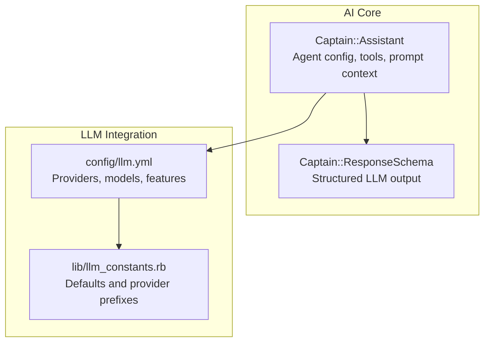
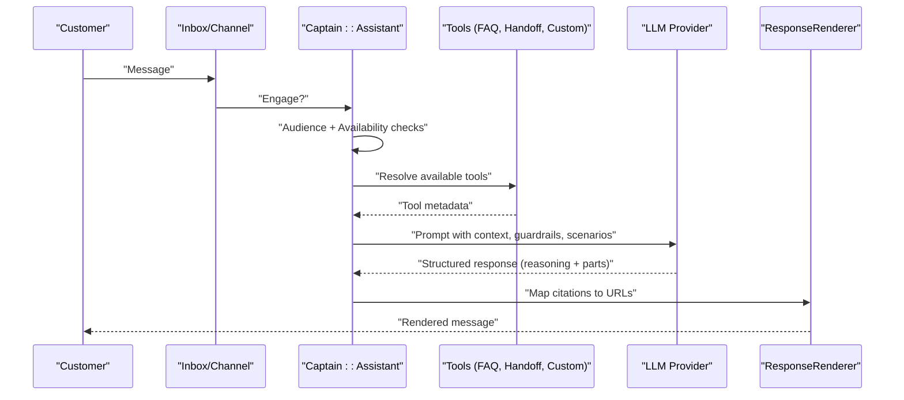
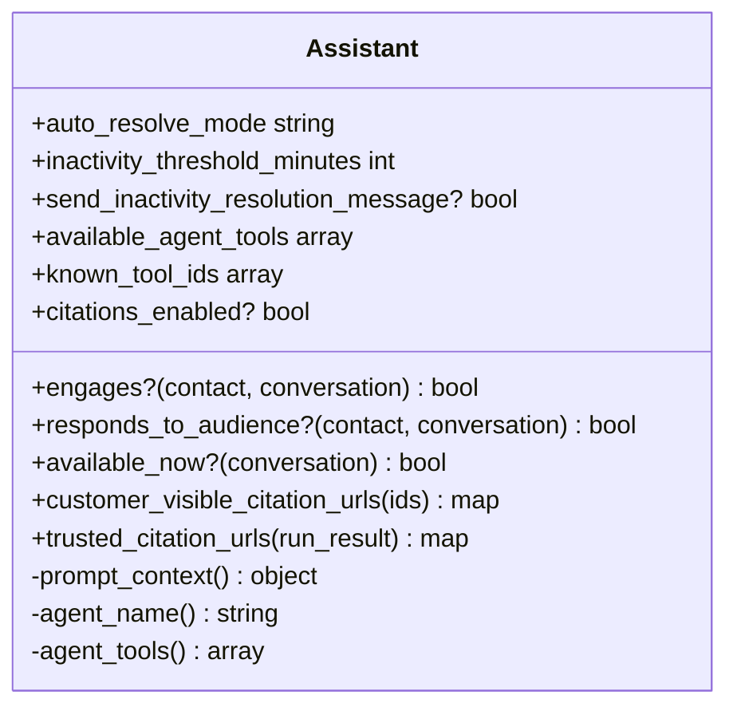
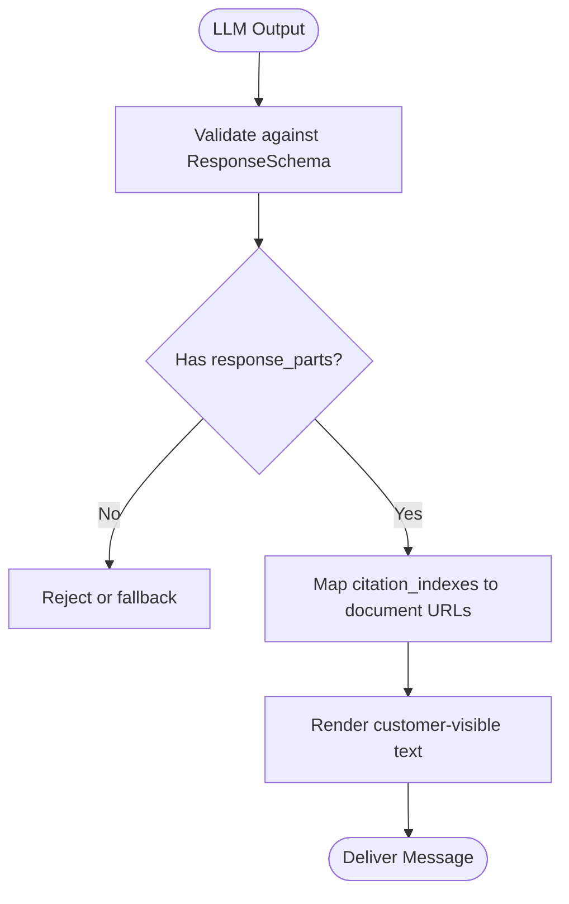
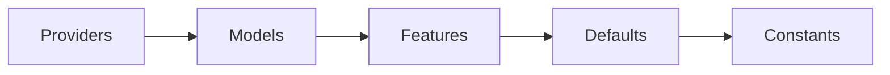
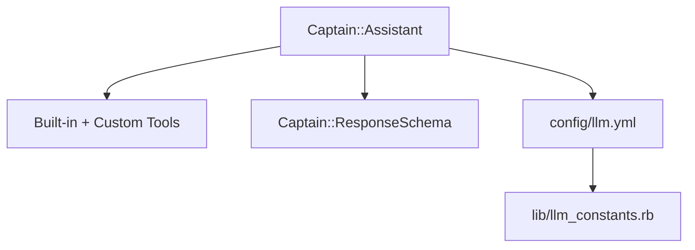

# AI & Automation

<cite>
**Referenced Files in This Document**
- [assistant.rb](file://enterprise/app/models/captain/assistant.rb)
- [response_schema.rb](file://enterprise/lib/captain/response_schema.rb)
- [llm.yml](file://config/llm.yml)
- [llm_constants.rb](file://lib/llm_constants.rb)
</cite>

## Table of Contents
1. [Introduction](#introduction)
2. [Project Structure](#project-structure)
3. [Core Components](#core-components)
4. [Architecture Overview](#architecture-overview)
5. [Detailed Component Analysis](#detailed-component-analysis)
6. [Dependency Analysis](#dependency-analysis)
7. [Performance Considerations](#performance-considerations)
8. [Troubleshooting Guide](#troubleshooting-guide)
9. [Conclusion](#conclusion)

## Introduction
This document explains Chatwoot’s AI-powered automation features centered on the Captain AI agent system. It covers the assistant architecture, natural language processing capabilities, automated response generation, integration with large language models (LLMs), prompt engineering and customization, automation rules for workflow orchestration, bot integration patterns, conversational flows, sentiment analysis and intent recognition, intelligent routing, configuration examples, performance optimization, cost management, and ethical considerations.

## Project Structure
The AI and automation capabilities are implemented across a small set of core components:
- Assistant model that defines agent behavior, tools, and prompt context
- Response schema that structures LLM outputs for consistent rendering and citation handling
- LLM provider and model configuration for selecting providers, models, and feature sets
- Constants for default models and provider prefixes

**Diagram sources**
- [assistant.rb:19-50](file://enterprise/app/models/captain/assistant.rb#L19-L50)
- [response_schema.rb:3-16](file://enterprise/lib/captain/response_schema.rb#L3-L16)
- [llm.yml:1-216](file://config/llm.yml#L1-L216)
- [llm_constants.rb:3-16](file://lib/llm_constants.rb#L3-L16)

**Section sources**
- [assistant.rb:19-50](file://enterprise/app/models/captain/assistant.rb#L19-L50)
- [response_schema.rb:3-16](file://enterprise/lib/captain/response_schema.rb#L3-L16)
- [llm.yml:1-216](file://config/llm.yml#L1-L216)
- [llm_constants.rb:3-16](file://lib/llm_constants.rb#L3-L16)

## Core Components
- Captain::Assistant: Defines the AI assistant entity, including audience targeting, availability windows, auto-resolve policies, tool composition, and prompt context passed to the LLM.
- Captain::ResponseSchema: Declares the structured JSON schema for LLM responses, ensuring consistent message parts and citation indexing.
- LLM Configuration: Centralizes provider definitions, model catalogs, per-feature model allowances, defaults, and credit multipliers for cost control.
- LLM Constants: Provides default model names and provider name prefixes used across the system.

Key responsibilities:
- Assistant orchestrates conversation flow, selects tools (FAQ lookup, handoff, custom tools), and composes prompts with guardrails and scenarios.
- ResponseSchema guarantees machine-readable, customer-safe outputs with reasoning and citation mapping.
- llm.yml enables flexible selection of providers and models per feature, supporting cost and performance tuning.

**Section sources**
- [assistant.rb:54-75](file://enterprise/app/models/captain/assistant.rb#L54-L75)
- [assistant.rb:83-101](file://enterprise/app/models/captain/assistant.rb#L83-L101)
- [assistant.rb:127-139](file://enterprise/app/models/captain/assistant.rb#L127-L139)
- [assistant.rb:202-230](file://enterprise/app/models/captain/assistant.rb#L202-L230)
- [response_schema.rb:3-16](file://enterprise/lib/captain/response_schema.rb#L3-L16)
- [llm.yml:1-216](file://config/llm.yml#L1-L216)
- [llm_constants.rb:3-16](file://lib/llm_constants.rb#L3-L16)

## Architecture Overview
The Captain AI system integrates with multiple LLM providers through a centralized configuration. The Assistant composes prompts using built-in and custom tools, enforces guardrails, and produces structured responses aligned with the ResponseSchema. Features like FAQ matching, translation, and content generation select appropriate models from llm.yml based on capability and cost.

**Diagram sources**
- [assistant.rb:83-101](file://enterprise/app/models/captain/assistant.rb#L83-L101)
- [assistant.rb:127-139](file://enterprise/app/models/captain/assistant.rb#L127-L139)
- [assistant.rb:202-230](file://enterprise/app/models/captain/assistant.rb#L202-L230)
- [response_schema.rb:3-16](file://enterprise/lib/captain/response_schema.rb#L3-L16)
- [llm.yml:70-216](file://config/llm.yml#L70-L216)

## Detailed Component Analysis

### Captain::Assistant
Responsibilities:
- Audience targeting and availability gating
- Auto-resolve policy and inactivity thresholds
- Tool composition (built-in and custom)
- Prompt context assembly (name, description, product name, scenarios, guidelines, guardrails)
- Citation URL resolution for customer-facing links

**Diagram sources**
- [assistant.rb:83-101](file://enterprise/app/models/captain/assistant.rb#L83-L101)
- [assistant.rb:103-125](file://enterprise/app/models/captain/assistant.rb#L103-L125)
- [assistant.rb:127-139](file://enterprise/app/models/captain/assistant.rb#L127-L139)
- [assistant.rb:149-166](file://enterprise/app/models/captain/assistant.rb#L149-L166)
- [assistant.rb:202-230](file://enterprise/app/models/captain/assistant.rb#L202-L230)

**Section sources**
- [assistant.rb:54-75](file://enterprise/app/models/captain/assistant.rb#L54-L75)
- [assistant.rb:83-101](file://enterprise/app/models/captain/assistant.rb#L83-L101)
- [assistant.rb:103-125](file://enterprise/app/models/captain/assistant.rb#L103-L125)
- [assistant.rb:127-139](file://enterprise/app/models/captain/assistant.rb#L127-L139)
- [assistant.rb:149-166](file://enterprise/app/models/captain/assistant.rb#L149-L166)
- [assistant.rb:202-230](file://enterprise/app/models/captain/assistant.rb#L202-L230)

### Captain::ResponseSchema
Purpose:
- Enforce a strict JSON structure for LLM outputs containing reasoning and ordered response parts
- Support citation indexes that map to knowledge base documents for transparent sourcing

**Diagram sources**
- [response_schema.rb:3-16](file://enterprise/lib/captain/response_schema.rb#L3-L16)
- [assistant.rb:149-166](file://enterprise/app/models/captain/assistant.rb#L149-L166)

**Section sources**
- [response_schema.rb:3-16](file://enterprise/lib/captain/response_schema.rb#L3-L16)
- [assistant.rb:149-166](file://enterprise/app/models/captain/assistant.rb#L149-L166)

### LLM Configuration and Model Selection
- Providers: OpenAI, Anthropic, Gemini
- Models: Multiple variants per provider with display names and credit multipliers
- Features: Feature-specific model allowlists and defaults (assistant, copilot, editor, FAQ generation, translation, transcription, etc.)
- Defaults: Global defaults for models and embeddings; provider prefixes for identification

**Diagram sources**
- [llm.yml:1-216](file://config/llm.yml#L1-L216)
- [llm_constants.rb:3-16](file://lib/llm_constants.rb#L3-L16)

**Section sources**
- [llm.yml:1-216](file://config/llm.yml#L1-L216)
- [llm_constants.rb:3-16](file://lib/llm_constants.rb#L3-L16)

## Dependency Analysis
- Assistant depends on:
  - Tools (FAQ lookup, handoff, custom tools)
  - Scenarios and guardrails for conditional logic and safety
  - ResponseSchema for structured outputs
  - LLM configuration for model/provider selection
- LLM configuration depends on:
  - Provider definitions and model catalogs
  - Feature flags and defaults
  - Constants for default models and provider naming

**Diagram sources**
- [assistant.rb:127-139](file://enterprise/app/models/captain/assistant.rb#L127-L139)
- [assistant.rb:202-230](file://enterprise/app/models/captain/assistant.rb#L202-L230)
- [response_schema.rb:3-16](file://enterprise/lib/captain/response_schema.rb#L3-L16)
- [llm.yml:1-216](file://config/llm.yml#L1-L216)
- [llm_constants.rb:3-16](file://lib/llm_constants.rb#L3-L16)

**Section sources**
- [assistant.rb:127-139](file://enterprise/app/models/captain/assistant.rb#L127-L139)
- [assistant.rb:202-230](file://enterprise/app/models/captain/assistant.rb#L202-L230)
- [response_schema.rb:3-16](file://enterprise/lib/captain/response_schema.rb#L3-L16)
- [llm.yml:1-216](file://config/llm.yml#L1-L216)
- [llm_constants.rb:3-16](file://lib/llm_constants.rb#L3-L16)

## Performance Considerations
- Model selection by feature: Use lighter models for high-volume tasks (e.g., classification, translation) and stronger models for complex reasoning.
- Credit multipliers: Configure models with lower credit multipliers where possible to reduce costs without sacrificing quality.
- Temperature and reasoning effort: Adjust temperature and reasoning effort per feature to balance creativity and determinism.
- Caching and batching: Cache frequent FAQ lookups and reuse context where safe to reduce API calls.
- Timeouts and retries: Implement robust retry policies with exponential backoff for external LLM calls.
- Monitoring: Track latency, token usage, error rates, and cost per feature/model to optimize resource allocation.

[No sources needed since this section provides general guidance]

## Troubleshooting Guide
Common issues and resolutions:
- Invalid response window: Ensure response_window is one of the allowed values; otherwise validation will fail.
- Missing citations: Verify citations_enabled and trusted_citation_urls mapping to ensure document IDs resolve to valid URLs.
- Tool resolution failures: Confirm custom tools are enabled and correctly registered; check known_tool_ids vs available_tool_ids.
- Model not available for feature: Check llm.yml feature allowlist and default model; switch to an allowed model if necessary.

Operational checks:
- Validate assistant configuration fields (name, description, account_id).
- Inspect auto_resolve_mode and inactivity thresholds to prevent unintended conversation closures.
- Review guardrails and response_guidelines to avoid unsafe or off-topic outputs.

**Section sources**
- [assistant.rb:60-73](file://enterprise/app/models/captain/assistant.rb#L60-L73)
- [assistant.rb:189-194](file://enterprise/app/models/captain/assistant.rb#L189-L194)
- [assistant.rb:149-166](file://enterprise/app/models/captain/assistant.rb#L149-L166)
- [assistant.rb:127-139](file://enterprise/app/models/captain/assistant.rb#L127-L139)
- [llm.yml:70-216](file://config/llm.yml#L70-L216)

## Conclusion
Chatwoot’s Captain AI system provides a robust foundation for AI-driven automation. The Assistant model encapsulates agent behavior, tool composition, and prompt context, while ResponseSchema ensures reliable, citable outputs. Centralized LLM configuration enables flexible model selection, cost control, and feature-specific optimizations. By combining these components with thoughtful automation rules, bot integrations, and ethical safeguards, teams can deliver intelligent, scalable, and responsible conversational experiences.

[No sources needed since this section summarizes without analyzing specific files]