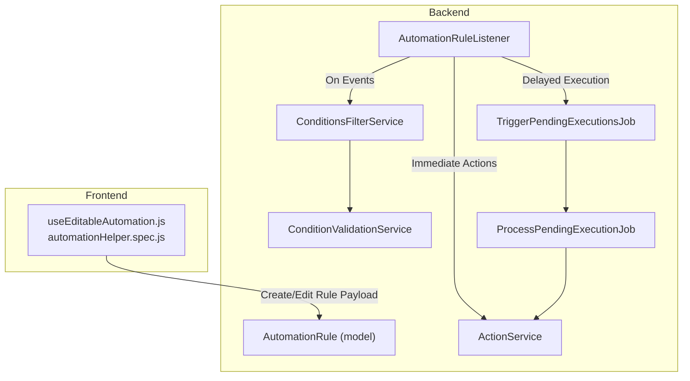
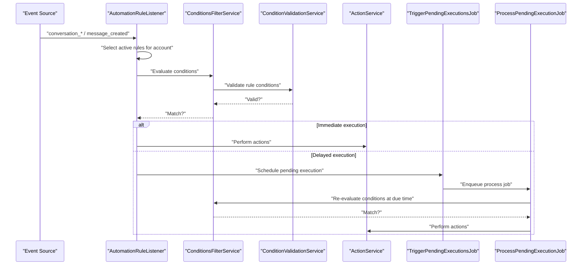
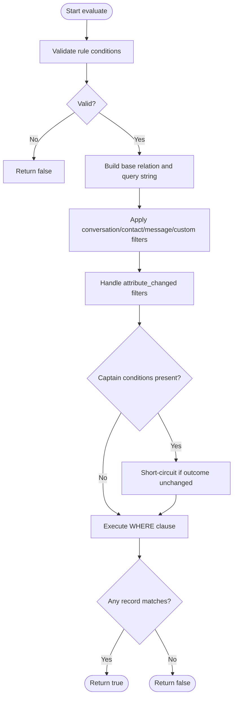
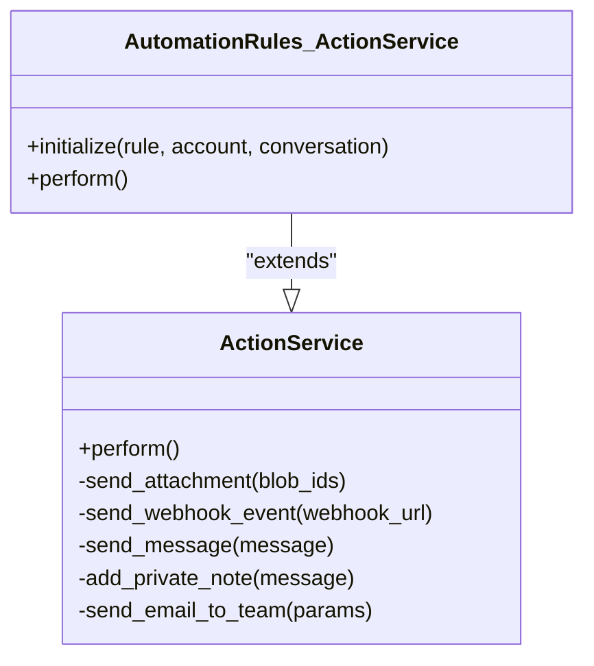
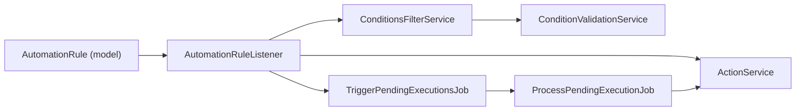

# Automation Rules Engine

<cite>
**Referenced Files in This Document**
- [automation_rule.rb](file://app/models/automation_rule.rb)
- [automation_rule_listener.rb](file://app/listeners/automation_rule_listener.rb)
- [conditions_filter_service.rb](file://app/services/automation_rules/conditions_filter_service.rb)
- [condition_validation_service.rb](file://app/services/automation_rules/condition_validation_service.rb)
- [action_service.rb](file://app/services/automation_rules/action_service.rb)
- [trigger_pending_executions_job.rb](file://app/jobs/automation_rules/trigger_pending_executions_job.rb)
- [process_pending_execution_job.rb](file://app/jobs/automation_rules/process_pending_execution_job.rb)
- [useEditableAutomation.js](file://app/javascript/dashboard/composables/useEditableAutomation.js)
- [automationHelper.spec.js](file://app/javascript/dashboard/helper/specs/automationHelper.spec.js)
</cite>

## Table of Contents
1. [Introduction](#introduction)
2. [Project Structure](#project-structure)
3. [Core Components](#core-components)
4. [Architecture Overview](#architecture-overview)
5. [Detailed Component Analysis](#detailed-component-analysis)
6. [Dependency Analysis](#dependency-analysis)
7. [Performance Considerations](#performance-considerations)
8. [Troubleshooting Guide](#troubleshooting-guide)
9. [Conclusion](#conclusion)
10. [Appendices](#appendices)

## Introduction
This document explains Chatwoot’s automation rules engine: how rules are created and edited, how conditions are evaluated, and how actions are executed. It covers trigger types, condition operators, available actions, rule prioritization and execution order, error handling, testing and debugging, performance considerations, and best practices for organizing complex rule sets.

## Project Structure
The automation rules engine spans models, listeners, services, jobs, and frontend composables:

- Model: persistence and validation of rules
- Listener: event-driven entry points for conversation and message events
- Services: condition evaluation and action execution
- Jobs: scheduling and processing delayed executions
- Frontend: rule creation UI helpers and payload serialization

**Diagram sources**
- [automation_rule.rb:24-48](file://app/models/automation_rule.rb#L24-L48)
- [automation_rule_listener.rb:1-109](file://app/listeners/automation_rule_listener.rb#L1-L109)
- [conditions_filter_service.rb:1-215](file://app/services/automation_rules/conditions_filter_service.rb#L1-L215)
- [condition_validation_service.rb:1-69](file://app/services/automation_rules/condition_validation_service.rb#L1-L69)
- [action_service.rb:1-66](file://app/services/automation_rules/action_service.rb#L1-L66)
- [trigger_pending_executions_job.rb:1-29](file://app/jobs/automation_rules/trigger_pending_executions_job.rb#L1-L29)
- [process_pending_execution_job.rb:1-64](file://app/jobs/automation_rules/process_pending_execution_job.rb#L1-L64)
- [useEditableAutomation.js:35-79](file://app/javascript/dashboard/composables/useEditableAutomation.js#L35-L79)
- [automationHelper.spec.js:342-388](file://app/javascript/dashboard/helper/specs/automationHelper.spec.js#L342-L388)

**Section sources**
- [automation_rule.rb:24-48](file://app/models/automation_rule.rb#L24-L48)
- [automation_rule_listener.rb:1-109](file://app/listeners/automation_rule_listener.rb#L1-L109)
- [conditions_filter_service.rb:1-215](file://app/services/automation_rules/conditions_filter_service.rb#L1-L215)
- [condition_validation_service.rb:1-69](file://app/services/automation_rules/condition_validation_service.rb#L1-L69)
- [action_service.rb:1-66](file://app/services/automation_rules/action_service.rb#L1-L66)
- [trigger_pending_executions_job.rb:1-29](file://app/jobs/automation_rules/trigger_pending_executions_job.rb#L1-L29)
- [process_pending_execution_job.rb:1-64](file://app/jobs/automation_rules/process_pending_execution_job.rb#L1-L64)
- [useEditableAutomation.js:35-79](file://app/javascript/dashboard/composables/useEditableAutomation.js#L35-L79)
- [automationHelper.spec.js:342-388](file://app/javascript/dashboard/helper/specs/automationHelper.spec.js#L342-L388)

## Core Components
- AutomationRule model: stores rule metadata, validates JSON structures, enforces supported attributes/operators, and manages delayed execution constraints.
- AutomationRuleListener: subscribes to system events (conversation_created/updated/opened/resolved, message_created), filters active rules per account, evaluates conditions, and either executes actions immediately or schedules delayed execution.
- ConditionsFilterService: builds SQL-like predicates from rule conditions across conversations, contacts, messages, and custom attributes; integrates with Captain classifier conditions; supports attribute_changed filtering.
- ConditionValidationService: validates that each condition uses a supported attribute key and operator, including special cases like attribute_changed and Captain-specific operators.
- ActionService: dispatches configured actions (send_message, add/remove labels, assign/unassign teams/agents, send_email_to_team, send_webhook_event, status/priority changes, notes, attachments).
- Pending execution jobs: TriggerPendingExecutionsJob sweeps eligible pending rows; ProcessPendingExecutionJob claims, re-validates, and executes them safely.

Key responsibilities:
- Rule creation/editing: enforced by model validations and frontend helpers.
- Event ingestion: listener routes events to the correct evaluation path.
- Condition evaluation: service composes queries and optional AI-based checks.
- Action execution: service invokes concrete actions with error isolation.
- Delayed execution: job pipeline ensures safe, idempotent execution at due time.

**Section sources**
- [automation_rule.rb:24-48](file://app/models/automation_rule.rb#L24-L48)
- [automation_rule_listener.rb:1-109](file://app/listeners/automation_rule_listener.rb#L1-L109)
- [conditions_filter_service.rb:1-215](file://app/services/automation_rules/conditions_filter_service.rb#L1-L215)
- [condition_validation_service.rb:1-69](file://app/services/automation_rules/condition_validation_service.rb#L1-L69)
- [action_service.rb:1-66](file://app/services/automation_rules/action_service.rb#L1-L66)
- [trigger_pending_executions_job.rb:1-29](file://app/jobs/automation_rules/trigger_pending_executions_job.rb#L1-L29)
- [process_pending_execution_job.rb:1-64](file://app/jobs/automation_rules/process_pending_execution_job.rb#L1-L64)

## Architecture Overview
The automation rules engine is event-driven. When an event occurs, the listener finds matching active rules for the account, evaluates their conditions, and either executes actions immediately or arms a delayed execution.

**Diagram sources**
- [automation_rule_listener.rb:1-109](file://app/listeners/automation_rule_listener.rb#L1-L109)
- [conditions_filter_service.rb:1-215](file://app/services/automation_rules/conditions_filter_service.rb#L1-L215)
- [condition_validation_service.rb:1-69](file://app/services/automation_rules/condition_validation_service.rb#L1-L69)
- [action_service.rb:1-66](file://app/services/automation_rules/action_service.rb#L1-L66)
- [trigger_pending_executions_job.rb:1-29](file://app/jobs/automation_rules/trigger_pending_executions_job.rb#L1-L29)
- [process_pending_execution_job.rb:1-64](file://app/jobs/automation_rules/process_pending_execution_job.rb#L1-L64)

## Detailed Component Analysis

### Rule Creation Interface
- The frontend composable normalizes conditions into a consistent structure, including query_operator defaults and value formatting for different input types.
- Test specs demonstrate serializing payloads with multiple AND conditions and standard action definitions.

Key behaviors:
- Default query_operator set to 'and' when missing.
- Values normalized based on input type (plain_text, long_text, date, multi_text, search_select).
- Payload includes name, description, event_name, execution_delay, conditions array, and actions array.

Practical example references:
- Serializing a delayed customer follow-up with multiple AND conditions and a send_message action.

**Section sources**
- [useEditableAutomation.js:35-79](file://app/javascript/dashboard/composables/useEditableAutomation.js#L35-L79)
- [automationHelper.spec.js:342-388](file://app/javascript/dashboard/helper/specs/automationHelper.spec.js#L342-L388)

### Condition Evaluation Logic
- Validation: ConditionValidationService ensures attribute_key and filter_operator combinations are supported, including special handling for attribute_changed and Captain-specific operators.
- Filtering: ConditionsFilterService constructs base relations over conversations, contacts, and messages, applies filters, and handles attribute_changed semantics. It also integrates Captain classifier conditions and supports starts_with prefix matching.

Important details:
- Query operators must be AND or OR; validated both at model level and service level.
- Starts_with operator is transformed to LIKE with trailing wildcard.
- Attribute_changed filters intersect/union records based on query_operator semantics.
- Captain conditions are short-circuited when they cannot affect the outcome.

**Diagram sources**
- [condition_validation_service.rb:16-22](file://app/services/automation_rules/condition_validation_service.rb#L16-L22)
- [conditions_filter_service.rb:28-42](file://app/services/automation_rules/conditions_filter_service.rb#L28-L42)
- [conditions_filter_service.rb:52-78](file://app/services/automation_rules/conditions_filter_service.rb#L52-L78)
- [conditions_filter_service.rb:81-109](file://app/services/automation_rules/conditions_filter_service.rb#L81-L109)
- [conditions_filter_service.rb:179-195](file://app/services/automation_rules/conditions_filter_service.rb#L179-L195)

**Section sources**
- [condition_validation_service.rb:16-22](file://app/services/automation_rules/condition_validation_service.rb#L16-L22)
- [conditions_filter_service.rb:28-42](file://app/services/automation_rules/conditions_filter_service.rb#L28-L42)
- [conditions_filter_service.rb:52-78](file://app/services/automation_rules/conditions_filter_service.rb#L52-L78)
- [conditions_filter_service.rb:81-109](file://app/services/automation_rules/conditions_filter_service.rb#L81-L109)
- [conditions_filter_service.rb:179-195](file://app/services/automation_rules/conditions_filter_service.rb#L179-L195)

### Action Execution Framework
- ActionService iterates through configured actions, invoking methods dynamically by action_name. Each action is isolated with try/catch to prevent one failing action from blocking others.
- Supported actions include sending messages, adding/removing labels, assigning/unassigning teams/agents, sending emails to teams, sending webhooks, changing status/priority, snoozing, resolving/opening conversations, and adding private notes.
- Some actions are channel-aware (e.g., tweet conversations skip certain actions).

**Diagram sources**
- [action_service.rb:1-66](file://app/services/automation_rules/action_service.rb#L1-L66)

**Section sources**
- [action_service.rb:1-66](file://app/services/automation_rules/action_service.rb#L1-L66)

### Trigger Types
Supported event triggers:
- Conversation-level: conversation_created, conversation_updated, conversation_opened, conversation_resolved
- Message-level: message_created

Behavioral notes:
- Auto-reply and automation-generated events are ignored to avoid loops.
- For conversation_created, delayed rules can arm via conversation_updated path to ensure consistent episode keying.

**Section sources**
- [automation_rule_listener.rb:1-109](file://app/listeners/automation_rule_listener.rb#L1-L109)

### Condition Operators and Attributes
- Query operators: AND, OR (validated at model and service levels).
- Filter operators: depend on attribute category; includes starts_with, equality, presence checks, and attribute_changed.
- Supported attribute keys:
  - Conversation fields: content, email, country_code, status, browser_language, referer, city, company_name, inbox_id, phone_number, priority, conversation_language, labels, private_note, assignee_id, team_id.
  - Message fields: content, private_note.
  - Contact fields: additional_attributes and standard contact fields.
  - Custom attributes: defined per account with attribute_model support.
- Special operators:
  - attribute_changed: compares from/to values for mutable attributes.
  - Captain classifier: detects/does_not_detect with single description value.

**Section sources**
- [automation_rule.rb:55-65](file://app/models/automation_rule.rb#L55-L65)
- [automation_rule.rb:83-90](file://app/models/automation_rule.rb#L83-L90)
- [automation_rule.rb:102-131](file://app/models/automation_rule.rb#L102-L131)
- [condition_validation_service.rb:35-67](file://app/services/automation_rules/condition_validation_service.rb#L35-L67)
- [conditions_filter_service.rb:52-78](file://app/services/automation_rules/conditions_filter_service.rb#L52-L78)
- [conditions_filter_service.rb:81-109](file://app/services/automation_rules/conditions_filter_service.rb#L81-L109)

### Available Actions
- send_message
- add_label, remove_label
- send_email_to_team
- assign_team, assign_agent, remove_assigned_agent, remove_assigned_team
- send_webhook_event
- mute_conversation
- change_status, resolve_conversation, open_conversation, pending_conversation, snooze_conversation
- change_priority
- send_email_transcript
- add_private_note
- send_attachment

**Section sources**
- [automation_rule.rb:60-65](file://app/models/automation_rule.rb#L60-L65)
- [action_service.rb:25-64](file://app/services/automation_rules/action_service.rb#L25-L64)

### Rule Prioritization and Execution Order
- Rules are selected by event_name and account, then filtered by active status.
- No explicit priority field exists; iteration order follows database retrieval order. To influence order, use execution_delay to stage effects or compose conditions to narrow scope.
- For conversation_created, delayed rules armed via conversation_updated are included alongside direct conversation_created rules.

**Section sources**
- [automation_rule_listener.rb:82-94](file://app/listeners/automation_rule_listener.rb#L82-L94)
- [automation_rule_listener.rb:62-67](file://app/listeners/automation_rule_listener.rb#L62-L67)

### Error Handling Mechanisms
- Model validations reject unsupported attributes/operators and enforce query_operator values.
- Condition evaluation catches exceptions and logs errors, returning false to avoid unintended actions.
- Action execution isolates each action’s failure and tracks exceptions without halting subsequent actions.
- Delayed execution jobs handle deserialization errors, claim concurrency, and mark rows appropriately (skipped/executing/executed).

**Section sources**
- [automation_rule.rb:83-90](file://app/models/automation_rule.rb#L83-L90)
- [automation_rule.rb:142-155](file://app/models/automation_rule.rb#L142-L155)
- [conditions_filter_service.rb:28-42](file://app/services/automation_rules/conditions_filter_service.rb#L28-L42)
- [action_service.rb:9-21](file://app/services/automation_rules/action_service.rb#L9-L21)
- [process_pending_execution_job.rb:1-64](file://app/jobs/automation_rules/process_pending_execution_job.rb#L1-L64)

### Practical Automation Scenarios
- Auto-assignment:
  - Trigger: conversation_created or message_created
  - Conditions: inbox_id equals specific inbox; status equals pending; labels absent
  - Action: assign_agent or assign_team
- Label application:
  - Trigger: message_created
  - Conditions: content contains keywords; private_note is false
  - Action: add_label
- Notification triggers:
  - Trigger: conversation_created
  - Conditions: priority equals high; assignee_id is not present
  - Action: send_email_to_team with a message

These scenarios align with the payload structure and supported attributes/actions documented above.

**Section sources**
- [automation_rule.rb:55-65](file://app/models/automation_rule.rb#L55-L65)
- [automation_rule.rb:60-65](file://app/models/automation_rule.rb#L60-L65)
- [automationHelper.spec.js:342-388](file://app/javascript/dashboard/helper/specs/automationHelper.spec.js#L342-L388)

### Rule Testing and Debugging
- Frontend tests validate payload serialization for complex AND conditions and action arrays.
- Backend logging:
  - Condition validation failures are logged.
  - Exception tracking captures errors during condition evaluation and action execution.
  - Pending execution sweep logs summary metrics (enqueued, capped, purged, abandoned, duration).

Debugging tips:
- Inspect rule conditions and query_operator values.
- Verify attribute_key and filter_operator combinations against supported lists.
- Check feature flags (delayed_automations, captain classifier) when applicable.
- Review exception tracker entries for failed actions.

**Section sources**
- [automationHelper.spec.js:342-388](file://app/javascript/dashboard/helper/specs/automationHelper.spec.js#L342-L388)
- [conditions_filter_service.rb:28-42](file://app/services/automation_rules/conditions_filter_service.rb#L28-L42)
- [action_service.rb:9-21](file://app/services/automation_rules/action_service.rb#L9-L21)
- [trigger_pending_executions_job.rb:23-27](file://app/jobs/automation_rules/trigger_pending_executions_job.rb#L23-L27)

## Dependency Analysis

**Diagram sources**
- [automation_rule.rb:24-48](file://app/models/automation_rule.rb#L24-L48)
- [automation_rule_listener.rb:1-109](file://app/listeners/automation_rule_listener.rb#L1-L109)
- [conditions_filter_service.rb:1-215](file://app/services/automation_rules/conditions_filter_service.rb#L1-L215)
- [condition_validation_service.rb:1-69](file://app/services/automation_rules/condition_validation_service.rb#L1-L69)
- [action_service.rb:1-66](file://app/services/automation_rules/action_service.rb#L1-L66)
- [trigger_pending_executions_job.rb:1-29](file://app/jobs/automation_rules/trigger_pending_executions_job.rb#L1-L29)
- [process_pending_execution_job.rb:1-64](file://app/jobs/automation_rules/process_pending_execution_job.rb#L1-L64)

**Section sources**
- [automation_rule.rb:24-48](file://app/models/automation_rule.rb#L24-L48)
- [automation_rule_listener.rb:1-109](file://app/listeners/automation_rule_listener.rb#L1-L109)
- [conditions_filter_service.rb:1-215](file://app/services/automation_rules/conditions_filter_service.rb#L1-L215)
- [condition_validation_service.rb:1-69](file://app/services/automation_rules/condition_validation_service.rb#L1-L69)
- [action_service.rb:1-66](file://app/services/automation_rules/action_service.rb#L1-L66)
- [trigger_pending_executions_job.rb:1-29](file://app/jobs/automation_rules/trigger_pending_executions_job.rb#L1-L29)
- [process_pending_execution_job.rb:1-64](file://app/jobs/automation_rules/process_pending_execution_job.rb#L1-L64)

## Performance Considerations
- Keep conditions selective: prefer exact matches (inbox_id, status) and avoid broad text searches where possible.
- Use starts_with judiciously; it expands to LIKE patterns which can impact index usage.
- Limit the number of rules per account and event to reduce evaluation overhead.
- Prefer immediate actions for simple flows; use delayed execution only when necessary due to extra scheduling and re-validation costs.
- Monitor pending execution sweep limits and purge terminal rows regularly to keep queues lean.
- Avoid chaining many heavy actions; isolate expensive operations and leverage rate limiting (e.g., email rate limits).

[No sources needed since this section provides general guidance]

## Troubleshooting Guide
Common issues and resolutions:
- Unsupported attribute_key or filter_operator:
  - Ensure attribute_key is among supported conversation/contact/message fields or a valid custom attribute definition.
  - Confirm filter_operator is allowed for the attribute category.
- Invalid query_operator:
  - Must be AND or OR; check normalization in frontend and backend validations.
- Captain conditions errors:
  - Feature flag required; operator must be detects/does_not_detect; exactly one description value with length limit.
- Delayed execution not firing:
  - Verify feature flag delayed_automations is enabled.
  - Check that conditions still match at due time and episode has not moved.
- Action failures:
  - Inspect exception tracker entries; some actions are skipped for certain channels (e.g., tweets).

Operational checks:
- Review logs from conditions evaluation and action execution.
- Inspect pending execution sweep summaries for anomalies.

**Section sources**
- [automation_rule.rb:83-90](file://app/models/automation_rule.rb#L83-L90)
- [automation_rule.rb:102-131](file://app/models/automation_rule.rb#L102-L131)
- [conditions_filter_service.rb:28-42](file://app/services/automation_rules/conditions_filter_service.rb#L28-L42)
- [action_service.rb:9-21](file://app/services/automation_rules/action_service.rb#L9-L21)
- [trigger_pending_executions_job.rb:23-27](file://app/jobs/automation_rules/trigger_pending_executions_job.rb#L23-L27)

## Conclusion
Chatwoot’s automation rules engine provides a robust, event-driven framework for automating workflows around conversations and messages. With clear validation, flexible condition evaluation, and resilient action execution, it supports common scenarios like auto-assignment, labeling, and notifications. Proper organization of rules, careful selection of conditions, and mindful use of delayed execution help maintain performance and reliability.

[No sources needed since this section summarizes without analyzing specific files]

## Appendices

### Best Practices for Rule Organization
- Group related rules by business domain and tag descriptions accordingly.
- Use precise conditions to minimize cross-rule interference.
- Stage complex workflows using delayed execution to sequence outcomes predictably.
- Regularly review inactive rules and clean up stale pending executions.

[No sources needed since this section provides general guidance]