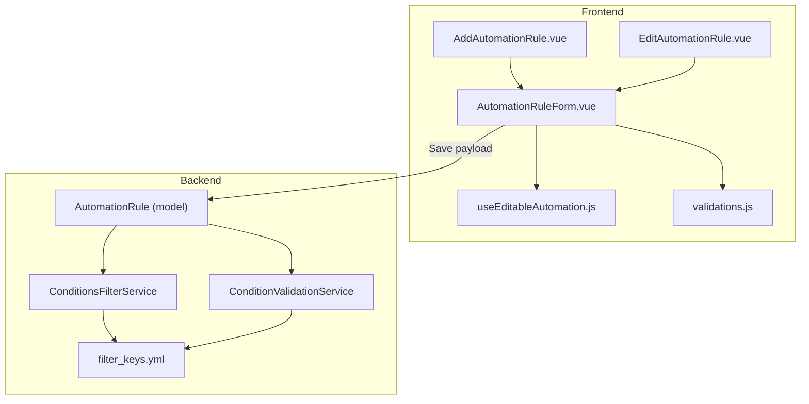
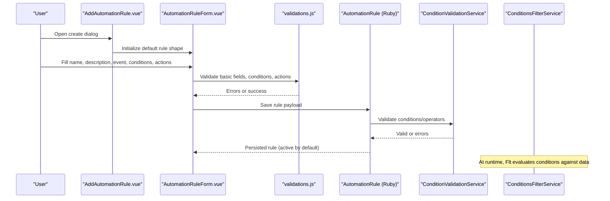
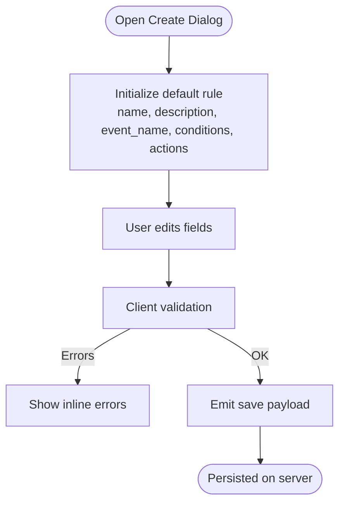
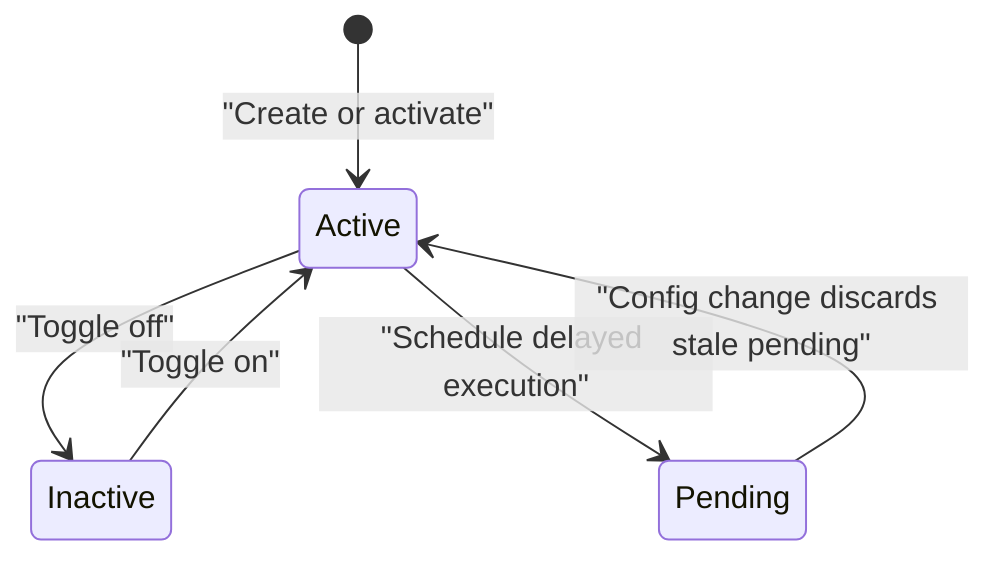
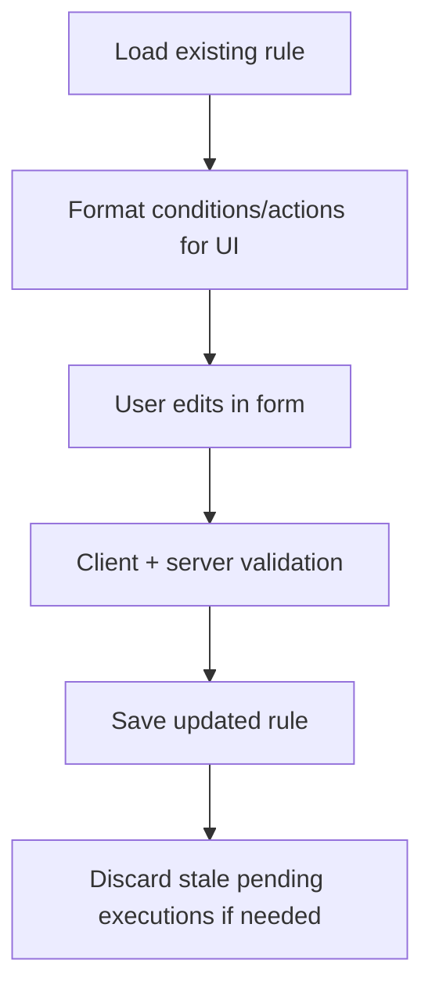
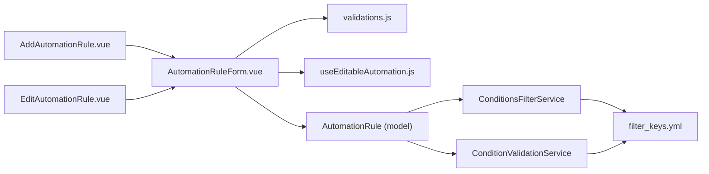

# Rule Creation Interface

<cite>
**Referenced Files in This Document**
- [automation_rule.rb](file://app/models/automation_rule.rb)
- [condition_validation_service.rb](file://app/services/automation_rules/condition_validation_service.rb)
- [conditions_filter_service.rb](file://app/services/automation_rules/conditions_filter_service.rb)
- [filter_keys.yml](file://lib/filters/filter_keys.yml)
- [validations.js](file://app/javascript/dashboard/helper/validations.js)
- [AddAutomationRule.vue](file://app/javascript/dashboard/routes/dashboard/settings/automation/AddAutomationRule.vue)
- [EditAutomationRule.vue](file://app/javascript/dashboard/routes/dashboard/settings/automation/EditAutomationRule.vue)
- [useEditableAutomation.js](file://app/javascript/dashboard/composables/useEditableAutomation.js)
- [AutomationRuleForm.vue](file://app/javascript/dashboard/routes/dashboard/settings/automation/AutomationRuleForm.vue)
</cite>

## Table of Contents
1. [Introduction](#introduction)
2. [Project Structure](#project-structure)
3. [Core Components](#core-components)
4. [Architecture Overview](#architecture-overview)
5. [Detailed Component Analysis](#detailed-component-analysis)
6. [Dependency Analysis](#dependency-analysis)
7. [Performance Considerations](#performance-considerations)
8. [Troubleshooting Guide](#troubleshooting-guide)
9. [Conclusion](#conclusion)

## Introduction
This document explains Chatwoot’s automation rule creation interface and the backend logic that powers it. It covers the end-to-end workflow from form input to persistence, validation rules, supported conditions and actions, JSON schema requirements, activation toggling, account scoping, and practical examples with common pitfalls.

## Project Structure
The automation rule feature spans frontend Vue components, a shared validation helper, and backend Ruby services and models:

- Frontend entry points for creating and editing rules
- Shared validation utilities for conditions and actions
- Backend model defining schema, validations, and allowed attributes
- Services validating and executing conditions against conversations, contacts, and messages
- Filter configuration defining supported attribute keys and operators

**Diagram sources**
- [AddAutomationRule.vue:1-92](file://app/javascript/dashboard/routes/dashboard/settings/automation/AddAutomationRule.vue#L1-L92)
- [EditAutomationRule.vue:1-49](file://app/javascript/dashboard/routes/dashboard/settings/automation/EditAutomationRule.vue#L1-L49)
- [AutomationRuleForm.vue:28-83](file://app/javascript/dashboard/routes/dashboard/settings/automation/AutomationRuleForm.vue#L28-L83)
- [useEditableAutomation.js:1-37](file://app/javascript/dashboard/composables/useEditableAutomation.js#L1-L37)
- [validations.js:1-232](file://app/javascript/dashboard/helper/validations.js#L1-L232)
- [automation_rule.rb:24-201](file://app/models/automation_rule.rb#L24-L201)
- [condition_validation_service.rb:1-69](file://app/services/automation_rules/condition_validation_service.rb#L1-L69)
- [conditions_filter_service.rb:1-215](file://app/services/automation_rules/conditions_filter_service.rb#L1-L215)
- [filter_keys.yml:1-239](file://lib/filters/filter_keys.yml#L1-L239)

**Section sources**
- [AddAutomationRule.vue:1-92](file://app/javascript/dashboard/routes/dashboard/settings/automation/AddAutomationRule.vue#L1-L92)
- [EditAutomationRule.vue:1-49](file://app/javascript/dashboard/routes/dashboard/settings/automation/EditAutomationRule.vue#L1-L49)
- [AutomationRuleForm.vue:28-83](file://app/javascript/dashboard/routes/dashboard/settings/automation/AutomationRuleForm.vue#L28-L83)
- [useEditableAutomation.js:1-37](file://app/javascript/dashboard/composables/useEditableAutomation.js#L1-L37)
- [validations.js:1-232](file://app/javascript/dashboard/helper/validations.js#L1-L232)
- [automation_rule.rb:24-201](file://app/models/automation_rule.rb#L24-L201)
- [condition_validation_service.rb:1-69](file://app/services/automation_rules/condition_validation_service.rb#L1-L69)
- [conditions_filter_service.rb:1-215](file://app/services/automation_rules/conditions_filter_service.rb#L1-L215)
- [filter_keys.yml:1-239](file://lib/filters/filter_keys.yml#L1-L239)

## Core Components
- AutomationRule model: defines persisted fields, allowed condition/action attributes, and server-side validations.
- ConditionValidationService: validates each condition’s operator and attribute key against filter definitions or custom attributes.
- ConditionsFilterService: builds queries and evaluates whether a conversation matches the rule’s conditions at runtime.
- Frontend helpers: validate user inputs for basic fields, conditions, and actions before submission.

Key responsibilities:
- Form state initialization and event-driven updates
- Validation of required fields, operators, values, and action parameters
- Mapping between UI inputs and backend-supported attributes
- Execution-time evaluation of conditions including special cases like attribute changes and Captain AI conditions

**Section sources**
- [automation_rule.rb:24-201](file://app/models/automation_rule.rb#L24-L201)
- [condition_validation_service.rb:1-69](file://app/services/automation_rules/condition_validation_service.rb#L1-L69)
- [conditions_filter_service.rb:1-215](file://app/services/automation_rules/conditions_filter_service.rb#L1-L215)
- [validations.js:1-232](file://app/javascript/dashboard/helper/validations.js#L1-L232)

## Architecture Overview
The rule creation flow integrates UI, validation, persistence, and execution layers.

**Diagram sources**
- [AddAutomationRule.vue:1-92](file://app/javascript/dashboard/routes/dashboard/settings/automation/AddAutomationRule.vue#L1-L92)
- [AutomationRuleForm.vue:28-83](file://app/javascript/dashboard/routes/dashboard/settings/automation/AutomationRuleForm.vue#L28-L83)
- [validations.js:1-232](file://app/javascript/dashboard/helper/validations.js#L1-L232)
- [automation_rule.rb:24-201](file://app/models/automation_rule.rb#L24-L201)
- [condition_validation_service.rb:1-69](file://app/services/automation_rules/condition_validation_service.rb#L1-L69)
- [conditions_filter_service.rb:1-215](file://app/services/automation_rules/conditions_filter_service.rb#L1-L215)

## Detailed Component Analysis

### Rule Creation Workflow
- The create dialog initializes a default rule object with:
  - Basic fields: name, description, event_name
  - Default event: conversation_created
  - One default condition and one default action
- When opening for monitor-based triggers, the dialog sets event_name to monitor_matched and clears conditions.
- On save, the form emits a payload containing the current automation state.

**Diagram sources**
- [AddAutomationRule.vue:1-92](file://app/javascript/dashboard/routes/dashboard/settings/automation/AddAutomationRule.vue#L1-L92)
- [AutomationRuleForm.vue:28-83](file://app/javascript/dashboard/routes/dashboard/settings/automation/AutomationRuleForm.vue#L28-L83)
- [validations.js:1-232](file://app/javascript/dashboard/helper/validations.js#L1-L232)

**Section sources**
- [AddAutomationRule.vue:1-92](file://app/javascript/dashboard/routes/dashboard/settings/automation/AddAutomationRule.vue#L1-L92)
- [AutomationRuleForm.vue:28-83](file://app/javascript/dashboard/routes/dashboard/settings/automation/AutomationRuleForm.vue#L28-L83)

### Form Validation Rules
- Required basic fields: name, description, event_name
- Conditions:
  - At least one condition is required except when event_name is monitor_matched
  - Each condition must have attribute_key and filter_operator
  - Most operators require values; is_present/is_not_present do not
  - days_before requires a value between 1 and 998
- Actions:
  - At least one action is required
  - Some actions do not require parameters; others require action_params array

Common error keys surfaced by the validator include:
- ATTRIBUTE_KEY_REQUIRED, FILTER_OPERATOR_REQUIRED, VALUE_REQUIRED, VALUE_MUST_BE_BETWEEN_1_AND_998, ACTION_PARAMETERS_REQUIRED, ATLEAST_ONE_CONDITION_REQUIRED, ATLEAST_ONE_ACTION_REQUIRED

**Section sources**
- [validations.js:1-232](file://app/javascript/dashboard/helper/validations.js#L1-L232)

### Data Structures and JSON Schema Requirements
- Rule-level fields:
  - name: string (required)
  - description: string (required)
  - event_name: string (required)
  - active: boolean (default true)
  - execution_delay: integer minutes (optional; validated range and constraints)
  - conditions: array of condition objects
  - actions: array of action objects
  - account_id: bigint (scoped per account)
  - monitor_id: bigint (optional; required for monitor_matched)
- Condition object:
  - attribute_key: string (must be supported or a valid custom attribute)
  - filter_operator: string (must be supported for the attribute)
  - values: any (required unless operator is is_present/is_not_present)
  - query_operator: string (optional; AND/OR for combining conditions)
  - custom_attribute_type: string (for custom attributes)
- Action object:
  - action_name: string (must be in allowed list)
  - action_params: array (required for most actions)

Allowed condition attribute keys are defined under conversations, contacts, and messages in filter_keys.yml. Allowed action names are enumerated in the model.

**Section sources**
- [automation_rule.rb:24-201](file://app/models/automation_rule.rb#L24-L201)
- [filter_keys.yml:1-239](file://lib/filters/filter_keys.yml#L1-L239)

### Supported Operators and Attribute Keys
- Conversation attributes include status, assignee_id, inbox_id, team_id, contact_id, priority, display_id, campaign_id, labels, browser_language, conversation_language, referer, created_at, last_activity_at, mail_subject.
- Contact attributes include name, phone_number, email, identifier, country_code, city, company_name, labels, created_at, last_activity_at, blocked.
- Message attributes include message_type, private_note, content.
- Common operators across attributes include equal_to, not_equal_to, contains, does_not_contain, is_present, is_not_present, is_greater_than, is_less_than, days_before, starts_with. Specific availability depends on the attribute definition.

**Section sources**
- [filter_keys.yml:1-239](file://lib/filters/filter_keys.yml#L1-L239)

### Rule Activation/Deactivation Toggle and Account Scoping
- active defaults to true; toggling deactivates or reactivates the rule.
- Changing active can affect pending executions; stale pending executions are discarded when execution configuration changes.
- Rules are scoped to an account via account_id; all operations are performed within the context of the authenticated account.

**Diagram sources**
- [automation_rule.rb:24-201](file://app/models/automation_rule.rb#L24-L201)

**Section sources**
- [automation_rule.rb:24-201](file://app/models/automation_rule.rb#L24-L201)

### Naming Conventions, Descriptions, and Metadata
- Name: concise, unique within the account; used for identification in lists and logs.
- Description: free-form text explaining the rule’s intent and scope.
- Event metadata: event_name indicates trigger type; monitor_id is required for monitor_matched events.
- Execution metadata: execution_delay specifies delay in minutes with constraints.

Best practices:
- Use descriptive names that reflect the trigger and primary outcome.
- Include context in descriptions (e.g., channels, teams, or business processes).
- Keep execution_delay within supported ranges and avoid unsupported condition combinations.

**Section sources**
- [automation_rule.rb:24-201](file://app/models/automation_rule.rb#L24-L201)
- [validations.js:1-232](file://app/javascript/dashboard/helper/validations.js#L1-L232)

### Practical Examples and Common Pitfalls

- Example types to consider:
  - Auto-assign new conversations based on inbox and language
  - Label conversations containing specific keywords in message content
  - Send email to team when priority is high and assignee is missing
  - Snooze or resolve conversations after a time delay with stable filters only

- Common pitfalls:
  - Missing required basic fields (name, description, event_name)
  - Using unsupported attribute_key or filter_operator for a given attribute
  - Omitting values for operators that require them
  - Providing invalid days_before values outside 1–998
  - Forgetting action_params for actions that require them
  - Using attribute_changed with execution_delay (not supported)
  - Using mutable attributes other than status/inbox_id with execution_delay on conversation-level events
  - Not providing monitor_id when event_name is monitor_matched

- Validation tips:
  - Ensure query_operator is AND or OR when combining multiple conditions
  - Confirm custom attributes exist in the account before referencing them
  - For Captain AI conditions, use supported operators and provide exactly one description value within length limits

**Section sources**
- [validations.js:1-232](file://app/javascript/dashboard/helper/validations.js#L1-L232)
- [automation_rule.rb:24-201](file://app/models/automation_rule.rb#L24-L201)
- [condition_validation_service.rb:1-69](file://app/services/automation_rules/condition_validation_service.rb#L1-L69)

### Editing Existing Rules
- The edit dialog formats existing rule data into the UI structure using composable helpers.
- Custom attributes are manifested with appropriate input types based on their definitions.
- Changes to conditions may trigger reauthorization flows and discard stale pending executions.

**Diagram sources**
- [EditAutomationRule.vue:1-49](file://app/javascript/dashboard/routes/dashboard/settings/automation/EditAutomationRule.vue#L1-L49)
- [useEditableAutomation.js:1-37](file://app/javascript/dashboard/composables/useEditableAutomation.js#L1-L37)
- [automation_rule.rb:24-201](file://app/models/automation_rule.rb#L24-L201)

**Section sources**
- [EditAutomationRule.vue:1-49](file://app/javascript/dashboard/routes/dashboard/settings/automation/EditAutomationRule.vue#L1-L49)
- [useEditableAutomation.js:1-37](file://app/javascript/dashboard/composables/useEditableAutomation.js#L1-L37)

## Dependency Analysis
The following diagram shows how components depend on each other during creation and evaluation.

**Diagram sources**
- [AddAutomationRule.vue:1-92](file://app/javascript/dashboard/routes/dashboard/settings/automation/AddAutomationRule.vue#L1-L92)
- [EditAutomationRule.vue:1-49](file://app/javascript/dashboard/routes/dashboard/settings/automation/EditAutomationRule.vue#L1-L49)
- [AutomationRuleForm.vue:28-83](file://app/javascript/dashboard/routes/dashboard/settings/automation/AutomationRuleForm.vue#L28-L83)
- [useEditableAutomation.js:1-37](file://app/javascript/dashboard/composables/useEditableAutomation.js#L1-L37)
- [validations.js:1-232](file://app/javascript/dashboard/helper/validations.js#L1-L232)
- [automation_rule.rb:24-201](file://app/models/automation_rule.rb#L24-L201)
- [condition_validation_service.rb:1-69](file://app/services/automation_rules/condition_validation_service.rb#L1-L69)
- [conditions_filter_service.rb:1-215](file://app/services/automation_rules/conditions_filter_service.rb#L1-L215)
- [filter_keys.yml:1-239](file://lib/filters/filter_keys.yml#L1-L239)

**Section sources**
- [automation_rule.rb:24-201](file://app/models/automation_rule.rb#L24-L201)
- [condition_validation_service.rb:1-69](file://app/services/automation_rules/condition_validation_service.rb#L1-L69)
- [conditions_filter_service.rb:1-215](file://app/services/automation_rules/conditions_filter_service.rb#L1-L215)
- [filter_keys.yml:1-239](file://lib/filters/filter_keys.yml#L1-L239)

## Performance Considerations
- Prefer stable filters (status, inbox_id) when using execution_delay to avoid unintended episode collapsing.
- Avoid attribute_changed conditions with execution_delay since they cannot be reliably reconstructed at fire time.
- Keep conditions minimal and precise to reduce query complexity.
- Use label presence checks where possible to leverage efficient indexing.

[No sources needed since this section provides general guidance]

## Troubleshooting Guide
- If saving fails due to unsupported attributes or operators:
  - Verify attribute_key exists in filter_keys.yml or is a valid custom attribute.
  - Ensure filter_operator is listed for that attribute.
- If conditions never match:
  - Check query_operator usage (AND/OR) and ensure values are correct.
  - Confirm custom_attribute_type aligns with the attribute’s model.
- If delayed rules do not run:
  - Ensure execution_delay is within the supported range.
  - Avoid attribute_changed conditions and non-stable attributes for conversation-level events.
- If monitor_matched rules fail:
  - Provide monitor_id when event_name is monitor_matched.

**Section sources**
- [automation_rule.rb:24-201](file://app/models/automation_rule.rb#L24-L201)
- [condition_validation_service.rb:1-69](file://app/services/automation_rules/condition_validation_service.rb#L1-L69)
- [conditions_filter_service.rb:1-215](file://app/services/automation_rules/conditions_filter_service.rb#L1-L215)
- [validations.js:1-232](file://app/javascript/dashboard/helper/validations.js#L1-L232)

## Conclusion
Chatwoot’s automation rule creation interface combines a guided UI with robust server-side validation and flexible condition evaluation. By adhering to the documented field requirements, supported operators, and best practices around delays and stability, users can build reliable automations that scale across accounts and workflows.