# Bot Integration

<cite>
**Referenced Files in This Document**
- [agent_bot.rb](file://app/models/agent_bot.rb)
- [agent_bot_inbox.rb](file://app/models/agent_bot_inbox.rb)
- [agent_bot_listener.rb](file://app/listeners/agent_bot_listener.rb)
- [webhook_job.rb](file://app/jobs/agent_bots/webhook_job.rb)
- [trigger.rb](file://lib/webhooks/trigger.rb)
- [conversation.rb](file://app/models/conversation.rb)
- [message.rb](file://app/models/message.rb)
- [bot_processor_service.rb](file://lib/integrations/bot_processor_service.rb)
- [webhook_secretable.rb](file://app/models/concerns/webhook_secretable.rb)
</cite>

## Table of Contents
1. [Introduction](#introduction)
2. [Project Structure](#project-structure)
3. [Core Components](#core-components)
4. [Architecture Overview](#architecture-overview)
5. [Detailed Component Analysis](#detailed-component-analysis)
6. [Dependency Analysis](#dependency-analysis)
7. [Performance Considerations](#performance-considerations)
8. [Troubleshooting Guide](#troubleshooting-guide)
9. [Conclusion](#conclusion)

## Introduction
This document explains Chatwoot’s bot integration capabilities with a focus on webhook-based bots, message routing, and conversation handling patterns. It covers supported bot frameworks (via webhooks), API integrations, real-time communication through events, authentication and security mechanisms, scaling strategies for high-volume interactions, and troubleshooting guidance.

## Project Structure
Chatwoot implements bot integrations primarily through:
- A model representing the external bot configuration and identity
- An association linking bots to inboxes
- Event listeners that dispatch webhook payloads when conversations or messages change
- Background jobs that deliver webhooks reliably
- A webhook trigger that signs requests and handles failures
- Conversation and message models that manage state and content suitable for bot processing

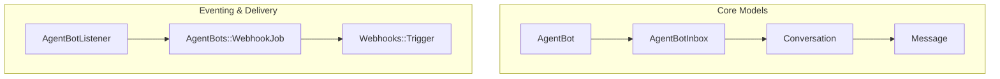

**Diagram sources**
- [agent_bot.rb:21-42](file://app/models/agent_bot.rb#L21-L42)
- [agent_bot_inbox.rb:14-23](file://app/models/agent_bot_inbox.rb#L14-L23)
- [conversation.rb:114-124](file://app/models/conversation.rb#L114-L124)
- [message.rb:132-135](file://app/models/message.rb#L132-L135)
- [agent_bot_listener.rb:1-90](file://app/listeners/agent_bot_listener.rb#L1-L90)
- [webhook_job.rb:1-17](file://app/jobs/agent_bots/webhook_job.rb#L1-L17)
- [trigger.rb:48-87](file://lib/webhooks/trigger.rb#L48-L87)

**Section sources**
- [agent_bot.rb:21-42](file://app/models/agent_bot.rb#L21-L42)
- [agent_bot_inbox.rb:14-23](file://app/models/agent_bot_inbox.rb#L14-L23)
- [agent_bot_listener.rb:1-90](file://app/listeners/agent_bot_listener.rb#L1-L90)
- [webhook_job.rb:1-17](file://app/jobs/agent_bots/webhook_job.rb#L1-L17)
- [trigger.rb:48-87](file://lib/webhooks/trigger.rb#L48-L87)

## Core Components
- AgentBot: Represents an external bot with an outgoing webhook URL and optional secret. It can be assigned as an AI assignee for conversations.
- AgentBotInbox: Associates an AgentBot with an inbox and enforces exclusivity against conflicting bot providers.
- AgentBotListener: Subscribes to conversation and message lifecycle events and dispatches webhook payloads to configured bots.
- AgentBots::WebhookJob: Delivers webhook payloads asynchronously with retries and failure handling.
- Webhooks::Trigger: Builds HTTP requests, adds HMAC signatures, and manages error handling including conversation status transitions.
- Conversation and Message: Provide context, state, and content for bot interactions; support structured content types and handoff flows.

**Section sources**
- [agent_bot.rb:21-73](file://app/models/agent_bot.rb#L21-L73)
- [agent_bot_inbox.rb:14-35](file://app/models/agent_bot_inbox.rb#L14-L35)
- [agent_bot_listener.rb:1-90](file://app/listeners/agent_bot_listener.rb#L1-L90)
- [webhook_job.rb:1-17](file://app/jobs/agent_bots/webhook_job.rb#L1-L17)
- [trigger.rb:48-87](file://lib/webhooks/trigger.rb#L48-L87)
- [conversation.rb:184-197](file://app/models/conversation.rb#L184-L197)
- [message.rb:88-116](file://app/models/message.rb#L88-L116)

## Architecture Overview
The bot architecture is event-driven and webhook-centric:
- Events: Conversation and message lifecycle events are emitted by core models.
- Listeners: AgentBotListener reacts to these events and selects the appropriate bot(s).
- Delivery: AgentBots::WebhookJob sends payloads to the bot’s outgoing URL using Webhooks::Trigger.
- Security: Optional HMAC signature and timestamp headers authenticate requests.
- Resilience: Retryable errors are handled, and failed deliveries can transition conversations back to open.

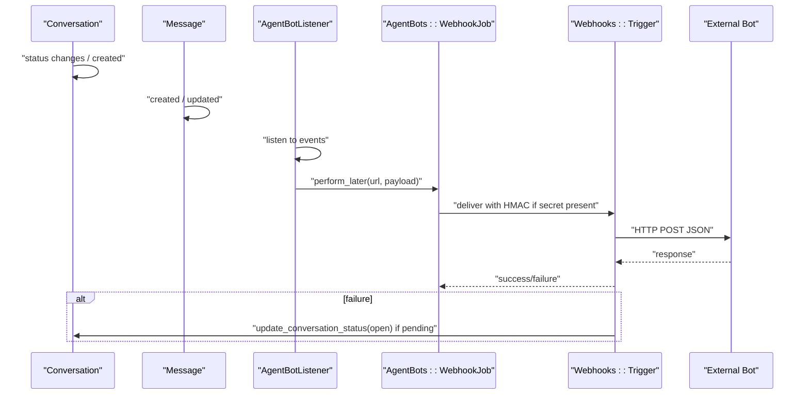

**Diagram sources**
- [agent_bot_listener.rb:36-89](file://app/listeners/agent_bot_listener.rb#L36-L89)
- [webhook_job.rb:10-15](file://app/jobs/agent_bots/webhook_job.rb#L10-L15)
- [trigger.rb:54-87](file://lib/webhooks/trigger.rb#L54-L87)
- [conversation.rb:184-197](file://app/models/conversation.rb#L184-L197)

## Detailed Component Analysis

### AgentBot Model
Responsibilities:
- Stores bot metadata, outgoing URL, and optional secret.
- Provides webhook_data for payloads.
- Supports assignment to conversations via polymorphic ai_assignee.

Key behaviors:
- Enumerates supported bot_type (webhook).
- Validates outgoing_url length.
- Exposes push_event_data for UI and webhook contexts.

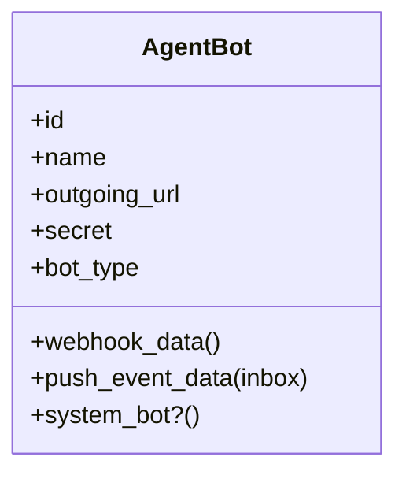

**Diagram sources**
- [agent_bot.rb:21-73](file://app/models/agent_bot.rb#L21-L73)

**Section sources**
- [agent_bot.rb:21-73](file://app/models/agent_bot.rb#L21-L73)

### AgentBotInbox Association
Responsibilities:
- Links an AgentBot to an Inbox.
- Enforces exclusive provider policy to avoid conflicts with other bot providers.
- Ensures account consistency.

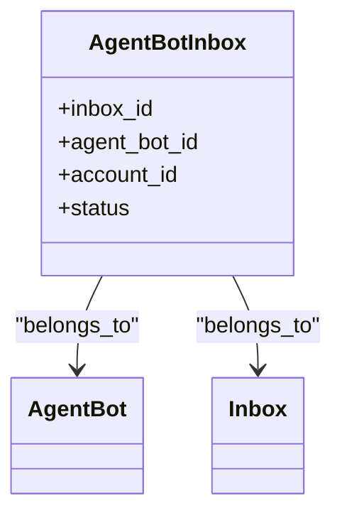

**Diagram sources**
- [agent_bot_inbox.rb:14-35](file://app/models/agent_bot_inbox.rb#L14-L35)

**Section sources**
- [agent_bot_inbox.rb:14-35](file://app/models/agent_bot_inbox.rb#L14-L35)

### AgentBotListener and Event Routing
Responsibilities:
- Subscribes to conversation and message events.
- Determines which bots to notify based on inbox configuration and conversation assignment.
- Constructs payloads and schedules delivery.

Routing logic:
- For each event, it collects active inbox bot and conversation-assigned bot.
- Filters out bots without outgoing URLs.
- Schedules asynchronous delivery via AgentBots::WebhookJob.

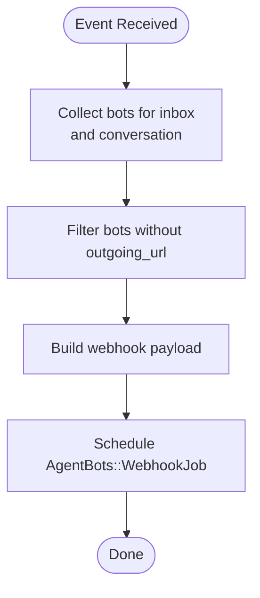

**Diagram sources**
- [agent_bot_listener.rb:65-89](file://app/listeners/agent_bot_listener.rb#L65-L89)

**Section sources**
- [agent_bot_listener.rb:1-90](file://app/listeners/agent_bot_listener.rb#L1-L90)

### Webhook Delivery and Error Handling
Responsibilities:
- Deliver payloads to bot endpoints with retry logic.
- Add HMAC signature and timestamp headers when a secret is present.
- Handle failures by updating conversation state and logging.

Delivery flow:
- Job invokes Trigger with URL, payload, type, secret, and delivery ID.
- Trigger computes HMAC and attaches headers.
- On failure, Trigger updates conversation status to open if pending and logs activity.

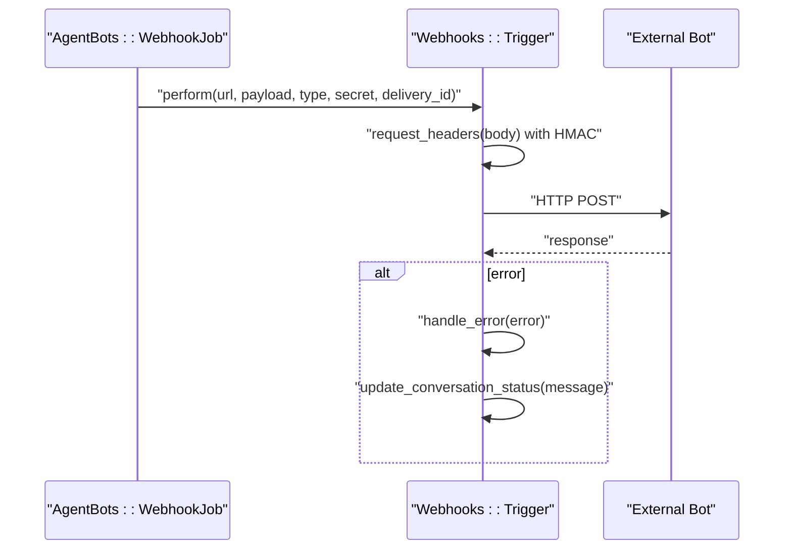

**Diagram sources**
- [webhook_job.rb:10-15](file://app/jobs/agent_bots/webhook_job.rb#L10-L15)
- [trigger.rb:54-87](file://lib/webhooks/trigger.rb#L54-L87)

**Section sources**
- [webhook_job.rb:1-17](file://app/jobs/agent_bots/webhook_job.rb#L1-L17)
- [trigger.rb:48-87](file://lib/webhooks/trigger.rb#L48-L87)

### Conversation State and Handoff
Responsibilities:
- Manages conversation status (open, resolved, pending, snoozed).
- Supports bot handoff to human agents.
- Assigns AI assignee (AgentBot) when bot is active.

Handoff behavior:
- Sets waiting_since if not set.
- Clears AI assignee.
- Opens conversation and dispatches handoff event.

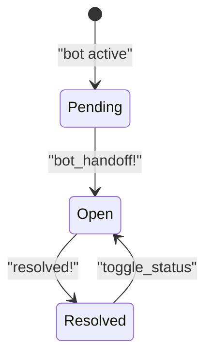

**Diagram sources**
- [conversation.rb:184-197](file://app/models/conversation.rb#L184-L197)
- [conversation.rb:316-334](file://app/models/conversation.rb#L316-L334)

**Section sources**
- [conversation.rb:184-197](file://app/models/conversation.rb#L184-L197)
- [conversation.rb:316-334](file://app/models/conversation.rb#L316-L334)

### Message Content and Structured Types
Responsibilities:
- Defines content types used by bots (text, input_select, cards, form, etc.).
- Normalizes content for webhook consumers.
- Tracks attachments and structured attributes.

Structured content:
- input_select enables interactive flows where bot actions can trigger handoff or resolve states.

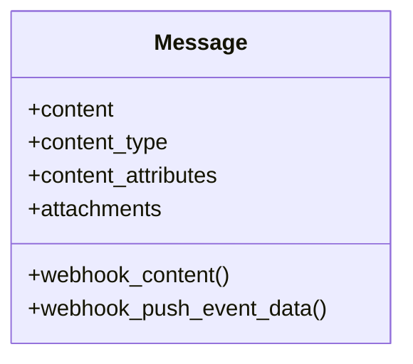

**Diagram sources**
- [message.rb:88-116](file://app/models/message.rb#L88-L116)
- [message.rb:177-212](file://app/models/message.rb#L177-L212)

**Section sources**
- [message.rb:88-116](file://app/models/message.rb#L88-L116)
- [message.rb:177-212](file://app/models/message.rb#L177-L212)

### Bot Processor Service (Integration Pattern)
Responsibilities:
- Orchestrates processing of incoming messages for bot integrations.
- Extracts content from messages, including structured inputs.
- Invokes external responses and processes actions like handoff or resolve.

Processing flow:
- Validates whether the message should run the processor.
- Extracts content based on event type.
- Calls external response handler and processes actions.

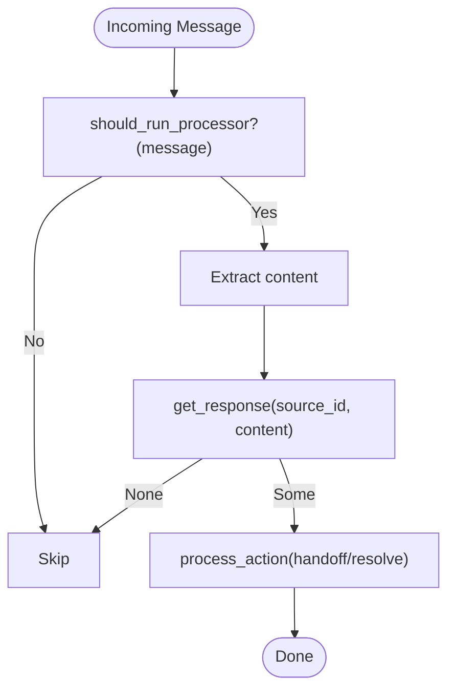

**Diagram sources**
- [bot_processor_service.rb:1-63](file://lib/integrations/bot_processor_service.rb#L1-L63)

**Section sources**
- [bot_processor_service.rb:1-63](file://lib/integrations/bot_processor_service.rb#L1-L63)

### Authentication and Security
Mechanisms:
- WebhookSecretable provides secure token generation and optional encryption for secrets.
- Webhooks::Trigger includes HMAC signature and timestamp headers when a secret is present.

Security considerations:
- Validate X-Chatwoot-Signature and X-Chatwoot-Timestamp at the bot endpoint.
- Rotate secrets using reset_secret! on AgentBot.

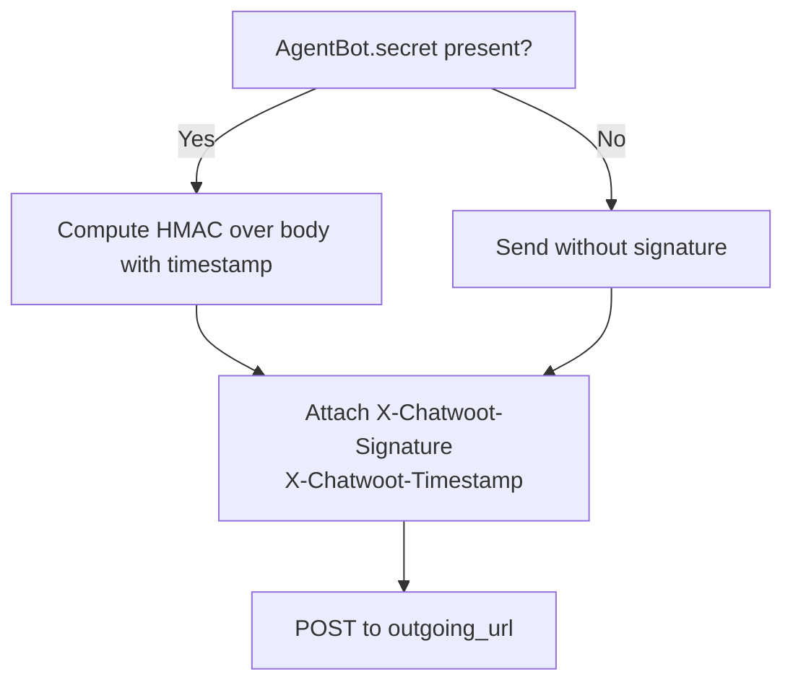

**Diagram sources**
- [webhook_secretable.rb:1-13](file://app/models/concerns/webhook_secretable.rb#L1-L13)
- [trigger.rb:54-63](file://lib/webhooks/trigger.rb#L54-L63)

**Section sources**
- [webhook_secretable.rb:1-13](file://app/models/concerns/webhook_secretable.rb#L1-L13)
- [trigger.rb:54-63](file://lib/webhooks/trigger.rb#L54-L63)

## Dependency Analysis
Component relationships:
- AgentBotListener depends on Conversation and Message to build payloads.
- AgentBots::WebhookJob depends on Webhooks::Trigger for delivery.
- Conversation and Message provide state and content consumed by listeners and processors.
- AgentBotInbox constrains which bots can be active per inbox.

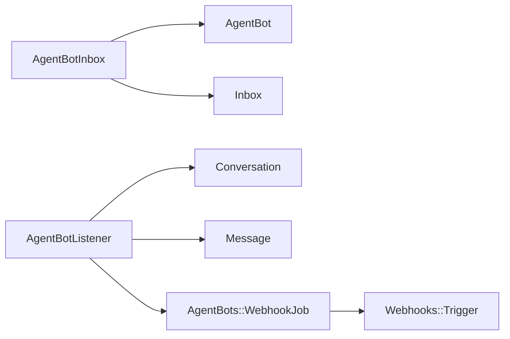

**Diagram sources**
- [agent_bot_inbox.rb:14-35](file://app/models/agent_bot_inbox.rb#L14-L35)
- [agent_bot_listener.rb:1-90](file://app/listeners/agent_bot_listener.rb#L1-L90)
- [webhook_job.rb:1-17](file://app/jobs/agent_bots/webhook_job.rb#L1-L17)
- [trigger.rb:48-87](file://lib/webhooks/trigger.rb#L48-L87)

**Section sources**
- [agent_bot_inbox.rb:14-35](file://app/models/agent_bot_inbox.rb#L14-L35)
- [agent_bot_listener.rb:1-90](file://app/listeners/agent_bot_listener.rb#L1-L90)
- [webhook_job.rb:1-17](file://app/jobs/agent_bots/webhook_job.rb#L1-L17)
- [trigger.rb:48-87](file://lib/webhooks/trigger.rb#L48-L87)

## Performance Considerations
- Asynchronous delivery: Use background jobs to avoid blocking request/response cycles.
- Retry strategy: Configure retryable errors and exponential backoff for resilience.
- Rate limiting: Implement client-side throttling and server-side limits to prevent flooding.
- Payload size: Normalize and truncate content to reduce network overhead.
- Connection timeouts: Set reasonable open/read timeouts for webhook calls.

[No sources needed since this section provides general guidance]

## Troubleshooting Guide
Common issues and resolutions:
- Bot not receiving webhooks:
  - Verify AgentBot.outgoing_url is configured and reachable.
  - Confirm AgentBotInbox is active for the target inbox.
  - Check webhook delivery logs and retry attempts.

- Conversations stuck in pending after bot failure:
  - Inspect Webhooks::Trigger error handling; failed deliveries may move conversations to open unless keep_pending_on_bot_failure is enabled.

- Signature validation failures:
  - Ensure bot validates X-Chatwoot-Signature and X-Chatwoot-Timestamp using the shared secret.
  - Regenerate secret on AgentBot if compromised.

- Structured input handling:
  - For input_select messages, ensure bot returns appropriate actions (handoff/resolve) to update conversation state.

**Section sources**
- [agent_bot_listener.rb:84-89](file://app/listeners/agent_bot_listener.rb#L84-L89)
- [webhook_job.rb:3-15](file://app/jobs/agent_bots/webhook_job.rb#L3-L15)
- [trigger.rb:65-87](file://lib/webhooks/trigger.rb#L65-L87)
- [bot_processor_service.rb:55-62](file://lib/integrations/bot_processor_service.rb#L55-L62)

## Conclusion
Chatwoot’s bot integration centers on webhook-based bots with robust event-driven routing, secure delivery, and resilient error handling. By leveraging AgentBot, AgentBotListener, and Webhooks::Trigger, developers can implement scalable, secure, and maintainable bot experiences. Proper configuration of secrets, careful handling of structured messages, and monitoring of delivery outcomes are key to reliable operations at scale.