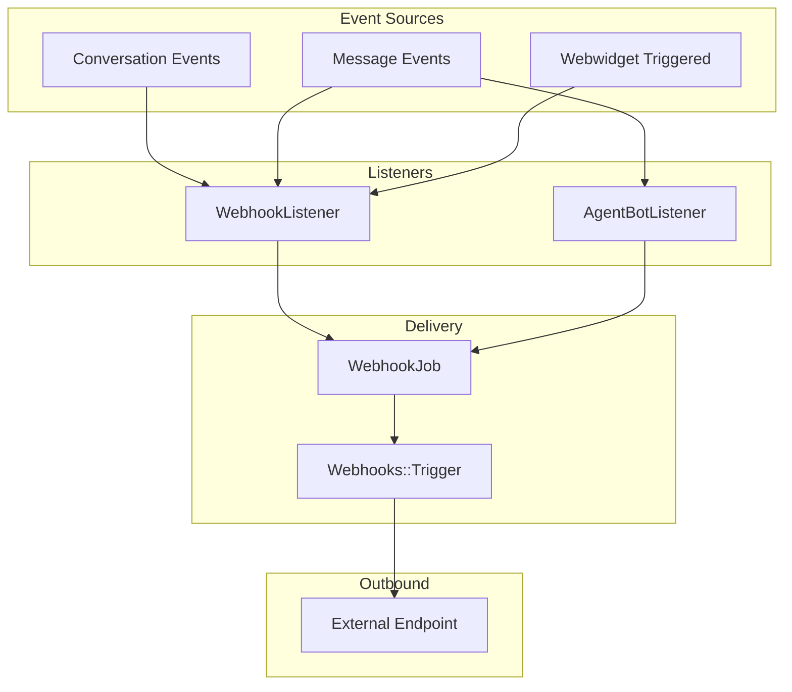
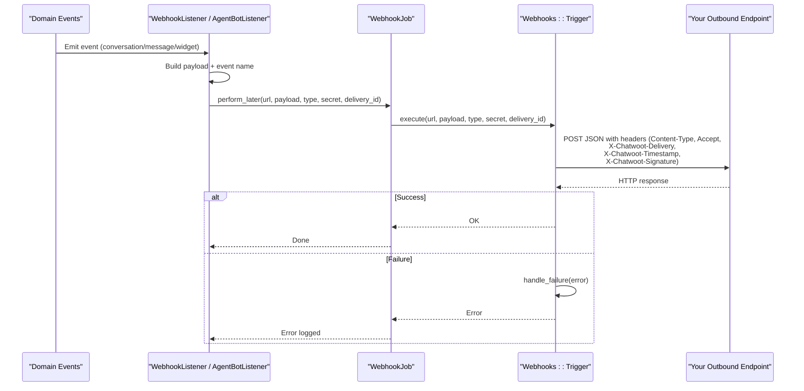
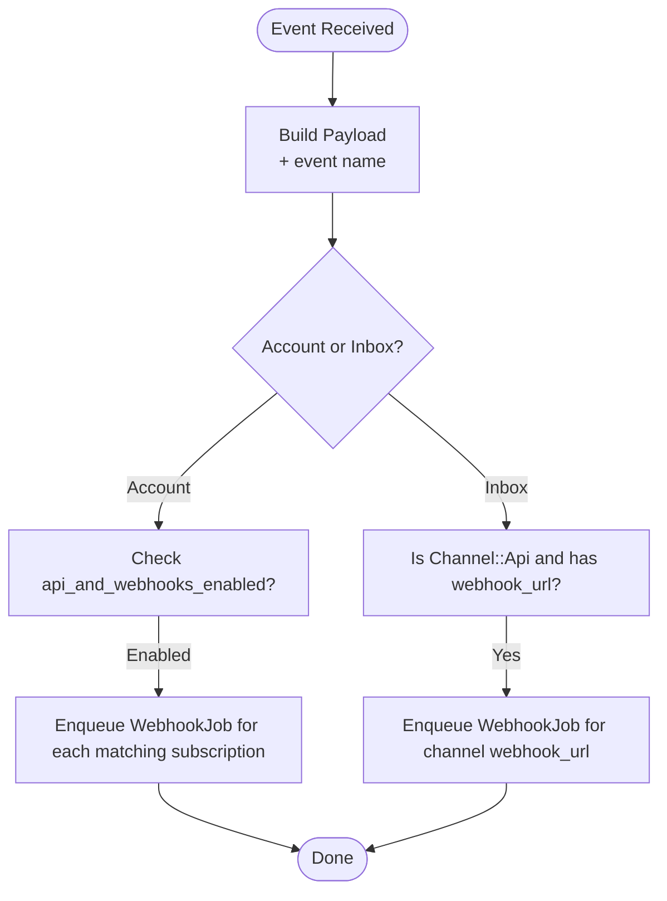
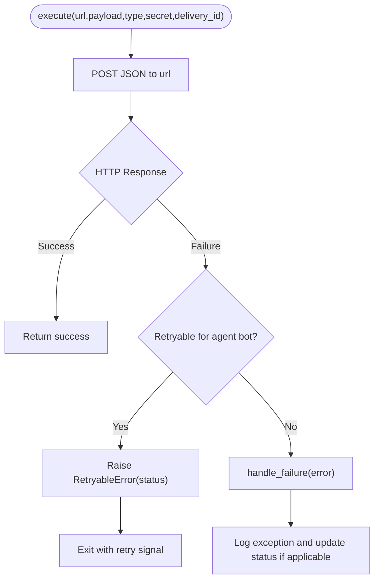
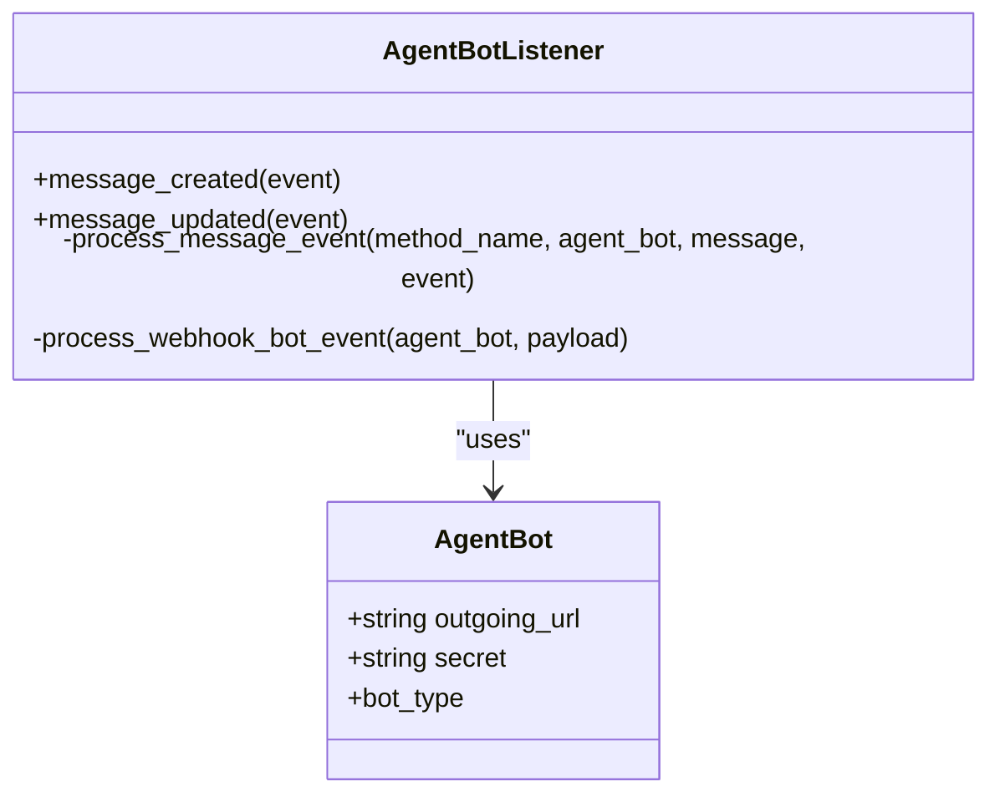
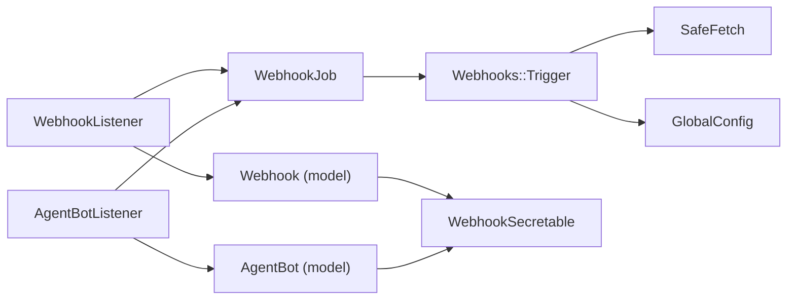

# Webhook Bots

<cite>
**Referenced Files in This Document**
- [webhook_listener.rb](file://app/listeners/webhook_listener.rb)
- [trigger.rb](file://lib/webhooks/trigger.rb)
- [webhook_job.rb](file://app/jobs/webhook_job.rb)
- [webhook.rb](file://app/models/webhook.rb)
- [agent_bot_listener.rb](file://app/listeners/agent_bot_listener.rb)
- [agent_bot.rb](file://app/models/agent_bot.rb)
- [webhook_secretable.rb](file://app/models/concerns/webhook_secretable.rb)
</cite>

## Table of Contents
1. [Introduction](#introduction)
2. [Project Structure](#project-structure)
3. [Core Components](#core-components)
4. [Architecture Overview](#architecture-overview)
5. [Detailed Component Analysis](#detailed-component-analysis)
6. [Dependency Analysis](#dependency-analysis)
7. [Performance Considerations](#performance-considerations)
8. [Troubleshooting Guide](#troubleshooting-guide)
9. [Conclusion](#conclusion)

## Introduction
This document explains the webhook-based bot integration in Chatwoot, focusing on how events are transformed into outbound webhooks, how payloads and signatures are constructed, and how responses and errors are handled. It covers:
- Outbound webhook architecture for account-level and inbox-level webhooks
- Agent bot (webhook bot) integration and payload delivery
- Configuration of outgoing URLs and secrets
- Security mechanisms including HMAC signature validation and HTTPS requirements
- Error handling, retry behavior, and monitoring guidance

## Project Structure
The webhook system is implemented across listeners, jobs, and a trigger utility:
- Listeners convert domain events into webhook payloads and enqueue delivery jobs
- Jobs delegate to a reusable trigger that performs HTTP requests with optional secret-based signing
- Models define webhook subscriptions and agent bot configuration

**Diagram sources**
- [webhook_listener.rb:1-135](file://app/listeners/webhook_listener.rb#L1-L135)
- [agent_bot_listener.rb:36-89](file://app/listeners/agent_bot_listener.rb#L36-L89)
- [webhook_job.rb:1-8](file://app/jobs/webhook_job.rb#L1-L8)
- [trigger.rb:14-63](file://lib/webhooks/trigger.rb#L14-L63)

**Section sources**
- [webhook_listener.rb:1-135](file://app/listeners/webhook_listener.rb#L1-L135)
- [agent_bot_listener.rb:36-89](file://app/listeners/agent_bot_listener.rb#L36-L89)
- [webhook_job.rb:1-8](file://app/jobs/webhook_job.rb#L1-L8)
- [trigger.rb:14-63](file://lib/webhooks/trigger.rb#L14-L63)

## Core Components
- WebhookListener: Converts conversation, message, contact, inbox, and widget events into payloads and dispatches them to configured webhooks.
- Webhooks::Trigger: Performs outbound HTTP POST requests, adds headers, signs payloads when a secret is present, and handles failures.
- WebhookJob: Background job that invokes the trigger with the correct webhook type and secret.
- Webhook model: Stores account/inbox-scoped webhook endpoints, subscriptions, and secrets; validates allowed events and URL formats.
- AgentBotListener: Routes message events to agent bots configured with an outgoing URL and secret.
- AgentBot model: Holds outgoing_url and secret for webhook bots.
- WebhookSecretable concern: Provides secure token generation and optional encryption for secrets.

Key responsibilities:
- Event-to-payload mapping and scoping (account vs inbox)
- Secure outbound delivery with HMAC signatures
- Retryable error detection for agent bots
- Status updates on failure paths

**Section sources**
- [webhook_listener.rb:1-135](file://app/listeners/webhook_listener.rb#L1-L135)
- [trigger.rb:14-135](file://lib/webhooks/trigger.rb#L14-L135)
- [webhook_job.rb:1-8](file://app/jobs/webhook_job.rb#L1-L8)
- [webhook.rb:21-47](file://app/models/webhook.rb#L21-L47)
- [agent_bot_listener.rb:36-89](file://app/listeners/agent_bot_listener.rb#L36-L89)
- [agent_bot.rb:21-73](file://app/models/agent_bot.rb#L21-L73)
- [webhook_secretable.rb:1-14](file://app/models/concerns/webhook_secretable.rb#L1-L14)

## Architecture Overview
End-to-end flow from event to outbound webhook:

**Diagram sources**
- [webhook_listener.rb:25-52](file://app/listeners/webhook_listener.rb#L25-L52)
- [agent_bot_listener.rb:78-89](file://app/listeners/agent_bot_listener.rb#L78-L89)
- [webhook_job.rb:1-8](file://app/jobs/webhook_job.rb#L1-L8)
- [trigger.rb:41-63](file://lib/webhooks/trigger.rb#L41-L63)

## Detailed Component Analysis

### WebhookListener
Responsibilities:
- Map domain events to payloads enriched with entity data and event names
- Deliver to account-level webhooks and API inbox channels
- Enqueue background jobs with unique delivery IDs

Highlights:
- Supports conversation_created/updated/status_changed, message_created/updated, webwidget_triggered, contact_created/updated, inbox_created/updated, typing_on/off
- For account-level webhooks, checks account feature flag before delivery
- For API inbox channel, delivers directly to the channel’s webhook_url if present

**Diagram sources**
- [webhook_listener.rb:10-84](file://app/listeners/webhook_listener.rb#L10-L84)
- [webhook_listener.rb:110-133](file://app/listeners/webhook_listener.rb#L110-L133)

**Section sources**
- [webhook_listener.rb:1-135](file://app/listeners/webhook_listener.rb#L1-L135)

### Webhooks::Trigger
Responsibilities:
- Perform outbound HTTP POST with JSON body
- Add security headers: Content-Type, Accept, X-Chatwoot-Delivery, and HMAC signature when secret is provided
- Handle timeouts and non-retryable errors
- Detect retryable statuses for agent bots and surface them appropriately

Security headers:
- X-Chatwoot-Delivery: Unique delivery ID for tracing
- X-Chatwoot-Timestamp: Current epoch seconds
- X-Chatwoot-Signature: sha256 HMAC over "<timestamp>.<body>" using the stored secret

Timeouts:
- Configurable via WEBHOOK_TIMEOUT; defaults to 5 seconds if not set or invalid

Error handling:
- Non-retryable errors log and continue
- For agent bot failures, may open pending conversations and create activity messages
- For API inbox failures, marks messages as failed with error details

**Diagram sources**
- [trigger.rb:22-32](file://lib/webhooks/trigger.rb#L22-L32)
- [trigger.rb:41-63](file://lib/webhooks/trigger.rb#L41-L63)
- [trigger.rb:65-102](file://lib/webhooks/trigger.rb#L65-L102)
- [trigger.rb:118-133](file://lib/webhooks/trigger.rb#L118-L133)

**Section sources**
- [trigger.rb:1-135](file://lib/webhooks/trigger.rb#L1-L135)

### WebhookJob
Responsibilities:
- Background job wrapper that calls Webhooks::Trigger.execute with the appropriate parameters

Notes:
- Queued under medium priority
- Passes through webhook_type (:account_webhook, :api_inbox_webhook, :agent_bot_webhook), secret, and delivery_id

**Section sources**
- [webhook_job.rb:1-8](file://app/jobs/webhook_job.rb#L1-L8)

### Webhook Model
Responsibilities:
- Store webhook endpoint (url), secret, and subscriptions
- Validate URL format (http/https) and uniqueness per account
- Restrict subscriptions to a predefined list of allowed events

Allowed events include:
- conversation_status_changed, conversation_updated, conversation_created
- contact_created, contact_updated
- message_created, message_updated
- webwidget_triggered
- inbox_created, inbox_updated
- conversation_typing_on, conversation_typing_off

**Section sources**
- [webhook.rb:21-47](file://app/models/webhook.rb#L21-L47)

### AgentBotListener and AgentBot
Responsibilities:
- AgentBotListener routes message_created and message_updated events to agent bots configured with an outgoing URL
- AgentBot stores outgoing_url and secret used to sign outbound requests

Behavior:
- Only webhook-type agent bots are supported
- If outgoing_url is blank, no delivery occurs
- Delivery uses WebhookJob with webhook_type :agent_bot_webhook and includes secret and delivery_id

**Diagram sources**
- [agent_bot_listener.rb:36-89](file://app/listeners/agent_bot_listener.rb#L36-L89)
- [agent_bot.rb:21-73](file://app/models/agent_bot.rb#L21-L73)

**Section sources**
- [agent_bot_listener.rb:36-89](file://app/listeners/agent_bot_listener.rb#L36-L89)
- [agent_bot.rb:21-73](file://app/models/agent_bot.rb#L21-L73)

### WebhookSecretable Concern
Responsibilities:
- Provide a secure token field named secret
- Optionally encrypt the secret at rest when encryption is configured
- Provide reset_secret! helper to regenerate and reload the secret

**Section sources**
- [webhook_secretable.rb:1-14](file://app/models/concerns/webhook_secretable.rb#L1-L14)

## Dependency Analysis
High-level dependencies:
- WebhookListener depends on domain models to build payloads and enqueues WebhookJob
- AgentBotListener depends on AgentBot configuration and enqueues WebhookJob
- WebhookJob delegates to Webhooks::Trigger
- Webhooks::Trigger depends on SafeFetch for outbound HTTP and GlobalConfig for timeout settings
- Webhook model defines allowed events and validates subscriptions
- AgentBot and Webhook both use WebhookSecretable for secret management

**Diagram sources**
- [webhook_listener.rb:110-133](file://app/listeners/webhook_listener.rb#L110-L133)
- [agent_bot_listener.rb:78-89](file://app/listeners/agent_bot_listener.rb#L78-L89)
- [webhook_job.rb:1-8](file://app/jobs/webhook_job.rb#L1-L8)
- [trigger.rb:41-63](file://lib/webhooks/trigger.rb#L41-L63)
- [trigger.rb:118-123](file://lib/webhooks/trigger.rb#L118-L123)
- [webhook.rb:21-47](file://app/models/webhook.rb#L21-L47)
- [agent_bot.rb:21-73](file://app/models/agent_bot.rb#L21-L73)
- [webhook_secretable.rb:1-14](file://app/models/concerns/webhook_secretable.rb#L1-L14)

**Section sources**
- [webhook_listener.rb:110-133](file://app/listeners/webhook_listener.rb#L110-L133)
- [agent_bot_listener.rb:78-89](file://app/listeners/agent_bot_listener.rb#L78-L89)
- [webhook_job.rb:1-8](file://app/jobs/webhook_job.rb#L1-L8)
- [trigger.rb:41-63](file://lib/webhooks/trigger.rb#L41-L63)
- [trigger.rb:118-123](file://lib/webhooks/trigger.rb#L118-L123)
- [webhook.rb:21-47](file://app/models/webhook.rb#L21-L47)
- [agent_bot.rb:21-73](file://app/models/agent_bot.rb#L21-L73)
- [webhook_secretable.rb:1-14](file://app/models/concerns/webhook_secretable.rb#L1-L14)

## Performance Considerations
- Asynchronous delivery: All webhooks are delivered via background jobs, preventing request blocking.
- Timeouts: Outbound requests respect WEBHOOK_TIMEOUT (default 5 seconds). Tune this based on your endpoint latency.
- Queue priority: WebhookJob uses medium queue priority; adjust worker capacity accordingly.
- Signature computation: HMAC calculation is lightweight but should be performed only when secrets are enabled.
- Payload size: Keep payloads minimal by relying on identifiers and avoiding large nested structures.

[No sources needed since this section provides general guidance]

## Troubleshooting Guide

Common issues and resolutions:
- Invalid URL or network errors
  - Ensure the outbound URL is reachable and accepts POST requests with application/json.
  - Verify DNS resolution and firewall rules allow outbound HTTPS.
- Missing or incorrect signature
  - Confirm your endpoint validates X-Chatwoot-Signature using SHA256 HMAC over "<timestamp>.<body>" with the shared secret.
  - Ensure X-Chatwoot-Timestamp is recent to prevent replay attacks.
- Timeouts
  - Increase WEBHOOK_TIMEOUT if your endpoint requires more processing time.
  - Optimize your endpoint to respond quickly and return 2xx on success.
- Agent bot retries
  - Status codes 429 and 500 are treated as retryable for agent bots. Implement idempotency and backoff strategies on your endpoint.
- Conversation/message status on failure
  - On agent bot failure, pending conversations may be opened and an activity note created.
  - On API inbox failure, messages are marked as failed with error details.

Monitoring recommendations:
- Track outbound HTTP metrics (latency, success rate) at your endpoint.
- Correlate deliveries using X-Chatwoot-Delivery header.
- Alert on repeated 4xx/5xx responses and high timeout rates.
- Monitor background job queues for backlog growth.

**Section sources**
- [trigger.rb:54-63](file://lib/webhooks/trigger.rb#L54-L63)
- [trigger.rb:65-102](file://lib/webhooks/trigger.rb#L65-L102)
- [trigger.rb:118-133](file://lib/webhooks/trigger.rb#L118-L133)

## Conclusion
Chatwoot’s webhook system provides a robust, asynchronous mechanism to deliver domain events to external systems. It supports secure delivery with HMAC signatures, configurable timeouts, and differentiated error handling for account-level, inbox-level, and agent bot integrations. By configuring outgoing URLs and secrets correctly and validating signatures at your endpoint, you can reliably integrate Chatwoot events into your workflows while maintaining security and observability.