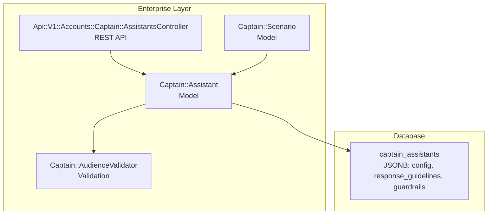
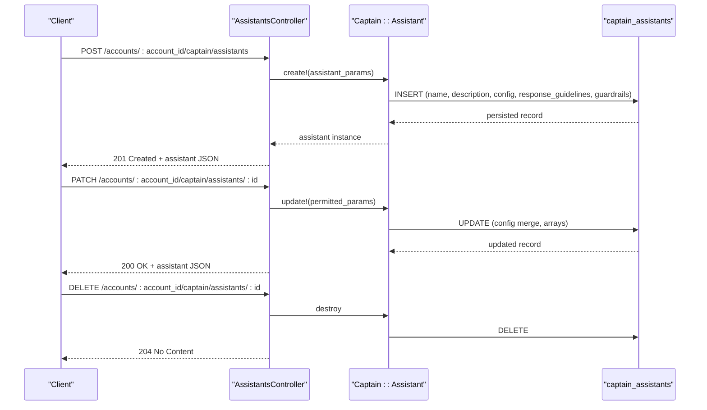
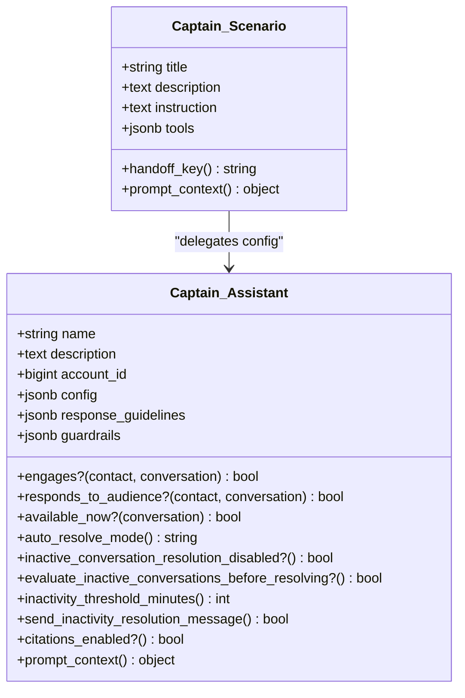
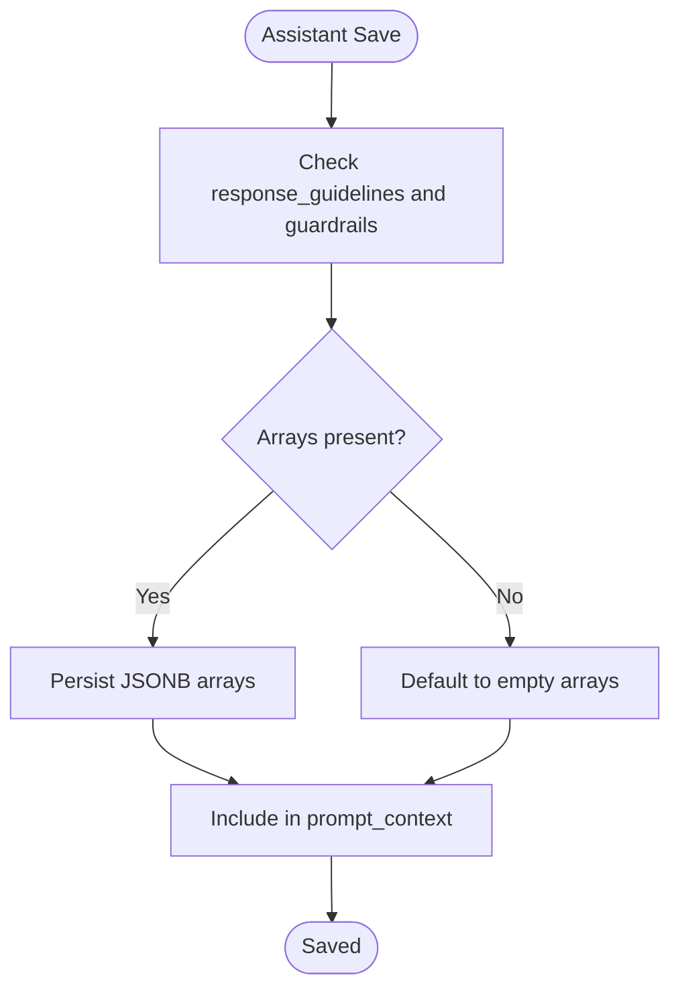
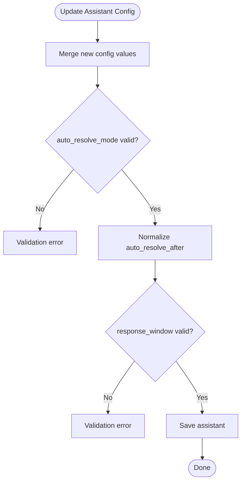
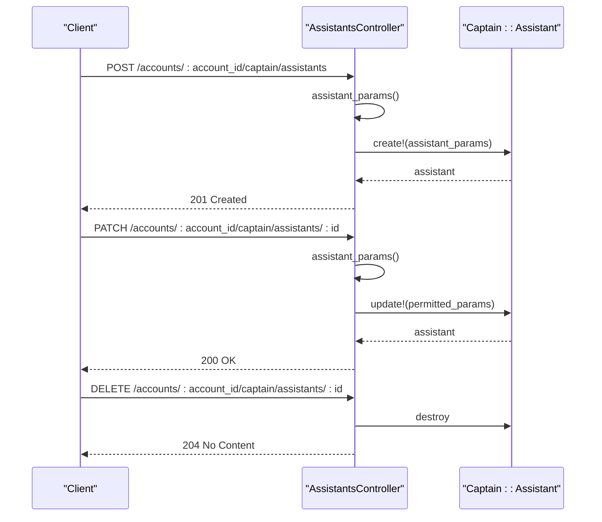
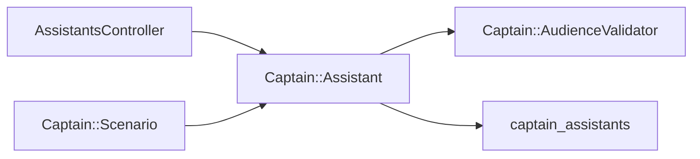

# Assistant Configuration

<cite>
**Referenced Files in This Document**   
- [assistant.rb](file://.worktrees/eeu-ai-gateway/enterprise/app/models/captain/assistant.rb)
- [assistants_controller.rb](file://.worktrees/eeu-ai-gateway/enterprise/app/controllers/api/v1/accounts/captain/assistants_controller.rb)
- [scenario.rb](file://.worktrees/eeu-ai-gateway/enterprise/app/models/captain/scenario.rb)
- [audience_validator.rb](file://enterprise/app/validators/captain/audience_validator.rb)
- [add_response_guidelines_and_guardrails_to_captain_assistants.rb](file://db/migrate/20250714104358_add_response_guidelines_and_guardrails_to_captain_assistants.rb)
</cite>

## Table of Contents
1. [Introduction](#introduction)
2. [Project Structure](#project-structure)
3. [Core Components](#core-components)
4. [Architecture Overview](#architecture-overview)
5. [Detailed Component Analysis](#detailed-component-analysis)
6. [Dependency Analysis](#dependency-analysis)
7. [Performance Considerations](#performance-considerations)
8. [Troubleshooting Guide](#troubleshooting-guide)
9. [Conclusion](#conclusion)
10. [Appendices](#appendices)

## Introduction
This document explains how to configure Captain AI assistants, focusing on the assistant model structure, configuration parameters, and the JSONB arrays used for response guidelines and guardrails. It covers creation, editing, and deletion workflows through the API controller, validation rules, business constraints, and best practices for naming and organizing assistants.

## Project Structure
Captain assistant configuration is implemented in the enterprise layer:
- Model: `Captain::Assistant` defines the assistant entity, validations, and configuration accessors.
- Controller: `Api::V1::Accounts::Captain::AssistantsController` exposes REST endpoints for listing, creating, updating, deleting, playground testing, metrics, and FAQ analytics.
- Related model: `Captain::Scenario` inherits some assistant configuration via delegation and composes prompt context with assistant-level guidelines and guardrails.
- Validator: `Captain::AudienceValidator` validates audience targeting configuration attached to the assistant config.
- Migration: Adds JSONB columns for response guidelines and guardrails to the assistant table.

**Diagram sources**
- [assistant.rb:19-75](file://.worktrees/eeu-ai-gateway/enterprise/app/models/captain/assistant.rb#L19-L75)
- [assistants_controller.rb:1-28](file://.worktrees/eeu-ai-gateway/enterprise/app/controllers/api/v1/accounts/captain/assistants_controller.rb#L1-L28)
- [scenario.rb:23-56](file://.worktrees/eeu-ai-gateway/enterprise/app/models/captain/scenario.rb#L23-L56)
- [audience_validator.rb:1-35](file://enterprise/app/validators/captain/audience_validator.rb#L1-L35)
- [add_response_guidelines_and_guardrails_to_captain_assistants.rb:1-6](file://db/migrate/20250714104358_add_response_guidelines_and_guardrails_to_captain_assistants.rb#L1-L6)

**Section sources**
- [assistant.rb:19-75](file://.worktrees/eeu-ai-gateway/enterprise/app/models/captain/assistant.rb#L19-L75)
- [assistants_controller.rb:1-28](file://.worktrees/eeu-ai-gateway/enterprise/app/controllers/api/v1/accounts/captain/assistants_controller.rb#L1-L28)
- [scenario.rb:23-56](file://.worktrees/eeu-ai-gateway/enterprise/app/models/captain/scenario.rb#L23-L56)
- [audience_validator.rb:1-35](file://enterprise/app/validators/captain/audience_validator.rb#L1-L35)
- [add_response_guidelines_and_guardrails_to_captain_assistants.rb:1-6](file://db/migrate/20250714104358_add_response_guidelines_and_guardrails_to_captain_assistants.rb#L1-L6)

## Core Components
- Assistant model fields:
  - name: string, required
  - description: text, required, max length enforced
  - account_id: bigint, required
  - config: jsonb, stores temperature, feature flags, auto-resolve settings, product_name, response_window, and more
  - response_guidelines: jsonb array
  - guardrails: jsonb array
- Configuration accessors are provided by store_accessor for keys such as temperature, feature_faq, feature_memory, feature_contact_attributes, product_name, auto_resolve_mode, auto_resolve_after, send_inactivity_resolution_message, and response_window.
- Scenario model delegates temperature, feature_faq, feature_memory, product_name, response_guidelines, and guardrails to its parent assistant, enabling scenario prompts to inherit assistant-level behavior.

**Section sources**
- [assistant.rb:1-13](file://.worktrees/eeu-ai-gateway/enterprise/app/models/captain/assistant.rb#L1-L13)
- [assistant.rb:54-75](file://.worktrees/eeu-ai-gateway/enterprise/app/models/captain/assistant.rb#L54-L75)
- [scenario.rb:56-73](file://.worktrees/eeu-ai-gateway/enterprise/app/models/captain/scenario.rb#L56-L73)

## Architecture Overview
The assistant configuration lifecycle flows through the REST API into the model, which persists data to the database and enforces validations. Scenarios compose their prompt context using assistant-level configuration, including response guidelines and guardrails.

**Diagram sources**
- [assistants_controller.rb:12-28](file://.worktrees/eeu-ai-gateway/enterprise/app/controllers/api/v1/accounts/captain/assistants_controller.rb#L12-L28)
- [assistant.rb:54-75](file://.worktrees/eeu-ai-gateway/enterprise/app/models/captain/assistant.rb#L54-L75)

## Detailed Component Analysis

### Assistant Model Structure
- Identity and relationships:
  - Belongs to an account
  - Has many documents, responses, FAQ suggestions, captain inboxes, inboxes, messages, copilot threads, custom tools, scenarios, agent sessions, conversation outcomes, and assigned conversations
- Configuration storage:
  - Uses store_accessor to expose typed configuration keys within the JSONB config column
- Validations:
  - Presence and length limits for name and description
  - Account presence
  - Audience validator integration
  - Response window enum validation
  - Auto-resolve mode inclusion validation
  - Boolean flag validation for sending inactivity resolution message
  - Numeric range validation for auto-resolve threshold minutes

**Diagram sources**
- [assistant.rb:19-75](file://.worktrees/eeu-ai-gateway/enterprise/app/models/captain/assistant.rb#L19-L75)
- [assistant.rb:83-125](file://.worktrees/eeu-ai-gateway/enterprise/app/models/captain/assistant.rb#L83-L125)
- [assistant.rb:141-179](file://.worktrees/eeu-ai-gateway/enterprise/app/models/captain/assistant.rb#L141-L179)
- [assistant.rb:214-230](file://.worktrees/eeu-ai-gateway/enterprise/app/models/captain/assistant.rb#L214-L230)
- [scenario.rb:23-73](file://.worktrees/eeu-ai-gateway/enterprise/app/models/captain/scenario.rb#L23-L73)

**Section sources**
- [assistant.rb:19-75](file://.worktrees/eeu-ai-gateway/enterprise/app/models/captain/assistant.rb#L19-L75)
- [assistant.rb:83-125](file://.worktrees/eeu-ai-gateway/enterprise/app/models/captain/assistant.rb#L83-L125)
- [assistant.rb:141-179](file://.worktrees/eeu-ai-gateway/enterprise/app/models/captain/assistant.rb#L141-L179)
- [assistant.rb:214-230](file://.worktrees/eeu-ai-gateway/enterprise/app/models/captain/assistant.rb#L214-L230)
- [scenario.rb:23-73](file://.worktrees/eeu-ai-gateway/enterprise/app/models/captain/scenario.rb#L23-L73)

### JSONB Schema for response_guidelines and guardrails
- Both fields are stored as JSONB arrays with default empty arrays.
- They are included in assistant prompt context and scenario prompt context, allowing them to influence generated responses and tool usage.
- The controller permits these arrays during create/update operations, supporting partial updates.

**Diagram sources**
- [add_response_guidelines_and_guardrails_to_captain_assistants.rb:1-6](file://db/migrate/20250714104358_add_response_guidelines_and_guardrails_to_captain_assistants.rb#L1-L6)
- [assistants_controller.rb:141-144](file://.worktrees/eeu-ai-gateway/enterprise/app/controllers/api/v1/accounts/captain/assistants_controller.rb#L141-L144)
- [assistant.rb:214-230](file://.worktrees/eeu-ai-gateway/enterprise/app/models/captain/assistant.rb#L214-L230)
- [scenario.rb:64-73](file://.worktrees/eeu-ai-gateway/enterprise/app/models/captain/scenario.rb#L64-L73)

**Section sources**
- [add_response_guidelines_and_guardrails_to_captain_assistants.rb:1-6](file://db/migrate/20250714104358_add_response_guidelines_and_guardrails_to_captain_assistants.rb#L1-L6)
- [assistants_controller.rb:141-144](file://.worktrees/eeu-ai-gateway/enterprise/app/controllers/api/v1/accounts/captain/assistants_controller.rb#L141-L144)
- [assistant.rb:214-230](file://.worktrees/eeu-ai-gateway/enterprise/app/models/captain/assistant.rb#L214-L230)
- [scenario.rb:64-73](file://.worktrees/eeu-ai-gateway/enterprise/app/models/captain/scenario.rb#L64-L73)

### Configuration Parameters
- Temperature: Controls model creativity; stored in config and exposed via store_accessor.
- Feature flags:
  - feature_faq: Enables FAQ-related features
  - feature_memory: Enables memory-related features
  - feature_contact_attributes: Enables contact attribute usage
  - feature_citation: Enables citation generation
- Product name: Used in prompt context when not provided by the assistant config.
- Auto-resolve modes:
  - disabled: Disables automatic resolution of inactive conversations
  - legacy: Legacy behavior
  - evaluated: Evaluates inactive conversations before resolving
- Auto-resolve timing:
  - auto_resolve_after: Threshold in minutes, normalized to steps of five minutes within a bounded range
  - send_inactivity_resolution_message: Boolean flag controlling whether a resolution message is sent
- Response window:
  - always: Always respond
  - business_hours: Respond only during working hours
  - outside_business_hours: Respond only outside working hours
- Audience targeting:
  - config.audience: Recursive condition tree validated by Captain::AudienceValidator

**Diagram sources**
- [assistant.rb:54-75](file://.worktrees/eeu-ai-gateway/enterprise/app/models/captain/assistant.rb#L54-L75)
- [assistant.rb:181-200](file://.worktrees/eeu-ai-gateway/enterprise/app/models/captain/assistant.rb#L181-L200)
- [assistant.rb:189-194](file://.worktrees/eeu-ai-gateway/enterprise/app/models/captain/assistant.rb#L189-L194)
- [assistants_controller.rb:17-22](file://.worktrees/eeu-ai-gateway/enterprise/app/controllers/api/v1/accounts/captain/assistants_controller.rb#L17-L22)

**Section sources**
- [assistant.rb:54-75](file://.worktrees/eeu-ai-gateway/enterprise/app/models/captain/assistant.rb#L54-L75)
- [assistant.rb:103-125](file://.worktrees/eeu-ai-gateway/enterprise/app/models/captain/assistant.rb#L103-L125)
- [assistant.rb:181-200](file://.worktrees/eeu-ai-gateway/enterprise/app/models/captain/assistant.rb#L181-L200)
- [assistant.rb:189-194](file://.worktrees/eeu-ai-gateway/enterprise/app/models/captain/assistant.rb#L189-L194)
- [assistants_controller.rb:17-22](file://.worktrees/eeu-ai-gateway/enterprise/app/controllers/api/v1/accounts/captain/assistants_controller.rb#L17-L22)

### Assistant Creation, Editing, and Deletion Workflows
- Create:
  - Accepts name, description, and config attributes
  - Permits response_guidelines and guardrails arrays separately to support partial updates
  - Validates presence and lengths, audience configuration, and config enums
- Update:
  - Merges incoming config into existing config to preserve other keys
  - Applies same validations as create
- Delete:
  - Removes the assistant record and cascades dependent associations

**Diagram sources**
- [assistants_controller.rb:12-28](file://.worktrees/eeu-ai-gateway/enterprise/app/controllers/api/v1/accounts/captain/assistants_controller.rb#L12-L28)
- [assistants_controller.rb:129-149](file://.worktrees/eeu-ai-gateway/enterprise/app/controllers/api/v1/accounts/captain/assistants_controller.rb#L129-L149)

**Section sources**
- [assistants_controller.rb:12-28](file://.worktrees/eeu-ai-gateway/enterprise/app/controllers/api/v1/accounts/captain/assistants_controller.rb#L12-L28)
- [assistants_controller.rb:129-149](file://.worktrees/eeu-ai-gateway/enterprise/app/controllers/api/v1/accounts/captain/assistants_controller.rb#L129-L149)

### Validation Rules and Business Constraints
- Name: Required
- Description: Required, maximum length enforced
- Account ID: Required
- Audience: Validated by Captain::AudienceValidator
- Response window: Must be one of allowed values
- Auto-resolve mode: Must be one of allowed modes
- Send inactivity resolution message: Boolean
- Auto-resolve after: Integer within minimum and maximum thresholds, normalized to step increments

Best practices:
- Keep descriptions concise and meaningful within the length limit
- Use clear, unique names for assistants to avoid confusion
- Organize assistants by use case or team, leveraging account scoping
- Prefer explicit response_window settings aligned with inbox working hours
- Use auto_resolve_mode=evaluated to evaluate inactive conversations before resolution

**Section sources**
- [assistant.rb:60-73](file://.worktrees/eeu-ai-gateway/enterprise/app/models/captain/assistant.rb#L60-L73)
- [assistant.rb:189-200](file://.worktrees/eeu-ai-gateway/enterprise/app/models/captain/assistant.rb#L189-L200)
- [audience_validator.rb:1-35](file://enterprise/app/validators/captain/audience_validator.rb#L1-L35)

### Examples of Proper Assistant Setup
- Basic setup:
  - Provide a descriptive name and a concise description
  - Set temperature to a value appropriate for your use case
  - Enable feature flags relevant to your workflow (e.g., FAQ, memory, citations)
  - Configure auto_resolve_mode based on desired automation level
  - Optionally set response_window to align with business hours
- Advanced setup:
  - Add response_guidelines to steer tone, structure, and content boundaries
  - Add guardrails to restrict sensitive topics or enforce compliance rules
  - Use audience targeting to restrict assistant engagement to specific contact segments
  - For scenarios, ensure instructions reference available tools and that tool references resolve correctly

Note: These examples describe recommended configurations without embedding code snippets. Refer to the referenced files for exact parameter names and validation logic.

**Section sources**
- [assistant.rb:54-75](file://.worktrees/eeu-ai-gateway/enterprise/app/models/captain/assistant.rb#L54-L75)
- [assistant.rb:214-230](file://.worktrees/eeu-ai-gateway/enterprise/app/models/captain/assistant.rb#L214-L230)
- [scenario.rb:146-178](file://.worktrees/eeu-ai-gateway/enterprise/app/models/captain/scenario.rb#L146-L178)

## Dependency Analysis
- Controller depends on the assistant model for persistence and validation.
- Scenario model delegates several assistant configuration keys, ensuring consistency across assistant and scenario prompts.
- Audience validator ensures complex targeting conditions are structurally valid.
- Migration adds JSONB columns for response_guidelines and guardrails, enabling flexible array-based configuration.

**Diagram sources**
- [assistants_controller.rb:1-28](file://.worktrees/eeu-ai-gateway/enterprise/app/controllers/api/v1/accounts/captain/assistants_controller.rb#L1-L28)
- [assistant.rb:19-75](file://.worktrees/eeu-ai-gateway/enterprise/app/models/captain/assistant.rb#L19-L75)
- [scenario.rb:23-56](file://.worktrees/eeu-ai-gateway/enterprise/app/models/captain/scenario.rb#L23-L56)
- [audience_validator.rb:1-35](file://enterprise/app/validators/captain/audience_validator.rb#L1-L35)

**Section sources**
- [assistants_controller.rb:1-28](file://.worktrees/eeu-ai-gateway/enterprise/app/controllers/api/v1/accounts/captain/assistants_controller.rb#L1-L28)
- [assistant.rb:19-75](file://.worktrees/eeu-ai-gateway/enterprise/app/models/captain/assistant.rb#L19-L75)
- [scenario.rb:23-56](file://.worktrees/eeu-ai-gateway/enterprise/app/models/captain/scenario.rb#L23-L56)
- [audience_validator.rb:1-35](file://enterprise/app/validators/captain/audience_validator.rb#L1-L35)

## Performance Considerations
- Normalization of auto_resolve_after reduces unnecessary precision and aligns UI options, minimizing configuration drift.
- Merging config on update avoids overwriting unrelated keys, reducing re-processing overhead.
- Using JSONB for arrays allows efficient querying and partial updates.
- Audience matching and response window checks are performed at runtime; keep audience trees simple to reduce evaluation cost.

[No sources needed since this section provides general guidance]

## Troubleshooting Guide
Common issues and resolutions:
- Validation errors on response_window: Ensure the value is one of the allowed options.
- Validation errors on auto_resolve_mode: Ensure the value matches one of the supported modes.
- Invalid audience configuration: Review the recursive condition tree and operator types against the audience validator definitions.
- Auto-resolve threshold out of range: Adjust auto_resolve_after to fall within the allowed bounds and note it will be rounded to the nearest step increment.
- Missing response_guidelines or guardrails: Confirm they are provided as arrays; defaults are empty arrays if omitted.

**Section sources**
- [assistant.rb:60-73](file://.worktrees/eeu-ai-gateway/enterprise/app/models/captain/assistant.rb#L60-L73)
- [assistant.rb:181-200](file://.worktrees/eeu-ai-gateway/enterprise/app/models/captain/assistant.rb#L181-L200)
- [assistant.rb:189-194](file://.worktrees/eeu-ai-gateway/enterprise/app/models/captain/assistant.rb#L189-L194)
- [audience_validator.rb:1-35](file://enterprise/app/validators/captain/audience_validator.rb#L1-L35)

## Conclusion
Captain assistant configuration centers around a robust model with strict validations, flexible JSONB storage for guidelines and guardrails, and a controller that supports full CRUD operations plus advanced features like playground testing and metrics. By following the validation rules, business constraints, and best practices outlined here, you can create well-organized, predictable, and compliant AI assistants tailored to your support workflows.

[No sources needed since this section summarizes without analyzing specific files]

## Appendices

### API Parameter Summary
- Top-level assistant fields:
  - name: string, required
  - description: string, required, max length enforced
- Config object:
  - product_name: string
  - feature_faq: boolean
  - feature_memory: boolean
  - feature_citation: boolean
  - feature_contact_attributes: boolean
  - welcome_message: string
  - handoff_message: string
  - resolution_message: string
  - instructions: string
  - temperature: number
  - auto_resolve_mode: enum ["disabled", "legacy", "evaluated"]
  - auto_resolve_after: integer within bounds, normalized to steps
  - send_inactivity_resolution_message: boolean
  - response_window: enum ["always", "business_hours", "outside_business_hours"]
  - audience: recursive condition tree (validated by Captain::AudienceValidator)
- Arrays:
  - response_guidelines: jsonb array
  - guardrails: jsonb array

**Section sources**
- [assistants_controller.rb:129-149](file://.worktrees/eeu-ai-gateway/enterprise/app/controllers/api/v1/accounts/captain/assistants_controller.rb#L129-L149)
- [assistant.rb:54-75](file://.worktrees/eeu-ai-gateway/enterprise/app/models/captain/assistant.rb#L54-L75)
- [assistant.rb:60-73](file://.worktrees/eeu-ai-gateway/enterprise/app/models/captain/assistant.rb#L60-L73)
- [audience_validator.rb:1-35](file://enterprise/app/validators/captain/audience_validator.rb#L1-L35)