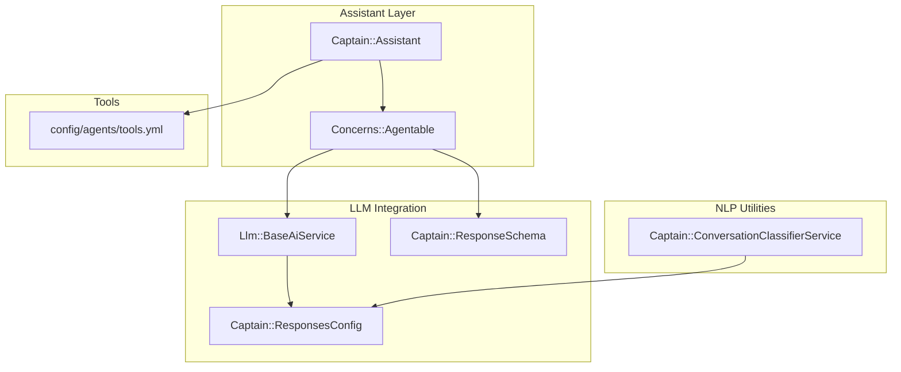
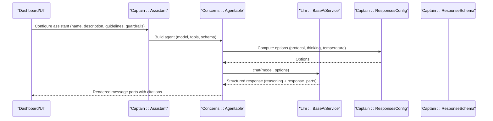
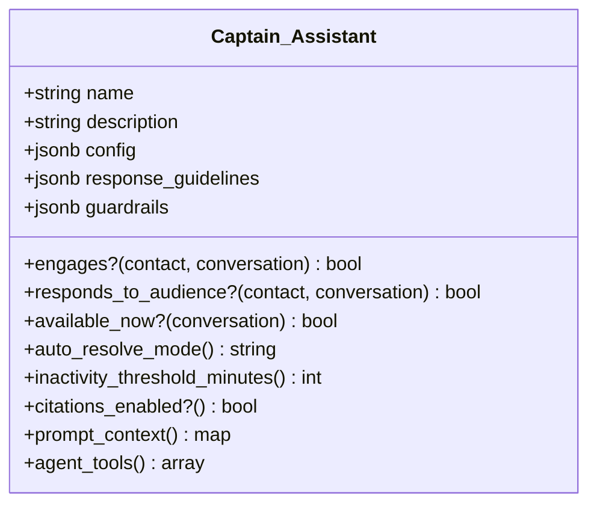
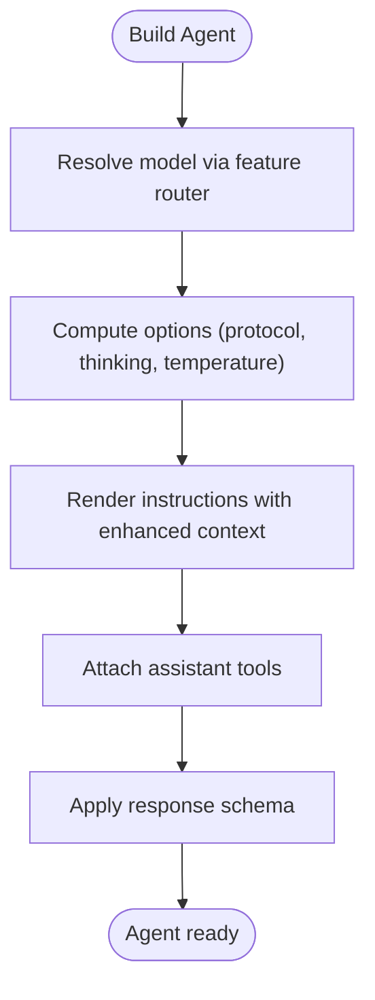
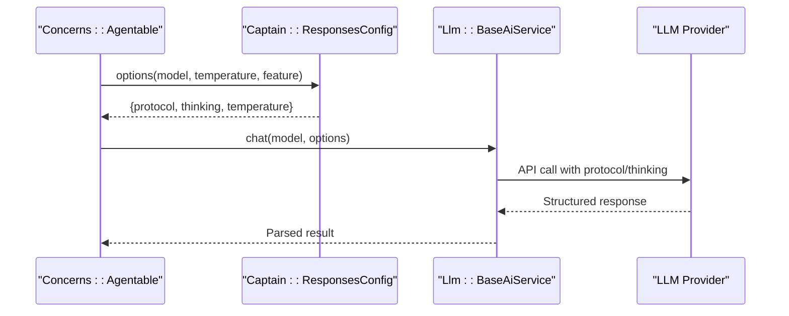
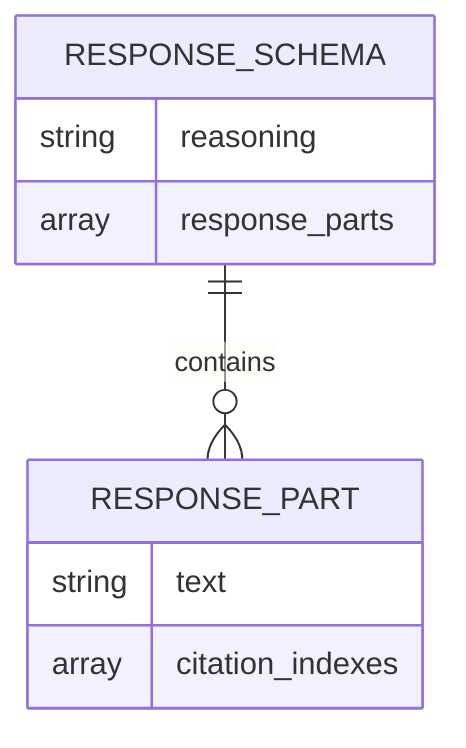
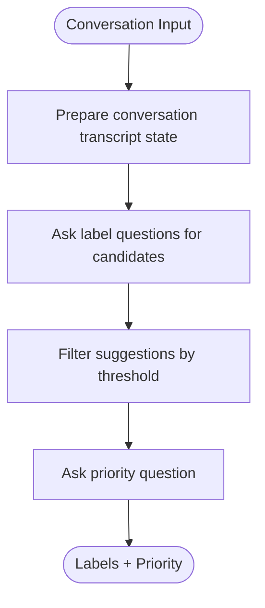
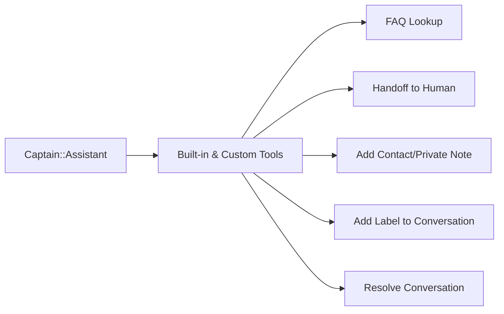
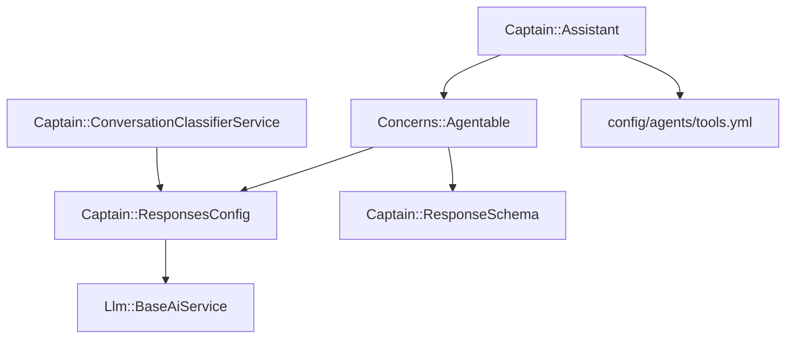

# Captain AI Agent

<cite>
**Referenced Files in This Document**
- [assistant.rb](file://enterprise/app/models/captain/assistant.rb)
- [agentable.rb](file://enterprise/app/models/concerns/agentable.rb)
- [responses_config.rb](file://lib/captain/responses_config.rb)
- [base_ai_service.rb](file://enterprise/app/services/llm/base_ai_service.rb)
- [response_schema.rb](file://enterprise/lib/captain/response_schema.rb)
- [conversation_classifier_service.rb](file://app/services/captain/conversation_classifier_service.rb)
- [tools.yml](file://config/agents/tools.yml)
- [llm_constants.rb](file://lib/llm_constants.rb)
</cite>

## Table of Contents
1. [Introduction](#introduction)
2. [Project Structure](#project-structure)
3. [Core Components](#core-components)
4. [Architecture Overview](#architecture-overview)
5. [Detailed Component Analysis](#detailed-component-analysis)
6. [Dependency Analysis](#dependency-analysis)
7. [Performance Considerations](#performance-considerations)
8. [Troubleshooting Guide](#troubleshooting-guide)
9. [Conclusion](#conclusion)

## Introduction
This document explains Chatwoot’s Captain AI agent system: how assistants are modeled, configured, and executed; how prompts and context are composed; how large language models (LLMs) are integrated; and how tools, guardrails, and response schemas shape the final output. It also covers configuration parameters such as temperature and auto-resolve modes, natural language processing capabilities like conversation classification, and best practices for performance, cost management, and ethical considerations.

## Project Structure
Captain AI is implemented across several layers:
- Assistant model defines assistant metadata, configuration, tool availability, and prompt context.
- Agentable concern standardizes agent construction, instruction rendering, and model selection.
- LLM service layer integrates with RubyLLM and provider-specific options.
- Response schema enforces structured outputs for reliable parsing.
- Conversation classifier uses a dedicated NLP client to suggest labels and priority.
- Tools configuration enumerates built-in and custom tool integrations.

**Diagram sources**
- [assistant.rb:19-55](file://enterprise/app/models/captain/assistant.rb#L19-L55)
- [agentable.rb:1-16](file://enterprise/app/models/concerns/agentable.rb#L1-L16)
- [base_ai_service.rb:21-29](file://enterprise/app/services/llm/base_ai_service.rb#L21-L29)
- [responses_config.rb:2-10](file://lib/captain/responses_config.rb#L2-L10)
- [response_schema.rb:3-16](file://enterprise/lib/captain/response_schema.rb#L3-L16)
- [conversation_classifier_service.rb:1-15](file://app/services/captain/conversation_classifier_service.rb#L1-L15)
- [tools.yml:1-42](file://config/agents/tools.yml#L1-L42)

**Section sources**
- [assistant.rb:19-55](file://enterprise/app/models/captain/assistant.rb#L19-L55)
- [agentable.rb:1-16](file://enterprise/app/models/concerns/agentable.rb#L1-L16)
- [base_ai_service.rb:21-29](file://enterprise/app/services/llm/base_ai_service.rb#L21-L29)
- [responses_config.rb:2-10](file://lib/captain/responses_config.rb#L2-L10)
- [response_schema.rb:3-16](file://enterprise/lib/captain/response_schema.rb#L3-L16)
- [conversation_classifier_service.rb:1-15](file://app/services/captain/conversation_classifier_service.rb#L1-L15)
- [tools.yml:1-42](file://config/agents/tools.yml#L1-L42)

## Core Components
- Captain::Assistant: Defines assistant identity, audience targeting, availability windows, auto-resolve behavior, citation handling, and prompt context including name, description, product name, scenarios, response guidelines, and guardrails.
- Concerns::Agentable: Provides a uniform interface to build an agent with instructions, tools, model, response schema, and temperature settings.
- Llm::BaseAiService: Wraps RubyLLM chat calls, applies protocol and thinking options, and manages temperature based on provider capabilities.
- Captain::ResponsesConfig: Computes provider-specific options (protocol, thinking effort), JSON formatting, and request metadata.
- Captain::ResponseSchema: Enforces a structured response format with reasoning and ordered response parts with optional citation indexes.
- Captain::ConversationClassifierService: Uses a specialized NLP client to propose labels and priority based on conversation messages.
- config/agents/tools.yml: Declares available tools (e.g., FAQ lookup, handoff, notes, labeling, resolution).

**Section sources**
- [assistant.rb:19-55](file://enterprise/app/models/captain/assistant.rb#L19-L55)
- [assistant.rb:83-101](file://enterprise/app/models/captain/assistant.rb#L83-L101)
- [assistant.rb:103-125](file://enterprise/app/models/captain/assistant.rb#L103-L125)
- [assistant.rb:149-166](file://enterprise/app/models/captain/assistant.rb#L149-L166)
- [assistant.rb:206-230](file://enterprise/app/models/captain/assistant.rb#L206-L230)
- [agentable.rb:1-16](file://enterprise/app/models/concerns/agentable.rb#L1-L16)
- [agentable.rb:18-36](file://enterprise/app/models/concerns/agentable.rb#L18-L36)
- [agentable.rb:38-43](file://enterprise/app/models/concerns/agentable.rb#L38-L43)
- [base_ai_service.rb:21-29](file://enterprise/app/services/llm/base_ai_service.rb#L21-L29)
- [responses_config.rb:2-10](file://lib/captain/responses_config.rb#L2-L10)
- [response_schema.rb:3-16](file://enterprise/lib/captain/response_schema.rb#L3-L16)
- [conversation_classifier_service.rb:1-15](file://app/services/captain/conversation_classifier_service.rb#L1-L15)
- [tools.yml:1-42](file://config/agents/tools.yml#L1-L42)

## Architecture Overview
The Captain AI architecture composes an assistant with a set of tools and a structured response schema, then executes it through the LLM integration layer. Prompt context includes assistant identity, product context, scenarios, guidelines, and guardrails. The LLM service layer selects the appropriate protocol and thinking mode per provider, and formats responses according to the schema.

**Diagram sources**
- [assistant.rb:206-230](file://enterprise/app/models/captain/assistant.rb#L206-L230)
- [agentable.rb:1-16](file://enterprise/app/models/concerns/agentable.rb#L1-L16)
- [responses_config.rb:2-10](file://lib/captain/responses_config.rb#L2-L10)
- [base_ai_service.rb:21-29](file://enterprise/app/services/llm/base_ai_service.rb#L21-L29)
- [response_schema.rb:3-16](file://enterprise/lib/captain/response_schema.rb#L3-L16)

## Detailed Component Analysis

### Assistant Model and Configuration
- Identity and metadata: name, description, avatar URL.
- Audience targeting: responds_to_audience? checks configured audience rules.
- Availability window: available_now? supports always, business_hours, outside_business_hours.
- Auto-resolve behavior:
  - Modes: disabled, legacy, evaluated.
  - Threshold: auto_resolve_after normalized to step increments.
  - Optional inactivity resolution message.
- Citations: feature flag and trusted source URL mapping from documents.
- Prompt context: includes name, description, product_name, citation_enabled, scenarios, response_guidelines, guardrails.
- Tools: built-in FAQ lookup and handoff plus enabled custom tools.

**Diagram sources**
- [assistant.rb:19-55](file://enterprise/app/models/captain/assistant.rb#L19-L55)
- [assistant.rb:83-101](file://enterprise/app/models/captain/assistant.rb#L83-L101)
- [assistant.rb:103-125](file://enterprise/app/models/captain/assistant.rb#L103-L125)
- [assistant.rb:149-166](file://enterprise/app/models/captain/assistant.rb#L149-L166)
- [assistant.rb:206-230](file://enterprise/app/models/captain/assistant.rb#L206-L230)

**Section sources**
- [assistant.rb:19-55](file://enterprise/app/models/captain/assistant.rb#L19-L55)
- [assistant.rb:83-101](file://enterprise/app/models/captain/assistant.rb#L83-L101)
- [assistant.rb:103-125](file://enterprise/app/models/captain/assistant.rb#L103-L125)
- [assistant.rb:149-166](file://enterprise/app/models/captain/assistant.rb#L149-L166)
- [assistant.rb:206-230](file://enterprise/app/models/captain/assistant.rb#L206-L230)

### Agent Construction and Prompt Rendering
- Agentable constructs an agent with:
  - Name derived from assistant.
  - Instructions rendered via a template and enhanced runtime context.
  - Tools provided by the assistant.
  - Model resolved via feature routing or installation override.
  - Response schema enforced by Captain::ResponseSchema.
  - Temperature computed from assistant config or default.
- Runtime context merges current time, conversation, contact attributes (if enabled), campaign info, and message length limits.

**Diagram sources**
- [agentable.rb:1-16](file://enterprise/app/models/concerns/agentable.rb#L1-L16)
- [agentable.rb:18-36](file://enterprise/app/models/concerns/agentable.rb#L18-L36)
- [agentable.rb:38-43](file://enterprise/app/models/concerns/agentable.rb#L38-L43)
- [responses_config.rb:2-10](file://lib/captain/responses_config.rb#L2-L10)

**Section sources**
- [agentable.rb:1-16](file://enterprise/app/models/concerns/agentable.rb#L1-L16)
- [agentable.rb:18-36](file://enterprise/app/models/concerns/agentable.rb#L18-L36)
- [agentable.rb:38-43](file://enterprise/app/models/concerns/agentable.rb#L38-L43)
- [responses_config.rb:2-10](file://lib/captain/responses_config.rb#L2-L10)

### LLM Service Layer Integration
- BaseAiService wraps RubyLLM.chat with:
  - Protocol selection (:responses vs :chat_completions).
  - Thinking effort injection when supported.
  - Conditional temperature application.
- ResponsesConfig computes:
  - Provider-specific options.
  - JSON formatting for structured outputs.
  - Request metadata for observability.

**Diagram sources**
- [base_ai_service.rb:21-29](file://enterprise/app/services/llm/base_ai_service.rb#L21-L29)
- [responses_config.rb:2-10](file://lib/captain/responses_config.rb#L2-L10)

**Section sources**
- [base_ai_service.rb:21-29](file://enterprise/app/services/llm/base_ai_service.rb#L21-L29)
- [responses_config.rb:2-10](file://lib/captain/responses_config.rb#L2-L10)

### Response Schema and Structured Outputs
- ResponseSchema enforces:
  - reasoning: free-text thought process.
  - response_parts: ordered array of text segments with optional citation_indexes referencing FAQ results.
- Ensures consistent parsing and safe rendering of customer-visible content.

**Diagram sources**
- [response_schema.rb:3-16](file://enterprise/lib/captain/response_schema.rb#L3-L16)

**Section sources**
- [response_schema.rb:3-16](file://enterprise/lib/captain/response_schema.rb#L3-L16)

### Natural Language Processing Capabilities
- ConversationClassifierService:
  - Suggests labels based on semantic similarity against account labels.
  - Determines priority using predefined criteria.
  - Uses a dedicated JEV client with a specific model and question templates.

**Diagram sources**
- [conversation_classifier_service.rb:21-42](file://app/services/captain/conversation_classifier_service.rb#L21-L42)
- [conversation_classifier_service.rb:57-64](file://app/services/captain/conversation_classifier_service.rb#L57-L64)

**Section sources**
- [conversation_classifier_service.rb:1-15](file://app/services/captain/conversation_classifier_service.rb#L1-L15)
- [conversation_classifier_service.rb:21-42](file://app/services/captain/conversation_classifier_service.rb#L21-L42)
- [conversation_classifier_service.rb:57-64](file://app/services/captain/conversation_classifier_service.rb#L57-L64)

### Tool Integration
- Built-in tools include FAQ lookup and handoff to human agents.
- Custom tools can be enabled and exposed to the assistant.
- Tools configuration file enumerates available tool definitions for frontend display and backend resolution.

**Diagram sources**
- [assistant.rb:206-212](file://enterprise/app/models/captain/assistant.rb#L206-L212)
- [tools.yml:1-42](file://config/agents/tools.yml#L1-L42)

**Section sources**
- [assistant.rb:206-212](file://enterprise/app/models/captain/assistant.rb#L206-L212)
- [tools.yml:1-42](file://config/agents/tools.yml#L1-L42)

## Dependency Analysis
Key dependencies and relationships:
- Assistant depends on Agentable for agent construction and on tools configuration for capability exposure.
- Agentable depends on ResponsesConfig for provider-specific options and on ResponseSchema for output structure.
- LLM service depends on ResponsesConfig and RubyLLM for execution.
- ConversationClassifierService depends on a dedicated NLP client and uses ResponsesConfig for metadata.

**Diagram sources**
- [assistant.rb:19-55](file://enterprise/app/models/captain/assistant.rb#L19-L55)
- [agentable.rb:1-16](file://enterprise/app/models/concerns/agentable.rb#L1-L16)
- [responses_config.rb:2-10](file://lib/captain/responses_config.rb#L2-L10)
- [base_ai_service.rb:21-29](file://enterprise/app/services/llm/base_ai_service.rb#L21-L29)
- [conversation_classifier_service.rb:1-15](file://app/services/captain/conversation_classifier_service.rb#L1-L15)
- [tools.yml:1-42](file://config/agents/tools.yml#L1-L42)

**Section sources**
- [assistant.rb:19-55](file://enterprise/app/models/captain/assistant.rb#L19-L55)
- [agentable.rb:1-16](file://enterprise/app/models/concerns/agentable.rb#L1-L16)
- [responses_config.rb:2-10](file://lib/captain/responses_config.rb#L2-L10)
- [base_ai_service.rb:21-29](file://enterprise/app/services/llm/base_ai_service.rb#L21-L29)
- [conversation_classifier_service.rb:1-15](file://app/services/captain/conversation_classifier_service.rb#L1-L15)
- [tools.yml:1-42](file://config/agents/tools.yml#L1-L42)

## Performance Considerations
- Model selection and routing:
  - Use feature routing to select optimal models per account or installation defaults.
  - Prefer smaller or faster models where possible to reduce latency and cost.
- Temperature and thinking:
  - Adjust temperature to balance creativity and determinism; lower values improve consistency.
  - Enable thinking only when needed; high-effort thinking increases latency and cost.
- JSON formatting:
  - Use structured responses to minimize post-processing overhead.
- Concurrency and batching:
  - Batch requests where feasible (e.g., multiple label questions) to reduce round-trips.
- Caching and reuse:
  - Cache frequent FAQ lookups and document embeddings to avoid redundant computations.
- Observability:
  - Track request metadata (protocol, thinking effort) for cost attribution and optimization.

[No sources needed since this section provides general guidance]

## Troubleshooting Guide
- Invalid response_window:
  - Ensure response_window is one of the allowed values; otherwise validation fails.
- Auto-resolve misconfiguration:
  - Verify auto_resolve_mode and auto_resolve_after thresholds are within allowed ranges and steps.
- Citation issues:
  - Confirm citations_enabled? and that trusted citation URLs are mapped correctly from documents.
- LLM errors:
  - Check provider endpoint configuration and ensure protocol/thinking options match provider capabilities.
- Tool resolution failures:
  - Validate tool slugs and ensure custom tools are enabled and properly registered.

**Section sources**
- [assistant.rb:189-194](file://enterprise/app/models/captain/assistant.rb#L189-L194)
- [assistant.rb:181-187](file://enterprise/app/models/captain/assistant.rb#L181-L187)
- [assistant.rb:149-166](file://enterprise/app/models/captain/assistant.rb#L149-L166)
- [base_ai_service.rb:21-29](file://enterprise/app/services/llm/base_ai_service.rb#L21-L29)

## Conclusion
Chatwoot’s Captain AI agent system combines a well-defined assistant model, robust prompt composition, structured response enforcement, and flexible LLM integration. By tuning configuration parameters like temperature and auto-resolve modes, leveraging tools and guardrails, and applying thoughtful prompt engineering and context management, teams can deliver reliable, cost-effective, and ethically sound AI-powered support experiences.

[No sources needed since this section summarizes without analyzing specific files]