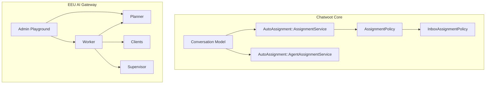
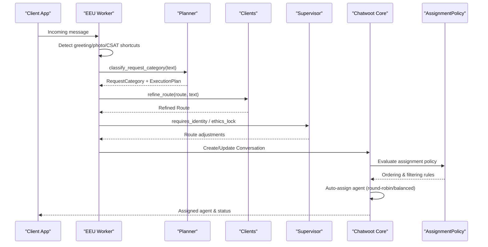
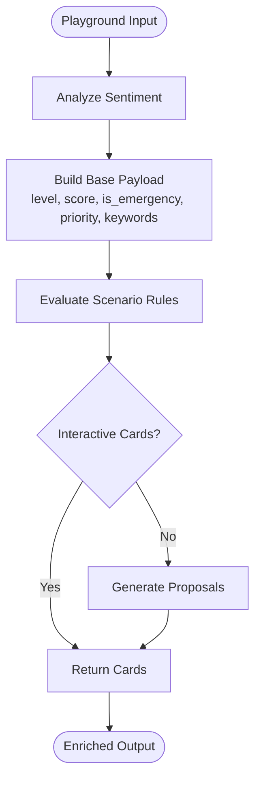
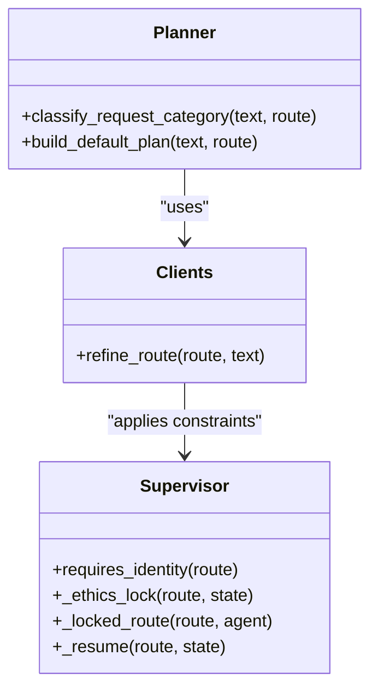
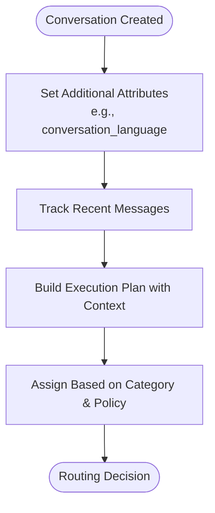
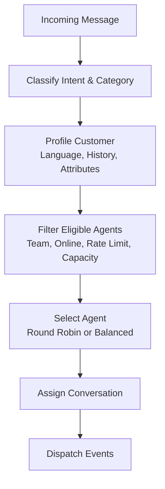
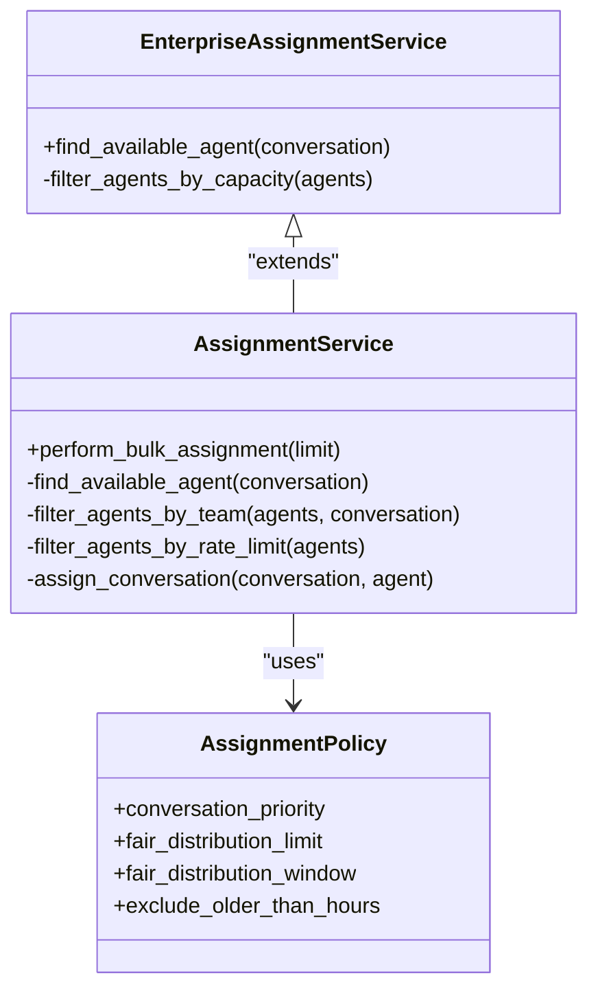
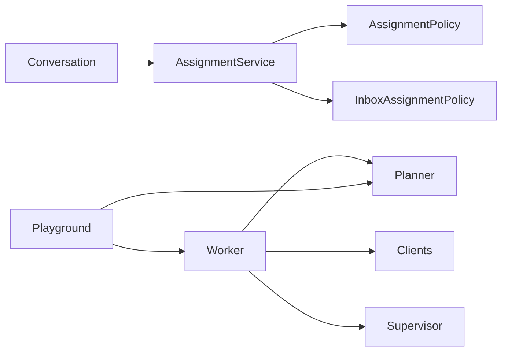
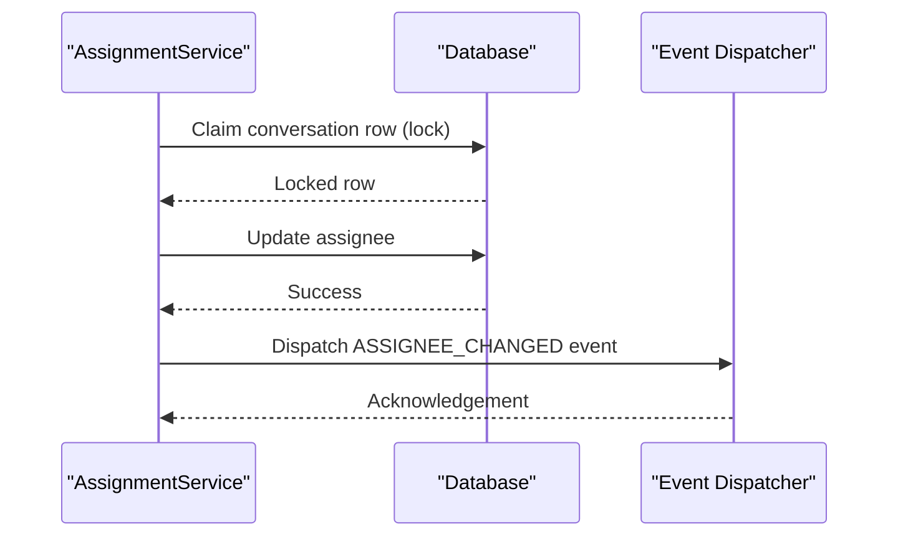

# Intelligent Routing

<cite>
**Referenced Files in This Document**
- [conversation.rb](file://app/models/conversation.rb)
- [assignment_policy.rb](file://app/models/assignment_policy.rb)
- [inbox_assignment_policy.rb](file://app/models/inbox_assignment_policy.rb)
- [assignment_service.rb](file://app/services/auto_assignment/assignment_service.rb)
- [agent_assignment_service.rb](file://app/services/auto_assignment/agent_assignment_service.rb)
- [eeu_ai_playground.py](file://.worktrees/eeu-ai-gateway/services/eeu-ai/eeu_ai/admin/playground.py)
- [eeu_ai_worker.py](file://.worktrees/eeu-ai-gateway/services/eeu-ai/eeu_ai/worker.py)
- [eeu_ai_planner.py](file://.worktrees/eeu-ai-gateway/services/eeu-ai/eeu_ai/planner.py)
- [eeu_ai_clients.py](file://.worktrees/eeu-ai-gateway/services/eeu-ai/eeu_ai/clients.py)
- [eeu_ai_supervisor.py](file://.worktrees/eeu-ai-gateway/services/eeu-ai/eeu_ai/agents/supervisor.py)
- [enterprise_assignment_service.rb](file://enterprise/app/services/enterprise/auto_assignment/assignment_service.rb)
</cite>

## Table of Contents
1. [Introduction](#introduction)
2. [Project Structure](#project-structure)
3. [Core Components](#core-components)
4. [Architecture Overview](#architecture-overview)
5. [Detailed Component Analysis](#detailed-component-analysis)
6. [Dependency Analysis](#dependency-analysis)
7. [Performance Considerations](#performance-considerations)
8. [Troubleshooting Guide](#troubleshooting-guide)
9. [Conclusion](#conclusion)
10. [Appendices](#appendices)

## Introduction
This document explains Chatwoot’s intelligent routing system, focusing on how conversations are classified and routed to the right agents or automated flows. It covers:
- Sentiment analysis capabilities used to enrich routing decisions
- Intent recognition and request categorization that guide routing
- Customer profiling via conversation attributes and history
- Routing rules based on content, customer history, and agent availability
- Skill-based assignment, workload balancing, and escalation policies
- Configuration examples, custom classification rules, and performance metrics
- Machine learning models for categorization and their training data requirements
- Customization options for industry-specific scenarios

The documentation combines core Ruby services (auto-assignment and policy-driven routing) with the EEU AI gateway components that provide sentiment analysis, intent classification, and planning logic.

## Project Structure
Intelligent routing spans two layers:
- Core Chatwoot layer (Ruby): Conversation model, auto-assignment services, and assignment policies define how conversations are prioritized, filtered, and assigned to available agents.
- EEU AI gateway layer (Python): Worker, planner, clients, supervisor, and playground integrate sentiment analysis, intent detection, scenario evaluation, and proposal generation to inform routing and response strategies.

**Diagram sources**
- [conversation.rb:57-146](file://app/models/conversation.rb#L57-L146)
- [assignment_service.rb:1-145](file://app/services/auto_assignment/assignment_service.rb#L1-L145)
- [agent_assignment_service.rb:1-82](file://app/services/auto_assignment/agent_assignment_service.rb#L1-L82)
- [assignment_policy.rb:24-39](file://app/models/assignment_policy.rb#L24-L39)
- [inbox_assignment_policy.rb:16-21](file://app/models/inbox_assignment_policy.rb#L16-L21)
- [eeu_ai_worker.py:442-474](file://.worktrees/eeu-ai-gateway/services/eeu-ai/eeu_ai/worker.py#L442-L474)
- [eeu_ai_planner.py:311-311](file://.worktrees/eeu-ai-gateway/services/eeu-ai/eeu_ai/planner.py#L311-L311)
- [eeu_ai_clients.py:112-112](file://.worktrees/eeu-ai-gateway/services/eeu-ai/eeu_ai/clients.py#L112-L112)
- [eeu_ai_supervisor.py:82-158](file://.worktrees/eeu-ai-gateway/services/eeu-ai/eeu_ai/agents/supervisor.py#L82-L158)
- [eeu_ai_playground.py:197-232](file://.worktrees/eeu-ai-gateway/services/eeu-ai/eeu_ai/admin/playground.py#L197-L232)

**Section sources**
- [conversation.rb:57-146](file://app/models/conversation.rb#L57-L146)
- [assignment_service.rb:1-145](file://app/services/auto_assignment/assignment_service.rb#L1-L145)
- [agent_assignment_service.rb:1-82](file://app/services/auto_assignment/agent_assignment_service.rb#L1-L82)
- [assignment_policy.rb:24-39](file://app/models/assignment_policy.rb#L24-L39)
- [inbox_assignment_policy.rb:16-21](file://app/models/inbox_assignment_policy.rb#L16-L21)
- [eeu_ai_worker.py:442-474](file://.worktrees/eeu-ai-gateway/services/eeu-ai/eeu_ai/worker.py#L442-L474)
- [eeu_ai_planner.py:311-311](file://.worktrees/eeu-ai-gateway/services/eeu-ai/eeu_ai/planner.py#L311-L311)
- [eeu_ai_clients.py:112-112](file://.worktrees/eeu-ai-gateway/services/eeu-ai/eeu_ai/clients.py#L112-L112)
- [eeu_ai_supervisor.py:82-158](file://.worktrees/eeu-ai-gateway/services/eeu-ai/eeu_ai/agents/supervisor.py#L82-L158)
- [eeu_ai_playground.py:197-232](file://.worktrees/eeu-ai-gateway/services/eeu-ai/eeu_ai/admin/playground.py#L197-L232)

## Core Components
- Conversation model: Holds conversation state, priority, language, and links to contacts, teams, and assignees. It exposes scopes and events used by auto-assignment and automation.
- Auto-assignment services: Determine eligible agents using team filters, rate limits, round-robin/balanced selection, and policy-driven ordering.
- Assignment policies: Define assignment order, conversation priority, fair distribution windows, and age exclusions.
- EEU AI worker: Handles message intake, greeting/photo/CSAT shortcuts, and delegates to planner and clients for intent and category classification.
- Planner: Classifies requests into categories and builds execution plans, incorporating conversation context and history.
- Clients: Refine routes and perform routing decisions based on text and route metadata.
- Supervisor: Enforces identity requirements, ethics locks, and resumption logic during routing.
- Admin playground: Integrates sentiment analysis and scenario evaluation to enrich routing outputs and interactive cards.

**Section sources**
- [conversation.rb:57-146](file://app/models/conversation.rb#L57-L146)
- [assignment_service.rb:1-145](file://app/services/auto_assignment/assignment_service.rb#L1-L145)
- [agent_assignment_service.rb:1-82](file://app/services/auto_assignment/agent_assignment_service.rb#L1-L82)
- [assignment_policy.rb:24-39](file://app/models/assignment_policy.rb#L24-L39)
- [eeu_ai_worker.py:442-474](file://.worktrees/eeu-ai-gateway/services/eeu-ai/eeu_ai/worker.py#L442-L474)
- [eeu_ai_planner.py:311-311](file://.worktrees/eeu-ai-gateway/services/eeu-ai/eeu_ai/planner.py#L311-L311)
- [eeu_ai_clients.py:112-112](file://.worktrees/eeu-ai-gateway/services/eeu-ai/eeu_ai/clients.py#L112-L112)
- [eeu_ai_supervisor.py:82-158](file://.worktrees/eeu-ai-gateway/services/eeu-ai/eeu_ai/agents/supervisor.py#L82-L158)
- [eeu_ai_playground.py:197-232](file://.worktrees/eeu-ai-gateway/services/eeu-ai/eeu_ai/admin/playground.py#L197-L232)

## Architecture Overview
The intelligent routing architecture integrates sentiment-aware classification, intent recognition, and policy-driven assignment:

**Diagram sources**
- [eeu_ai_worker.py:442-474](file://.worktrees/eeu-ai-gateway/services/eeu-ai/eeu_ai/worker.py#L442-L474)
- [eeu_ai_planner.py:311-311](file://.worktrees/eeu-ai-gateway/services/eeu-ai/eeu_ai/planner.py#L311-L311)
- [eeu_ai_clients.py:112-112](file://.worktrees/eeu-ai-gateway/services/eeu-ai/eeu_ai/clients.py#L112-L112)
- [eeu_ai_supervisor.py:82-158](file://.worktrees/eeu-ai-gateway/services/eeu-ai/eeu_ai/agents/supervisor.py#L82-L158)
- [assignment_service.rb:1-145](file://app/services/auto_assignment/assignment_service.rb#L1-L145)
- [assignment_policy.rb:24-39](file://app/models/assignment_policy.rb#L24-L39)

## Detailed Component Analysis

### Sentiment Analysis Integration
Sentiment analysis is integrated into the admin playground to enrich routing outputs:
- The playground calls a sentiment classifier to compute level, score, emergency flags, priority, and detected keywords.
- These signals can influence scenario evaluation and interactive card generation.

**Diagram sources**
- [eeu_ai_playground.py:197-232](file://.worktrees/eeu-ai-gateway/services/eeu-ai/eeu_ai/admin/playground.py#L197-L232)

**Section sources**
- [eeu_ai_playground.py:197-232](file://.worktrees/eeu-ai-gateway/services/eeu-ai/eeu_ai/admin/playground.py#L197-L232)

### Intent Recognition and Request Categorization
Intent recognition and categorization are handled by the planner and clients:
- Planner classifies requests into categories and constructs execution plans.
- Clients refine routes based on text and existing route metadata.
- Supervisor enforces constraints like identity requirements and ethics locks.

**Diagram sources**
- [eeu_ai_planner.py:311-311](file://.worktrees/eeu-ai-gateway/services/eeu-ai/eeu_ai/planner.py#L311-L311)
- [eeu_ai_clients.py:112-112](file://.worktrees/eeu-ai-gateway/services/eeu-ai/eeu_ai/clients.py#L112-L112)
- [eeu_ai_supervisor.py:82-158](file://.worktrees/eeu-ai-gateway/services/eeu-ai/eeu_ai/agents/supervisor.py#L82-L158)

**Section sources**
- [eeu_ai_planner.py:311-311](file://.worktrees/eeu-ai-gateway/services/eeu-ai/eeu_ai/planner.py#L311-L311)
- [eeu_ai_clients.py:112-112](file://.worktrees/eeu-ai-gateway/services/eeu-ai/eeu_ai/clients.py#L112-L112)
- [eeu_ai_supervisor.py:82-158](file://.worktrees/eeu-ai-gateway/services/eeu-ai/eeu_ai/agents/supervisor.py#L82-L158)

### Customer Profiling and History-Aware Routing
Customer profiling leverages conversation attributes and recent history:
- Conversation model stores additional_attributes including conversation_language and other contextual fields.
- Planner incorporates recent conversation history when building prompts and execution plans.

**Diagram sources**
- [conversation.rb:68-82](file://app/models/conversation.rb#L68-L82)
- [eeu_ai_planner.py:657-667](file://.worktrees/eeu-ai-gateway/services/eeu-ai/eeu_ai/planner.py#L657-L667)

**Section sources**
- [conversation.rb:68-82](file://app/models/conversation.rb#L68-L82)
- [eeu_ai_planner.py:657-667](file://.worktrees/eeu-ai-gateway/services/eeu-ai/eeu_ai/planner.py#L657-L667)

### Routing Rules Based on Content, History, and Agent Availability
Routing rules combine:
- Content signals: intent/category from planner and sentiment from playground.
- History signals: recent messages and conversation attributes.
- Agent availability: online status, team membership, rate limits, and capacity checks.

**Diagram sources**
- [assignment_service.rb:68-105](file://app/services/auto_assignment/assignment_service.rb#L68-L105)
- [agent_assignment_service.rb:61-76](file://app/services/auto_assignment/agent_assignment_service.rb#L61-L76)
- [eeu_ai_worker.py:442-474](file://.worktrees/eeu-ai-gateway/services/eeu-ai/eeu_ai/worker.py#L442-L474)

**Section sources**
- [assignment_service.rb:68-105](file://app/services/auto_assignment/assignment_service.rb#L68-L105)
- [agent_assignment_service.rb:61-76](file://app/services/auto_assignment/agent_assignment_service.rb#L61-L76)
- [eeu_ai_worker.py:442-474](file://.worktrees/eeu-ai-gateway/services/eeu-ai/eeu_ai/worker.py#L442-L474)

### Skill-Based Assignment, Workload Balancing, and Escalation Policies
Skill-based assignment and workload balancing are implemented through:
- Team filtering and member constraints.
- Round-robin and balanced selectors.
- Enterprise extensions adding capacity checks and advanced assignment features.
- Assignment policies controlling conversation priority and fair distribution windows.

**Diagram sources**
- [assignment_service.rb:1-145](file://app/services/auto_assignment/assignment_service.rb#L1-L145)
- [enterprise_assignment_service.rb:1-37](file://enterprise/app/services/enterprise/auto_assignment/assignment_service.rb#L1-L37)
- [assignment_policy.rb:24-39](file://app/models/assignment_policy.rb#L24-L39)

**Section sources**
- [assignment_service.rb:1-145](file://app/services/auto_assignment/assignment_service.rb#L1-L145)
- [enterprise_assignment_service.rb:1-37](file://enterprise/app/services/enterprise/auto_assignment/assignment_service.rb#L1-L37)
- [assignment_policy.rb:24-39](file://app/models/assignment_policy.rb#L24-L39)

### Examples of Routing Configuration and Custom Classification Rules
Configuration examples include:
- Assignment policies with round-robin or balanced ordering, conversation priority settings, and fair distribution windows.
- Frontend fixtures demonstrating policy structures and camelCase mappings for UI consumption.

Custom classification rules can be added by:
- Extending planner classification logic to incorporate domain-specific intents.
- Using playground scenario evaluation to map specific phrases or patterns to actionable cards.

**Section sources**
- [assignment_policy.rb:24-39](file://app/models/assignment_policy.rb#L24-L39)
- [inbox_assignment_policy.rb:16-21](file://app/models/inbox_assignment_policy.rb#L16-L21)

### Performance Metrics and Monitoring
Key metrics to monitor:
- Assignment latency and throughput per inbox.
- Agent utilization and balance across teams.
- Intent classification accuracy and fallback rates.
- Sentiment analysis impact on escalation frequency.

Recommended instrumentation:
- Track events dispatched by auto-assignment services.
- Log planner classification outcomes and confidence scores.
- Monitor worker shortcuts (greeting/photo/CSAT) to ensure low-latency paths.

[No sources needed since this section provides general guidance]

### Machine Learning Models and Training Data Requirements
Models involved:
- Sentiment classifier (used in playground).
- Intent classifier and request categorizer (planner).
- Proposal engine and scenario manager (playground).

Training data requirements:
- Labeled samples for sentiment levels and emergency detection.
- Intent labels aligned with business domains (e.g., billing, outage reporting).
- Scenario rule datasets mapping phrases to interactive actions.
- Historical conversation transcripts for context-aware planning.

[No sources needed since this section provides general guidance]

### Customization Options for Industry-Specific Scenarios
To tailor routing for specific industries:
- Extend planner classification to recognize domain-specific intents and entities.
- Configure scenario rules in the playground to generate targeted interactive cards.
- Adjust assignment policies to prioritize longest-waiting or earliest-created conversations based on SLA needs.
- Use enterprise capacity filtering to enforce agent workload caps.

**Section sources**
- [eeu_ai_playground.py:197-232](file://.worktrees/eeu-ai-gateway/services/eeu-ai/eeu_ai/admin/playground.py#L197-L232)
- [assignment_policy.rb:24-39](file://app/models/assignment_policy.rb#L24-L39)
- [enterprise_assignment_service.rb:1-37](file://enterprise/app/services/enterprise/auto_assignment/assignment_service.rb#L1-L37)

## Dependency Analysis
The routing pipeline depends on both core Chatwoot services and EEU AI components:

**Diagram sources**
- [conversation.rb:57-146](file://app/models/conversation.rb#L57-L146)
- [assignment_service.rb:1-145](file://app/services/auto_assignment/assignment_service.rb#L1-L145)
- [assignment_policy.rb:24-39](file://app/models/assignment_policy.rb#L24-L39)
- [inbox_assignment_policy.rb:16-21](file://app/models/inbox_assignment_policy.rb#L16-L21)
- [eeu_ai_worker.py:442-474](file://.worktrees/eeu-ai-gateway/services/eeu-ai/eeu_ai/worker.py#L442-L474)
- [eeu_ai_planner.py:311-311](file://.worktrees/eeu-ai-gateway/services/eeu-ai/eeu_ai/planner.py#L311-L311)
- [eeu_ai_clients.py:112-112](file://.worktrees/eeu-ai-gateway/services/eeu-ai/eeu_ai/clients.py#L112-L112)
- [eeu_ai_supervisor.py:82-158](file://.worktrees/eeu-ai-gateway/services/eeu-ai/eeu_ai/agents/supervisor.py#L82-L158)
- [eeu_ai_playground.py:197-232](file://.worktrees/eeu-ai-gateway/services/eeu-ai/eeu_ai/admin/playground.py#L197-L232)

**Section sources**
- [conversation.rb:57-146](file://app/models/conversation.rb#L57-L146)
- [assignment_service.rb:1-145](file://app/services/auto_assignment/assignment_service.rb#L1-L145)
- [assignment_policy.rb:24-39](file://app/models/assignment_policy.rb#L24-L39)
- [inbox_assignment_policy.rb:16-21](file://app/models/inbox_assignment_policy.rb#L16-L21)
- [eeu_ai_worker.py:442-474](file://.worktrees/eeu-ai-gateway/services/eeu-ai/eeu_ai/worker.py#L442-L474)
- [eeu_ai_planner.py:311-311](file://.worktrees/eeu-ai-gateway/services/eeu-ai/eeu_ai/planner.py#L311-L311)
- [eeu_ai_clients.py:112-112](file://.worktrees/eeu-ai-gateway/services/eeu-ai/eeu_ai/clients.py#L112-L112)
- [eeu_ai_supervisor.py:82-158](file://.worktrees/eeu-ai-gateway/services/eeu-ai/eeu_ai/agents/supervisor.py#L82-L158)
- [eeu_ai_playground.py:197-232](file://.worktrees/eeu-ai-gateway/services/eeu-ai/eeu_ai/admin/playground.py#L197-L232)

## Performance Considerations
- Prefer deterministic shortcuts in the worker for greetings, photos, and CSAT triggers to reduce LLM dependency.
- Cache frequently used scenario evaluations and proposal sets where possible.
- Use assignment policies to limit stale backlog processing and focus on active conversations.
- Monitor agent rate limits and capacity to prevent overload and ensure balanced distribution.

[No sources needed since this section provides general guidance]

## Troubleshooting Guide
Common issues and resolutions:
- Misrouted conversations due to incorrect intent classification: Review planner classification inputs and adjust scenario rules in the playground.
- Agents not receiving assignments: Verify team membership, online status, and rate limits; check assignment policy configuration.
- High escalation rates: Inspect sentiment analysis outputs and emergency flags; tune scenario thresholds.
- Duplicate assignment events: Ensure atomic claim-and-assign operations and lock handling are functioning correctly.

**Section sources**
- [assignment_service.rb:95-124](file://app/services/auto_assignment/assignment_service.rb#L95-L124)
- [eeu_ai_playground.py:197-232](file://.worktrees/eeu-ai-gateway/services/eeu-ai/eeu_ai/admin/playground.py#L197-L232)
- [eeu_ai_worker.py:442-474](file://.worktrees/eeu-ai-gateway/services/eeu-ai/eeu_ai/worker.py#L442-L474)

## Conclusion
Chatwoot’s intelligent routing system combines robust auto-assignment mechanisms with AI-driven sentiment and intent analysis. By leveraging assignment policies, team-based filtering, and enterprise capacity controls, organizations can implement skill-based routing, workload balancing, and escalation policies tailored to their operational needs. The EEU AI gateway enhances routing with scenario evaluation and proposal generation, enabling industry-specific customization and improved customer experiences.

[No sources needed since this section summarizes without analyzing specific files]

## Appendices

### API and Event Flow for Assignment

**Diagram sources**
- [assignment_service.rb:107-133](file://app/services/auto_assignment/assignment_service.rb#L107-L133)