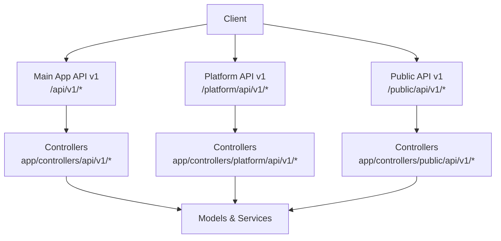
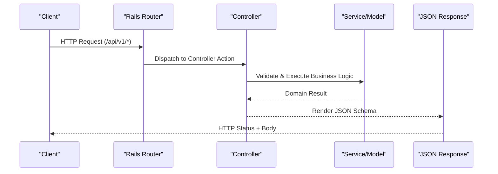
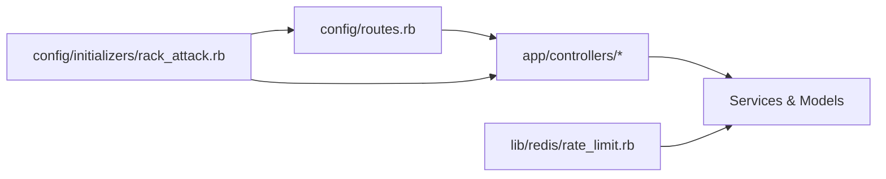

# API Reference

<cite>
**Referenced Files in This Document**
- [routes.rb](file://config/routes.rb)
- [swagger.json](file://swagger/swagger.json)
- [accounts_controller.rb (API v1)](file://app/controllers/api/v1/accounts_controller.rb)
- [accounts_controller.rb (Platform v1)](file://app/controllers/platform/api/v1/accounts_controller.rb)
- [inboxes_controller.rb (Public v1)](file://app/controllers/public/api/v1/inboxes_controller.rb)
- [rack_attack.rb](file://config/initializers/rack_attack.rb)
- [rate_limit.rb](file://lib/redis/rate_limit.rb)
- [create_update_payload.yml](file://swagger/definitions/request/webhooks/create_update_payload.yml)
- [webhooks.js](file://app/javascript/dashboard/api/webhooks.js)
</cite>

## Table of Contents
1. [Introduction](#introduction)
2. [Project Structure](#project-structure)
3. [Core Components](#core-components)
4. [Architecture Overview](#architecture-overview)
5. [Detailed Component Analysis](#detailed-component-analysis)
6. [Dependency Analysis](#dependency-analysis)
7. [Performance Considerations](#performance-considerations)
8. [Troubleshooting Guide](#troubleshooting-guide)
9. [Conclusion](#conclusion)
10. [Appendices](#appendices)

## Introduction
This document provides a comprehensive API reference for Chatwoot’s RESTful APIs, covering:
- Main Application API v1 with Bearer token authentication
- Platform API for third-party integrations using OAuth2 and platform app credentials
- Public API for widget and external service interactions
- Webhook endpoints for event-driven integrations
- Authentication methods, rate limiting, error codes, versioning strategies
- Security considerations, best practices, and client implementation guidelines
- SDK references and code samples for popular programming languages

The API surface is defined by Rails routes and OpenAPI/Swagger definitions. The main application API v1 is scoped under /api/v1, the Platform API under /platform/api/v1, and the Public API under /public/api/v1.

## Project Structure
Chatwoot exposes three primary API namespaces:
- Main Application API v1: account-scoped resources for dashboard and agent workflows
- Platform API v1: programmatic access for third-party apps via platform apps
- Public API v1: public-facing endpoints for widgets and contact-initiated conversations

**Diagram sources**
- [routes.rb:48-618](file://config/routes.rb#L48-L618)
- [routes.rb:647-695](file://config/routes.rb#L647-L695)

**Section sources**
- [routes.rb:48-618](file://config/routes.rb#L48-L618)
- [routes.rb:647-695](file://config/routes.rb#L647-L695)

## Core Components
- Main Application API v1: Account-scoped REST endpoints for accounts, agents, contacts, conversations, labels, campaigns, reports, and more. Uses Devise Token Auth and supports Bearer tokens.
- Platform API v1: Endpoints to manage platform apps’ permitted accounts, users, and agent bots. Uses platform app bearer auth or API key.
- Public API v1: Endpoints for inboxes, contacts, conversations, and messages exposed to websites/widgets.
- Webhooks: Event-driven notifications for conversation, message, and contact lifecycle events.

Key controller entry points:
- Main App API v1: [accounts_controller.rb (API v1)](file://app/controllers/api/v1/accounts_controller.rb)
- Platform API v1: [accounts_controller.rb (Platform v1)](file://app/controllers/platform/api/v1/accounts_controller.rb)
- Public API v1: [inboxes_controller.rb (Public v1)](file://app/controllers/public/api/v1/inboxes_controller.rb)

**Section sources**
- [accounts_controller.rb (API v1):1-190](file://app/controllers/api/v1/accounts_controller.rb#L1-L190)
- [accounts_controller.rb (Platform v1):1-51](file://app/controllers/platform/api/v1/accounts_controller.rb#L1-L51)
- [inboxes_controller.rb (Public v1):1-34](file://app/controllers/public/api/v1/inboxes_controller.rb#L1-L34)

## Architecture Overview
The API architecture follows a layered design:
- Routing layer defines namespace paths and HTTP verbs
- Controller layer handles request validation, authorization, and business orchestration
- Service/model layers implement domain logic
- Response rendering uses JSON views and Swagger-defined schemas

**Diagram sources**
- [routes.rb:48-618](file://config/routes.rb#L48-L618)
- [accounts_controller.rb (API v1):23-61](file://app/controllers/api/v1/accounts_controller.rb#L23-L61)

## Detailed Component Analysis

### Main Application API v1
- Base path: /api/v1
- Authentication: Bearer tokens via Devise Token Auth; legacy headers supported but Bearer takes precedence
- Scope: Account-scoped resources under /api/v1/accounts/:account_id
- Key endpoints include:
  - Accounts: create, show, update, cache_keys, update_active_at
  - Contacts, Conversations, Messages, Labels, Inboxes, Campaigns, Reports, Integrations, Webhooks
  - Widget sub-APIs for direct uploads, config, events, messages, and conversations

Authentication behavior:
- Bearer Authorization header is preferred over legacy api_access_token
- Empty or invalid Bearer does not fall back to legacy headers

Rate limiting:
- Per-account and per-user throttling rules are configured in Rack::Attack
- Examples include conversation transcript, agent create/delete, attachment upload, contact search, and report endpoints

Error handling:
- Custom exceptions are rescued and rendered as JSON errors
- Example: account creation returns unprocessable entity on Shopify signup errors

Example call paths:
- GET /api/v1/profile with Authorization: Bearer <token>
- POST /api/v1/accounts (account creation)
- GET /api/v1/accounts/:id

**Section sources**
- [accounts_controller.rb (API v1):1-190](file://app/controllers/api/v1/accounts_controller.rb#L1-L190)
- [routes.rb:48-618](file://config/routes.rb#L48-L618)
- [rack_attack.rb:291-382](file://config/initializers/rack_attack.rb#L291-L382)

### Platform API v1
- Base path: /platform/api/v1
- Authentication: platformAppBearerAuth or platformAppApiKey (OAuth2 flow for platform apps)
- Resources:
  - Accounts: index, show, create, update, destroy
  - Account Users: list and manage user-permissions within permitted accounts
  - Agent Bots: CRUD operations
  - Users: create, show, update, destroy; login and token endpoints

Swagger schema references define request/response payloads and security schemes.

Example call paths:
- POST /platform/api/v1/accounts
- GET /platform/api/v1/accounts/:account_id
- PATCH /platform/api/v1/accounts/:account_id
- DELETE /platform/api/v1/accounts/:account_id

**Section sources**
- [swagger.json:22-215](file://swagger/swagger.json#L22-L215)
- [swagger.json:600-793](file://swagger/swagger.json#L600-L793)
- [accounts_controller.rb (Platform v1):1-51](file://app/controllers/platform/api/v1/accounts_controller.rb#L1-L51)
- [routes.rb:647-669](file://config/routes.rb#L647-L669)

### Public API v1
- Base path: /public/api/v1
- Purpose: Expose inbox, contact, conversation, and message endpoints for website widgets and external services
- Key controllers:
  - Inboxes: resolve channel identifier and validate HMAC where applicable
  - CSAT Survey: show and update survey responses
  - Portals: help center content endpoints

Example call paths:
- GET /public/api/v1/inboxes/:id
- GET /public/api/v1/csat_survey/:id
- GET /hc/:slug/articles/:article_slug

**Section sources**
- [inboxes_controller.rb (Public v1):1-34](file://app/controllers/public/api/v1/inboxes_controller.rb#L1-L34)
- [routes.rb:673-709](file://config/routes.rb#L673-L709)

### Webhooks
- Subscription model allows clients to subscribe to event types such as conversation_created, message_created, contact_updated, etc.
- Payload schema includes url, name, and subscriptions array
- Frontend integration uses a dedicated webhooks client module

Event payload example fields:
- url: string
- name: string
- subscriptions: array of strings from the enumerated set

Frontend usage:
- WebHooks class extends ApiClient with account-scoped base path

**Section sources**
- [create_update_payload.yml:1-30](file://swagger/definitions/request/webhooks/create_update_payload.yml#L1-L30)
- [webhooks.js:1-9](file://app/javascript/dashboard/api/webhooks.js#L1-L9)

## Dependency Analysis
The API depends on routing, controllers, and configuration modules:
- Routes define namespace boundaries and resource paths
- Controllers enforce authentication, authorization, and business logic
- Rate limiting is enforced at the middleware level via Rack::Attack
- Redis-based rate limit utilities support custom throttling patterns

**Diagram sources**
- [routes.rb:48-618](file://config/routes.rb#L48-L618)
- [rack_attack.rb:1-408](file://config/initializers/rack_attack.rb#L1-L408)
- [rate_limit.rb:1-23](file://lib/redis/rate_limit.rb#L1-L23)

**Section sources**
- [routes.rb:48-618](file://config/routes.rb#L48-L618)
- [rack_attack.rb:1-408](file://config/initializers/rack_attack.rb#L1-L408)
- [rate_limit.rb:1-23](file://lib/redis/rate_limit.rb#L1-L23)

## Performance Considerations
- Use pagination and filtering where available to reduce payload sizes
- Prefer batch endpoints (e.g., bulk_create) to minimize round trips
- Leverage caching helpers like cache_keys for frequently accessed data
- Respect rate limits to avoid throttling and ensure stable throughput
- For heavy operations (e.g., data imports), use asynchronous jobs and polling status endpoints

[No sources needed since this section provides general guidance]

## Troubleshooting Guide
Common issues and resolutions:
- Unauthorized (401): Ensure Authorization header uses Bearer scheme with a valid token; legacy headers are fallback only
- Forbidden (403): Account may have API access disabled; enable API and webhooks for the account
- Unprocessable Entity (422): Validate request body against schema; check for missing required fields or invalid enums
- Throttled (429): Review Rack::Attack logs and adjust client retry/backoff strategy; consider whitelisting trusted IPs if appropriate

Rate limiting details:
- Global IP throttle and specific endpoint throttles are configured in Rack::Attack
- User-level throttles for reports and drilldown endpoints use UID or API token identifiers
- Widget-specific throttles protect conversation/message creation and contact updates

Logging:
- Blocked requests are logged with remote IP, path, matched rule, user identifier, account ID, method, and user agent

**Section sources**
- [rack_attack.rb:124-129](file://config/initializers/rack_attack.rb#L124-L129)
- [rack_attack.rb:228-283](file://config/initializers/rack_attack.rb#L228-L283)
- [rack_attack.rb:291-382](file://config/initializers/rack_attack.rb#L291-L382)
- [rack_attack.rb:384-408](file://config/initializers/rack_attack.rb#L384-L408)

## Conclusion
Chatwoot’s APIs provide a robust, versioned REST surface for internal dashboards, third-party platforms, and public widgets. Authentication is primarily Bearer-based for the main app and OAuth2/platform app credentials for the Platform API. Rate limiting and error handling are well-defined, and webhook subscriptions enable event-driven integrations. Clients should follow best practices for authentication, error handling, retries, and respecting rate limits.

[No sources needed since this section summarizes without analyzing specific files]

## Appendices

### Authentication Methods
- Main Application API v1:
  - Bearer token via Authorization header
  - Legacy headers supported but do not override empty/invalid Bearer
- Platform API v1:
  - platformAppBearerAuth or platformAppApiKey
- Public API v1:
  - No authentication required for public endpoints; some operations may require HMAC verification depending on inbox configuration

**Section sources**
- [swagger.json:30-37](file://swagger/swagger.json#L30-L37)
- [swagger.json:85-91](file://swagger/swagger.json#L85-L91)

### Versioning Strategy
- API versions are encoded in URL paths:
  - /api/v1/* for main application
  - /platform/api/v1/* for platform integrations
  - /public/api/v1/* for public endpoints
- Future versions will follow similar path-based versioning

**Section sources**
- [routes.rb:48-618](file://config/routes.rb#L48-L618)
- [routes.rb:647-695](file://config/routes.rb#L647-L695)

### Error Codes and Responses
- 200 OK: Successful operation
- 401 Unauthorized: Missing or invalid credentials
- 403 Forbidden: Insufficient permissions or feature disabled
- 404 Not Found: Resource does not exist
- 422 Unprocessable Entity: Validation failure
- 429 Too Many Requests: Rate limited by Rack::Attack

**Section sources**
- [swagger.json:59-68](file://swagger/swagger.json#L59-L68)
- [swagger.json:104-120](file://swagger/swagger.json#L104-L120)
- [accounts_controller.rb (API v1):136-139](file://app/controllers/api/v1/accounts_controller.rb#L136-L139)

### SDK References and Code Samples
- JavaScript Dashboard SDK:
  - WebHooks client class for managing webhook subscriptions
- Popular Languages:
  - Ruby: Use Faraday or HTTParty with Bearer Authorization header
  - Python: Use requests with headers={"Authorization": "Bearer <token>"}
  - Node.js: Use axios with headers={"Authorization": "Bearer <token>"}

Note: Replace <token> with your actual access token and base URLs according to your deployment.

**Section sources**
- [webhooks.js:1-9](file://app/javascript/dashboard/api/webhooks.js#L1-L9)