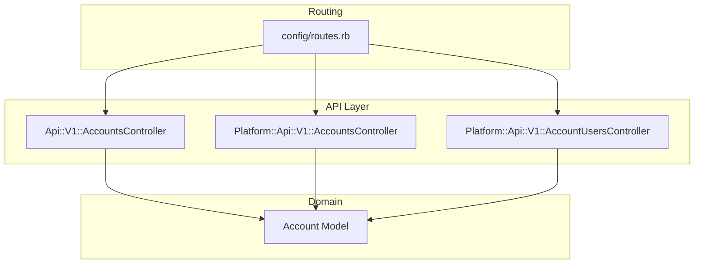
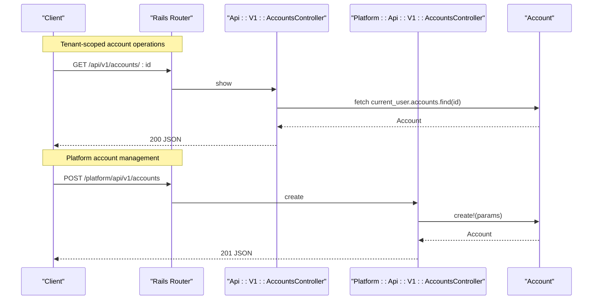
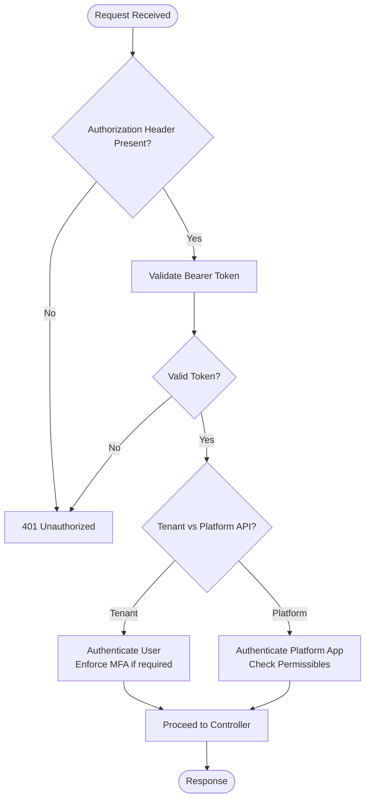
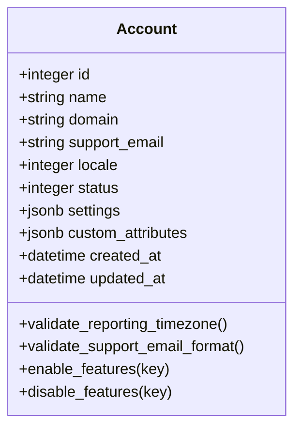
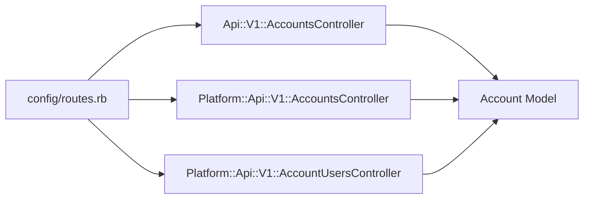

# Accounts API

<cite>
**Referenced Files in This Document**
- [routes.rb](file://config/routes.rb)
- [accounts_controller.rb](file://app/controllers/api/v1/accounts_controller.rb)
- [platform_accounts_controller.rb](file://app/controllers/platform/api/v1/accounts_controller.rb)
- [account_users_controller.rb](file://app/controllers/platform/api/v1/account_users_controller.rb)
- [account.rb](file://app/models/account.rb)
- [api_bearer_authentication_spec.rb](file://spec/requests/api_bearer_authentication_spec.rb)
- [swagger.json](file://swagger/swagger.json)
</cite>

## Table of Contents
1. [Introduction](#introduction)
2. [Project Structure](#project-structure)
3. [Core Components](#core-components)
4. [Architecture Overview](#architecture-overview)
5. [Detailed Component Analysis](#detailed-component-analysis)
6. [Dependency Analysis](#dependency-analysis)
7. [Performance Considerations](#performance-considerations)
8. [Troubleshooting Guide](#troubleshooting-guide)
9. [Conclusion](#conclusion)

## Introduction
This document provides detailed API documentation for Chatwoot’s Account management endpoints. It covers:
- HTTP methods and routes for account creation, retrieval, updates, and deletion
- Request/response schemas with field types, validation rules, and business constraints
- Authentication requirements using Bearer tokens and platform app tokens
- Error responses and status codes
- Common use cases such as multi-tenant setup and account configuration

The documentation is derived from the application routes, controllers, models, and Swagger definitions.

## Project Structure
Account-related endpoints are defined under two namespaces:
- Tenant-facing API (v1): scoped to a specific account context
- Platform API (v1): used by platform apps to manage accounts across tenants

**Diagram sources**
- [routes.rb:48-67](file://config/routes.rb#L48-L67)
- [routes.rb:647-669](file://config/routes.rb#L647-L669)
- [accounts_controller.rb:1-190](file://app/controllers/api/v1/accounts_controller.rb#L1-L190)
- [platform_accounts_controller.rb:1-51](file://app/controllers/platform/api/v1/accounts_controller.rb#L1-L51)
- [account_users_controller.rb:1-29](file://app/controllers/platform/api/v1/account_users_controller.rb#L1-L29)
- [account.rb:26-116](file://app/models/account.rb#L26-L116)

**Section sources**
- [routes.rb:48-67](file://config/routes.rb#L48-L67)
- [routes.rb:647-669](file://config/routes.rb#L647-L669)

## Core Components
- Api::V1::AccountsController: Handles tenant-scoped account operations (create, show, update, cache_keys, update_active_at).
- Platform::Api::V1::AccountsController: Handles platform-level account CRUD (index, create, show, update, destroy).
- Platform::Api::V1::AccountUsersController: Manages account users for a given account via platform app permissions.
- Account model: Defines validations, settings schema, enumerations, and behavior for account data.

Key responsibilities:
- Input validation and parameter permitting
- Feature flag handling for features and limits
- Multi-tenancy scoping and authorization
- Caching helpers for account metadata

**Section sources**
- [accounts_controller.rb:1-190](file://app/controllers/api/v1/accounts_controller.rb#L1-L190)
- [platform_accounts_controller.rb:1-51](file://app/controllers/platform/api/v1/accounts_controller.rb#L1-L51)
- [account_users_controller.rb:1-29](file://app/controllers/platform/api/v1/account_users_controller.rb#L1-L29)
- [account.rb:26-116](file://app/models/account.rb#L26-L116)

## Architecture Overview
The Accounts API supports two primary flows:
- Tenant API flow: authenticated user within an account context performs account operations.
- Platform API flow: platform app with access token manages accounts and assigns users.

**Diagram sources**
- [routes.rb:48-67](file://config/routes.rb#L48-L67)
- [routes.rb:647-669](file://config/routes.rb#L647-L669)
- [accounts_controller.rb:23-61](file://app/controllers/api/v1/accounts_controller.rb#L23-L61)
- [platform_accounts_controller.rb:11-27](file://app/controllers/platform/api/v1/accounts_controller.rb#L11-L27)
- [account.rb:26-116](file://app/models/account.rb#L26-L116)

## Detailed Component Analysis

### Authentication and Authorization
- Bearer tokens: The system accepts Bearer tokens in the Authorization header for both tenant and platform APIs. Tests confirm that invalid or empty bearer tokens are rejected, and platform app tokens are required for platform endpoints.
- Legacy headers: The legacy api_access_token header is supported but takes lower precedence when a valid Bearer token is present.
- Platform app permissions: Access to platform resources is restricted by permissibles; only accounts explicitly permitted to a platform app can be accessed.

**Diagram sources**
- [api_bearer_authentication_spec.rb:1-62](file://spec/requests/api_bearer_authentication_spec.rb#L1-L62)
- [accounts_controller.rb:1-15](file://app/controllers/api/v1/accounts_controller.rb#L1-L15)
- [platform_accounts_controller.rb:1-27](file://app/controllers/platform/api/v1/accounts_controller.rb#L1-L27)

**Section sources**
- [api_bearer_authentication_spec.rb:1-62](file://spec/requests/api_bearer_authentication_spec.rb#L1-L62)
- [accounts_controller.rb:1-15](file://app/controllers/api/v1/accounts_controller.rb#L1-L15)
- [platform_accounts_controller.rb:1-27](file://app/controllers/platform/api/v1/accounts_controller.rb#L1-L27)

### Tenant API: Accounts (v1)
Endpoints:
- POST /api/v1/accounts
  - Purpose: Create a new account (and optionally a user). Supports Shopify pending install flow.
  - Auth: Public signup endpoint; may require captcha depending on configuration.
  - Request body fields:
    - account_name: string
    - email: string (email format)
    - password: string
    - locale: integer (ISO code mapping)
    - user_full_name: string
    - shopify_pending_install_token: string (optional)
  - Response:
    - 201 Created: Returns authentication headers and account details when applicable; otherwise returns email for unauthenticated web signup.
    - 422 Unprocessable Entity: Validation errors or signup failures.
    - 404 Not Found: Signup disabled or not found route error.
- GET /api/v1/accounts/:id
  - Purpose: Retrieve account details for the current user’s account.
  - Auth: Requires valid Bearer token for the current user.
  - Response: 200 OK with account detail object.
- PATCH/PUT /api/v1/accounts/:id
  - Purpose: Update account attributes and settings.
  - Auth: Requires valid Bearer token and account ownership.
  - Request body fields:
    - name: string
    - locale: integer
    - domain: string (max length 100)
    - support_email: string (valid email format)
    - custom_attributes: object (industry, company_size, timezone, referral_source, user_role, website)
    - settings: object (auto_resolve_after, auto_resolve_message, auto_resolve_ignore_waiting, audio_transcriptions, auto_resolve_label, auto_translate, translation_provider, enforce_mfa if enabled)
  - Response: 200 OK with updated account.
- POST /api/v1/accounts/:id/update_active_at
  - Purpose: Update the active timestamp for the current account user.
  - Auth: Requires valid Bearer token.
  - Response: 200 OK.
- GET /api/v1/accounts/:id/cache_keys
  - Purpose: Retrieve cache keys for the account.
  - Auth: Requires valid Bearer token.
  - Response: 200 OK with cache_keys object.

Validation and constraints:
- name presence required at model level.
- domain max length 100.
- settings validated against a JSON schema.
- auto_resolve_after must meet minimum minutes limit.
- reporting_timezone must be a valid timezone.
- support_email must be a valid email address.

Error responses:
- 401 Unauthorized: Missing or invalid Bearer token.
- 403 Forbidden: API access not enabled for the account.
- 404 Not Found: Account not found or signup disabled.
- 422 Unprocessable Entity: Validation errors or invalid parameters.

Common use cases:
- Multi-tenant setup: Each account represents a tenant; configure domain, locale, and settings per tenant.
- Configuration: Use settings to enable features like auto-resolve, translations, and MFA enforcement.

**Section sources**
- [routes.rb:48-67](file://config/routes.rb#L48-L67)
- [accounts_controller.rb:23-67](file://app/controllers/api/v1/accounts_controller.rb#L23-L67)
- [accounts_controller.rb:75-154](file://app/controllers/api/v1/accounts_controller.rb#L75-L154)
- [accounts_controller.rb:156-178](file://app/controllers/api/v1/accounts_controller.rb#L156-L178)
- [account.rb:44-65](file://app/models/account.rb#L44-L65)
- [account.rb:222-240](file://app/models/account.rb#L222-L240)
- [swagger.json:1688-1734](file://swagger/swagger.json#L1688-L1734)

### Platform API: Accounts (v1)
Endpoints:
- GET /platform/api/v1/accounts
  - Purpose: List accounts permitted to the platform app.
  - Auth: Requires platform app Bearer token.
  - Response: 200 OK with array of accounts.
- POST /platform/api/v1/accounts
  - Purpose: Create a new account and assign it to the platform app.
  - Auth: Requires platform app Bearer token.
  - Request body fields:
    - name: string
    - locale: integer
    - domain: string
    - support_email: string
    - status: integer (active/suspended)
    - features: object (feature flags)
    - limits: object (usage limits)
    - custom_attributes: object
  - Response: 201 Created with account details.
- GET /platform/api/v1/accounts/:id
  - Purpose: Retrieve a specific account permitted to the platform app.
  - Auth: Requires platform app Bearer token.
  - Response: 200 OK with account details.
- PATCH/PUT /platform/api/v1/accounts/:id
  - Purpose: Update account attributes and features.
  - Auth: Requires platform app Bearer token.
  - Request body fields: same as create.
  - Response: 200 OK with updated account.
- DELETE /platform/api/v1/accounts/:id
  - Purpose: Delete an account asynchronously.
  - Auth: Requires platform app Bearer token.
  - Response: 200 OK (job enqueued).

Business constraints:
- Features are toggled via enable_features/disable_features based on the features object.
- Limits and custom_attributes are persisted alongside core attributes.

Error responses:
- 401 Unauthorized: Invalid or missing platform app token.
- 403 Forbidden: Account not permitted to the platform app.
- 404 Not Found: Account not found.
- 422 Unprocessable Entity: Validation errors.

**Section sources**
- [routes.rb:647-669](file://config/routes.rb#L647-L669)
- [platform_accounts_controller.rb:1-51](file://app/controllers/platform/api/v1/accounts_controller.rb#L1-L51)

### Platform API: Account Users (v1)
Endpoints:
- GET /platform/api/v1/accounts/:account_id/account_users
  - Purpose: List all users associated with the specified account.
  - Auth: Requires platform app Bearer token and permissible access to the account.
  - Response: 200 OK with array of account users.
- POST /platform/api/v1/accounts/:account_id/account_users
  - Purpose: Add or update a user role within the account.
  - Auth: Requires platform app Bearer token and permissible access to the account.
  - Request body fields:
    - user_id: integer
    - role: string (e.g., agent/administrator)
  - Response: 200 OK with created/updated account user.
- DELETE /platform/api/v1/accounts/:account_id/account_users
  - Purpose: Remove a user from the account.
  - Auth: Requires platform app Bearer token and permissible access to the account.
  - Response: 200 OK.

**Section sources**
- [routes.rb:647-669](file://config/routes.rb#L647-L669)
- [account_users_controller.rb:1-29](file://app/controllers/platform/api/v1/account_users_controller.rb#L1-L29)

### Data Models and Schemas
Account model fields and behaviors relevant to the API:
- Core fields: id, name, domain, support_email, locale, status, created_at, updated_at
- Settings: JSONB storing feature toggles and operational settings
- Custom attributes: JSONB for extensible metadata
- Enumerations: locale and status
- Validations: presence of name, domain length, settings schema, numeric constraints, timezone/email formats

**Diagram sources**
- [account.rb:1-20](file://app/models/account.rb#L1-L20)
- [account.rb:44-65](file://app/models/account.rb#L44-L65)
- [account.rb:115-117](file://app/models/account.rb#L115-L117)
- [account.rb:222-240](file://app/models/account.rb#L222-L240)

**Section sources**
- [account.rb:1-20](file://app/models/account.rb#L1-L20)
- [account.rb:44-65](file://app/models/account.rb#L44-L65)
- [account.rb:115-117](file://app/models/account.rb#L115-L117)
- [account.rb:222-240](file://app/models/account.rb#L222-L240)

## Dependency Analysis
- Routing defines resource paths and nested scopes for both tenant and platform APIs.
- Controllers depend on the Account model for persistence and validation.
- Platform controllers rely on platform app permissibles to restrict access.
- Authentication tests validate Bearer token precedence and platform app restrictions.

**Diagram sources**
- [routes.rb:48-67](file://config/routes.rb#L48-L67)
- [routes.rb:647-669](file://config/routes.rb#L647-L669)
- [accounts_controller.rb:1-190](file://app/controllers/api/v1/accounts_controller.rb#L1-L190)
- [platform_accounts_controller.rb:1-51](file://app/controllers/platform/api/v1/accounts_controller.rb#L1-L51)
- [account_users_controller.rb:1-29](file://app/controllers/platform/api/v1/account_users_controller.rb#L1-L29)
- [account.rb:26-116](file://app/models/account.rb#L26-L116)

**Section sources**
- [routes.rb:48-67](file://config/routes.rb#L48-L67)
- [routes.rb:647-669](file://config/routes.rb#L647-L669)
- [accounts_controller.rb:1-190](file://app/controllers/api/v1/accounts_controller.rb#L1-L190)
- [platform_accounts_controller.rb:1-51](file://app/controllers/platform/api/v1/accounts_controller.rb#L1-L51)
- [account_users_controller.rb:1-29](file://app/controllers/platform/api/v1/account_users_controller.rb#L1-L29)
- [account.rb:26-116](file://app/models/account.rb#L26-L116)

## Performance Considerations
- Cache keys endpoint uses short TTLs and stale-while-revalidate to reduce load while keeping responses fresh.
- Asynchronous deletion for platform account destruction avoids blocking requests.
- Settings and custom attributes are stored in JSONB, enabling flexible configuration without schema migrations.

[No sources needed since this section provides general guidance]

## Troubleshooting Guide
Common issues and resolutions:
- 401 Unauthorized: Ensure a valid Bearer token is provided in the Authorization header. For platform endpoints, use a platform app token and ensure the account is permitted.
- 403 Forbidden: Verify that API access is enabled for the account and that the platform app has permissible access to the target account.
- 404 Not Found: Confirm the account exists and that the user belongs to the account for tenant endpoints; check that signup is enabled for public creation.
- 422 Unprocessable Entity: Review request payload against validation rules (name presence, domain length, email format, timezone validity, settings schema).

Operational checks:
- Validate captcha for public signup endpoints.
- Confirm MFA enforcement settings for account and user contexts.
- Inspect Redis-based caches and latest version checks for account metadata.

**Section sources**
- [accounts_controller.rb:156-178](file://app/controllers/api/v1/accounts_controller.rb#L156-L178)
- [accounts_controller.rb:116-120](file://app/controllers/api/v1/accounts_controller.rb#L116-L120)
- [api_bearer_authentication_spec.rb:1-62](file://spec/requests/api_bearer_authentication_spec.rb#L1-L62)

## Conclusion
Chatwoot’s Accounts API provides robust support for multi-tenant account management through both tenant and platform interfaces. The tenant API focuses on per-account configuration and user-scoped operations, while the platform API enables centralized management of accounts and their users with strict permission controls. Proper authentication using Bearer tokens and adherence to validation rules ensure secure and reliable operations across diverse deployment scenarios.

[No sources needed since this section summarizes without analyzing specific files]