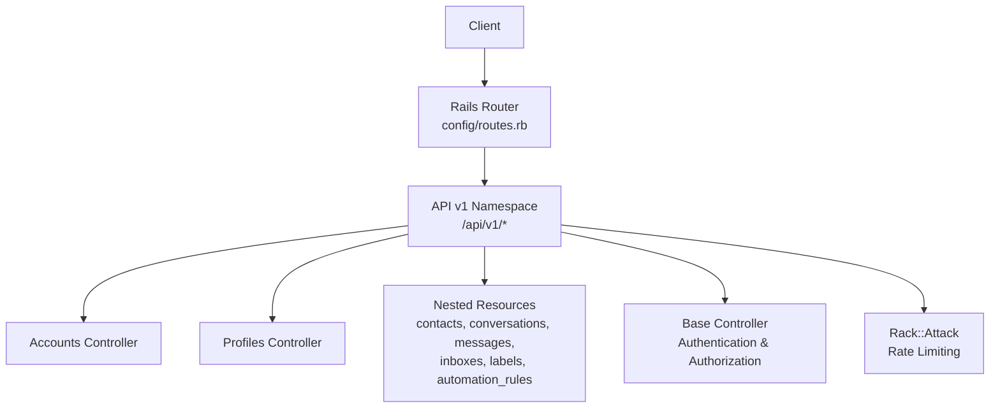
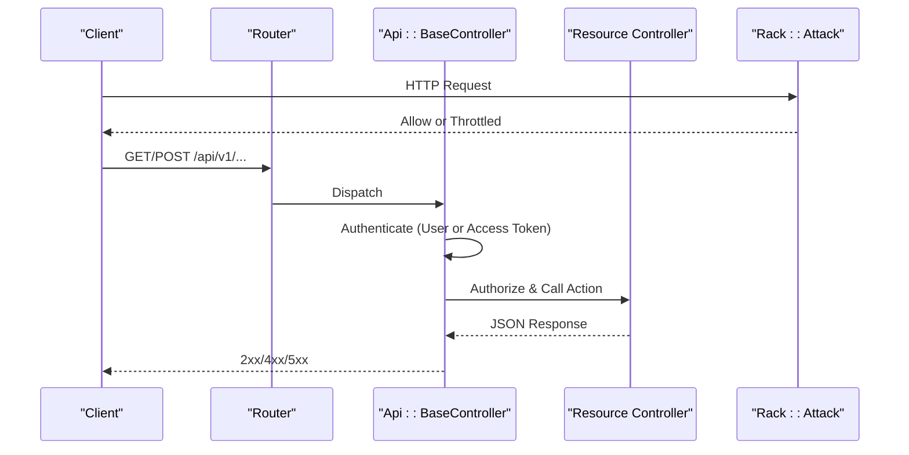
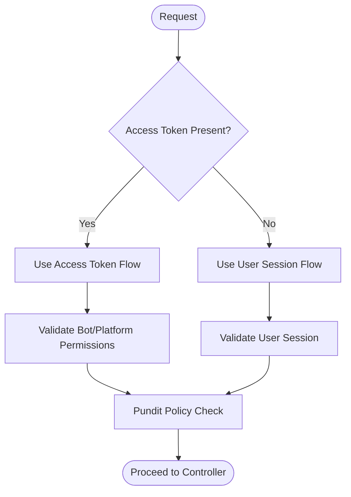
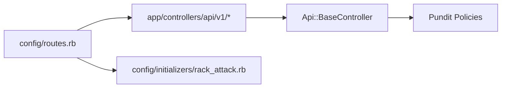

# Application API v1

<cite>
**Referenced Files in This Document**
- [routes.rb](file://config/routes.rb)
- [base_controller.rb](file://app/controllers/api/base_controller.rb)
- [devise_token_auth.rb](file://config/initializers/devise_token_auth.rb)
- [accounts_controller.rb](file://app/controllers/api/v1/accounts_controller.rb)
- [profiles_controller.rb](file://app/controllers/api/v1/profiles_controller.rb)
- [rack_attack.rb](file://config/initializers/rack_attack.rb)
- [companies.js](file://app/javascript/dashboard/api/companies.js)
- [api_bearer_authentication_spec.rb](file://spec/requests/api_bearer_authentication_spec.rb)
</cite>

## Table of Contents
1. [Introduction](#introduction)
2. [Project Structure](#project-structure)
3. [Core Components](#core-components)
4. [Architecture Overview](#architecture-overview)
5. [Detailed Component Analysis](#detailed-component-analysis)
6. [Dependency Analysis](#dependency-analysis)
7. [Performance Considerations](#performance-considerations)
8. [Troubleshooting Guide](#troubleshooting-guide)
9. [Conclusion](#conclusion)

## Introduction
This document describes Chatwoot’s main Application API v1 for dashboard and agent-facing integrations. It covers authentication with Bearer tokens, core resources (accounts, users/profile, contacts, conversations, messages, inboxes, labels), automation rules, pagination, filtering, sorting, search, rate limiting, versioning, and best practices for client implementation.

The API is a JSON-only REST interface under the /api/v1 namespace. Authentication supports both user-based tokens (DeviseTokenAuth) and raw access tokens for bots/platform apps. Authorization is enforced per account using Pundit policies.

## Project Structure
At a high level:
- Routes are defined under config/routes.rb, grouping endpoints by namespace (api/v1, platform/api/v1, public/api/v1).
- Controllers live under app/controllers/api/v1 and nested modules (e.g., accounts/*).
- Base controller sets up authentication and authorization flows.
- Rate limiting is configured via Rack::Attack.
- Frontend JS clients demonstrate standard query patterns (page, sort, q).

**Diagram sources**
- [routes.rb:48-510](file://config/routes.rb#L48-L510)
- [base_controller.rb:1-22](file://app/controllers/api/base_controller.rb#L1-L22)
- [rack_attack.rb:231-390](file://config/initializers/rack_attack.rb#L231-L390)

**Section sources**
- [routes.rb:48-510](file://config/routes.rb#L48-L510)

## Core Components
- Authentication
  - User sessions and tokens via DeviseTokenAuth.
  - Bearer token support for both user tokens and bot/platform app tokens.
  - Token lifespan and header behavior configured in DeviseTokenAuth initializer.
- Authorization
  - Account-scoped authorization via Pundit policies.
  - Access control enforced at base controller and resource controllers.
- Versioning
  - All application endpoints documented here are under /api/v1.
  - Separate namespaces exist for platform APIs (/platform/api/v1) and public widget APIs (/public/api/v1).

Key behaviors:
- Raw access tokens bypass encoded dashboard bearer parsing to allow direct bot/platform usage.
- MFA enforcement can be applied to token-authenticated requests on sensitive endpoints.

**Section sources**
- [devise_token_auth.rb:1-53](file://config/initializers/devise_token_auth.rb#L1-L53)
- [base_controller.rb:1-22](file://app/controllers/api/base_controller.rb#L1-L22)
- [api_bearer_authentication_spec.rb:28-62](file://spec/requests/api_bearer_authentication_spec.rb#L28-L62)

## Architecture Overview
The request lifecycle for API v1:
1. Request enters Rails router and matches /api/v1 routes.
2. Base controller authenticates either via user session or access token.
3. Authorization checks ensure the caller has permission within the target account.
4. Resource controllers handle business logic and return JSON responses.
5. Rack::Attack enforces rate limits where applicable.

**Diagram sources**
- [routes.rb:48-510](file://config/routes.rb#L48-L510)
- [base_controller.rb:1-22](file://app/controllers/api/base_controller.rb#L1-L22)
- [rack_attack.rb:231-390](file://config/initializers/rack_attack.rb#L231-L390)

## Detailed Component Analysis

### Authentication and Authorization
- Supported schemes
  - User-based Bearer tokens from DeviseTokenAuth.
  - Bot/platform app access tokens passed as Bearer.
- Header handling
  - DeviseTokenAuth configuration controls header rotation and token lifespan.
  - Base controller skips encoded dashboard bearer parsing when using raw access tokens.
- Authorization model
  - Pundit policies enforce per-account permissions.
  - Base controller provides helper methods for authorization checks.

**Diagram sources**
- [base_controller.rb:1-22](file://app/controllers/api/base_controller.rb#L1-L22)
- [devise_token_auth.rb:1-53](file://config/initializers/devise_token_auth.rb#L1-L53)
- [api_bearer_authentication_spec.rb:28-62](file://spec/requests/api_bearer_authentication_spec.rb#L28-L62)

**Section sources**
- [base_controller.rb:1-22](file://app/controllers/api/base_controller.rb#L1-L22)
- [devise_token_auth.rb:1-53](file://config/initializers/devise_token_auth.rb#L1-L53)
- [api_bearer_authentication_spec.rb:28-62](file://spec/requests/api_bearer_authentication_spec.rb#L28-L62)

### Accounts
- Endpoints
  - POST /api/v1/accounts — Create an account (signup flow; may require captcha and account name/user full name).
  - GET /api/v1/accounts/:id — Show account details.
  - PATCH/PUT /api/v1/accounts/:id — Update account settings and custom attributes.
  - POST /api/v1/accounts/:id/update_active_at — Update last active timestamp.
  - GET /api/v1/accounts/:id/cache_keys — Retrieve cache keys.
- Authentication
  - Create allows unauthenticated signup depending on environment; other actions require authenticated user or valid access token.
- Validation and errors
  - Missing required fields raise invalid parameter exceptions.
  - Account-level API access must be enabled for token-based access on non-create endpoints.
- Example call paths
  - Create: POST /api/v1/accounts with account_name, email, password, locale.
  - Update: PATCH /api/v1/accounts/:id with name, locale, domain, support_email, custom_attributes, settings.

**Section sources**
- [routes.rb:49-56](file://config/routes.rb#L49-L56)
- [accounts_controller.rb:1-190](file://app/controllers/api/v1/accounts_controller.rb#L1-L190)

### Users (Profile)
- Endpoints
  - GET /api/v1/profile — Get current user profile (includes pubsub token; subject to MFA enforcement for token auth).
  - PATCH/PUT /api/v1/profile — Update profile attributes and custom attributes.
  - DELETE /api/v1/profile/avatar — Remove avatar.
  - POST /api/v1/profile/availability — Set availability per account.
  - POST /api/v1/profile/auto_offline — Toggle auto-offline per account.
  - PUT /api/v1/profile/set_active_account — Set active account.
  - POST /api/v1/profile/resend_confirmation — Resend confirmation email.
  - POST /api/v1/profile/reset_access_token — Regenerate user access token.
- Authentication
  - Requires authenticated user or valid access token; some endpoints enforce MFA for token auth.

**Section sources**
- [routes.rb:521-540](file://config/routes.rb#L521-L540)
- [profiles_controller.rb:1-89](file://app/controllers/api/v1/profiles_controller.rb#L1-L89)

### Contacts
- Endpoints
  - GET /api/v1/accounts/:account_id/contacts — List contacts with pagination and sorting.
  - GET /api/v1/accounts/:account_id/contacts/:id — Show contact.
  - PATCH/PUT /api/v1/accounts/:account_id/contacts/:id — Update contact.
  - POST /api/v1/accounts/:account_id/contacts — Create contact.
  - DELETE /api/v1/accounts/:account_id/contacts/:id — Delete contact.
  - GET /api/v1/accounts/:account_id/contacts/active — Active contacts.
  - GET /api/v1/accounts/:account_id/contacts/search — Search contacts.
  - POST /api/v1/accounts/:account_id/contacts/filter — Filter contacts with complex filters.
  - POST /api/v1/accounts/:account_id/contacts/import — Import contacts.
  - POST /api/v1/accounts/:account_id/contacts/export — Export contacts.
  - GET /api/v1/accounts/:account_id/contacts/:id/contactable_inboxes — Contactable inboxes.
  - DELETE /api/v1/accounts/:account_id/contacts/:id/avatar — Remove avatar.
  - POST /api/v1/accounts/:account_id/contacts/:id/destroy_custom_attributes — Destroy custom attributes.
  - Nested:
    - GET /api/v1/accounts/:account_id/contacts/:id/conversations — Conversations for a contact.
    - POST /api/v1/accounts/:account_id/contacts/:id/contact_inboxes — Create contact inbox mapping.
    - POST /api/v1/accounts/:account_id/contacts/:id/labels/create — Add label to contact.
    - GET /api/v1/accounts/:account_id/contacts/:id/labels — List labels on contact.
    - GET /api/v1/accounts/:account_id/contacts/:id/notes — Notes for contact.
    - GET /api/v1/accounts/:account_id/contacts/:id/attachments — Attachments for contact.
- Pagination, filtering, sorting
  - Standard page and sort parameters supported across list endpoints.
  - Search uses q parameter; filter uses POST payload.

**Section sources**
- [routes.rb:266-287](file://config/routes.rb#L266-L287)

### Conversations
- Endpoints
  - GET /api/v1/accounts/:account_id/conversations — List conversations with pagination and sorting.
  - GET /api/v1/accounts/:account_id/conversations/:display_id — Show conversation.
  - PATCH/PUT /api/v1/accounts/:account_id/conversations/:display_id — Update conversation.
  - POST /api/v1/accounts/:account_id/conversations — Create conversation.
  - DELETE /api/v1/accounts/:account_id/conversations/:display_id — Delete conversation.
  - Collection:
    - GET /api/v1/accounts/:account_id/conversations/meta — Meta information.
    - GET /api/v1/accounts/:account_id/conversations/search — Search conversations.
    - GET /api/v1/accounts/:account_id/conversations/unread_counts — Unread counts.
    - POST /api/v1/accounts/:account_id/conversations/filter — Filter conversations.
  - Member actions:
    - POST mute/unmute, transcript, toggle_status/priority/typing_status, update_last_seen, unread, custom_attributes, destroy_custom_attributes, attachments, inbox_assistant.
- Messages (nested under conversations)
  - GET /api/v1/accounts/:account_id/conversations/:conversation_id/messages — List messages.
  - POST /api/v1/accounts/:account_id/conversations/:conversation_id/messages — Create message.
  - PATCH/PUT /api/v1/accounts/:account_id/conversations/:conversation_id/messages/:message_id — Update message.
  - DELETE /api/v1/accounts/:account_id/conversations/:conversation_id/messages/:message_id — Delete message.
  - Additional:
    - POST translate, POST retry, POST auto_translate (enterprise).
- Participants, labels, drafts, suggestions, assignments, direct uploads
  - GET/POST/PUT/DELETE participants.
  - POST index/create labels on conversation.
  - GET/PUT/DELETE draft_messages.
  - GET suggestions/labels, GET suggestions/priority.
  - POST assignments.
  - POST direct_uploads.

**Section sources**
- [routes.rb:190-232](file://config/routes.rb#L190-L232)

### Inboxes
- Endpoints
  - GET /api/v1/accounts/:account_id/inboxes — List inboxes.
  - GET /api/v1/accounts/:account_id/inboxes/:id — Show inbox.
  - POST /api/v1/accounts/:account_id/inboxes — Create inbox.
  - PATCH/PUT /api/v1/accounts/:account_id/inboxes/:id — Update inbox.
  - DELETE /api/v1/accounts/:account_id/inboxes/:id — Delete inbox.
  - Member:
    - GET assignable_agents, campaigns, agent_bot, message_templates.
    - POST set_agent_bot, sync_templates, register_webhook, reset_secret, rotate_hmac_token, health, whatsapp_business_management_token.
    - DELETE avatar.
  - Enterprise features include conference, calling toggles, inbound calls, recording, business hours.

**Section sources**
- [routes.rb:335-362](file://config/routes.rb#L335-L362)

### Labels
- Endpoints
  - GET /api/v1/accounts/:account_id/labels — List labels.
  - GET /api/v1/accounts/:account_id/labels/:id — Show label.
  - POST /api/v1/accounts/:account_id/labels — Create label.
  - PATCH/PUT /api/v1/accounts/:account_id/labels/:id — Update label.
  - DELETE /api/v1/accounts/:account_id/labels/:id — Delete label.

**Section sources**
- [routes.rb:370-370](file://config/routes.rb#L370-L370)

### Automation Rules
- Endpoints
  - GET /api/v1/accounts/:account_id/automation_rules — List automation rules.
  - POST /api/v1/accounts/:account_id/automation_rules — Create automation rule.
  - GET /api/v1/accounts/:account_id/automation_rules/:id — Show automation rule.
  - PATCH/PUT /api/v1/accounts/:account_id/automation_rules/:id — Update automation rule.
  - DELETE /api/v1/accounts/:account_id/automation_rules/:id — Delete automation rule.
  - POST clone — Clone an automation rule.

**Section sources**
- [routes.rb:166-168](file://config/routes.rb#L166-L168)

### Search
- Endpoints
  - GET /api/v1/accounts/:account_id/search — General search endpoint.
  - GET /api/v1/accounts/:account_id/search/conversations — Search conversations.
  - GET /api/v1/accounts/:account_id/search/messages — Search messages.
  - GET /api/v1/accounts/:account_id/search/contacts — Search contacts.
  - GET /api/v1/accounts/:account_id/search/articles — Search articles.

**Section sources**
- [routes.rb:234-241](file://config/routes.rb#L234-L241)

### Companies
- Endpoints
  - GET /api/v1/accounts/:account_id/companies — List companies with pagination and sorting.
  - GET /api/v1/accounts/:account_id/companies/:id — Show company.
  - POST /api/v1/accounts/:account_id/companies — Create company.
  - PATCH/PUT /api/v1/accounts/:account_id/companies/:id — Update company.
  - DELETE /api/v1/accounts/:account_id/companies/:id — Delete company.
  - GET /api/v1/accounts/:account_id/companies/search — Search companies.
  - Nested:
    - GET /api/v1/accounts/:account_id/companies/:id/contacts — List contacts.
    - POST /api/v1/accounts/:account_id/companies/:id/contacts/create — Create contact.
    - DELETE /api/v1/accounts/:account_id/companies/:id/contacts/:contact_id — Delete contact.
    - GET /api/v1/accounts/:account_id/companies/:id/conversations — List conversations.
    - POST /api/v1/accounts/:account_id/companies/:id/conversations/filter — Filter conversations.
    - GET /api/v1/accounts/:account_id/companies/:id/notes — List notes.

Pagination and sorting examples are demonstrated by the frontend client.

**Section sources**
- [routes.rb:243-265](file://config/routes.rb#L243-L265)
- [companies.js:1-48](file://app/javascript/dashboard/api/companies.js#L1-L48)

### Webhooks and Integrations
- Webhooks
  - GET /api/v1/accounts/:account_id/webhooks — List webhooks.
  - POST /api/v1/accounts/:account_id/webhooks — Create webhook.
  - PATCH/PUT /api/v1/accounts/:account_id/webhooks/:id — Update webhook.
  - DELETE /api/v1/accounts/:account_id/webhooks/:id — Delete webhook.
- Integrations
  - Stripe, Slack, Dyte, Shopify, Linear, Notion integration endpoints under /api/v1/accounts/:account_id/integrations.

**Section sources**
- [routes.rb:436-484](file://config/routes.rb#L436-L484)

### Public Widget API (for contacts)
- Endpoints
  - GET /api/public/api/v1/inboxes/:inbox_id/contacts — List contacts.
  - POST /api/public/api/v1/inboxes/:inbox_id/contacts — Create contact.
  - PATCH/PUT /api/public/api/v1/inboxes/:inbox_id/contacts/:id — Update contact.
  - GET /api/public/api/v1/inboxes/:inbox_id/contacts/:id/conversations — List conversations.
  - POST /api/public/api/v1/inboxes/:inbox_id/contacts/:id/conversations — Create conversation.
  - GET /api/public/api/v1/inboxes/:inbox_id/contacts/:id/conversations/:conversation_id — Show conversation.
  - GET /api/public/api/v1/inboxes/:inbox_id/contacts/:id/conversations/:conversation_id/messages — List messages.
  - POST /api/public/api/v1/inboxes/:inbox_id/contacts/:id/conversations/:conversation_id/messages — Create message.
  - PATCH/PUT /api/public/api/v1/inboxes/:inbox_id/contacts/:id/conversations/:conversation_id/messages/:message_id — Update message.
  - Member actions: toggle_status, toggle_typing, update_last_seen.
  - CSAT survey: GET/UPDATE /api/public/api/v1/csat_survey.

**Section sources**
- [routes.rb:673-695](file://config/routes.rb#L673-L695)

### Platform API (separate from Application API v1)
- Endpoints
  - /platform/api/v1/users (CRUD + login/token).
  - /platform/api/v1/agent_bots (CRUD).
  - /platform/api/v1/accounts (CRUD + account_users, email_channel_migrations).
- Authentication
  - Uses platform app access tokens; distinct from user tokens.

**Section sources**
- [routes.rb:647-669](file://config/routes.rb#L647-L669)

## Dependency Analysis
- Route-to-controller mapping
  - Most account-scoped resources are nested under /api/v1/accounts/:account_id.
  - Controllers are organized under app/controllers/api/v1 and submodules.
- Authentication dependencies
  - Api::BaseController includes AccessTokenAuthHelper and DeviseTokenAuth.
  - Raw access tokens bypass encoded dashboard bearer parsing.
- Rate limiting dependencies
  - Rack::Attack throttles specific endpoints (widget APIs, reports, meta endpoints).

**Diagram sources**
- [routes.rb:48-510](file://config/routes.rb#L48-L510)
- [base_controller.rb:1-22](file://app/controllers/api/base_controller.rb#L1-L22)
- [rack_attack.rb:231-390](file://config/initializers/rack_attack.rb#L231-L390)

**Section sources**
- [routes.rb:48-510](file://config/routes.rb#L48-L510)
- [base_controller.rb:1-22](file://app/controllers/api/base_controller.rb#L1-L22)
- [rack_attack.rb:231-390](file://config/initializers/rack_attack.rb#L231-L390)

## Performance Considerations
- Pagination
  - Use page parameter to limit response size.
- Sorting
  - Use sort parameter to order results efficiently.
- Filtering
  - Prefer POST /filter endpoints for complex queries to avoid large query strings.
- Search
  - Use dedicated search endpoints with q parameter for text search.
- Rate limiting
  - Respect rate limits; implement exponential backoff on 429 responses.
- Caching
  - Leverage cache keys endpoint for client-side caching strategies.

[No sources needed since this section provides general guidance]

## Troubleshooting Guide
Common issues and resolutions:
- Unauthorized (401)
  - Ensure Authorization header contains a valid Bearer token.
  - For bot/platform tokens, verify token type and permissions.
- Forbidden (403)
  - Account-level API access may be disabled; enable it for token-based access.
- Rate limited (429)
  - Back off and retry after delay; check environment variables controlling rate limits.
- Validation errors (422)
  - Review required fields and constraints for each endpoint.

Operational tips:
- Verify token lifespan and header rotation settings in DeviseTokenAuth initializer.
- Confirm MFA enforcement requirements for token-authenticated requests.

**Section sources**
- [devise_token_auth.rb:1-53](file://config/initializers/devise_token_auth.rb#L1-L53)
- [accounts_controller.rb:116-120](file://app/controllers/api/v1/accounts_controller.rb#L116-L120)
- [rack_attack.rb:231-390](file://config/initializers/rack_attack.rb#L231-L390)

## Conclusion
Chatwoot’s Application API v1 provides a comprehensive, account-scoped REST interface for managing support operations. It supports robust authentication (user and access tokens), fine-grained authorization, and extensive resources including contacts, conversations, messages, inboxes, labels, and automation rules. Clients should follow best practices for pagination, filtering, sorting, and search, while respecting rate limits and versioning boundaries.

[No sources needed since this section summarizes without analyzing specific files]