# Authentication & Security

<cite>
**Referenced Files in This Document**
- [devise_token_auth.rb](file://config/initializers/devise_token_auth.rb)
- [devise.rb](file://config/initializers/devise.rb)
- [user.rb](file://app/models/user.rb)
- [access_token.rb](file://app/models/access_token.rb)
- [user_session.rb](file://app/models/user_session.rb)
- [platform_app.rb](file://app/models/platform_app.rb)
- [base_token_service.rb](file://app/services/base_token_service.rb)
- [widget_token_service.rb](file://app/services/widget/token_service.rb)
- [api_bearer_authentication_spec.rb](file://spec/requests/api_bearer_authentication_spec.rb)
- [sessions_controller_spec.rb](file://spec/requests/devise_overrides/sessions_controller_spec.rb)
</cite>

## Table of Contents
1. [Introduction](#introduction)
2. [Project Structure](#project-structure)
3. [Core Components](#core-components)
4. [Architecture Overview](#architecture-overview)
5. [Detailed Component Analysis](#detailed-component-analysis)
6. [Dependency Analysis](#dependency-analysis)
7. [Performance Considerations](#performance-considerations)
8. [Troubleshooting Guide](#troubleshooting-guide)
9. [Conclusion](#conclusion)
10. [Appendices](#appendices)

## Introduction
This document explains Chatwoot’s authentication and security mechanisms across three primary surfaces:
- Application API: Bearer token authentication for programmatic access.
- Platform API: OAuth2-based integration with platform apps and permissions.
- Web interfaces: Session-based authentication using Devise, including MFA support.

It covers token structures (JWT), expiration handling, refresh strategies, role-based access control (RBAC), policy enforcement, security best practices, token storage recommendations, common pitfalls, and guidance for building secure API clients.

## Project Structure
Authentication-related code is primarily located under:
- Configuration initializers for Devise and DeviseTokenAuth
- Models for users, sessions, access tokens, and platform apps
- Services for JWT generation and decoding
- Request specs demonstrating bearer and session flows

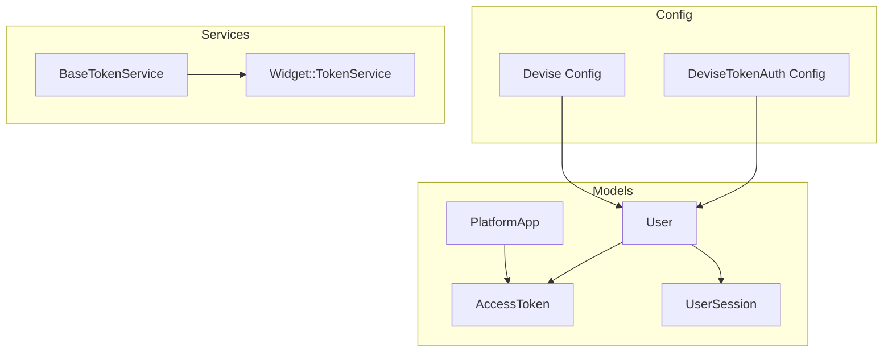

**Diagram sources**
- [devise_token_auth.rb:1-53](file://config/initializers/devise_token_auth.rb#L1-L53)
- [devise.rb:1-275](file://config/initializers/devise.rb#L1-L275)
- [user.rb:1-265](file://app/models/user.rb#L1-L265)
- [access_token.rb:1-22](file://app/models/access_token.rb#L1-L22)
- [user_session.rb:1-47](file://app/models/user_session.rb#L1-L47)
- [platform_app.rb:1-17](file://app/models/platform_app.rb#L1-L17)
- [base_token_service.rb:1-27](file://app/services/base_token_service.rb#L1-L27)
- [widget_token_service.rb:1-27](file://app/services/widget/token_service.rb#L1-L27)

**Section sources**
- [devise_token_auth.rb:1-53](file://config/initializers/devise_token_auth.rb#L1-L53)
- [devise.rb:1-275](file://config/initializers/devise.rb#L1-L275)
- [user.rb:1-265](file://app/models/user.rb#L1-L265)
- [access_token.rb:1-22](file://app/models/access_token.rb#L1-L22)
- [user_session.rb:1-47](file://app/models/user_session.rb#L1-L47)
- [platform_app.rb:1-17](file://app/models/platform_app.rb#L1-L17)
- [base_token_service.rb:1-27](file://app/services/base_token_service.rb#L1-L27)
- [widget_token_service.rb:1-27](file://app/services/widget/token_service.rb#L1-L27)

## Core Components
- Devise and DeviseTokenAuth configuration define session behavior, password policies, token lifespans, and header rotation.
- User model integrates Devise modules, two-factor authentication, and SSO providers. It also manages MFA state and backup codes.
- AccessToken provides secure, unique tokens for owners (users or platform apps).
- UserSession tracks active browser/device sessions per user.
- BaseTokenService and Widget::TokenService implement JWT encoding/decoding with HS256 and configurable expiry.

Key responsibilities:
- Web UI: Devise session management, password reset, confirmation, and MFA.
- Application API: Bearer token validation via DeviseTokenAuth.
- Platform API: OAuth2 flow using platform app credentials and permissions.
- Widgets and internal services: JWT-based short-lived tokens with HS256.

**Section sources**
- [devise.rb:99-162](file://config/initializers/devise.rb#L99-L162)
- [devise_token_auth.rb:1-53](file://config/initializers/devise_token_auth.rb#L1-L53)
- [user.rb:48-69](file://app/models/user.rb#L48-L69)
- [access_token.rb:18-21](file://app/models/access_token.rb#L18-L21)
- [user_session.rb:32-46](file://app/models/user_session.rb#L32-L46)
- [base_token_service.rb:1-27](file://app/services/base_token_service.rb#L1-L27)
- [widget_token_service.rb:1-27](file://app/services/widget/token_service.rb#L1-L27)

## Architecture Overview
The system supports multiple authentication modes:

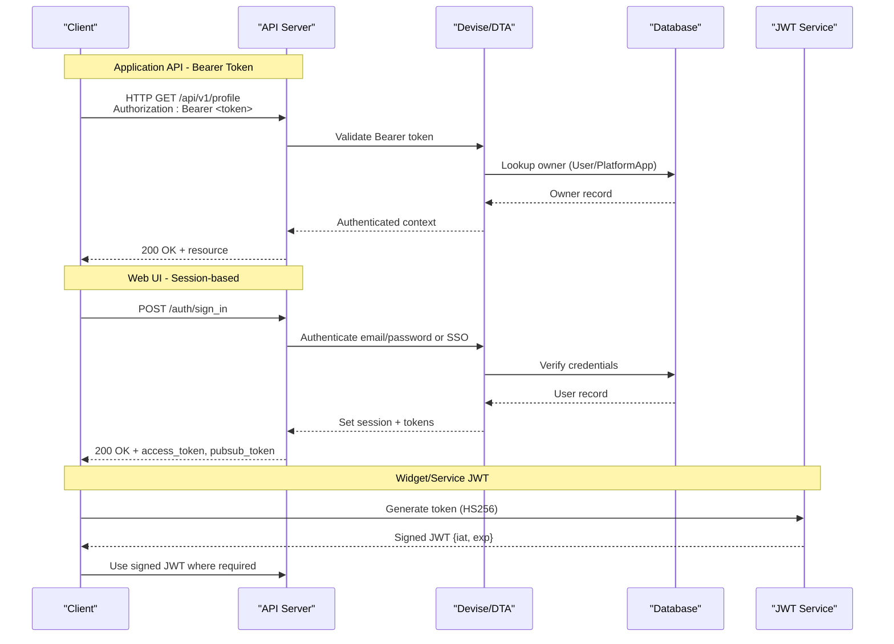

**Diagram sources**
- [api_bearer_authentication_spec.rb:1-31](file://spec/requests/api_bearer_authentication_spec.rb#L1-L31)
- [sessions_controller_spec.rb:1-32](file://spec/requests/devise_overrides/sessions_controller_spec.rb#L1-L32)
- [base_token_service.rb:1-27](file://app/services/base_token_service.rb#L1-L27)
- [widget_token_service.rb:1-27](file://app/services/widget/token_service.rb#L1-L27)

## Detailed Component Analysis

### Bearer Token Authentication (Application API)
- Clients send requests with Authorization: Bearer <token>.
- The server validates the token and resolves the authenticated owner (typically a User).
- Legacy headers are not used when a Bearer token is present but invalid; this prevents unintended fallbacks.

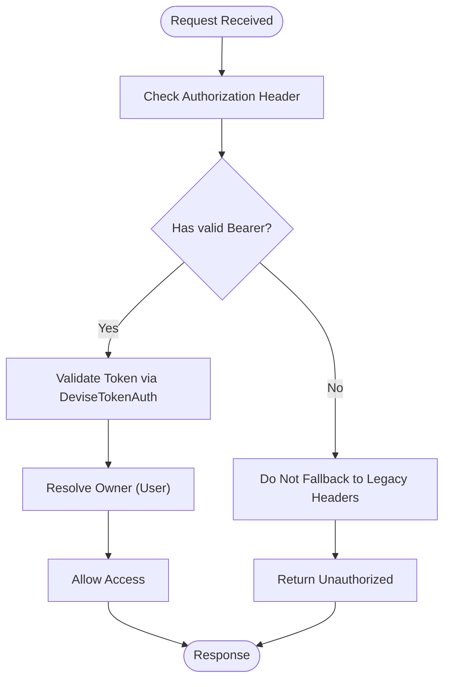

**Diagram sources**
- [api_bearer_authentication_spec.rb:8-29](file://spec/requests/api_bearer_authentication_spec.rb#L8-L29)

**Section sources**
- [api_bearer_authentication_spec.rb:1-31](file://spec/requests/api_bearer_authentication_spec.rb#L1-L31)

### Session-Based Authentication (Web Interfaces)
- Sign-in returns access_token and pubsub_token in JSON payload.
- Devise handles session lifecycle, password hashing, and account confirmation/reset.
- Password policies and lockout settings are configured via Devise.

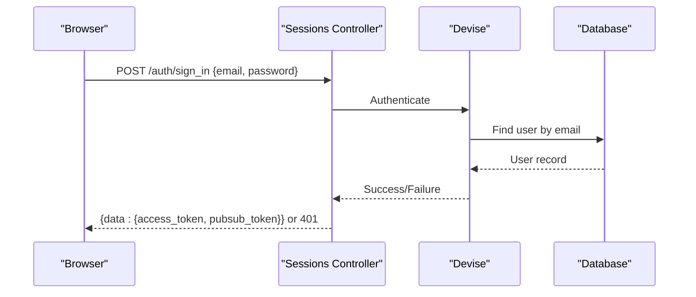

**Diagram sources**
- [sessions_controller_spec.rb:12-32](file://spec/requests/devise_overrides/sessions_controller_spec.rb#L12-L32)
- [devise.rb:99-162](file://config/initializers/devise.rb#L99-L162)

**Section sources**
- [sessions_controller_spec.rb:1-32](file://spec/requests/devise_overrides/sessions_controller_spec.rb#L1-L32)
- [devise.rb:99-162](file://config/initializers/devise.rb#L99-L162)

### OAuth2 Flow (Platform API)
- Platform apps authenticate via OAuth2 and use their own access tokens scoped to permissions.
- PlatformApp includes AccessTokenable to generate and manage tokens.

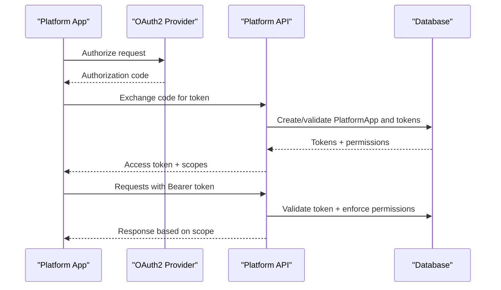

**Diagram sources**
- [platform_app.rb:10-16](file://app/models/platform_app.rb#L10-L16)
- [access_token.rb:18-21](file://app/models/access_token.rb#L18-L21)

**Section sources**
- [platform_app.rb:1-17](file://app/models/platform_app.rb#L1-L17)
- [access_token.rb:1-22](file://app/models/access_token.rb#L1-L22)

### JWT Token Structure and Expiration Handling
- BaseTokenService uses HS256 with Rails secret_key_base.
- Widget::TokenService adds iat/exp claims and reads expiry days from InstallationConfig (default 180 days).
- Decoding errors and expired signatures return empty payloads safely.

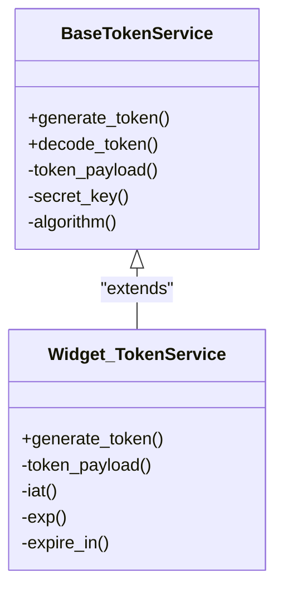

**Diagram sources**
- [base_token_service.rb:1-27](file://app/services/base_token_service.rb#L1-L27)
- [widget_token_service.rb:1-27](file://app/services/widget/token_service.rb#L1-L27)

**Section sources**
- [base_token_service.rb:1-27](file://app/services/base_token_service.rb#L1-L27)
- [widget_token_service.rb:1-27](file://app/services/widget/token_service.rb#L1-L27)

### Refresh Mechanisms and Token Lifespan
- DeviseTokenAuth sets token_lifespan and controls header rotation behavior.
- remove_tokens_after_password_reset ensures old tokens are invalidated upon password changes.
- max_number_of_devices limits concurrent sessions per user.

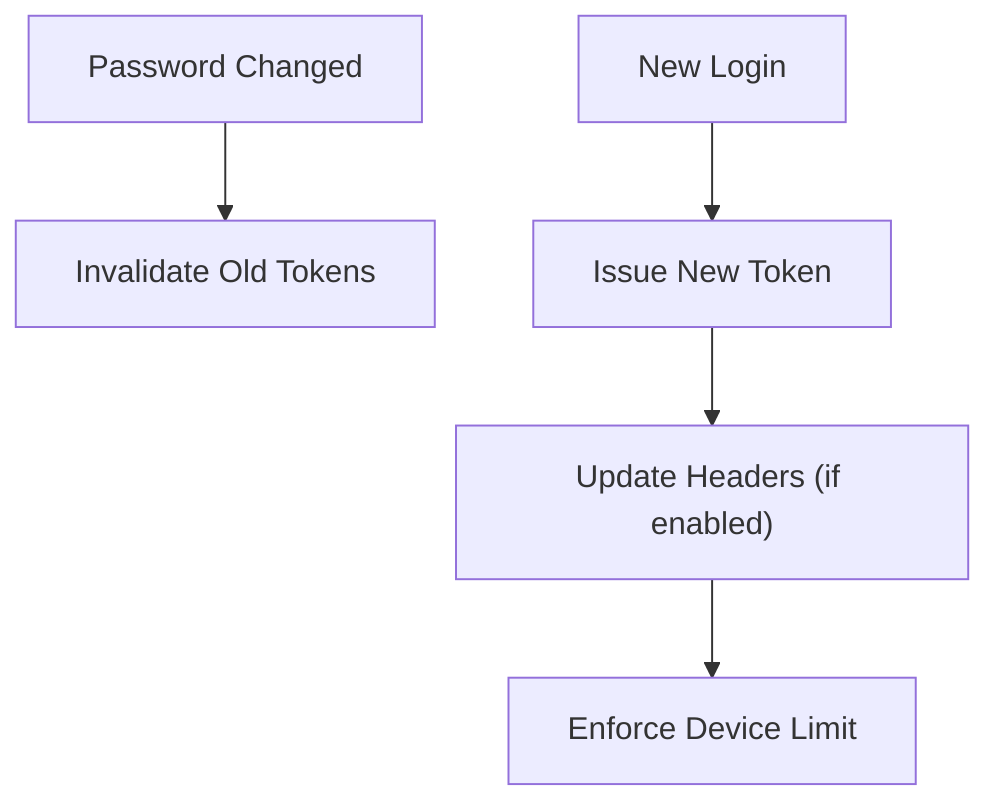

**Diagram sources**
- [devise_token_auth.rb:1-53](file://config/initializers/devise_token_auth.rb#L1-L53)

**Section sources**
- [devise_token_auth.rb:1-53](file://config/initializers/devise_token_auth.rb#L1-L53)

### Role-Based Access Control and Policy Enforcement
- RBAC is enforced via Pundit-style policies (e.g., AccountPolicy, ConversationPolicy).
- Policies evaluate current account_user roles and permissions to allow/deny actions.
- Frontend components consume policy checks to conditionally render features.

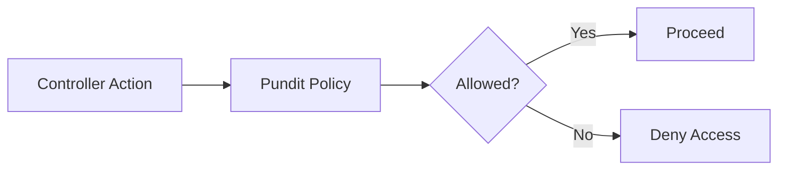

[No diagram sources needed since this section describes conceptual policy enforcement without mapping to specific files]

**Section sources**
- [user.rb:164-166](file://app/models/user.rb#L164-L166)

### Multi-Factor Authentication (MFA) Setup and Management
- User model integrates two_factor_authenticatable and delegates MFA operations to Mfa::ManagementService.
- MFA can be enforced at the account level; users must enable MFA if required.
- Backup codes are encrypted and managed securely.

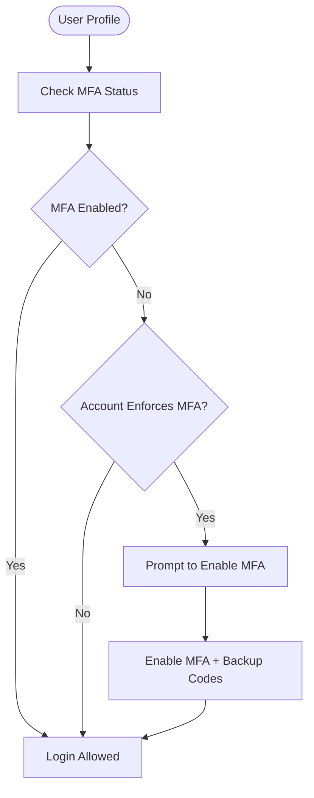

**Diagram sources**
- [user.rb:203-226](file://app/models/user.rb#L203-L226)

**Section sources**
- [user.rb:203-226](file://app/models/user.rb#L203-L226)

### Password Policies and Account Security
- Devise configures password length and reconfirmation behavior.
- Reset password within a time window and sign-out behavior are controlled via Devise.
- Account confirmation and tracking features are enabled.

**Section sources**
- [devise.rb:155-162](file://config/initializers/devise.rb#L155-L162)
- [devise.rb:195-207](file://config/initializers/devise.rb#L195-L207)
- [devise.rb:225-245](file://config/initializers/devise.rb#L225-L245)

### Secure API Client Implementation Examples
- Always include Authorization: Bearer <token> for Application API endpoints.
- Handle 401 Unauthorized responses by prompting re-authentication or refreshing tokens.
- For Platform API, ensure OAuth2 client exchanges authorization codes for tokens and attaches them correctly.

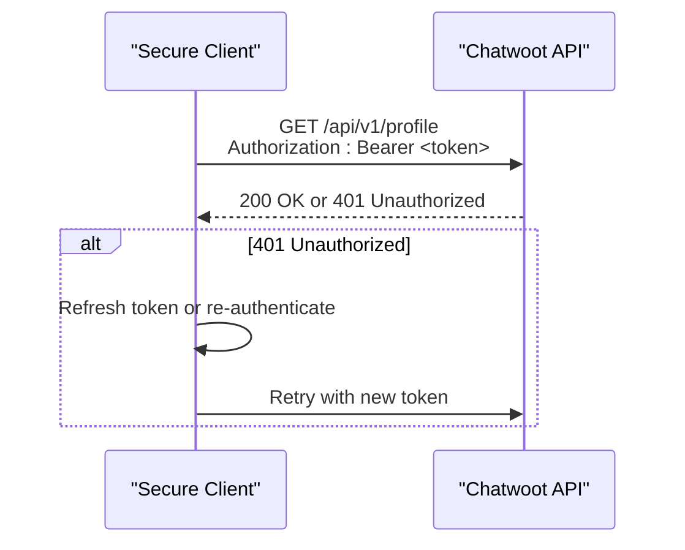

**Diagram sources**
- [api_bearer_authentication_spec.rb:8-29](file://spec/requests/api_bearer_authentication_spec.rb#L8-L29)

**Section sources**
- [api_bearer_authentication_spec.rb:1-31](file://spec/requests/api_bearer_authentication_spec.rb#L1-L31)

## Dependency Analysis
The following diagram shows key dependencies among authentication components:

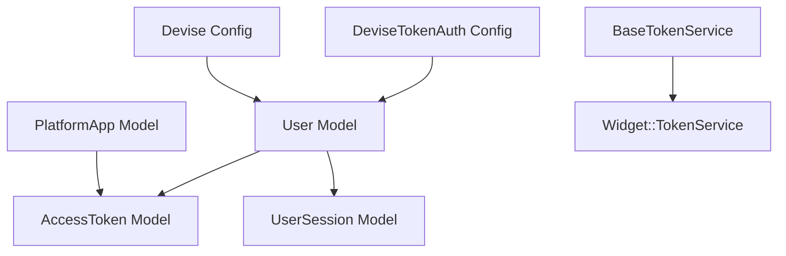

**Diagram sources**
- [devise_token_auth.rb:1-53](file://config/initializers/devise_token_auth.rb#L1-L53)
- [devise.rb:1-275](file://config/initializers/devise.rb#L1-L275)
- [user.rb:1-265](file://app/models/user.rb#L1-L265)
- [access_token.rb:1-22](file://app/models/access_token.rb#L1-L22)
- [user_session.rb:1-47](file://app/models/user_session.rb#L1-L47)
- [platform_app.rb:1-17](file://app/models/platform_app.rb#L1-L17)
- [base_token_service.rb:1-27](file://app/services/base_token_service.rb#L1-L27)
- [widget_token_service.rb:1-27](file://app/services/widget/token_service.rb#L1-L27)

**Section sources**
- [devise_token_auth.rb:1-53](file://config/initializers/devise_token_auth.rb#L1-L53)
- [devise.rb:1-275](file://config/initializers/devise.rb#L1-L275)
- [user.rb:1-265](file://app/models/user.rb#L1-L265)
- [access_token.rb:1-22](file://app/models/access_token.rb#L1-L22)
- [user_session.rb:1-47](file://app/models/user_session.rb#L1-L47)
- [platform_app.rb:1-17](file://app/models/platform_app.rb#L1-L17)
- [base_token_service.rb:1-27](file://app/services/base_token_service.rb#L1-L27)
- [widget_token_service.rb:1-27](file://app/services/widget/token_service.rb#L1-L27)

## Performance Considerations
- Token lifespan and device limits affect session storage and cleanup overhead.
- Avoid excessive header rotation if batch requests require consistent tokens.
- Use short-lived JWTs for widget/service integrations to reduce exposure.

[No sources needed since this section provides general guidance]

## Troubleshooting Guide
Common issues and resolutions:
- Invalid Bearer token returns 401 Unauthorized; verify token validity and ensure it is not expired.
- Legacy headers should not be relied upon when Bearer is present; always prefer Authorization header.
- After password change, old tokens are invalidated; re-authenticate to obtain fresh tokens.
- MFA enforcement prompts require enabling MFA before accessing protected resources.

**Section sources**
- [api_bearer_authentication_spec.rb:21-29](file://spec/requests/api_bearer_authentication_spec.rb#L21-L29)
- [devise_token_auth.rb:1-53](file://config/initializers/devise_token_auth.rb#L1-L53)
- [user.rb:224-226](file://app/models/user.rb#L224-L226)

## Conclusion
Chatwoot implements robust authentication across web sessions, Application API Bearer tokens, and Platform API OAuth2 flows. JWT usage is standardized via HS256 with configurable expiry. RBAC and policies provide fine-grained access control. Following the recommended practices and troubleshooting steps will help maintain secure and reliable integrations.

[No sources needed since this section summarizes without analyzing specific files]

## Appendices

### Security Best Practices
- Store tokens securely in memory or secure storage; avoid logging sensitive values.
- Use HTTPS for all API calls and set secure cookie flags for sessions.
- Rotate secrets regularly and restrict access to secret_key_base.
- Enforce MFA for privileged accounts and consider account-level enforcement.
- Implement proper error handling for 401/403 responses and retry logic with backoff.

[No sources needed since this section provides general guidance]

### Token Storage Recommendations
- Prefer in-memory storage for short-lived tokens during runtime.
- For persistent storage, use secure OS/keychain mechanisms rather than plain text.
- Clear tokens on logout and invalidate sessions after password changes.

[No sources needed since this section provides general guidance]

### Common Security Pitfalls
- Falling back to legacy headers when Bearer is present but invalid.
- Storing tokens in localStorage without encryption.
- Ignoring token expiration and failing to refresh proactively.
- Allowing unlimited concurrent devices without monitoring.

[No sources needed since this section provides general guidance]