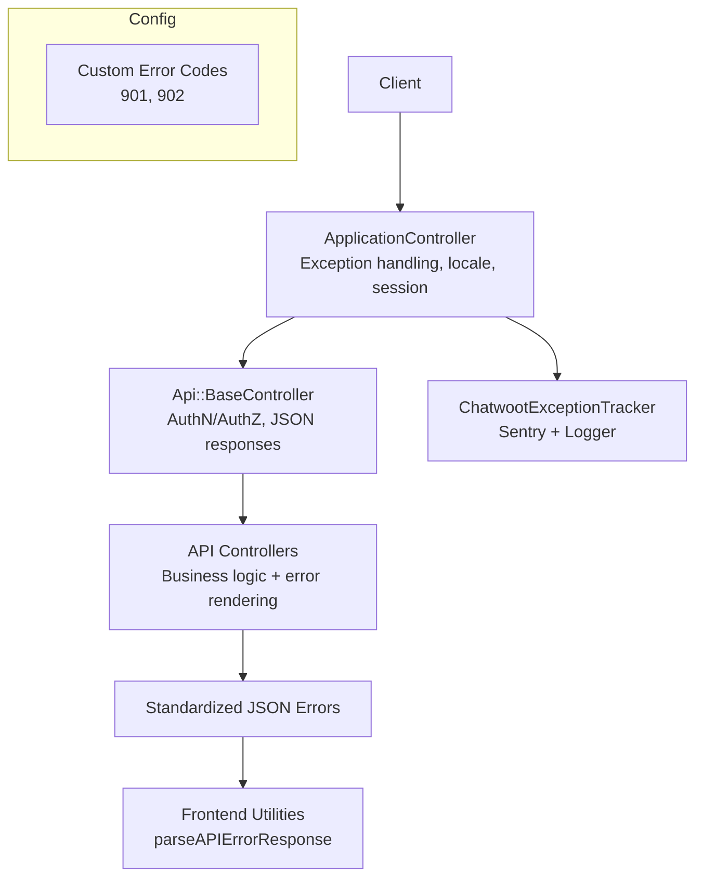
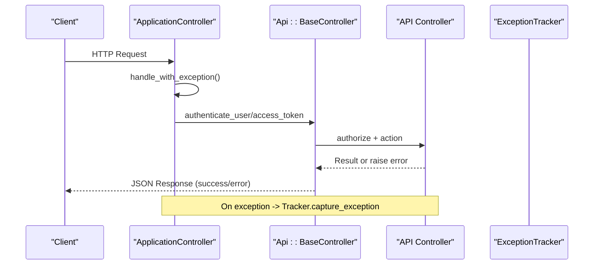
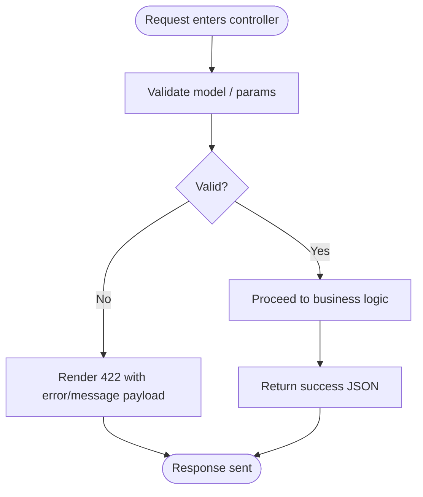
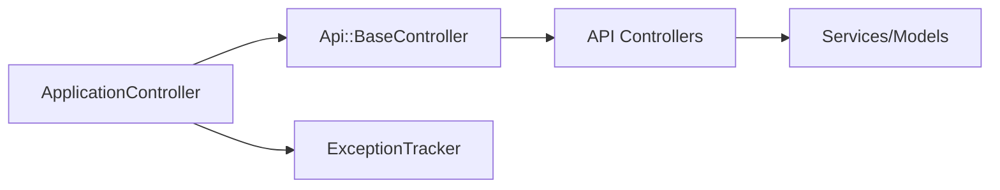

# Error Handling & Status Codes

<cite>
**Referenced Files in This Document**
- [application_controller.rb](file://app/controllers/application_controller.rb)
- [base_controller.rb](file://app/controllers/api/base_controller.rb)
- [custom_error_codes.rb](file://config/initializers/custom_error_codes.rb)
- [chatwoot_exception_tracker.rb](file://lib/chatwoot_exception_tracker.rb)
- [sessions_controller.rb](file://app/controllers/devise_overrides/sessions_controller.rb)
- [api.spec.js](file://app/javascript/dashboard/store/utils/specs/api.spec.js)
- [articles_controller.rb](file://app/controllers/api/v1/accounts/articles_controller.rb)
- [contacts_controller.rb](file://app/controllers/api/v1/accounts/contacts_controller.rb)
- [conversations_controller.rb](file://app/controllers/api/v1/accounts/conversations_controller.rb)
- [inbox_health_management.rb](file://app/controllers/api/v1/accounts/concerns/inbox_health_management.rb)
- [json_schema_validator.rb](file://app/models/concerns/json_schema_validator.rb)
</cite>

## Table of Contents
1. [Introduction](#introduction)
2. [Project Structure](#project-structure)
3. [Core Components](#core-components)
4. [Architecture Overview](#architecture-overview)
5. [Detailed Component Analysis](#detailed-component-analysis)
6. [Dependency Analysis](#dependency-analysis)
7. [Performance Considerations](#performance-considerations)
8. [Troubleshooting Guide](#troubleshooting-guide)
9. [Conclusion](#conclusion)

## Introduction
This document explains Chatwoot’s error handling patterns and HTTP status codes across its APIs. It covers standard error response formats, common error scenarios (authentication failures, validation errors, rate limiting, server errors), client-side handling strategies, retry/backoff guidance, debugging and logging best practices, and monitoring error rates. The content is grounded in the codebase to ensure accuracy and practical applicability.

## Project Structure
Error handling spans several layers:
- Application-wide exception handling and localization are applied at the controller base level.
- API controllers centralize authentication and authorization, returning consistent JSON responses.
- Custom HTTP status codes extend Rack for domain-specific states.
- Exception tracking integrates with Sentry and logs to Rails logger.
- Frontend utilities parse API error payloads into user-friendly messages.

**Diagram sources**
- [application_controller.rb:1-29](file://app/controllers/application_controller.rb#L1-L29)
- [base_controller.rb:1-22](file://app/controllers/api/base_controller.rb#L1-L22)
- [custom_error_codes.rb:1-3](file://config/initializers/custom_error_codes.rb#L1-L3)
- [chatwoot_exception_tracker.rb:1-33](file://lib/chatwoot_exception_tracker.rb#L1-L33)
- [api.spec.js:23-41](file://app/javascript/dashboard/store/utils/specs/api.spec.js#L23-L41)

**Section sources**
- [application_controller.rb:1-29](file://app/controllers/application_controller.rb#L1-L29)
- [base_controller.rb:1-22](file://app/controllers/api/base_controller.rb#L1-L22)
- [custom_error_codes.rb:1-3](file://config/initializers/custom_error_codes.rb#L1-L3)
- [chatwoot_exception_tracker.rb:1-33](file://lib/chatwoot_exception_tracker.rb#L1-L33)
- [api.spec.js:23-41](file://app/javascript/dashboard/store/utils/specs/api.spec.js#L23-L41)

## Core Components
- Application-level exception handling:
  - Centralizes around_action exception handling and sets current user context.
- API base controller:
  - Enforces JSON responses, access token auth, and Pundit-based authorization.
- Custom HTTP status codes:
  - Adds domain-specific statuses like trial expiration and account suspension.
- Exception tracker:
  - Captures exceptions to Sentry and logs them; attaches user/account context when available.
- Frontend error parsing:
  - Extracts human-readable messages from API error payloads.

**Section sources**
- [application_controller.rb:1-29](file://app/controllers/application_controller.rb#L1-L29)
- [base_controller.rb:1-22](file://app/controllers/api/base_controller.rb#L1-L22)
- [custom_error_codes.rb:1-3](file://config/initializers/custom_error_codes.rb#L1-L3)
- [chatwoot_exception_tracker.rb:1-33](file://lib/chatwoot_exception_tracker.rb#L1-L33)
- [api.spec.js:23-41](file://app/javascript/dashboard/store/utils/specs/api.spec.js#L23-L41)

## Architecture Overview
The request lifecycle includes authentication, authorization, business logic, and standardized error rendering. Exceptions bubble up to the application controller where they are handled and tracked.

**Diagram sources**
- [application_controller.rb:1-29](file://app/controllers/application_controller.rb#L1-L29)
- [base_controller.rb:1-22](file://app/controllers/api/base_controller.rb#L1-L22)
- [chatwoot_exception_tracker.rb:1-33](file://lib/chatwoot_exception_tracker.rb#L1-L33)

## Detailed Component Analysis

### Authentication and Authorization Errors
- Access token authentication:
  - Unauthorized responses are returned when tokens are missing or invalid.
- Account/session checks:
  - Suspended accounts or unauthorized bot access return unauthorized/forbidden responses.
- MFA flows:
  - Some sessions require MFA verification before issuing tokens.

Recommended client behavior:
- Treat 401 as “re-authenticate” and clear sensitive state.
- For 403, show a feature-not-enabled or insufficient-permissions message.
- If MFA is required, prompt the user to complete verification.

**Section sources**
- [base_controller.rb:1-22](file://app/controllers/api/base_controller.rb#L1-L22)
- [sessions_controller.rb:33-73](file://app/controllers/devise_overrides/sessions_controller.rb#L33-L73)

### Validation Errors
Common patterns:
- Model validation failures render 422 Unprocessable Entity with structured error details.
- JSON schema validation adds field-level messages for type, minimum, maximum constraints.

Examples in codebase:
- Article/category creation returns 422 with error messages when invalid.
- Contacts import and search validations return 422 with descriptive messages.
- Schema validator maps JSON schema violations to model errors.

Client handling:
- Display field-level errors next to inputs.
- Aggregate top-level messages for summary notifications.

**Section sources**
- [articles_controller.rb:31-36](file://app/controllers/api/v1/accounts/articles_controller.rb#L31-L36)
- [contacts_controller.rb:25-35](file://app/controllers/api/v1/accounts/contacts_controller.rb#L25-L35)
- [json_schema_validator.rb:71-95](file://app/models/concerns/json_schema_validator.rb#L71-L95)

### Rate Limiting
- Email sending endpoints enforce per-account rate limits and respond with 429 Too Many Requests when exceeded.

Client handling:
- Respect Retry-After if present.
- Implement exponential backoff with jitter for retries.
- Show a temporary throttling message to users.

**Section sources**
- [conversations_controller.rb:74-76](file://app/controllers/api/v1/accounts/conversations_controller.rb#L74-L76)

### Server Errors and Global Exception Handling
- All requests pass through ApplicationController’s exception handler.
- Exceptions are captured by ChatwootExceptionTracker, which:
  - Logs to Rails.logger.error
  - Sends to Sentry when configured, attaching user and account context

Client handling:
- Treat 5xx as transient; retry with backoff for idempotent operations.
- Provide a friendly “something went wrong” message and allow retry.

**Section sources**
- [application_controller.rb:1-29](file://app/controllers/application_controller.rb#L1-L29)
- [chatwoot_exception_tracker.rb:1-33](file://lib/chatwoot_exception_tracker.rb#L1-L33)

### Standard Error Response Formats
Observed structures:
- Top-level error message: { "error": "..." }
- Top-level message: { "message": "..." }
- Structured validation errors: { "error": { "<field>": ["..."] } }
- Feature not enabled: { "error": "..." } with 403
- Rate limit exceeded: 429 without body (head-only)

Frontend parsing:
- Utilities extract either message or error fields from response.data and surface them to users.

**Section sources**
- [articles_controller.rb:31-36](file://app/controllers/api/v1/accounts/articles_controller.rb#L31-L36)
- [contacts_controller.rb:25-35](file://app/controllers/api/v1/accounts/contacts_controller.rb#L25-L35)
- [inbox_health_management.rb:48-65](file://app/controllers/api/v1/accounts/concerns/inbox_health_management.rb#L48-L65)
- [api.spec.js:23-41](file://app/javascript/dashboard/store/utils/specs/api.spec.js#L23-L41)

### Custom HTTP Status Codes
- 901 Trial Expired
- 902 Account Suspended

These are registered via Rack utilities and can be used throughout the app to signal account lifecycle issues.

**Section sources**
- [custom_error_codes.rb:1-3](file://config/initializers/custom_error_codes.rb#L1-L3)

### Flowchart: Validation Error Rendering

**Diagram sources**
- [articles_controller.rb:31-36](file://app/controllers/api/v1/accounts/articles_controller.rb#L31-L36)
- [contacts_controller.rb:25-35](file://app/controllers/api/v1/accounts/contacts_controller.rb#L25-L35)

## Dependency Analysis
- ApplicationController includes exception handling and sets Current.user context.
- Api::BaseController enforces JSON responses and authentication/authorization.
- Controllers delegate to services/models; validation errors propagate as 422.
- ExceptionTracker depends on Sentry environment configuration and Rails logger.

**Diagram sources**
- [application_controller.rb:1-29](file://app/controllers/application_controller.rb#L1-L29)
- [base_controller.rb:1-22](file://app/controllers/api/base_controller.rb#L1-L22)
- [chatwoot_exception_tracker.rb:1-33](file://lib/chatwoot_exception_tracker.rb#L1-L33)

**Section sources**
- [application_controller.rb:1-29](file://app/controllers/application_controller.rb#L1-L29)
- [base_controller.rb:1-22](file://app/controllers/api/base_controller.rb#L1-L22)
- [chatwoot_exception_tracker.rb:1-33](file://lib/chatwoot_exception_tracker.rb#L1-L33)

## Performance Considerations
- Avoid excessive retries on non-idempotent endpoints; only retry GET/HEAD and safe operations.
- Use exponential backoff with jitter to reduce thundering herds during outages.
- Monitor 429 spikes to detect rate-limiting hotspots and adjust client quotas.
- Track 5xx rates and latency percentiles to identify degraded services.

[No sources needed since this section provides general guidance]

## Troubleshooting Guide
Common scenarios and resolutions:
- Authentication failures (401):
  - Verify access token presence and validity; refresh tokens if supported.
  - Check MFA requirements; complete verification flow.
- Authorization failures (403):
  - Confirm account features are enabled and user roles permit access.
- Validation errors (422):
  - Inspect field-level error objects; correct input types and constraints.
- Rate limiting (429):
  - Back off and retry later; respect any Retry-After header.
- Server errors (5xx):
  - Retry with backoff for idempotent calls; escalate if persistent.

Debugging and logging:
- Enable Rails logger and Sentry DSN to capture exceptions with user/account context.
- Correlate errors using account_id and user_id tags in Sentry.
- Review controller actions that render 422/403/429 to pinpoint root causes.

Monitoring error rates:
- Instrument metrics for HTTP status codes across API endpoints.
- Alert on sudden increases in 4xx/5xx or sustained 429 spikes.

**Section sources**
- [chatwoot_exception_tracker.rb:1-33](file://lib/chatwoot_exception_tracker.rb#L1-L33)
- [base_controller.rb:1-22](file://app/controllers/api/base_controller.rb#L1-L22)
- [articles_controller.rb:31-36](file://app/controllers/api/v1/accounts/articles_controller.rb#L31-L36)
- [conversations_controller.rb:74-76](file://app/controllers/api/v1/accounts/conversations_controller.rb#L74-L76)

## Conclusion
Chatwoot’s API error handling is centralized and consistent:
- Authentication and authorization are enforced at the API base layer.
- Validation errors are structured and localized.
- Global exception handling ensures reliable tracking and observability.
- Clients should implement robust error handling with retries, backoff, and graceful degradation.

[No sources needed since this section summarizes without analyzing specific files]