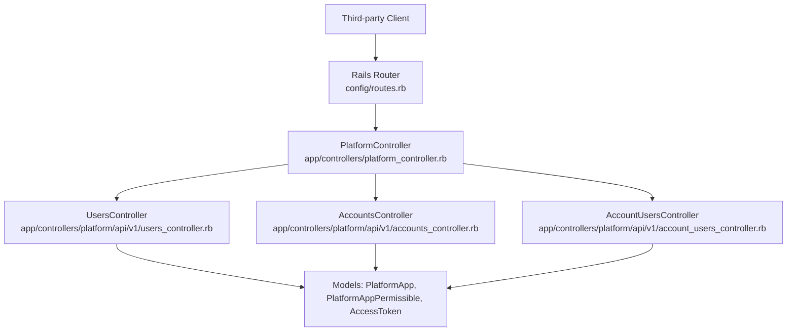
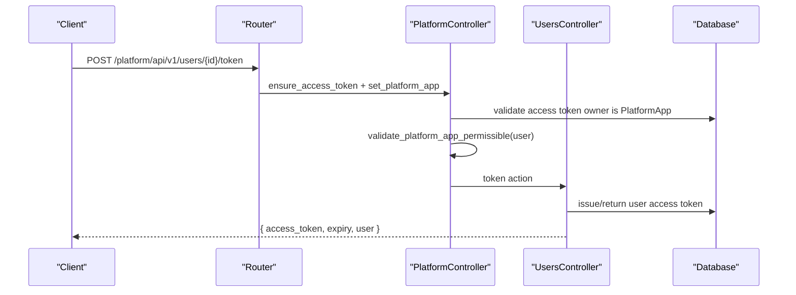
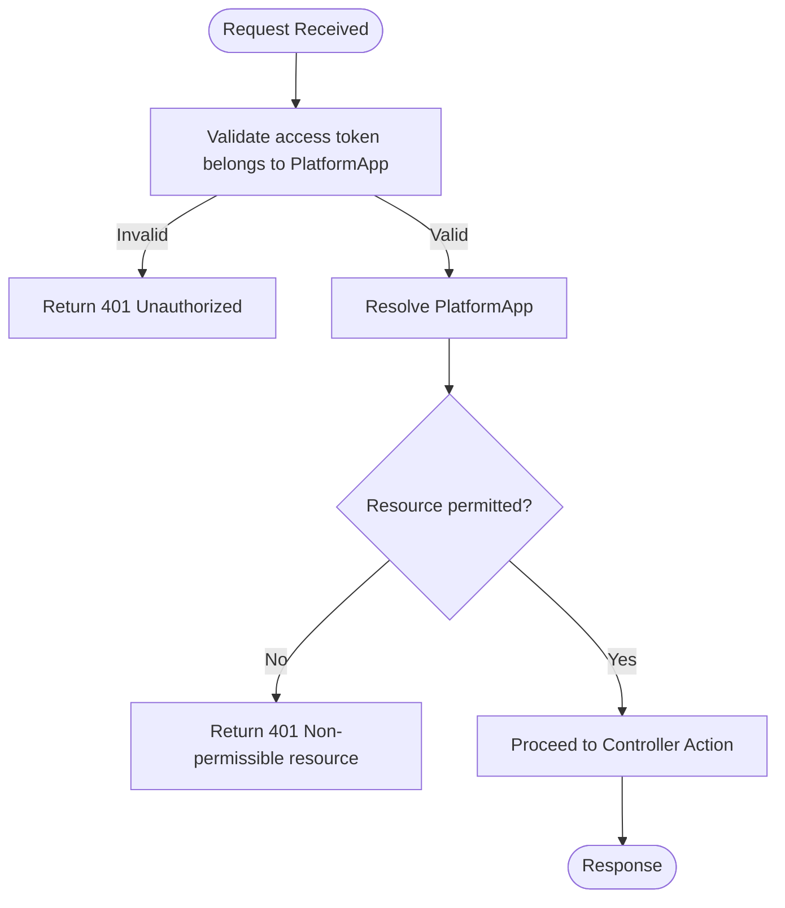
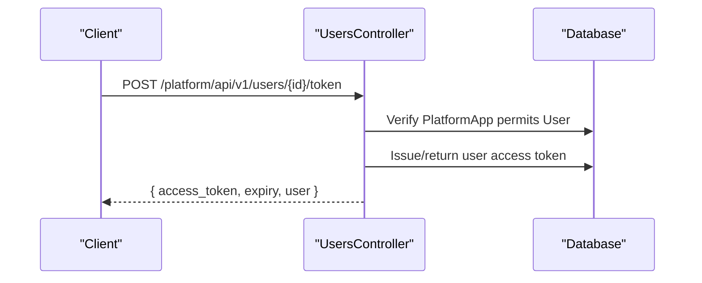
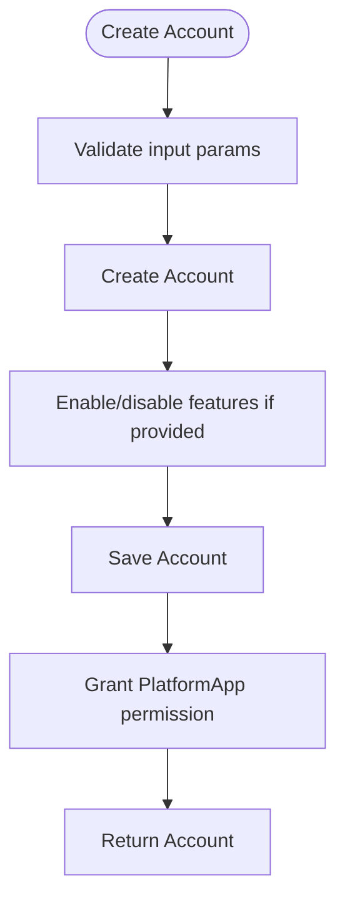
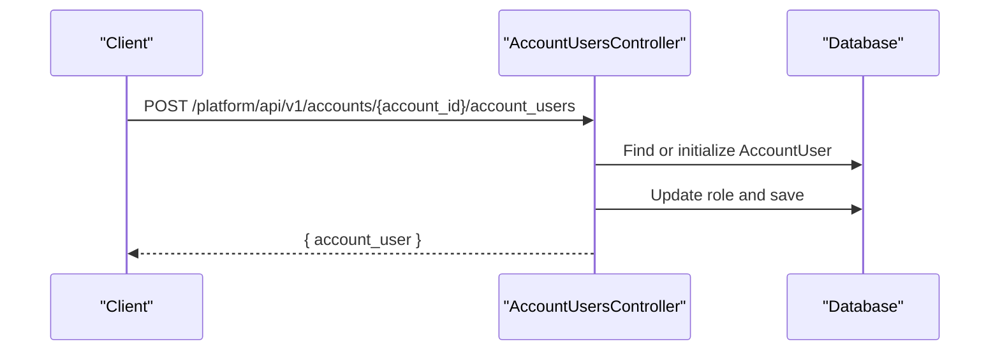
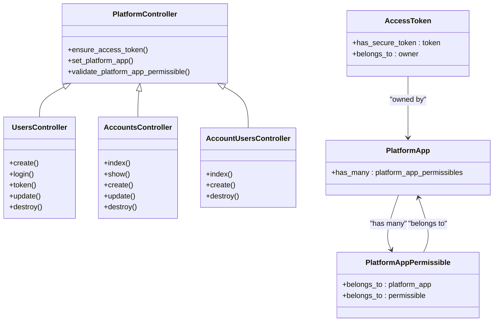

# Platform API

<cite>
**Referenced Files in This Document**
- [routes.rb](file://config/routes.rb)
- [platform_controller.rb](file://app/controllers/platform_controller.rb)
- [users_controller.rb](file://app/controllers/platform/api/v1/users_controller.rb)
- [accounts_controller.rb](file://app/controllers/platform/api/v1/accounts_controller.rb)
- [account_users_controller.rb](file://app/controllers/platform/api/v1/account_users_controller.rb)
- [platform_app.rb](file://app/models/platform_app.rb)
- [platform_app_permissible.rb](file://app/models/platform_app_permissible.rb)
- [access_token.rb](file://app/models/access_token.rb)
- [swagger.json](file://swagger/swagger.json)
</cite>

## Table of Contents
1. [Introduction](#introduction)
2. [Project Structure](#project-structure)
3. [Core Components](#core-components)
4. [Architecture Overview](#architecture-overview)
5. [Detailed Component Analysis](#detailed-component-analysis)
6. [Dependency Analysis](#dependency-analysis)
7. [Performance Considerations](#performance-considerations)
8. [Troubleshooting Guide](#troubleshooting-guide)
9. [Conclusion](#conclusion)
10. [Appendices](#appendices)

## Introduction
This document describes Chatwoot’s Platform API for third-party integrations. It explains how platform apps authenticate, manage access tokens, and operate on accounts, users, contacts, conversations, and system configuration through a secure, permissioned interface. It also covers security considerations, authorization patterns, error handling, rate limiting guidance, and best practices for secure consumption.

## Project Structure
The Platform API is exposed under the /platform namespace with versioned routes. Controllers live under app/controllers/platform/api/v1 and inherit from a shared base that enforces authentication and permission checks.

**Diagram sources**
- [routes.rb:647-669](file://config/routes.rb#L647-L669)
- [platform_controller.rb:1-34](file://app/controllers/platform_controller.rb#L1-L34)
- [users_controller.rb:1-58](file://app/controllers/platform/api/v1/users_controller.rb#L1-L58)
- [accounts_controller.rb:1-51](file://app/controllers/platform/api/v1/accounts_controller.rb#L1-L51)
- [account_users_controller.rb:1-30](file://app/controllers/platform/api/v1/account_users_controller.rb#L1-L30)

**Section sources**
- [routes.rb:647-669](file://config/routes.rb#L647-L669)

## Core Components
- PlatformController: Base controller for all platform endpoints. Enforces access token validation, resolves the owning PlatformApp, and validates permissibility for resource-scoped operations.
- PlatformApp: Represents a registered integration application; owns an AccessToken and declares permitted resources via PlatformAppPermissible.
- PlatformAppPermissible: Polymorphic association linking a PlatformApp to allowed resources (e.g., Account, User).
- AccessToken: Secure token associated with a polymorphic owner (e.g., PlatformApp or User).

Key responsibilities:
- Authentication: Validate incoming requests using an access token belonging to a PlatformApp.
- Authorization: Ensure the requested resource is explicitly permitted for the PlatformApp.
- Resource management: Provide CRUD-like operations for Accounts and Users, plus account-user membership management.

**Section sources**
- [platform_controller.rb:1-34](file://app/controllers/platform_controller.rb#L1-L34)
- [platform_app.rb:1-17](file://app/models/platform_app.rb#L1-L17)
- [platform_app_permissible.rb:1-25](file://app/models/platform_app_permissible.rb#L1-L25)
- [access_token.rb:1-22](file://app/models/access_token.rb#L1-L22)

## Architecture Overview
The Platform API uses a token-based approach where a PlatformApp holds an access token used to call endpoints. For user-scoped actions, the PlatformApp can obtain a user access token or SSO link for a specific user if permitted.

**Diagram sources**
- [routes.rb:647-669](file://config/routes.rb#L647-L669)
- [platform_controller.rb:1-34](file://app/controllers/platform_controller.rb#L1-L34)
- [users_controller.rb:1-58](file://app/controllers/platform/api/v1/users_controller.rb#L1-L58)

## Detailed Component Analysis

### Authentication and Access Token Management
- Platform-level authentication: Requests must include a valid access token owned by a PlatformApp. The base controller ensures this and rejects invalid tokens.
- Permissibility model: Each PlatformApp maintains a list of permissible resources (polymorphic). Operations on resources require explicit permission.
- User token issuance: A permitted PlatformApp can request a user access token for a specific user. Responses include the token, optional expiry, and user details.

**Diagram sources**
- [platform_controller.rb:18-32](file://app/controllers/platform_controller.rb#L18-L32)

Security notes:
- Use HTTPS for all calls.
- Store PlatformApp access tokens securely and rotate periodically.
- Limit permissions to only required resources.

Error responses:
- 401 Unauthorized: Invalid or missing access token, or non-permissible resource.
- 404 Not Found: Requested resource does not exist.

**Section sources**
- [platform_controller.rb:1-34](file://app/controllers/platform_controller.rb#L1-L34)
- [swagger.json:800-933](file://swagger/swagger.json#L800-L933)

### Platform App Registration and Permissions
- PlatformApp represents an integration and owns an AccessToken.
- PlatformAppPermissible links a PlatformApp to allowed resources (e.g., Account, User).
- When creating or updating resources via the Platform API, the PlatformApp automatically gains permission to the created resource when applicable.

Best practices:
- Create a dedicated PlatformApp per integration environment.
- Maintain minimal permissibles to reduce risk.
- Audit permissions regularly.

**Section sources**
- [platform_app.rb:1-17](file://app/models/platform_app.rb#L1-L17)
- [platform_app_permissible.rb:1-25](file://app/models/platform_app_permissible.rb#L1-L25)
- [accounts_controller.rb:11-16](file://app/controllers/platform/api/v1/accounts_controller.rb#L11-L16)

### Users Endpoint
Capabilities:
- Create or find-by-email a User and grant the PlatformApp permission.
- Retrieve an SSO URL for a User.
- Obtain a User access token for a permitted User.
- Update User attributes (including custom attributes), with email changes bypassing reconfirmation for platform flows.
- Delete a User asynchronously.

**Diagram sources**
- [users_controller.rb:17-21](file://app/controllers/platform/api/v1/users_controller.rb#L17-L21)
- [swagger.json:855-933](file://swagger/swagger.json#L855-L933)

Notes:
- The endpoint returns user details including id, name, display_name, email, and pubsub_token.
- If the PlatformApp is not permitted for the target User, the request is rejected.

**Section sources**
- [users_controller.rb:1-58](file://app/controllers/platform/api/v1/users_controller.rb#L1-L58)
- [swagger.json:800-933](file://swagger/swagger.json#L800-L933)

### Accounts Endpoint
Capabilities:
- List accounts permitted to the PlatformApp.
- Create an Account and automatically grant the PlatformApp permission.
- Update Account attributes and features.
- Delete an Account asynchronously.

**Diagram sources**
- [accounts_controller.rb:11-22](file://app/controllers/platform/api/v1/accounts_controller.rb#L11-L22)

**Section sources**
- [accounts_controller.rb:1-51](file://app/controllers/platform/api/v1/accounts_controller.rb#L1-L51)

### Account Users Endpoint
Capabilities:
- List members of an Account.
- Add a member to an Account (with role).
- Remove a member from an Account.

**Diagram sources**
- [account_users_controller.rb:9-13](file://app/controllers/platform/api/v1/account_users_controller.rb#L9-L13)

**Section sources**
- [account_users_controller.rb:1-30](file://app/controllers/platform/api/v1/account_users_controller.rb#L1-L30)

### System Configuration and Other Resources
- Agent Bots: The Platform API exposes agent bots under the same namespace. Refer to the route definitions for available actions.
- Email Channel Migrations: A dedicated endpoint exists for migrating email channels.

For full endpoint listings and schemas, consult the Swagger documentation generated for the Platform API.

**Section sources**
- [routes.rb:647-669](file://config/routes.rb#L647-L669)

## Dependency Analysis
The Platform API relies on a small set of core models and controllers:

**Diagram sources**
- [platform_controller.rb:1-34](file://app/controllers/platform_controller.rb#L1-L34)
- [users_controller.rb:1-58](file://app/controllers/platform/api/v1/users_controller.rb#L1-L58)
- [accounts_controller.rb:1-51](file://app/controllers/platform/api/v1/accounts_controller.rb#L1-L51)
- [account_users_controller.rb:1-30](file://app/controllers/platform/api/v1/account_users_controller.rb#L1-L30)
- [platform_app.rb:1-17](file://app/models/platform_app.rb#L1-L17)
- [platform_app_permissible.rb:1-25](file://app/models/platform_app_permissible.rb#L1-L25)
- [access_token.rb:1-22](file://app/models/access_token.rb#L1-L22)

**Section sources**
- [platform_controller.rb:1-34](file://app/controllers/platform_controller.rb#L1-L34)
- [platform_app.rb:1-17](file://app/models/platform_app.rb#L1-L17)
- [platform_app_permissible.rb:1-25](file://app/models/platform_app_permissible.rb#L1-L25)
- [access_token.rb:1-22](file://app/models/access_token.rb#L1-L22)

## Performance Considerations
- Prefer batch operations where supported (e.g., bulk account user management).
- Use asynchronous deletion jobs for heavy cleanup tasks.
- Cache frequently accessed read-only data at the client layer when appropriate.
- Avoid unnecessary feature toggles updates in tight loops; batch feature changes.

[No sources needed since this section provides general guidance]

## Troubleshooting Guide
Common issues and resolutions:
- 401 Unauthorized:
  - Missing or invalid access token: Ensure the PlatformApp access token is included in the request header.
  - Non-permissible resource: Confirm the PlatformApp has been granted permission to the target resource.
- 404 Not Found:
  - Target resource does not exist: Verify IDs and scoping.
- Token refresh:
  - For user-scoped access, use the user token endpoint to obtain a new token when needed.

Operational tips:
- Log and monitor failed authentication attempts.
- Rotate PlatformApp access tokens periodically.
- Review permissibles to remove unused permissions.

**Section sources**
- [platform_controller.rb:18-32](file://app/controllers/platform_controller.rb#L18-L32)
- [swagger.json:800-933](file://swagger/swagger.json#L800-L933)

## Conclusion
Chatwoot’s Platform API provides a secure, permissioned interface for third-party integrations. By leveraging PlatformApp access tokens and the permissibility model, integrations can safely manage accounts, users, and related resources. Follow the security and best practice recommendations to ensure robust and maintainable integrations.

[No sources needed since this section summarizes without analyzing specific files]

## Appendices

### OAuth2 Authorization Flow Notes
- The Platform API primarily uses bearer tokens issued to PlatformApps rather than interactive OAuth2 authorization codes.
- For user impersonation flows, use the user token endpoint to obtain a user access token after verifying permissibility.

[No sources needed since this section provides general guidance]

### Rate Limiting Guidance
- Apply client-side exponential backoff and jitter on retries.
- Respect server responses indicating throttling and implement local request queues.
- Monitor usage metrics and adjust concurrency accordingly.

[No sources needed since this section provides general guidance]

### SDK References and Integration Guides
- Official SDKs and examples are maintained separately. Consult the Chatwoot developer portal for language-specific SDKs and integration guides.

[No sources needed since this section references external materials]