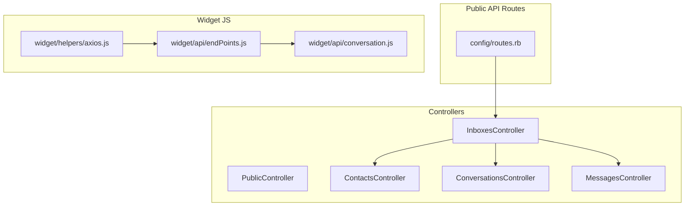
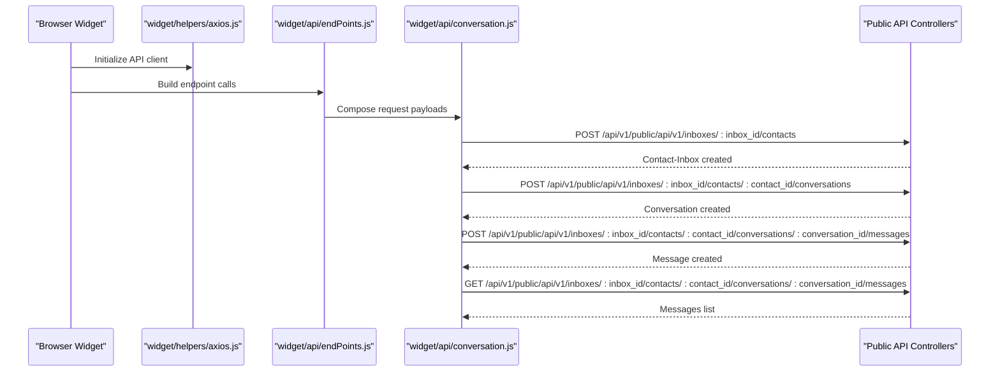
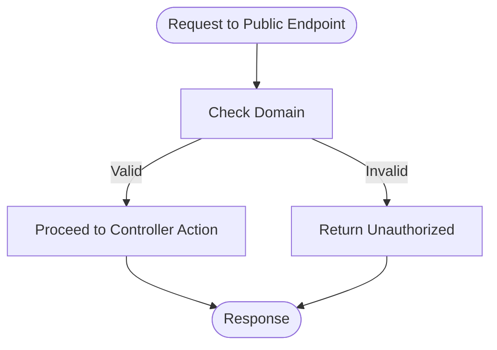
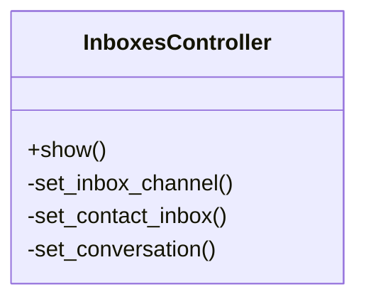
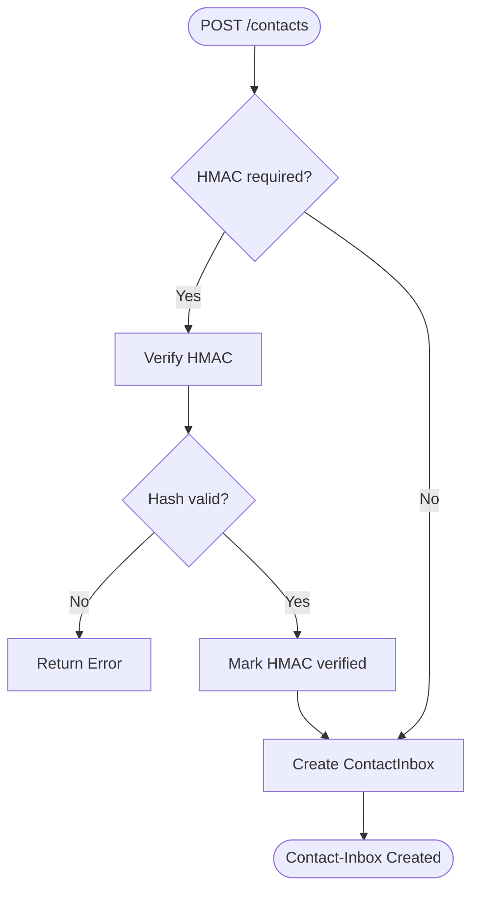
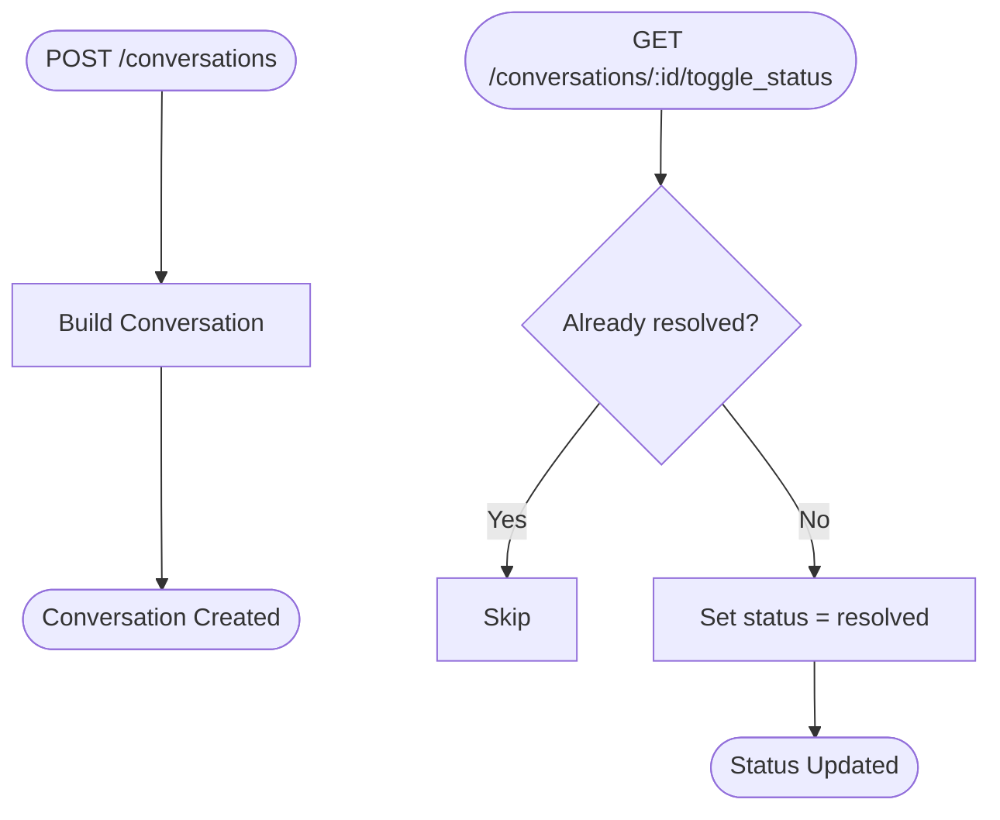
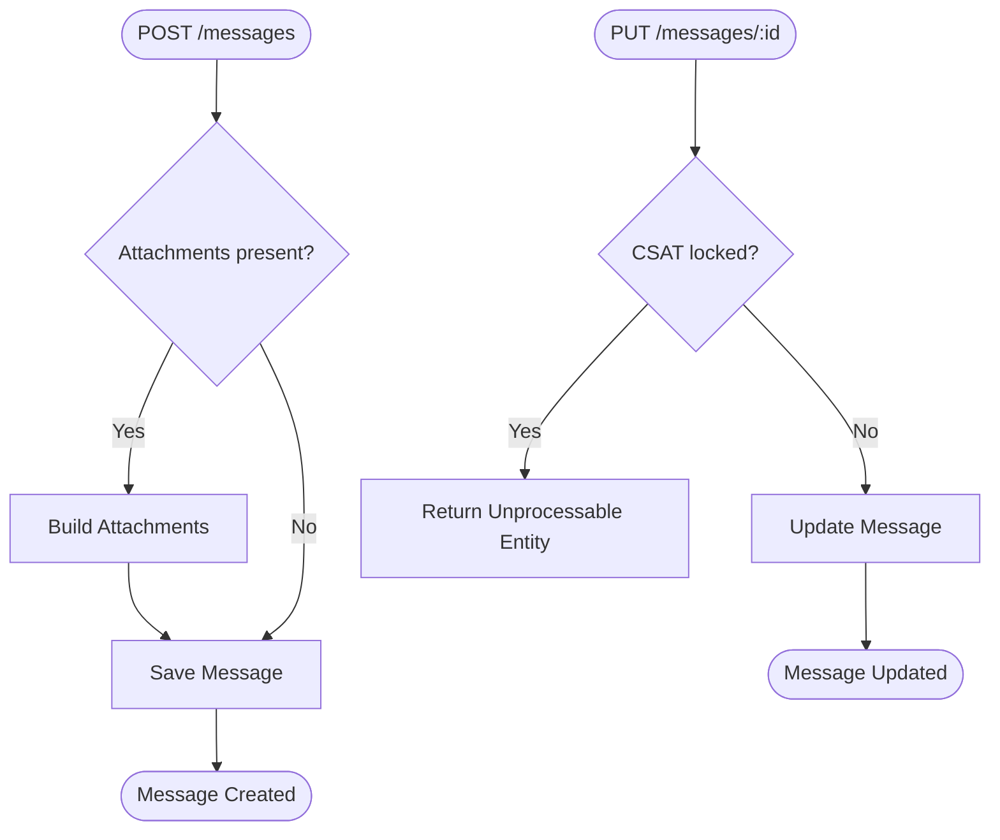
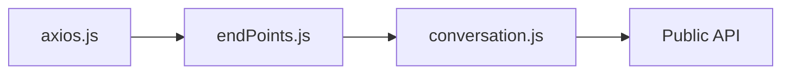
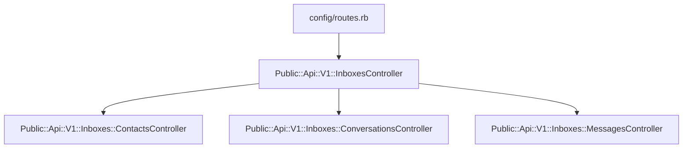

# Public API

<cite>
**Referenced Files in This Document**
- [routes.rb](file://config/routes.rb)
- [public_controller.rb](file://app/controllers/public_controller.rb)
- [inboxes_controller.rb](file://app/controllers/public/api/v1/inboxes_controller.rb)
- [contacts_controller.rb](file://app/controllers/public/api/v1/inboxes/contacts_controller.rb)
- [conversations_controller.rb](file://app/controllers/public/api/v1/inboxes/conversations_controller.rb)
- [messages_controller.rb](file://app/controllers/public/api/v1/inboxes/messages_controller.rb)
- [axios.js](file://app/javascript/widget/helpers/axios.js)
- [endPoints.js](file://app/javascript/widget/api/endPoints.js)
- [conversation.js](file://app/javascript/widget/api/conversation.js)
</cite>

## Table of Contents
1. [Introduction](#introduction)
2. [Project Structure](#project-structure)
3. [Core Components](#core-components)
4. [Architecture Overview](#architecture-overview)
5. [Detailed Component Analysis](#detailed-component-analysis)
6. [Dependency Analysis](#dependency-analysis)
7. [Performance Considerations](#performance-considerations)
8. [Troubleshooting Guide](#troubleshooting-guide)
9. [Conclusion](#conclusion)

## Introduction
This document describes Chatwoot’s Public API used by widgets and external services to create conversations, send messages, and retrieve conversation data without full authentication. It also covers widget-specific functionality such as contact identification, conversation lifecycle management, and real-time signals like typing indicators. Security considerations for public endpoints, HMAC-based identifier verification, and domain restrictions are included alongside practical integration guidance.

## Project Structure
The Public API is exposed under the /api/v1/public namespace and provides resources for inboxes, contacts, conversations, and messages. The route definitions and controller hierarchy define how requests flow from the browser widget to backend services.

**Diagram sources**
- [routes.rb:671-695](file://config/routes.rb#L671-L695)
- [public_controller.rb:1-29](file://app/controllers/public_controller.rb#L1-L29)
- [inboxes_controller.rb:1-34](file://app/controllers/public/api/v1/inboxes_controller.rb#L1-L34)
- [contacts_controller.rb:1-54](file://app/controllers/public/api/v1/inboxes/contacts_controller.rb#L1-L54)
- [conversations_controller.rb:1-68](file://app/controllers/public/api/v1/inboxes/conversations_controller.rb#L1-L68)
- [messages_controller.rb:1-74](file://app/controllers/public/api/v1/inboxes/messages_controller.rb#L1-L74)
- [axios.js:1-15](file://app/javascript/widget/helpers/axios.js#L1-L15)
- [endPoints.js:83-138](file://app/javascript/widget/api/endPoints.js#L83-L138)
- [conversation.js:44-95](file://app/javascript/widget/api/conversation.js#L44-L95)

**Section sources**
- [routes.rb:671-695](file://config/routes.rb#L671-L695)
- [public_controller.rb:1-29](file://app/controllers/public_controller.rb#L1-L29)

## Core Components
- Public base controller: Provides shared behavior for public endpoints, including skipping CSRF verification and enforcing custom domain checks where applicable.
- Inboxes controller: Resolves inbox channel, contact-inbox mapping, and conversation context based on request parameters.
- Contacts controller: Creates or updates a contact via a contact-inbox; supports optional HMAC validation for secure identifier handling.
- Conversations controller: Creates conversations, toggles status (e.g., resolve), manages typing events, and updates last seen timestamps.
- Messages controller: Lists, creates, and updates messages; supports attachments and CSAT survey responses with time-based locking.

Key responsibilities:
- Resolve scoped entities using inbox identifier and contact source id.
- Validate identifiers when HMAC is enabled.
- Provide minimal, widget-friendly operations for customer-facing flows.

**Section sources**
- [public_controller.rb:1-29](file://app/controllers/public_controller.rb#L1-L29)
- [inboxes_controller.rb:1-34](file://app/controllers/public/api/v1/inboxes_controller.rb#L1-L34)
- [contacts_controller.rb:1-54](file://app/controllers/public/api/v1/inboxes/contacts_controller.rb#L1-L54)
- [conversations_controller.rb:1-68](file://app/controllers/public/api/v1/inboxes/conversations_controller.rb#L1-L68)
- [messages_controller.rb:1-74](file://app/controllers/public/api/v1/inboxes/messages_controller.rb#L1-L74)

## Architecture Overview
The Public API exposes REST endpoints for contacts, conversations, and messages. Widget JavaScript uses an Axios client configured with the application base URL and helper modules to call these endpoints.

**Diagram sources**
- [axios.js:1-15](file://app/javascript/widget/helpers/axios.js#L1-L15)
- [endPoints.js:83-138](file://app/javascript/widget/api/endPoints.js#L83-L138)
- [conversation.js:44-95](file://app/javascript/widget/api/conversation.js#L44-L95)
- [routes.rb:671-695](file://config/routes.rb#L671-L695)
- [contacts_controller.rb:1-54](file://app/controllers/public/api/v1/inboxes/contacts_controller.rb#L1-L54)
- [conversations_controller.rb:1-68](file://app/controllers/public/api/v1/inboxes/conversations_controller.rb#L1-L68)
- [messages_controller.rb:1-74](file://app/controllers/public/api/v1/inboxes/messages_controller.rb#L1-L74)

## Detailed Component Analysis

### Public Base Controller
- Purpose: Centralizes common behaviors for public endpoints.
- Key behaviors:
  - Skips CSRF token verification for public routes.
  - Enforces custom domain checks for portal-related endpoints.
  - Ensures feature flags are respected for cloud deployments.

**Diagram sources**
- [public_controller.rb:1-29](file://app/controllers/public_controller.rb#L1-L29)

**Section sources**
- [public_controller.rb:1-29](file://app/controllers/public_controller.rb#L1-L29)

### Inboxes Controller
- Responsibilities:
  - Resolve Channel::Api by identifier.
  - Map contact-inbox using source_id.
  - Resolve conversation by display_id with HMAC-aware scoping.

**Diagram sources**
- [inboxes_controller.rb:1-34](file://app/controllers/public/api/v1/inboxes_controller.rb#L1-L34)

**Section sources**
- [inboxes_controller.rb:1-34](file://app/controllers/public/api/v1/inboxes_controller.rb#L1-L34)

### Contacts Controller
- Capabilities:
  - Create a contact-inbox with optional source_id.
  - Update contact attributes securely.
  - Optional HMAC validation to ensure identifier integrity.

**Diagram sources**
- [contacts_controller.rb:1-54](file://app/controllers/public/api/v1/inboxes/contacts_controller.rb#L1-L54)

**Section sources**
- [contacts_controller.rb:1-54](file://app/controllers/public/api/v1/inboxes/contacts_controller.rb#L1-L54)

### Conversations Controller
- Capabilities:
  - List and show conversations scoped to contact-inbox.
  - Create new conversations.
  - Toggle conversation status (resolve).
  - Emit typing events and update last seen timestamps.

**Diagram sources**
- [conversations_controller.rb:1-68](file://app/controllers/public/api/v1/inboxes/conversations_controller.rb#L1-L68)

**Section sources**
- [conversations_controller.rb:1-68](file://app/controllers/public/api/v1/inboxes/conversations_controller.rb#L1-L68)

### Messages Controller
- Capabilities:
  - List messages with pagination support.
  - Create messages with optional attachments.
  - Update messages (e.g., CSAT responses) with time-based lock.

**Diagram sources**
- [messages_controller.rb:1-74](file://app/controllers/public/api/v1/inboxes/messages_controller.rb#L1-L74)

**Section sources**
- [messages_controller.rb:1-74](file://app/controllers/public/api/v1/inboxes/messages_controller.rb#L1-L74)

### Widget Integration Helpers
- Axios client configuration sets base URL and header utilities for widget requests.
- Endpoint builders compose URLs and payloads for conversation and message operations.
- Conversation helpers expose methods for typing, last seen, transcript, and attribute management.

**Diagram sources**
- [axios.js:1-15](file://app/javascript/widget/helpers/axios.js#L1-L15)
- [endPoints.js:83-138](file://app/javascript/widget/api/endPoints.js#L83-L138)
- [conversation.js:44-95](file://app/javascript/widget/api/conversation.js#L44-L95)

**Section sources**
- [axios.js:1-15](file://app/javascript/widget/helpers/axios.js#L1-L15)
- [endPoints.js:83-138](file://app/javascript/widget/api/endPoints.js#L83-L138)
- [conversation.js:44-95](file://app/javascript/widget/api/conversation.js#L44-L95)

## Dependency Analysis
- Route-to-controller mapping:
  - Public routes under /api/v1/public/api/v1 map to controllers under app/controllers/public/api/v1.
- Controller dependencies:
  - InboxesController acts as a base for Contacts, Conversations, and Messages controllers.
  - ContactsController optionally validates HMAC tokens tied to the inbox channel.
  - ConversationsController interacts with conversation models and event dispatchers for typing events.
  - MessagesController uses finders and attachment builders to persist messages.

**Diagram sources**
- [routes.rb:671-695](file://config/routes.rb#L671-L695)
- [inboxes_controller.rb:1-34](file://app/controllers/public/api/v1/inboxes_controller.rb#L1-L34)
- [contacts_controller.rb:1-54](file://app/controllers/public/api/v1/inboxes/contacts_controller.rb#L1-L54)
- [conversations_controller.rb:1-68](file://app/controllers/public/api/v1/inboxes/conversations_controller.rb#L1-L68)
- [messages_controller.rb:1-74](file://app/controllers/public/api/v1/inboxes/messages_controller.rb#L1-L74)

**Section sources**
- [routes.rb:671-695](file://config/routes.rb#L671-L695)

## Performance Considerations
- Minimize payload size by sending only necessary fields for contact creation and updates.
- Use before/after pagination for message listing to reduce response sizes.
- Avoid frequent typing indicator updates; batch UI state changes on the client side.
- Leverage HMAC verification only when required to reduce cryptographic overhead.

[No sources needed since this section provides general guidance]

## Troubleshooting Guide
Common issues and resolutions:
- Invalid HMAC hash:
  - Ensure the identifier_hash matches the expected HMAC computed with the inbox’s HMAC token and identifier.
  - If HMAC is not mandatory for the inbox, omit identifier_hash.
- Domain unauthorized:
  - For portal-related endpoints, verify that the request domain is registered or belongs to a portal.
- CSAT update locked:
  - CSAT survey responses cannot be updated after 14 days; handle this error gracefully on the client.

Operational tips:
- Inspect controller errors and HTTP status codes returned by the Public API.
- Validate request parameters against the documented shapes for each endpoint.
- Confirm that the widget’s base URL and headers are correctly configured.

**Section sources**
- [contacts_controller.rb:31-48](file://app/controllers/public/api/v1/inboxes/contacts_controller.rb#L31-L48)
- [public_controller.rb:9-20](file://app/controllers/public_controller.rb#L9-L20)
- [messages_controller.rb:14-20](file://app/controllers/public/api/v1/inboxes/messages_controller.rb#L14-L20)

## Conclusion
Chatwoot’s Public API provides a focused set of endpoints for widget-driven customer interactions. By leveraging contact-inbox scoping, optional HMAC verification, and minimal authentication requirements, it enables secure and efficient customer-facing flows. Proper configuration of the widget client, careful parameter handling, and adherence to security constraints will ensure reliable integration.

[No sources needed since this section summarizes without analyzing specific files]