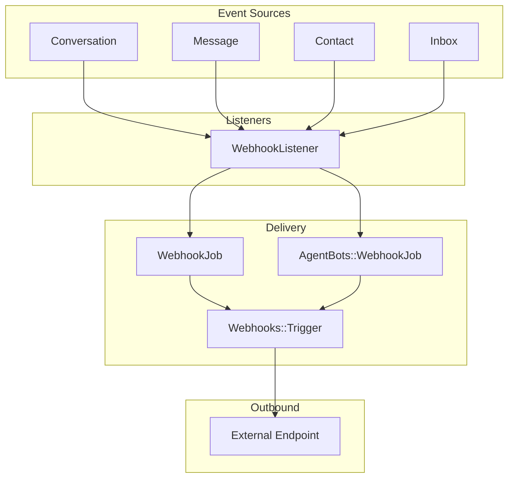
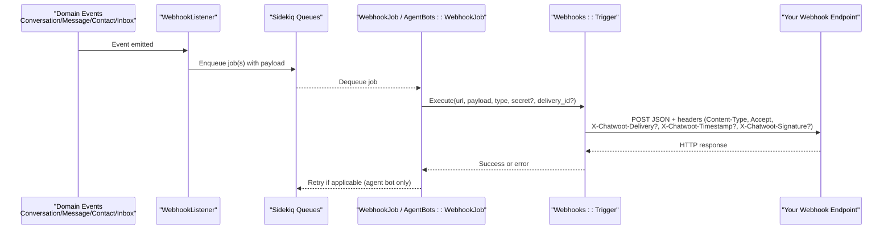
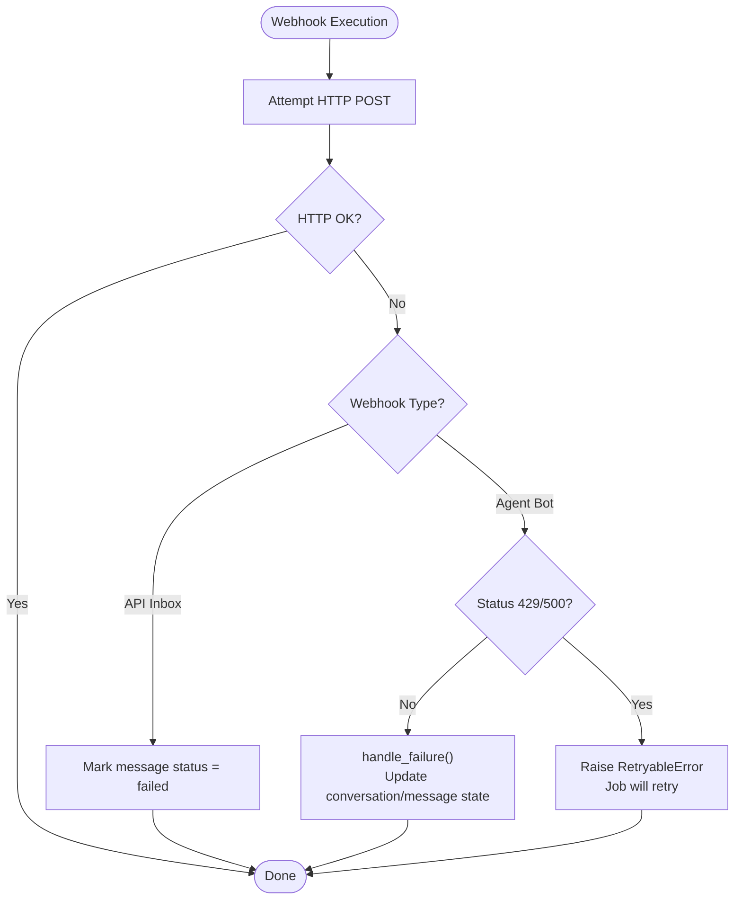
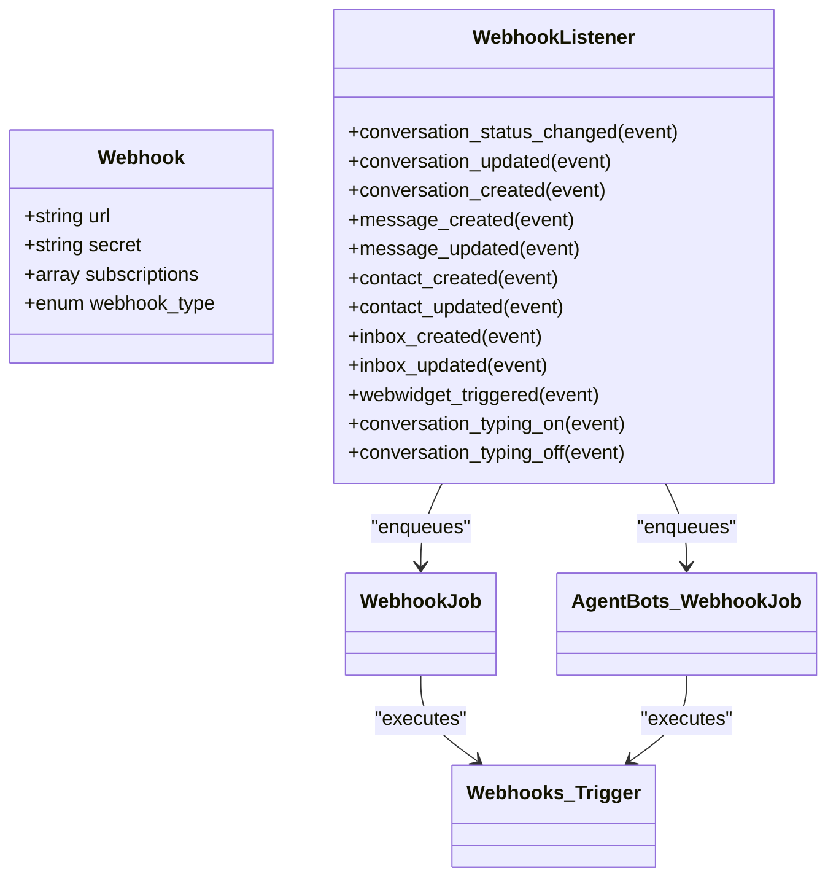

# Webhook System

<cite>
**Referenced Files in This Document**
- [webhook_listener.rb](file://app/listeners/webhook_listener.rb)
- [trigger.rb](file://lib/webhooks/trigger.rb)
- [webhook.rb](file://app/models/webhook.rb)
- [message.rb](file://app/models/message.rb)
- [conversation.rb](file://app/models/conversation.rb)
- [webhook_job.rb](file://app/jobs/webhook_job.rb)
- [agent_bot_webhook_job.rb](file://app/jobs/agent_bots/webhook_job.rb)
- [trigger_spec.rb](file://spec/lib/webhooks/trigger_spec.rb)
</cite>

## Table of Contents
1. [Introduction](#introduction)
2. [Project Structure](#project-structure)
3. [Core Components](#core-components)
4. [Architecture Overview](#architecture-overview)
5. [Detailed Component Analysis](#detailed-component-analysis)
6. [Dependency Analysis](#dependency-analysis)
7. [Performance Considerations](#performance-considerations)
8. [Troubleshooting Guide](#troubleshooting-guide)
9. [Conclusion](#conclusion)

## Introduction
This document explains Chatwoot’s webhook system for event-driven integrations. It covers the available webhook events, payload structure, security headers and signature verification, delivery mechanisms, retry policies, failure handling, and operational guidance for monitoring and troubleshooting.

## Project Structure
The webhook system is implemented as a listener-to-job pipeline:
- Listeners react to domain events (e.g., conversation_created, message_created).
- Jobs enqueue outbound HTTP requests to configured webhook endpoints.
- A trigger class performs the actual HTTP call with optional signing and error handling.

**Diagram sources**
- [webhook_listener.rb:1-135](file://app/listeners/webhook_listener.rb#L1-L135)
- [webhook_job.rb](file://app/jobs/webhook_job.rb)
- [agent_bot_webhook_job.rb:1-16](file://app/jobs/agent_bots/webhook_job.rb#L1-L16)
- [trigger.rb:1-135](file://lib/webhooks/trigger.rb#L1-L135)

**Section sources**
- [webhook_listener.rb:1-135](file://app/listeners/webhook_listener.rb#L1-L135)
- [webhook_job.rb](file://app/jobs/webhook_job.rb)
- [agent_bot_webhook_job.rb:1-16](file://app/jobs/agent_bots/webhook_job.rb#L1-L16)
- [trigger.rb:1-135](file://lib/webhooks/trigger.rb#L1-L135)

## Core Components
- Webhook model: Stores endpoint URL, secret, subscriptions, and scope (account vs inbox).
- WebhookListener: Builds payloads from domain objects and enqueues jobs per subscription.
- WebhookJob / AgentBots::WebhookJob: Enqueue and execute outbound requests; agent bot job adds retries.
- Webhooks::Trigger: Performs HTTP POST with timeouts, optional HMAC signature, and error handling.

Key responsibilities:
- Event filtering by allowed subscriptions.
- Payload construction using domain object webhook_data methods.
- Delivery via Sidekiq jobs with appropriate queues.
- Security headers including optional HMAC-SHA256 signature.

**Section sources**
- [webhook.rb:21-44](file://app/models/webhook.rb#L21-L44)
- [webhook_listener.rb:1-135](file://app/listeners/webhook_listener.rb#L1-L135)
- [webhook_job.rb](file://app/jobs/webhook_job.rb)
- [agent_bot_webhook_job.rb:1-16](file://app/jobs/agent_bots/webhook_job.rb#L1-L16)
- [trigger.rb:1-135](file://lib/webhooks/trigger.rb#L1-L135)

## Architecture Overview
End-to-end flow from event to external endpoint:

**Diagram sources**
- [webhook_listener.rb:10-135](file://app/listeners/webhook_listener.rb#L10-L135)
- [webhook_job.rb](file://app/jobs/webhook_job.rb)
- [agent_bot_webhook_job.rb:1-16](file://app/jobs/agent_bots/webhook_job.rb#L1-L16)
- [trigger.rb:41-63](file://lib/webhooks/trigger.rb#L41-L63)

## Detailed Component Analysis

### Available Webhook Events
Allowed events are enforced at the model level. The following events are supported:
- conversation_status_changed
- conversation_updated
- conversation_created
- contact_created
- contact_updated
- message_created
- message_updated
- webwidget_triggered
- inbox_created
- inbox_updated
- conversation_typing_on
- conversation_typing_off

Notes:
- For contact_updated and inbox_updated, webhooks are only sent when there are changed attributes.
- Typing events include user and conversation data plus an is_private flag.

**Section sources**
- [webhook.rb:32-34](file://app/models/webhook.rb#L32-L34)
- [webhook_listener.rb:86-108](file://app/listeners/webhook_listener.rb#L86-L108)

### Payload Formats and Metadata
Payloads are built from domain objects’ webhook_data methods and merged with event metadata:
- conversation_* events: include conversation.webhook_data plus event name and changed_attributes where applicable.
- message_* events: include message.webhook_data plus event name; filtered by message.sendable criteria.
- contact_* events: include contact.webhook_data plus event name and changed_attributes where applicable.
- inbox_* events: include Inbox::EventDataPresenter.webhook_data plus event name and changed_attributes where applicable.
- webwidget_triggered: includes contact_inbox.webhook_data plus event_info.
- typing events: include user.webhook_data, conversation.webhook_data, and is_private.

Example fields commonly present:
- account, inbox, conversation, contact, user, sender, attachments, timestamps, identifiers, content, and custom attributes.

For exact field shapes, refer to the webhook_data implementations on models/presenters used by listeners.

**Section sources**
- [webhook_listener.rb:2-84](file://app/listeners/webhook_listener.rb#L2-L84)
- [message.rb:177-200](file://app/models/message.rb#L177-L200)
- [conversation.rb](file://app/models/conversation.rb)

### Security Headers and Signature Verification
When a webhook has a secret, the trigger adds:
- X-Chatwoot-Timestamp: current epoch seconds
- X-Chatwoot-Signature: sha256=HMAC-SHA256(secret, "#{timestamp}.#{body}")

If a delivery_id is provided, it is included as:
- X-Chatwoot-Delivery

Always verify:
- Timestamp freshness (reject stale timestamps)
- Signature matches your stored secret over timestamp.body
- Idempotency using X-Chatwoot-Delivery

Tests confirm header behavior and HMAC computation.

**Section sources**
- [trigger.rb:54-63](file://lib/webhooks/trigger.rb#L54-L63)
- [trigger_spec.rb:178-257](file://spec/lib/webhooks/trigger_spec.rb#L178-L257)

### Registration and Subscriptions
- Webhooks are scoped to an account and optionally an inbox.
- Each webhook stores a URL, secret, and an array of subscriptions (events).
- Subscriptions are validated against the allowed list.
- Account-level webhooks deliver to all matching events for that account.
- API inbox webhooks deliver to the channel’s webhook_url when enabled.

**Section sources**
- [webhook.rb:21-44](file://app/models/webhook.rb#L21-L44)
- [webhook_listener.rb:110-133](file://app/listeners/webhook_listener.rb#L110-L133)

### Delivery Mechanisms and Queues
- WebhookListener enqueues WebhookJob for account-level webhooks and API inbox webhooks.
- Agent bots use AgentBots::WebhookJob which runs on the high queue and supports retries.
- All deliveries are asynchronous via Sidekiq.

**Section sources**
- [webhook_listener.rb:110-133](file://app/listeners/webhook_listener.rb#L110-L133)
- [agent_bot_webhook_job.rb:1-16](file://app/jobs/agent_bots/webhook_job.rb#L1-L16)

### Retry Policies and Failure Handling
- Non-agent-bot webhooks: failures are logged; no automatic retries.
- Agent-bot webhooks:
  - Certain HTTP statuses (429, 500) are treated as retryable.
  - The job retries up to 3 times with a short backoff.
  - On final failure, handle_failure is invoked to update state (e.g., reopen pending conversations, add activity messages).
- For message_created/message_updated events on API inbox webhooks, failures mark the message status as failed.

**Diagram sources**
- [trigger.rb:26-37](file://lib/webhooks/trigger.rb#L26-L37)
- [trigger.rb:65-102](file://lib/webhooks/trigger.rb#L65-L102)
- [trigger.rb:125-133](file://lib/webhooks/trigger.rb#L125-L133)
- [agent_bot_webhook_job.rb:1-16](file://app/jobs/agent_bots/webhook_job.rb#L1-L16)

**Section sources**
- [trigger.rb:26-37](file://lib/webhooks/trigger.rb#L26-L37)
- [trigger.rb:65-102](file://lib/webhooks/trigger.rb#L65-L102)
- [trigger.rb:125-133](file://lib/webhooks/trigger.rb#L125-L133)
- [agent_bot_webhook_job.rb:1-16](file://app/jobs/agent_bots/webhook_job.rb#L1-L16)
- [trigger_spec.rb:34-176](file://spec/lib/webhooks/trigger_spec.rb#L34-L176)

### Example Integration Patterns
- Conversation lifecycle: Subscribe to conversation_created, conversation_updated, conversation_status_changed to sync CRM states.
- Message routing: Subscribe to message_created/message_updated to forward messages to external systems.
- Contact enrichment: Subscribe to contact_updated to push attribute changes to downstream databases.
- Widget analytics: Subscribe to webwidget_triggered to capture engagement events.
- Typing indicators: Subscribe to conversation_typing_on/off to reflect real-time presence.

[No sources needed since this section provides conceptual patterns]

## Dependency Analysis

**Diagram sources**
- [webhook.rb:21-44](file://app/models/webhook.rb#L21-L44)
- [webhook_listener.rb:1-135](file://app/listeners/webhook_listener.rb#L1-L135)
- [webhook_job.rb](file://app/jobs/webhook_job.rb)
- [agent_bot_webhook_job.rb:1-16](file://app/jobs/agent_bots/webhook_job.rb#L1-L16)
- [trigger.rb:1-135](file://lib/webhooks/trigger.rb#L1-L135)

**Section sources**
- [webhook.rb:21-44](file://app/models/webhook.rb#L21-L44)
- [webhook_listener.rb:1-135](file://app/listeners/webhook_listener.rb#L1-L135)
- [webhook_job.rb](file://app/jobs/webhook_job.rb)
- [agent_bot_webhook_job.rb:1-16](file://app/jobs/agent_bots/webhook_job.rb#L1-L16)
- [trigger.rb:1-135](file://lib/webhooks/trigger.rb#L1-L135)

## Performance Considerations
- Asynchronous delivery: All webhooks are delivered via Sidekiq jobs to avoid blocking request flows.
- Timeouts: Outbound requests use configurable open/read timeouts with a default fallback.
- Queue prioritization: Agent bot webhooks run on a high-priority queue to reduce latency for automated responses.
- Payload size: Keep payloads minimal; rely on IDs and reference related resources when possible.

[No sources needed since this section provides general guidance]

## Troubleshooting Guide
Common issues and resolutions:
- Invalid or blocked URLs: Ensure the endpoint is reachable and not blocked by network policies.
- Signature mismatches: Verify you compute HMAC-SHA256 over “timestamp.body” using the stored secret and compare with X-Chatwoot-Signature.
- Stale timestamps: Reject requests with old X-Chatwoot-Timestamp values to prevent replay attacks.
- Idempotency: Use X-Chatwoot-Delivery to deduplicate retries.
- Failed deliveries:
  - API inbox webhooks: message status becomes failed; inspect logs and endpoint responses.
  - Agent bot webhooks: check retry attempts and final failure logs; review conversation state transitions.
- Monitoring:
  - Track Sidekiq job performance and failure rates.
  - Monitor webhook endpoint latency and error rates.
  - Alert on repeated signature failures or timeout spikes.

**Section sources**
- [trigger_spec.rb:178-257](file://spec/lib/webhooks/trigger_spec.rb#L178-L257)
- [trigger.rb:118-123](file://lib/webhooks/trigger.rb#L118-L123)
- [agent_bot_webhook_job.rb:1-16](file://app/jobs/agent_bots/webhook_job.rb#L1-L16)

## Conclusion
Chatwoot’s webhook system provides a robust, secure, and scalable mechanism for event-driven integrations. By subscribing to the appropriate events, verifying signatures, and implementing idempotent handlers, you can reliably integrate Chatwoot with external systems. Use the provided headers and retry semantics to build resilient integrations and monitor delivery health through job queues and endpoint metrics.