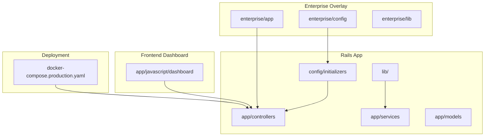
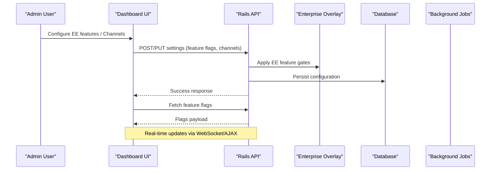
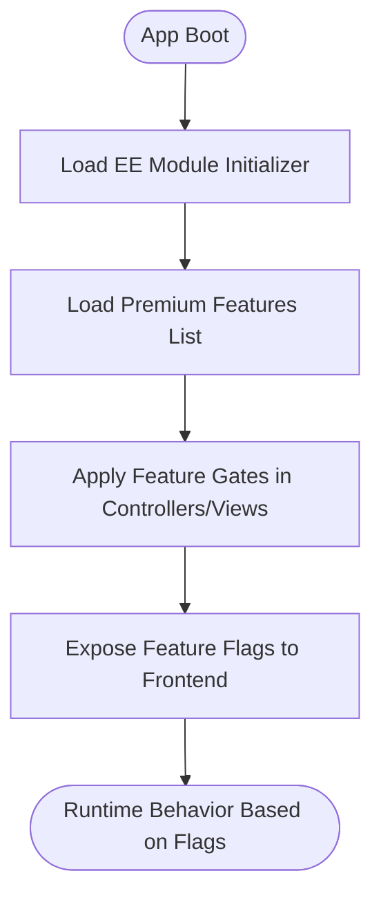
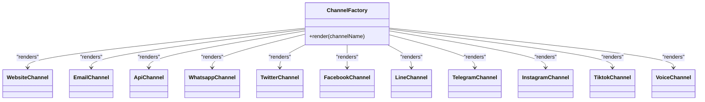
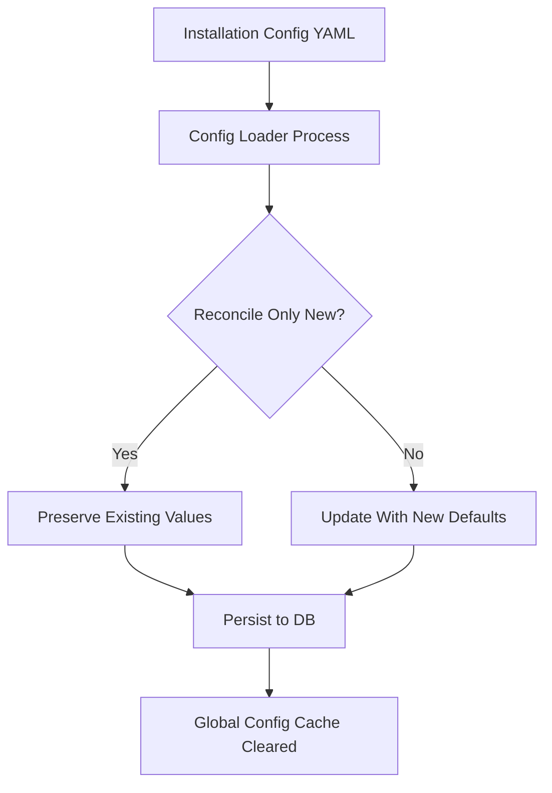
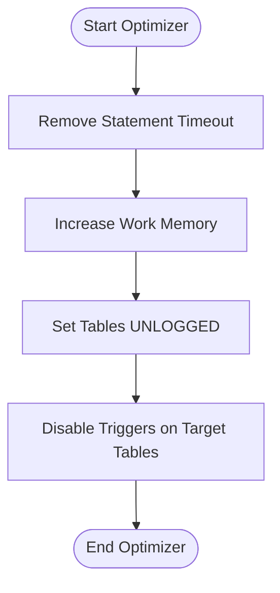
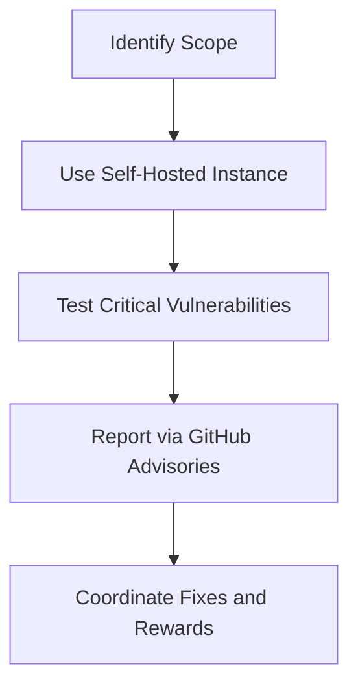
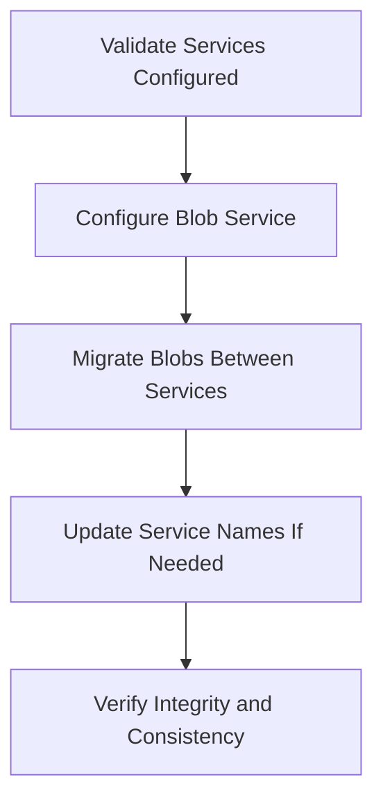
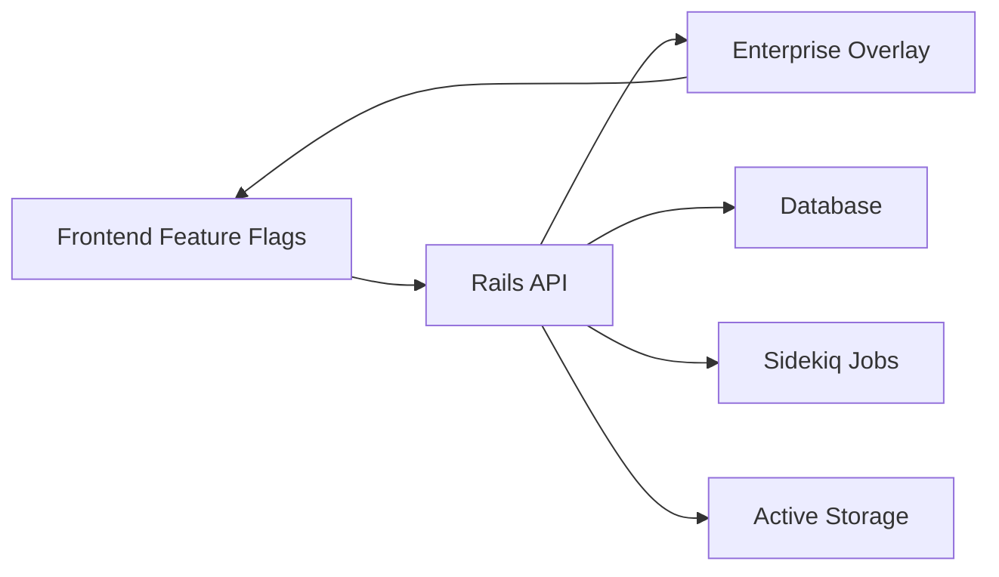

# Advanced Topics

<cite>
**Referenced Files in This Document**
- [README.md](file://README.md)
- [SECURITY.md](file://SECURITY.md)
- [enterprise/config/premium_features.yml](file://enterprise/config/premium_features.yml)
- [app/javascript/dashboard/featureFlags.js](file://app/javascript/dashboard/featureFlags.js)
- [app/javascript/dashboard/routes/dashboard/settings/inbox/ChannelFactory.vue](file://app/javascript/dashboard/routes/dashboard/settings/inbox/ChannelFactory.vue)
- [lib/test_data/database_optimizer.rb](file://lib/test_data/database_optimizer.rb)
- [lib/active_storage/migrator.rb](file://lib/active_storage/migrator.rb)
- [config/initializers/01_inject_enterprise_edition_module.rb](file://config/initializers/01_inject_enterprise_edition_module.rb)
- [AGENTS.md](file://AGENTS.md)
- [spec/lib/config_loader_spec.rb](file://spec/lib/config_loader_spec.rb)
- [lib/tasks/feature_defaults.rake](file://lib/tasks/feature_defaults.rake)
- [docker-compose.production.yaml](file://docker-compose.production.yaml)
</cite>

## Table of Contents
1. [Introduction](#introduction)
2. [Project Structure](#project-structure)
3. [Core Components](#core-components)
4. [Architecture Overview](#architecture-overview)
5. [Detailed Component Analysis](#detailed-component-analysis)
6. [Dependency Analysis](#dependency-analysis)
7. [Performance Considerations](#performance-considerations)
8. [Troubleshooting Guide](#troubleshooting-guide)
9. [Conclusion](#conclusion)
10. [Appendices](#appendices)

## Introduction
This document provides expert-level guidance for advanced Chatwoot topics, including Enterprise Edition features, custom channel development, deep customization options, performance optimization, database tuning, memory management, security considerations, penetration testing and vulnerability assessment, advanced configuration, plugin development and extension points, troubleshooting complex issues, log analysis, diagnostic tools, migration strategies, upgrade procedures, compatibility considerations, advanced deployment scenarios, custom integrations, white-labeling, and scaling Chatwoot in enterprise environments.

## Project Structure
Chatwoot is a Rails application with a Vue-based dashboard and extensive extension points:
- Core Rails app under app/, config/, lib/, db/, spec/
- Enterprise overlay under enterprise/ that extends or overrides OSS behavior
- Frontend dashboard under app/javascript/dashboard/
- Docker and deployment assets at the repository root
- Configuration files under config/ and environment-specific initializers

**Diagram sources**
- [config/initializers/01_inject_enterprise_edition_module.rb](file://config/initializers/01_inject_enterprise_edition_module.rb)
- [enterprise/config/premium_features.yml](file://enterprise/config/premium_features.yml)
- [app/javascript/dashboard/featureFlags.js](file://app/javascript/dashboard/featureFlags.js)
- [docker-compose.production.yaml](file://docker-compose.production.yaml)

**Section sources**
- [README.md:1-140](file://README.md#L1-L140)
- [AGENTS.md:110-124](file://AGENTS.md#L110-L124)

## Core Components
- Enterprise Edition (EE) feature gating via premium features list and frontend feature flags
- Channel factory for adding new channels in the dashboard UI
- Database optimizer utilities for test data generation and performance tuning
- Active Storage migrator for blob storage service migrations
- Security policy and vulnerability reporting process

Key areas to focus on for advanced users:
- EE feature toggles and premium capabilities
- Custom channel creation and registration
- Feature flag system and installation configuration reconciliation
- Storage backend migration tooling
- Security posture and responsible disclosure

**Section sources**
- [enterprise/config/premium_features.yml:1-13](file://enterprise/config/premium_features.yml#L1-L13)
- [app/javascript/dashboard/featureFlags.js:35-70](file://app/javascript/dashboard/featureFlags.js#L35-L70)
- [app/javascript/dashboard/routes/dashboard/settings/inbox/ChannelFactory.vue:1-46](file://app/javascript/dashboard/routes/dashboard/settings/inbox/ChannelFactory.vue#L1-L46)
- [lib/test_data/database_optimizer.rb:1-35](file://lib/test_data/database_optimizer.rb#L1-L35)
- [lib/active_storage/migrator.rb:1-35](file://lib/active_storage/migrator.rb#L1-L35)
- [SECURITY.md:1-57](file://SECURITY.md#L1-L57)

## Architecture Overview
The system integrates Rails controllers, services, models, background jobs, and a Vue dashboard. The Enterprise overlay injects additional features and behaviors into core components.

**Diagram sources**
- [app/javascript/dashboard/featureFlags.js:35-70](file://app/javascript/dashboard/featureFlags.js#L35-L70)
- [enterprise/config/premium_features.yml:1-13](file://enterprise/config/premium_features.yml#L1-L13)
- [config/initializers/01_inject_enterprise_edition_module.rb](file://config/initializers/01_inject_enterprise_edition_module.rb)

## Detailed Component Analysis

### Enterprise Edition Features and Premium Capabilities
- Premium features are enumerated in a dedicated configuration file and gated by feature flags in the frontend.
- The EE module initializer injects enterprise capabilities into the Rails app lifecycle.
- Frontend feature flags include SLA, Captain integration, custom roles, campaign analytics, copilot workflows, and more.

**Diagram sources**
- [config/initializers/01_inject_enterprise_edition_module.rb](file://config/initializers/01_inject_enterprise_edition_module.rb)
- [enterprise/config/premium_features.yml:1-13](file://enterprise/config/premium_features.yml#L1-L13)
- [app/javascript/dashboard/featureFlags.js:35-70](file://app/javascript/dashboard/featureFlags.js#L35-L70)

**Section sources**
- [enterprise/config/premium_features.yml:1-13](file://enterprise/config/premium_features.yml#L1-L13)
- [app/javascript/dashboard/featureFlags.js:35-70](file://app/javascript/dashboard/featureFlags.js#L35-L70)
- [config/initializers/01_inject_enterprise_edition_module.rb](file://config/initializers/01_inject_enterprise_edition_module.rb)

### Custom Channel Development
- The dashboard uses a channel factory to render per-channel setup forms based on the selected channel type.
- To add a custom channel:
  - Implement a new channel view component and register it in the channel view list.
  - Ensure backend support for the channel model, controller endpoints, and any required jobs/services.
  - Expose the channel type in the frontend so it can be selected during inbox creation.

**Diagram sources**
- [app/javascript/dashboard/routes/dashboard/settings/inbox/ChannelFactory.vue:1-46](file://app/javascript/dashboard/routes/dashboard/settings/inbox/ChannelFactory.vue#L1-L46)

**Section sources**
- [app/javascript/dashboard/routes/dashboard/settings/inbox/ChannelFactory.vue:1-46](file://app/javascript/dashboard/routes/dashboard/settings/inbox/ChannelFactory.vue#L1-L46)

### Deep Customization and Extension Points
- Installation configuration reconciliation allows managing defaults and locked values for features and general configs.
- Feature defaults rake tasks provide interactive toggling of feature flags and persist changes to global configuration.
- The AGENTS guide emphasizes maintaining compatibility between OSS and EE overlays when extending functionality.

**Diagram sources**
- [spec/lib/config_loader_spec.rb:35-75](file://spec/lib/config_loader_spec.rb#L35-L75)
- [lib/tasks/feature_defaults.rake:39-64](file://lib/tasks/feature_defaults.rake#L39-L64)

**Section sources**
- [spec/lib/config_loader_spec.rb:35-75](file://spec/lib/config_loader_spec.rb#L35-L75)
- [lib/tasks/feature_defaults.rake:39-64](file://lib/tasks/feature_defaults.rake#L39-L64)
- [AGENTS.md:110-124](file://AGENTS.md#L110-L124)

### Performance Optimization and Database Tuning
- Test data generation includes database optimizations such as disabling statement timeouts, increasing work_mem, setting tables to UNLOGGED mode, and disabling triggers for faster operations.
- These techniques should be used cautiously in production; they are primarily intended for controlled environments like tests or bulk data seeding.

**Diagram sources**
- [lib/test_data/database_optimizer.rb:1-35](file://lib/test_data/database_optimizer.rb#L1-L35)

**Section sources**
- [lib/test_data/database_optimizer.rb:1-35](file://lib/test_data/database_optimizer.rb#L1-L35)

### Memory Management and Background Processing
- Background processing is managed via Sidekiq configuration and job queues.
- For high-throughput environments, tune worker concurrency, queue priorities, and retry policies according to workload characteristics.
- Monitor memory usage and GC behavior in Puma workers; consider process isolation and horizontal scaling.

[No sources needed since this section provides general guidance]

### Security Considerations, Penetration Testing, and Vulnerability Assessment
- Follow the project’s security policy for responsible disclosure and scope definitions.
- Avoid testing against production services; use self-hosted instances for assessments.
- Focus on critical vulnerabilities such as RCE, SQL injection, authentication bypass, privilege escalation, XSS, CSRF, and unauthorized admin actions.

**Diagram sources**
- [SECURITY.md:1-57](file://SECURITY.md#L1-L57)

**Section sources**
- [SECURITY.md:1-57](file://SECURITY.md#L1-L57)

### Advanced Configuration Options and Plugin Development
- Use installation_config.yml and features.yml to manage default configurations and feature flags.
- Reconciliation logic preserves locked values and supports toggling features programmatically.
- For plugins and extensions, follow the patterns in lib/ and app/ directories, ensuring compatibility with both OSS and EE overlays.

**Section sources**
- [spec/lib/config_loader_spec.rb:35-75](file://spec/lib/config_loader_spec.rb#L35-L75)
- [lib/tasks/feature_defaults.rake:39-64](file://lib/tasks/feature_defaults.rake#L39-L64)
- [AGENTS.md:110-124](file://AGENTS.md#L110-L124)

### Migration Strategies and Upgrade Procedures
- Active Storage migrator supports migrating blobs between configured storage services, validating service configurations and updating blob records accordingly.
- Plan rolling deployments carefully to maintain compatibility across cache, message, cookie, and encryption formats.
- Validate schema migrations and ensure idempotent corrective migrations if necessary.

**Diagram sources**
- [lib/active_storage/migrator.rb:1-35](file://lib/active_storage/migrator.rb#L1-L35)

**Section sources**
- [lib/active_storage/migrator.rb:1-35](file://lib/active_storage/migrator.rb#L1-L35)

### Advanced Deployment Scenarios and White-Labeling
- Production deployments typically use docker-compose.production.yaml and environment-specific configurations.
- White-labeling can be achieved through feature flags (e.g., disable branding) and customizing frontend assets and locales.
- Ensure proper reverse proxy configuration, TLS termination, and secure headers.

**Section sources**
- [docker-compose.production.yaml](file://docker-compose.production.yaml)
- [app/javascript/dashboard/featureFlags.js:35-70](file://app/javascript/dashboard/featureFlags.js#L35-L70)

### Scaling Chatwoot in Enterprise Environments
- Scale horizontally by running multiple Puma workers and Sidekiq processes behind a load balancer.
- Use externalized Redis for caching and pub/sub, and a robust database cluster with read replicas where appropriate.
- Monitor key metrics: request latency, error rates, job throughput, database query performance, and cache hit ratios.
- Tune Sidekiq concurrency and queue distribution based on workload profiles.

[No sources needed since this section provides general guidance]

## Dependency Analysis
The following diagram highlights key dependencies among core components relevant to advanced topics:

**Diagram sources**
- [app/javascript/dashboard/featureFlags.js:35-70](file://app/javascript/dashboard/featureFlags.js#L35-L70)
- [enterprise/config/premium_features.yml:1-13](file://enterprise/config/premium_features.yml#L1-L13)
- [lib/active_storage/migrator.rb:1-35](file://lib/active_storage/migrator.rb#L1-L35)

**Section sources**
- [app/javascript/dashboard/featureFlags.js:35-70](file://app/javascript/dashboard/featureFlags.js#L35-L70)
- [enterprise/config/premium_features.yml:1-13](file://enterprise/config/premium_features.yml#L1-L13)
- [lib/active_storage/migrator.rb:1-35](file://lib/active_storage/migrator.rb#L1-L35)

## Performance Considerations
- Database: Adjust work_mem and statement_timeout judiciously; avoid UNLOGGED tables and disabled triggers in production unless explicitly justified.
- Application: Optimize Puma worker count and Sidekiq concurrency; profile hot paths using APM tools.
- Caching: Leverage Redis effectively; monitor hit rates and eviction policies.
- Storage: Choose appropriate storage backends and configure CDN for static assets.

[No sources needed since this section provides general guidance]

## Troubleshooting Guide
- Feature flags not applying:
  - Verify installation config reconciliation and ensure GlobalConfig cache is cleared after changes.
  - Check frontend feature flags mapping and backend gate enforcement.
- Channel setup issues:
  - Confirm the channel view is registered in the channel factory and backend endpoints exist.
- Storage migration failures:
  - Validate service configurations and ensure blob integrity post-migration.
- Security reports:
  - Follow responsible disclosure guidelines and use self-hosted instances for testing.

**Section sources**
- [spec/lib/config_loader_spec.rb:35-75](file://spec/lib/config_loader_spec.rb#L35-L75)
- [lib/tasks/feature_defaults.rake:39-64](file://lib/tasks/feature_defaults.rake#L39-L64)
- [app/javascript/dashboard/routes/dashboard/settings/inbox/ChannelFactory.vue:1-46](file://app/javascript/dashboard/routes/dashboard/settings/inbox/ChannelFactory.vue#L1-L46)
- [lib/active_storage/migrator.rb:1-35](file://lib/active_storage/migrator.rb#L1-L35)
- [SECURITY.md:1-57](file://SECURITY.md#L1-L57)

## Conclusion
For experienced developers and administrators, Chatwoot offers robust extension points, enterprise-grade features, and flexible deployment options. By leveraging the EE overlay, feature flags, custom channels, and advanced configuration mechanisms, organizations can tailor Chatwoot to meet complex operational requirements while maintaining security, performance, and scalability.

[No sources needed since this section summarizes without analyzing specific files]

## Appendices
- Responsible Disclosure and Supported Versions: Refer to the security policy for scope and supported version matrix.
- Enterprise Development Practices: Consult the AGENTS guide for best practices when working with EE overlays.

**Section sources**
- [SECURITY.md:1-57](file://SECURITY.md#L1-L57)
- [AGENTS.md:110-124](file://AGENTS.md#L110-L124)