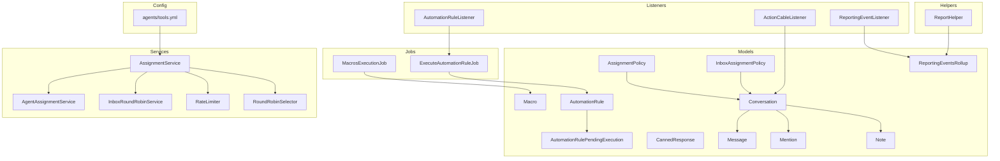
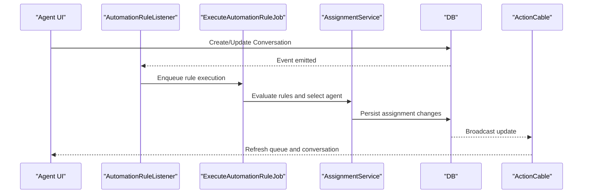
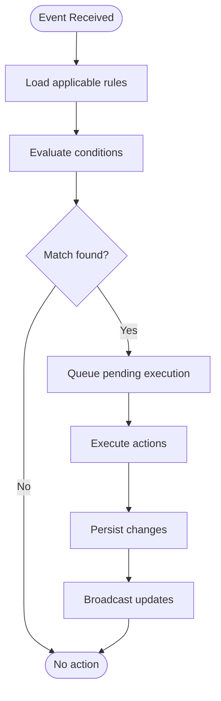
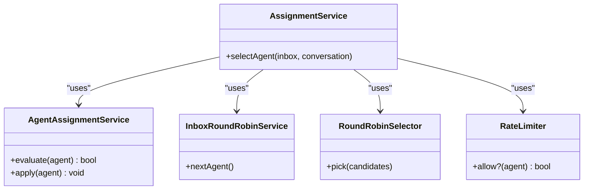
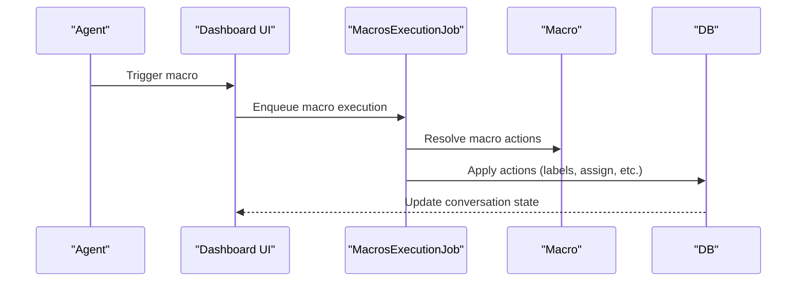
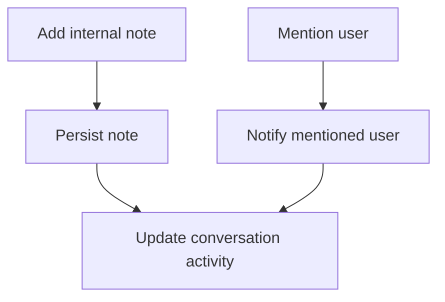
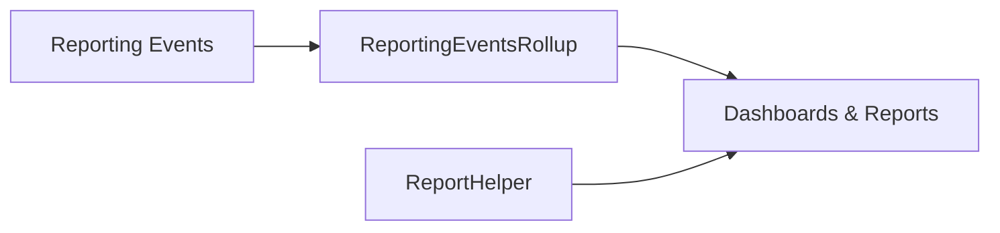
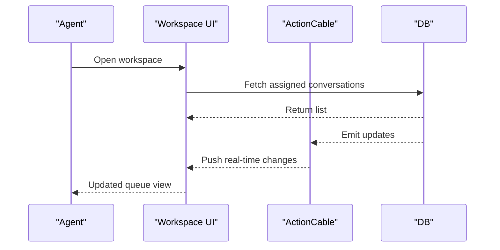
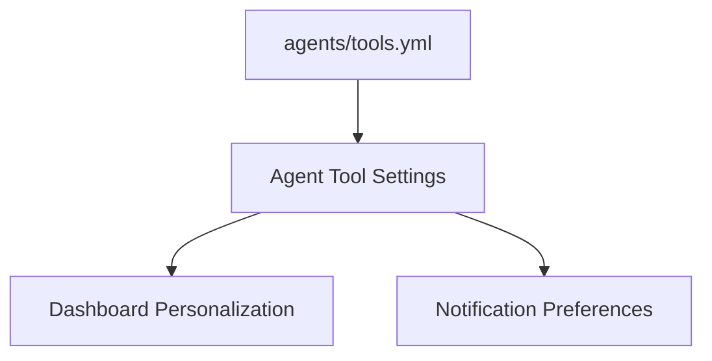
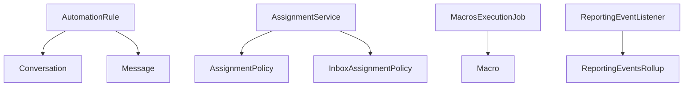

# Agent Tools

<cite>
**Referenced Files in This Document**
- [automation_rule.rb](file://app/models/automation_rule.rb)
- [automation_rule_pending_execution.rb](file://app/models/automation_rule_pending_execution.rb)
- [canned_response.rb](file://app/models/canned_response.rb)
- [macro.rb](file://app/models/macro.rb)
- [mention.rb](file://app/models/mention.rb)
- [note.rb](file://app/models/note.rb)
- [conversation.rb](file://app/models/conversation.rb)
- [message.rb](file://app/models/message.rb)
- [assignment_policy.rb](file://app/models/assignment_policy.rb)
- [inbox_assignment_policy.rb](file://app/models/inbox_assignment_policy.rb)
- [agent_assignment_service.rb](file://app/services/auto_assignment/agent_assignment_service.rb)
- [assignment_service.rb](file://app/services/auto_assignment/assignment_service.rb)
- [inbox_round_robin_service.rb](file://app/services/auto_assignment/inbox_round_robin_service.rb)
- [rate_limiter.rb](file://app/services/auto_assignment/rate_limiter.rb)
- [round_robin_selector.rb](file://app/services/auto_assignment/round_robin_selector.rb)
- [macros_execution_job.rb](file://app/jobs/macros_execution_job.rb)
- [automation_rules/execute_automation_rule_job.rb](file://app/jobs/automation_rules/execute_automation_rule_job.rb)
- [automation_rule_listener.rb](file://app/listeners/automation_rule_listener.rb)
- [action_cable_listener.rb](file://app/listeners/action_cable_listener.rb)
- [reporting_event_listener.rb](file://app/listeners/reporting_event_listener.rb)
- [report_helper.rb](file://app/helpers/report_helper.rb)
- [reporting_events_rollup.rb](file://app/models/reporting_events_rollup.rb)
- [tools.yml](file://config/agents/tools.yml)
</cite>

## Table of Contents
1. [Introduction](#introduction)
2. [Project Structure](#project-structure)
3. [Core Components](#core-components)
4. [Architecture Overview](#architecture-overview)
5. [Detailed Component Analysis](#detailed-component-analysis)
6. [Dependency Analysis](#dependency-analysis)
7. [Performance Considerations](#performance-considerations)
8. [Troubleshooting Guide](#troubleshooting-guide)
9. [Conclusion](#conclusion)

## Introduction
This document explains Chatwoot’s agent productivity tools and dashboard functionality with a focus on:
- Agent workspace interface and conversation queue management
- Assignment algorithms and policies
- Automation rules engine for workflow automation
- Canned responses and macros
- Team collaboration features (internal notes, mentions, activity tracking)
- Reporting capabilities, performance metrics, and agent monitoring
- Customization options for workflows, notifications, and dashboards
- Examples of automation rule configurations, macro definitions, and integration patterns
- Scalability considerations for large teams and high-volume environments

## Project Structure
The agent productivity features span models, services, jobs, listeners, helpers, and configuration files:
- Models define core entities such as automation rules, canned responses, macros, mentions, notes, conversations, messages, assignment policies, and reporting rollups.
- Services implement auto-assignment strategies and rate limiting.
- Jobs execute automation rules and macros asynchronously.
- Listeners react to events to trigger automation and broadcasting.
- Helpers provide reporting utilities.
- Configuration includes agent tool settings.

**Diagram sources**
- [automation_rule.rb](file://app/models/automation_rule.rb)
- [automation_rule_pending_execution.rb](file://app/models/automation_rule_pending_execution.rb)
- [canned_response.rb](file://app/models/canned_response.rb)
- [macro.rb](file://app/models/macro.rb)
- [mention.rb](file://app/models/mention.rb)
- [note.rb](file://app/models/note.rb)
- [conversation.rb](file://app/models/conversation.rb)
- [message.rb](file://app/models/message.rb)
- [assignment_policy.rb](file://app/models/assignment_policy.rb)
- [inbox_assignment_policy.rb](file://app/models/inbox_assignment_policy.rb)
- [agent_assignment_service.rb](file://app/services/auto_assignment/agent_assignment_service.rb)
- [assignment_service.rb](file://app/services/auto_assignment/assignment_service.rb)
- [inbox_round_robin_service.rb](file://app/services/auto_assignment/inbox_round_robin_service.rb)
- [rate_limiter.rb](file://app/services/auto_assignment/rate_limiter.rb)
- [round_robin_selector.rb](file://app/services/auto_assignment/round_robin_selector.rb)
- [macros_execution_job.rb](file://app/jobs/macros_execution_job.rb)
- [automation_rules/execute_automation_rule_job.rb](file://app/jobs/automation_rules/execute_automation_rule_job.rb)
- [automation_rule_listener.rb](file://app/listeners/automation_rule_listener.rb)
- [action_cable_listener.rb](file://app/listeners/action_cable_listener.rb)
- [reporting_event_listener.rb](file://app/listeners/reporting_event_listener.rb)
- [report_helper.rb](file://app/helpers/report_helper.rb)
- [reporting_events_rollup.rb](file://app/models/reporting_events_rollup.rb)
- [tools.yml](file://config/agents/tools.yml)

**Section sources**
- [automation_rule.rb](file://app/models/automation_rule.rb)
- [assignment_service.rb](file://app/services/auto_assignment/assignment_service.rb)
- [automation_rule_listener.rb](file://app/listeners/automation_rule_listener.rb)
- [report_helper.rb](file://app/helpers/report_helper.rb)
- [tools.yml](file://config/agents/tools.yml)

## Core Components
- Automation Rules Engine: Declarative rules that match conversation attributes and apply actions (e.g., assign, label, notify). Pending executions are tracked to ensure reliability under load.
- Auto-Assignment Algorithms: Policy-driven selection of agents using round-robin, capacity-aware distribution, and rate limiting.
- Macros and Canned Responses: Reusable templates and multi-step actions to accelerate replies and standardize workflows.
- Collaboration Features: Internal notes and mentions enable private team communication and targeted notifications within conversations.
- Reporting and Monitoring: Event-driven metrics collection and rollups support dashboards and agent performance insights.

**Section sources**
- [automation_rule.rb](file://app/models/automation_rule.rb)
- [automation_rule_pending_execution.rb](file://app/models/automation_rule_pending_execution.rb)
- [assignment_service.rb](file://app/services/auto_assignment/assignment_service.rb)
- [canned_response.rb](file://app/models/canned_response.rb)
- [macro.rb](file://app/models/macro.rb)
- [mention.rb](file://app/models/mention.rb)
- [note.rb](file://app/models/note.rb)
- [reporting_events_rollup.rb](file://app/models/reporting_events_rollup.rb)

## Architecture Overview
The system uses an event-driven architecture:
- Events from conversations/messages trigger listeners.
- Listeners enqueue jobs to process automation rules and macros.
- Services compute assignments based on policies and current agent state.
- Real-time updates are broadcast via ActionCable.
- Metrics are recorded and aggregated for reporting.

**Diagram sources**
- [automation_rule_listener.rb](file://app/listeners/automation_rule_listener.rb)
- [automation_rules/execute_automation_rule_job.rb](file://app/jobs/automation_rules/execute_automation_rule_job.rb)
- [assignment_service.rb](file://app/services/auto_assignment/assignment_service.rb)
- [action_cable_listener.rb](file://app/listeners/action_cable_listener.rb)

## Detailed Component Analysis

### Automation Rules Engine
- Purpose: Match conditions on conversations/messages and perform actions like assigning, labeling, or notifying.
- Key elements:
  - Rule definition and evaluation logic.
  - Pending execution records to handle retries and backpressure.
  - Listener that reacts to relevant events and enqueues job processing.
- Processing flow:
  - Event triggers listener.
  - Listener enqueues job with rule context.
  - Job evaluates matching rules and executes actions.
  - Updates are persisted and broadcast.

**Diagram sources**
- [automation_rule_listener.rb](file://app/listeners/automation_rule_listener.rb)
- [automation_rules/execute_automation_rule_job.rb](file://app/jobs/automation_rules/execute_automation_rule_job.rb)
- [automation_rule.rb](file://app/models/automation_rule.rb)
- [automation_rule_pending_execution.rb](file://app/models/automation_rule_pending_execution.rb)

**Section sources**
- [automation_rule.rb](file://app/models/automation_rule.rb)
- [automation_rule_pending_execution.rb](file://app/models/automation_rule_pending_execution.rb)
- [automation_rule_listener.rb](file://app/listeners/automation_rule_listener.rb)
- [automation_rules/execute_automation_rule_job.rb](file://app/jobs/automation_rules/execute_automation_rule_job.rb)

### Auto-Assignment Algorithms
- Strategy:
  - Policy-based selection using assignment policies at account and inbox levels.
  - Round-robin distribution across available agents.
  - Rate limiting to prevent overloading agents.
- Components:
  - AssignmentService orchestrates selection.
  - AgentAssignmentService encapsulates agent-specific logic.
  - InboxRoundRobinService manages per-inbox rotation.
  - RoundRobinSelector selects next eligible agent.
  - RateLimiter controls throughput.

**Diagram sources**
- [assignment_service.rb](file://app/services/auto_assignment/assignment_service.rb)
- [agent_assignment_service.rb](file://app/services/auto_assignment/agent_assignment_service.rb)
- [inbox_round_robin_service.rb](file://app/services/auto_assignment/inbox_round_robin_service.rb)
- [round_robin_selector.rb](file://app/services/auto_assignment/round_robin_selector.rb)
- [rate_limiter.rb](file://app/services/auto_assignment/rate_limiter.rb)

**Section sources**
- [assignment_service.rb](file://app/services/auto_assignment/assignment_service.rb)
- [agent_assignment_service.rb](file://app/services/auto_assignment/agent_assignment_service.rb)
- [inbox_round_robin_service.rb](file://app/services/auto_assignment/inbox_round_robin_service.rb)
- [round_robin_selector.rb](file://app/services/auto_assignment/round_robin_selector.rb)
- [rate_limiter.rb](file://app/services/auto_assignment/rate_limiter.rb)
- [assignment_policy.rb](file://app/models/assignment_policy.rb)
- [inbox_assignment_policy.rb](file://app/models/inbox_assignment_policy.rb)

### Macros and Canned Responses
- Macros:
  - Multi-step actions applied to conversations (e.g., set labels, assign, send message).
  - Executed asynchronously via a dedicated job.
- Canned Responses:
  - Reusable text snippets for quick insertion into replies.
- Execution flow:
  - User triggers macro from the agent workspace.
  - System enqueues macro execution job.
  - Job applies actions and persists results.

**Diagram sources**
- [macros_execution_job.rb](file://app/jobs/macros_execution_job.rb)
- [macro.rb](file://app/models/macro.rb)
- [canned_response.rb](file://app/models/canned_response.rb)

**Section sources**
- [macros_execution_job.rb](file://app/jobs/macros_execution_job.rb)
- [macro.rb](file://app/models/macro.rb)
- [canned_response.rb](file://app/models/canned_response.rb)

### Team Collaboration: Notes and Mentions
- Internal Notes:
  - Private comments visible only to team members within a conversation.
- Mentions:
  - Tagging teammates to notify them about specific conversations or messages.
- Activity Tracking:
  - Changes to notes and mentions contribute to conversation activity and audit trails.

**Diagram sources**
- [note.rb](file://app/models/note.rb)
- [mention.rb](file://app/models/mention.rb)
- [conversation.rb](file://app/models/conversation.rb)

**Section sources**
- [note.rb](file://app/models/note.rb)
- [mention.rb](file://app/models/mention.rb)
- [conversation.rb](file://app/models/conversation.rb)

### Reporting, Metrics, and Agent Monitoring
- Event Collection:
  - Reporting events are captured during key interactions.
- Rollups:
  - Aggregated metrics stored for efficient querying and dashboard rendering.
- Helper Utilities:
  - Report helper provides common calculations and formatting for metrics.

**Diagram sources**
- [reporting_event_listener.rb](file://app/listeners/reporting_event_listener.rb)
- [reporting_events_rollup.rb](file://app/models/reporting_events_rollup.rb)
- [report_helper.rb](file://app/helpers/report_helper.rb)

**Section sources**
- [reporting_event_listener.rb](file://app/listeners/reporting_event_listener.rb)
- [reporting_events_rollup.rb](file://app/models/reporting_events_rollup.rb)
- [report_helper.rb](file://app/helpers/report_helper.rb)

### Workspace Interface and Conversation Queue Management
- The agent workspace displays:
  - Assigned conversations and queues filtered by status, labels, and inboxes.
  - Real-time updates when assignments change or new messages arrive.
- Queue behavior:
  - Conversations appear based on assignment policy and availability.
  - Actions (assign, label, reply) update the queue instantly via broadcasts.

**Diagram sources**
- [action_cable_listener.rb](file://app/listeners/action_cable_listener.rb)
- [conversation.rb](file://app/models/conversation.rb)

**Section sources**
- [action_cable_listener.rb](file://app/listeners/action_cable_listener.rb)
- [conversation.rb](file://app/models/conversation.rb)

### Customization Options
- Agent Tools Configuration:
  - Centralized settings for agent-facing tools and behaviors.
- Notification Systems:
  - Configurable notifications for mentions, assignments, and automation outcomes.
- Dashboard Personalization:
  - Filters, views, and widgets tailored to team needs.

**Diagram sources**
- [tools.yml](file://config/agents/tools.yml)

**Section sources**
- [tools.yml](file://config/agents/tools.yml)

## Dependency Analysis
Key dependencies and relationships:
- Automation rules depend on conversation and message attributes; they interact with assignment policies and notification systems.
- Assignment service depends on policies and round-robin strategy components.
- Macros rely on model definitions and background jobs for safe execution.
- Reporting relies on event listeners and rollup models for accurate metrics.

**Diagram sources**
- [automation_rule.rb](file://app/models/automation_rule.rb)
- [conversation.rb](file://app/models/conversation.rb)
- [message.rb](file://app/models/message.rb)
- [assignment_service.rb](file://app/services/auto_assignment/assignment_service.rb)
- [assignment_policy.rb](file://app/models/assignment_policy.rb)
- [inbox_assignment_policy.rb](file://app/models/inbox_assignment_policy.rb)
- [macros_execution_job.rb](file://app/jobs/macros_execution_job.rb)
- [macro.rb](file://app/models/macro.rb)
- [reporting_event_listener.rb](file://app/listeners/reporting_event_listener.rb)
- [reporting_events_rollup.rb](file://app/models/reporting_events_rollup.rb)

**Section sources**
- [automation_rule.rb](file://app/models/automation_rule.rb)
- [assignment_service.rb](file://app/services/auto_assignment/assignment_service.rb)
- [macros_execution_job.rb](file://app/jobs/macros_execution_job.rb)
- [reporting_event_listener.rb](file://app/listeners/reporting_event_listener.rb)

## Performance Considerations
- Asynchronous Processing:
  - Use background jobs for automation rule execution and macro application to avoid blocking request cycles.
- Rate Limiting:
  - Apply rate limits to agent workload to prevent overload and maintain response quality.
- Efficient Queries:
  - Leverage rollup tables for reporting to reduce heavy aggregations on live data.
- Real-Time Updates:
  - Minimize payload size in broadcasts and batch updates where possible.
- Scaling Strategies:
  - Horizontal scaling of worker processes for jobs.
  - Partitioning by account or inbox to distribute load.
  - Tuning Sidekiq concurrency and retry policies for automation and macro jobs.

[No sources needed since this section provides general guidance]

## Troubleshooting Guide
- Automation Rules Not Firing:
  - Verify rule conditions and event triggers.
  - Check pending execution records for failed attempts and retry logs.
- Incorrect Assignments:
  - Inspect assignment policies and round-robin state.
  - Validate agent availability and rate limiter thresholds.
- Macros Not Applying:
  - Confirm macro actions are valid and permissions allow execution.
  - Review macro execution job logs for errors.
- Missing Mentions or Notes:
  - Ensure mention parsing is enabled and notification subscriptions are configured.
  - Check conversation activity logs for persistence issues.
- Reporting Discrepancies:
  - Validate event emission and rollup aggregation jobs.
  - Cross-check report helper calculations and time zone settings.

**Section sources**
- [automation_rule_pending_execution.rb](file://app/models/automation_rule_pending_execution.rb)
- [assignment_service.rb](file://app/services/auto_assignment/assignment_service.rb)
- [macros_execution_job.rb](file://app/jobs/macros_execution_job.rb)
- [mention.rb](file://app/models/mention.rb)
- [note.rb](file://app/models/note.rb)
- [reporting_events_rollup.rb](file://app/models/reporting_events_rollup.rb)

## Conclusion
Chatwoot’s agent productivity suite combines robust automation, intelligent assignment, collaborative features, and comprehensive reporting. By leveraging asynchronous jobs, policy-driven assignment, and event-driven metrics, it supports scalable operations for large teams and high-volume environments. Customizable tools and dashboards empower teams to tailor workflows to their operational needs while maintaining consistency and efficiency.

[No sources needed since this section summarizes without analyzing specific files]