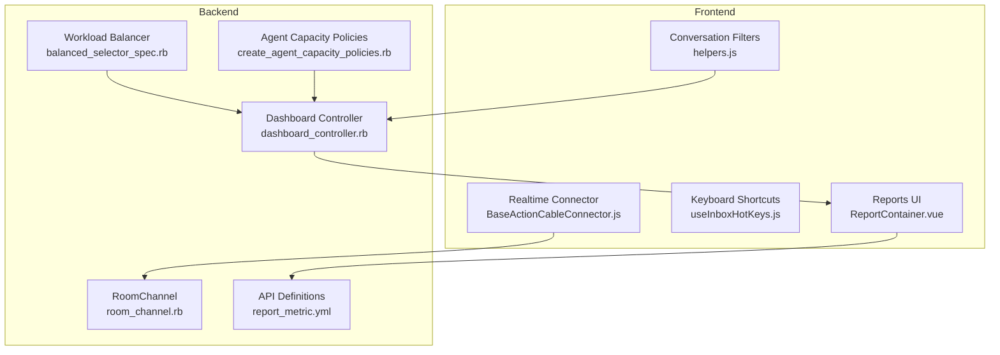
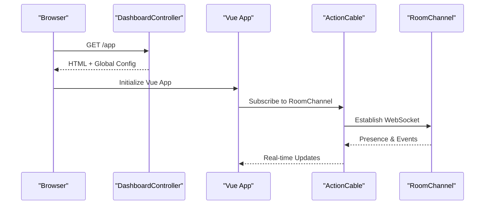
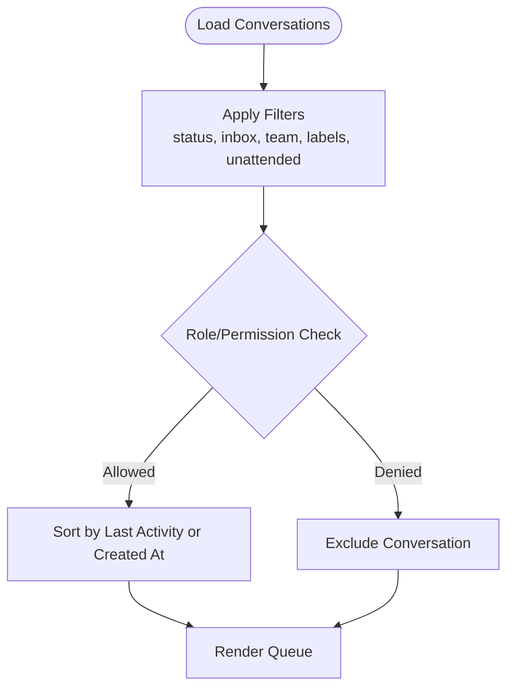
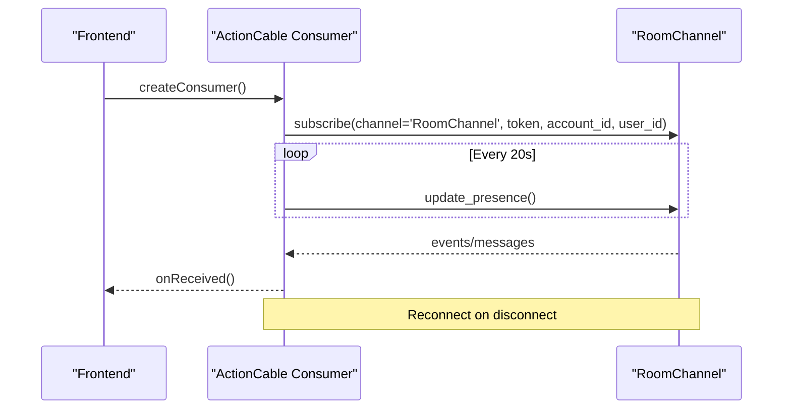
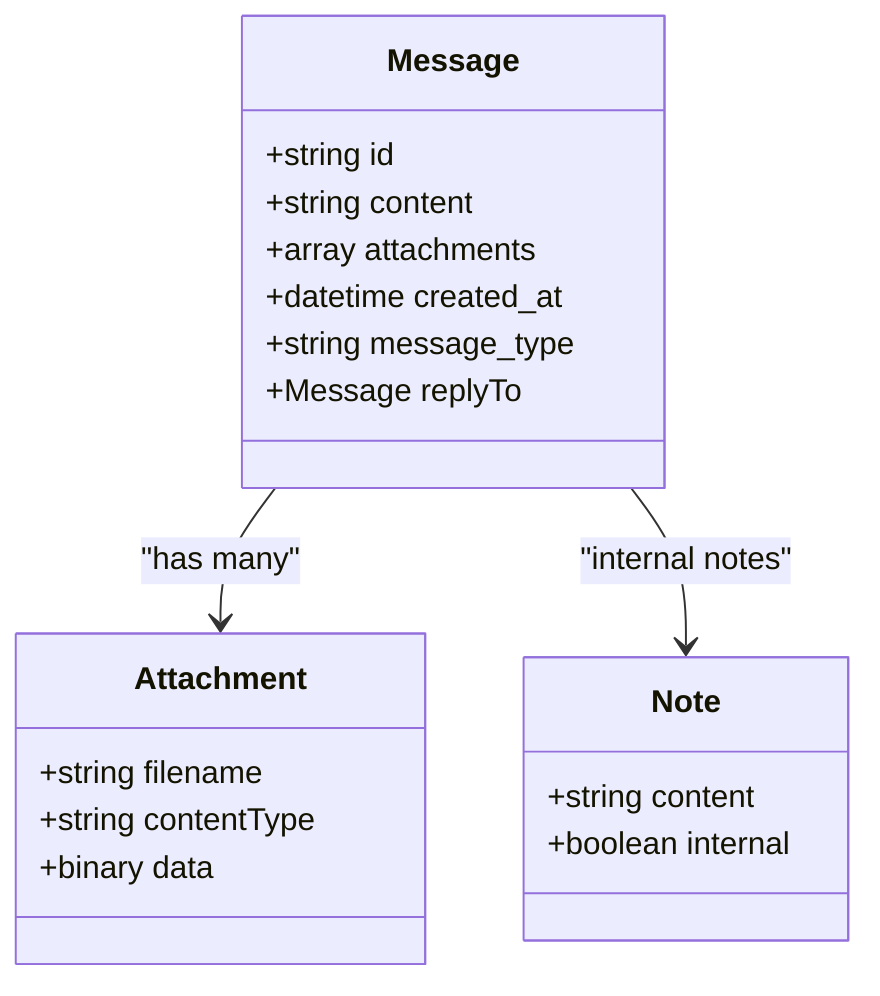
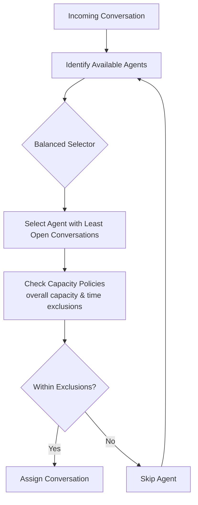
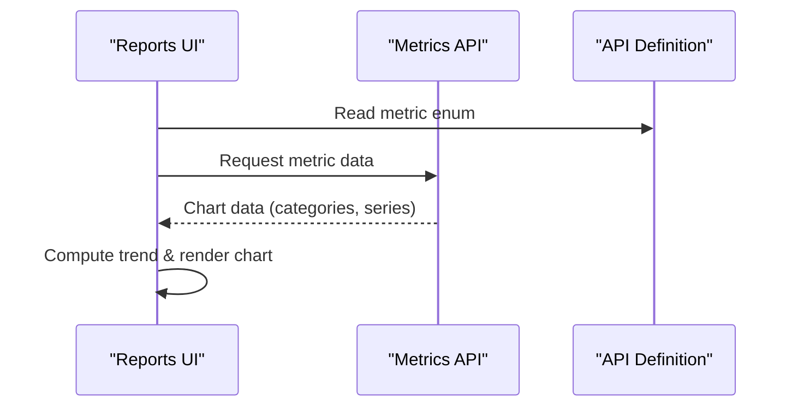
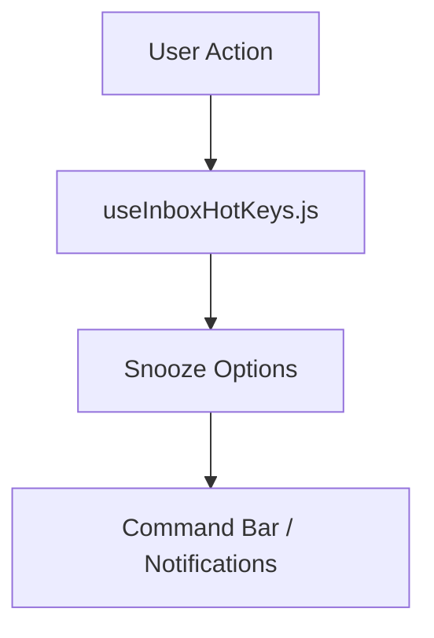
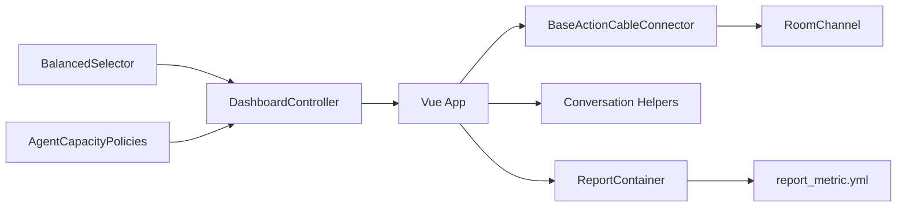

# Agent Workspace & Dashboard

<cite>
**Referenced Files in This Document**
- [dashboard_controller.rb](file://app/controllers/dashboard_controller.rb)
- [BaseActionCableConnector.js](file://app/javascript/shared/helpers/BaseActionCableConnector.js)
- [room_channel.rb](file://app/channels/room_channel.rb)
- [helpers.js](file://app/javascript/dashboard/store/modules/conversations/helpers.js)
- [ReportContainer.vue](file://app/javascript/dashboard/routes/dashboard/settings/reports/ReportContainer.vue)
- [report_metric.yml](file://swagger/parameters/report_metric.yml)
- [balanced_selector_spec.rb](file://spec/enterprise/services/enterprise/auto_assignment/balanced_selector_spec.rb)
- [create_agent_capacity_policies.rb](file://db/migrate/20250806140002_create_agent_capacity_policies.rb)
- [agent_capacity_policies.rb](file://spec/factories/agent_capacity_policies.rb)
- [useInboxHotKeys.js](file://app/javascript/dashboard/composables/commands/useInboxHotKeys.js)
</cite>

## Table of Contents
1. [Introduction](#introduction)
2. [Project Structure](#project-structure)
3. [Core Components](#core-components)
4. [Architecture Overview](#architecture-overview)
5. [Detailed Component Analysis](#detailed-component-analysis)
6. [Dependency Analysis](#dependency-analysis)
7. [Performance Considerations](#performance-considerations)
8. [Troubleshooting Guide](#troubleshooting-guide)
9. [Conclusion](#conclusion)

## Introduction
This document explains Chatwoot’s agent workspace and dashboard with a focus on:
- Conversation queue management, real-time updates, and filtering
- Conversation view capabilities (threading, attachments, internal notes)
- Agent availability, workload balancing, and shift scheduling
- Dashboard metrics, performance indicators, and productivity tracking
- Customization options (workspace layout, notifications, keyboard shortcuts)
- Accessibility, mobile responsiveness, and cross-browser compatibility
- Integrations, API endpoints for workspace data, and plugin extensibility

## Project Structure
The agent workspace is a Vue-based frontend served by the Rails backend. The dashboard entry point prepares global configuration and renders the application pack. Real-time communication uses ActionCable. Filtering and sorting logic for conversations live in the dashboard store helpers. Reporting UI consumes report metrics exposed via API definitions. Workload balancing and capacity policies are implemented in enterprise services and migrations. Keyboard shortcuts are provided through composables.

**Diagram sources**
- [dashboard_controller.rb:1-134](file://app/controllers/dashboard_controller.rb#L1-L134)
- [BaseActionCableConnector.js:1-49](file://app/javascript/shared/helpers/BaseActionCableConnector.js#L1-L49)
- [room_channel.rb:1-1](file://app/channels/room_channel.rb#L1-L1)
- [helpers.js:69-144](file://app/javascript/dashboard/store/modules/conversations/helpers.js#L69-L144)
- [ReportContainer.vue:93-131](file://app/javascript/dashboard/routes/dashboard/settings/reports/ReportContainer.vue#L93-L131)
- [report_metric.yml:1-13](file://swagger/parameters/report_metric.yml#L1-L13)
- [balanced_selector_spec.rb:1-29](file://spec/enterprise/services/enterprise/auto_assignment/balanced_selector_spec.rb#L1-L29)
- [create_agent_capacity_policies.rb:1-14](file://db/migrate/20250806140002_create_agent_capacity_policies.rb#L1-L14)

**Section sources**
- [dashboard_controller.rb:1-134](file://app/controllers/dashboard_controller.rb#L1-L134)
- [BaseActionCableConnector.js:1-49](file://app/javascript/shared/helpers/BaseActionCableConnector.js#L1-L49)
- [room_channel.rb:1-1](file://app/channels/room_channel.rb#L1-L1)
- [helpers.js:69-144](file://app/javascript/dashboard/store/modules/conversations/helpers.js#L69-L144)
- [ReportContainer.vue:93-131](file://app/javascript/dashboard/routes/dashboard/settings/reports/ReportContainer.vue#L93-L131)
- [report_metric.yml:1-13](file://swagger/parameters/report_metric.yml#L1-L13)
- [balanced_selector_spec.rb:1-29](file://spec/enterprise/services/enterprise/auto_assignment/balanced_selector_spec.rb#L1-L29)
- [create_agent_capacity_policies.rb:1-14](file://db/migrate/20250806140002_create_agent_capacity_policies.rb#L1-L14)

## Core Components
- Dashboard controller initializes global configuration, sets up scripts, and ensures correct HTML rendering for the SPA.
- Real-time connector establishes an ActionCable subscription to RoomChannel, manages presence, and reconnects on disconnect.
- Conversation filters implement status, inbox, team, label, unattended, and role-based visibility rules.
- Reports UI displays metric charts and supports drill-down navigation.
- Enterprise auto-assignment selects agents based on workload balance.
- Agent capacity policies define exclusion rules for time and overall capacity.
- Keyboard shortcuts provide quick actions like snoozing notifications.

**Section sources**
- [dashboard_controller.rb:1-134](file://app/controllers/dashboard_controller.rb#L1-L134)
- [BaseActionCableConnector.js:1-49](file://app/javascript/shared/helpers/BaseActionCableConnector.js#L1-L49)
- [helpers.js:69-144](file://app/javascript/dashboard/store/modules/conversations/helpers.js#L69-L144)
- [ReportContainer.vue:93-131](file://app/javascript/dashboard/routes/dashboard/settings/reports/ReportContainer.vue#L93-L131)
- [balanced_selector_spec.rb:1-29](file://spec/enterprise/services/enterprise/auto_assignment/balanced_selector_spec.rb#L1-L29)
- [create_agent_capacity_policies.rb:1-14](file://db/migrate/20250806140002_create_agent_capacity_policies.rb#L1-L14)
- [useInboxHotKeys.js:36-88](file://app/javascript/dashboard/composables/commands/useInboxHotKeys.js#L36-L88)

## Architecture Overview
The agent workspace loads from the dashboard controller, which injects global configuration and app packs. The frontend subscribes to ActionCable for live updates. Conversation lists are filtered client-side using helper functions. Reports UI fetches metrics defined in the API spec. Workload balancing and capacity policies influence assignment and availability.

**Diagram sources**
- [dashboard_controller.rb:1-134](file://app/controllers/dashboard_controller.rb#L1-L134)
- [BaseActionCableConnector.js:1-49](file://app/javascript/shared/helpers/BaseActionCableConnector.js#L1-L49)
- [room_channel.rb:1-1](file://app/channels/room_channel.rb#L1-L1)

## Detailed Component Analysis

### Conversation Queue Management and Filtering
- Filters support:
  - Status, inbox, team, labels
  - Unattended detection using first reply and waiting timestamps
  - Role-based visibility including administrator, agent, and permission-scoped access
- Sorting options include last activity and creation time ascending/descending.

**Diagram sources**
- [helpers.js:69-144](file://app/javascript/dashboard/store/modules/conversations/helpers.js#L69-L144)

**Section sources**
- [helpers.js:69-144](file://app/javascript/dashboard/store/modules/conversations/helpers.js#L69-L144)

### Real-Time Updates
- Frontend creates an ActionCable consumer and subscribes to RoomChannel with pubsub token, account ID, and user ID.
- Presence is updated periodically; reconnection logic handles transient network issues.

**Diagram sources**
- [BaseActionCableConnector.js:1-49](file://app/javascript/shared/helpers/BaseActionCableConnector.js#L1-L49)
- [room_channel.rb:1-1](file://app/channels/room_channel.rb#L1-L1)

**Section sources**
- [BaseActionCableConnector.js:1-49](file://app/javascript/shared/helpers/BaseActionCableConnector.js#L1-L49)
- [room_channel.rb:1-1](file://app/channels/room_channel.rb#L1-L1)

### Conversation View Interface
- Message threading:
  - Messages can reference prior messages via reply-to fields.
  - Grouping logic determines avatar visibility per sender and message type.
- Attachments:
  - Email replies carry multipart content with inline images and attachments.
- Internal notes:
  - Notes are part of conversation metadata and can be toggled for internal-only visibility.

[No diagram sources needed since this diagram shows conceptual structure]

**Section sources**
- [BaseActionCableConnector.js:1-49](file://app/javascript/shared/helpers/BaseActionCableConnector.js#L1-L49)

### Agent Availability, Workload Balancing, and Shift Scheduling
- Workload balancing:
  - Enterprise selector chooses the agent with the least open conversations among available members.
- Agent capacity policies:
  - Define exclusion rules such as overall capacity limits and time-based exclusions (hours/days).
- Shift scheduling:
  - Time-based exclusions enable defining off-hours and days when agents should not receive assignments.

**Diagram sources**
- [balanced_selector_spec.rb:1-29](file://spec/enterprise/services/enterprise/auto_assignment/balanced_selector_spec.rb#L1-L29)
- [create_agent_capacity_policies.rb:1-14](file://db/migrate/20250806140002_create_agent_capacity_policies.rb#L1-L14)
- [agent_capacity_policies.rb:1-21](file://spec/factories/agent_capacity_policies.rb#L1-L21)

**Section sources**
- [balanced_selector_spec.rb:1-29](file://spec/enterprise/services/enterprise/auto_assignment/balanced_selector_spec.rb#L1-L29)
- [create_agent_capacity_policies.rb:1-14](file://db/migrate/20250806140002_create_agent_capacity_policies.rb#L1-L14)
- [agent_capacity_policies.rb:1-21](file://spec/factories/agent_capacity_policies.rb#L1-L21)

### Dashboard Metrics, Performance Indicators, and Productivity Tracking
- Metrics supported include:
  - Conversations count
  - Incoming/outgoing messages count
  - Average first response time
  - Average resolution time
  - Resolutions count
- Reports UI maps metric keys to display names and descriptions, computes trends, and renders charts with drill-down navigation.

**Diagram sources**
- [ReportContainer.vue:93-131](file://app/javascript/dashboard/routes/dashboard/settings/reports/ReportContainer.vue#L93-L131)
- [report_metric.yml:1-13](file://swagger/parameters/report_metric.yml#L1-L13)

**Section sources**
- [ReportContainer.vue:93-131](file://app/javascript/dashboard/routes/dashboard/settings/reports/ReportContainer.vue#L93-L131)
- [report_metric.yml:1-13](file://swagger/parameters/report_metric.yml#L1-L13)

### Customization Options
- Workspace layout:
  - Global configuration keys control branding, manifest display, and feature flags.
- Notification preferences:
  - Snooze actions are exposed via keyboard shortcuts and command bar integrations.
- Keyboard shortcuts:
  - Inbox hotkeys provide quick snooze options (until tomorrow, next week, next month, custom time).

**Diagram sources**
- [useInboxHotKeys.js:36-88](file://app/javascript/dashboard/composables/commands/useInboxHotKeys.js#L36-L88)

**Section sources**
- [dashboard_controller.rb:1-134](file://app/controllers/dashboard_controller.rb#L1-L134)
- [useInboxHotKeys.js:36-88](file://app/javascript/dashboard/composables/commands/useInboxHotKeys.js#L36-L88)

### Accessibility, Mobile Responsiveness, and Cross-Browser Compatibility
- Accessibility:
  - Use semantic components and ensure keyboard navigability for core workflows.
- Mobile responsiveness:
  - Responsive layouts and touch-friendly controls for agents on mobile devices.
- Cross-browser compatibility:
  - Standard web technologies (HTML/CSS/JS) with ActionCable for real-time features across modern browsers.

[No sources needed since this section provides general guidance]

### Integration with External Tools and Plugins
- External tools:
  - Global configuration exposes platform banners, feature announcements, and integration flags.
- API endpoints:
  - Report metrics are defined in Swagger parameters for consumption by external dashboards.
- Plugins:
  - Dashboard scripts can be injected via global configuration for third-party extensions.

**Section sources**
- [dashboard_controller.rb:1-134](file://app/controllers/dashboard_controller.rb#L1-L134)
- [report_metric.yml:1-13](file://swagger/parameters/report_metric.yml#L1-L13)

## Dependency Analysis
The following diagram highlights key dependencies between frontend modules, backend controllers, channels, and API definitions.

**Diagram sources**
- [dashboard_controller.rb:1-134](file://app/controllers/dashboard_controller.rb#L1-L134)
- [BaseActionCableConnector.js:1-49](file://app/javascript/shared/helpers/BaseActionCableConnector.js#L1-L49)
- [room_channel.rb:1-1](file://app/channels/room_channel.rb#L1-L1)
- [helpers.js:69-144](file://app/javascript/dashboard/store/modules/conversations/helpers.js#L69-L144)
- [ReportContainer.vue:93-131](file://app/javascript/dashboard/routes/dashboard/settings/reports/ReportContainer.vue#L93-L131)
- [report_metric.yml:1-13](file://swagger/parameters/report_metric.yml#L1-L13)
- [balanced_selector_spec.rb:1-29](file://spec/enterprise/services/enterprise/auto_assignment/balanced_selector_spec.rb#L1-L29)
- [create_agent_capacity_policies.rb:1-14](file://db/migrate/20250806140002_create_agent_capacity_policies.rb#L1-L14)

**Section sources**
- [dashboard_controller.rb:1-134](file://app/controllers/dashboard_controller.rb#L1-L134)
- [BaseActionCableConnector.js:1-49](file://app/javascript/shared/helpers/BaseActionCableConnector.js#L1-L49)
- [room_channel.rb:1-1](file://app/channels/room_channel.rb#L1-L1)
- [helpers.js:69-144](file://app/javascript/dashboard/store/modules/conversations/helpers.js#L69-L144)
- [ReportContainer.vue:93-131](file://app/javascript/dashboard/routes/dashboard/settings/reports/ReportContainer.vue#L93-L131)
- [report_metric.yml:1-13](file://swagger/parameters/report_metric.yml#L1-L13)
- [balanced_selector_spec.rb:1-29](file://spec/enterprise/services/enterprise/auto_assignment/balanced_selector_spec.rb#L1-L29)
- [create_agent_capacity_policies.rb:1-14](file://db/migrate/20250806140002_create_agent_capacity_policies.rb#L1-L14)

## Performance Considerations
- Real-time updates:
  - Periodic presence updates every 20 seconds; consider tuning intervals based on traffic.
- Filtering and sorting:
  - Client-side filters reduce server load but may impact large datasets; consider pagination and server-side filtering for scale.
- Reports:
  - Chart rendering can be optimized by limiting data points and leveraging lazy loading.
- Assignment:
  - Balanced selection reduces overload but requires efficient counting of open conversations.

[No sources needed since this section provides general guidance]

## Troubleshooting Guide
- Real-time connectivity issues:
  - Verify ActionCable consumer initialization and RoomChannel subscription.
  - Check reconnection logic and presence updates.
- Conversation filtering anomalies:
  - Validate filter parameters (status, inbox, team, labels, unattended).
  - Confirm role-based permissions are correctly applied.
- Reports not displaying:
  - Ensure metric keys match the API definition.
  - Validate data structure returned by the metrics endpoint.
- Assignment imbalances:
  - Review balanced selector behavior and capacity policy exclusions.

**Section sources**
- [BaseActionCableConnector.js:1-49](file://app/javascript/shared/helpers/BaseActionCableConnector.js#L1-L49)
- [helpers.js:69-144](file://app/javascript/dashboard/store/modules/conversations/helpers.js#L69-L144)
- [report_metric.yml:1-13](file://swagger/parameters/report_metric.yml#L1-L13)
- [balanced_selector_spec.rb:1-29](file://spec/enterprise/services/enterprise/auto_assignment/balanced_selector_spec.rb#L1-L29)
- [create_agent_capacity_policies.rb:1-14](file://db/migrate/20250806140002_create_agent_capacity_policies.rb#L1-L14)

## Conclusion
Chatwoot’s agent workspace combines a responsive Vue frontend with a robust Rails backend. It delivers powerful conversation filtering, real-time updates via ActionCable, and comprehensive reporting. Enterprise features enhance workload balancing and capacity planning. Keyboard shortcuts and global configuration support customization and productivity. With clear API definitions and extensible configuration, teams can tailor the workspace to their operational needs while maintaining accessibility and cross-browser compatibility.