# Assignment Policies & Workload Management

<cite>
**Referenced Files in This Document**
- [assignment_policy.rb](file://app/models/assignment_policy.rb)
- [inbox.rb](file://app/models/inbox.rb)
- [agent_assignment_service.rb](file://app/services/auto_assignment/agent_assignment_service.rb)
- [rate_limiter.rb](file://app/services/auto_assignment/rate_limiter.rb)
- [auto_assignment_handler.rb](file://app/models/concerns/auto_assignment_handler.rb)
- [assignment_service.rb](file://enterprise/app/services/enterprise/auto_assignment/assignment_service.rb)
- [capacity_service.rb](file://enterprise/app/services/enterprise/auto_assignment/capacity_service.rb)
- [constants.js](file://app/javascript/dashboard/routes/dashboard/settings/assignmentPolicy/constants.js)
- [fixtures.js](file://app/javascript/dashboard/store/modules/specs/assignmentPolicies/fixtures.js)
- [20250806140000_create_assignment_policies.rb](file://db/migrate/20250806140000_create_assignment_policies.rb)
</cite>

## Table of Contents
1. [Introduction](#introduction)
2. [Project Structure](#project-structure)
3. [Core Components](#core-components)
4. [Architecture Overview](#architecture-overview)
5. [Detailed Component Analysis](#detailed-component-analysis)
6. [Dependency Analysis](#dependency-analysis)
7. [Performance Considerations](#performance-considerations)
8. [Troubleshooting Guide](#troubleshooting-guide)
9. [Conclusion](#conclusion)

## Introduction
This document explains Chatwoot’s assignment policies and workload management system, focusing on automatic conversation distribution, capacity controls, manual assignment workflows, and performance metrics. It covers:
- Automatic distribution algorithms: round-robin and balanced load (with policy-driven selection).
- Capacity management for agents, teams, and inbox-specific constraints.
- Manual assignment interfaces and reassignment flows.
- Metrics and monitoring for workload distribution and agent utilization.
- Configuration examples for different team structures and support models.
- Scalability considerations, real-time adjustments, and HR integration patterns.

## Project Structure
Assignment-related logic spans models, services, concerns, enterprise extensions, and frontend constants/fixtures. The key pieces are:
- Data model for assignment policies and their association to inboxes.
- Auto-assignment orchestration via services and handlers.
- Rate limiting and fair distribution windows.
- Enterprise features for balanced selection and capacity filtering.
- Frontend constants and fixtures that define policy options.

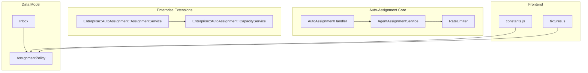

**Diagram sources**
- [assignment_policy.rb:24-39](file://app/models/assignment_policy.rb#L24-L39)
- [inbox.rb:74-75](file://app/models/inbox.rb#L74-L75)
- [auto_assignment_handler.rb:1-32](file://app/models/concerns/auto_assignment_handler.rb#L1-L32)
- [agent_assignment_service.rb:1-82](file://app/services/auto_assignment/agent_assignment_service.rb#L1-L82)
- [rate_limiter.rb:1-42](file://app/services/auto_assignment/rate_limiter.rb#L1-L42)
- [assignment_service.rb:1-93](file://enterprise/app/services/enterprise/auto_assignment/assignment_service.rb#L1-L93)
- [capacity_service.rb:1-26](file://enterprise/app/services/enterprise/auto_assignment/capacity_service.rb#L1-L26)
- [constants.js:1-20](file://app/javascript/dashboard/routes/dashboard/settings/assignmentPolicy/constants.js#L1-L20)
- [fixtures.js:1-57](file://app/javascript/dashboard/store/modules/specs/assignmentPolicies/fixtures.js#L1-L57)

**Section sources**
- [assignment_policy.rb:24-39](file://app/models/assignment_policy.rb#L24-L39)
- [inbox.rb:74-75](file://app/models/inbox.rb#L74-L75)
- [auto_assignment_handler.rb:1-32](file://app/models/concerns/auto_assignment_handler.rb#L1-L32)
- [agent_assignment_service.rb:1-82](file://app/services/auto_assignment/agent_assignment_service.rb#L1-L82)
- [rate_limiter.rb:1-42](file://app/services/auto_assignment/rate_limiter.rb#L1-L42)
- [assignment_service.rb:1-93](file://enterprise/app/services/enterprise/auto_assignment/assignment_service.rb#L1-L93)
- [capacity_service.rb:1-26](file://enterprise/app/services/enterprise/auto_assignment/capacity_service.rb#L1-L26)
- [constants.js:1-20](file://app/javascript/dashboard/routes/dashboard/settings/assignmentPolicy/constants.js#L1-L20)
- [fixtures.js:1-57](file://app/javascript/dashboard/store/modules/specs/assignmentPolicies/fixtures.js#L1-L57)

## Core Components
- AssignmentPolicy: Defines distribution order, priority, fair distribution limits/windows, and age exclusions; linked to inboxes via a join table.
- Inbox: Holds auto-assignment settings and associates with an assignment policy.
- AutoAssignmentHandler: Triggers assignment on status transitions and enqueues jobs for redistribution.
- AgentAssignmentService: Performs round-robin selection among online, allowed agents under lock.
- RateLimiter: Enforces per-agent assignment rate using Redis with configurable limit/window from the policy.
- Enterprise AssignmentService: Extends base flow with balanced selector, capacity filtering, and exclusion rules.
- CapacityService: Checks agent capacity against inbox-specific limits.
- Frontend constants/fixtures: Define policy options and defaults for UI configuration.

**Section sources**
- [assignment_policy.rb:24-39](file://app/models/assignment_policy.rb#L24-L39)
- [inbox.rb:74-75](file://app/models/inbox.rb#L74-L75)
- [auto_assignment_handler.rb:1-32](file://app/models/concerns/auto_assignment_handler.rb#L1-L32)
- [agent_assignment_service.rb:1-82](file://app/services/auto_assignment/agent_assignment_service.rb#L1-L82)
- [rate_limiter.rb:1-42](file://app/services/auto_assignment/rate_limiter.rb#L1-L42)
- [assignment_service.rb:1-93](file://enterprise/app/services/enterprise/auto_assignment/assignment_service.rb#L1-L93)
- [capacity_service.rb:1-26](file://enterprise/app/services/enterprise/auto_assignment/capacity_service.rb#L1-L26)
- [constants.js:1-20](file://app/javascript/dashboard/routes/dashboard/settings/assignmentPolicy/constants.js#L1-L20)
- [fixtures.js:1-57](file://app/javascript/dashboard/store/modules/specs/assignmentPolicies/fixtures.js#L1-L57)

## Architecture Overview
The assignment pipeline integrates model callbacks, background jobs, and service selectors:

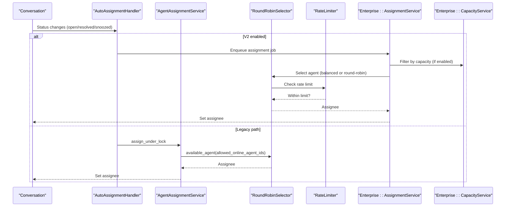

**Diagram sources**
- [auto_assignment_handler.rb:1-32](file://app/models/concerns/auto_assignment_handler.rb#L1-L32)
- [agent_assignment_service.rb:1-82](file://app/services/auto_assignment/agent_assignment_service.rb#L1-L82)
- [assignment_service.rb:1-93](file://enterprise/app/services/enterprise/auto_assignment/assignment_service.rb#L1-L93)
- [capacity_service.rb:1-26](file://enterprise/app/services/enterprise/auto_assignment/capacity_service.rb#L1-L26)
- [rate_limiter.rb:1-42](file://app/services/auto_assignment/rate_limiter.rb#L1-L42)

## Detailed Component Analysis

### Assignment Policy Model
- Purpose: Encapsulates distribution strategy and fairness parameters.
- Key fields:
  - assignment_order: round_robin (and balanced in enterprise).
  - conversation_priority: earliest_created or longest_waiting.
  - fair_distribution_limit: max assignments per window per agent.
  - fair_distribution_window: time window for rate limiting.
  - exclude_older_than_hours: threshold to skip stale unassigned conversations.
- Associations: Belongs to account; has many inboxes through inbox_assignment_policies.
- Validations: Presence/uniqueness of name; numeric constraints for limits/windows/exclusions.

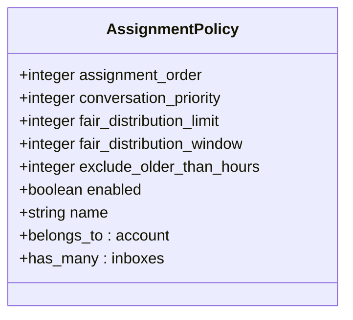

**Diagram sources**
- [assignment_policy.rb:24-39](file://app/models/assignment_policy.rb#L24-L39)
- [20250806140000_create_assignment_policies.rb:1-21](file://db/migrate/20250806140000_create_assignment_policies.rb#L1-L21)

**Section sources**
- [assignment_policy.rb:24-39](file://app/models/assignment_policy.rb#L24-L39)
- [20250806140000_create_assignment_policies.rb:1-21](file://db/migrate/20250806140000_create_assignment_policies.rb#L1-L21)

### Inbox Association and Settings
- Inboxes can be bound to an assignment policy via a one-to-one relationship.
- Inboxes expose assignable agents and member lists used during selection.

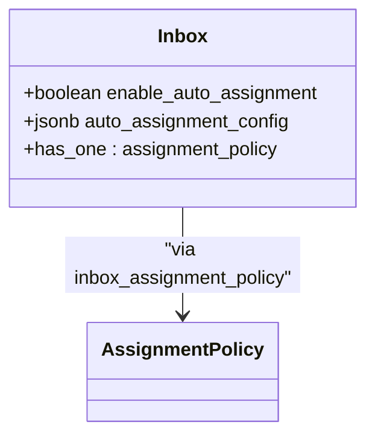

**Diagram sources**
- [inbox.rb:74-75](file://app/models/inbox.rb#L74-L75)

**Section sources**
- [inbox.rb:74-75](file://app/models/inbox.rb#L74-L75)

### Automatic Distribution Algorithms

#### Round-Robin
- Selection is performed over online, allowed agents within the inbox.
- Uses a round-robin selector and respects rate limits per agent.

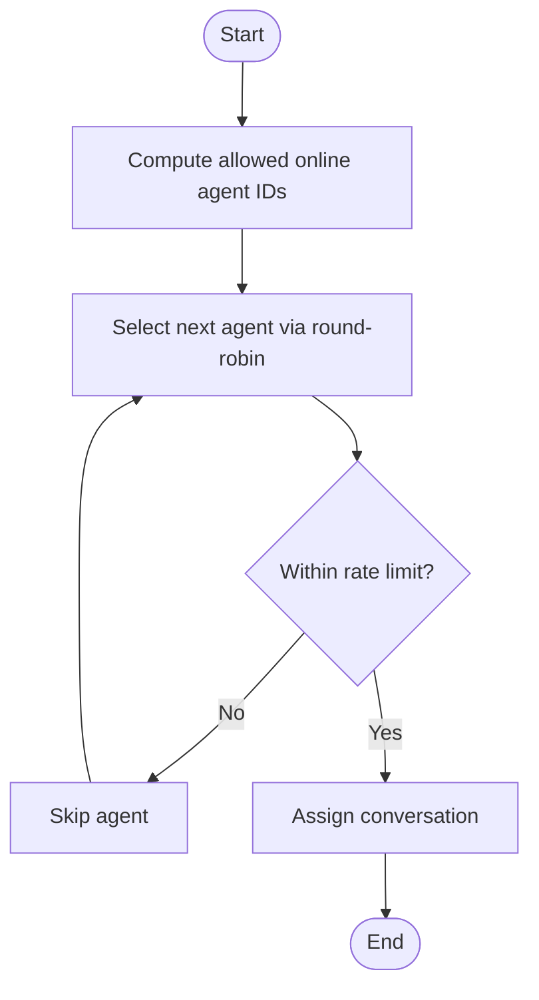

**Diagram sources**
- [agent_assignment_service.rb:61-76](file://app/services/auto_assignment/agent_assignment_service.rb#L61-L76)
- [rate_limiter.rb:1-42](file://app/services/auto_assignment/rate_limiter.rb#L1-L42)

**Section sources**
- [agent_assignment_service.rb:1-82](file://app/services/auto_assignment/agent_assignment_service.rb#L1-L82)
- [rate_limiter.rb:1-42](file://app/services/auto_assignment/rate_limiter.rb#L1-L42)

#### Balanced Load (Enterprise)
- When advanced_assignment feature is enabled and policy indicates balanced mode, the enterprise balanced selector chooses agents considering capacity and fairness.
- Capacity filtering ensures agents do not exceed inbox-specific limits.

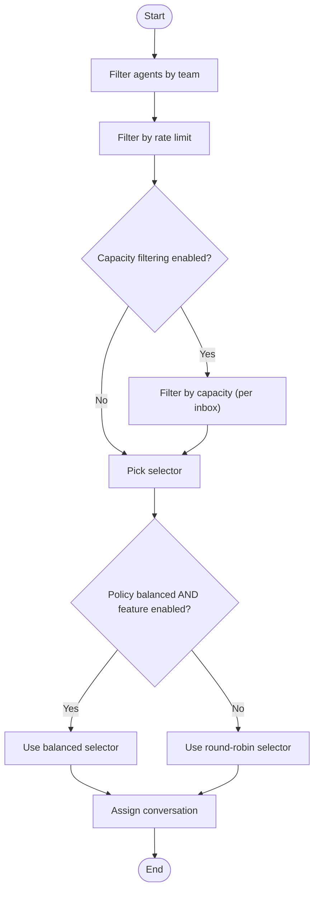

**Diagram sources**
- [assignment_service.rb:17-48](file://enterprise/app/services/enterprise/auto_assignment/assignment_service.rb#L17-L48)
- [capacity_service.rb:1-26](file://enterprise/app/services/enterprise/auto_assignment/capacity_service.rb#L1-L26)

**Section sources**
- [assignment_service.rb:1-93](file://enterprise/app/services/enterprise/auto_assignment/assignment_service.rb#L1-L93)
- [capacity_service.rb:1-26](file://enterprise/app/services/enterprise/auto_assignment/capacity_service.rb#L1-L26)

#### Skill-Based Routing
- Not present in the analyzed codebase. There is no explicit skill-based routing implementation visible in the referenced files.

[No sources needed since this section does not analyze specific files]

### Capacity Management

#### Individual Agent Limits
- Per-agent rate limiting uses Redis with a sliding window defined by fair_distribution_limit and fair_distribution_window from the assignment policy.

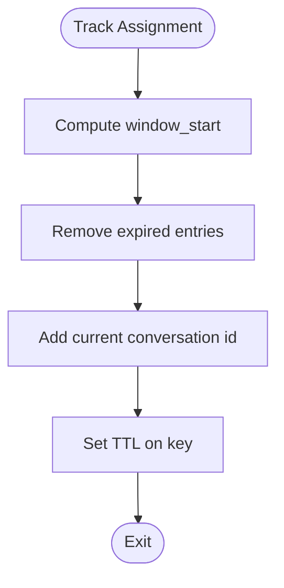

**Diagram sources**
- [rate_limiter.rb:8-14](file://app/services/auto_assignment/rate_limiter.rb#L8-L14)
- [rate_limiter.rb:22-31](file://app/services/auto_assignment/rate_limiter.rb#L22-L31)

**Section sources**
- [rate_limiter.rb:1-42](file://app/services/auto_assignment/rate_limiter.rb#L1-L42)

#### Team and Inbox-Specific Constraints
- Enterprise capacity service checks per-inbox conversation limits tied to an agent’s capacity policy. If no specific limit exists for an inbox, capacity is considered unlimited.

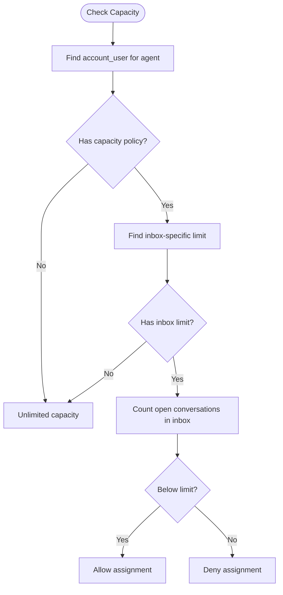

**Diagram sources**
- [capacity_service.rb:1-26](file://enterprise/app/services/enterprise/auto_assignment/capacity_service.rb#L1-L26)

**Section sources**
- [capacity_service.rb:1-26](file://enterprise/app/services/enterprise/auto_assignment/capacity_service.rb#L1-L26)

### Manual Assignment Interfaces and Reassignment Workflows
- Manual assignment targets are validated to ensure they belong to the current account (assignee_id or team_id).
- Reassignment occurs when conversation status transitions trigger assignment logic, including resolved/snoozed states for redistribution.

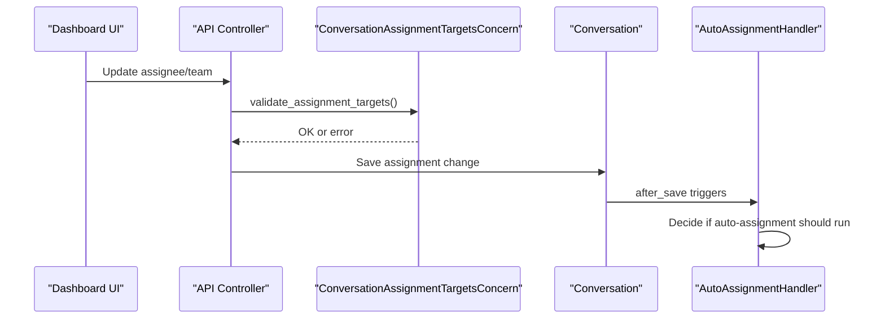

**Diagram sources**
- [conversation_assignment_targets_concern.rb:1-13](file://app/controllers/concerns/conversation_assignment_targets_concern.rb#L1-L13)
- [auto_assignment_handler.rb:1-32](file://app/models/concerns/auto_assignment_handler.rb#L1-L32)

**Section sources**
- [conversation_assignment_targets_concern.rb:1-13](file://app/controllers/concerns/conversation_assignment_targets_concern.rb#L1-L13)
- [auto_assignment_handler.rb:1-32](file://app/models/concerns/auto_assignment_handler.rb#L1-L32)

### Override Capabilities
- Enterprise assignment service allows overriding base behavior with policy-driven configuration and selective selectors.
- Exclusion rules (labels and age) can prevent certain conversations from being auto-assigned.

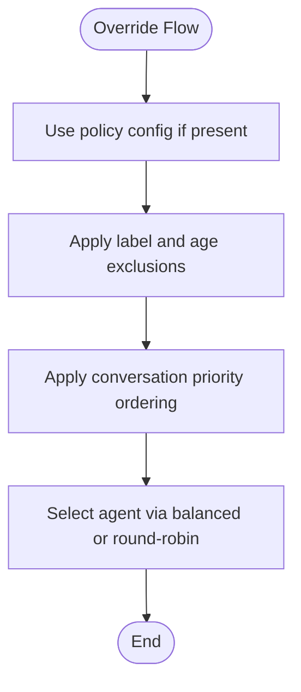

**Diagram sources**
- [assignment_service.rb:58-91](file://enterprise/app/services/enterprise/auto_assignment/assignment_service.rb#L58-L91)

**Section sources**
- [assignment_service.rb:58-91](file://enterprise/app/services/enterprise/auto_assignment/assignment_service.rb#L58-L91)

### Performance Metrics and Utilization Tracking
- Fair distribution window and limit provide a basis for measuring per-agent throughput and preventing overload.
- Conversation priority (earliest vs longest waiting) influences queue dynamics and SLA adherence.
- Age exclusions help avoid assigning stale conversations that could skew utilization metrics.

[No sources needed since this section provides general guidance]

### Configuration Examples
- Round-robin policy:
  - assignment_order: round_robin
  - conversation_priority: earliest_created
  - fair_distribution_limit: e.g., 100
  - fair_distribution_window: e.g., 3600 seconds
  - exclude_older_than_hours: e.g., 168 hours
- Balanced policy (enterprise):
  - assignment_order: balanced (when supported)
  - conversation_priority: longest_waiting
  - fair_distribution_limit/window: tuned for fairness
  - Enable advanced_assignment feature and configure agent capacity policies per inbox.

These values align with frontend constants and fixtures that define available options and defaults.

**Section sources**
- [constants.js:1-20](file://app/javascript/dashboard/routes/dashboard/settings/assignmentPolicy/constants.js#L1-L20)
- [fixtures.js:1-57](file://app/javascript/dashboard/store/modules/specs/assignmentPolicies/fixtures.js#L1-L57)

## Dependency Analysis
Key dependencies and relationships:
- Inbox depends on AssignmentPolicy via a join table.
- AutoAssignmentHandler orchestrates assignment triggers based on conversation state.
- AgentAssignmentService relies on round-robin selection and rate limiting.
- Enterprise AssignmentService extends base behavior with balanced selection and capacity filtering.
- CapacityService depends on account user mappings and inbox-specific limits.

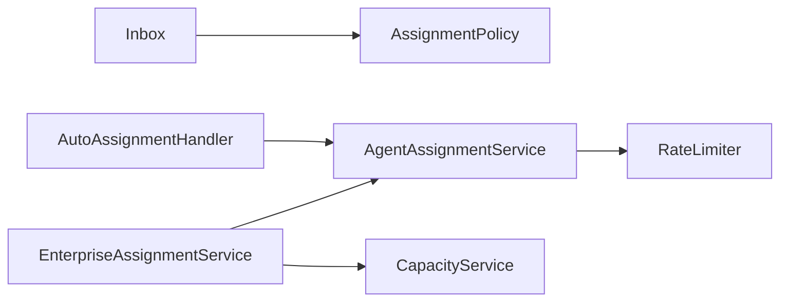

**Diagram sources**
- [inbox.rb:74-75](file://app/models/inbox.rb#L74-L75)
- [auto_assignment_handler.rb:1-32](file://app/models/concerns/auto_assignment_handler.rb#L1-L32)
- [agent_assignment_service.rb:1-82](file://app/services/auto_assignment/agent_assignment_service.rb#L1-L82)
- [assignment_service.rb:1-93](file://enterprise/app/services/enterprise/auto_assignment/assignment_service.rb#L1-L93)
- [capacity_service.rb:1-26](file://enterprise/app/services/enterprise/auto_assignment/capacity_service.rb#L1-L26)

**Section sources**
- [inbox.rb:74-75](file://app/models/inbox.rb#L74-L75)
- [auto_assignment_handler.rb:1-32](file://app/models/concerns/auto_assignment_handler.rb#L1-L32)
- [agent_assignment_service.rb:1-82](file://app/services/auto_assignment/agent_assignment_service.rb#L1-L82)
- [assignment_service.rb:1-93](file://enterprise/app/services/enterprise/auto_assignment/assignment_service.rb#L1-L93)
- [capacity_service.rb:1-26](file://enterprise/app/services/enterprise/auto_assignment/capacity_service.rb#L1-L26)

## Performance Considerations
- Tune fair_distribution_limit and fair_distribution_window to match expected message volume and agent responsiveness.
- Use conversation_priority=longest_waiting to prioritize aging tickets and reduce bottlenecks.
- Enable capacity filtering to prevent hotspots on high-volume inboxes.
- Monitor Redis keys for assignment tracking and ensure proper TTL configuration.
- For large teams, prefer balanced selection with advanced_assignment enabled to distribute load more evenly.

[No sources needed since this section provides general guidance]

## Troubleshooting Guide
- Conversations not auto-assigned:
  - Verify inbox.auto_assignment_v2_enabled and handler conditions.
  - Ensure agents are online and members of the inbox.
  - Check rate limiter counts and policy limits.
- Overloaded agents:
  - Adjust fair_distribution_limit/window.
  - Enable capacity filtering and set inbox-specific limits.
- Stale conversations assigned unexpectedly:
  - Review exclude_older_than_hours and exclusion rules in capacity policy.

**Section sources**
- [auto_assignment_handler.rb:1-32](file://app/models/concerns/auto_assignment_handler.rb#L1-L32)
- [rate_limiter.rb:1-42](file://app/services/auto_assignment/rate_limiter.rb#L1-L42)
- [assignment_service.rb:58-91](file://enterprise/app/services/enterprise/auto_assignment/assignment_service.rb#L58-L91)

## Conclusion
Chatwoot’s assignment system combines robust data modeling, flexible policy configuration, and scalable service layers. Round-robin provides simple distribution, while enterprise features add balanced selection, capacity controls, and exclusion rules. Proper tuning of limits, windows, and priorities enables efficient workload distribution across teams and inboxes. For skill-based routing, additional customization would be required beyond the current codebase scope.

[No sources needed since this section summarizes without analyzing specific files]