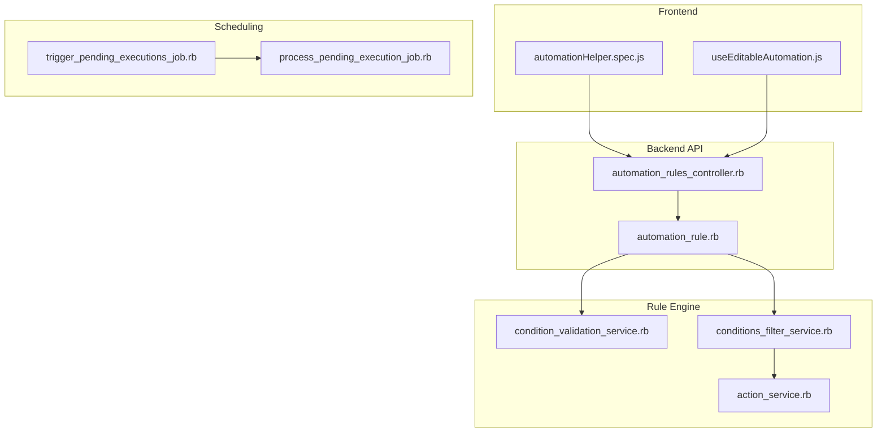
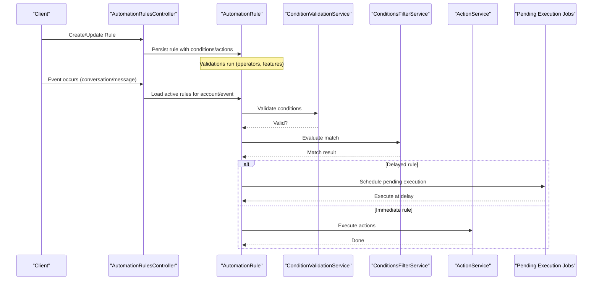
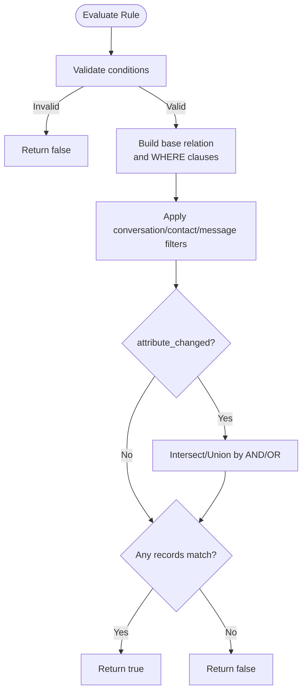
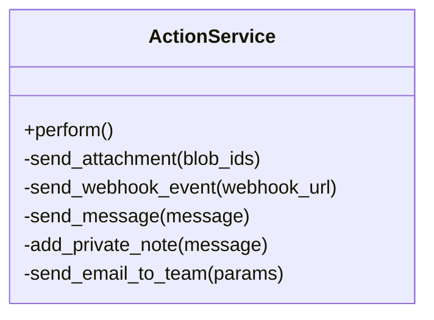
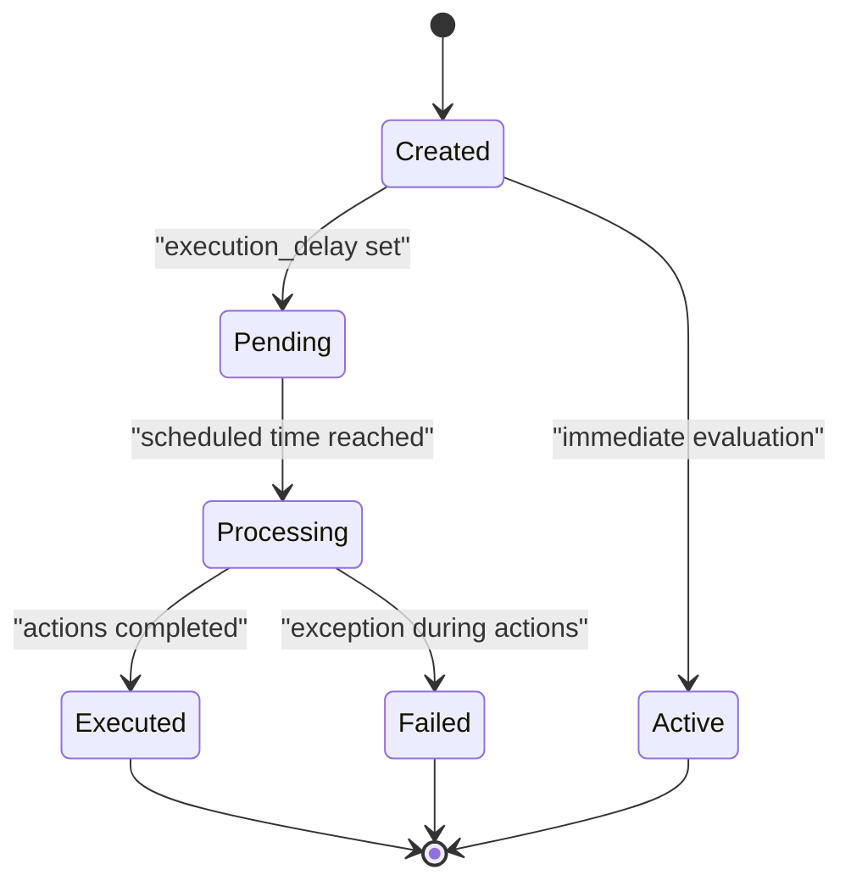
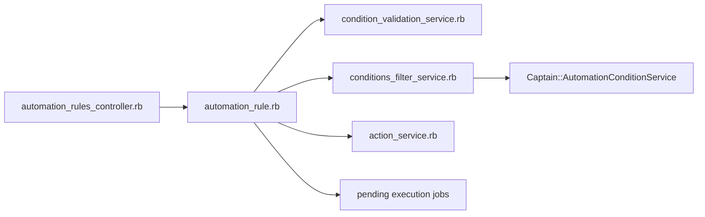

# Automation Rules Engine

<cite>
**Referenced Files in This Document**
- [automation_rule.rb](file://app/models/automation_rule.rb)
- [automation_rules_controller.rb](file://app/controllers/api/v1/accounts/automation_rules_controller.rb)
- [conditions_filter_service.rb](file://app/services/automation_rules/conditions_filter_service.rb)
- [condition_validation_service.rb](file://app/services/automation_rules/condition_validation_service.rb)
- [action_service.rb](file://app/services/automation_rules/action_service.rb)
- [process_pending_execution_job.rb](file://app/jobs/automation_rules/process_pending_execution_job.rb)
- [trigger_pending_executions_job.rb](file://app/jobs/automation_rules/trigger_pending_executions_job.rb)
- [automationHelper.spec.js](file://app/javascript/dashboard/helper/specs/automationHelper.spec.js)
- [useEditableAutomation.js](file://app/javascript/dashboard/composables/useEditableAutomation.js)
</cite>

## Table of Contents
1. [Introduction](#introduction)
2. [Project Structure](#project-structure)
3. [Core Components](#core-components)
4. [Architecture Overview](#architecture-overview)
5. [Detailed Component Analysis](#detailed-component-analysis)
6. [Dependency Analysis](#dependency-analysis)
7. [Performance Considerations](#performance-considerations)
8. [Troubleshooting Guide](#troubleshooting-guide)
9. [Conclusion](#conclusion)
10. [Appendices](#appendices)

## Introduction
This document explains Chatwoot’s automation rules engine: how rules are created, how conditions are matched against conversations and messages, and how actions are executed. It covers supported condition types (contact attributes, conversation properties, message fields, time-based triggers), available actions (label assignment, status changes, notifications, webhooks), rule evaluation order, testing and debugging capabilities, performance considerations for high-volume environments, conflict resolution, priority management, and best practices for complex workflows.

## Project Structure
The automation rules feature spans models, services, controllers, jobs, and frontend helpers:
- Model: defines rule schema, validations, and lifecycle hooks.
- Controller: exposes REST endpoints to create, update, clone, and delete rules; enforces feature flags for delayed automations.
- Services: validate conditions, build queries, evaluate matches, and execute actions.
- Jobs: schedule and process delayed executions.
- Frontend helpers: serialize rule payloads and condition values for the UI.

**Diagram sources**
- [automation_rules_controller.rb:1-93](file://app/controllers/api/v1/accounts/automation_rules_controller.rb#L1-L93)
- [automation_rule.rb:1-201](file://app/models/automation_rule.rb#L1-L201)
- [condition_validation_service.rb:1-69](file://app/services/automation_rules/condition_validation_service.rb#L1-L69)
- [conditions_filter_service.rb:1-215](file://app/services/automation_rules/conditions_filter_service.rb#L1-L215)
- [action_service.rb:1-66](file://app/services/automation_rules/action_service.rb#L1-L66)
- [trigger_pending_executions_job.rb](file://app/jobs/automation_rules/trigger_pending_executions_job.rb)
- [process_pending_execution_job.rb](file://app/jobs/automation_rules/process_pending_execution_job.rb)
- [automationHelper.spec.js:342-388](file://app/javascript/dashboard/helper/specs/automationHelper.spec.js#L342-L388)
- [useEditableAutomation.js:35-79](file://app/javascript/dashboard/composables/useEditableAutomation.js#L35-L79)

**Section sources**
- [automation_rules_controller.rb:1-93](file://app/controllers/api/v1/accounts/automation_rules_controller.rb#L1-L93)
- [automation_rule.rb:1-201](file://app/models/automation_rule.rb#L1-L201)

## Core Components
- Rule model: stores rule metadata, conditions, actions, event type, execution delay, and active state. Validates JSON structures, allowed operators, and supports Captain AI conditions when enabled.
- Condition validation service: ensures each condition uses a supported attribute key, operator, and query operator.
- Conditions filter service: builds SQL filters across conversations, contacts, and messages; integrates with Captain AI; evaluates AND/OR logic; handles attribute_changed semantics.
- Action service: executes rule actions safely, isolating per-action failures and tracking exceptions.
- Controller: manages CRUD operations, attachment handling, and delayed automation gating via feature flags.
- Jobs: schedule delayed rule evaluations and process pending executions.

**Section sources**
- [automation_rule.rb:24-48](file://app/models/automation_rule.rb#L24-L48)
- [condition_validation_service.rb:16-22](file://app/services/automation_rules/condition_validation_service.rb#L16-L22)
- [conditions_filter_service.rb:28-42](file://app/services/automation_rules/conditions_filter_service.rb#L28-L42)
- [action_service.rb:9-21](file://app/services/automation_rules/action_service.rb#L9-L21)
- [automation_rules_controller.rb:14-41](file://app/controllers/api/v1/accounts/automation_rules_controller.rb#L14-L41)

## Architecture Overview
The automation rules engine follows an event-driven pipeline:
- Events trigger rule evaluation based on event_name (e.g., conversation_updated, message_created).
- Conditions are validated and compiled into a query that joins conversations, contacts, and messages.
- If a rule has an execution_delay, it is scheduled for later evaluation.
- When evaluated, matching rules execute their actions sequentially.

**Diagram sources**
- [automation_rules_controller.rb:14-41](file://app/controllers/api/v1/accounts/automation_rules_controller.rb#L14-L41)
- [automation_rule.rb:177-186](file://app/models/automation_rule.rb#L177-L186)
- [condition_validation_service.rb:16-22](file://app/services/automation_rules/condition_validation_service.rb#L16-L22)
- [conditions_filter_service.rb:28-42](file://app/services/automation_rules/conditions_filter_service.rb#L28-L42)
- [action_service.rb:9-21](file://app/services/automation_rules/action_service.rb#L9-L21)
- [trigger_pending_executions_job.rb](file://app/jobs/automation_rules/trigger_pending_executions_job.rb)
- [process_pending_execution_job.rb](file://app/jobs/automation_rules/process_pending_execution_job.rb)

## Detailed Component Analysis

### Rule Creation Interface
- The controller accepts name, description, event_name, active flag, optional execution_delay (when enabled), conditions array, and actions array.
- Attachments can be included in actions and are attached to the rule.
- Feature flag gating prevents setting execution_delay unless delayed automations are enabled.

Key behaviors:
- Validation errors from the model are returned to the client.
- Cloning a rule preserves its definition but refuses to copy delayed behavior if delayed automations are disabled.

**Section sources**
- [automation_rules_controller.rb:14-57](file://app/controllers/api/v1/accounts/automation_rules_controller.rb#L14-L57)
- [automation_rules_controller.rb:61-85](file://app/controllers/api/v1/accounts/automation_rules_controller.rb#L61-L85)

### Condition Matching Logic
- Supported condition keys include conversation fields (status, inbox_id, labels, assignee_id), contact fields (additional_attributes and standard fields), and message fields (content, private_note, etc.).
- Query operators support AND/OR composition across conditions.
- Special operators:
  - starts_with: converted to LIKE prefix search.
  - attribute_changed: compares changed_attributes payload to determine if a field transition occurred.
- Captain AI conditions are integrated when enabled; they are treated as boolean conditions within the AND/OR chain.

Evaluation flow:
- Validate all conditions using the validation service.
- Build a base relation joining conversations, contacts, and messages.
- Apply filters per attribute category and construct a combined WHERE clause.
- For attribute_changed filters, intersect or union results based on AND/OR semantics.
- Return whether any record matches.

**Diagram sources**
- [conditions_filter_service.rb:28-42](file://app/services/automation_rules/conditions_filter_service.rb#L28-L42)
- [conditions_filter_service.rb:52-78](file://app/services/automation_rules/conditions_filter_service.rb#L52-L78)
- [conditions_filter_service.rb:80-109](file://app/services/automation_rules/conditions_filter_service.rb#L80-L109)
- [conditions_filter_service.rb:179-195](file://app/services/automation_rules/conditions_filter_service.rb#L179-L195)

**Section sources**
- [conditions_filter_service.rb:1-215](file://app/services/automation_rules/conditions_filter_service.rb#L1-L215)
- [condition_validation_service.rb:16-69](file://app/services/automation_rules/condition_validation_service.rb#L16-L69)

### Action Execution System
- Actions are defined as action_name plus action_params.
- Supported actions include sending messages, adding/removing labels, assigning teams/agents, sending emails to teams, muting conversations, changing statuses/priorities, sending attachments, sending webhooks, and adding private notes.
- Each action is executed sequentially; failures are captured and logged without stopping other actions.
- Some actions are skipped for specific channels (e.g., tweets).

**Diagram sources**
- [action_service.rb:1-66](file://app/services/automation_rules/action_service.rb#L1-L66)

**Section sources**
- [automation_rule.rb:60-65](file://app/models/automation_rule.rb#L60-L65)
- [action_service.rb:9-64](file://app/services/automation_rules/action_service.rb#L9-L64)

### Time-Based Triggers and Delayed Automations
- Rules may specify an execution_delay (minutes) to defer evaluation after the triggering event.
- Constraints:
  - Only certain events and attributes are allowed for delayed rules (e.g., conversation-level episodes keyed by status; only status and inbox_id are safe to filter on).
  - attribute_changed cannot be used with delayed rules because change context is not available at fire time.
- On configuration changes (active, delay, event, conditions, actions), stale pending executions are discarded so rearming happens on next matching event.

**Diagram sources**
- [automation_rule.rb:28-31](file://app/models/automation_rule.rb#L28-L31)
- [automation_rule.rb:157-173](file://app/models/automation_rule.rb#L157-L173)
- [automation_rule.rb:177-186](file://app/models/automation_rule.rb#L177-L186)

**Section sources**
- [automation_rule.rb:28-31](file://app/models/automation_rule.rb#L28-L31)
- [automation_rule.rb:157-186](file://app/models/automation_rule.rb#L157-L186)

### Supported Conditions and Actions
- Conditions:
  - Conversation attributes: status, inbox_id, labels, assignee_id, additional_attributes, and more.
  - Contact attributes: standard fields and additional_attributes.
  - Message attributes: content, private_note, and others.
  - Custom attributes: validated against account definitions.
  - Captain AI detection conditions when feature-enabled.
- Actions:
  - send_message, add_label, remove_label, send_email_to_team, assign_team, assign_agent, remove_assigned_agent, remove_assigned_team, send_webhook_event, mute_conversation, change_status, resolve_conversation, open_conversation, pending_conversation, snooze_conversation, change_priority, send_email_transcript, add_private_note, send_attachment.

**Section sources**
- [automation_rule.rb:55-65](file://app/models/automation_rule.rb#L55-L65)
- [condition_validation_service.rb:35-69](file://app/services/automation_rules/condition_validation_service.rb#L35-L69)

### Rule Evaluation Order and Priority Management
- Rules are evaluated independently; there is no explicit global priority field.
- To control precedence:
  - Use precise conditions to avoid overlap.
  - Split broad rules into narrower ones and rely on AND/OR grouping.
  - Prefer immediate rules for critical paths and delayed rules for post-processing.
- Conflicts are resolved by condition specificity rather than ordering.

[No sources needed since this section provides general guidance]

### Practical Automation Scenarios
- Auto-assignment:
  - Trigger on message_created or conversation_updated.
  - Conditions: inbox_id equals Support, status equals open, assignee_id is_not_present.
  - Actions: assign_agent or assign_team.
- SLA monitoring:
  - Trigger on conversation_updated with execution_delay.
  - Conditions: status equals open, labels includes sla_breach, inbox_id equals Billing.
  - Actions: add_label escalated, send_webhook_event to alert channel.
- Workflow routing:
  - Trigger on message_created.
  - Conditions: content starts_with “refund”, labels does_not_include billing.
  - Actions: add_label billing, assign_team Finance, send_message “We will handle your refund request”.

[No sources needed since this section provides general guidance]

### Rule Testing and Debugging
- Frontend serialization tests demonstrate correct payload structure for conditions and actions, including boolean and dropdown values.
- Composable useEditableAutomation normalizes condition values for different input types (plain text, multi-text, date, boolean, dropdowns).
- Backend logging:
  - Condition validation failures are logged.
  - Exception tracking captures action execution errors.

**Section sources**
- [automationHelper.spec.js:342-388](file://app/javascript/dashboard/helper/specs/automationHelper.spec.js#L342-L388)
- [useEditableAutomation.js:35-79](file://app/javascript/dashboard/composables/useEditableAutomation.js#L35-L79)
- [conditions_filter_service.rb:44-49](file://app/services/automation_rules/conditions_filter_service.rb#L44-L49)
- [action_service.rb:13-17](file://app/services/automation_rules/action_service.rb#L13-L17)

## Dependency Analysis

**Diagram sources**
- [automation_rules_controller.rb:1-93](file://app/controllers/api/v1/accounts/automation_rules_controller.rb#L1-L93)
- [automation_rule.rb:1-201](file://app/models/automation_rule.rb#L1-L201)
- [condition_validation_service.rb:1-69](file://app/services/automation_rules/condition_validation_service.rb#L1-L69)
- [conditions_filter_service.rb:1-215](file://app/services/automation_rules/conditions_filter_service.rb#L1-L215)
- [action_service.rb:1-66](file://app/services/automation_rules/action_service.rb#L1-L66)

**Section sources**
- [automation_rules_controller.rb:1-93](file://app/controllers/api/v1/accounts/automation_rules_controller.rb#L1-L93)
- [automation_rule.rb:1-201](file://app/models/automation_rule.rb#L1-L201)

## Performance Considerations
- Avoid overly broad conditions; prefer specific attribute filters to reduce join and scan costs.
- Limit the number of conditions per rule; group related checks logically.
- Use delayed automations sparingly; they require additional scheduling and rearm logic.
- Keep action payloads small; avoid heavy computations inside actions.
- Monitor exception logs for failing actions to prevent cascading failures.

[No sources needed since this section provides general guidance]

## Troubleshooting Guide
Common issues and resolutions:
- Invalid query operator: ensure query_operator is AND or OR.
- Unsupported attribute_key: verify attribute exists in conversation/contact/message or custom attribute definitions.
- Captain conditions require feature enablement and valid operators/description length.
- Delayed automations not enabled: check feature flag before setting execution_delay.
- Stale pending executions: editing a rule discards armed rows; rearm occurs on next matching event.

**Section sources**
- [automation_rule.rb:188-196](file://app/models/automation_rule.rb#L188-L196)
- [automation_rule.rb:100-127](file://app/models/automation_rule.rb#L100-L127)
- [automation_rules_controller.rb:72-85](file://app/controllers/api/v1/accounts/automation_rules_controller.rb#L72-L85)
- [automation_rule.rb:177-186](file://app/models/automation_rule.rb#L177-L186)

## Conclusion
Chatwoot’s automation rules engine provides a flexible, extensible system for automating customer support workflows. By combining robust condition matching, a rich set of actions, and optional delayed execution, teams can implement auto-assignment, SLA monitoring, and workflow routing effectively. Adhering to best practices—precise conditions, careful use of delayed rules, and clear separation of responsibilities—ensures reliable performance even under high volume.

[No sources needed since this section summarizes without analyzing specific files]

## Appendices

### Best Practices for Complex Workflows
- Decompose complex rules into smaller, focused rules.
- Use labels to segment conversations and route them through specialized pipelines.
- Leverage delayed automations for post-event processing and SLA checks.
- Regularly review and prune inactive or redundant rules.
- Test new rules with representative data and monitor logs for exceptions.

[No sources needed since this section provides general guidance]