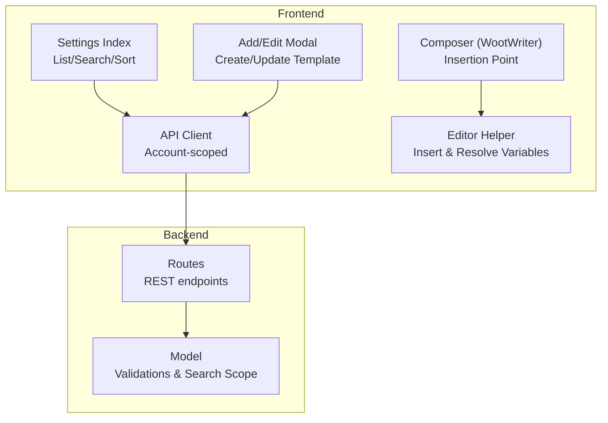
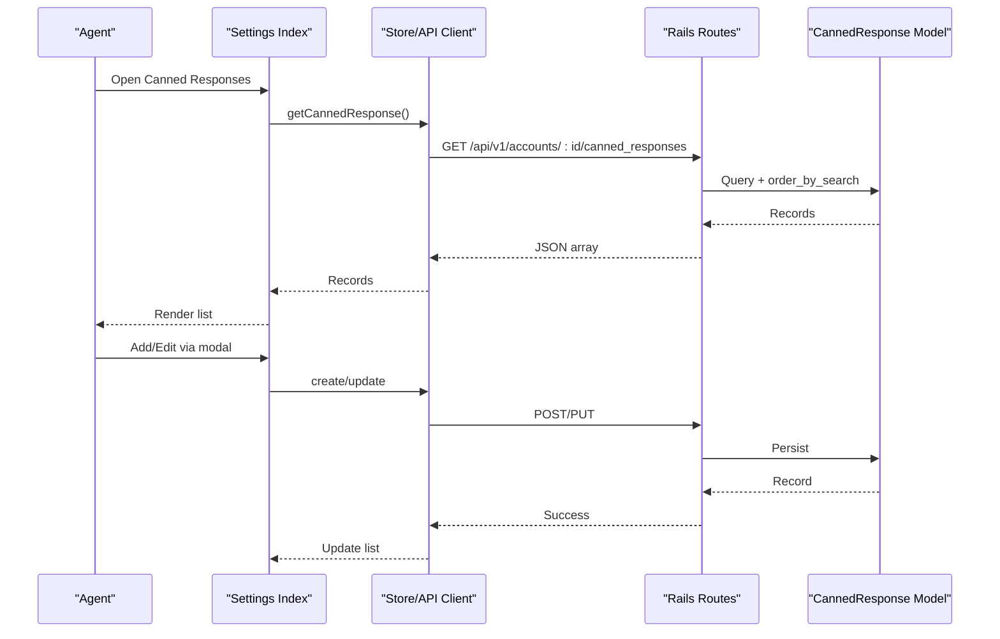
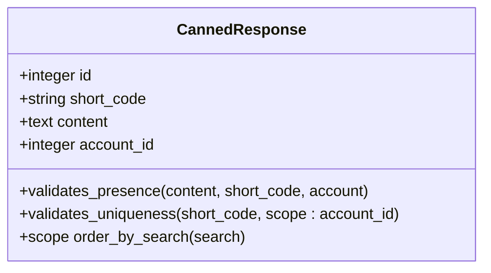
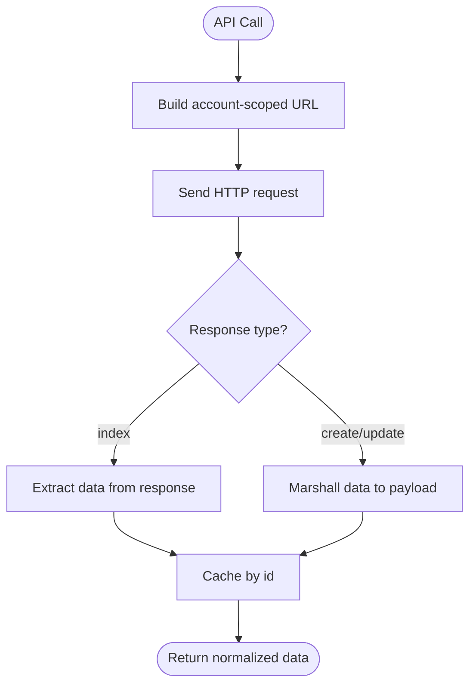
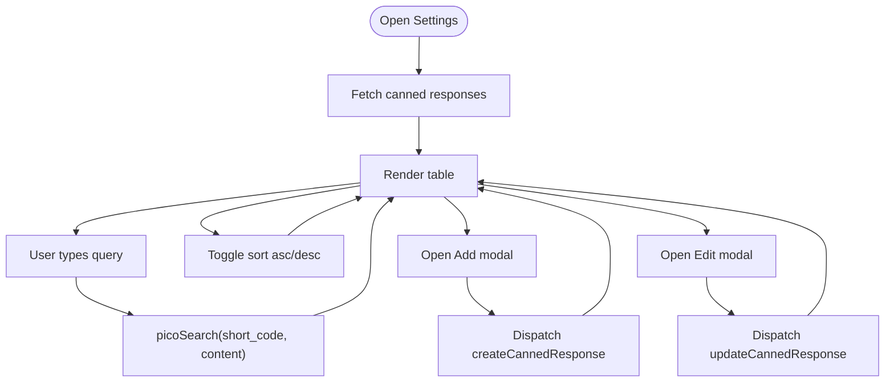
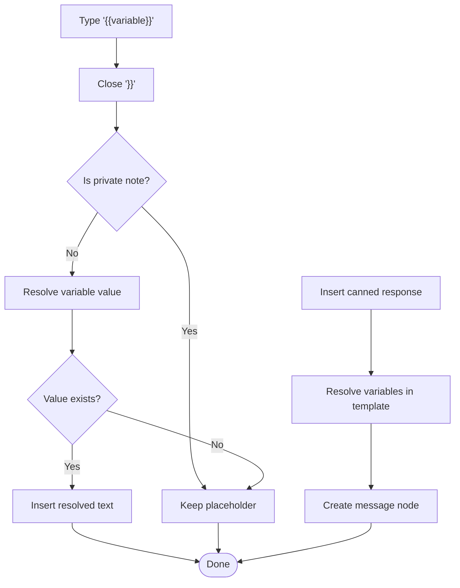
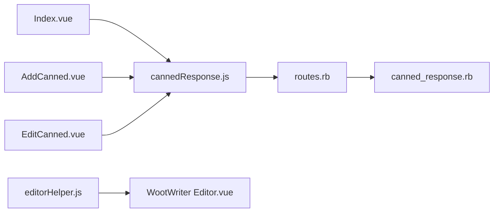

# Canned Responses System

<cite>
**Referenced Files in This Document**
- [canned_response.rb](file://app/models/canned_response.rb)
- [cannedResponse.js](file://app/javascript/dashboard/api/cannedResponse.js)
- [Index.vue](file://app/javascript/dashboard/routes/dashboard/settings/canned/Index.vue)
- [AddCanned.vue](file://app/javascript/dashboard/routes/dashboard/settings/canned/AddCanned.vue)
- [EditCanned.vue](file://app/javascript/dashboard/routes/dashboard/settings/canned/EditCanned.vue)
- [editorHelper.js](file://app/javascript/dashboard/helper/editorHelper.js)
- [WootWriter Editor.vue](file://app/javascript/dashboard/components/widgets/WootWriter/Editor.vue)
- [routes.rb](file://config/routes.rb)
</cite>

## Table of Contents
1. [Introduction](#introduction)
2. [Project Structure](#project-structure)
3. [Core Components](#core-components)
4. [Architecture Overview](#architecture-overview)
5. [Detailed Component Analysis](#detailed-component-analysis)
6. [Dependency Analysis](#dependency-analysis)
7. [Performance Considerations](#performance-considerations)
8. [Troubleshooting Guide](#troubleshooting-guide)
9. [Conclusion](#conclusion)

## Introduction
This document explains Chatwoot’s canned responses system: how agents create and manage response templates, how variables are substituted at insertion time, and how the feature integrates with conversations. It covers the template creation interface, search and sorting, editor integration for inserting canned responses and variables, and data flow between the frontend and backend.

## Project Structure
The canned responses feature spans a small set of backend and frontend components:
- Backend model defines validation, uniqueness, and search ordering.
- Frontend API client wraps account-scoped requests and caching.
- Settings pages provide CRUD UI for short codes and content.
- Editor helpers integrate canned responses and variable substitution into the conversation composer.

**Diagram sources**
- [Index.vue:41-52](file://app/javascript/dashboard/routes/dashboard/settings/canned/Index.vue#L41-L52)
- [AddCanned.vue:57-79](file://app/javascript/dashboard/routes/dashboard/settings/canned/AddCanned.vue#L57-L79)
- [EditCanned.vue:61-86](file://app/javascript/dashboard/routes/dashboard/settings/canned/EditCanned.vue#L61-L86)
- [cannedResponse.js:3-22](file://app/javascript/dashboard/api/cannedResponse.js#L3-L22)
- [routes.rb:165](file://config/routes.rb#L165)
- [canned_response.rb:13-31](file://app/models/canned_response.rb#L13-L31)

**Section sources**
- [canned_response.rb:13-31](file://app/models/canned_response.rb#L13-L31)
- [cannedResponse.js:3-22](file://app/javascript/dashboard/api/cannedResponse.js#L3-L22)
- [Index.vue:41-52](file://app/javascript/dashboard/routes/dashboard/settings/canned/Index.vue#L41-L52)
- [AddCanned.vue:57-79](file://app/javascript/dashboard/routes/dashboard/settings/canned/AddCanned.vue#L57-L79)
- [EditCanned.vue:61-86](file://app/javascript/dashboard/routes/dashboard/settings/canned/EditCanned.vue#L61-L86)
- [routes.rb:165](file://config/routes.rb#L165)

## Core Components
- Model: CannedResponse stores templates per account, enforces presence and uniqueness of short_code, and provides a search-aware ordering scope.
- API Client: Account-scaped REST client that normalizes index payloads and caches models by id.
- Settings UI: List view with search and sort; modals to add or edit templates.
- Editor Integration: Inserts canned responses into messages and resolves variables inline.

Key responsibilities:
- Data persistence and validation: [canned_response.rb:13-31](file://app/models/canned_response.rb#L13-L31)
- HTTP layer and caching: [cannedResponse.js:3-22](file://app/javascript/dashboard/api/cannedResponse.js#L3-L22)
- Management UI: [Index.vue:41-52](file://app/javascript/dashboard/routes/dashboard/settings/canned/Index.vue#L41-L52), [AddCanned.vue:57-79](file://app/javascript/dashboard/routes/dashboard/settings/canned/AddCanned.vue#L57-L79), [EditCanned.vue:61-86](file://app/javascript/dashboard/routes/dashboard/settings/canned/EditCanned.vue#L61-L86)
- Insertion and variable resolution: [editorHelper.js:503-517](file://app/javascript/dashboard/helper/editorHelper.js#L503-L517), [editorHelper.js:576-584](file://app/javascript/dashboard/helper/editorHelper.js#L576-L584)

**Section sources**
- [canned_response.rb:13-31](file://app/models/canned_response.rb#L13-L31)
- [cannedResponse.js:3-22](file://app/javascript/dashboard/api/cannedResponse.js#L3-L22)
- [Index.vue:41-52](file://app/javascript/dashboard/routes/dashboard/settings/canned/Index.vue#L41-L52)
- [AddCanned.vue:57-79](file://app/javascript/dashboard/routes/dashboard/settings/canned/AddCanned.vue#L57-L79)
- [EditCanned.vue:61-86](file://app/javascript/dashboard/routes/dashboard/settings/canned/EditCanned.vue#L61-L86)
- [editorHelper.js:503-517](file://app/javascript/dashboard/helper/editorHelper.js#L503-L517)
- [editorHelper.js:576-584](file://app/javascript/dashboard/helper/editorHelper.js#L576-L584)

## Architecture Overview
The system follows a standard MVC-like flow with Vue-based settings and an editor-driven insertion experience.

**Diagram sources**
- [Index.vue:73-83](file://app/javascript/dashboard/routes/dashboard/settings/canned/Index.vue#L73-L83)
- [AddCanned.vue:57-79](file://app/javascript/dashboard/routes/dashboard/settings/canned/AddCanned.vue#L57-L79)
- [EditCanned.vue:61-86](file://app/javascript/dashboard/routes/dashboard/settings/canned/EditCanned.vue#L61-L86)
- [cannedResponse.js:3-22](file://app/javascript/dashboard/api/cannedResponse.js#L3-L22)
- [routes.rb:165](file://config/routes.rb#L165)
- [canned_response.rb:23-31](file://app/models/canned_response.rb#L23-L31)

## Detailed Component Analysis

### Model: CannedResponse
Responsibilities:
- Enforce required fields and unique short_code per account.
- Provide a database-level search-aware ordering scope that prioritizes short_code matches over content matches.

Complexity notes:
- Validation is O(1) per record on save.
- The search scope builds a CASE expression and orders by descending relevance score; cost depends on DB engine and indexes.

**Diagram sources**
- [canned_response.rb:13-31](file://app/models/canned_response.rb#L13-L31)

**Section sources**
- [canned_response.rb:13-31](file://app/models/canned_response.rb#L13-L31)

### Frontend API Client: CannedResponse
Responsibilities:
- Define account-scoped resource path.
- Normalize index responses from bare arrays to expected payload shape.
- Cache records by id for offline-first behavior.

**Diagram sources**
- [cannedResponse.js:3-22](file://app/javascript/dashboard/api/cannedResponse.js#L3-L22)

**Section sources**
- [cannedResponse.js:3-22](file://app/javascript/dashboard/api/cannedResponse.js#L3-L22)

### Settings UI: List, Add, Edit
- List page:
  - Loads records via store.
  - Sorts by short_code ascending/descending.
  - Filters using picoSearch across short_code and content.
- Add/Edit modals:
  - Validate short_code length and content presence.
  - Submit via store actions to create/update templates.

**Diagram sources**
- [Index.vue:41-52](file://app/javascript/dashboard/routes/dashboard/settings/canned/Index.vue#L41-L52)
- [Index.vue:69-71](file://app/javascript/dashboard/routes/dashboard/settings/canned/Index.vue#L69-L71)
- [AddCanned.vue:57-79](file://app/javascript/dashboard/routes/dashboard/settings/canned/AddCanned.vue#L57-L79)
- [EditCanned.vue:61-86](file://app/javascript/dashboard/routes/dashboard/settings/canned/EditCanned.vue#L61-L86)

**Section sources**
- [Index.vue:41-52](file://app/javascript/dashboard/routes/dashboard/settings/canned/Index.vue#L41-L52)
- [Index.vue:69-71](file://app/javascript/dashboard/routes/dashboard/settings/canned/Index.vue#L69-L71)
- [AddCanned.vue:57-79](file://app/javascript/dashboard/routes/dashboard/settings/canned/AddCanned.vue#L57-L79)
- [EditCanned.vue:61-86](file://app/javascript/dashboard/routes/dashboard/settings/canned/EditCanned.vue#L61-L86)

### Editor Integration: Inserting Canned Responses and Variables
- Variable input rule:
  - When an agent types {{key}} and closes braces, the editor resolves the variable if available; otherwise keeps the placeholder.
- Canned response insertion:
  - When inserting a canned response, the editor resolves variables within the template before creating the message node.

**Diagram sources**
- [editorHelper.js:503-517](file://app/javascript/dashboard/helper/editorHelper.js#L503-L517)
- [editorHelper.js:576-584](file://app/javascript/dashboard/helper/editorHelper.js#L576-L584)

**Section sources**
- [editorHelper.js:503-517](file://app/javascript/dashboard/helper/editorHelper.js#L503-L517)
- [editorHelper.js:576-584](file://app/javascript/dashboard/helper/editorHelper.js#L576-L584)

### Composer Entry Points
- The WootWriter editor exposes methods to insert special content including canned responses and variables, and emits analytics events when inserted.

**Section sources**
- [WootWriter Editor.vue:761-784](file://app/javascript/dashboard/components/widgets/WootWriter/Editor.vue#L761-L784)

## Dependency Analysis
High-level dependencies among components:

**Diagram sources**
- [Index.vue:73-83](file://app/javascript/dashboard/routes/dashboard/settings/canned/Index.vue#L73-L83)
- [AddCanned.vue:57-79](file://app/javascript/dashboard/routes/dashboard/settings/canned/AddCanned.vue#L57-L79)
- [EditCanned.vue:61-86](file://app/javascript/dashboard/routes/dashboard/settings/canned/EditCanned.vue#L61-L86)
- [cannedResponse.js:3-22](file://app/javascript/dashboard/api/cannedResponse.js#L3-L22)
- [routes.rb:165](file://config/routes.rb#L165)
- [canned_response.rb:13-31](file://app/models/canned_response.rb#L13-L31)
- [editorHelper.js:503-517](file://app/javascript/dashboard/helper/editorHelper.js#L503-L517)
- [WootWriter Editor.vue:761-784](file://app/javascript/dashboard/components/widgets/WootWriter/Editor.vue#L761-L784)

**Section sources**
- [cannedResponse.js:3-22](file://app/javascript/dashboard/api/cannedResponse.js#L3-L22)
- [routes.rb:165](file://config/routes.rb#L165)
- [canned_response.rb:13-31](file://app/models/canned_response.rb#L13-L31)

## Performance Considerations
- Database search ordering: The model’s search scope uses a CASE expression to rank results by short_code and content matches. For large libraries, consider:
  - Adding partial indexes on short_code and content where supported.
  - Limiting result sets and leveraging pagination at the controller level if not already present.
- Frontend search: picoSearch runs in-memory on loaded records. For very large datasets:
  - Debounce user input.
  - Consider server-side filtering for long queries.
- Caching: The API client caches records by id, reducing repeated network calls during editing sessions.

[No sources needed since this section provides general guidance]

## Troubleshooting Guide
Common issues and resolutions:
- Short code conflicts:
  - Symptom: Save fails due to uniqueness constraint.
  - Resolution: Ensure short_code is unique within the account.
- Missing content:
  - Symptom: Validation error on content field.
  - Resolution: Provide non-empty content in the editor.
- Variables not resolving:
  - Symptom: Placeholders remain after insertion.
  - Resolution: Verify variables exist in context; ensure not in a private note.
- Search returns no results:
  - Symptom: picoSearch shows empty list.
  - Resolution: Confirm records exist and query matches short_code or content.

**Section sources**
- [canned_response.rb:16-19](file://app/models/canned_response.rb#L16-L19)
- [AddCanned.vue:41-49](file://app/javascript/dashboard/routes/dashboard/settings/canned/AddCanned.vue#L41-L49)
- [EditCanned.vue:36-44](file://app/javascript/dashboard/routes/dashboard/settings/canned/EditCanned.vue#L36-L44)
- [editorHelper.js:503-517](file://app/javascript/dashboard/helper/editorHelper.js#L503-L517)

## Conclusion
Chatwoot’s canned responses feature provides a robust way to manage reusable message templates. Agents can create and edit templates through a simple settings UI, search and sort them efficiently, and insert them directly into conversations with automatic variable substitution. The backend enforces data integrity and supports search-aware ordering, while the frontend leverages caching and in-memory search for responsiveness.

[No sources needed since this section summarizes without analyzing specific files]