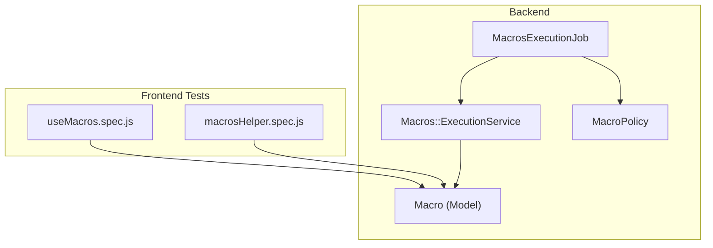
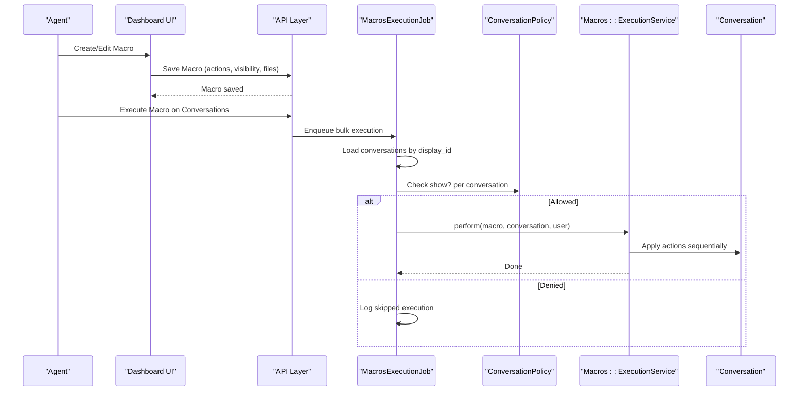
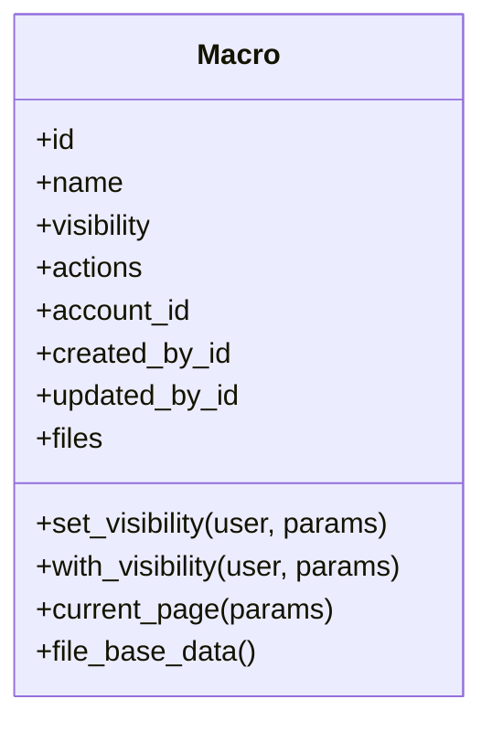
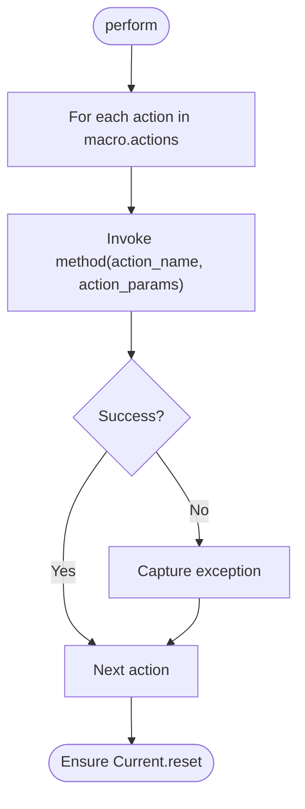
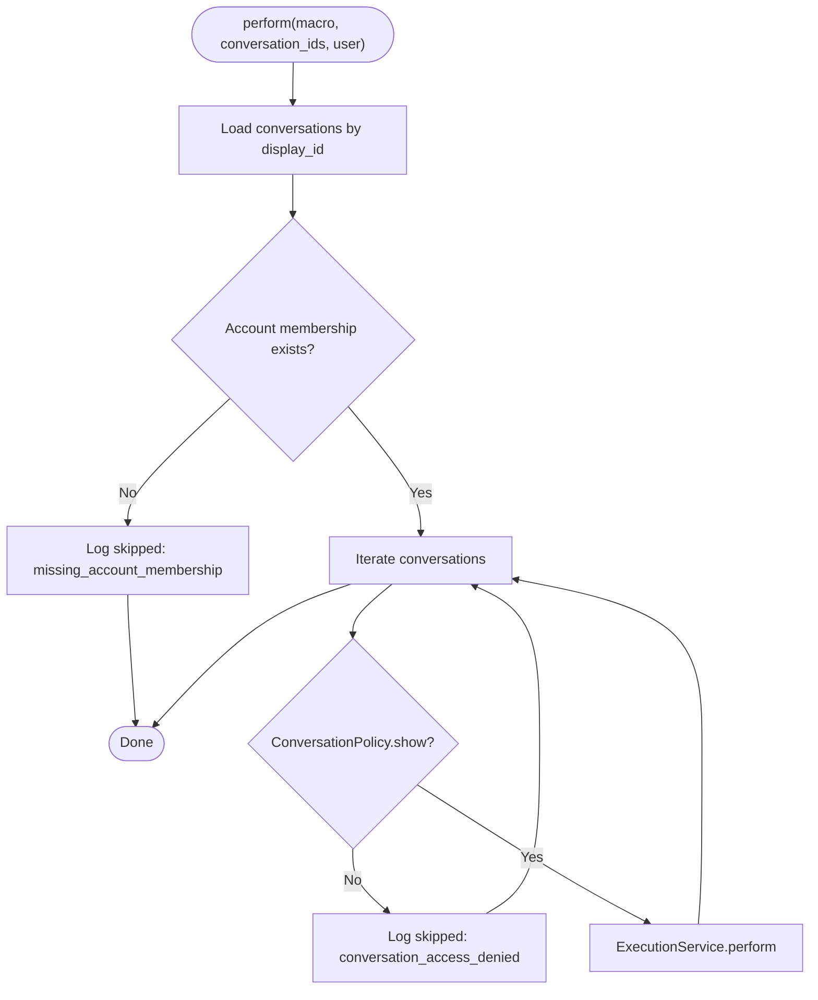
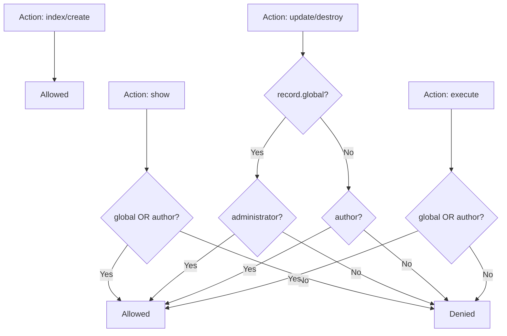
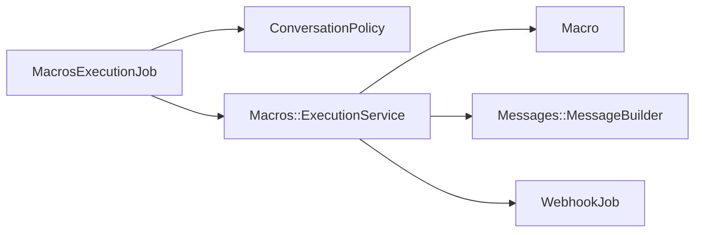

# Macros System

<cite>
**Referenced Files in This Document**
- [macro.rb](file://app/models/macro.rb)
- [execution_service.rb](file://app/services/macros/execution_service.rb)
- [macros_execution_job.rb](file://app/jobs/macros_execution_job.rb)
- [macro_policy.rb](file://app/policies/macro_policy.rb)
- [useMacros.spec.js](file://app/javascript/dashboard/composables/spec/useMacros.spec.js)
- [macrosHelper.spec.js](file://app/javascript/dashboard/helper/specs/macrosHelper.spec.js)
</cite>

## Table of Contents
1. [Introduction](#introduction)
2. [Project Structure](#project-structure)
3. [Core Components](#core-components)
4. [Architecture Overview](#architecture-overview)
5. [Detailed Component Analysis](#detailed-component-analysis)
6. [Dependency Analysis](#dependency-analysis)
7. [Performance Considerations](#performance-considerations)
8. [Troubleshooting Guide](#troubleshooting-guide)
9. [Conclusion](#conclusion)
10. [Appendices](#appendices)

## Introduction
This document explains Chatwoot’s macros system: how to create and compose macro actions, how they are executed (including bulk operations), supported action types, permissions and sharing, audit trails, testing and debugging guidance, performance considerations for bulk execution, and integration with automation rules and event-driven workflows.

## Project Structure
The macros feature spans model, service, job, policy, and frontend test layers:
- Model defines the Macro entity, supported actions, visibility, and validation.
- ExecutionService orchestrates per-conversation action application.
- MacrosExecutionJob handles bulk execution across multiple conversations with authorization checks.
- MacroPolicy enforces read/update/delete/execute permissions based on visibility and ownership.
- Frontend tests reveal supported action types and UI behavior.

**Diagram sources**
- [macro.rb:19-79](file://app/models/macro.rb#L19-L79)
- [execution_service.rb:1-71](file://app/services/macros/execution_service.rb#L1-L71)
- [macros_execution_job.rb:1-42](file://app/jobs/macros_execution_job.rb#L1-L42)
- [macro_policy.rb:1-36](file://app/policies/macro_policy.rb#L1-L36)
- [useMacros.spec.js:144-178](file://app/javascript/dashboard/composables/spec/useMacros.spec.js#L144-L178)
- [macrosHelper.spec.js:1-44](file://app/javascript/dashboard/helper/specs/macrosHelper.spec.js#L1-L44)

**Section sources**
- [macro.rb:19-79](file://app/models/macro.rb#L19-L79)
- [execution_service.rb:1-71](file://app/services/macros/execution_service.rb#L1-L71)
- [macros_execution_job.rb:1-42](file://app/jobs/macros_execution_job.rb#L1-L42)
- [macro_policy.rb:1-36](file://app/policies/macro_policy.rb#L1-L36)
- [useMacros.spec.js:144-178](file://app/javascript/dashboard/composables/spec/useMacros.spec.js#L144-L178)
- [macrosHelper.spec.js:1-44](file://app/javascript/dashboard/helper/specs/macrosHelper.spec.js#L1-L44)

## Core Components
- Macro model: Stores name, visibility (personal/global), JSON actions array, attachments, and audit fields. Validates that only supported action names are used.
- ExecutionService: Iterates through a macro’s actions and executes them against a conversation, handling special cases like “self” assignment and tweet channel restrictions.
- MacrosExecutionJob: Performs bulk execution by loading conversations, enforcing account membership and per-conversation access, then invoking ExecutionService per conversation.
- MacroPolicy: Controls index/create/show/update/destroy/execute permissions based on visibility and authorship.

Key responsibilities:
- Action composition and validation at creation time.
- Safe, isolated execution per conversation with error capture.
- Bulk orchestration with permission enforcement.
- Visibility-based discovery and editing rights.

**Section sources**
- [macro.rb:19-79](file://app/models/macro.rb#L19-L79)
- [execution_service.rb:1-71](file://app/services/macros/execution_service.rb#L1-L71)
- [macros_execution_job.rb:1-42](file://app/jobs/macros_execution_job.rb#L1-L42)
- [macro_policy.rb:1-36](file://app/policies/macro_policy.rb#L1-L36)

## Architecture Overview
The lifecycle of a macro execution is:
1. User composes a macro via the dashboard (frontend).
2. Macro is persisted with validated actions and optional files.
3. When triggered (manually or via automation), a background job loads target conversations.
4. For each conversation, the job checks permissions and delegates to ExecutionService.
5. ExecutionService applies each action sequentially, capturing errors and ensuring context cleanup.

**Diagram sources**
- [macros_execution_job.rb:4-26](file://app/jobs/macros_execution_job.rb#L4-L26)
- [execution_service.rb:10-21](file://app/services/macros/execution_service.rb#L10-L21)

## Detailed Component Analysis

### Macro Model
- Attributes: id, name, visibility (personal/global), actions (JSONB), created_by, updated_by, account_id, timestamps.
- Relationships: belongs_to account, created_by, updated_by; has_many_attached files.
- Validation: Ensures all action_name values belong to the supported set.
- Helpers: file_base_data returns metadata for attached files.

Supported actions include:
- send_message, add_label, assign_team, assign_agent, mute_conversation, change_status, remove_label, remove_assigned_agent, resolve_conversation, snooze_conversation, change_priority, send_email_transcript, send_attachment, add_private_note, send_webhook_event.

Visibility controls who can see and edit:
- personal: visible to creator.
- global: visible to all within the account.

**Diagram sources**
- [macro.rb:19-79](file://app/models/macro.rb#L19-L79)

**Section sources**
- [macro.rb:19-79](file://app/models/macro.rb#L19-L79)

### Execution Service
- Initializes with macro, conversation, and user; sets Current.user for downstream services.
- Iterates over macro.actions and invokes dynamic methods matching action_name.
- Error handling: captures exceptions per action without aborting the entire sequence.
- Special behaviors:
  - assign_agent: maps 'self' to the executing user’s ID before delegating.
  - add_private_note and send_message: skip on tweet channels; otherwise create messages via MessageBuilder.
  - send_attachment: resolves blobs from macro.files and sends as message attachments.
  - send_webhook_event: enqueues WebhookJob with webhook_url and event payload.

**Diagram sources**
- [execution_service.rb:10-21](file://app/services/macros/execution_service.rb#L10-L21)

**Section sources**
- [execution_service.rb:1-71](file://app/services/macros/execution_service.rb#L1-L71)

### Bulk Execution Job
- Loads conversations by display_id under the same account.
- Validates account membership for the executing user.
- Per conversation:
  - Checks ConversationPolicy.show? to enforce access control.
  - If allowed, calls ExecutionService.perform.
  - If denied, logs a structured skip event with reason.

**Diagram sources**
- [macros_execution_job.rb:4-26](file://app/jobs/macros_execution_job.rb#L4-L26)

**Section sources**
- [macros_execution_job.rb:1-42](file://app/jobs/macros_execution_job.rb#L1-L42)

### Permissions and Sharing
- MacroPolicy:
  - index/create: open to authenticated users.
  - show: allowed if macro is global or authored by the current user.
  - update/destroy: global macros require administrator; personal macros require author.
  - execute: allowed if macro is global or authored by the current user.

This ensures safe sharing of reusable macros while protecting edits to organization-wide assets.

**Diagram sources**
- [macro_policy.rb:1-36](file://app/policies/macro_policy.rb#L1-L36)

**Section sources**
- [macro_policy.rb:1-36](file://app/policies/macro_policy.rb#L1-L36)

### Supported Actions and UI Behavior
Frontend tests confirm the following action categories and dropdown behaviors:
- assign_agent: includes “None”, “Self”, and agents list.
- add_label/remove_label: lists available labels with color metadata.
- change_priority: uses predefined priority options.

These map to backend-supported action names defined in the Macro model.

**Section sources**
- [useMacros.spec.js:144-178](file://app/javascript/dashboard/composables/spec/useMacros.spec.js#L144-L178)
- [macrosHelper.spec.js:1-44](file://app/javascript/dashboard/helper/specs/macrosHelper.spec.js#L1-L44)
- [macro.rb:33-35](file://app/models/macro.rb#L33-L35)

### Practical Macro Patterns
Common patterns you can build using supported actions:
- Escalate:
  - Add label(s) such as “escalated”.
  - Change status to open.
  - Assign to a senior agent or team.
  - Optionally add a private note explaining escalation.
- Resolve:
  - Change status to resolved.
  - Add label(s) such as “resolved”.
  - Optionally send a closing message.
- Follow-up:
  - Snooze conversation for a period.
  - Add label(s) such as “follow-up”.
  - Optionally send a reminder message.
- Transfer:
  - Remove current assigned agent/team.
  - Assign new agent/team.
  - Add label(s) indicating transfer.
  - Optionally add a private note with handover details.

Note: Tweet-channel conversations restrict sending messages and notes; other actions remain applicable.

[No sources needed since this section provides conceptual examples]

## Dependency Analysis
High-level dependencies:
- MacrosExecutionJob depends on Macro (for account and actions), ConversationPolicy (access control), and Macros::ExecutionService (action application).
- ExecutionService depends on Macro (for actions and attached files) and downstream services (e.g., Messages::MessageBuilder, WebhookJob).
- MacroPolicy governs access to Macro records.

**Diagram sources**
- [macros_execution_job.rb:4-26](file://app/jobs/macros_execution_job.rb#L4-L26)
- [execution_service.rb:10-67](file://app/services/macros/execution_service.rb#L10-L67)
- [macro.rb:19-79](file://app/models/macro.rb#L19-L79)

**Section sources**
- [macros_execution_job.rb:1-42](file://app/jobs/macros_execution_job.rb#L1-L42)
- [execution_service.rb:1-71](file://app/services/macros/execution_service.rb#L1-L71)
- [macro.rb:19-79](file://app/models/macro.rb#L19-L79)

## Performance Considerations
- Bulk execution runs in a background job queue (:medium), preventing UI blocking.
- Per-conversation authorization checks avoid unnecessary work for inaccessible conversations.
- ExecutionService processes actions sequentially per conversation; errors are captured individually to avoid cascading failures.
- Tweet-channel restrictions prevent invalid message/note operations early.
- Recommendations:
  - Keep macro actions minimal and focused to reduce per-conversation overhead.
  - Prefer label/status changes for large batches; heavy operations (attachments, webhooks) should be used judiciously.
  - Monitor job queues and logs for skipped executions due to access denials or missing memberships.

[No sources needed since this section provides general guidance]

## Troubleshooting Guide
- Missing account membership:
  - The job logs a skip event when the executing user lacks an account_user record. Ensure the user is a member of the target account.
- Conversation access denied:
  - The job logs a skip event when ConversationPolicy denies access. Verify the user has permission to view the conversation.
- Unsupported action names:
  - Macro creation validates action_name values; unsupported actions will cause validation errors. Use only the supported set.
- Tweet channel limitations:
  - Sending messages and adding private notes are skipped for tweet channels. Adjust macro actions accordingly.
- Exception capture:
  - Any runtime error during action execution is captured and logged; review exception tracking for root causes.

Operational tips:
- Inspect structured logs for macro_execution_skipped events to identify reasons and affected conversations.
- Validate macro actions before bulk execution to minimize retries.

**Section sources**
- [macros_execution_job.rb:11-25](file://app/jobs/macros_execution_job.rb#L11-L25)
- [macros_execution_job.rb:30-40](file://app/jobs/macros_execution_job.rb#L30-L40)
- [macro.rb:68-75](file://app/models/macro.rb#L68-L75)
- [execution_service.rb:30-67](file://app/services/macros/execution_service.rb#L30-L67)

## Conclusion
Chatwoot’s macros system provides a robust way to automate repetitive tasks across conversations. With clear visibility controls, comprehensive action support, secure bulk execution, and strong error handling, teams can standardize workflows such as escalation, resolution, follow-ups, and transfers. Proper use of permissions, careful action selection, and attention to channel constraints ensure reliable and efficient automation.

[No sources needed since this section summarizes without analyzing specific files]

## Appendices

### Macro Creation Interface and Action Composition
- The dashboard allows creating macros with a name, visibility, and a list of actions. Each action specifies an action_name and parameters.
- Supported action types include label management (add/remove), status changes, assignee updates (agent/team), note additions (private/public), custom field modifications (via change_priority and related actions), and more.
- Frontend tests demonstrate dropdown population for assign_agent, add_label/remove_label, and change_priority.

**Section sources**
- [useMacros.spec.js:144-178](file://app/javascript/dashboard/composables/spec/useMacros.spec.js#L144-L178)
- [macrosHelper.spec.js:1-44](file://app/javascript/dashboard/helper/specs/macrosHelper.spec.js#L1-L44)
- [macro.rb:33-35](file://app/models/macro.rb#L33-L35)

### Audit Trails
- Macro records include created_by and updated_by fields, and the model includes an audit module, enabling tracking of who created or modified macros.

**Section sources**
- [macro.rb:22-27](file://app/models/macro.rb#L22-L27)
- [macro.rb:78-79](file://app/models/macro.rb#L78-L79)

### Integration with Automation Rules and Event-Driven Execution
- Macros can be triggered by automation rules and event-driven flows. The ExecutionService emits a webhook event (macro.executed) when configured, enabling external integrations to react to macro execution.

**Section sources**
- [execution_service.rb:64-67](file://app/services/macros/execution_service.rb#L64-L67)