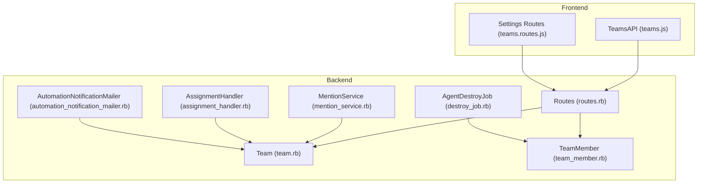
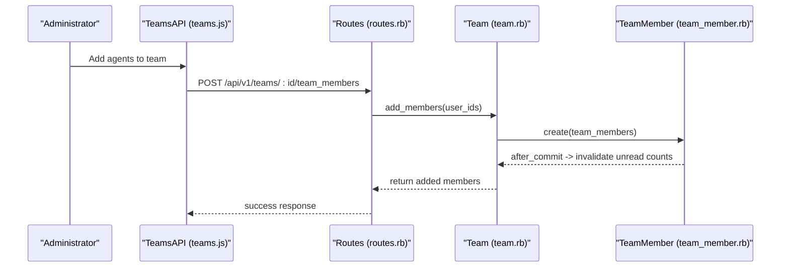
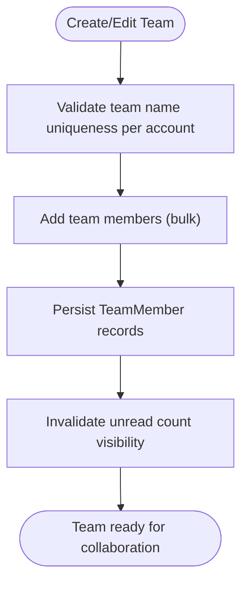
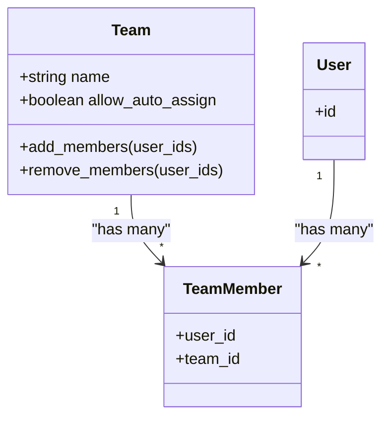
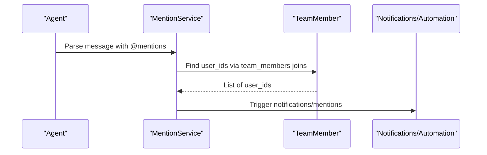
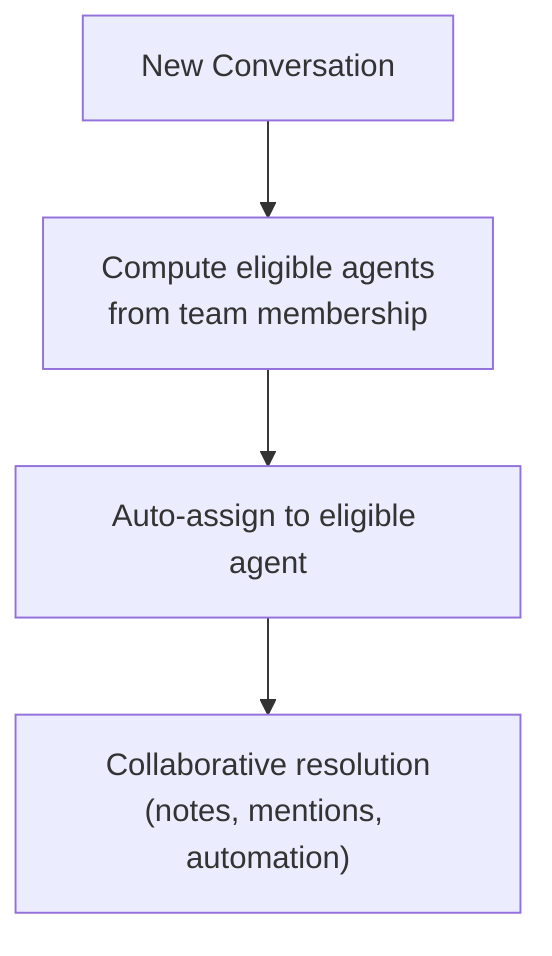
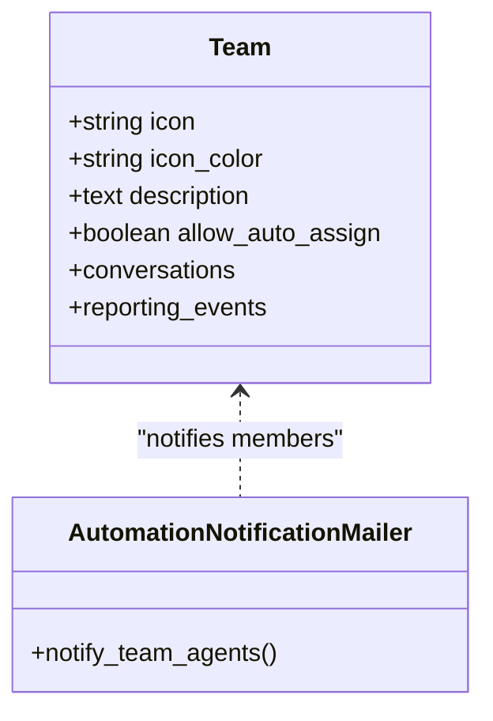
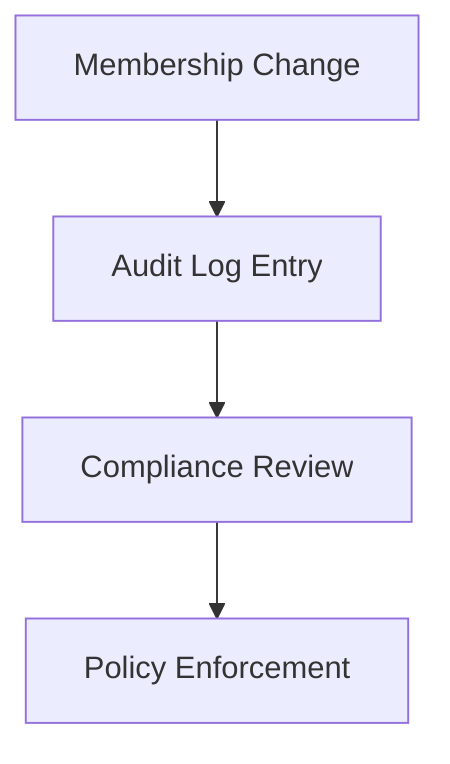
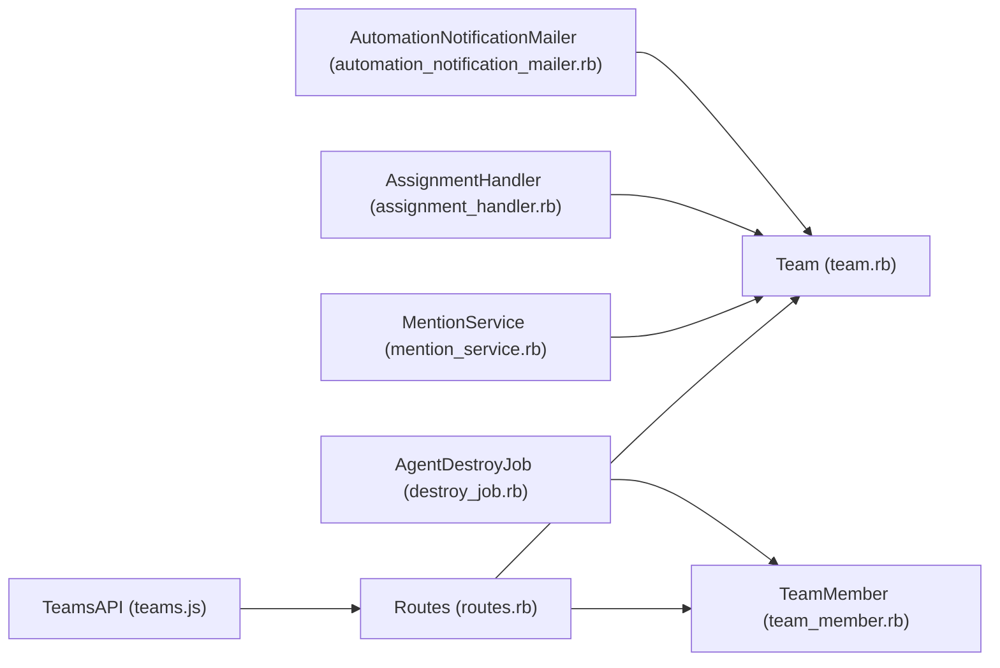

# Team Collaboration Features

<cite>
**Referenced Files in This Document**
- [team.rb](file://app/models/team.rb)
- [team_member.rb](file://app/models/team_member.rb)
- [teams.js](file://app/javascript/dashboard/api/teams.js)
- [teams.routes.js](file://app/javascript/dashboard/routes/dashboard/settings/teams/teams.routes.js)
- [routes.rb](file://config/routes.rb)
- [mention_service.rb](file://app/services/messages/mention_service.rb)
- [assignment_handler.rb](file://app/models/concerns/assignment_handler.rb)
- [automation_notification_mailer.rb](file://app/mailers/team_notifications/automation_notification_mailer.rb)
- [destroy_job.rb](file://app/jobs/agents/destroy_job.rb)
</cite>

## Table of Contents
1. [Introduction](#introduction)
2. [Project Structure](#project-structure)
3. [Core Components](#core-components)
4. [Architecture Overview](#architecture-overview)
5. [Detailed Component Analysis](#detailed-component-analysis)
6. [Dependency Analysis](#dependency-analysis)
7. [Performance Considerations](#performance-considerations)
8. [Troubleshooting Guide](#troubleshooting-guide)
9. [Conclusion](#conclusion)

## Introduction
This document explains Chatwoot’s team collaboration features with a focus on:
- Team creation and member management
- Role-based access control (RBAC) for teams
- Internal communication tools such as private notes, mentions (@mentions), and activity feeds
- Conversation handoff mechanisms, participant management, and collaborative resolution workflows
- Team-specific settings, shared labels, and collaborative automation rules
- Examples of team structures for different support models
- Conflict resolution, audit logging, and compliance considerations
- Integration with external collaboration tools like Slack and email systems

The content is grounded in the repository’s models, controllers, services, routes, and frontend APIs that implement these capabilities.

## Project Structure
Team collaboration spans several layers:
- Data models define teams, members, and their relationships to accounts and conversations
- Frontend API client exposes endpoints for managing team members
- Routes define REST endpoints for team member operations
- Services handle internal communications like @mentions
- Policies and jobs enforce lifecycle and cleanup behaviors
- Mailers notify team members about automation events

**Diagram sources**
- [teams.js:5-39](file://app/javascript/dashboard/api/teams.js#L5-L39)
- [teams.routes.js:40-87](file://app/javascript/dashboard/routes/dashboard/settings/teams/teams.routes.js#L40-L87)
- [routes.rb:386-386](file://config/routes.rb#L386-L386)
- [team.rb:20-89](file://app/models/team.rb#L20-L89)
- [team_member.rb:17-31](file://app/models/team_member.rb#L17-L31)
- [mention_service.rb:34-36](file://app/services/messages/mention_service.rb#L34-L36)
- [assignment_handler.rb:27-28](file://app/models/concerns/assignment_handler.rb#L27-L28)
- [automation_notification_mailer.rb:5-5](file://app/mailers/team_notifications/automation_notification_mailer.rb#L5-L5)
- [destroy_job.rb:23-24](file://app/jobs/agents/destroy_job.rb#L23-L24)

**Section sources**
- [team.rb:20-89](file://app/models/team.rb#L20-L89)
- [team_member.rb:17-31](file://app/models/team_member.rb#L17-L31)
- [teams.js:5-39](file://app/javascript/dashboard/api/teams.js#L5-L39)
- [teams.routes.js:40-87](file://app/javascript/dashboard/routes/dashboard/settings/teams/teams.routes.js#L40-L87)
- [routes.rb:386-386](file://config/routes.rb#L386-L386)

## Core Components
- Team model encapsulates team metadata, membership, and conversation scope within an account. It provides methods to add/remove members and invalidate unread count caches when membership changes.
- TeamMember model represents the join table between users and teams, ensuring unique membership per team and invalidating visibility caches on create/destroy.
- TeamsAPI frontend client exposes methods to list, add, and update team members via REST endpoints.
- MentionService resolves mentions by querying team memberships to find relevant users.
- AssignmentHandler uses team membership to constrain auto-assignment eligibility.
- AutomationNotificationMailer notifies team members about automation rule events.
- AgentDestroyJob removes team memberships when agents are deleted.

Key responsibilities:
- Membership lifecycle: add/remove members, ensure uniqueness, maintain cache consistency
- Visibility and notifications: invalidate unread counts and send automation notifications
- Collaboration: resolve @mentions across team members and constrain assignment to eligible members

**Section sources**
- [team.rb:20-89](file://app/models/team.rb#L20-L89)
- [team_member.rb:17-31](file://app/models/team_member.rb#L17-L31)
- [teams.js:5-39](file://app/javascript/dashboard/api/teams.js#L5-L39)
- [mention_service.rb:34-36](file://app/services/messages/mention_service.rb#L34-L36)
- [assignment_handler.rb:27-28](file://app/models/concerns/assignment_handler.rb#L27-L28)
- [automation_notification_mailer.rb:5-5](file://app/mailers/team_notifications/automation_notification_mailer.rb#L5-L5)
- [destroy_job.rb:23-24](file://app/jobs/agents/destroy_job.rb#L23-L24)

## Architecture Overview
The team collaboration feature integrates frontend UI, backend routes, data models, and services to enable:
- Creating and configuring teams
- Managing team members
- Collaborating through mentions and automation notifications
- Assigning and resolving conversations within team boundaries

**Diagram sources**
- [teams.js:25-39](file://app/javascript/dashboard/api/teams.js#L25-L39)
- [routes.rb:386-386](file://config/routes.rb#L386-L386)
- [team.rb:42-49](file://app/models/team.rb#L42-L49)
- [team_member.rb:22-28](file://app/models/team_member.rb#L22-L28)

## Detailed Component Analysis

### Team Creation and Member Management
- Team creation is exposed via frontend routes under Settings > Teams, gated by feature flags and administrator permissions.
- Member management includes adding and updating team members through the TeamsAPI client, which calls backend endpoints defined in routes.
- The Team model enforces uniqueness of team names per account and provides bulk add/remove operations for members.
- TeamMember ensures unique membership per team and triggers cache invalidation for unread counts when membership changes.

**Diagram sources**
- [teams.routes.js:40-87](file://app/javascript/dashboard/routes/dashboard/settings/teams/teams.routes.js#L40-L87)
- [teams.js:25-39](file://app/javascript/dashboard/api/teams.js#L25-L39)
- [team.rb:31-49](file://app/models/team.rb#L31-L49)
- [team_member.rb:22-28](file://app/models/team_member.rb#L22-L28)

**Section sources**
- [teams.routes.js:40-87](file://app/javascript/dashboard/routes/dashboard/settings/teams/teams.routes.js#L40-L87)
- [teams.js:25-39](file://app/javascript/dashboard/api/teams.js#L25-L39)
- [team.rb:31-49](file://app/models/team.rb#L31-L49)
- [team_member.rb:22-28](file://app/models/team_member.rb#L22-L28)

### Role-Based Access Control (RBAC) for Teams
- Frontend routes restrict team creation and editing to administrators and require a specific feature flag.
- Backend policies govern permissions for team-related resources; while not detailed here, policies are part of the RBAC system controlling who can manage teams and members.

**Diagram sources**
- [team.rb:20-89](file://app/models/team.rb#L20-L89)
- [team_member.rb:17-31](file://app/models/team_member.rb#L17-L31)

**Section sources**
- [teams.routes.js:40-87](file://app/javascript/dashboard/routes/dashboard/settings/teams/teams.routes.js#L40-L87)

### Internal Communication Tools: Private Notes, Mentions, Activity Feeds
- Private notes: While not shown in the referenced files, notes are typically stored as messages or dedicated note entities associated with conversations.
- Mentions (@mentions): MentionService queries team memberships to identify users to notify when mentioned.
- Activity feeds: Auditing modules attached to Team and TeamMember provide change logs for compliance and operational visibility.

**Diagram sources**
- [mention_service.rb:34-36](file://app/services/messages/mention_service.rb#L34-L36)

**Section sources**
- [mention_service.rb:34-36](file://app/services/messages/mention_service.rb#L34-L36)
- [team.rb:89-89](file://app/models/team.rb#L89-L89)
- [team_member.rb:31-31](file://app/models/team_member.rb#L31-L31)

### Conversation Handoff, Participant Management, and Collaborative Resolution
- Auto-assignment respects team membership constraints, limiting eligible assignees to team members with capacity.
- Participant management involves conversation participants and team membership; while participant models are not detailed here, team membership influences assignment and visibility.
- Collaborative resolution leverages team-scoped conversations and automation rules to coordinate work among members.

**Diagram sources**
- [assignment_handler.rb:27-28](file://app/models/concerns/assignment_handler.rb#L27-L28)

**Section sources**
- [assignment_handler.rb:27-28](file://app/models/concerns/assignment_handler.rb#L27-L28)

### Team-Specific Settings, Shared Labels, and Collaborative Automation Rules
- Team settings include properties like icon, icon color, description, and auto-assignment toggles.
- Shared labels: Teams scope conversations and reporting events, enabling label usage across team members.
- Automation rules: AutomationNotificationMailer sends notifications to team members when automation rules trigger.

**Diagram sources**
- [team.rb:20-89](file://app/models/team.rb#L20-L89)
- [automation_notification_mailer.rb:5-5](file://app/mailers/team_notifications/automation_notification_mailer.rb#L5-L5)

**Section sources**
- [team.rb:20-89](file://app/models/team.rb#L20-L89)
- [automation_notification_mailer.rb:5-5](file://app/mailers/team_notifications/automation_notification_mailer.rb#L5-L5)

### Examples of Team Structures for Different Support Models
- Tiered support: Create L1, L2, and L3 teams; route escalations from L1 to L2/L3 using automation rules and assignment constraints.
- Specialized teams: Form teams by domain (e.g., Billing, Technical, Product); use labels and filters to organize conversations.
- Regional teams: Organize teams by geography (e.g., EMEA, APAC); configure routing based on contact attributes and time zones.

[No sources needed since this section provides conceptual examples]

### Conflict Resolution, Audit Logging, and Compliance
- Conflict resolution: When multiple agents collaborate, use mentions and notes to coordinate; leverage automation rules to prevent overlapping actions.
- Audit logging: Team and TeamMember models include auditing modules to capture changes for compliance and operational review.
- Compliance: Ensure member additions/removals are audited and that sensitive data handling follows organizational policies.

**Diagram sources**
- [team.rb:89-89](file://app/models/team.rb#L89-L89)
- [team_member.rb:31-31](file://app/models/team_member.rb#L31-L31)

**Section sources**
- [team.rb:89-89](file://app/models/team.rb#L89-L89)
- [team_member.rb:31-31](file://app/models/team_member.rb#L31-L31)

### Integration with External Collaboration Tools (Slack and Email)
- Slack integration: Chatwoot supports sending notifications and updates to Slack channels; while not detailed in the referenced files, jobs and integrations exist for Slack messaging.
- Email systems: Automation rules and mailers can notify team members via email; mention notifications and automation events can be routed to email systems.

[No sources needed since this section provides general guidance]

## Dependency Analysis
The following diagram shows key dependencies among components involved in team collaboration:

**Diagram sources**
- [teams.js:25-39](file://app/javascript/dashboard/api/teams.js#L25-L39)
- [routes.rb:386-386](file://config/routes.rb#L386-L386)
- [team.rb:20-89](file://app/models/team.rb#L20-L89)
- [team_member.rb:17-31](file://app/models/team_member.rb#L17-L31)
- [mention_service.rb:34-36](file://app/services/messages/mention_service.rb#L34-L36)
- [assignment_handler.rb:27-28](file://app/models/concerns/assignment_handler.rb#L27-L28)
- [automation_notification_mailer.rb:5-5](file://app/mailers/team_notifications/automation_notification_mailer.rb#L5-L5)
- [destroy_job.rb:23-24](file://app/jobs/agents/destroy_job.rb#L23-L24)

**Section sources**
- [teams.js:25-39](file://app/javascript/dashboard/api/teams.js#L25-L39)
- [routes.rb:386-386](file://config/routes.rb#L386-L386)
- [team.rb:20-89](file://app/models/team.rb#L20-L89)
- [team_member.rb:17-31](file://app/models/team_member.rb#L17-L31)
- [mention_service.rb:34-36](file://app/services/messages/mention_service.rb#L34-L36)
- [assignment_handler.rb:27-28](file://app/models/concerns/assignment_handler.rb#L27-L28)
- [automation_notification_mailer.rb:5-5](file://app/mailers/team_notifications/automation_notification_mailer.rb#L5-L5)
- [destroy_job.rb:23-24](file://app/jobs/agents/destroy_job.rb#L23-L24)

## Performance Considerations
- Bulk operations: Use bulk add/remove methods to minimize database round-trips when managing team members.
- Cache invalidation: Membership changes trigger unread count cache invalidation; ensure background jobs handle high-volume scenarios efficiently.
- Query optimization: Mention resolution joins team memberships; consider indexing and query scoping to reduce overhead.

[No sources needed since this section provides general guidance]

## Troubleshooting Guide
- Members not receiving notifications: Verify that team membership is correctly persisted and that automation rules are configured to notify team members.
- Unread counts stale after membership changes: Check that after_commit hooks are firing and cache invalidation is occurring.
- Agent deletion leaving orphaned memberships: Confirm that destroy jobs remove team memberships upon agent deletion.

**Section sources**
- [team_member.rb:22-28](file://app/models/team_member.rb#L22-L28)
- [destroy_job.rb:23-24](file://app/jobs/agents/destroy_job.rb#L23-L24)

## Conclusion
Chatwoot’s team collaboration features provide a robust foundation for organizing support operations through teams, members, and automated workflows. By leveraging team membership for assignment constraints, mentions, and notifications, organizations can implement tiered, specialized, and regional support models effectively. Auditing and compliance features ensure accountability, while integrations with Slack and email systems extend collaboration beyond the platform.

[No sources needed since this section summarizes without analyzing specific files]