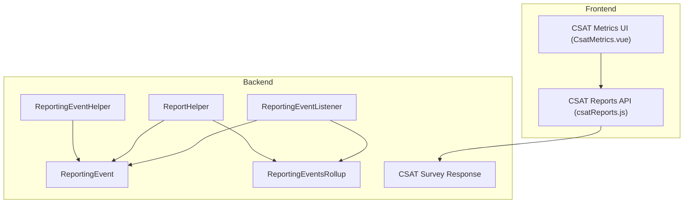
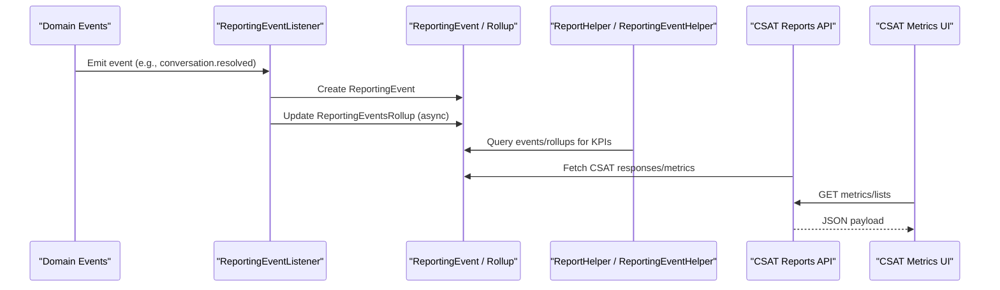
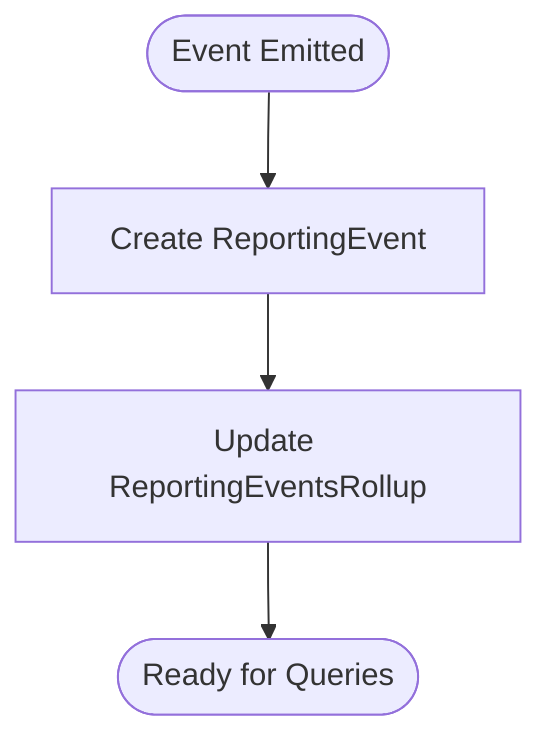
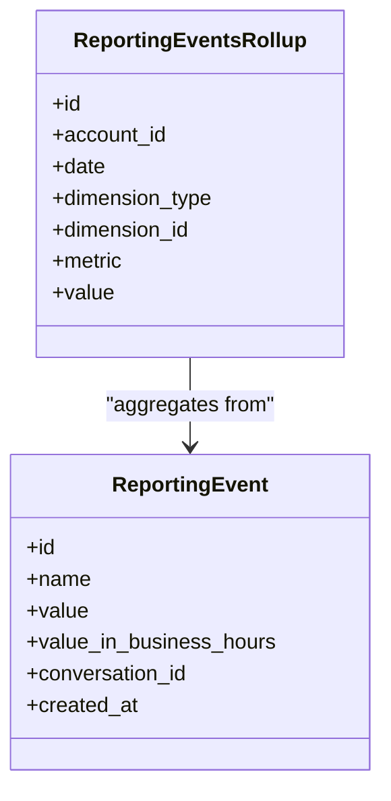
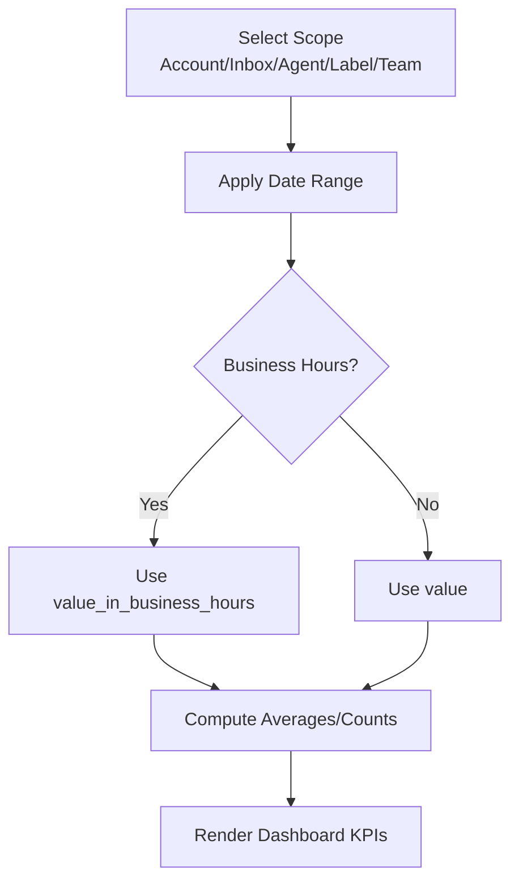
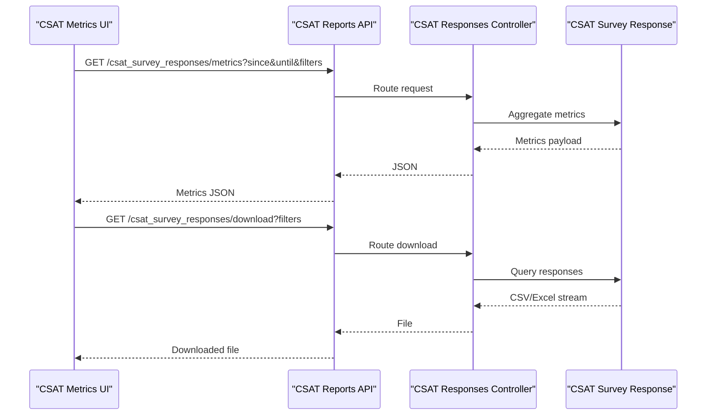
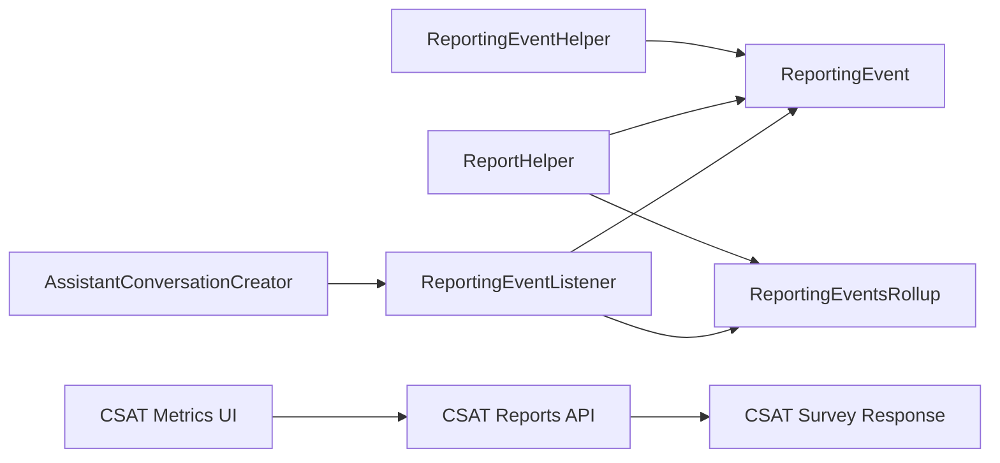

# Analytics & Reporting

<cite>
**Referenced Files in This Document**
- [reporting_event.rb](file://app/models/reporting_event.rb)
- [reporting_events_rollup.rb](file://app/models/reporting_events_rollup.rb)
- [reporting_event_listener.rb](file://app/listeners/reporting_event_listener.rb)
- [report_helper.rb](file://app/helpers/report_helper.rb)
- [reporting_event_helper.rb](file://app/helpers/reporting_event_helper.rb)
- [csat_survey_response.rb](file://app/models/csat_survey_response.rb)
- [csatReports.js](file://app/javascript/dashboard/api/csatReports.js)
- [CsatMetrics.vue](file://app/javascript/dashboard/routes/dashboard/settings/reports/components/CsatMetrics.vue)
- [index.json.jbuilder](file://app/views/api/v1/accounts/csat_survey_responses/index.json.jbuilder)
- [update.json.jbuilder](file://app/views/api/v1/accounts/csat_survey_responses/update.json.jbuilder)
- [assistant_conversation_creator.rb](file://lib/seeders/reports/assistant_conversation_creator.rb)
- [async_dispatcher.rb](file://enterprise/app/dispatchers/enterprise/async_dispatcher.rb)
</cite>

## Table of Contents
1. [Introduction](#introduction)
2. [Project Structure](#project-structure)
3. [Core Components](#core-components)
4. [Architecture Overview](#architecture-overview)
5. [Detailed Component Analysis](#detailed-component-analysis)
6. [Dependency Analysis](#dependency-analysis)
7. [Performance Considerations](#performance-considerations)
8. [Troubleshooting Guide](#troubleshooting-guide)
9. [Conclusion](#conclusion)

## Introduction
This document explains Chatwoot’s analytics and reporting capabilities, focusing on the reporting event system, metric collection, data aggregation, performance dashboards, CSAT surveys, export and visualization, real-time and historical analysis, and operational considerations such as retention and privacy. It is designed for both technical and non-technical readers to understand how metrics are captured, aggregated, and presented.

## Project Structure
Analytics and reporting span models, listeners, helpers, views, and frontend components:
- Models define core entities for events and rollups, and CSAT responses.
- Listeners react to domain events and persist analytics records.
- Helpers compute report metrics and business-hour-aware calculations.
- Views serialize CSAT responses for API consumption.
- Frontend components fetch and display CSAT metrics and lists.

**Diagram sources**
- [reporting_event.rb](file://app/models/reporting_event.rb)
- [reporting_events_rollup.rb](file://app/models/reporting_events_rollup.rb)
- [reporting_event_listener.rb](file://app/listeners/reporting_event_listener.rb)
- [report_helper.rb](file://app/helpers/report_helper.rb)
- [reporting_event_helper.rb](file://app/helpers/reporting_event_helper.rb)
- [csat_survey_response.rb](file://app/models/csat_survey_response.rb)
- [csatReports.js](file://app/javascript/dashboard/api/csatReports.js)
- [CsatMetrics.vue](file://app/javascript/dashboard/routes/dashboard/settings/reports/components/CsatMetrics.vue)

**Section sources**
- [reporting_event.rb](file://app/models/reporting_event.rb)
- [reporting_events_rollup.rb](file://app/models/reporting_events_rollup.rb)
- [reporting_event_listener.rb](file://app/listeners/reporting_event_listener.rb)
- [report_helper.rb](file://app/helpers/report_helper.rb)
- [reporting_event_helper.rb](file://app/helpers/reporting_event_helper.rb)
- [csat_survey_response.rb](file://app/models/csat_survey_response.rb)
- [csatReports.js](file://app/javascript/dashboard/api/csatReports.js)
- [CsatMetrics.vue](file://app/javascript/dashboard/routes/dashboard/settings/reports/components/CsatMetrics.vue)

## Core Components
- Reporting Event System: Domain events trigger listeners that create ReportingEvent records and optionally update pre-aggregated ReportingEventsRollup tables for fast dashboard queries.
- Report Helpers: Provide KPIs like first response time, reply time, resolution time, conversation counts, message counts, and bot handoff/resolution metrics with optional business-hours adjustments.
- Business Hours Utilities: Compute working time windows per inbox and timezone to derive business-hour-aware metrics.
- CSAT Surveys: Persist customer satisfaction responses and expose them via API; frontend displays metrics and distributions.

Key responsibilities:
- Capture: Recording granular events at key lifecycle points.
- Aggregate: Pre-computing rollups for efficient querying.
- Present: Serving KPIs and detailed lists through APIs and dashboards.
- Analyze: Supporting filters by account/inbox/agent/team/labels and date ranges.

**Section sources**
- [reporting_event_listener.rb](file://app/listeners/reporting_event_listener.rb)
- [report_helper.rb](file://app/helpers/report_helper.rb)
- [reporting_event_helper.rb](file://app/helpers/reporting_event_helper.rb)
- [csat_survey_response.rb](file://app/models/csat_survey_response.rb)
- [csatReports.js](file://app/javascript/dashboard/api/csatReports.js)
- [CsatMetrics.vue](file://app/javascript/dashboard/routes/dashboard/settings/reports/components/CsatMetrics.vue)

## Architecture Overview
The analytics pipeline integrates event-driven capture, background aggregation, and presentation layers.

**Diagram sources**
- [reporting_event_listener.rb](file://app/listeners/reporting_event_listener.rb)
- [report_helper.rb](file://app/helpers/report_helper.rb)
- [reporting_event_helper.rb](file://app/helpers/reporting_event_helper.rb)
- [csatReports.js](file://app/javascript/dashboard/api/csatReports.js)
- [CsatMetrics.vue](file://app/javascript/dashboard/routes/dashboard/settings/reports/components/CsatMetrics.vue)

## Detailed Component Analysis

### Reporting Event System
- Purpose: Record meaningful moments in conversations (e.g., first response, reply time, resolution, bot handoff/resolution).
- Flow:
  - Domain code emits events.
  - ReportingEventListener persists ReportingEvent records.
  - RollupService updates ReportingEventsRollup for faster dashboard queries.
- Extensibility: Enterprise dispatcher adds additional listeners for advanced features.

**Diagram sources**
- [reporting_event_listener.rb](file://app/listeners/reporting_event_listener.rb)
- [reporting_event.rb](file://app/models/reporting_event.rb)
- [reporting_events_rollup.rb](file://app/models/reporting_events_rollup.rb)

**Section sources**
- [reporting_event_listener.rb](file://app/listeners/reporting_event_listener.rb)
- [reporting_event.rb](file://app/models/reporting_event.rb)
- [reporting_events_rollup.rb](file://app/models/reporting_events_rollup.rb)
- [assistant_conversation_creator.rb](file://lib/seeders/reports/assistant_conversation_creator.rb)
- [async_dispatcher.rb](file://enterprise/app/dispatchers/enterprise/async_dispatcher.rb)

### Metric Collection and Aggregation
- Granular metrics: Captured via ReportingEvent (e.g., first_response, reply_time, conversation_resolved).
- Aggregated metrics: Stored in ReportingEventsRollup to optimize dashboard performance.
- Helpers compute averages and counts over defined date ranges and scopes (account/inbox/agent/team/label).

**Diagram sources**
- [reporting_event.rb](file://app/models/reporting_event.rb)
- [reporting_events_rollup.rb](file://app/models/reporting_events_rollup.rb)

**Section sources**
- [report_helper.rb](file://app/helpers/report_helper.rb)
- [reporting_event.rb](file://app/models/reporting_event.rb)
- [reporting_events_rollup.rb](file://app/models/reporting_events_rollup.rb)

### Performance Dashboards and KPIs
- KPIs include:
  - First response time (business hours or calendar hours)
  - Reply time (business hours or calendar hours)
  - Average resolution time (business hours or calendar hours)
  - Conversation, incoming/outgoing message, resolution, bot resolution, and bot handoff counts
- Scope selection supports account, inbox, agent, label, and team contexts.
- Business hour logic uses inbox configuration and timezone to calculate working time windows.

**Diagram sources**
- [report_helper.rb](file://app/helpers/report_helper.rb)
- [reporting_event_helper.rb](file://app/helpers/reporting_event_helper.rb)

**Section sources**
- [report_helper.rb](file://app/helpers/report_helper.rb)
- [reporting_event_helper.rb](file://app/helpers/reporting_event_helper.rb)

### CSAT Survey Functionality and Feedback Analysis
- Data model: CSAT survey responses are persisted and exposed via API endpoints.
- Frontend:
  - CSAT Reports API provides list, download, and metrics endpoints.
  - CSAT Metrics component displays total responses, satisfaction score, response rate, and rating distribution.
- Export: The API supports downloading filtered CSAT responses.

**Diagram sources**
- [csatReports.js](file://app/javascript/dashboard/api/csatReports.js)
- [CsatMetrics.vue](file://app/javascript/dashboard/routes/dashboard/settings/reports/components/CsatMetrics.vue)
- [index.json.jbuilder](file://app/views/api/v1/accounts/csat_survey_responses/index.json.jbuilder)
- [update.json.jbuilder](file://app/views/api/v1/accounts/csat_survey_responses/update.json.jbuilder)
- [csat_survey_response.rb](file://app/models/csat_survey_response.rb)

**Section sources**
- [csat_survey_response.rb](file://app/models/csat_survey_response.rb)
- [csatReports.js](file://app/javascript/dashboard/api/csatReports.js)
- [CsatMetrics.vue](file://app/javascript/dashboard/routes/dashboard/settings/reports/components/CsatMetrics.vue)
- [index.json.jbuilder](file://app/views/api/v1/accounts/csat_survey_responses/index.json.jbuilder)
- [update.json.jbuilder](file://app/views/api/v1/accounts/csat_survey_responses/update.json.jbuilder)

### Real-Time Analytics, Historical Trends, and Predictive Insights
- Real-time: Event-driven capture ensures near-real-time availability of metrics as conversations progress.
- Historical trends: Rollup tables enable efficient time-series analysis across days/weeks/months.
- Predictive insights: While not implemented here, the structured event and rollup schema can support future predictive modeling (e.g., forecasting response times or CSAT trends) by exporting aggregated datasets to external ML pipelines.

[No sources needed since this section provides conceptual guidance]

### Customizable Reports and Automated Scheduling
- Customization: Filters by scope (account/inbox/agent/team/label), date range, and business hours allow tailored reports.
- Automation: Scheduled jobs can be configured to run periodic aggregations or exports using existing services and helpers.

[No sources needed since this section provides general guidance]

## Dependency Analysis

**Diagram sources**
- [assistant_conversation_creator.rb](file://lib/seeders/reports/assistant_conversation_creator.rb)
- [reporting_event_listener.rb](file://app/listeners/reporting_event_listener.rb)
- [reporting_event.rb](file://app/models/reporting_event.rb)
- [reporting_events_rollup.rb](file://app/models/reporting_events_rollup.rb)
- [report_helper.rb](file://app/helpers/report_helper.rb)
- [reporting_event_helper.rb](file://app/helpers/reporting_event_helper.rb)
- [csatReports.js](file://app/javascript/dashboard/api/csatReports.js)
- [CsatMetrics.vue](file://app/javascript/dashboard/routes/dashboard/settings/reports/components/CsatMetrics.vue)
- [csat_survey_response.rb](file://app/models/csat_survey_response.rb)

**Section sources**
- [assistant_conversation_creator.rb](file://lib/seeders/reports/assistant_conversation_creator.rb)
- [reporting_event_listener.rb](file://app/listeners/reporting_event_listener.rb)
- [report_helper.rb](file://app/helpers/report_helper.rb)
- [reporting_event_helper.rb](file://app/helpers/reporting_event_helper.rb)
- [csatReports.js](file://app/javascript/dashboard/api/csatReports.js)
- [CsatMetrics.vue](file://app/javascript/dashboard/routes/dashboard/settings/reports/components/CsatMetrics.vue)
- [csat_survey_response.rb](file://app/models/csat_survey_response.rb)

## Performance Considerations
- Use ReportingEventsRollup for dashboard queries to reduce heavy joins and aggregations on raw events.
- Prefer business-hour-aware metrics when evaluating SLA compliance; ensure inbox working hours and timezone are correctly configured.
- Limit query scopes (account/inbox/agent/team/label) and date ranges to minimize load.
- For large datasets, consider partitioning rollups by date and dimension type, and offloading heavy computations to background jobs.

[No sources needed since this section provides general guidance]

## Troubleshooting Guide
- Missing metrics: Verify that domain events are emitted and handled by ReportingEventListener. Check that rollup creation succeeds; failures should be tracked and retried.
- Incorrect business hours: Confirm inbox working hours and timezone settings; helper functions rely on these to compute accurate metrics.
- CSAT data not appearing: Ensure CSAT responses are created and the API endpoints return expected payloads; validate frontend filters and parameters.

**Section sources**
- [reporting_event_listener.rb](file://app/listeners/reporting_event_listener.rb)
- [reporting_event_helper.rb](file://app/helpers/reporting_event_helper.rb)
- [csatReports.js](file://app/javascript/dashboard/api/csatReports.js)
- [CsatMetrics.vue](file://app/javascript/dashboard/routes/dashboard/settings/reports/components/CsatMetrics.vue)

## Conclusion
Chatwoot’s analytics and reporting system combines event-driven capture, robust aggregation, and flexible presentation to deliver actionable insights. With clear KPIs, business-hour awareness, and CSAT feedback tools, teams can monitor performance, analyze trends, and make data-informed decisions. Future enhancements can build on the existing schema to add predictive analytics and automated reporting workflows.