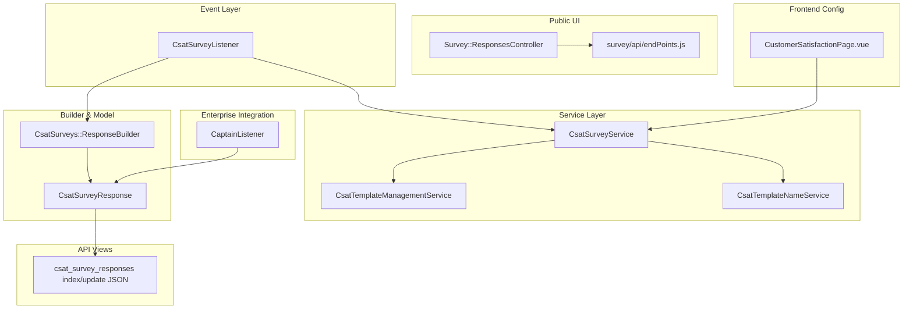
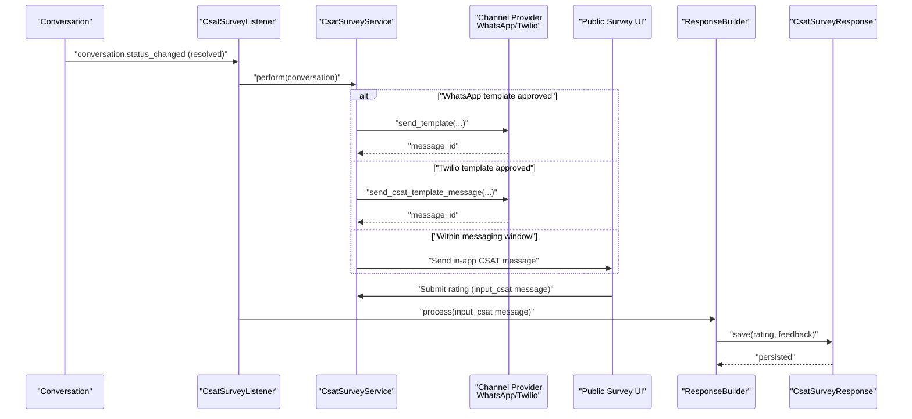
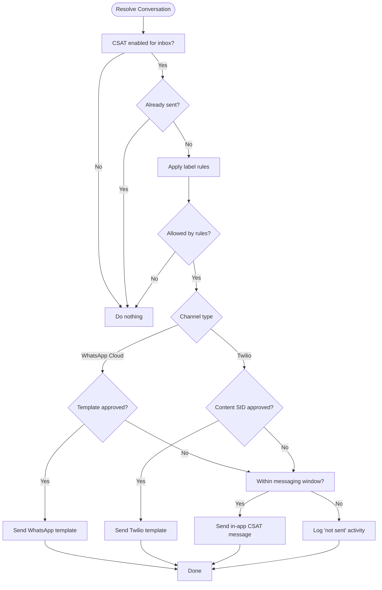
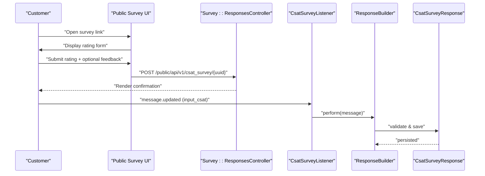
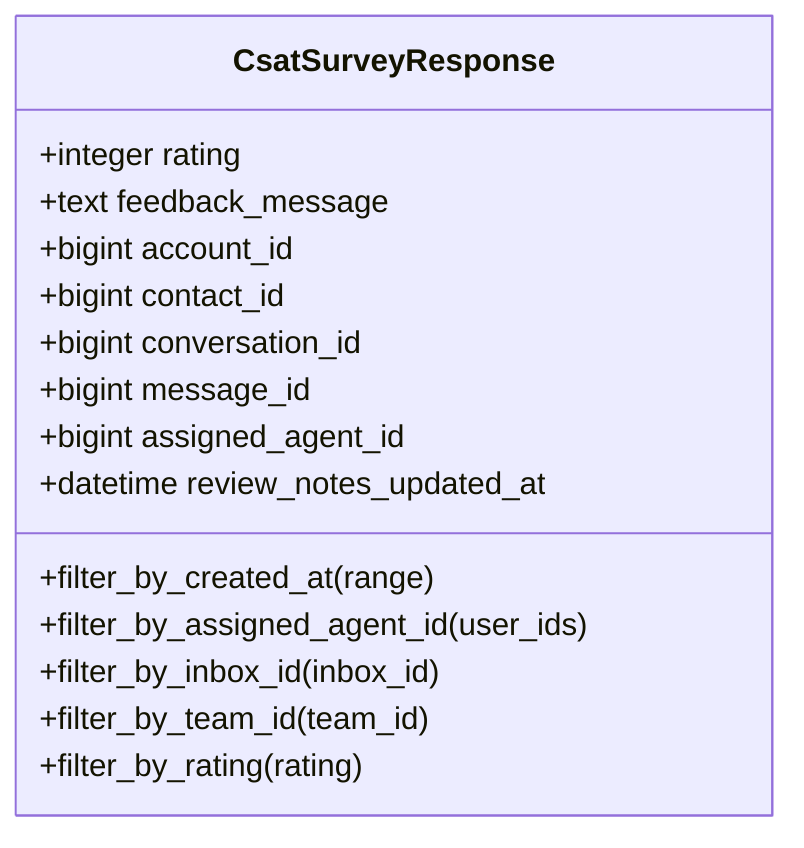
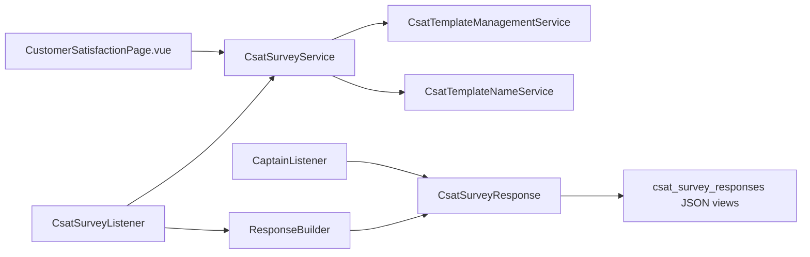

# CSAT Surveys

<cite>
**Referenced Files in This Document**
- [csat_survey_listener.rb](file://app/listeners/csat_survey_listener.rb)
- [csat_survey_service.rb](file://app/services/csat_survey_service.rb)
- [response_builder.rb](file://app/builders/csat_surveys/response_builder.rb)
- [csat_survey_response.rb](file://app/models/csat_survey_response.rb)
- [responses_controller.rb](file://app/controllers/survey/responses_controller.rb)
- [endPoints.js](file://app/javascript/survey/api/endPoints.js)
- [CustomerSatisfactionPage.vue](file://app/javascript/dashboard/routes/dashboard/settings/inbox/settingsPage/CustomerSatisfactionPage.vue)
- [csat_template_management_service.rb](file://app/services/csat_template_management_service.rb)
- [csat_template_name_service.rb](file://app/services/csat_template_name_service.rb)
- [captain_listener.rb](file://enterprise/app/listeners/captain_listener.rb)
- [index.json.jbuilder](file://app/views/api/v1/accounts/csat_survey_responses/index.json.jbuilder)
- [update.json.jbuilder](file://app/views/api/v1/accounts/csat_survey_responses/update.json.jbuilder)
</cite>

## Table of Contents
1. Introduction
2. Project Structure
3. Core Components
4. Architecture Overview
5. Detailed Component Analysis
6. Dependency Analysis
7. Performance Considerations
8. Troubleshooting Guide
9. Conclusion
10. Appendices

## Introduction
This document explains Chatwoot’s Customer Satisfaction (CSAT) survey functionality end-to-end: how surveys are created and configured, how they are distributed to customers across channels, how responses are collected and validated, and how results are analyzed and exported. It also covers multilingual support, timing controls, privacy considerations, and integration points with conversation workflows.

## Project Structure
The CSAT feature spans listeners, services, builders, models, controllers, views, and frontend configuration pages. The key areas are:
- Event-driven triggers for sending surveys and processing responses
- Channel-specific delivery logic (WhatsApp Cloud API and Twilio WhatsApp)
- Response persistence and validation
- Public-facing survey UI endpoints and rendering
- Template management for channel templates
- Frontend configuration for display types, messages, languages, and rules

**Diagram sources**
- [csat_survey_listener.rb:1-16](file://app/listeners/csat_survey_listener.rb#L1-L16)
- [csat_survey_service.rb:1-182](file://app/services/csat_survey_service.rb#L1-L182)
- [csat_template_management_service.rb:1-199](file://app/services/csat_template_management_service.rb#L1-L199)
- [csat_template_name_service.rb:1-50](file://app/services/csat_template_name_service.rb#L1-L50)
- [response_builder.rb:1-29](file://app/builders/csat_surveys/response_builder.rb#L1-L29)
- [csat_survey_response.rb:1-48](file://app/models/csat_survey_response.rb#L1-L48)
- [responses_controller.rb:1-11](file://app/controllers/survey/responses_controller.rb#L1-L11)
- [endPoints.js:1-13](file://app/javascript/survey/api/endPoints.js#L1-L13)
- [CustomerSatisfactionPage.vue:114-161](file://app/javascript/dashboard/routes/dashboard/settings/inbox/settingsPage/CustomerSatisfactionPage.vue#L114-L161)
- [captain_listener.rb:1-31](file://enterprise/app/listeners/captain_listener.rb#L1-L31)
- [index.json.jbuilder:1-3](file://app/views/api/v1/accounts/csat_survey_responses/index.json.jbuilder#L1-L3)
- [update.json.jbuilder:1-1](file://app/views/api/v1/accounts/csat_survey_responses/update.json.jbuilder#L1-L1)

**Section sources**
- [csat_survey_listener.rb:1-16](file://app/listeners/csat_survey_listener.rb#L1-L16)
- [csat_survey_service.rb:1-182](file://app/services/csat_survey_service.rb#L1-L182)
- [csat_template_management_service.rb:1-199](file://app/services/csat_template_management_service.rb#L1-L199)
- [csat_template_name_service.rb:1-50](file://app/services/csat_template_name_service.rb#L1-L50)
- [response_builder.rb:1-29](file://app/builders/csat_surveys/response_builder.rb#L1-L29)
- [csat_survey_response.rb:1-48](file://app/models/csat_survey_response.rb#L1-L48)
- [responses_controller.rb:1-11](file://app/controllers/survey/responses_controller.rb#L1-L11)
- [endPoints.js:1-13](file://app/javascript/survey/api/endPoints.js#L1-L13)
- [CustomerSatisfactionPage.vue:114-161](file://app/javascript/dashboard/routes/dashboard/settings/inbox/settingsPage/CustomerSatisfactionPage.vue#L114-L161)
- [captain_listener.rb:1-31](file://enterprise/app/listeners/captain_listener.rb#L1-L31)
- [index.json.jbuilder:1-3](file://app/views/api/v1/accounts/csat_survey_responses/index.json.jbuilder#L1-L3)
- [update.json.jbuilder:1-1](file://app/views/api/v1/accounts/csat_survey_responses/update.json.jbuilder#L1-L1)

## Core Components
- CsatSurveyListener: Listens for conversation status changes and message updates to trigger survey dispatch and response processing.
- CsatSurveyService: Orchestrates whether and how to send a CSAT survey based on inbox settings, messaging windows, labels, and channel template availability.
- CsatSurveys::ResponseBuilder: Parses submitted CSAT input messages and persists validated responses.
- CsatSurveyResponse: Data model for storing ratings and optional feedback, with validations and scopes for filtering.
- Survey::ResponsesController: Renders the public survey page and injects global branding/config.
- csat_survey_responses API views: Render list and single response payloads for external consumption.
- CsatTemplateManagementService and CsatTemplateNameService: Manage creation, deletion, and naming of channel templates (WhatsApp/Twilio).
- CustomerSatisfactionPage.vue: Frontend configuration UI for enabling CSAT, choosing display type, customizing message/button text/language, and setting label-based rules.
- CaptainListener (Enterprise): Records CSAT outcomes into conversation outcome tracking when a CSAT response is received.

**Section sources**
- [csat_survey_listener.rb:1-16](file://app/listeners/csat_survey_listener.rb#L1-L16)
- [csat_survey_service.rb:1-182](file://app/services/csat_survey_service.rb#L1-L182)
- [response_builder.rb:1-29](file://app/builders/csat_surveys/response_builder.rb#L1-L29)
- [csat_survey_response.rb:1-48](file://app/models/csat_survey_response.rb#L1-L48)
- [responses_controller.rb:1-11](file://app/controllers/survey/responses_controller.rb#L1-L11)
- [index.json.jbuilder:1-3](file://app/views/api/v1/accounts/csat_survey_responses/index.json.jbuilder#L1-L3)
- [update.json.jbuilder:1-1](file://app/views/api/v1/accounts/csat_survey_responses/update.json.jbuilder#L1-L1)
- [csat_template_management_service.rb:1-199](file://app/services/csat_template_management_service.rb#L1-L199)
- [csat_template_name_service.rb:1-50](file://app/services/csat_template_name_service.rb#L1-L50)
- [CustomerSatisfactionPage.vue:114-161](file://app/javascript/dashboard/routes/dashboard/settings/inbox/settingsPage/CustomerSatisfactionPage.vue#L114-L161)
- [captain_listener.rb:1-31](file://enterprise/app/listeners/captain_listener.rb#L1-L31)

## Architecture Overview
The CSAT flow is event-driven:
- When a conversation is resolved, the listener triggers the service to decide whether to send a CSAT survey.
- Depending on the inbox channel and template approval, the system sends either a WhatsApp Cloud API template or a Twilio WhatsApp template; otherwise it falls back to an in-app message if within the messaging window.
- When a customer submits a rating via the survey UI, the message is processed by the builder and persisted as a CSAT response.
- Enterprise integrations can consume these responses to update conversation outcomes.

**Diagram sources**
- [csat_survey_listener.rb:1-16](file://app/listeners/csat_survey_listener.rb#L1-L16)
- [csat_survey_service.rb:1-182](file://app/services/csat_survey_service.rb#L1-L182)
- [response_builder.rb:1-29](file://app/builders/csat_surveys/response_builder.rb#L1-L29)
- [csat_survey_response.rb:1-48](file://app/models/csat_survey_response.rb#L1-L48)

## Detailed Component Analysis

### Survey Creation and Configuration
- Enablement: Inboxes toggle CSAT via csat_survey_enabled.
- Display options: display_type supports emoji and other modes; message and button_text customize the prompt; language sets template language.
- Rules: survey_rules with operator and values allow conditional sending based on conversation labels.
- Templates: For WhatsApp/Twilio, template name generation and status checks ensure only approved templates are used.

Key behaviors:
- Frontend initializes state from inbox.csat_config including display_type, message, button_text, language, and survey_rules.
- Template management service validates parameters, creates/deletes provider templates, and updates inbox.csat_config.template metadata.
- Template names follow a consistent pattern per inbox, supporting versioning.

**Section sources**
- [CustomerSatisfactionPage.vue:114-161](file://app/javascript/dashboard/routes/dashboard/settings/inbox/settingsPage/CustomerSatisfactionPage.vue#L114-L161)
- [csat_template_management_service.rb:1-199](file://app/services/csat_template_management_service.rb#L1-L199)
- [csat_template_name_service.rb:1-50](file://app/services/csat_template_name_service.rb#L1-L50)

### Distribution Mechanisms
Decision logic determines delivery path:
- If inbox uses WhatsApp Cloud API and a template is approved, send via provider template.
- Else if inbox uses Twilio WhatsApp and content_sid is approved, send via Twilio template.
- Else if within messaging window, send in-app CSAT message.
- Otherwise, log activity that CSAT was not sent due to messaging window constraints.

Additional controls:
- Only sent for resolved conversations and not for tweet-type conversations.
- Prevents duplicate surveys per conversation.
- Optional label-based rules to include/exclude certain conversations.

**Diagram sources**
- [csat_survey_service.rb:1-182](file://app/services/csat_survey_service.rb#L1-L182)

**Section sources**
- [csat_survey_service.rb:1-182](file://app/services/csat_survey_service.rb#L1-L182)

### Response Collection and Validation
- Submission: Customers submit ratings through the public survey UI, which posts to the CSAT endpoint using provided API helpers.
- Processing: On receiving an input_csat message, the listener invokes the response builder.
- Validation: Rating must be present and included in allowed values; account, contact, and conversation IDs are required.
- Persistence: A CsatSurveyResponse record is created/updated with rating and optional feedback, linked to the originating message and conversation.

**Diagram sources**
- [endPoints.js:1-13](file://app/javascript/survey/api/endPoints.js#L1-L13)
- [responses_controller.rb:1-11](file://app/controllers/survey/responses_controller.rb#L1-L11)
- [csat_survey_listener.rb:1-16](file://app/listeners/csat_survey_listener.rb#L1-L16)
- [response_builder.rb:1-29](file://app/builders/csat_surveys/response_builder.rb#L1-L29)
- [csat_survey_response.rb:1-48](file://app/models/csat_survey_response.rb#L1-L48)

**Section sources**
- [endPoints.js:1-13](file://app/javascript/survey/api/endPoints.js#L1-L13)
- [responses_controller.rb:1-11](file://app/controllers/survey/responses_controller.rb#L1-L11)
- [csat_survey_listener.rb:1-16](file://app/listeners/csat_survey_listener.rb#L1-L16)
- [response_builder.rb:1-29](file://app/builders/csat_surveys/response_builder.rb#L1-L29)
- [csat_survey_response.rb:1-48](file://app/models/csat_survey_response.rb#L1-L48)

### Survey Templates, Rating Scales, and Customization
- Templates: Managed per inbox for WhatsApp Cloud API and Twilio. The system checks template status and ensures approval before sending.
- Rating scale: Fixed integer scale from 1 to 5 with presence and inclusion validation.
- Customization:
  - display_type: Choose between emoji and other modes.
  - message: Customize the prompt text.
  - button_text: Customize the call-to-action text.
  - language: Set template language (e.g., “en”).
  - survey_rules: Conditional sending based on conversation labels (operator contains/does_not_contain, values array).

**Section sources**
- [csat_template_management_service.rb:1-199](file://app/services/csat_template_management_service.rb#L1-L199)
- [csat_survey_response.rb:1-48](file://app/models/csat_survey_response.rb#L1-L48)
- [CustomerSatisfactionPage.vue:114-161](file://app/javascript/dashboard/routes/dashboard/settings/inbox/settingsPage/CustomerSatisfactionPage.vue#L114-L161)
- [csat_survey_service.rb:1-182](file://app/services/csat_survey_service.rb#L1-L182)

### Response Analysis, Trend Tracking, and Automated Feedback Processing
- Filtering and analysis:
  - Scopes support filtering by created_at range, assigned_agent_id, inbox_id, team_id, and rating.
  - API views render lists and individual responses for downstream analytics.
- Trend tracking:
  - Responses are tied to conversations and contacts, enabling time-series analysis and agent/team performance metrics.
- Automated feedback processing:
  - Enterprise CaptainListener records CSAT outcomes into conversation outcome tracking upon message updates.

**Diagram sources**
- [csat_survey_response.rb:1-48](file://app/models/csat_survey_response.rb#L1-L48)

**Section sources**
- [csat_survey_response.rb:1-48](file://app/models/csat_survey_response.rb#L1-L48)
- [index.json.jbuilder:1-3](file://app/views/api/v1/accounts/csat_survey_responses/index.json.jbuilder#L1-L3)
- [update.json.jbuilder:1-1](file://app/views/api/v1/accounts/csat_survey_responses/update.json.jbuilder#L1-L1)
- [captain_listener.rb:1-31](file://enterprise/app/listeners/captain_listener.rb#L1-L31)

### Integration with Conversation Workflows
- Trigger point: When a conversation transitions to resolved, the listener triggers the CSAT service.
- Activity logging: If a survey cannot be sent due to messaging window constraints, an activity message is logged to the conversation timeline.
- Outcome tracking: Enterprise flows capture CSAT ratings into conversation outcomes for reporting.

**Section sources**
- [csat_survey_listener.rb:1-16](file://app/listeners/csat_survey_listener.rb#L1-L16)
- [csat_survey_service.rb:1-182](file://app/services/csat_survey_service.rb#L1-L182)
- [captain_listener.rb:1-31](file://enterprise/app/listeners/captain_listener.rb#L1-L31)

### Delivery Channels, Timing Controls, and Multilingual Support
- Channels:
  - WhatsApp Cloud API: Uses approved templates with language codes and URL buttons linking to the survey.
  - Twilio WhatsApp: Uses approved content_sid templates with variables for conversation identifiers.
- Timing controls:
  - Only after resolution.
  - Respects messaging window constraints; logs activity if outside window.
  - Prevents duplicate submissions per conversation.
- Multilingual support:
  - Template language configurable per inbox.
  - Frontend initializes language from csat_config.

**Section sources**
- [csat_survey_service.rb:1-182](file://app/services/csat_survey_service.rb#L1-L182)
- [csat_template_management_service.rb:1-199](file://app/services/csat_template_management_service.rb#L1-L199)
- [CustomerSatisfactionPage.vue:114-161](file://app/javascript/dashboard/routes/dashboard/settings/inbox/settingsPage/CustomerSatisfactionPage.vue#L114-L161)

### Data Privacy, Response Validation, and Export Capabilities
- Privacy:
  - Responses are scoped to account and linked to conversation/contact/message identifiers.
  - No PII beyond necessary identifiers is stored in the response model.
- Validation:
  - Rating presence and inclusion in allowed values enforced at model level.
  - Required associations (account, contact, conversation) enforced.
- Export:
  - API views provide JSON arrays of responses and single response objects for export to external tools.

**Section sources**
- [csat_survey_response.rb:1-48](file://app/models/csat_survey_response.rb#L1-L48)
- [index.json.jbuilder:1-3](file://app/views/api/v1/accounts/csat_survey_responses/index.json.jbuilder#L1-L3)
- [update.json.jbuilder:1-1](file://app/views/api/v1/accounts/csat_survey_responses/update.json.jbuilder#L1-L1)

## Dependency Analysis
High-level dependencies among core components:

**Diagram sources**
- [csat_survey_listener.rb:1-16](file://app/listeners/csat_survey_listener.rb#L1-L16)
- [csat_survey_service.rb:1-182](file://app/services/csat_survey_service.rb#L1-L182)
- [csat_template_management_service.rb:1-199](file://app/services/csat_template_management_service.rb#L1-L199)
- [csat_template_name_service.rb:1-50](file://app/services/csat_template_name_service.rb#L1-L50)
- [response_builder.rb:1-29](file://app/builders/csat_surveys/response_builder.rb#L1-L29)
- [csat_survey_response.rb:1-48](file://app/models/csat_survey_response.rb#L1-L48)
- [index.json.jbuilder:1-3](file://app/views/api/v1/accounts/csat_survey_responses/index.json.jbuilder#L1-L3)
- [CustomerSatisfactionPage.vue:114-161](file://app/javascript/dashboard/routes/dashboard/settings/inbox/settingsPage/CustomerSatisfactionPage.vue#L114-L161)
- [captain_listener.rb:1-31](file://enterprise/app/listeners/captain_listener.rb#L1-L31)

**Section sources**
- [csat_survey_listener.rb:1-16](file://app/listeners/csat_survey_listener.rb#L1-L16)
- [csat_survey_service.rb:1-182](file://app/services/csat_survey_service.rb#L1-L182)
- [csat_template_management_service.rb:1-199](file://app/services/csat_template_management_service.rb#L1-L199)
- [csat_template_name_service.rb:1-50](file://app/services/csat_template_name_service.rb#L1-L50)
- [response_builder.rb:1-29](file://app/builders/csat_surveys/response_builder.rb#L1-L29)
- [csat_survey_response.rb:1-48](file://app/models/csat_survey_response.rb#L1-L48)
- [index.json.jbuilder:1-3](file://app/views/api/v1/accounts/csat_survey_responses/index.json.jbuilder#L1-L3)
- [CustomerSatisfactionPage.vue:114-161](file://app/javascript/dashboard/routes/dashboard/settings/inbox/settingsPage/CustomerSatisfactionPage.vue#L114-L161)
- [captain_listener.rb:1-31](file://enterprise/app/listeners/captain_listener.rb#L1-L31)

## Performance Considerations
- Avoid redundant template checks by caching template status where appropriate.
- Use scopes efficiently for large datasets; prefer indexed queries (already present for common filters).
- Batch operations for bulk exports or analytics jobs to reduce database load.
- Ensure background job queues are sized appropriately for high-volume inboxes.

[No sources needed since this section provides general guidance]

## Troubleshooting Guide
Common issues and resolutions:
- Survey not sent:
  - Verify inbox csat_survey_enabled flag.
  - Confirm conversation is resolved and not a tweet-type conversation.
  - Check messaging window constraints; activity logs will indicate why it was skipped.
  - Validate label-based rules if configured.
- Template errors:
  - Ensure template exists and is approved for the selected language.
  - For Twilio, verify content_sid is set and approved.
  - Review error logs for template status checks and creation failures.
- Response not recorded:
  - Confirm the submission message has content_type input_csat.
  - Validate rating presence and value range.
  - Check association integrity (account, contact, conversation).

Operational references:
- Listener behavior and triggers
- Service decision logic and error logging
- Model validations and scopes
- Template management service error handling

**Section sources**
- [csat_survey_listener.rb:1-16](file://app/listeners/csat_survey_listener.rb#L1-L16)
- [csat_survey_service.rb:1-182](file://app/services/csat_survey_service.rb#L1-L182)
- [csat_survey_response.rb:1-48](file://app/models/csat_survey_response.rb#L1-L48)
- [csat_template_management_service.rb:1-199](file://app/services/csat_template_management_service.rb#L1-L199)

## Conclusion
Chatwoot’s CSAT feature provides a robust, event-driven mechanism to collect customer satisfaction data across channels. It supports flexible configuration, strict validation, and clear integration points for analytics and automation. With template management for WhatsApp and Twilio, multilingual support, and strong filtering/export capabilities, teams can reliably measure and act on customer feedback.

[No sources needed since this section summarizes without analyzing specific files]

## Appendices

### Example: Survey Configuration
- Enable CSAT for an inbox and configure:
  - display_type: choose emoji or other mode
  - message: customize prompt
  - button_text: customize call-to-action
  - language: set template language
  - survey_rules: define operator and values for label-based conditions

Reference:
- [CustomerSatisfactionPage.vue:114-161](file://app/javascript/dashboard/routes/dashboard/settings/inbox/settingsPage/CustomerSatisfactionPage.vue#L114-L161)

**Section sources**
- [CustomerSatisfactionPage.vue:114-161](file://app/javascript/dashboard/routes/dashboard/settings/inbox/settingsPage/CustomerSatisfactionPage.vue#L114-L161)

### Example: Response Filtering
Use model scopes to filter responses:
- By date range
- By assigned agent
- By inbox or team
- By rating value

Reference:
- [csat_survey_response.rb:1-48](file://app/models/csat_survey_response.rb#L1-L48)

**Section sources**
- [csat_survey_response.rb:1-48](file://app/models/csat_survey_response.rb#L1-L48)

### Example: Integration with Conversation Workflows
- Trigger: conversation resolved
- Action: send CSAT via preferred channel
- Logging: activity message if not sent due to constraints
- Outcome: enterprise tracking of CSAT ratings

References:
- [csat_survey_listener.rb:1-16](file://app/listeners/csat_survey_listener.rb#L1-L16)
- [csat_survey_service.rb:1-182](file://app/services/csat_survey_service.rb#L1-L182)
- [captain_listener.rb:1-31](file://enterprise/app/listeners/captain_listener.rb#L1-L31)

**Section sources**
- [csat_survey_listener.rb:1-16](file://app/listeners/csat_survey_listener.rb#L1-L16)
- [csat_survey_service.rb:1-182](file://app/services/csat_survey_service.rb#L1-L182)
- [captain_listener.rb:1-31](file://enterprise/app/listeners/captain_listener.rb#L1-L31)