# Data Visualization

<cite>
**Referenced Files in This Document**
- [BarChart.vue](file://app/javascript/shared/components/charts/BarChart.vue)
- [BarChart.spec.js](file://app/javascript/shared/components/specs/BarChart.spec.js)
- [ReportContainer.vue](file://app/javascript/dashboard/routes/dashboard/settings/reports/ReportContainer.vue)
- [Index.vue (Superadmin Dashboard)](file://app/javascript/superadmin_pages/views/dashboard/Index.vue)
- [superadmin_pages.js](file://app/javascript/entrypoints/superadmin_pages.js)
- [CampaignDeliveryBreakdown.vue](file://app/javascript/dashboard/components-next/Campaigns/Pages/CampaignAnalyticsPage/CampaignDeliveryBreakdown.vue)
- [ProgressMetric.vue](file://app/javascript/dashboard/components-next/captain/pageComponents/overview/v2/ProgressMetric.vue)
- [ResolutionFlowCard.vue](file://app/javascript/dashboard/components-next/captain/pageComponents/overview/v2/ResolutionFlowCard.vue)
- [ResolutionTrendCard.vue](file://app/javascript/dashboard/components-next/captain/pageComponents/overview/v2/ResolutionTrendCard.vue)
- [CsatRatingDistribution.vue](file://app/javascript/dashboard/routes/dashboard/settings/reports/components/CsatRatingDistribution.vue)
</cite>

## Table of Contents
1. [Introduction](#introduction)
2. [Project Structure](#project-structure)
3. [Core Components](#core-components)
4. [Architecture Overview](#architecture-overview)
5. [Detailed Component Analysis](#detailed-component-analysis)
6. [Dependency Analysis](#dependency-analysis)
7. [Performance Considerations](#performance-considerations)
8. [Troubleshooting Guide](#troubleshooting-guide)
9. [Conclusion](#conclusion)
10. [Appendices](#appendices)

## Introduction
This document explains Chatwoot’s data visualization components and charting capabilities. It covers the chart component architecture, data binding mechanisms, rendering pipelines, available chart types, interactivity (filtering, drill-down, real-time updates), custom development patterns, theme customization, responsive design, performance optimization for large datasets, accessibility compliance, and integration with third-party charting libraries.

## Project Structure
Chatwoot’s frontend uses Vue 3 components that wrap a shared charting library (@chatwoot/viz). The primary reusable wrapper is the BarChart component under shared components. Higher-level dashboard pages compose these wrappers to render reports and analytics.

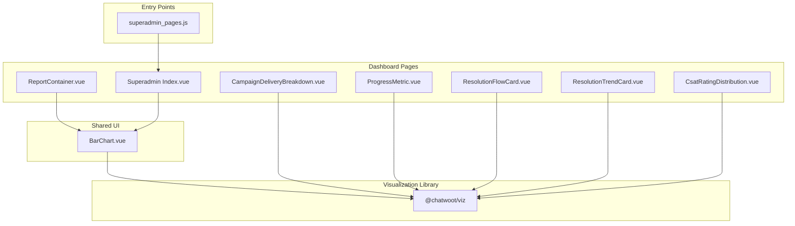

**Diagram sources**
- [BarChart.vue:1-34](file://app/javascript/shared/components/charts/BarChart.vue#L1-L34)
- [ReportContainer.vue:1-50](file://app/javascript/dashboard/routes/dashboard/settings/reports/ReportContainer.vue#L1-L50)
- [Index.vue (Superadmin Dashboard):1-54](file://app/javascript/superadmin_pages/views/dashboard/Index.vue#L1-L54)
- [superadmin_pages.js:1-30](file://app/javascript/entrypoints/superadmin_pages.js#L1-L30)
- [CampaignDeliveryBreakdown.vue:1-135](file://app/javascript/dashboard/components-next/Campaigns/Pages/CampaignAnalyticsPage/CampaignDeliveryBreakdown.vue#L1-L135)
- [ProgressMetric.vue:1-60](file://app/javascript/dashboard/components-next/captain/pageComponents/overview/v2/ProgressMetric.vue#L1-L60)
- [ResolutionFlowCard.vue:1-231](file://app/javascript/dashboard/components-next/captain/pageComponents/overview/v2/ResolutionFlowCard.vue#L1-L231)
- [ResolutionTrendCard.vue:1-228](file://app/javascript/dashboard/components-next/captain/pageComponents/overview/v2/ResolutionTrendCard.vue#L1-L228)
- [CsatRatingDistribution.vue:1-76](file://app/javascript/dashboard/routes/dashboard/settings/reports/components/CsatRatingDistribution.vue#L1-L76)

**Section sources**
- [BarChart.vue:1-34](file://app/javascript/shared/components/charts/BarChart.vue#L1-L34)
- [ReportContainer.vue:1-50](file://app/javascript/dashboard/routes/dashboard/settings/reports/ReportContainer.vue#L1-L50)
- [Index.vue (Superadmin Dashboard):1-54](file://app/javascript/superadmin_pages/views/dashboard/Index.vue#L1-L54)
- [superadmin_pages.js:1-30](file://app/javascript/entrypoints/superadmin_pages.js#L1-L30)

## Core Components
- BarChart wrapper: A thin Vue 3 wrapper around @chatwoot/viz’s BarChart. It accepts data, ariaLabel, and clickable flags, and emits itemClick events when enabled. It also applies CSS variables for consistent theming.
- ReportContainer: Composes BarChart and other report elements; integrates metrics via composables and supports drill-down flows.
- Superadmin Index: Loads stats asynchronously and renders a bar chart using the shared BarChart wrapper.
- CampaignDeliveryBreakdown: Uses PercentageChart from @chatwoot/viz to visualize delivery breakdown segments.
- ProgressMetric: Renders a usage progress bar via PercentageChart with computed data.
- ResolutionFlowCard: Visualizes flow transitions using SankeyChart and supports drill-down interactions.
- ResolutionTrendCard: Switches between LineChart and BarChart based on selected measure, providing formatted values and accessible labels.
- CsatRatingDistribution: Displays rating distribution as a segmented percentage chart with custom legend items.

**Section sources**
- [BarChart.vue:1-34](file://app/javascript/shared/components/charts/BarChart.vue#L1-L34)
- [ReportContainer.vue:1-50](file://app/javascript/dashboard/routes/dashboard/settings/reports/ReportContainer.vue#L1-L50)
- [Index.vue (Superadmin Dashboard):1-54](file://app/javascript/superadmin_pages/views/dashboard/Index.vue#L1-L54)
- [CampaignDeliveryBreakdown.vue:1-135](file://app/javascript/dashboard/components-next/Campaigns/Pages/CampaignAnalyticsPage/CampaignDeliveryBreakdown.vue#L1-L135)
- [ProgressMetric.vue:1-60](file://app/javascript/dashboard/components-next/captain/pageComponents/overview/v2/ProgressMetric.vue#L1-L60)
- [ResolutionFlowCard.vue:1-231](file://app/javascript/dashboard/components-next/captain/pageComponents/overview/v2/ResolutionFlowCard.vue#L1-L231)
- [ResolutionTrendCard.vue:1-228](file://app/javascript/dashboard/components-next/captain/pageComponents/overview/v2/ResolutionTrendCard.vue#L1-L228)
- [CsatRatingDistribution.vue:1-76](file://app/javascript/dashboard/routes/dashboard/settings/reports/components/CsatRatingDistribution.vue#L1-L76)

## Architecture Overview
The visualization layer follows a layered approach:
- Presentation Layer: Vue components (e.g., BarChart wrapper, report cards).
- Composition Layer: Page components compute chart data and bind it to chart props.
- Rendering Layer: @chatwoot/viz provides the actual chart implementations.
- Entry Point: superadmin_pages.js bootstraps isolated Vue apps for superadmin dashboards.

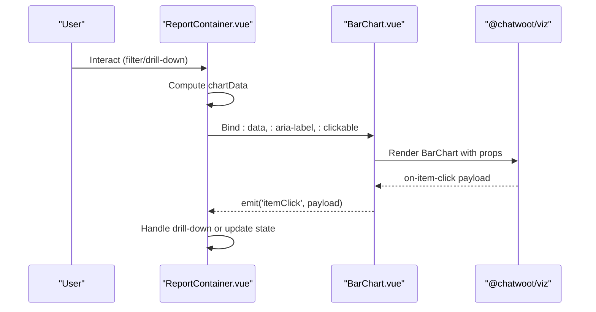

**Diagram sources**
- [ReportContainer.vue:1-50](file://app/javascript/dashboard/routes/dashboard/settings/reports/ReportContainer.vue#L1-L50)
- [BarChart.vue:1-34](file://app/javascript/shared/components/charts/BarChart.vue#L1-L34)

## Detailed Component Analysis

### BarChart Wrapper
- Purpose: Provide a consistent interface for bar charts across the app, including accessibility and theming.
- Props: data (object), ariaLabel (string), clickable (boolean).
- Events: itemClick emitted when clickable is true and an item is clicked.
- Theming: Uses CSS variables scoped to the component class to control colors and typography.

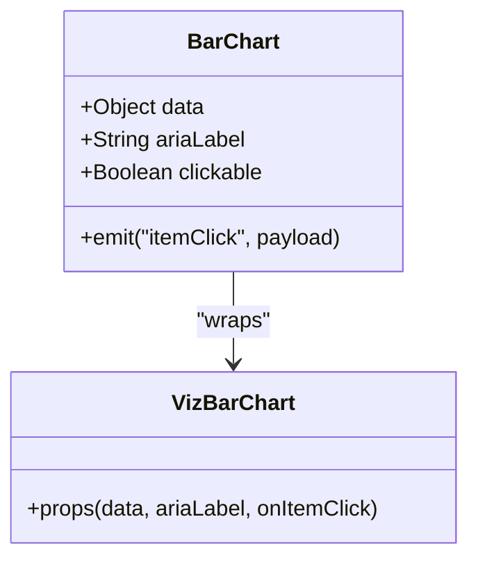

**Diagram sources**
- [BarChart.vue:1-34](file://app/javascript/shared/components/charts/BarChart.vue#L1-L34)

**Section sources**
- [BarChart.vue:1-34](file://app/javascript/shared/components/charts/BarChart.vue#L1-L34)
- [BarChart.spec.js:1-51](file://app/javascript/shared/components/specs/BarChart.spec.js#L1-L51)

### ReportContainer
- Integrates BarChart and related report elements.
- Uses composables to fetch metrics and date ranges.
- Supports drill-down via a dedicated drawer component.

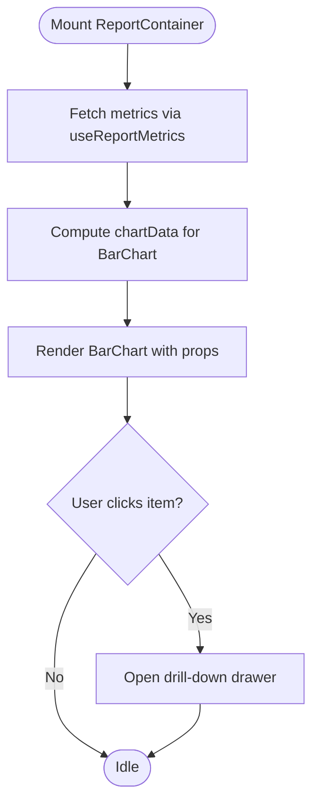

**Diagram sources**
- [ReportContainer.vue:1-50](file://app/javascript/dashboard/routes/dashboard/settings/reports/ReportContainer.vue#L1-L50)

**Section sources**
- [ReportContainer.vue:1-50](file://app/javascript/dashboard/routes/dashboard/settings/reports/ReportContainer.vue#L1-L50)

### Superadmin Dashboard Index
- Loads stats asynchronously and renders a bar chart using the shared BarChart wrapper.
- Demonstrates basic data fetching and error handling.

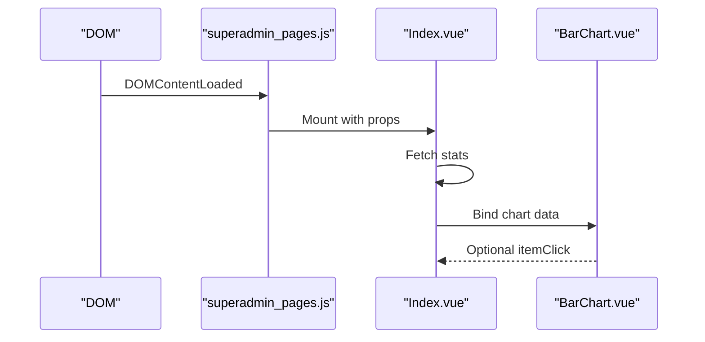

**Diagram sources**
- [superadmin_pages.js:1-30](file://app/javascript/entrypoints/superadmin_pages.js#L1-L30)
- [Index.vue (Superadmin Dashboard):1-54](file://app/javascript/superadmin_pages/views/dashboard/Index.vue#L1-L54)
- [BarChart.vue:1-34](file://app/javascript/shared/components/charts/BarChart.vue#L1-L34)

**Section sources**
- [Index.vue (Superadmin Dashboard):1-54](file://app/javascript/superadmin_pages/views/dashboard/Index.vue#L1-L54)
- [superadmin_pages.js:1-30](file://app/javascript/entrypoints/superadmin_pages.js#L1-L30)

### CampaignDeliveryBreakdown
- Uses PercentageChart to show delivery status segments (read, delivered, failed, skipped, pending).
- Computes segment values and maps them to localized labels and colors.

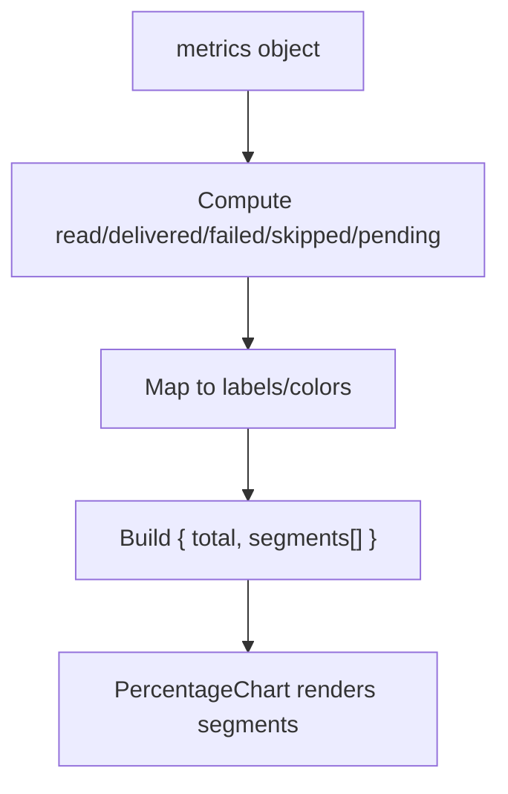

**Diagram sources**
- [CampaignDeliveryBreakdown.vue:1-135](file://app/javascript/dashboard/components-next/Campaigns/Pages/CampaignAnalyticsPage/CampaignDeliveryBreakdown.vue#L1-L135)

**Section sources**
- [CampaignDeliveryBreakdown.vue:1-135](file://app/javascript/dashboard/components-next/Campaigns/Pages/CampaignAnalyticsPage/CampaignDeliveryBreakdown.vue#L1-L135)

### ProgressMetric
- Renders a simple usage progress bar using PercentageChart.
- Computes clamped used value against total and binds aria-label for accessibility.

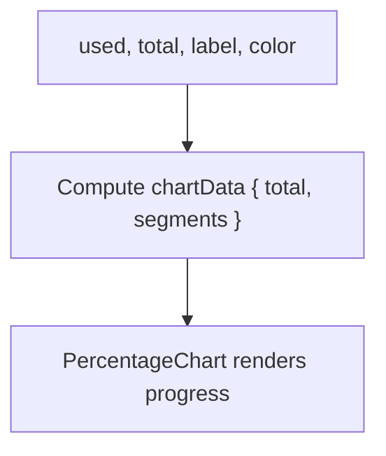

**Diagram sources**
- [ProgressMetric.vue:1-60](file://app/javascript/dashboard/components-next/captain/pageComponents/overview/v2/ProgressMetric.vue#L1-L60)

**Section sources**
- [ProgressMetric.vue:1-60](file://app/javascript/dashboard/components-next/captain/pageComponents/overview/v2/ProgressMetric.vue#L1-L60)

### ResolutionFlowCard
- Visualizes handoff flows using SankeyChart.
- Provides drill-down by emitting events for nodes and links, excluding “Other reasons” from keyboard navigation for accessibility.

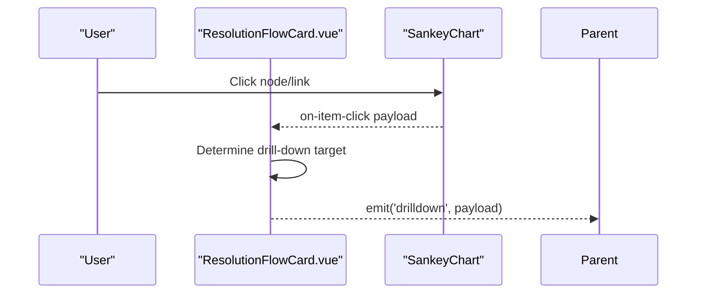

**Diagram sources**
- [ResolutionFlowCard.vue:1-231](file://app/javascript/dashboard/components-next/captain/pageComponents/overview/v2/ResolutionFlowCard.vue#L1-L231)

**Section sources**
- [ResolutionFlowCard.vue:1-231](file://app/javascript/dashboard/components-next/captain/pageComponents/overview/v2/ResolutionFlowCard.vue#L1-L231)

### ResolutionTrendCard
- Switches between LineChart and BarChart based on selected measure.
- Formats values and sets accessible labels and styling via CSS variables.

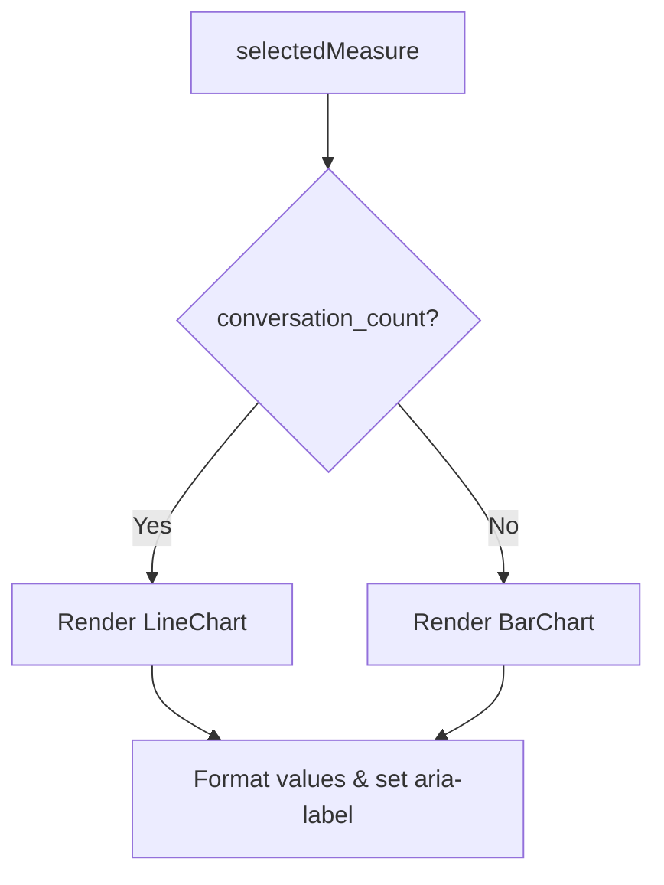

**Diagram sources**
- [ResolutionTrendCard.vue:1-228](file://app/javascript/dashboard/components-next/captain/pageComponents/overview/v2/ResolutionTrendCard.vue#L1-L228)

**Section sources**
- [ResolutionTrendCard.vue:1-228](file://app/javascript/dashboard/components-next/captain/pageComponents/overview/v2/ResolutionTrendCard.vue#L1-L228)

### CsatRatingDistribution
- Displays CSAT rating distribution using PercentageChart with custom legend slots.
- Sorts ratings and maps them to localized labels and colors.

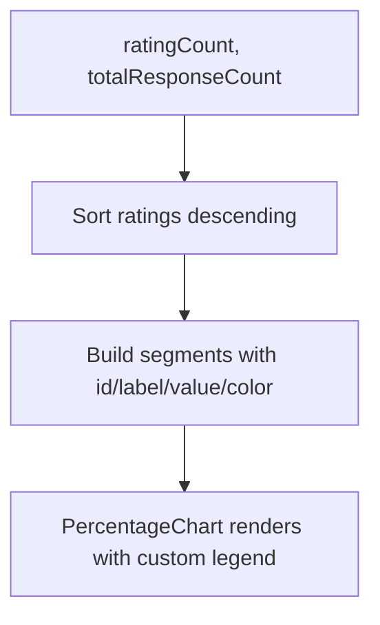

**Diagram sources**
- [CsatRatingDistribution.vue:1-76](file://app/javascript/dashboard/routes/dashboard/settings/reports/components/CsatRatingDistribution.vue#L1-L76)

**Section sources**
- [CsatRatingDistribution.vue:1-76](file://app/javascript/dashboard/routes/dashboard/settings/reports/components/CsatRatingDistribution.vue#L1-L76)

## Dependency Analysis
- Shared BarChart depends on @chatwoot/viz for rendering.
- Dashboard pages depend on shared components and composables for data fetching and formatting.
- Superadmin entrypoint mounts isolated Vue apps and imports viz styles.

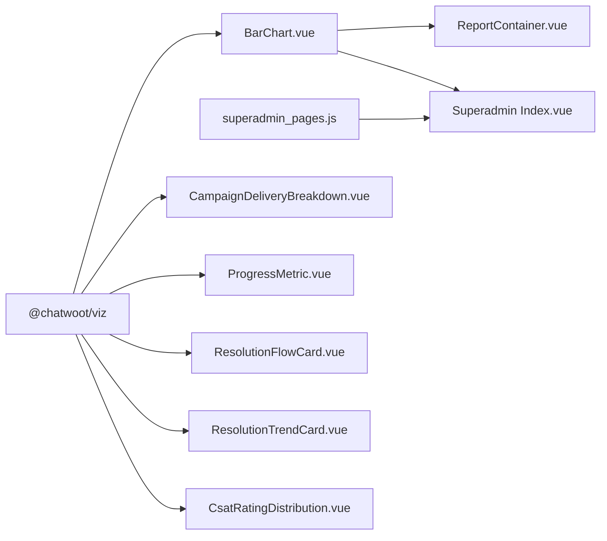

**Diagram sources**
- [BarChart.vue:1-34](file://app/javascript/shared/components/charts/BarChart.vue#L1-L34)
- [ReportContainer.vue:1-50](file://app/javascript/dashboard/routes/dashboard/settings/reports/ReportContainer.vue#L1-L50)
- [Index.vue (Superadmin Dashboard):1-54](file://app/javascript/superadmin_pages/views/dashboard/Index.vue#L1-L54)
- [superadmin_pages.js:1-30](file://app/javascript/entrypoints/superadmin_pages.js#L1-L30)
- [CampaignDeliveryBreakdown.vue:1-135](file://app/javascript/dashboard/components-next/Campaigns/Pages/CampaignAnalyticsPage/CampaignDeliveryBreakdown.vue#L1-L135)
- [ProgressMetric.vue:1-60](file://app/javascript/dashboard/components-next/captain/pageComponents/overview/v2/ProgressMetric.vue#L1-L60)
- [ResolutionFlowCard.vue:1-231](file://app/javascript/dashboard/components-next/captain/pageComponents/overview/v2/ResolutionFlowCard.vue#L1-L231)
- [ResolutionTrendCard.vue:1-228](file://app/javascript/dashboard/components-next/captain/pageComponents/overview/v2/ResolutionTrendCard.vue#L1-L228)
- [CsatRatingDistribution.vue:1-76](file://app/javascript/dashboard/routes/dashboard/settings/reports/components/CsatRatingDistribution.vue#L1-L76)

**Section sources**
- [BarChart.vue:1-34](file://app/javascript/shared/components/charts/BarChart.vue#L1-L34)
- [superadmin_pages.js:1-30](file://app/javascript/entrypoints/superadmin_pages.js#L1-L30)

## Performance Considerations
- Data preparation: Precompute series/categories and clamp values to avoid unnecessary re-renders.
- Conditional rendering: Only render charts when data exists; show skeletons while loading.
- Event handling: Attach click handlers only when interactive features are enabled to reduce overhead.
- Accessibility: Provide aria-labels and ensure keyboard navigation where appropriate.
- Theming: Use CSS variables to minimize style recalculations and keep visual consistency.

[No sources needed since this section provides general guidance]

## Troubleshooting Guide
- BarChart not responding to clicks: Ensure clickable prop is true and handle itemClick event at the parent level.
- Empty charts: Verify data structure matches expected format (categories, series, segments).
- Accessibility issues: Confirm aria-label is provided and interactive elements have proper roles/tabindex.
- Superadmin app not mounting: Check DOMContentLoaded handler and element existence in superadmin_pages.js.

**Section sources**
- [BarChart.spec.js:1-51](file://app/javascript/shared/components/specs/BarChart.spec.js#L1-L51)
- [superadmin_pages.js:1-30](file://app/javascript/entrypoints/superadmin_pages.js#L1-L30)

## Conclusion
Chatwoot’s visualization layer centers on a small set of Vue components that wrap @chatwoot/viz. The BarChart wrapper standardizes interaction and theming, while higher-level components implement domain-specific logic for reporting and analytics. The architecture emphasizes clear data binding, accessibility, and responsive design, enabling scalable and maintainable data visualizations across the application.

[No sources needed since this section summarizes without analyzing specific files]

## Appendices

### Available Chart Types and Usage
- BarChart: Time-series or categorical comparisons; supports click interactions and themed tooltips.
- LineChart: Trend lines with optional comparison series; supports formatted values and accessible labels.
- PercentageChart: Segmented bars for distributions and progress indicators; supports custom legends.
- SankeyChart: Flow diagrams for handoffs and transitions; supports drill-down and accessibility controls.

**Section sources**
- [BarChart.vue:1-34](file://app/javascript/shared/components/charts/BarChart.vue#L1-L34)
- [ResolutionTrendCard.vue:1-228](file://app/javascript/dashboard/components-next/captain/pageComponents/overview/v2/ResolutionTrendCard.vue#L1-L228)
- [CampaignDeliveryBreakdown.vue:1-135](file://app/javascript/dashboard/components-next/Campaigns/Pages/CampaignAnalyticsPage/CampaignDeliveryBreakdown.vue#L1-L135)
- [ResolutionFlowCard.vue:1-231](file://app/javascript/dashboard/components-next/captain/pageComponents/overview/v2/ResolutionFlowCard.vue#L1-L231)

### Interactive Features
- Filtering: Toggle measures (e.g., conversation count vs resolution rate) to switch chart types.
- Drill-down: Emit structured payloads to open detailed views or drawers.
- Real-time updates: Recompute chartData on metric changes and rebind props to trigger re-render.

**Section sources**
- [ResolutionTrendCard.vue:1-228](file://app/javascript/dashboard/components-next/captain/pageComponents/overview/v2/ResolutionTrendCard.vue#L1-L228)
- [ResolutionFlowCard.vue:1-231](file://app/javascript/dashboard/components-next/captain/pageComponents/overview/v2/ResolutionFlowCard.vue#L1-L231)

### Custom Chart Development
- Create a new wrapper component under shared/components/charts to encapsulate a chart type from @chatwoot/viz.
- Define props for data, accessibility, and interactivity; emit events for user interactions.
- Apply CSS variables for consistent theming and ensure responsive behavior.

**Section sources**
- [BarChart.vue:1-34](file://app/javascript/shared/components/charts/BarChart.vue#L1-L34)

### Theme Customization
- Use CSS variables prefixed with --cw-viz-* to customize colors, fonts, and tooltip styles per chart.
- Leverage Tailwind utility classes for layout and spacing within chart containers.

**Section sources**
- [BarChart.vue:26-33](file://app/javascript/shared/components/charts/BarChart.vue#L26-L33)
- [ResolutionTrendCard.vue:197-218](file://app/javascript/dashboard/components-next/captain/pageComponents/overview/v2/ResolutionTrendCard.vue#L197-L218)

### Responsive Design Patterns
- Use flex/grid layouts to adapt chart containers across breakpoints.
- Show skeleton loaders during data fetch and hide charts until data is ready.

**Section sources**
- [Index.vue (Superadmin Dashboard):26-36](file://app/javascript/superadmin_pages/views/dashboard/Index.vue#L26-L36)
- [CsatRatingDistribution.vue:47-72](file://app/javascript/dashboard/routes/dashboard/settings/reports/components/CsatRatingDistribution.vue#L47-L72)

### Integration with Third-Party Libraries
- Import styles from @chatwoot/viz/style.css in entrypoints to ensure consistent visuals.
- Compose multiple chart types within a single page by importing corresponding components from @chatwoot/viz.

**Section sources**
- [superadmin_pages.js:1-30](file://app/javascript/entrypoints/superadmin_pages.js#L1-L30)
- [ResolutionTrendCard.vue:1-228](file://app/javascript/dashboard/components-next/captain/pageComponents/overview/v2/ResolutionTrendCard.vue#L1-L228)