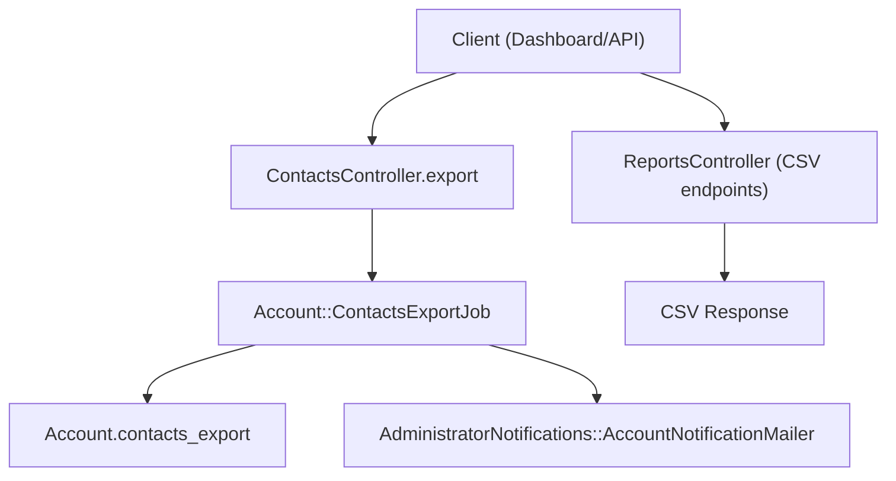
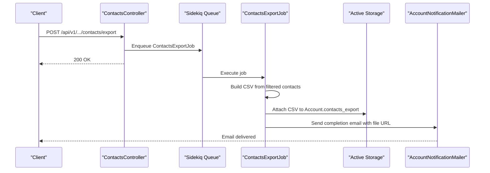
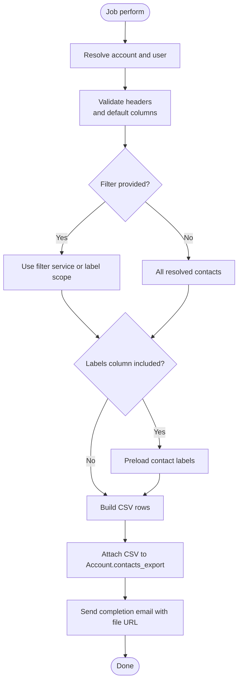
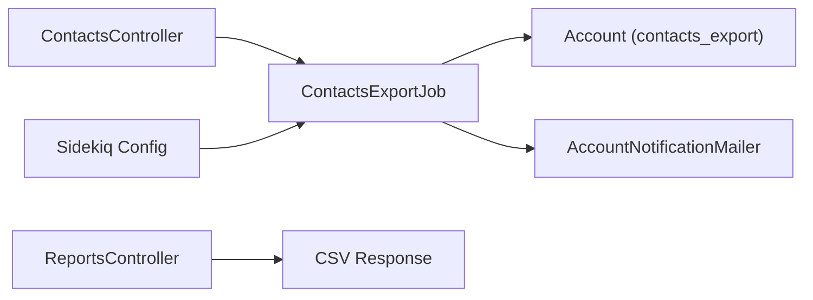

# Export Capabilities

<cite>
**Referenced Files in This Document**
- [contacts_controller.rb](file://app/controllers/api/v1/accounts/contacts_controller.rb)
- [contacts_export_job.rb](file://app/jobs/account/contacts_export_job.rb)
- [account.rb](file://app/models/account.rb)
- [reports_controller.rb](file://app/controllers/api/v2/accounts/reports_controller.rb)
- [downloadHelper.js](file://app/javascript/dashboard/helper/downloadHelper.js)
- [sidekiq.yml](file://config/sidekiq.yml)
- [application.rb](file://config/application.rb)
</cite>

## Table of Contents
1. [Introduction](#introduction)
2. [Project Structure](#project-structure)
3. [Core Components](#core-components)
4. [Architecture Overview](#architecture-overview)
5. [Detailed Component Analysis](#detailed-component-analysis)
6. [Dependency Analysis](#dependency-analysis)
7. [Performance Considerations](#performance-considerations)
8. [Troubleshooting Guide](#troubleshooting-guide)
9. [Conclusion](#conclusion)

## Introduction
This document explains Chatwoot’s data export capabilities with a focus on contacts and reports. It covers supported export formats, background job processing, progress tracking, filters, date ranges, data transformation options, scheduling, notifications, storage integration, security, and performance considerations for large datasets.

## Project Structure
Export functionality spans controllers, jobs, models, helpers, and configuration:
- Contacts export is initiated via an API controller and processed by a background job that generates CSV and attaches it to the account.
- Reports export provides CSV downloads for various report types.
- Frontend helpers support client-side CSV download utilities.
- Background processing uses Sidekiq queues.
- Storage is handled via Active Storage attachments.

**Diagram sources**
- [contacts_controller.rb:45-50](file://app/controllers/api/v1/accounts/contacts_controller.rb#L45-L50)
- [contacts_export_job.rb:1-108](file://app/jobs/account/contacts_export_job.rb#L1-L108)
- [account.rb:113](file://app/models/account.rb#L113)
- [reports_controller.rb:99-103](file://app/controllers/api/v2/accounts/reports_controller.rb#L99-L103)

**Section sources**
- [contacts_controller.rb:45-50](file://app/controllers/api/v1/accounts/contacts_controller.rb#L45-L50)
- [contacts_export_job.rb:1-108](file://app/jobs/account/contacts_export_job.rb#L1-L108)
- [account.rb:113](file://app/models/account.rb#L113)
- [reports_controller.rb:99-103](file://app/controllers/api/v2/accounts/reports_controller.rb#L99-L103)

## Core Components
- Contacts export API endpoint triggers asynchronous CSV generation and email notification.
- Contacts export job builds CSV from filtered contacts, attaches file to the account, and sends completion email.
- Reports controller exposes CSV endpoints for multiple report types.
- Frontend helper provides client-side CSV download utility.
- Sidekiq configuration defines queue priorities used by export jobs.

Key responsibilities:
- API layer validates input and enqueues jobs.
- Job layer performs heavy lifting off the request path.
- Model layer stores exported files via Active Storage.
- Reporting layer renders CSV templates for direct download.

**Section sources**
- [contacts_controller.rb:45-50](file://app/controllers/api/v1/accounts/contacts_controller.rb#L45-L50)
- [contacts_export_job.rb:1-108](file://app/jobs/account/contacts_export_job.rb#L1-L108)
- [reports_controller.rb:21-52](file://app/controllers/api/v2/accounts/reports_controller.rb#L21-L52)
- [downloadHelper.js:4-22](file://app/javascript/dashboard/helper/downloadHelper.js#L4-L22)
- [sidekiq.yml:17-35](file://config/sidekiq.yml#L17-L35)

## Architecture Overview
The export flow separates request handling from processing:
- Clients call the contacts export endpoint or report CSV endpoints.
- Contacts export is queued as a low-priority job.
- The job queries contacts based on filters, generates CSV, attaches it to the account, and emails a link.
- Report CSVs are rendered directly as responses.

**Diagram sources**
- [contacts_controller.rb:45-50](file://app/controllers/api/v1/accounts/contacts_controller.rb#L45-L50)
- [contacts_export_job.rb:19-31](file://app/jobs/account/contacts_export_job.rb#L19-L31)
- [contacts_export_job.rb:79-102](file://app/jobs/account/contacts_export_job.rb#L79-L102)

## Detailed Component Analysis

### Contacts Export API
- Endpoint accepts optional column names and filter parameters (payload or label).
- Delegates to a background job with account and user context.
- Returns immediate success response while processing continues asynchronously.

Supported inputs:
- column_names: list of contact fields to include; defaults to standard columns plus labels.
- payload: structured filter criteria passed to the contact filter service.
- label: single label filter applied to contacts.

Output:
- HTTP 200 with success message; actual file becomes available after job completes.

**Section sources**
- [contacts_controller.rb:45-50](file://app/controllers/api/v1/accounts/contacts_controller.rb#L45-L50)

### Contacts Export Job
Responsibilities:
- Resolve account and requesting user.
- Validate requested headers against allowed contact columns and special labels column.
- Query contacts using either filter service or label scope.
- Preload labels efficiently when needed.
- Generate CSV with UTF-8 BOM for correct spreadsheet encoding.
- Attach CSV to the account and send completion email with downloadable link.

Data transformation:
- Labels are joined into a comma-separated string for the labels column.
- Default columns include id, name, email, phone_number, and labels.

Error handling:
- If no data is generated, attachment is skipped.
- Mail delivery is deferred safely.

**Diagram sources**
- [contacts_export_job.rb:7-15](file://app/jobs/account/contacts_export_job.rb#L7-L15)
- [contacts_export_job.rb:70-77](file://app/jobs/account/contacts_export_job.rb#L70-L77)
- [contacts_export_job.rb:59-68](file://app/jobs/account/contacts_export_job.rb#L59-L68)
- [contacts_export_job.rb:43-57](file://app/jobs/account/contacts_export_job.rb#L43-L57)
- [contacts_export_job.rb:79-102](file://app/jobs/account/contacts_export_job.rb#L79-L102)

**Section sources**
- [contacts_export_job.rb:1-108](file://app/jobs/account/contacts_export_job.rb#L1-L108)

### Reports CSV Export
- Multiple report endpoints render CSV responses directly.
- Common CSV rendering sets content type and disposition headers and renders ERB templates.
- Supports grouping, business hours toggles, and timezone offsets for certain reports.

Supported report types (examples):
- Agents, Inboxes, Labels, Teams, Conversations Summary, Conversation Traffic.

Date range and filters:
- since/until timestamps define the reporting window.
- group_by controls aggregation dimensions.
- business_hours toggles working-hours-aware calculations.
- timezone_offset adjusts time-based metrics.

**Section sources**
- [reports_controller.rb:21-52](file://app/controllers/api/v2/accounts/reports_controller.rb#L21-L52)
- [reports_controller.rb:99-103](file://app/controllers/api/v2/accounts/reports_controller.rb#L99-L103)
- [reports_controller.rb:109-141](file://app/controllers/api/v2/accounts/reports_controller.rb#L109-L141)

### Frontend Download Helper
- Utility functions to create and trigger browser downloads of CSV blobs.
- Generates filenames based on report type and date range.

Usage patterns:
- Convert server-provided CSV content into a Blob and trigger download.
- Compose human-readable filenames including date and business-hours flag.

**Section sources**
- [downloadHelper.js:4-22](file://app/javascript/dashboard/helper/downloadHelper.js#L4-L22)

### Background Processing and Queues
- Contacts export job runs on the low priority queue.
- Sidekiq configuration defines queue order and concurrency settings.
- Jobs can be retried according to global retry policy.

Operational notes:
- Low-priority queue ensures non-blocking operations do not starve critical workloads.
- Concurrency and timeouts are configurable per environment.

**Section sources**
- [contacts_export_job.rb:1-3](file://app/jobs/account/contacts_export_job.rb#L1-L3)
- [sidekiq.yml:1-41](file://config/sidekiq.yml#L1-L41)

### Storage Integration
- Exported CSV files are attached to the Account model via Active Storage.
- A signed URL is generated for secure access to the file.

Security implications:
- Access to the file URL should be protected by application authentication and authorization.
- Ensure storage backend is configured securely and access tokens are not exposed.

**Section sources**
- [account.rb:113](file://app/models/account.rb#L113)
- [contacts_export_job.rb:100-102](file://app/jobs/account/contacts_export_job.rb#L100-L102)

## Dependency Analysis

**Diagram sources**
- [contacts_controller.rb:45-50](file://app/controllers/api/v1/accounts/contacts_controller.rb#L45-L50)
- [contacts_export_job.rb:1-108](file://app/jobs/account/contacts_export_job.rb#L1-L108)
- [account.rb:113](file://app/models/account.rb#L113)
- [reports_controller.rb:99-103](file://app/controllers/api/v2/accounts/reports_controller.rb#L99-L103)
- [sidekiq.yml:17-35](file://config/sidekiq.yml#L17-L35)

**Section sources**
- [contacts_controller.rb:45-50](file://app/controllers/api/v1/accounts/contacts_controller.rb#L45-L50)
- [contacts_export_job.rb:1-108](file://app/jobs/account/contacts_export_job.rb#L1-L108)
- [account.rb:113](file://app/models/account.rb#L113)
- [reports_controller.rb:99-103](file://app/controllers/api/v2/accounts/reports_controller.rb#L99-L103)
- [sidekiq.yml:17-35](file://config/sidekiq.yml#L17-L35)

## Performance Considerations
- Asynchronous processing: Contacts export runs in a background job to avoid blocking requests.
- Efficient querying: Contact filtering leverages services and scopes; labels are preloaded only when needed.
- CSV generation: Uses streaming-safe CSV builder to handle large datasets without excessive memory usage.
- Encoding: UTF-8 BOM ensures compatibility with spreadsheet applications.
- Queue prioritization: Low-priority queue prevents contention with critical tasks.
- Storage: Active Storage attachment is performed once per export; ensure storage backend is optimized for large files.

Recommendations:
- Tune Sidekiq concurrency and worker count based on workload.
- Monitor queue depths and job execution times.
- Partition large exports by date ranges or labels to reduce payload size.
- Configure storage backend for high throughput and durability.

[No sources needed since this section provides general guidance]

## Troubleshooting Guide
Common issues and resolutions:
- Export does not appear: Verify job execution logs and Sidekiq queue status. Check if the job was enqueued and completed successfully.
- Missing labels in CSV: Ensure the labels column is included in column_names and that the user has permission to view labels.
- Incorrect encoding in spreadsheets: Confirm UTF-8 BOM is present; the job prepends BOM automatically.
- Email not received: Check mailer delivery logs and SMTP configuration.
- Large dataset slowdown: Reduce export scope using filters (labels, date ranges) and consider splitting exports.

Access control and security:
- Only authenticated users with appropriate permissions can initiate exports and access report endpoints.
- Exported files are stored as attachments; protect access to the generated URLs through application-level authorization.

Encryption and sensitive data:
- Application supports Active Record encryption for sensitive attributes when configured.
- Ensure encryption keys are properly set in production environments.

**Section sources**
- [contacts_export_job.rb:79-102](file://app/jobs/account/contacts_export_job.rb#L79-L102)
- [application.rb:73-83](file://config/application.rb#L73-L83)

## Conclusion
Chatwoot’s export system provides robust, asynchronous CSV generation for contacts and reports, with clear separation between request handling and processing. It supports flexible filtering, efficient data transformation, and secure storage via Active Storage. For large datasets, leveraging filters, background jobs, and tuned Sidekiq workers ensures reliable performance. Security is enforced through authentication, authorization, and optional encryption configurations.

[No sources needed since this section summarizes without analyzing specific files]