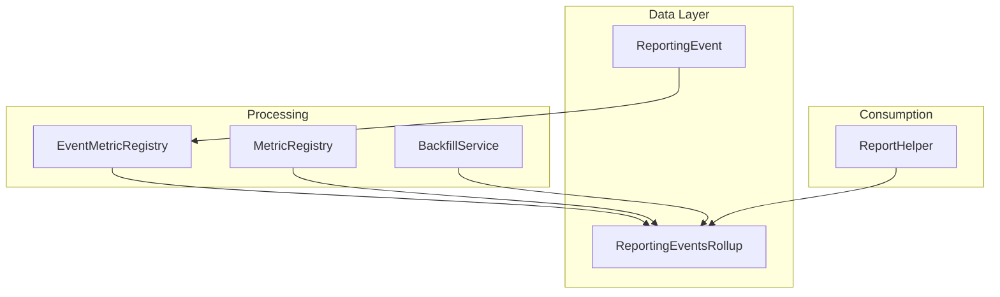
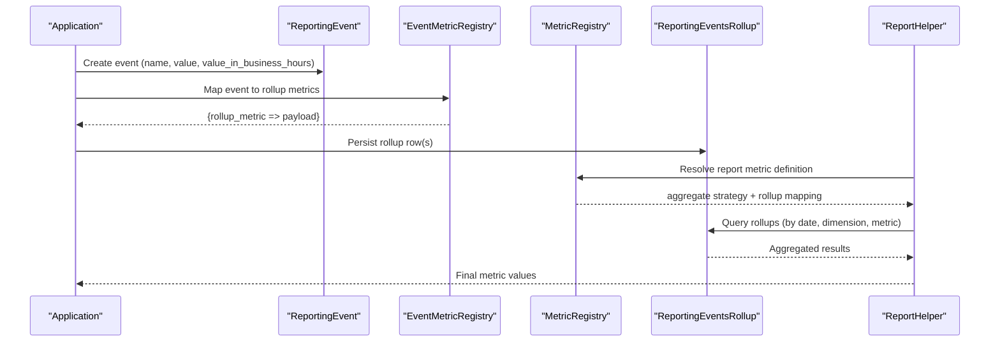
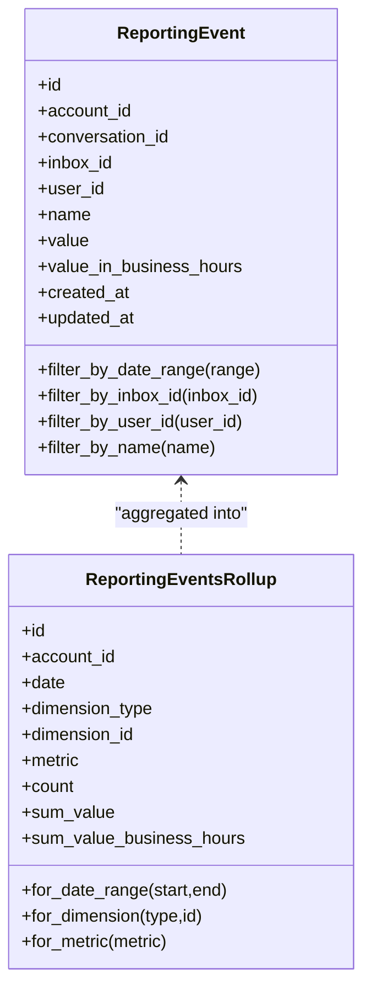
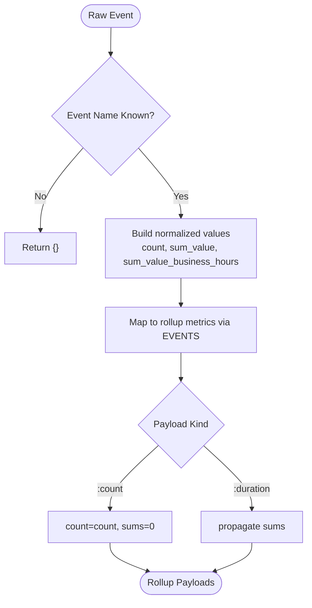
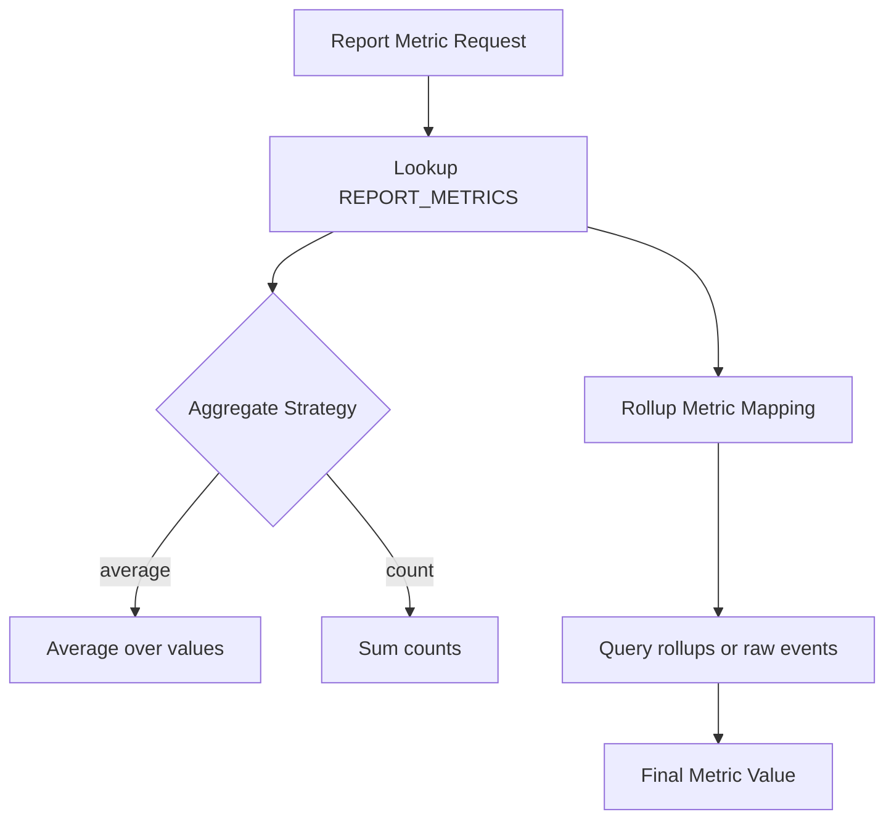
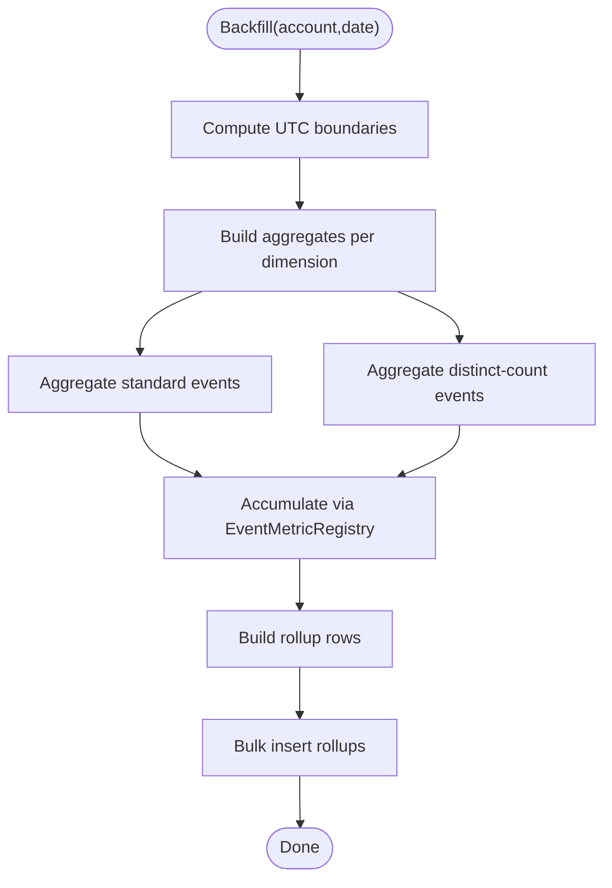
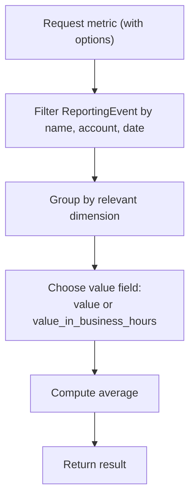
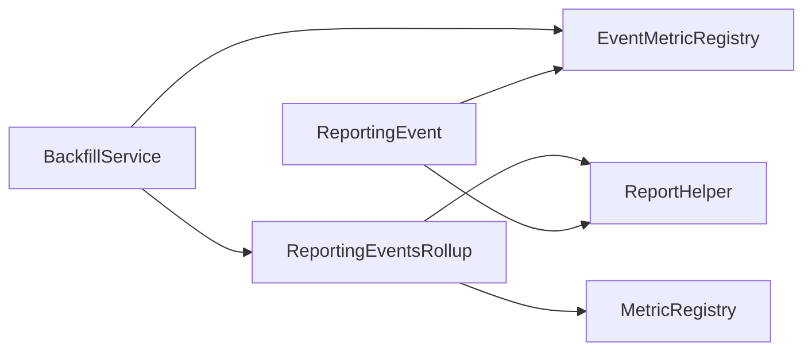

# Performance Metrics

<cite>
**Referenced Files in This Document**
- [reporting_event.rb](file://app/models/reporting_event.rb)
- [reporting_events_rollup.rb](file://app/models/reporting_events_rollup.rb)
- [event_metric_registry.rb](file://app/services/reporting_events/event_metric_registry.rb)
- [metric_registry.rb](file://app/services/reporting_events/metric_registry.rb)
- [backfill_service.rb](file://app/services/reporting_events/backfill_service.rb)
- [report_helper.rb](file://app/helpers/report_helper.rb)
</cite>

## Table of Contents
1. [Introduction](#introduction)
2. [Project Structure](#project-structure)
3. [Core Components](#core-components)
4. [Architecture Overview](#architecture-overview)
5. [Detailed Component Analysis](#detailed-component-analysis)
6. [Dependency Analysis](#dependency-analysis)
7. [Performance Considerations](#performance-considerations)
8. [Troubleshooting Guide](#troubleshooting-guide)
9. [Conclusion](#conclusion)

## Introduction
This document explains Chatwoot’s performance metrics system: how reporting events are emitted, how metrics are collected and aggregated, and how rollups enable efficient analytics. It covers key indicators such as first response time, resolution time, conversation volume, agent productivity, and customer satisfaction signals. It also documents the event metric registry, rollup calculations, dimensional analysis, data retention considerations, query optimization for large datasets, and integration points with external monitoring tools.

## Project Structure
The performance metrics subsystem is centered around:
- Raw event storage and scoping
- Rollup tables for fast aggregation
- Registries that map raw events to rollup metrics and report metrics
- A backfill service that computes historical rollups across dimensions

**Diagram sources**
- [reporting_event.rb:1-57](file://app/models/reporting_event.rb#L1-L57)
- [reporting_events_rollup.rb:1-49](file://app/models/reporting_events_rollup.rb#L1-L49)
- [event_metric_registry.rb:1-80](file://app/services/reporting_events/event_metric_registry.rb#L1-L80)
- [metric_registry.rb:1-108](file://app/services/reporting_events/metric_registry.rb#L1-L108)
- [backfill_service.rb:1-143](file://app/services/reporting_events/backfill_service.rb#L1-L143)
- [report_helper.rb:56-89](file://app/helpers/report_helper.rb#L56-L89)

**Section sources**
- [reporting_event.rb:1-57](file://app/models/reporting_event.rb#L1-L57)
- [reporting_events_rollup.rb:1-49](file://app/models/reporting_events_rollup.rb#L1-L49)
- [event_metric_registry.rb:1-80](file://app/services/reporting_events/event_metric_registry.rb#L1-L80)
- [metric_registry.rb:1-108](file://app/services/reporting_events/metric_registry.rb#L1-L108)
- [backfill_service.rb:1-143](file://app/services/reporting_events/backfill_service.rb#L1-L143)
- [report_helper.rb:56-89](file://app/helpers/report_helper.rb#L56-L89)

## Core Components
- ReportingEvent: Stores raw performance events (e.g., first_response, reply_time, conversation_resolved) with values and business-hours-aware values. Includes scopes for filtering by date range, inbox, user, and name.
- ReportingEventsRollup: Pre-aggregated daily rows per account/dimension/metric with count, sum_value, and sum_value_business_hours. Enumerates supported rollup metrics and provides scopes for date ranges, dimensions, and metrics.
- EventMetricRegistry: Maps raw event names to rollup metric definitions (count or duration payloads).
- MetricRegistry: Bridges report-level metrics to either raw events or rollup metrics, defining aggregation strategies (count, average) and rollup mappings.
- BackfillService: Computes rollups from raw events for a given account and date, supporting multiple dimensions (account, agent, inbox), including distinct-count semantics where required.
- ReportHelper: Provides helper methods to compute averages for key metrics using both raw events and rollups.

Key KPIs covered:
- First Response Time (FRT): avg_first_response_time
- Resolution Time (ART): avg_resolution_time
- Reply Time: reply_time
- Conversation Volume: conversations_count
- Agent Productivity: resolutions_count, bot_resolutions_count, bot_handoffs_count
- Customer Satisfaction: CsatSurveyResponse model exists in the codebase; however, this document focuses on the performance metrics subsystem defined above.

**Section sources**
- [reporting_event.rb:30-56](file://app/models/reporting_event.rb#L30-L56)
- [reporting_events_rollup.rb:24-48](file://app/models/reporting_events_rollup.rb#L24-L48)
- [event_metric_registry.rb:7-24](file://app/services/reporting_events/event_metric_registry.rb#L7-L24)
- [metric_registry.rb:5-38](file://app/services/reporting_events/metric_registry.rb#L5-L38)
- [backfill_service.rb:4-14](file://app/services/reporting_events/backfill_service.rb#L4-L14)
- [report_helper.rb:56-89](file://app/helpers/report_helper.rb#L56-L89)

## Architecture Overview
The metrics pipeline has two primary paths:
- Live path: Events are recorded into ReportingEvent. Reports can read directly from raw events or from precomputed rollups.
- Historical path: BackfillService aggregates raw events into ReportingEventsRollup for faster analytical queries.

**Diagram sources**
- [reporting_event.rb:30-56](file://app/models/reporting_event.rb#L30-L56)
- [event_metric_registry.rb:32-55](file://app/services/reporting_events/event_metric_registry.rb#L32-L55)
- [metric_registry.rb:42-88](file://app/services/reporting_events/metric_registry.rb#L42-L88)
- [reporting_events_rollup.rb:24-48](file://app/models/reporting_events_rollup.rb#L24-L48)
- [report_helper.rb:56-89](file://app/helpers/report_helper.rb#L56-L89)

## Detailed Component Analysis

### Data Models
- ReportingEvent
  - Purpose: Capture granular performance events with timestamps, values, and optional associations (account, conversation, inbox, user).
  - Scopes: Date range, inbox, user, and name filters support efficient querying.
- ReportingEventsRollup
  - Purpose: Store daily aggregated metrics per account and dimension (account, agent, inbox, team).
  - Enums: Supports metrics like resolutions_count, first_response, resolution_time, reply_time, bot_resolutions_count, bot_handoffs_count.
  - Indexes: Optimized for summary and timeseries queries.

**Diagram sources**
- [reporting_event.rb:1-57](file://app/models/reporting_event.rb#L1-L57)
- [reporting_events_rollup.rb:1-49](file://app/models/reporting_events_rollup.rb#L1-L49)

**Section sources**
- [reporting_event.rb:30-56](file://app/models/reporting_event.rb#L30-L56)
- [reporting_events_rollup.rb:24-48](file://app/models/reporting_events_rollup.rb#L24-L48)

### Event Metric Registry
- Purpose: Define which rollup metrics each raw event produces and whether they carry counts or durations.
- Key behavior:
  - Converts a raw event into one or more rollup metric payloads.
  - Enforces payload kinds (:count vs :duration) and normalizes values.

**Diagram sources**
- [event_metric_registry.rb:7-24](file://app/services/reporting_events/event_metric_registry.rb#L7-L24)
- [event_metric_registry.rb:32-79](file://app/services/reporting_events/event_metric_registry.rb#L32-L79)

**Section sources**
- [event_metric_registry.rb:7-24](file://app/services/reporting_events/event_metric_registry.rb#L7-L24)
- [event_metric_registry.rb:32-79](file://app/services/reporting_events/event_metric_registry.rb#L32-L79)

### Metric Registry
- Purpose: Align report-level metrics with underlying data sources (raw events or rollups) and define aggregation strategies.
- Highlights:
  - SUMMARY_METRICS maps high-level summary keys to report metric definitions.
  - EVENT_METRICS expands raw events into rollup metric payloads.
  - REPORT_METRICS defines supported report metrics, their source event/rollup, and aggregation method (count, average).
  - Utility methods expose aggregate strategy, rollup mapping, and raw event name for a given report metric.

**Diagram sources**
- [metric_registry.rb:5-38](file://app/services/reporting_events/metric_registry.rb#L5-L38)
- [metric_registry.rb:42-88](file://app/services/reporting_events/metric_registry.rb#L42-L88)

**Section sources**
- [metric_registry.rb:5-38](file://app/services/reporting_events/metric_registry.rb#L5-L38)
- [metric_registry.rb:42-88](file://app/services/reporting_events/metric_registry.rb#L42-L88)

### Backfill Service
- Purpose: Compute ReportingEventsRollup rows from ReportingEvent for a specific account and date, across multiple dimensions.
- Key behaviors:
  - Splits standard events and distinct-count events (e.g., bot handoffs require COUNT(DISTINCT conversation_id)).
  - Groups by dimension (account, agent, inbox) and aggregates count, sum_value, and sum_value_business_hours.
  - Uses bulk insert for performance.

**Diagram sources**
- [backfill_service.rb:18-35](file://app/services/reporting_events/backfill_service.rb#L18-L35)
- [backfill_service.rb:69-101](file://app/services/reporting_events/backfill_service.rb#L69-L101)
- [backfill_service.rb:103-141](file://app/services/reporting_events/backfill_service.rb#L103-L141)

**Section sources**
- [backfill_service.rb:4-14](file://app/services/reporting_events/backfill_service.rb#L4-L14)
- [backfill_service.rb:69-101](file://app/services/reporting_events/backfill_service.rb#L69-L101)
- [backfill_service.rb:103-141](file://app/services/reporting_events/backfill_service.rb#L103-L141)

### Report Helper
- Purpose: Provide convenient methods to compute averages for core metrics, optionally using business hours.
- Typical usage:
  - Average first response time
  - Average reply time
  - Average resolution time

**Diagram sources**
- [report_helper.rb:56-89](file://app/helpers/report_helper.rb#L56-L89)

**Section sources**
- [report_helper.rb:56-89](file://app/helpers/report_helper.rb#L56-L89)

## Dependency Analysis
- ReportingEvent depends on Account, User, Inbox, Conversation.
- ReportingEventsRollup depends on Account and enumerates supported metrics and dimensions.
- EventMetricRegistry and MetricRegistry are pure logic modules used by processing and reporting layers.
- BackfillService depends on EventMetricRegistry and ReportingEventsRollup.
- ReportHelper consumes ReportingEvent and ReportingEventsRollup to produce report values.

**Diagram sources**
- [reporting_event.rb:30-56](file://app/models/reporting_event.rb#L30-L56)
- [reporting_events_rollup.rb:24-48](file://app/models/reporting_events_rollup.rb#L24-L48)
- [event_metric_registry.rb:32-55](file://app/services/reporting_events/event_metric_registry.rb#L32-L55)
- [metric_registry.rb:42-88](file://app/services/reporting_events/metric_registry.rb#L42-L88)
- [backfill_service.rb:94-101](file://app/services/reporting_events/backfill_service.rb#L94-L101)
- [report_helper.rb:56-89](file://app/helpers/report_helper.rb#L56-L89)

**Section sources**
- [reporting_event.rb:30-56](file://app/models/reporting_event.rb#L30-L56)
- [reporting_events_rollup.rb:24-48](file://app/models/reporting_events_rollup.rb#L24-L48)
- [event_metric_registry.rb:32-55](file://app/services/reporting_events/event_metric_registry.rb#L32-L55)
- [metric_registry.rb:42-88](file://app/services/reporting_events/metric_registry.rb#L42-L88)
- [backfill_service.rb:94-101](file://app/services/reporting_events/backfill_service.rb#L94-L101)
- [report_helper.rb:56-89](file://app/helpers/report_helper.rb#L56-L89)

## Performance Considerations
- Use ReportingEventsRollup for analytical queries to avoid heavy aggregations on raw events at scale.
- Prefer scoped queries (date range, dimension, metric) to leverage indexes on rollups.
- For distinct-count metrics (e.g., bot handoffs), use the dedicated distinct-count aggregation path to ensure correctness.
- When computing averages, choose between wall-clock and business-hours values based on operational needs.
- Bulk insert rollups during backfills to minimize database round-trips.

[No sources needed since this section provides general guidance]

## Troubleshooting Guide
- Missing rollup data:
  - Verify backfill ran for the target date and account.
  - Confirm dimension groupings (account, agent, inbox) match expected IDs.
- Incorrect averages:
  - Ensure you select the correct value field (value vs value_in_business_hours).
  - Validate that the metric’s aggregate strategy matches expectations (count vs average).
- Unknown metric errors:
  - Check that the metric is defined in MetricRegistry and EventMetricRegistry if it relies on raw events.
- Distinct-count anomalies:
  - Confirm that distinct-conversation counting is applied for bot handoff metrics.

**Section sources**
- [backfill_service.rb:10-14](file://app/services/reporting_events/backfill_service.rb#L10-L14)
- [metric_registry.rb:27-38](file://app/services/reporting_events/metric_registry.rb#L27-L38)
- [event_metric_registry.rb:7-24](file://app/services/reporting_events/event_metric_registry.rb#L7-L24)

## Conclusion
Chatwoot’s performance metrics system separates raw event capture from precomputed rollups to deliver fast, scalable analytics. Registries provide a clear contract between raw events, rollup metrics, and report metrics, while the backfill service ensures historical accuracy across dimensions. By leveraging rollups and scoped queries, teams can efficiently monitor first response time, resolution time, reply time, conversation volume, and agent productivity. The design supports extensibility for additional metrics and integrates cleanly with external monitoring through well-defined data models and aggregation strategies.

[No sources needed since this section summarizes without analyzing specific files]