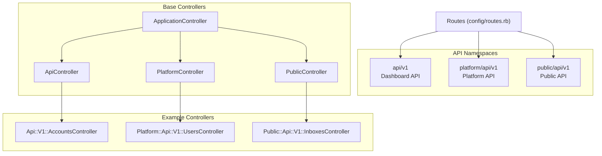
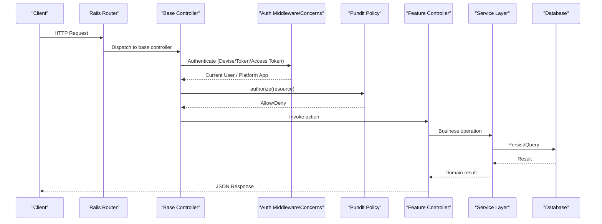
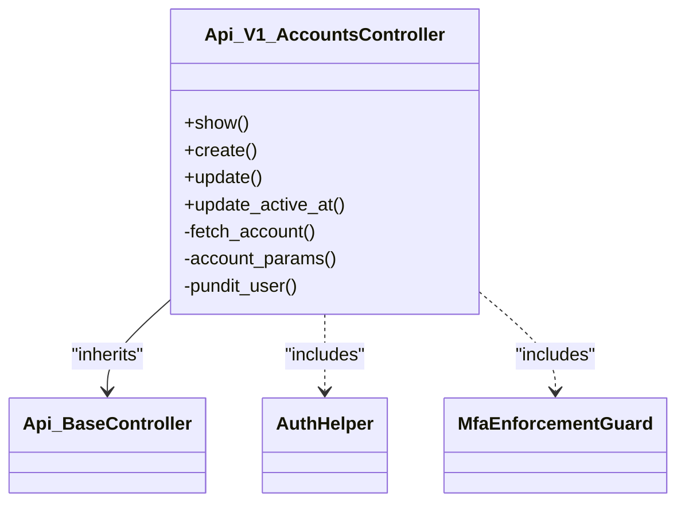
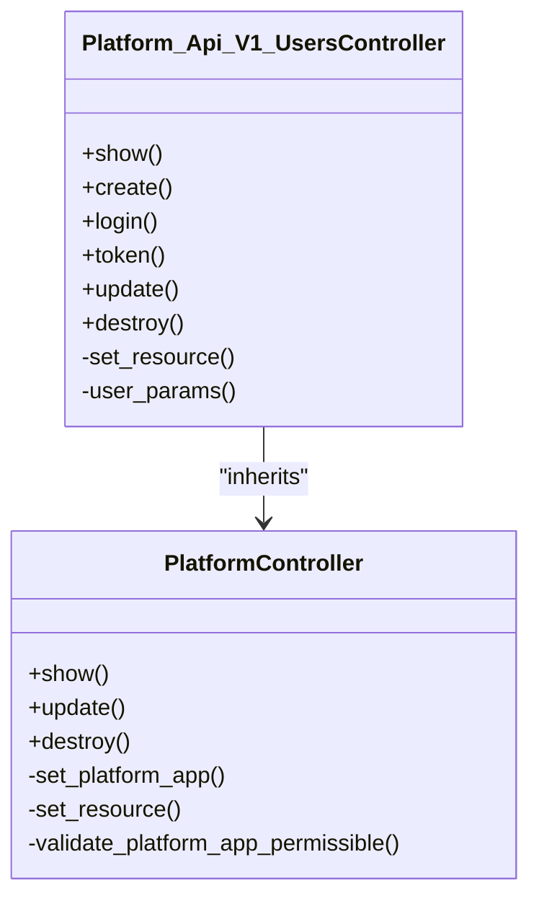
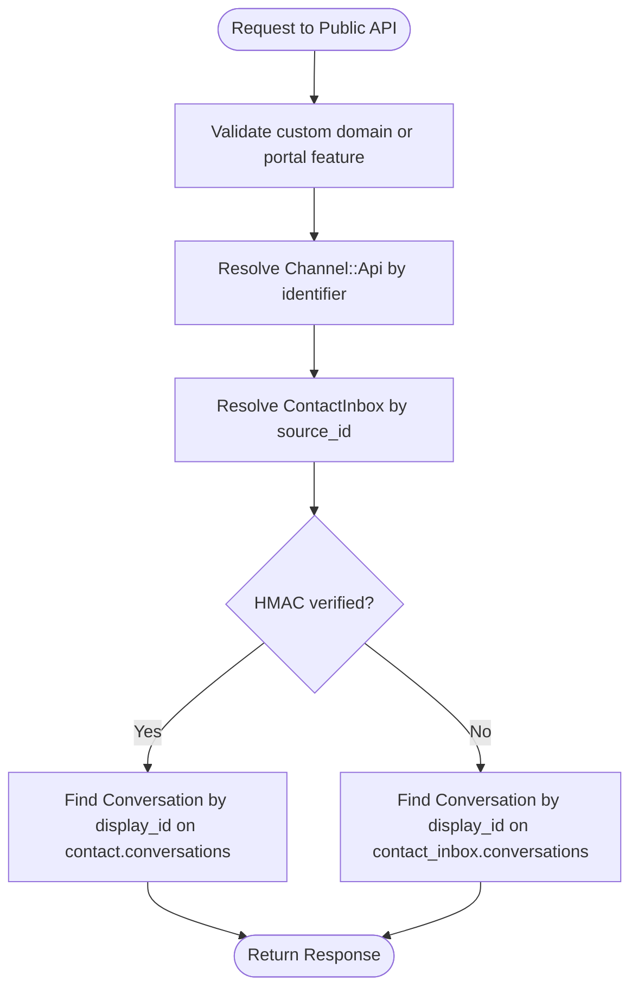
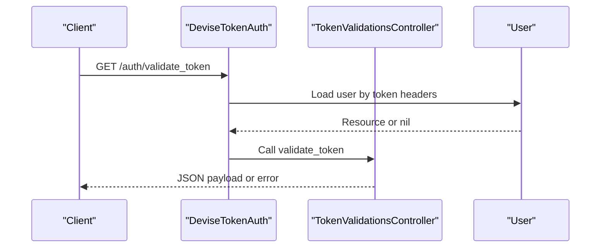
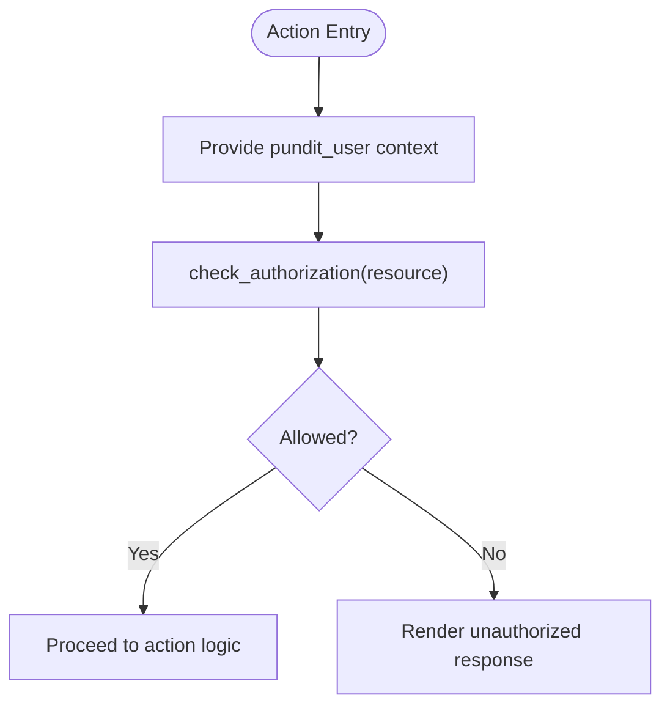
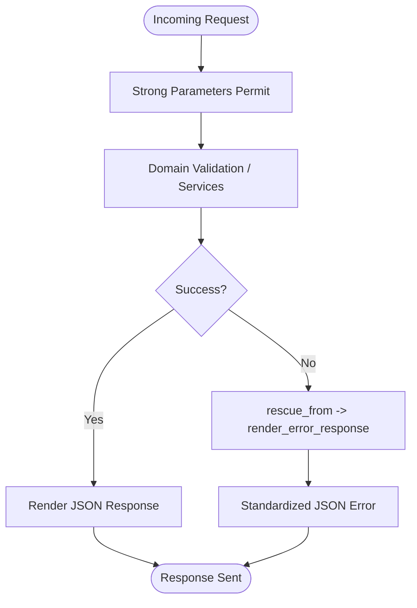
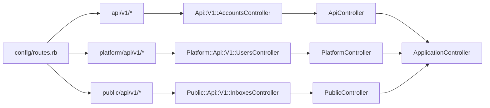

# API Layer Design

<cite>
**Referenced Files in This Document**
- [routes.rb](file://config/routes.rb)
- [application_controller.rb](file://app/controllers/application_controller.rb)
- [api_controller.rb](file://app/controllers/api_controller.rb)
- [platform_controller.rb](file://app/controllers/platform_controller.rb)
- [public_controller.rb](file://app/controllers/public_controller.rb)
- [accounts_controller.rb](file://app/controllers/api/v1/accounts_controller.rb)
- [users_controller.rb](file://app/controllers/platform/api/v1/users_controller.rb)
- [inboxes_controller.rb](file://app/controllers/public/api/v1/inboxes_controller.rb)
- [devise_overrides/token_validations_controller.rb](file://app/controllers/devise_overrides/token_validations_controller.rb)
- [devise.rb](file://config/initializers/devise.rb)
- [token_service.rb](file://app/services/widget/token_service.rb)
</cite>

## Table of Contents
1. [Introduction](#introduction)
2. [Project Structure](#project-structure)
3. [Core Components](#core-components)
4. [Architecture Overview](#architecture-overview)
5. [Detailed Component Analysis](#detailed-component-analysis)
6. [Dependency Analysis](#dependency-analysis)
7. [Performance Considerations](#performance-considerations)
8. [Troubleshooting Guide](#troubleshooting-guide)
9. [Conclusion](#conclusion)

## Introduction
This document explains Chatwoot’s API layer architecture with a focus on RESTful design patterns, controller hierarchy, request/response lifecycle, parameter validation, error handling, API versioning, authentication (Devise and token management), authorization (Pundit), and security considerations across the v1 dashboard API, platform API, and public API.

## Project Structure
Chatwoot organizes its APIs under three primary namespaces:
- Dashboard API: api/v1 for account-scoped resources used by the web dashboard and integrations.
- Platform API: platform/api/v1 for programmatic access via platform apps using access tokens.
- Public API: public/api/v1 for contact-facing endpoints exposed to external channels and portals.

**Diagram sources**
- [routes.rb:48-695](file://config/routes.rb#L48-L695)
- [application_controller.rb](file://app/controllers/application_controller.rb)
- [api_controller.rb](file://app/controllers/api_controller.rb)
- [platform_controller.rb](file://app/controllers/platform_controller.rb)
- [public_controller.rb](file://app/controllers/public_controller.rb)
- [accounts_controller.rb](file://app/controllers/api/v1/accounts_controller.rb)
- [users_controller.rb](file://app/controllers/platform/api/v1/users_controller.rb)
- [inboxes_controller.rb](file://app/controllers/public/api/v1/inboxes_controller.rb)

**Section sources**
- [routes.rb:48-695](file://config/routes.rb#L48-L695)

## Core Components
- Application base: ApplicationController provides shared behavior for all controllers.
- API base: ApiController extends application behavior for JSON responses and health/status helpers.
- Platform base: PlatformController enforces platform app access token authentication and permissibility checks.
- Public base: PublicController handles custom domain validation and portal feature gating for public endpoints.

Key responsibilities:
- Authentication: Devise + DeviseTokenAuth for user sessions and token-based auth; platform access tokens for platform API.
- Authorization: Pundit policies invoked from controllers to enforce resource-level access control.
- Error handling: Centralized exception handling and consistent JSON error responses.
- Parameter validation: Strong parameters and explicit permit lists in controllers.

**Section sources**
- [application_controller.rb](file://app/controllers/application_controller.rb)
- [api_controller.rb:1-26](file://app/controllers/api_controller.rb#L1-L26)
- [platform_controller.rb:1-34](file://app/controllers/platform_controller.rb#L1-L34)
- [public_controller.rb:1-29](file://app/controllers/public_controller.rb#L1-L29)

## Architecture Overview
The API layer is layered as follows:
- Routes define namespace-scoped endpoints for each API surface.
- Base controllers encapsulate cross-cutting concerns (auth, error handling, response formatting).
- Feature controllers implement business logic and delegate to services/presenters/models.

[No sources needed since this diagram shows conceptual workflow, not actual code structure]

## Detailed Component Analysis

### Dashboard API (api/v1)
- Namespace and versioning: All dashboard endpoints are under api/v1.
- Authentication: Primarily Devise + DeviseTokenAuth; some endpoints support access-token-based auth.
- Authorization: Pundit policies are applied via before_action hooks in controllers.
- Example: AccountsController demonstrates signup flows, account scoping, MFA enforcement, and settings updates.

**Diagram sources**
- [accounts_controller.rb:1-189](file://app/controllers/api/v1/accounts_controller.rb#L1-L189)

**Section sources**
- [accounts_controller.rb:1-189](file://app/controllers/api/v1/accounts_controller.rb#L1-L189)
- [routes.rb:48-576](file://config/routes.rb#L48-L576)

### Platform API (platform/api/v1)
- Authentication: Access token-based via PlatformController’s ensure_access_token and set_platform_app.
- Authorization: Per-resource permissibility enforced by validate_platform_app_permissible.
- Example: UsersController creates users, generates SSO login links, updates attributes, and schedules deletions.

**Diagram sources**
- [platform_controller.rb:1-34](file://app/controllers/platform_controller.rb#L1-L34)
- [users_controller.rb:1-58](file://app/controllers/platform/api/v1/users_controller.rb#L1-L58)

**Section sources**
- [platform_controller.rb:1-34](file://app/controllers/platform_controller.rb#L1-L34)
- [users_controller.rb:1-58](file://app/controllers/platform/api/v1/users_controller.rb#L1-L58)
- [routes.rb:647-669](file://config/routes.rb#L647-L669)

### Public API (public/api/v1)
- Authentication: No user auth; relies on channel identifiers and HMAC verification where applicable.
- Security: Custom domain validation and portal feature gating.
- Example: InboxesController resolves inbox, contact_inbox, and conversation based on path params and HMAC status.

**Diagram sources**
- [public_controller.rb:1-29](file://app/controllers/public_controller.rb#L1-L29)
- [inboxes_controller.rb:1-34](file://app/controllers/public/api/v1/inboxes_controller.rb#L1-L34)

**Section sources**
- [public_controller.rb:1-29](file://app/controllers/public_controller.rb#L1-L29)
- [inboxes_controller.rb:1-34](file://app/controllers/public/api/v1/inboxes_controller.rb#L1-L34)
- [routes.rb:673-695](file://config/routes.rb#L673-L695)

### Authentication Mechanisms
- Devise integration: Configured via initializers and routes mapping to overridden controllers for confirmations, passwords, sessions, token validations, and omniauth callbacks.
- Token validation: DeviseOverrides::TokenValidationsController renders JSON payload when a valid token is present.
- Widget JWT: Widget::TokenService encodes JWT payloads with configurable expiry.

**Diagram sources**
- [routes.rb:3-9](file://config/routes.rb#L3-L9)
- [devise_overrides/token_validations_controller.rb:1-10](file://app/controllers/devise_overrides/token_validations_controller.rb#L1-L10)
- [devise.rb:25-117](file://config/initializers/devise.rb#L25-L117)

**Section sources**
- [routes.rb:3-9](file://config/routes.rb#L3-L9)
- [devise_overrides/token_validations_controller.rb:1-10](file://app/controllers/devise_overrides/token_validations_controller.rb#L1-L10)
- [devise.rb:25-117](file://config/initializers/devise.rb#L25-L117)
- [token_service.rb:1-27](file://app/services/widget/token_service.rb#L1-L27)

### Authorization Policies (Pundit)
- Pattern: Controllers include Pundit and provide pundit_user context; before_action :check_authorization enforces policy decisions.
- Example: Api::V1::AccountsController supplies user/account/account_user context for policies.

**Diagram sources**
- [accounts_controller.rb:180-186](file://app/controllers/api/v1/accounts_controller.rb#L180-L186)

**Section sources**
- [accounts_controller.rb:180-186](file://app/controllers/api/v1/accounts_controller.rb#L180-L186)

### Request/Response Lifecycle and Error Handling
- Base controllers include common concerns such as request exception handling and token-based auth helpers.
- Controllers use rescue_from to map domain exceptions to standardized JSON error responses.
- Parameter validation uses strong parameters with explicit permit lists.

**Diagram sources**
- [accounts_controller.rb:16-21](file://app/controllers/api/v1/accounts_controller.rb#L16-L21)
- [platform_controller.rb:1-34](file://app/controllers/platform_controller.rb#L1-L34)
- [public_controller.rb:1-29](file://app/controllers/public_controller.rb#L1-L29)

**Section sources**
- [accounts_controller.rb:16-21](file://app/controllers/api/v1/accounts_controller.rb#L16-L21)
- [platform_controller.rb:1-34](file://app/controllers/platform_controller.rb#L1-L34)
- [public_controller.rb:1-29](file://app/controllers/public_controller.rb#L1-L29)

### API Versioning Approach
- Versioned namespaces: api/v1 and api/v2 for dashboard APIs; platform/api/v1 and public/api/v1 for their respective surfaces.
- Route definitions clearly separate versions and features, enabling parallel evolution without breaking clients.

**Section sources**
- [routes.rb:48-617](file://config/routes.rb#L48-L617)
- [routes.rb:647-695](file://config/routes.rb#L647-L695)

### Typical Controller Implementations
- Api::V1::AccountsController: Demonstrates multi-step signup, account scoping, MFA enforcement, settings updates, and Pundit context setup.
- Platform::Api::V1::UsersController: Shows platform app-driven user lifecycle and SSO link generation.
- Public::Api::V1::InboxesController: Illustrates public endpoint resolution with HMAC-aware conversation lookup.

**Section sources**
- [accounts_controller.rb:1-189](file://app/controllers/api/v1/accounts_controller.rb#L1-L189)
- [users_controller.rb:1-58](file://app/controllers/platform/api/v1/users_controller.rb#L1-L58)
- [inboxes_controller.rb:1-34](file://app/controllers/public/api/v1/inboxes_controller.rb#L1-L34)

## Dependency Analysis

**Diagram sources**
- [routes.rb:48-695](file://config/routes.rb#L48-L695)
- [api_controller.rb:1-26](file://app/controllers/api_controller.rb#L1-L26)
- [platform_controller.rb:1-34](file://app/controllers/platform_controller.rb#L1-L34)
- [public_controller.rb:1-29](file://app/controllers/public_controller.rb#L1-L29)
- [accounts_controller.rb:1-189](file://app/controllers/api/v1/accounts_controller.rb#L1-L189)
- [users_controller.rb:1-58](file://app/controllers/platform/api/v1/users_controller.rb#L1-L58)
- [inboxes_controller.rb:1-34](file://app/controllers/public/api/v1/inboxes_controller.rb#L1-L34)

**Section sources**
- [routes.rb:48-695](file://config/routes.rb#L48-L695)

## Performance Considerations
- Prefer ActionController::API for stateless JSON APIs to reduce middleware overhead.
- Use background jobs for heavy operations (e.g., data imports, branding enrichment).
- Cache read-heavy endpoints with appropriate cache headers.
- Limit database queries by scoping resources early and leveraging associations.

[No sources needed since this section provides general guidance]

## Troubleshooting Guide
- Authentication failures:
  - Verify DeviseTokenAuth headers and token validity via /auth/validate_token.
  - Ensure platform access tokens belong to permissible resources.
- Authorization errors:
  - Confirm pundit_user context includes required entities.
  - Review policy methods for the target resource.
- Parameter validation issues:
  - Ensure permitted parameters match controller permit lists.
- Public API domain issues:
  - Validate custom domain registration and portal feature flags.

**Section sources**
- [devise_overrides/token_validations_controller.rb:1-10](file://app/controllers/devise_overrides/token_validations_controller.rb#L1-L10)
- [platform_controller.rb:18-32](file://app/controllers/platform_controller.rb#L18-L32)
- [accounts_controller.rb:180-186](file://app/controllers/api/v1/accounts_controller.rb#L180-L186)
- [public_controller.rb:9-27](file://app/controllers/public_controller.rb#L9-L27)

## Conclusion
Chatwoot’s API layer employs clear namespace-based versioning, robust base controllers for cross-cutting concerns, and consistent authentication and authorization patterns across dashboard, platform, and public APIs. Controllers emphasize strong parameter validation, centralized error handling, and service-layer delegation, ensuring maintainability and scalability.

[No sources needed since this section summarizes without analyzing specific files]