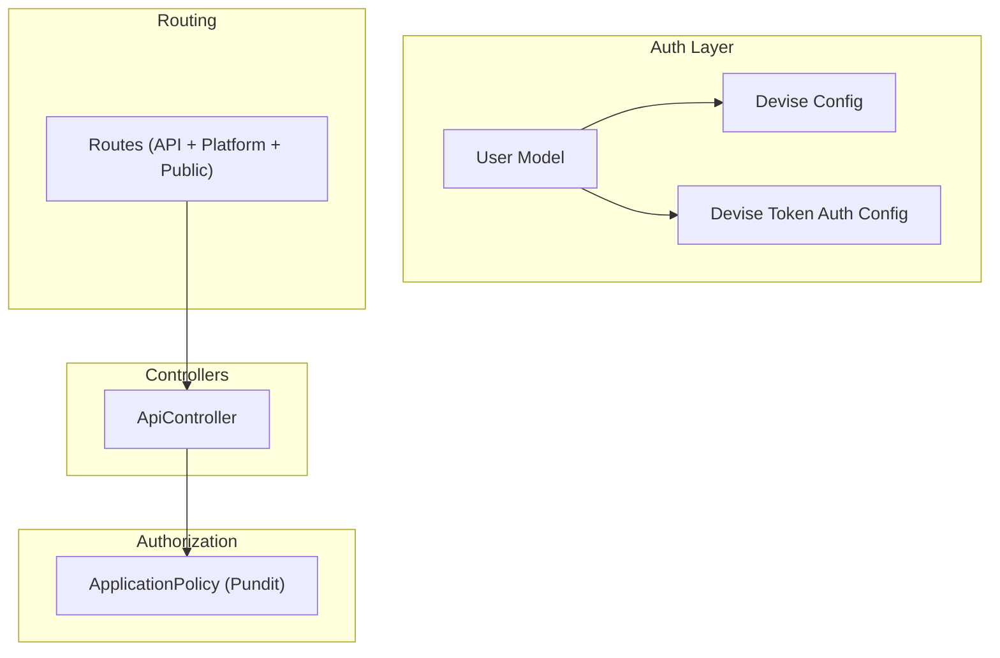
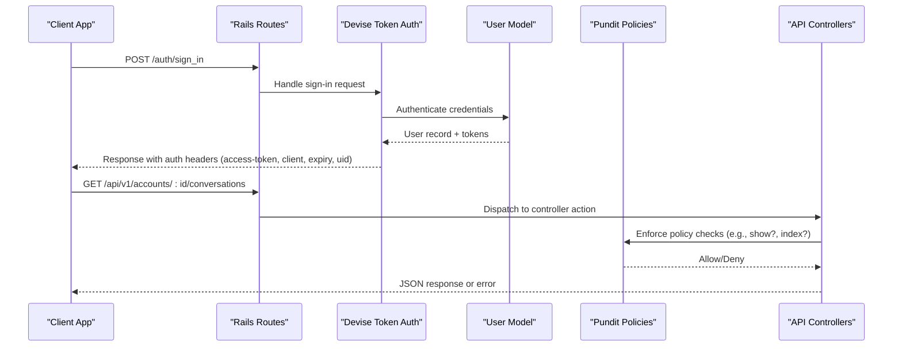
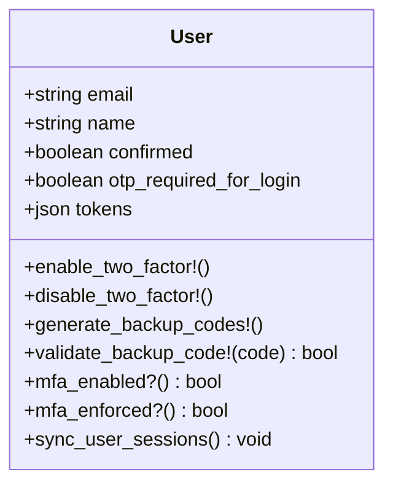
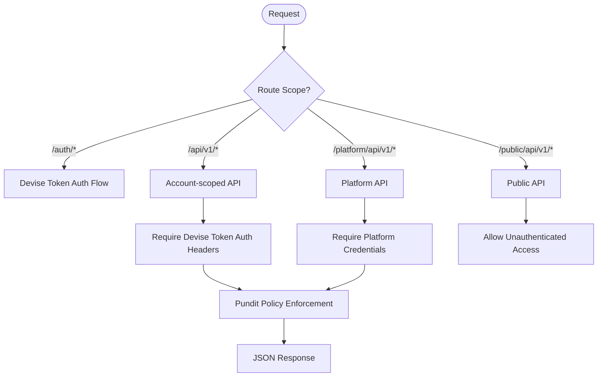
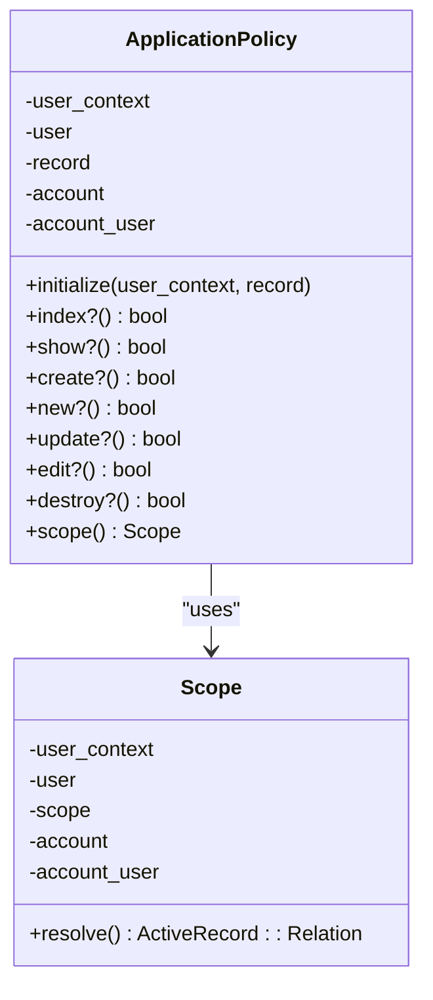
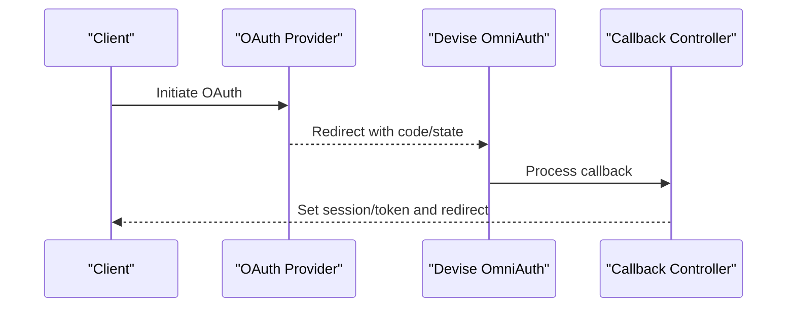
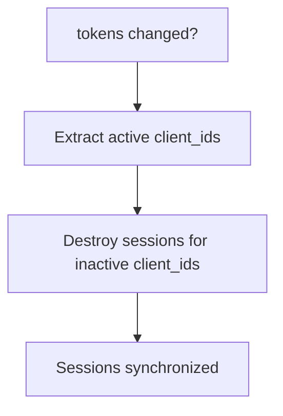
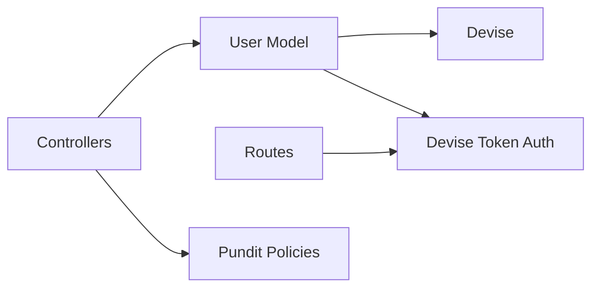

# Authentication & Authorization

<cite>
**Referenced Files in This Document**
- [user.rb](file://app/models/user.rb)
- [devise.rb](file://config/initializers/devise.rb)
- [devise_token_auth.rb](file://config/initializers/devise_token_auth.rb)
- [routes.rb](file://config/routes.rb)
- [application_policy.rb](file://app/policies/application_policy.rb)
- [api_controller.rb](file://app/controllers/api_controller.rb)
</cite>

## Table of Contents
1. [Introduction](#introduction)
2. [Project Structure](#project-structure)
3. [Core Components](#core-components)
4. [Architecture Overview](#architecture-overview)
5. [Detailed Component Analysis](#detailed-component-analysis)
6. [Dependency Analysis](#dependency-analysis)
7. [Performance Considerations](#performance-considerations)
8. [Troubleshooting Guide](#troubleshooting-guide)
9. [Conclusion](#conclusion)

## Introduction
This document explains Chatwoot’s authentication and authorization system, focusing on:
- Multi-layered authentication using Devise for web sessions and Devise Token Auth for API access
- JWT token lifecycle, refresh behavior, and session synchronization
- Authorization via Pundit with policy classes and role-based access control
- OAuth integration patterns and platform/API key authentication
- Security considerations for token storage and transmission
- Examples of protected routes, policy enforcement, and custom authorization logic

## Project Structure
The authentication and authorization features are implemented across models, initializers, routes, controllers, and policies:
- User model integrates Devise and Devise Token Auth modules
- Initializers configure Devise and Devise Token Auth behavior
- Routes mount Devise Token Auth endpoints and define API scopes
- Policies implement resource-level authorization via Pundit
- Controllers enforce current user context and skip auth where appropriate

**Diagram sources**
- [user.rb:48-68](file://app/models/user.rb#L48-L68)
- [devise.rb:1-275](file://config/initializers/devise.rb#L1-L275)
- [devise_token_auth.rb:1-53](file://config/initializers/devise_token_auth.rb#L1-L53)
- [routes.rb:1-10](file://config/routes.rb#L1-L10)
- [application_policy.rb:1-60](file://app/policies/application_policy.rb#L1-L60)
- [api_controller.rb:1-26](file://app/controllers/api_controller.rb#L1-L26)

**Section sources**
- [user.rb:48-68](file://app/models/user.rb#L48-L68)
- [devise.rb:1-275](file://config/initializers/devise.rb#L1-L275)
- [devise_token_auth.rb:1-53](file://config/initializers/devise_token_auth.rb#L1-L53)
- [routes.rb:1-10](file://config/routes.rb#L1-L10)
- [application_policy.rb:1-60](file://app/policies/application_policy.rb#L1-L60)
- [api_controller.rb:1-26](file://app/controllers/api_controller.rb#L1-L26)

## Core Components
- User model: Integrates Devise and Devise Token Auth, supports email/password, confirmation, recovery, tracking, two-factor auth, and OmniAuth providers (Google OAuth2, SAML). It also manages MFA delegation and session synchronization based on stored tokens.
- Devise initializer: Configures mailer, case-insensitive email handling, password rules, reconfirmation, remember me, sign-out behavior, and OmniAuth path prefix.
- Devise Token Auth initializer: Sets token lifespan, header rotation behavior, device concurrency limits, and legacy Devise support toggle.
- Routes: Mounts Devise Token Auth under /auth, defines account-scoped API routes, platform APIs, public APIs, and various OAuth callback routes.
- Pundit ApplicationPolicy: Provides base authorization methods and a scope resolver that delegates to Pundit policy scopes.
- ApiController: Base controller for API endpoints, skipping current user setup for specific actions and exposing health/status endpoints.

**Section sources**
- [user.rb:48-68](file://app/models/user.rb#L48-L68)
- [user.rb:193-256](file://app/models/user.rb#L193-L256)
- [devise.rb:1-275](file://config/initializers/devise.rb#L1-L275)
- [devise_token_auth.rb:1-53](file://config/initializers/devise_token_auth.rb#L1-L53)
- [routes.rb:1-10](file://config/routes.rb#L1-L10)
- [application_policy.rb:1-60](file://app/policies/application_policy.rb#L1-L60)
- [api_controller.rb:1-26](file://app/controllers/api_controller.rb#L1-L26)

## Architecture Overview
Chatwoot uses a layered approach:
- Web sessions: Devise handles browser-based authentication flows (sign-in, sign-out, confirmations, password resets).
- API access: Devise Token Auth issues and validates JWT-like tokens via headers; clients must include required headers.
- Authorization: Pundit enforces resource-level permissions through policy classes, scoped by account and user roles.
- OAuth integrations: OmniAuth providers (Google OAuth2, SAML) integrate with Devise; additional channel-specific OAuth flows exist under dedicated namespaces.
- Platform and public APIs: Separate route namespaces for platform integrations and contact-facing APIs.

**Diagram sources**
- [routes.rb:1-10](file://config/routes.rb#L1-L10)
- [user.rb:48-68](file://app/models/user.rb#L48-L68)
- [application_policy.rb:1-60](file://app/policies/application_policy.rb#L1-L60)

## Detailed Component Analysis

### User Model and Devise Integration
- The User model includes Devise modules for database authentication, registration, recovery, rememberability, trackability, validation, confirmation, password requirements, and two-factor authentication.
- OmniAuth is configured for Google OAuth2 and SAML.
- MFA functionality is delegated to a service object for separation of concerns.
- Email change flow includes a workaround for a known Devise race condition vulnerability.
- Token synchronization ensures only active client IDs remain in the user’s token store.

**Diagram sources**
- [user.rb:48-68](file://app/models/user.rb#L48-L68)
- [user.rb:203-256](file://app/models/user.rb#L203-L256)

**Section sources**
- [user.rb:48-68](file://app/models/user.rb#L48-L68)
- [user.rb:193-256](file://app/models/user.rb#L193-L256)

### Devise Configuration
Key behaviors:
- Mailer sender and parent mailer configuration
- Case-insensitive and whitespace-stripped email keys
- Password length constraints and reconfirmation enabled
- Remember me expiration on sign out
- Sign-out via DELETE method
- OmniAuth path prefix guidance

Security notes:
- Uses application secret_key_base for token generation
- Skips session storage for HTTP auth strategy
- Configurable timeout and lock strategies available

**Section sources**
- [devise.rb:1-275](file://config/initializers/devise.rb#L1-L275)

### Devise Token Auth Configuration
Key behaviors:
- Headers do not rotate on each request (change_headers_on_each_request = false)
- Token lifespan set to 2 months
- Tokens removed after password reset
- Max concurrent devices per user set to 25
- Legacy Devise support toggle available

Token management implications:
- Clients should persist received headers (access-token, client, expiry, uid)
- Token refresh is not automatic; clients must handle expiration and re-authentication

**Section sources**
- [devise_token_auth.rb:1-53](file://config/initializers/devise_token_auth.rb#L1-L53)

### Routing and Protected Endpoints
- Devise Token Auth mounted at /auth with overridden controllers for confirmations, passwords, sessions, token validations, and omniauth callbacks.
- Account-scoped API routes under /api/v1/accounts/:account_id provide resource endpoints for conversations, contacts, inboxes, etc.
- Platform API routes under /platform/api/v1 expose admin-level operations for users and accounts.
- Public API routes under /public/api/v1 allow contact-facing interactions without user authentication.

Protected routes examples:
- Account-scoped resources require authenticated users via Devise Token Auth headers.
- Profile endpoints (MFA, sessions, trusted devices) require authentication.
- Platform endpoints require platform-level authorization.

**Diagram sources**
- [routes.rb:1-10](file://config/routes.rb#L1-L10)
- [routes.rb:48-618](file://config/routes.rb#L48-L618)
- [routes.rb:647-669](file://config/routes.rb#L647-L669)
- [routes.rb:673-695](file://config/routes.rb#L673-L695)

**Section sources**
- [routes.rb:1-10](file://config/routes.rb#L1-L10)
- [routes.rb:48-618](file://config/routes.rb#L48-L618)
- [routes.rb:647-669](file://config/routes.rb#L647-L669)
- [routes.rb:673-695](file://config/routes.rb#L673-L695)

### Authorization with Pundit
- ApplicationPolicy provides default deny-by-default methods (index?, create?, update?, destroy?) and a show? method that checks record existence within a scope.
- The policy scope resolves via Pundit.policy_scope!, allowing per-resource scoping rules.
- Controllers typically use Pundit to authorize actions before performing updates or deletions.

Role-based access control:
- While this document focuses on the base policy structure, Chatwoot implements numerous domain-specific policies (e.g., conversation_policy.rb, inbox_policy.rb) to enforce agent/admin/super-admin permissions.
- Policies operate over the current user context including user, account, and account_user to determine permissions.

**Diagram sources**
- [application_policy.rb:1-60](file://app/policies/application_policy.rb#L1-L60)

**Section sources**
- [application_policy.rb:1-60](file://app/policies/application_policy.rb#L1-L60)

### OAuth Integration Patterns
- Devise OmniAuth configured for Google OAuth2 and SAML.
- Routes define callback endpoints for various providers (Google, Microsoft, Instagram, TikTok, Notion).
- Channel-specific authorization endpoints exist under api/v1 namespaces (twitter, microsoft, google, instagram, tiktok, notion, whatsapp).

Flow overview:
- Client initiates OAuth via provider
- Provider redirects back to callback endpoint
- Backend authenticates and links or creates user/session accordingly

**Diagram sources**
- [user.rb:59-68](file://app/models/user.rb#L59-L68)
- [routes.rb:763-767](file://config/routes.rb#L763-L767)

**Section sources**
- [user.rb:59-68](file://app/models/user.rb#L59-L68)
- [routes.rb:763-767](file://config/routes.rb#L763-L767)

### API Key and Platform Authentication
- Platform API routes under /platform/api/v1 expose endpoints for managing users and accounts, intended for platform integrations.
- These routes likely require platform-level credentials distinct from user tokens.

Security considerations:
- Use strong secrets and restrict IP ranges where possible
- Rotate platform app secrets periodically
- Validate scopes and permissions strictly

**Section sources**
- [routes.rb:647-669](file://config/routes.rb#L647-L669)

### Session Handling and Token Sync
- User model synchronizes user sessions when tokens change, removing inactive client IDs.
- Devise Token Auth stores tokens per client; max devices limit prevents excessive concurrent sessions.

**Diagram sources**
- [user.rb:253-256](file://app/models/user.rb#L253-L256)

**Section sources**
- [user.rb:253-256](file://app/models/user.rb#L253-L256)

## Dependency Analysis
- User depends on Devise and Devise Token Auth modules for authentication and token management.
- Routes depend on Devise Token Auth mounting and controller overrides.
- Policies depend on Pundit for scope resolution and authorization decisions.
- Controllers rely on current user context established by Devise/Devise Token Auth and apply Pundit policies.

**Diagram sources**
- [user.rb:48-68](file://app/models/user.rb#L48-L68)
- [routes.rb:1-10](file://config/routes.rb#L1-L10)
- [application_policy.rb:1-60](file://app/policies/application_policy.rb#L1-L60)

**Section sources**
- [user.rb:48-68](file://app/models/user.rb#L48-L68)
- [routes.rb:1-10](file://config/routes.rb#L1-L10)
- [application_policy.rb:1-60](file://app/policies/application_policy.rb#L1-L60)

## Performance Considerations
- Token header rotation disabled reduces overhead but requires clients to manage token persistence.
- Max devices per user capped at 25 to prevent resource exhaustion.
- Pundit policy scopes should be optimized to avoid N+1 queries and heavy computations.
- Avoid unnecessary session sync operations; ensure token changes are minimal.

[No sources needed since this section provides general guidance]

## Troubleshooting Guide
Common issues and resolutions:
- Missing or invalid auth headers: Ensure clients send access-token, client, expiry, and uid headers for API requests.
- Token expiration: Refresh tokens by re-authenticating via /auth/sign_in or implementing token refresh logic on the client side.
- Too many concurrent devices: Exceeding max devices removes oldest tokens; adjust config if necessary.
- Email confirmation failures: Verify Devise mailer configuration and check for the race condition workaround in User model.
- Policy denials: Review Pundit policy implementations for the affected resource and ensure correct user/account context.

**Section sources**
- [devise_token_auth.rb:1-53](file://config/initializers/devise_token_auth.rb#L1-L53)
- [user.rb:232-249](file://app/models/user.rb#L232-L249)
- [application_policy.rb:1-60](file://app/policies/application_policy.rb#L1-L60)

## Conclusion
Chatwoot’s authentication and authorization system combines Devise for web sessions and Devise Token Auth for API access, with robust configuration for token lifespan, device concurrency, and OmniAuth integrations. Authorization is enforced through Pundit policies, providing fine-grained, resource-based access control. Proper client-side token management and adherence to security best practices are essential for secure and reliable operation.

[No sources needed since this section summarizes without analyzing specific files]