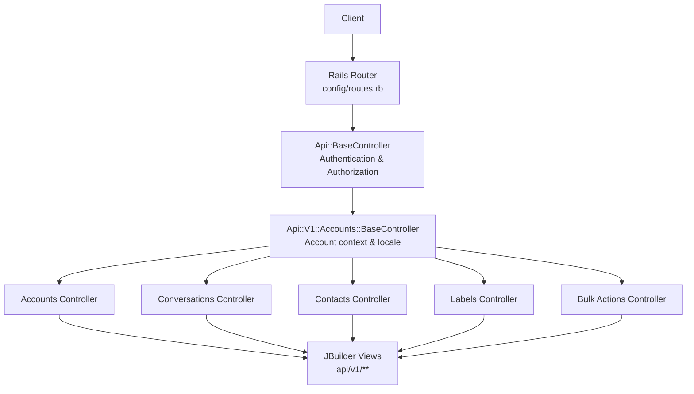
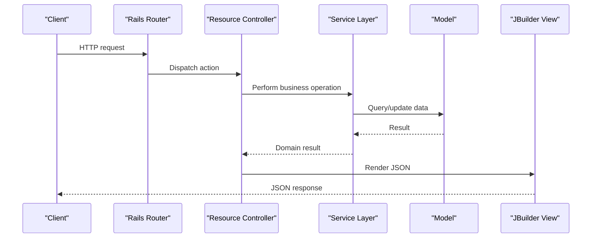
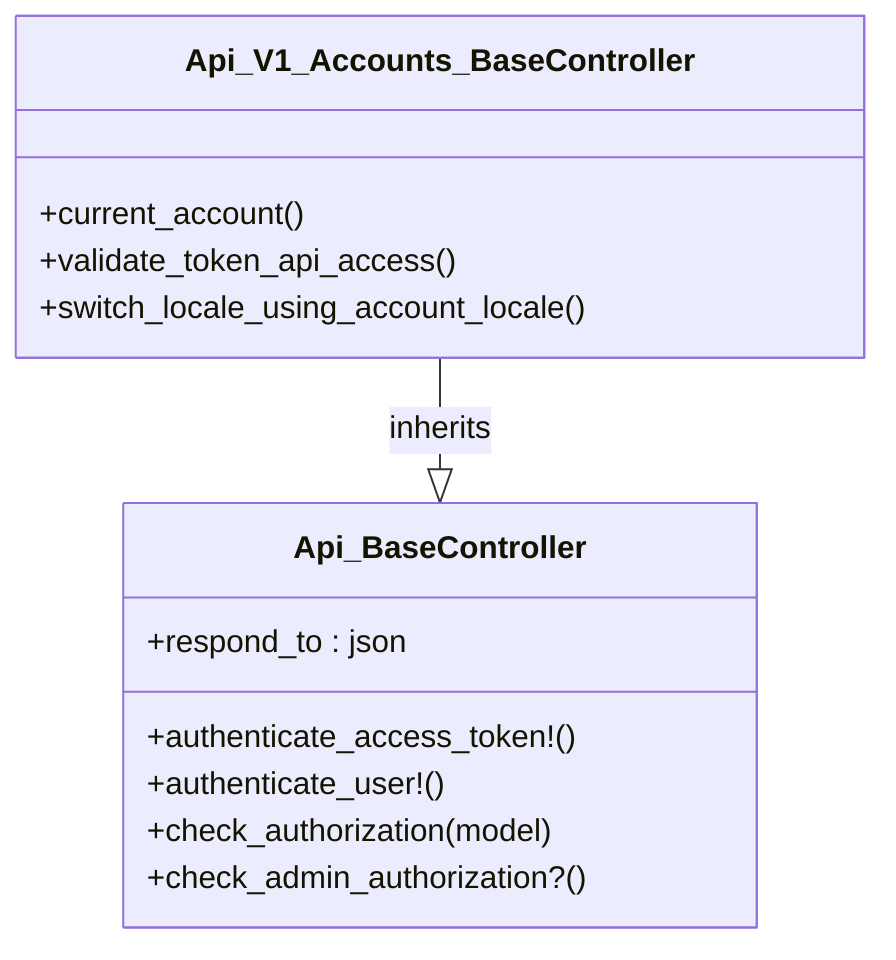
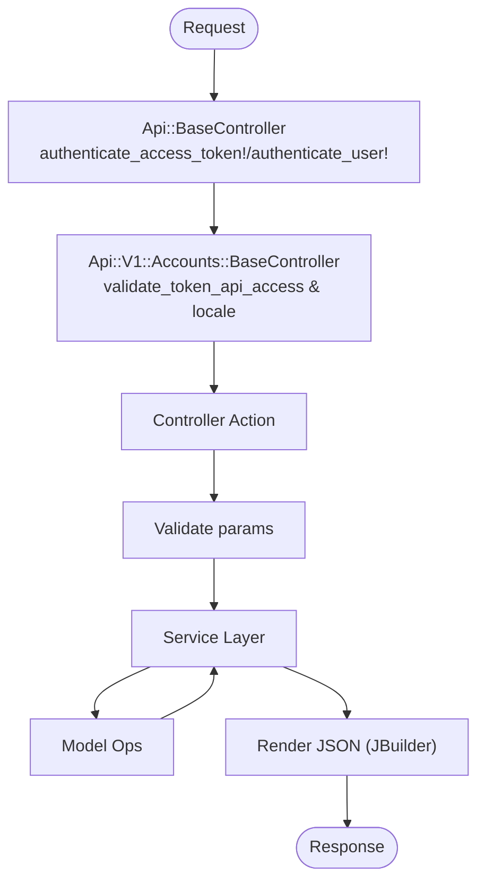
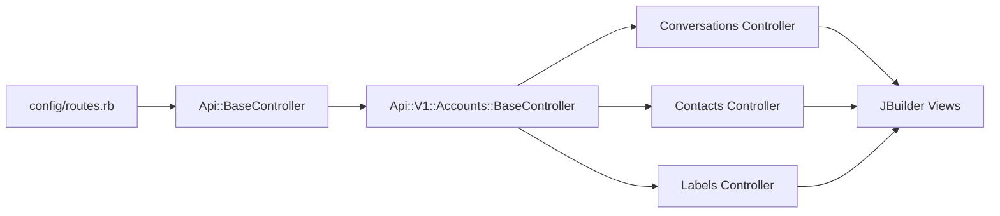

# REST API Design Patterns

<cite>
**Referenced Files in This Document**
- [routes.rb](file://config/routes.rb)
- [base_controller.rb](file://app/controllers/api/base_controller.rb)
- [accounts_base_controller.rb](file://app/controllers/api/v1/accounts/base_controller.rb)
- [accounts_controller.rb](file://app/controllers/api/v1/accounts_controller.rb)
- [conversations_controller.rb](file://app/controllers/api/v1/accounts/conversations_controller.rb)
- [contacts_controller.rb](file://app/controllers/api/v1/accounts/contacts_controller.rb)
- [labels_controller.rb](file://app/controllers/api/v1/accounts/labels_controller.rb)
- [bulk_actions_controller.rb](file://app/controllers/api/v1/accounts/bulk_actions_controller.rb)
- [custom_filters_index.json.jbuilder](file://app/views/api/v1/accounts/custom_filters/index.json.jbuilder)
- [custom_filter_model_partial.json.jbuilder](file://app/views/api/v1/models/_custom_filter.json.jbuilder)
</cite>

## Table of Contents
1. [Introduction](#introduction)
2. [Project Structure](#project-structure)
3. [Core Components](#core-components)
4. [Architecture Overview](#architecture-overview)
5. [Detailed Component Analysis](#detailed-component-analysis)
6. [Dependency Analysis](#dependency-analysis)
7. [Performance Considerations](#performance-considerations)
8. [Troubleshooting Guide](#troubleshooting-guide)
9. [Conclusion](#conclusion)

## Introduction
This document explains Chatwoot’s REST API design patterns for the v1 endpoints. It focuses on consistent controller structure, resource naming conventions, HTTP method usage, URL path structures, base controller inheritance that provides common functionality (authentication, authorization, response formatting), and the request/response lifecycle from controller entry points through service layer calls to model operations. It also covers typical CRUD operations, nested resources, bulk operations, error response formats, status code conventions, and consistency patterns used across the application.

## Project Structure
The v1 API is organized under a namespace with account-scoped routes. Controllers live under app/controllers/api/v1 and its subdirectories (for example, accounts). Views use JBuilder templates under app/views/api/v1 to serialize JSON responses. Routes are defined centrally in config/routes.rb.

**Diagram sources**
- [routes.rb:48-510](file://config/routes.rb#L48-L510)
- [base_controller.rb:1-21](file://app/controllers/api/base_controller.rb#L1-L21)
- [accounts_base_controller.rb:1-17](file://app/controllers/api/v1/accounts/base_controller.rb#L1-L17)

**Section sources**
- [routes.rb:48-510](file://config/routes.rb#L48-L510)

## Core Components
- Api::BaseController: Central base for all API controllers. Handles JSON format, token-based authentication, user authentication fallback, and Pundit authorization helpers.
- Api::V1::Accounts::BaseController: Adds account scoping, locale switching, and account-level API access checks for all account-scoped v1 controllers.
- Resource Controllers: Each domain resource (accounts, conversations, contacts, labels, etc.) implements standard actions aligned with Rails resourceful routing.
- JBuilder Views: Consistent serialization via partials under app/views/api/v1/models.

Key responsibilities:
- Authentication: Access tokens or DeviseTokenAuth sessions.
- Authorization: Pundit policies per resource.
- Response formatting: JSON via respond_to and JBuilder partials.
- Error handling: Custom exceptions mapped to standardized JSON errors.

**Section sources**
- [base_controller.rb:1-21](file://app/controllers/api/base_controller.rb#L1-L21)
- [accounts_base_controller.rb:1-17](file://app/controllers/api/v1/accounts/base_controller.rb#L1-L17)

## Architecture Overview
The v1 API follows a layered pattern:
- Routing: Namespace api/v1 with account-scoped resources.
- Controllers: Inherit from Api::BaseController; account-scoped controllers inherit from Api::V1::Accounts::BaseController.
- Services: Business logic delegated to services (not shown here).
- Models: Data persistence and validations.
- Views: JBuilder serializes models into consistent JSON shapes.

[No sources needed since this diagram shows conceptual workflow, not actual code structure]

## Detailed Component Analysis

### Base Controller Inheritance Pattern
- Api::BaseController sets up JSON responses, supports both raw access tokens and session-based auth, and delegates authorization to Pundit.
- Api::V1::Accounts::BaseController ensures Current.account is set, validates account-level API access when using tokens, enforces MFA where applicable, and switches locale based on account settings.

**Diagram sources**
- [base_controller.rb:1-21](file://app/controllers/api/base_controller.rb#L1-L21)
- [accounts_base_controller.rb:1-17](file://app/controllers/api/v1/accounts/base_controller.rb#L1-L17)

**Section sources**
- [base_controller.rb:1-21](file://app/controllers/api/base_controller.rb#L1-L21)
- [accounts_base_controller.rb:1-17](file://app/controllers/api/v1/accounts/base_controller.rb#L1-L17)

### Resource Naming Conventions and URL Paths
- Resources are pluralized and snake_case (e.g., /api/v1/accounts, /api/v1/conversations, /api/v1/contacts, /api/v1/labels).
- Nested resources follow parent-child relationships (e.g., /api/v1/accounts/:account_id/conversations/:conversation_id/messages).
- Collection and member routes add specialized actions (e.g., search, filter, toggle_status).

Examples from routes:
- Accounts: create, show, update, plus custom member actions like update_active_at and cache_keys.
- Conversations: index, create, show, update, destroy; collection meta/search/filter; member toggles and transcript.
- Contacts: index, show, update, create, destroy; collection search/filter/import/export; member contactable_inboxes and avatar deletion.
- Labels: standard CRUD.

**Section sources**
- [routes.rb:52-510](file://config/routes.rb#L52-L510)

### Typical CRUD Operations
Standard resource controllers implement:
- Index: List resources with pagination and filtering.
- Show: Retrieve a single resource.
- Create: Validate input, build/save via service/model, render serialized JSON.
- Update: Assign attributes, validate, save, render updated JSON.
- Destroy: Delete resource, return success status.

Serialization uses JBuilder partials under app/views/api/v1/models to ensure consistent field exposure.

Example serialization references:
- Index list rendering via array partial.
- Single resource rendering via model partial.

**Section sources**
- [custom_filters_index.json.jbuilder:1-3](file://app/views/api/v1/accounts/custom_filters/index.json.jbuilder#L1-L3)
- [custom_filter_model_partial.json.jbuilder:1-6](file://app/views/api/v1/models/_custom_filter.json.jbuilder#L1-L6)

### Nested Resource Handling
Nested routes are declared within parent scopes. For example:
- Conversations contain messages: /api/v1/accounts/:account_id/conversations/:conversation_id/messages.
- Contacts have related conversations and notes under their scope.

Controllers for nested resources typically:
- Resolve the parent record first.
- Scope child queries to the parent.
- Enforce permissions at both levels.

**Section sources**
- [routes.rb:190-232](file://config/routes.rb#L190-L232)
- [routes.rb:266-287](file://config/routes.rb#L266-L287)

### Bulk Operations
Bulk actions are exposed via dedicated endpoints:
- /api/v1/accounts/:account_id/bulk_actions (create) for batch processing.
- Specific resources may expose collection actions like filter, import, export.

Bulk operations typically:
- Accept an array of IDs or filters.
- Delegate to background jobs or batch services.
- Return aggregated results or job identifiers.

**Section sources**
- [routes.rb:76-76](file://config/routes.rb#L76-L76)
- [bulk_actions_controller.rb:14-14](file://app/controllers/api/v1/accounts/bulk_actions_controller.rb#L14-L14)

### Request/Response Lifecycle
A typical flow:
1. Request enters Rails router and matches a v1 route.
2. Api::BaseController runs before_actions for authentication and authorization.
3. Account-scoped controllers run additional checks (account presence, API access enabled, locale switch).
4. Controller action validates parameters and delegates to a service.
5. Service performs model operations and returns domain objects.
6. Controller renders JSON via JBuilder views/partials.

**Diagram sources**
- [base_controller.rb:1-21](file://app/controllers/api/base_controller.rb#L1-L21)
- [accounts_base_controller.rb:1-17](file://app/controllers/api/v1/accounts/base_controller.rb#L1-L17)

**Section sources**
- [base_controller.rb:1-21](file://app/controllers/api/base_controller.rb#L1-L21)
- [accounts_base_controller.rb:1-17](file://app/controllers/api/v1/accounts/base_controller.rb#L1-L17)

### Error Response Formats and Status Codes
Common patterns:
- Validation failures: 422 Unprocessable Entity with message or error details.
- Feature disabled or missing capability: 403 Forbidden with descriptive error.
- Custom exceptions: Handled by rescue_from and rendered via a shared error renderer.

Examples:
- Article/category validation errors returned as JSON with error messages and 422.
- Companies feature disabled returns 403 with a clear error message.
- Bulk actions failure returns structured JSON with success flag and 422.

Status codes observed:
- 422 for validation and business rule violations.
- 403 for forbidden access or disabled features.
- 200/201/204 for successful operations depending on action.

**Section sources**
- [articles_controller.rb:31-36](file://app/controllers/api/v1/accounts/articles_controller.rb#L31-L36)
- [categories_controller.rb:17-25](file://app/controllers/api/v1/accounts/categories_controller.rb#L17-L25)
- [companies_controller.rb:80-80](file://app/controllers/api/v1/accounts/companies_controller.rb#L80-L80)
- [bulk_actions_controller.rb:14-14](file://app/controllers/api/v1/accounts/bulk_actions_controller.rb#L14-L14)

### API Consistency Patterns
- All v1 controllers inherit from Api::BaseController for uniform auth/authz and JSON behavior.
- Account-scoped controllers inherit from Api::V1::Accounts::BaseController for account context and locale handling.
- Responses are consistently serialized via JBuilder partials under app/views/api/v1/models.
- Routes are grouped under api/v1 with clear nesting for parent-child relationships.
- Custom exceptions are centralized and rendered uniformly.

**Section sources**
- [base_controller.rb:1-21](file://app/controllers/api/base_controller.rb#L1-L21)
- [accounts_base_controller.rb:1-17](file://app/controllers/api/v1/accounts/base_controller.rb#L1-L17)
- [custom_filter_model_partial.json.jbuilder:1-6](file://app/views/api/v1/models/_custom_filter.json.jbuilder#L1-L6)

## Dependency Analysis
High-level dependencies among core components:

**Diagram sources**
- [routes.rb:48-510](file://config/routes.rb#L48-L510)
- [base_controller.rb:1-21](file://app/controllers/api/base_controller.rb#L1-L21)
- [accounts_base_controller.rb:1-17](file://app/controllers/api/v1/accounts/base_controller.rb#L1-L17)

**Section sources**
- [routes.rb:48-510](file://config/routes.rb#L48-L510)

## Performance Considerations
- Use collection endpoints for filtering and searching to reduce client-side processing.
- Leverage pagination and selective field rendering via JBuilder partials to minimize payload size.
- Offload heavy operations (imports, exports, bulk actions) to background jobs where possible.
- Cache read-heavy endpoints (e.g., cache_keys) with appropriate headers.

[No sources needed since this section provides general guidance]

## Troubleshooting Guide
Common issues and resolutions:
- API access disabled for account: Ensure the account has API/webhooks enabled; otherwise requests return 403.
- Validation errors: Inspect the error payload for field-specific messages; correct inputs accordingly.
- Feature not enabled: Some endpoints require enterprise features; verify configuration and licensing.

Relevant patterns:
- Account-scoped API access check returns 403 when disabled.
- Validation errors return 422 with detailed messages.

**Section sources**
- [accounts_base_controller.rb:12-16](file://app/controllers/api/v1/accounts/base_controller.rb#L12-L16)
- [articles_controller.rb:31-36](file://app/controllers/api/v1/accounts/articles_controller.rb#L31-L36)

## Conclusion
Chatwoot’s v1 REST API follows a consistent, maintainable design:
- Uniform base controllers provide authentication, authorization, and JSON response handling.
- Account-scoped controllers add tenant isolation, locale switching, and feature gating.
- Routes clearly express resource hierarchies and specialized actions.
- JBuilder partials ensure stable, predictable JSON schemas.
- Errors are standardized with meaningful status codes and messages.

Adhering to these patterns ensures a cohesive developer experience and reliable integrations.