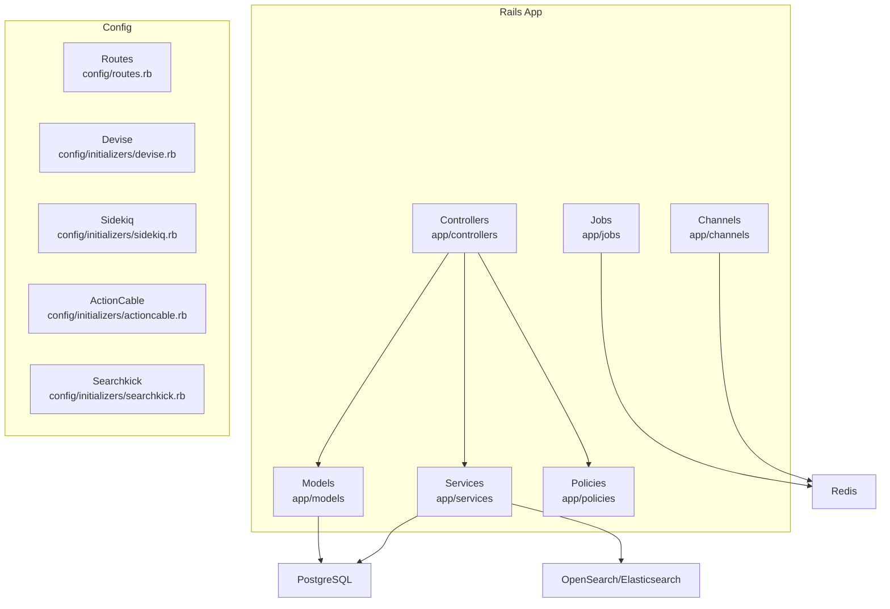
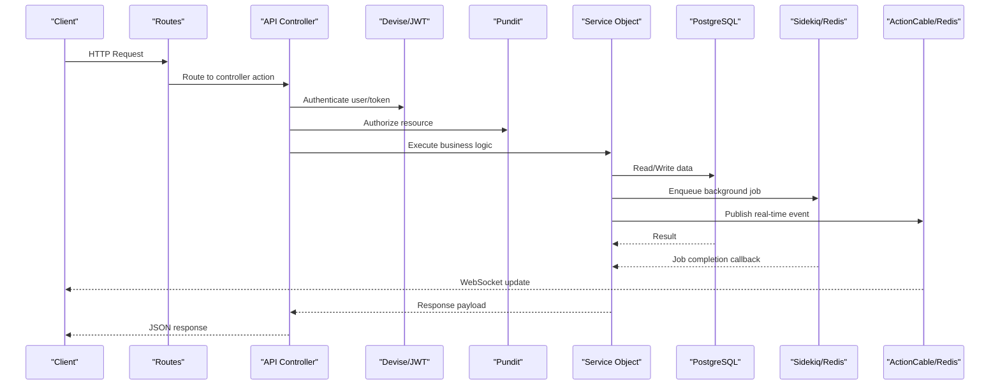
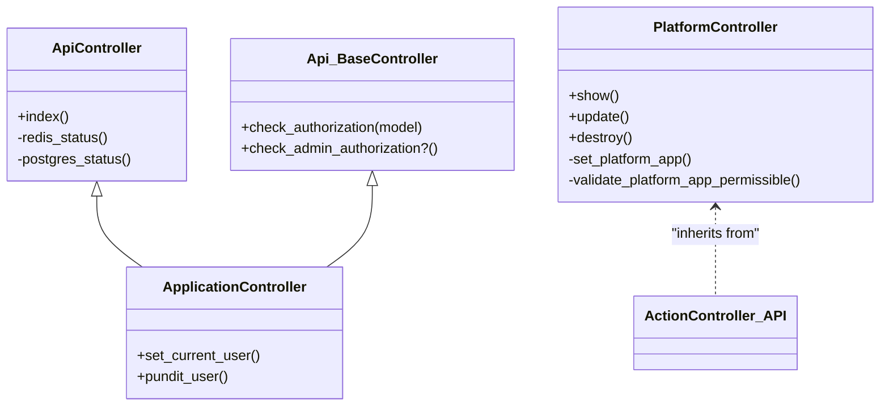
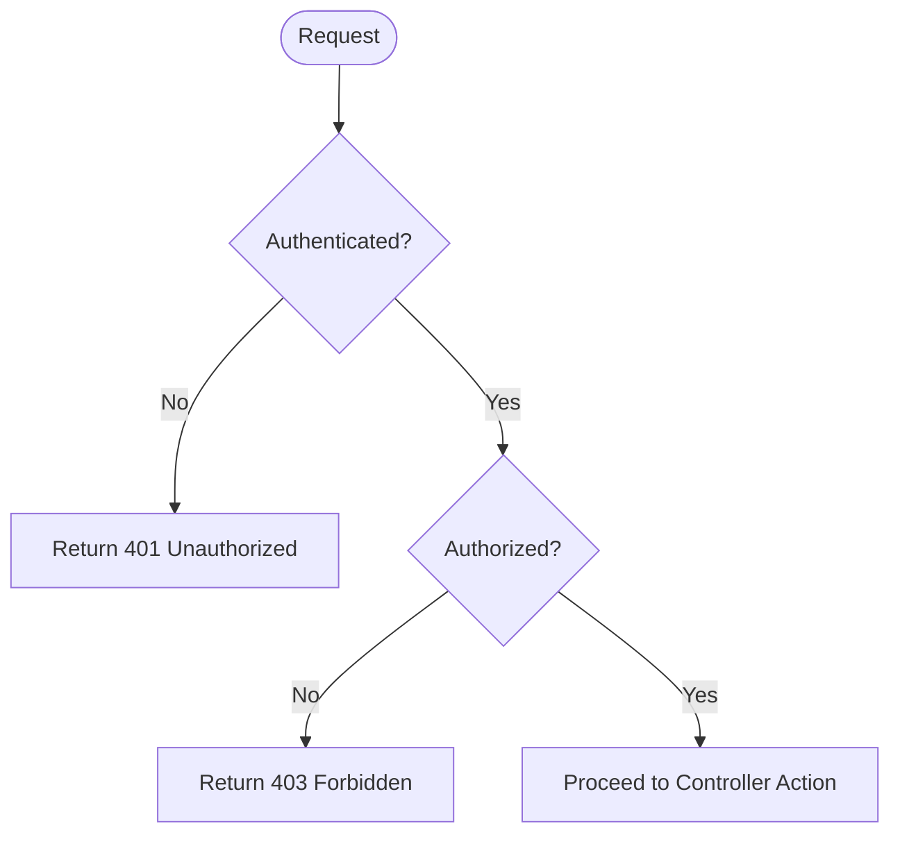
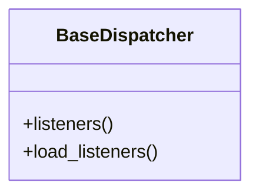
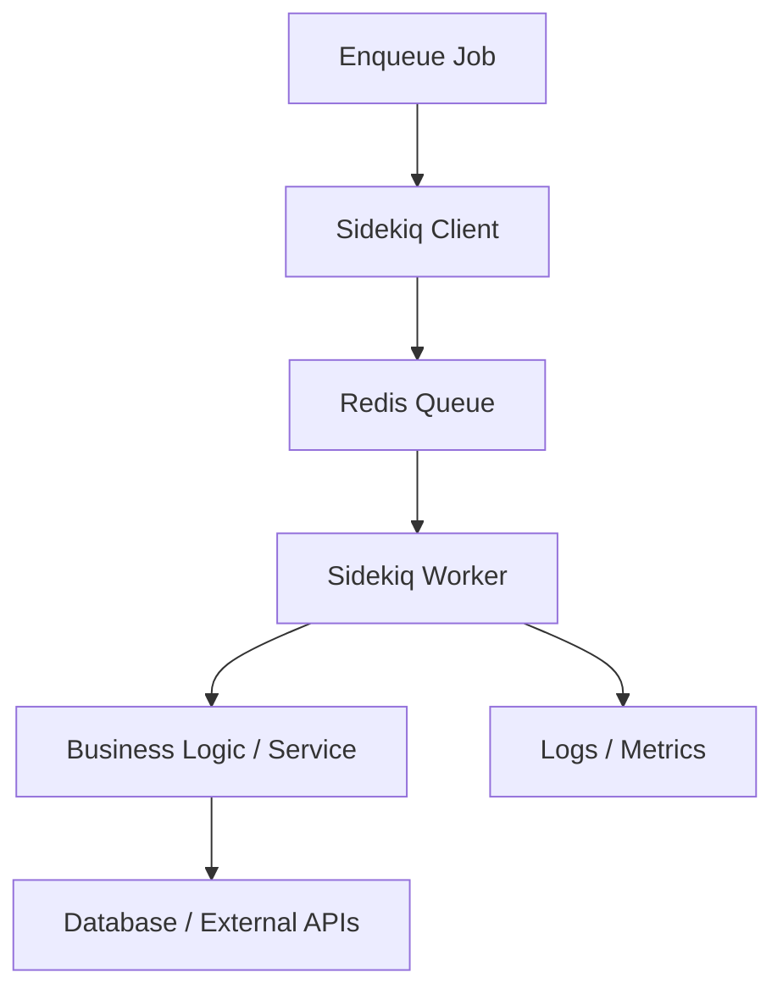
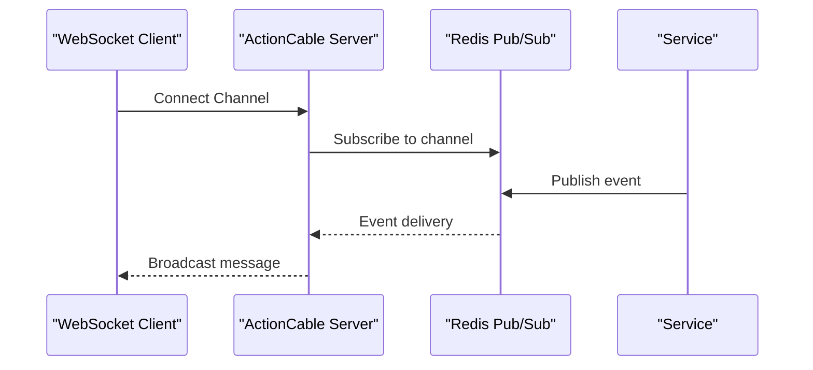
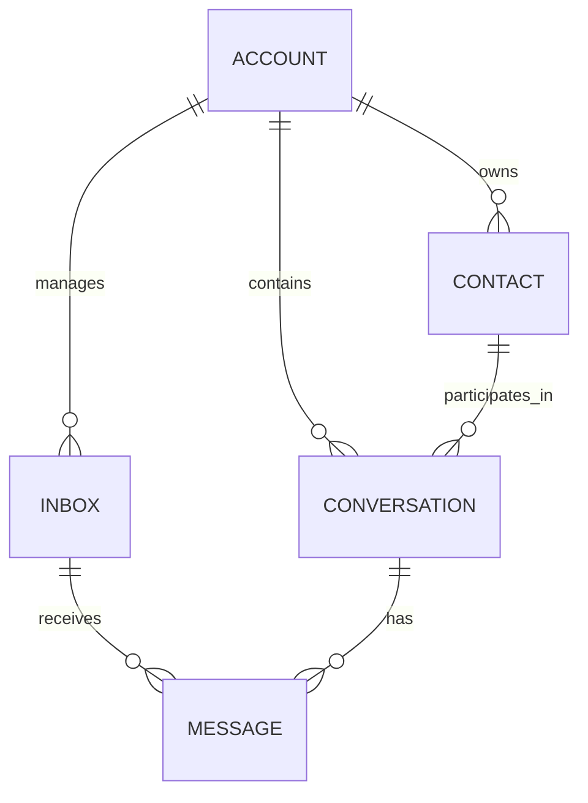
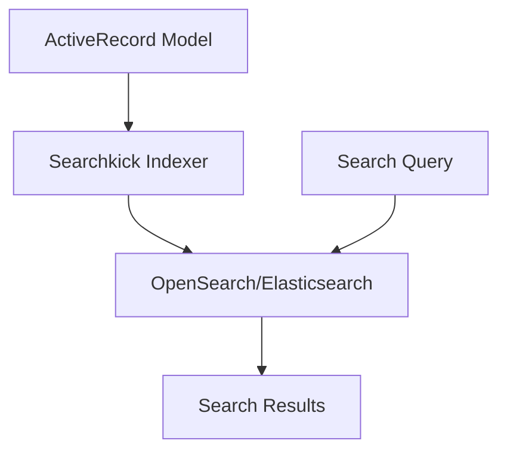
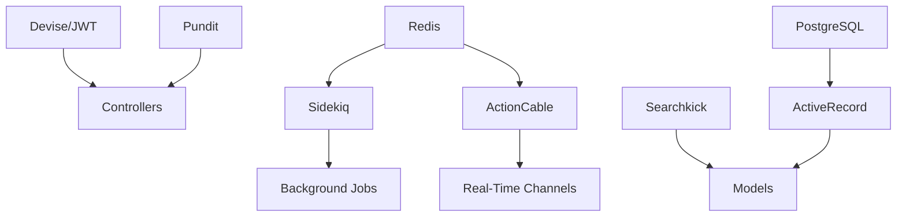

# Backend Architecture

<cite>
**Referenced Files in This Document**
- [README.md](file://README.md)
- [application.rb](file://config/application.rb)
- [routes.rb](file://config/routes.rb)
- [devise.rb](file://config/initializers/devise.rb)
- [sidekiq.rb](file://config/initializers/sidekiq.rb)
- [actioncable.rb](file://config/initializers/actioncable.rb)
- [searchkick.rb](file://config/initializers/searchkick.rb)
- [application_controller.rb](file://app/controllers/application_controller.rb)
- [api_controller.rb](file://app/controllers/api_controller.rb)
- [base_controller.rb](file://app/controllers/api/base_controller.rb)
- [platform_controller.rb](file://app/controllers/platform_controller.rb)
- [base_dispatcher.rb](file://app/dispatchers/base_dispatcher.rb)
- [schema.rb](file://db/schema.rb)
</cite>

## Table of Contents
1. [Introduction](#introduction)
2. [Project Structure](#project-structure)
3. [Core Components](#core-components)
4. [Architecture Overview](#architecture-overview)
5. [Detailed Component Analysis](#detailed-component-analysis)
6. [Dependency Analysis](#dependency-analysis)
7. [Performance Considerations](#performance-considerations)
8. [Troubleshooting Guide](#troubleshooting-guide)
9. [Conclusion](#conclusion)

## Introduction
This document explains the backend architecture of Chatwoot, a Ruby on Rails 7 application designed for omnichannel customer support. It covers the MVC pattern, service-oriented design with business logic encapsulated in service objects, event-driven architecture using Wisper pub/sub, API layer structure with RESTful controllers, authentication via Devise and JWT, authorization through Pundit policies, background job processing with Sidekiq, real-time communication with ActionCable, database design patterns and ActiveRecord associations, and infrastructure components such as Redis caching, Searchkick search indexing, and file storage configuration.

The project README describes Chatwoot as a modern, open-source, self-hosted customer support platform that centralizes conversations across channels and provides tools to manage them at scale.

**Section sources**
- [README.md:37-49](file://README.md#L37-L49)

## Project Structure
Chatwoot follows standard Rails conventions with clear separation of concerns:
- Controllers under app/controllers define the API layer (RESTful endpoints).
- Models under app/models represent domain entities and relationships.
- Services under app/services encapsulate business logic.
- Jobs under app/jobs handle asynchronous tasks via Sidekiq.
- Channels under app/channels implement real-time features via ActionCable.
- Policies under app/policies enforce authorization rules via Pundit.
- Initializers under config/initializers configure gems and integrations.
- Routes under config/routes.rb define public and internal endpoints.

**Diagram sources**
- [routes.rb:48-576](file://config/routes.rb#L48-L576)
- [devise.rb:1-275](file://config/initializers/devise.rb#L1-L275)
- [sidekiq.rb:1-92](file://config/initializers/sidekiq.rb#L1-L92)
- [actioncable.rb:1-19](file://config/initializers/actioncable.rb#L1-L19)
- [searchkick.rb:1-24](file://config/initializers/searchkick.rb#L1-L24)

**Section sources**
- [routes.rb:48-576](file://config/routes.rb#L48-L576)
- [application.rb:36-86](file://config/application.rb#L36-L86)

## Core Components
- MVC Pattern: Controllers orchestrate requests, models encapsulate data and associations, services contain business logic, views render responses (not detailed here), and helpers/presenters assist rendering and formatting.
- Service-Oriented Design: Business operations are implemented in service classes under app/services, promoting single responsibility and testability.
- Event-Driven Architecture: Wisper pub/sub is used via BaseDispatcher to decouple components and propagate events to listeners.
- API Layer: RESTful controllers under api/v1 expose account-scoped resources; platform APIs use token-based auth; public APIs serve widget and portal endpoints.
- Authentication: Devise integrates with DeviseTokenAuth for JWT-based dashboard authentication.
- Authorization: Pundit policies govern access control per resource and context.
- Background Jobs: Sidekiq processes jobs asynchronously, with cron scheduling via sidekiq-cron.
- Real-Time Communication: ActionCable uses Redis adapter for WebSocket pub/sub.
- Database: PostgreSQL with ActiveRecord; schema includes core entities like accounts, contacts, conversations, messages, inboxes, and more.
- Infrastructure: Redis for caching, queues, and pub/sub; Searchkick for search indexing against OpenSearch/Elasticsearch; Active Storage for file storage.

**Section sources**
- [application_controller.rb:1-30](file://app/controllers/application_controller.rb#L1-L30)
- [base_controller.rb:1-21](file://app/controllers/api/base_controller.rb#L1-L21)
- [base_dispatcher.rb:1-11](file://app/dispatchers/base_dispatcher.rb#L1-L11)
- [schema.rb:13-800](file://db/schema.rb#L13-L800)

## Architecture Overview
The system is organized into layers:
- Presentation/API Layer: RESTful controllers handle HTTP requests, authenticate users or tokens, authorize actions, and delegate to services.
- Domain Layer: Services encapsulate business logic; models define data structures and associations.
- Integration Layer: External systems (e.g., social channels, payment gateways) are integrated via services and webhooks.
- Data Layer: PostgreSQL stores persistent data; Redis provides caching, queues, and pub/sub; Searchkick indexes searchable content.

**Diagram sources**
- [routes.rb:48-576](file://config/routes.rb#L48-L576)
- [devise.rb:1-275](file://config/initializers/devise.rb#L1-L275)
- [base_controller.rb:1-21](file://app/controllers/api/base_controller.rb#L1-L21)
- [sidekiq.rb:1-92](file://config/initializers/sidekiq.rb#L1-L92)
- [actioncable.rb:1-19](file://config/initializers/actioncable.rb#L1-L19)

## Detailed Component Analysis

### MVC and API Layer
- ApplicationController sets up common behavior: DeviseTokenAuth integration, exception handling, Pundit authorization, locale switching, and current user tracking.
- ApiController exposes health/status endpoints and checks Redis and PostgreSQL connectivity.
- Api::BaseController enforces authentication (either DeviseTokenAuth or raw access tokens) and provides helper methods for authorization checks.
- PlatformController secures platform APIs with access tokens and validates permissible resources.

**Diagram sources**
- [application_controller.rb:1-30](file://app/controllers/application_controller.rb#L1-L30)
- [api_controller.rb:1-26](file://app/controllers/api_controller.rb#L1-L26)
- [base_controller.rb:1-21](file://app/controllers/api/base_controller.rb#L1-L21)
- [platform_controller.rb:1-33](file://app/controllers/platform_controller.rb#L1-L33)

**Section sources**
- [application_controller.rb:1-30](file://app/controllers/application_controller.rb#L1-L30)
- [api_controller.rb:1-26](file://app/controllers/api_controller.rb#L1-L26)
- [base_controller.rb:1-21](file://app/controllers/api/base_controller.rb#L1-L21)
- [platform_controller.rb:1-33](file://app/controllers/platform_controller.rb#L1-L33)

### Authentication and Authorization
- Devise is configured for email-based authentication, password recovery, confirmation, and session management. DeviseTokenAuth is mounted for JWT-based dashboard authentication.
- Pundit is integrated via ApplicationController to provide policy-based authorization. The pundit_user method supplies context (user, account, account_user) to policies.

**Diagram sources**
- [devise.rb:1-275](file://config/initializers/devise.rb#L1-L275)
- [application_controller.rb:1-30](file://app/controllers/application_controller.rb#L1-L30)

**Section sources**
- [devise.rb:1-275](file://config/initializers/devise.rb#L1-L275)
- [application_controller.rb:1-30](file://app/controllers/application_controller.rb#L1-L30)

### Event-Driven Architecture with Wisper
- BaseDispatcher includes Wisper::Publisher and provides listener registration via load_listeners. This enables decoupled event propagation across components.

**Diagram sources**
- [base_dispatcher.rb:1-11](file://app/dispatchers/base_dispatcher.rb#L1-L11)

**Section sources**
- [base_dispatcher.rb:1-11](file://app/dispatchers/base_dispatcher.rb#L1-L11)

### Background Job Processing with Sidekiq
- Sidekiq client and server are configured with Redis connection settings.
- Server middleware logs dequeued jobs and optionally adds custom logging based on environment variables.
- Cron schedules are loaded from schedule.yml and managed via sidekiq-cron.

**Diagram sources**
- [sidekiq.rb:1-92](file://config/initializers/sidekiq.rb#L1-L92)

**Section sources**
- [sidekiq.rb:1-92](file://config/initializers/sidekiq.rb#L1-L92)

### Real-Time Communication with ActionCable
- ActionCable uses Redis adapter for pub/sub. Configuration supports environments where Redis client commands are disabled (e.g., GCP Memorystore) by adjusting connection parameters.

**Diagram sources**
- [actioncable.rb:1-19](file://config/initializers/actioncable.rb#L1-L19)

**Section sources**
- [actioncable.rb:1-19](file://config/initializers/actioncable.rb#L1-L19)

### Database Design Patterns and ActiveRecord Associations
- PostgreSQL schema defines core entities: accounts, contacts, companies, conversations, messages, inboxes, labels, campaigns, automation rules, and more.
- Indexes and constraints optimize queries and enforce uniqueness.
- JSONB columns store flexible attributes (settings, metadata, custom_attributes).
- Vector extensions support semantic search capabilities for AI features.

**Diagram sources**
- [schema.rb:64-800](file://db/schema.rb#L64-L800)

**Section sources**
- [schema.rb:13-800](file://db/schema.rb#L13-L800)

### Search Indexing with Searchkick
- Searchkick is configured to connect to OpenSearch/Elasticsearch using API keys or AWS credentials.
- Queue name can be set for async migration tasks when OpenSearch is present.

**Diagram sources**
- [searchkick.rb:1-24](file://config/initializers/searchkick.rb#L1-L24)

**Section sources**
- [searchkick.rb:1-24](file://config/initializers/searchkick.rb#L1-L24)

### File Storage Configuration
- Active Storage is configured in the application initializer to disable previewers not used by the app.
- Storage backends are typically configured via config/storage.yml (not analyzed here).

**Section sources**
- [application.rb:70-71](file://config/application.rb#L70-L71)

## Dependency Analysis
Key dependencies and their roles:
- Devise and DeviseTokenAuth: Provide authentication and JWT token handling.
- Pundit: Provides policy-based authorization.
- Sidekiq: Processes background jobs with Redis.
- ActionCable: Enables real-time WebSocket communication backed by Redis.
- Searchkick: Integrates with OpenSearch/Elasticsearch for search indexing.
- ActiveRecord: ORM for PostgreSQL.

**Diagram sources**
- [devise.rb:1-275](file://config/initializers/devise.rb#L1-L275)
- [sidekiq.rb:1-92](file://config/initializers/sidekiq.rb#L1-L92)
- [actioncable.rb:1-19](file://config/initializers/actioncable.rb#L1-L19)
- [searchkick.rb:1-24](file://config/initializers/searchkick.rb#L1-L24)

**Section sources**
- [application.rb:36-86](file://config/application.rb#L36-L86)
- [routes.rb:48-576](file://config/routes.rb#L48-L576)

## Performance Considerations
- Use Redis for caching and queueing to offload heavy tasks and reduce database load.
- Leverage PostgreSQL extensions (pg_trgm, pgcrypto, vector) for advanced querying and security.
- Configure Sidekiq workers with appropriate concurrency and memory limits.
- Optimize database queries with proper indexing and avoid N+1 queries.
- Use Searchkick for efficient full-text and semantic search instead of expensive SQL queries.
- Enable monitoring and tracing via APM tools (Datadog, Elastic APM, Scout APM, New Relic) as configured in application.rb.

[No sources needed since this section provides general guidance]

## Troubleshooting Guide
- Authentication Issues: Verify Devise configuration and JWT token handling. Check routes for DeviseTokenAuth mounting and ensure secret_key_base is set.
- Authorization Errors: Ensure Pundit policies exist and pundit_user returns correct context. Validate permissions in policies.
- Background Jobs Not Running: Confirm Sidekiq is running and connected to Redis. Check logs for errors and verify cron schedules in schedule.yml.
- Real-Time Events Not Received: Ensure ActionCable is configured with Redis and that the Redis adapter is correctly initialized. Check network/firewall settings for WebSocket connections.
- Search Queries Failing: Verify Searchkick configuration for OpenSearch/Elasticsearch connectivity and credentials.

**Section sources**
- [devise.rb:1-275](file://config/initializers/devise.rb#L1-L275)
- [application_controller.rb:1-30](file://app/controllers/application_controller.rb#L1-L30)
- [sidekiq.rb:1-92](file://config/initializers/sidekiq.rb#L1-L92)
- [actioncable.rb:1-19](file://config/initializers/actioncable.rb#L1-L19)
- [searchkick.rb:1-24](file://config/initializers/searchkick.rb#L1-L24)

## Conclusion
Chatwoot’s backend leverages Rails’ MVC pattern with a strong emphasis on service-oriented design and event-driven architecture. Authentication and authorization are handled securely via Devise/JWT and Pundit. Background processing and real-time communication rely on Sidekiq and ActionCable, both backed by Redis. The database schema reflects a robust domain model optimized for performance and scalability. Infrastructure components like Searchkick and Active Storage extend functionality for search and file management. This architecture supports scalable, maintainable, and secure customer support operations across multiple channels.

[No sources needed since this section summarizes without analyzing specific files]