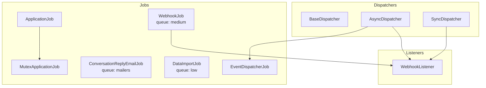
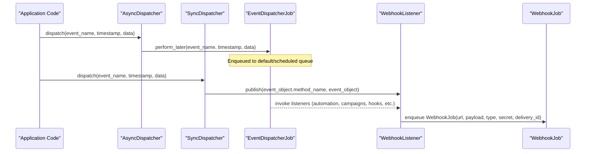
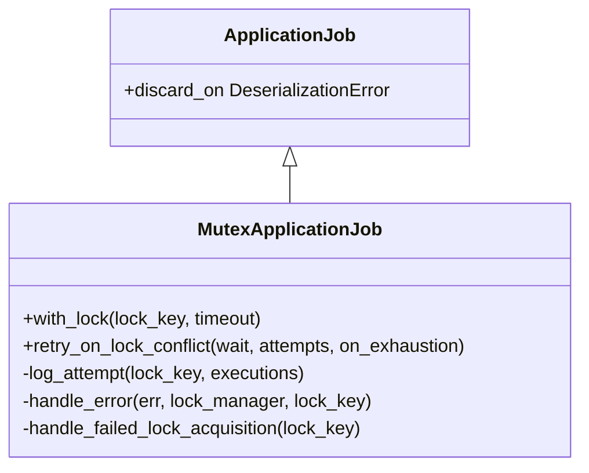
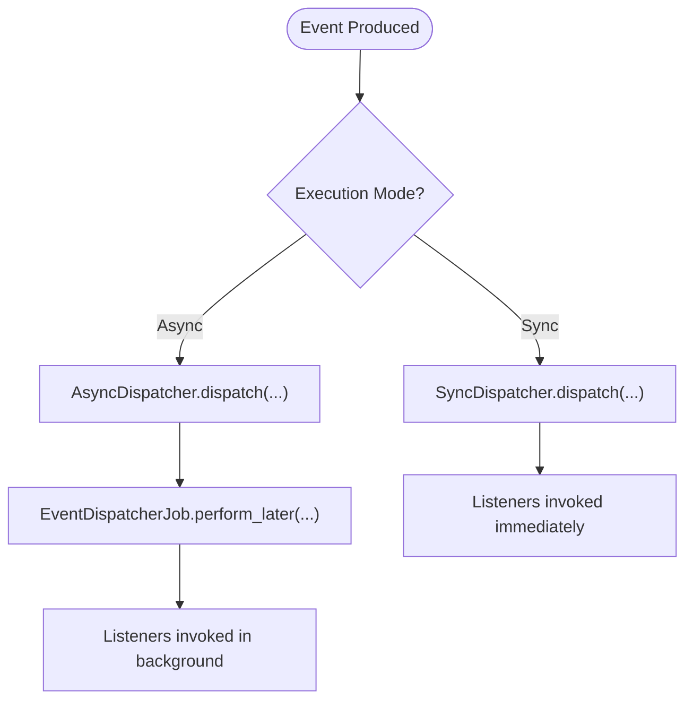
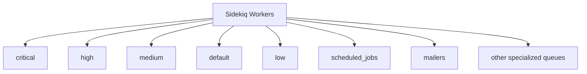
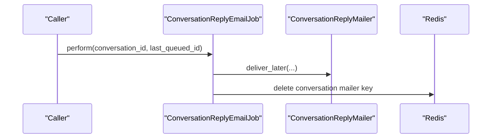
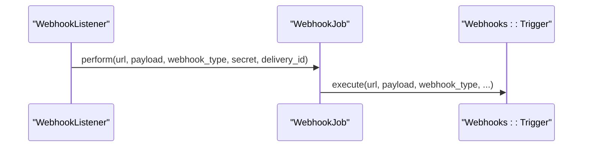
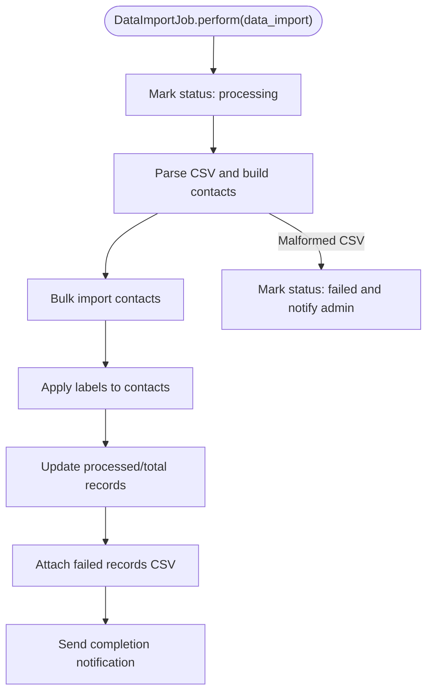
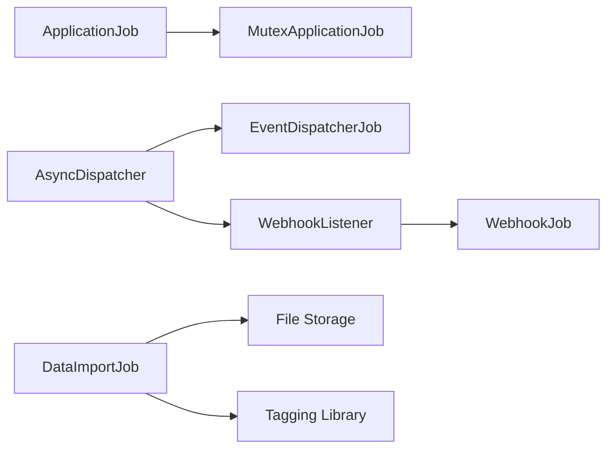

# Background Job System

<cite>
**Referenced Files in This Document**
- [application_job.rb](file://app\jobs\application_job.rb)
- [mutex_application_job.rb](file://app\jobs\mutex_application_job.rb)
- [sidekiq.yml](file://config\sidekiq.yml)
- [base_dispatcher.rb](file://app\dispatchers\base_dispatcher.rb)
- [async_dispatcher.rb](file://app\dispatchers\async_dispatcher.rb)
- [sync_dispatcher.rb](file://app\dispatchers\sync_dispatcher.rb)
- [event_dispatcher_job.rb](file://app\jobs\event_dispatcher_job.rb)
- [conversation_reply_email_job.rb](file://app\jobs\conversation_reply_email_job.rb)
- [webhook_job.rb](file://app\jobs\webhook_job.rb)
- [data_import_job.rb](file://app\jobs\data_import_job.rb)
- [webhook_listener.rb](file://app\listeners\webhook_listener.rb)
</cite>

## Table of Contents
1. [Introduction](#introduction)
2. [Project Structure](#project-structure)
3. [Core Components](#core-components)
4. [Architecture Overview](#architecture-overview)
5. [Detailed Component Analysis](#detailed-component-analysis)
6. [Dependency Analysis](#dependency-analysis)
7. [Performance Considerations](#performance-considerations)
8. [Troubleshooting Guide](#troubleshooting-guide)
9. [Conclusion](#conclusion)

## Introduction
This document explains Chatwoot’s background job processing system built on Sidekiq and ActiveJob. It covers the base job class, prioritization and queue strategy, retry mechanisms, dispatcher patterns for synchronous and asynchronous event handling, and key job categories such as email delivery, webhook processing, data imports, conversation processing, and notifications. It also provides guidance on monitoring, performance tuning, queue management, failure handling, custom job implementation, testing approaches, and operational considerations for production.

## Project Structure
Chatwoot organizes jobs under app/jobs with domain-specific subdirectories (for example, conversations, webhooks, notification, data_imports). The base classes and shared utilities live at the top level:
- Base job class: ApplicationJob
- Distributed locking base: MutexApplicationJob
- Dispatcher framework: dispatchers/*
- Key job examples: conversation_reply_email_job.rb, webhook_job.rb, data_import_job.rb, event_dispatcher_job.rb

**Diagram sources**
- [application_job.rb:1-9](file://app\jobs\application_job.rb#L1-L9)
- [mutex_application_job.rb:1-63](file://app\jobs\mutex_application_job.rb#L1-L63)
- [async_dispatcher.rb:1-28](file://app\dispatchers\async_dispatcher.rb#L1-L28)
- [sync_dispatcher.rb:1-13](file://app\dispatchers\sync_dispatcher.rb#L1-L13)
- [conversation_reply_email_job.rb:1-17](file://app\jobs\conversation_reply_email_job.rb#L1-L17)
- [webhook_job.rb:1-8](file://app\jobs\webhook_job.rb#L1-L8)
- [data_import_job.rb:1-219](file://app\jobs\data_import_job.rb#L1-L219)
- [webhook_listener.rb:1-38](file://app\listeners\webhook_listener.rb#L1-L38)

**Section sources**
- [application_job.rb:1-9](file://app\jobs\application_job.rb#L1-L9)
- [mutex_application_job.rb:1-63](file://app\jobs\mutex_application_job.rb#L1-L63)
- [sidekiq.yml:1-42](file://config\sidekiq.yml#L1-L42)
- [async_dispatcher.rb:1-28](file://app\dispatchers\async_dispatcher.rb#L1-L28)
- [sync_dispatcher.rb:1-13](file://app\dispatchers\sync_dispatcher.rb#L1-L13)
- [conversation_reply_email_job.rb:1-17](file://app\jobs\conversation_reply_email_job.rb#L1-L17)
- [webhook_job.rb:1-8](file://app\jobs\webhook_job.rb#L1-L8)
- [data_import_job.rb:1-219](file://app\jobs\data_import_job.rb#L1-L219)
- [webhook_listener.rb:1-38](file://app\listeners\webhook_listener.rb#L1-L38)

## Core Components
- ApplicationJob: Base class for all jobs; includes a discard handler for deserialization errors to prevent poison-poke loops.
- MutexApplicationJob: Adds distributed locking via Redis and a retry helper for lock conflicts.
- Dispatchers: Provide a uniform interface to publish events either synchronously or asynchronously.
- EventDispatcherJob: Enqueues event processing when using AsyncDispatcher.
- Domain Jobs: Email delivery, webhook delivery, data import, and other background tasks are implemented as dedicated job classes.

Key responsibilities:
- Prioritization: Queues are ordered from critical to low and specialized queues for mailers, scheduled jobs, and housekeeping.
- Retry: Global defaults via Sidekiq config; per-job retries where needed.
- Locking: Optional mutual exclusion for idempotent operations.

**Section sources**
- [application_job.rb:1-9](file://app\jobs\application_job.rb#L1-L9)
- [mutex_application_job.rb:1-63](file://app\jobs\mutex_application_job.rb#L1-L63)
- [sidekiq.yml:1-42](file://config\sidekiq.yml#L1-L42)
- [async_dispatcher.rb:1-28](file://app\dispatchers\async_dispatcher.rb#L1-L28)
- [sync_dispatcher.rb:1-13](file://app\dispatchers\sync_dispatcher.rb#L1-L13)

## Architecture Overview
The background job architecture combines ActiveJob + Sidekiq with a dispatcher pattern that decouples event producers from consumers.

**Diagram sources**
- [async_dispatcher.rb:1-28](file://app\dispatchers\async_dispatcher.rb#L1-L28)
- [sync_dispatcher.rb:1-13](file://app\dispatchers\sync_dispatcher.rb#L1-L13)
- [webhook_listener.rb:1-38](file://app\listeners\webhook_listener.rb#L1-L38)
- [webhook_job.rb:1-8](file://app\jobs\webhook_job.rb#L1-L8)

## Detailed Component Analysis

### Base Classes and Error Handling
- ApplicationJob
  - Discards jobs that fail deserialization to avoid repeated failures.
- MutexApplicationJob
  - Provides with_lock(key, timeout) for mutual exclusion using Redis.
  - Offers retry_on_lock_conflict(wait:, attempts:, on_exhaustion:) to automatically retry on contention or call a fallback method.

**Diagram sources**
- [application_job.rb:1-9](file://app\jobs\application_job.rb#L1-L9)
- [mutex_application_job.rb:1-63](file://app\jobs\mutex_application_job.rb#L1-L63)

**Section sources**
- [application_job.rb:1-9](file://app\jobs\application_job.rb#L1-L9)
- [mutex_application_job.rb:1-63](file://app\jobs\mutex_application_job.rb#L1-L63)

### Dispatcher Pattern
- BaseDispatcher
  - Uses Wisper::Publisher to subscribe/listen to events.
- AsyncDispatcher
  - Offloads event processing to EventDispatcherJob for background execution.
  - Subscribes to multiple listeners (automation rules, campaigns, CSAT surveys, hooks, installation webhooks, notifications, participation, unread counts, reporting, webhooks).
- SyncDispatcher
  - Executes listeners synchronously within the request thread (e.g., ActionCable, agent bot).

**Diagram sources**
- [base_dispatcher.rb:1-12](file://app\dispatchers\base_dispatcher.rb#L1-L12)
- [async_dispatcher.rb:1-28](file://app\dispatchers\async_dispatcher.rb#L1-L28)
- [sync_dispatcher.rb:1-13](file://app\dispatchers\sync_dispatcher.rb#L1-L13)

**Section sources**
- [base_dispatcher.rb:1-12](file://app\dispatchers\base_dispatcher.rb#L1-L12)
- [async_dispatcher.rb:1-28](file://app\dispatchers\async_dispatcher.rb#L1-L28)
- [sync_dispatcher.rb:1-13](file://app\dispatchers\sync_dispatcher.rb#L1-L13)

### Queue Prioritization and Configuration
- Sidekiq configuration defines queue order and concurrency:
  - Priority queues: critical > high > medium > default
  - Specialized queues: monitors_live, mailers, action_mailbox_routing, low, scheduled_jobs, deferred, purgable, housekeeping, async_database_migration, bulk_reindex_low, monitors_backfill, active_storage_analysis, active_storage_purge, action_mailbox_incineration
- Concurrency is environment-aware and controlled by an environment variable.

**Diagram sources**
- [sidekiq.yml:1-42](file://config\sidekiq.yml#L1-L42)

**Section sources**
- [sidekiq.yml:1-42](file://config\sidekiq.yml#L1-L42)

### Job Categories

#### Email Delivery
- ConversationReplyEmailJob
  - Enqueued to the mailers queue.
  - Sends reply emails based on conversation context and cleans up related Redis keys.

**Diagram sources**
- [conversation_reply_email_job.rb:1-17](file://app\jobs\conversation_reply_email_job.rb#L1-L17)

**Section sources**
- [conversation_reply_email_job.rb:1-17](file://app\jobs\conversation_reply_email_job.rb#L1-L17)

#### Webhook Processing
- WebhookJob
  - Enqueued to the medium queue.
  - Delegates to Webhooks::Trigger.execute with optional secret and delivery_id.
- WebhookListener
  - Reacts to conversation/message events and enqueues WebhookJob for outbound webhooks.

**Diagram sources**
- [webhook_listener.rb:1-38](file://app\listeners\webhook_listener.rb#L1-L38)
- [webhook_job.rb:1-8](file://app\jobs\webhook_job.rb#L1-L8)

**Section sources**
- [webhook_listener.rb:1-38](file://app\listeners\webhook_listener.rb#L1-L38)
- [webhook_job.rb:1-8](file://app\jobs\webhook_job.rb#L1-L8)

#### Data Imports
- DataImportJob
  - Enqueued to the low queue.
  - Parses CSV, builds contacts, applies labels, handles malformed CSV, attaches failed records, and notifies admins.
  - Includes retry for transient storage errors.

**Diagram sources**
- [data_import_job.rb:1-219](file://app\jobs\data_import_job.rb#L1-L219)

**Section sources**
- [data_import_job.rb:1-219](file://app\jobs\data_import_job.rb#L1-L219)

#### Conversation Processing and Notifications
- AsyncDispatcher subscribes to automation rules, campaigns, CSAT surveys, hooks, installation webhooks, notifications, participation, unread counts, reporting, and webhooks. These listeners typically trigger downstream jobs or real-time updates.
- Internal scheduling jobs (for example, internal dispatchers) can trigger enterprise features like conversation monitors.

**Section sources**
- [async_dispatcher.rb:1-28](file://app\dispatchers\async_dispatcher.rb#L1-L28)

### Custom Job Implementation Guidelines
- Inherit from ApplicationJob for standard behavior or MutexApplicationJob when you need distributed locking.
- Choose an appropriate queue based on priority and workload characteristics (see queue list).
- Use retry_on for expected transient failures; consider exponential backoff where supported by your environment.
- For idempotent operations, wrap logic in with_lock(key) to avoid duplicate processing across workers.
- Keep perform methods small and delegate heavy work to services.

[No sources needed since this section provides general guidance]

### Testing Approaches
- Unit tests: Instantiate jobs and assert perform behavior without executing Sidekiq.
- Integration tests: Use Rails test helpers to assert jobs are enqueued on specific queues and that listeners are invoked.
- Isolation: Stub external dependencies (HTTP clients, storage, Redis) to ensure deterministic tests.
- Coverage: Verify error paths (malformed CSV, missing files, network failures) and retry behaviors.

[No sources needed since this section provides general guidance]

## Dependency Analysis
- ApplicationJob is the root for all jobs.
- MutexApplicationJob depends on ApplicationJob and Redis-based locking.
- Dispatchers depend on Wisper for event publishing and on listeners for side effects.
- WebhookListener depends on WebhookJob to send outbound webhooks.
- DataImportJob depends on file storage and tagging libraries for label application.

**Diagram sources**
- [application_job.rb:1-9](file://app\jobs\application_job.rb#L1-L9)
- [mutex_application_job.rb:1-63](file://app\jobs\mutex_application_job.rb#L1-L63)
- [async_dispatcher.rb:1-28](file://app\dispatchers\async_dispatcher.rb#L1-L28)
- [webhook_listener.rb:1-38](file://app\listeners\webhook_listener.rb#L1-L38)
- [webhook_job.rb:1-8](file://app\jobs\webhook_job.rb#L1-L8)
- [data_import_job.rb:1-219](file://app\jobs\data_import_job.rb#L1-L219)

**Section sources**
- [application_job.rb:1-9](file://app\jobs\application_job.rb#L1-L9)
- [mutex_application_job.rb:1-63](file://app\jobs\mutex_application_job.rb#L1-L63)
- [async_dispatcher.rb:1-28](file://app\dispatchers\async_dispatcher.rb#L1-L28)
- [webhook_listener.rb:1-38](file://app\listeners\webhook_listener.rb#L1-L38)
- [webhook_job.rb:1-8](file://app\jobs\webhook_job.rb#L1-L8)
- [data_import_job.rb:1-219](file://app\jobs\data_import_job.rb#L1-L219)

## Performance Considerations
- Concurrency tuning
  - Adjust SIDEKIQ_CONCURRENCY per environment to match CPU and I/O capacity.
  - Separate high-throughput domains into their own queues (for example, mailers, scheduled_jobs, low).
- Queue ordering
  - Place latency-sensitive work in higher-priority queues (critical, high).
  - Use low and scheduled_jobs for batch or non-urgent tasks.
- Retry strategy
  - Rely on global max_retries in Sidekiq config; add targeted retry_on for known transient failures.
- Lock contention
  - Use MutexApplicationJob.with_lock for idempotent operations; tune timeout and retry parameters to balance throughput and fairness.
- Memory and GC
  - Process large datasets in batches (as seen in data import) to reduce memory pressure.
- Observability
  - Monitor queue lengths, job durations, and failure rates via Sidekiq UI and metrics collectors.

[No sources needed since this section provides general guidance]

## Troubleshooting Guide
- Poisoned jobs
  - Deserialization errors are discarded by ApplicationJob to prevent repeated failures. Inspect logs for skipped jobs and validate serialized arguments.
- Lock acquisition failures
  - MutexApplicationJob raises a lock acquisition error when it cannot acquire a Redis lock; configure retry_on_lock_conflict to handle contention gracefully.
- Webhook delivery issues
  - Check WebhookJob and WebhookListener flows; verify secrets, delivery IDs, and endpoint availability.
- Data import failures
  - Malformed CSV leads to a failed status; check attached failed records CSV and admin notifications.
- Queue backlog
  - Review Sidekiq queue priorities and worker concurrency; scale workers or rebalance queues if necessary.

**Section sources**
- [application_job.rb:1-9](file://app\jobs\application_job.rb#L1-L9)
- [mutex_application_job.rb:1-63](file://app\jobs\mutex_application_job.rb#L1-L63)
- [webhook_job.rb:1-8](file://app\jobs\webhook_job.rb#L1-L8)
- [data_import_job.rb:1-219](file://app\jobs\data_import_job.rb#L1-L219)

## Conclusion
Chatwoot’s background job system leverages ActiveJob and Sidekiq to provide scalable, prioritized, and resilient processing. The dispatcher pattern cleanly separates event producers from consumers, while base classes offer consistent error handling and optional distributed locking. By aligning job categories with appropriate queues, applying targeted retries, and monitoring performance, teams can operate reliably in production environments.