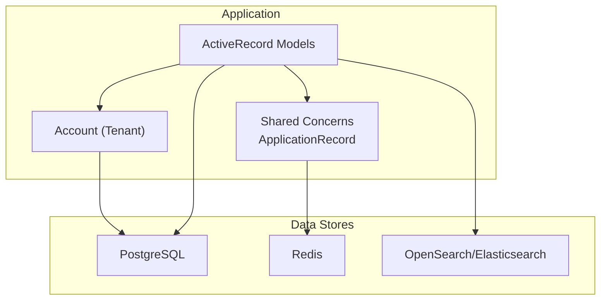
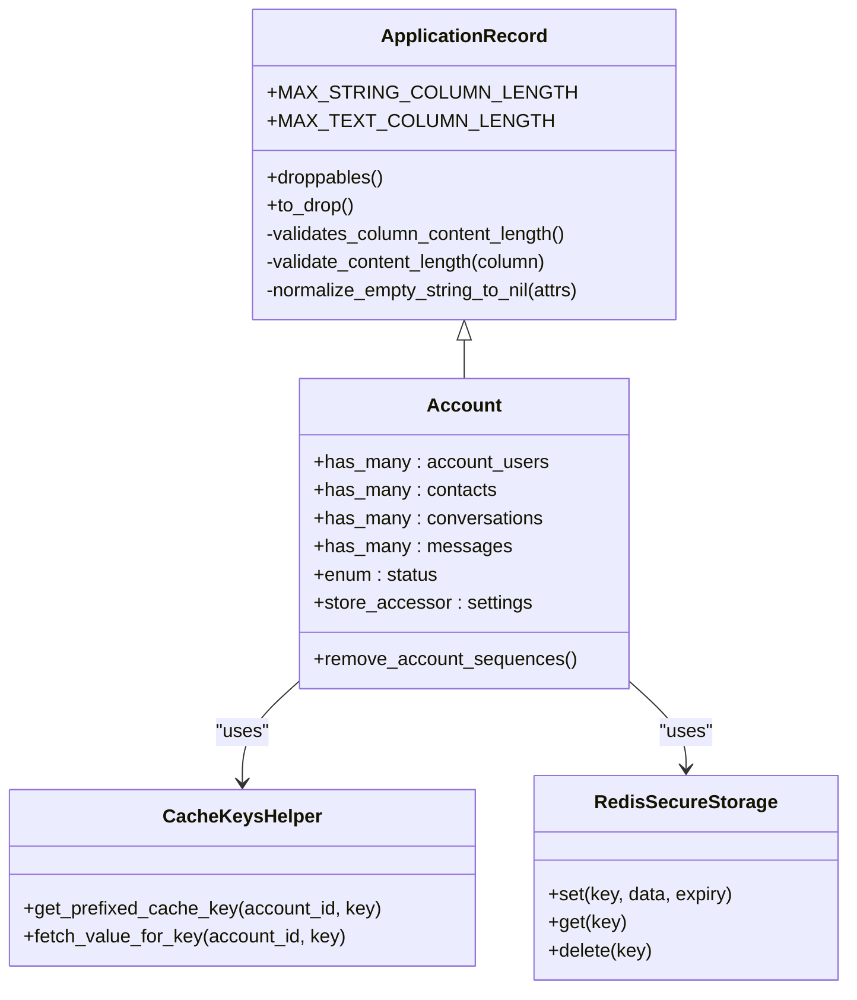
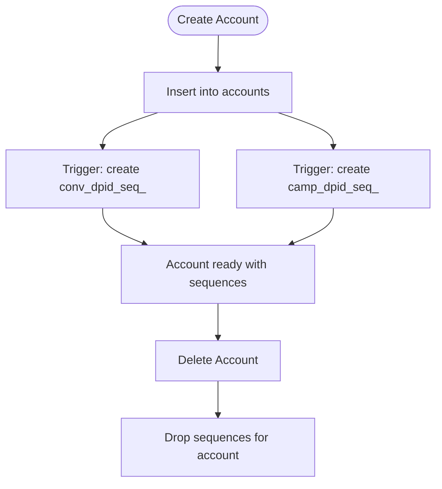
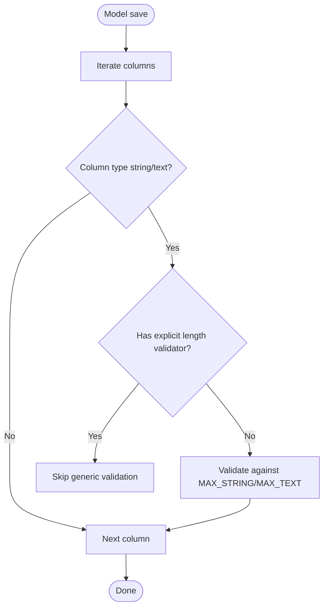
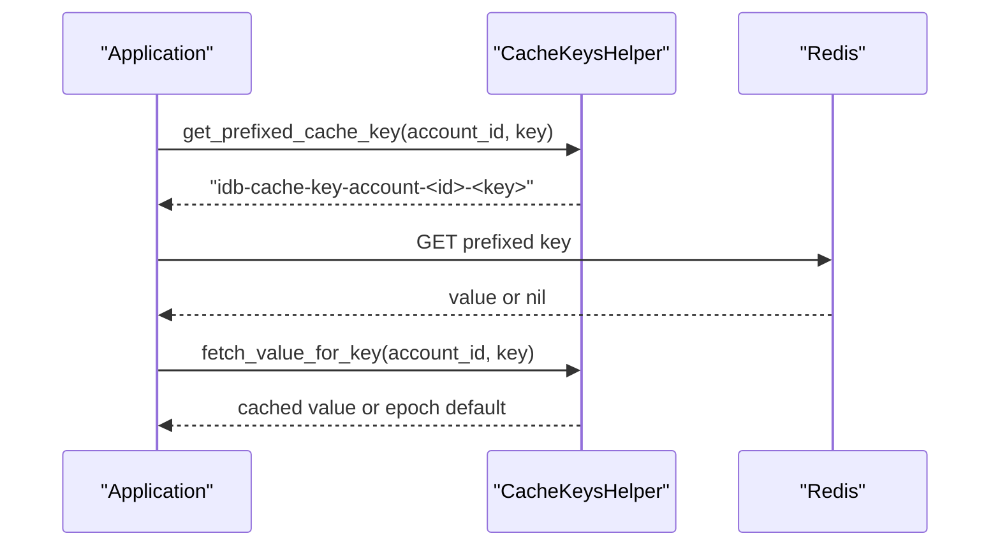
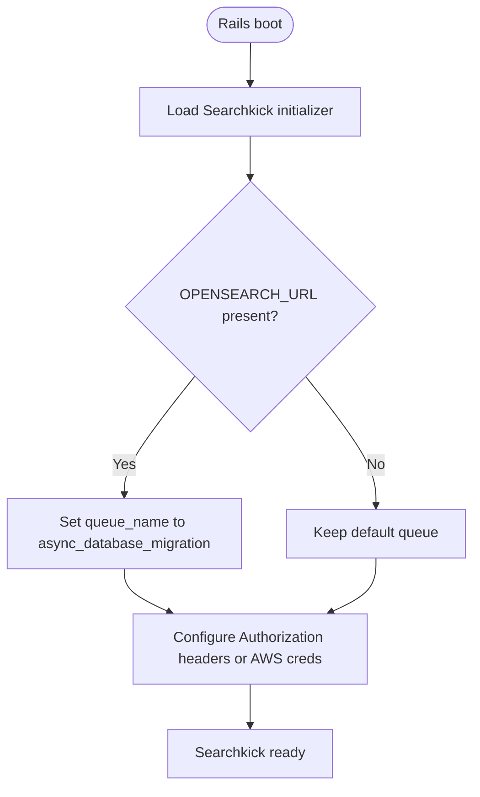
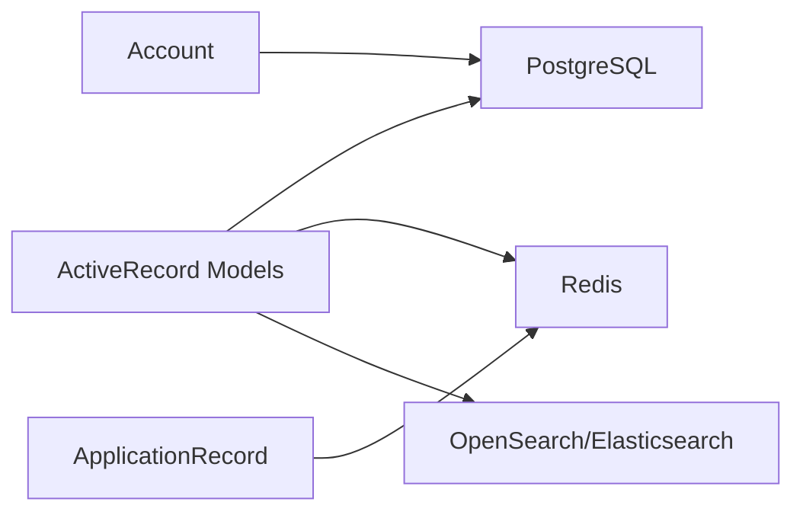

# Database Patterns

<cite>
**Referenced Files in This Document**
- [application_record.rb](file://app/models/application_record.rb)
- [account.rb](file://app/models/account.rb)
- [schema.rb](file://db/schema.rb)
- [database.yml](file://config/database.yml)
- [searchkick.rb](file://config/initializers/searchkick.rb)
- [cache_keys_helper.rb](file://app/helpers/cache_keys_helper.rb)
- [secure_storage.rb](file://lib/redis/secure_storage.rb)
</cite>

## Table of Contents
1. [Introduction](#introduction)
2. [Project Structure](#project-structure)
3. [Core Components](#core-components)
4. [Architecture Overview](#architecture-overview)
5. [Detailed Component Analysis](#detailed-component-analysis)
6. [Dependency Analysis](#dependency-analysis)
7. [Performance Considerations](#performance-considerations)
8. [Troubleshooting Guide](#troubleshooting-guide)
9. [Conclusion](#conclusion)

## Introduction
This document explains Chatwoot’s database design patterns and ActiveRecord usage with a focus on multi-tenant isolation, shared model concerns, schema organization, relationship modeling, indexing, migrations, data integrity, caching via Redis, search indexing via Searchkick, and performance monitoring. It provides code-level diagrams and references to concrete files for traceability.

## Project Structure
Chatwoot is a Rails application backed by PostgreSQL. The core data layer includes:
- ApplicationRecord as the base class for all models with shared validations and helpers.
- Account as the primary tenant boundary; most domain entities are scoped by account_id.
- A comprehensive schema with many tables, JSONB columns, and indexes.
- Configuration for PostgreSQL connection pooling, timeouts, and extensions.
- Searchkick initializer for OpenSearch/Elasticsearch integration.
- Redis-based caching utilities and secure storage for sensitive temporary data.

**Diagram sources**
- [application_record.rb:1-57](file://app/models/application_record.rb#L1-L57)
- [account.rb:1-253](file://app/models/account.rb#L1-L253)
- [schema.rb:13-20](file://db/schema.rb#L13-L20)
- [database.yml:1-32](file://config/database.yml#L1-L32)
- [searchkick.rb:1-24](file://config/initializers/searchkick.rb#L1-L24)
- [cache_keys_helper.rb:1-15](file://app/helpers/cache_keys_helper.rb#L1-L15)
- [secure_storage.rb:1-40](file://lib/redis/secure_storage.rb#L1-L40)

**Section sources**
- [application_record.rb:1-57](file://app/models/application_record.rb#L1-L57)
- [schema.rb:13-20](file://db/schema.rb#L13-L20)
- [database.yml:1-32](file://config/database.yml#L1-L32)

## Core Components
- ApplicationRecord: Base class providing shared validations (e.g., column length limits), helper methods for Liquid drops, and normalization utilities.
- Account: Tenant root with extensive relationships, feature flags, settings stored as JSONB, and database triggers for per-account sequences.
- Schema: Defines tables, columns, constraints, and indexes across the system, including vector embeddings and GIN indexes for JSONB arrays.
- Database configuration: PostgreSQL adapter, pool sizing, reaping frequency, and statement timeout.
- Searchkick initializer: Configures client options and queueing for OpenSearch/Elasticsearch.
- Caching and secure storage: Redis-based cache key helpers and encrypted storage for sensitive data.

**Section sources**
- [application_record.rb:1-57](file://app/models/application_record.rb#L1-L57)
- [account.rb:1-253](file://app/models/account.rb#L1-L253)
- [schema.rb:64-80](file://db/schema.rb#L64-L80)
- [database.yml:1-32](file://config/database.yml#L1-L32)
- [searchkick.rb:1-24](file://config/initializers/searchkick.rb#L1-L24)
- [cache_keys_helper.rb:1-15](file://app/helpers/cache_keys_helper.rb#L1-L15)
- [secure_storage.rb:1-40](file://lib/redis/secure_storage.rb#L1-L40)

## Architecture Overview
The system uses a single PostgreSQL database with strong multi-tenancy at the application level through account scoping. Shared behavior lives in ApplicationRecord and included concerns. Search and vector operations are offloaded to external systems (OpenSearch/Elasticsearch and pgvector). Redis is used for caching and secure temporary storage.

**Diagram sources**
- [application_record.rb:1-57](file://app/models/application_record.rb#L1-L57)
- [account.rb:1-253](file://app/models/account.rb#L1-L253)
- [cache_keys_helper.rb:1-15](file://app/helpers/cache_keys_helper.rb#L1-L15)
- [secure_storage.rb:1-40](file://lib/redis/secure_storage.rb#L1-L40)

## Detailed Component Analysis

### Multi-Tenant Architecture and Account Isolation
- All major entities are associated with an account_id, ensuring logical isolation.
- Account defines extensive relationships and stores flexible configuration in JSONB fields.
- Per-account sequences are created via database triggers when accounts are inserted, and dropped on deletion.

**Diagram sources**
- [account.rb:214-220](file://app/models/account.rb#L214-L220)
- [account.rb:242-245](file://app/models/account.rb#L242-L245)

**Section sources**
- [account.rb:64-111](file://app/models/account.rb#L64-L111)
- [account.rb:214-220](file://app/models/account.rb#L214-L220)
- [account.rb:242-245](file://app/models/account.rb#L242-L245)

### Model Inheritance and Shared Concerns
- ApplicationRecord centralizes common validations and helpers.
- Column content length validation prevents oversized payloads for string/text columns unless explicitly overridden.
- Helpers normalize empty strings to nil and provide Liquid drop support for templates.

**Diagram sources**
- [application_record.rb:27-47](file://app/models/application_record.rb#L27-L47)

**Section sources**
- [application_record.rb:1-57](file://app/models/application_record.rb#L1-L57)

### Schema Organization and Relationship Modeling
- The schema defines numerous tables with consistent use of account_id for scoping.
- JSONB columns store flexible settings and metadata.
- Indexes include standard B-tree indexes, unique constraints, partial indexes, and GIN indexes for JSONB arrays.
- Vector embeddings are supported via pgvector with IVFFlat indexes.

Key observations:
- Accounts table uses serial id and status index.
- Many-to-many and one-to-many relationships are modeled with foreign keys and indexes.
- Audit and reporting tables include composite indexes for efficient queries.

**Section sources**
- [schema.rb:64-80](file://db/schema.rb#L64-L80)
- [schema.rb:151-179](file://db/schema.rb#L151-L179)
- [schema.rb:195-202](file://db/schema.rb#L195-L202)
- [schema.rb:234-249](file://db/schema.rb#L234-L249)

### Query Optimization Strategies
- Use scopes and indexed columns for filtering (e.g., status, account_id).
- Leverage JSONB GIN indexes where applicable.
- Prefer partial indexes for filtered subsets (e.g., pending or ringing states).
- Utilize vector indexes for similarity search over embeddings.

Examples from schema:
- Partial index on calls for provider and created_at where status = 'ringing'.
- GIN indexes on JSONB arrays like cited_document_ids, document_ids, used_faq_ids.
- IVFFlat indexes on vector embeddings for fast approximate nearest neighbor searches.

**Section sources**
- [schema.rb:329-354](file://db/schema.rb#L329-L354)
- [schema.rb:151-179](file://db/schema.rb#L151-L179)
- [schema.rb:195-202](file://db/schema.rb#L195-L202)

### Indexing Strategies
- Unique indexes enforce business uniqueness (e.g., tokens, identifiers).
- Composite indexes optimize common query patterns (e.g., account_id + other fields).
- Partial indexes reduce index size and improve selectivity for specific states.
- GIN indexes accelerate JSONB array lookups.
- IVFFlat indexes enable vector similarity search.

**Section sources**
- [schema.rb:21-29](file://db/schema.rb#L21-L29)
- [schema.rb:45-62](file://db/schema.rb#L45-L62)
- [schema.rb:329-354](file://db/schema.rb#L329-L354)
- [schema.rb:195-202](file://db/schema.rb#L195-L202)

### Migration Patterns and Data Integrity Constraints
- Migrations define schema evolution; schema.rb reflects current state.
- Constraints include NOT NULL, defaults, unique constraints, and foreign keys.
- Triggers manage per-account sequence creation/deletion.
- Extensions such as pg_stat_statements, pg_trgm, pgcrypto, plpgsql, and vector are enabled.

**Section sources**
- [schema.rb:13-20](file://db/schema.rb#L13-L20)
- [schema.rb:64-80](file://db/schema.rb#L64-L80)
- [account.rb:214-220](file://app/models/account.rb#L214-L220)
- [account.rb:242-245](file://app/models/account.rb#L242-L245)

### Caching Mechanisms with Redis
- CacheKeysHelper provides account-scoped cache keys and retrieval helpers.
- Redis is used for ephemeral data and cache invalidation coordination.
- Redis::SecureStorage encrypts sensitive data before storing in Redis using AES-256-GCM.

**Diagram sources**
- [cache_keys_helper.rb:1-15](file://app/helpers/cache_keys_helper.rb#L1-L15)

**Section sources**
- [cache_keys_helper.rb:1-15](file://app/helpers/cache_keys_helper.rb#L1-L15)
- [secure_storage.rb:1-40](file://lib/redis/secure_storage.rb#L1-L40)

### Search Indexing with Searchkick
- Searchkick initializer configures client options for OpenSearch/Elasticsearch, supporting API key authorization and AWS credentials.
- Queue name can be set for asynchronous database migration tasks when OpenSearch URL is present.

**Diagram sources**
- [searchkick.rb:1-24](file://config/initializers/searchkick.rb#L1-L24)

**Section sources**
- [searchkick.rb:1-24](file://config/initializers/searchkick.rb#L1-L24)

### Performance Monitoring
- PostgreSQL extension pg_stat_statements is enabled for query performance analysis.
- Statement timeout is configured to limit long-running queries.
- Connection pool size adapts based on Sidekiq vs web processes.

**Section sources**
- [schema.rb:13-20](file://db/schema.rb#L13-L20)
- [database.yml:1-14](file://config/database.yml#L1-L14)

## Dependency Analysis
The following diagram shows how components depend on each other regarding database and caching layers.

**Diagram sources**
- [application_record.rb:1-57](file://app/models/application_record.rb#L1-L57)
- [account.rb:1-253](file://app/models/account.rb#L1-L253)
- [database.yml:1-32](file://config/database.yml#L1-L32)
- [searchkick.rb:1-24](file://config/initializers/searchkick.rb#L1-L24)
- [cache_keys_helper.rb:1-15](file://app/helpers/cache_keys_helper.rb#L1-L15)
- [secure_storage.rb:1-40](file://lib/redis/secure_storage.rb#L1-L40)

**Section sources**
- [database.yml:1-32](file://config/database.yml#L1-L32)
- [schema.rb:13-20](file://db/schema.rb#L13-L20)

## Performance Considerations
- Use account-scoped queries to leverage indexes on account_id.
- Prefer JSONB GIN indexes for array-heavy workloads.
- Leverage partial indexes for high-selectivity filters (e.g., status = 'ringing').
- Offload text search and vector similarity to OpenSearch/Elasticsearch and pgvector respectively.
- Tune PostgreSQL statement_timeout and connection pools according to workload characteristics.
- Monitor slow queries using pg_stat_statements.

[No sources needed since this section provides general guidance]

## Troubleshooting Guide
- If Redis-backed cache reads return unexpected values, verify that cache keys are correctly prefixed with account_id and that Redis connectivity is healthy.
- If encrypted Redis storage fails, ensure encryption environment variables are configured; otherwise Redis::SecureStorage will raise an error.
- If search queries fail, confirm Searchkick initialization and environment variables for OPENSEARCH_URL, OPENSEARCH_API_KEY, or AWS credentials.
- For long-running queries timing out, review statement_timeout and consider optimizing queries or adding appropriate indexes.

**Section sources**
- [cache_keys_helper.rb:1-15](file://app/helpers/cache_keys_helper.rb#L1-L15)
- [secure_storage.rb:1-40](file://lib/redis/secure_storage.rb#L1-L40)
- [searchkick.rb:1-24](file://config/initializers/searchkick.rb#L1-L24)
- [database.yml:1-14](file://config/database.yml#L1-L14)

## Conclusion
Chatwoot’s database design emphasizes multi-tenant isolation via account scoping, shared model behavior through ApplicationRecord, and robust schema organization with strategic indexing. Redis provides efficient caching and secure temporary storage, while Searchkick integrates with OpenSearch/Elasticsearch for advanced search and vector capabilities. Proper use of indexes, JSONB, partial indexes, and vector indexes, combined with careful configuration of PostgreSQL and Redis, supports scalability and performance.

[No sources needed since this section summarizes without analyzing specific files]