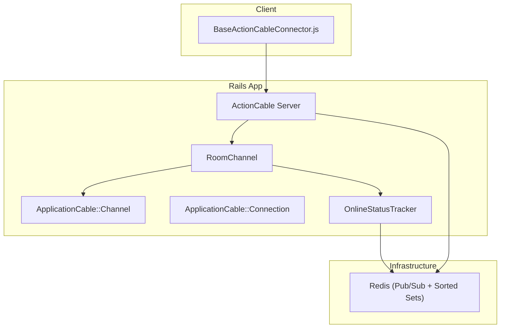
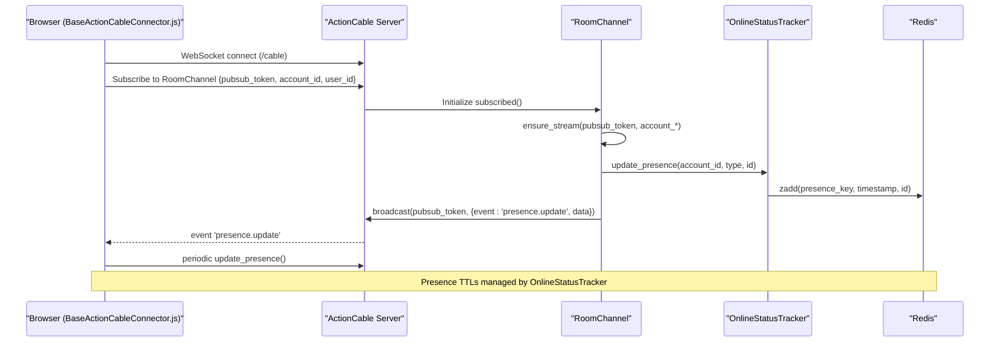
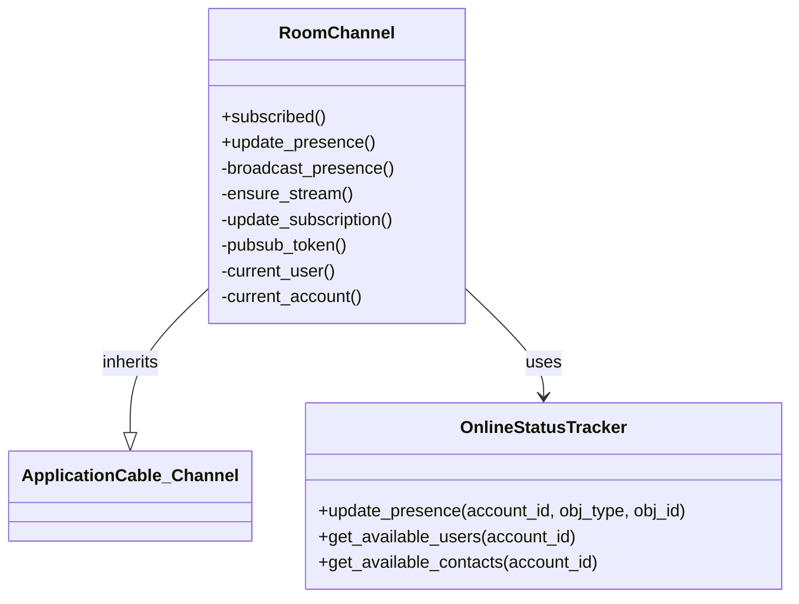
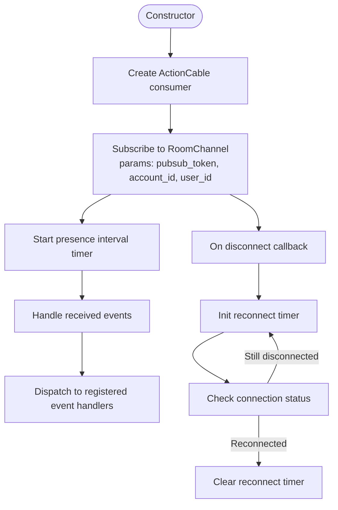
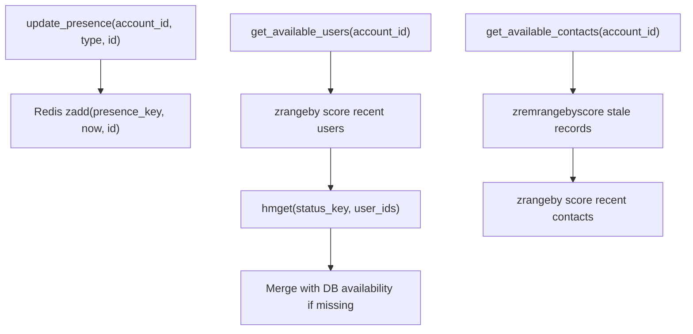
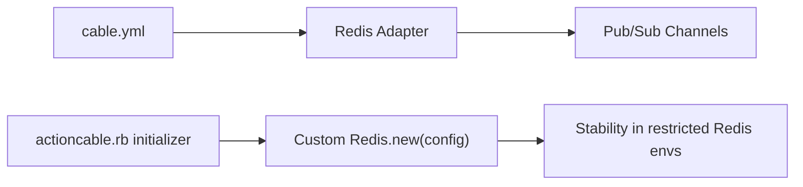
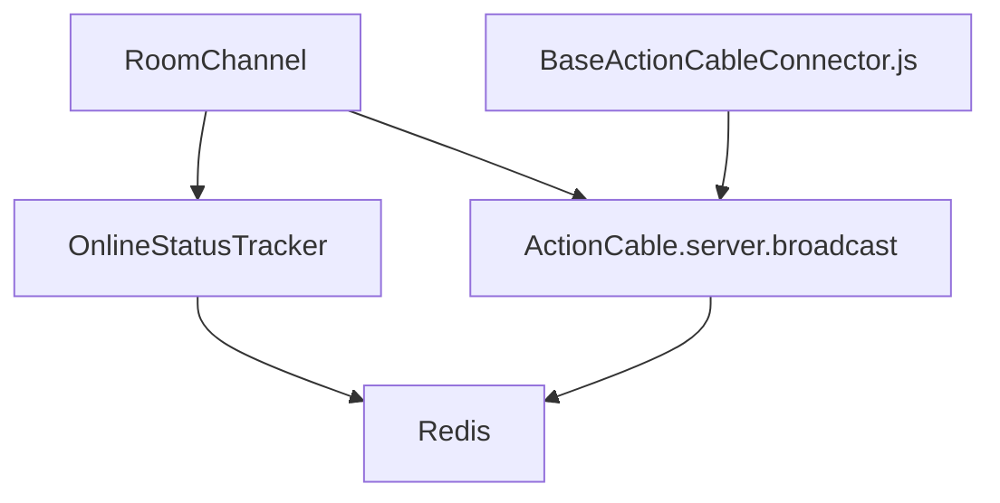

# Real-time Communication

<cite>
**Referenced Files in This Document**
- [room_channel.rb](file://app/channels/room_channel.rb)
- [application_cable/channel.rb](file://app/channels/application_cable/channel.rb)
- [application_cable/connection.rb](file://app/channels/application_cable/connection.rb)
- [cable.yml](file://config/cable.yml)
- [actioncable.rb](file://config/initializers/actioncable.rb)
- [BaseActionCableConnector.js](file://app/javascript/shared/helpers/BaseActionCableConnector.js)
- [online_status_tracker.rb](file://lib/online_status_tracker.rb)
</cite>

## Table of Contents
1. [Introduction](#introduction)
2. [Project Structure](#project-structure)
3. [Core Components](#core-components)
4. [Architecture Overview](#architecture-overview)
5. [Detailed Component Analysis](#detailed-component-analysis)
6. [Dependency Analysis](#dependency-analysis)
7. [Performance Considerations](#performance-considerations)
8. [Troubleshooting Guide](#troubleshooting-guide)
9. [Conclusion](#conclusion)

## Introduction
This document explains Chatwoot’s real-time communication system built on ActionCable. It covers the WebSocket architecture for live conversation updates, agent notifications, and collaboration features; channel organization and connection management; message broadcasting patterns; client-side integration with reconnection handling; scaling considerations for high concurrency; room-based messaging; presence tracking; and real-time state synchronization.

## Project Structure
The real-time layer is implemented as:
- Server-side channels under app/channels
- Client-side WebSocket connector under app/javascript/shared/helpers
- Redis-backed pub/sub configuration under config/cable.yml and initializers
- Presence and availability logic under lib/online_status_tracker.rb

**Diagram sources**
- [BaseActionCableConnector.js:1-48](file://app/javascript/shared/helpers/BaseActionCableConnector.js#L1-L48)
- [room_channel.rb:1-60](file://app/channels/room_channel.rb#L1-L60)
- [application_cable/channel.rb:1-3](file://app/channels/application_cable/channel.rb#L1-L3)
- [application_cable/connection.rb:1-3](file://app/channels/application_cable/connection.rb#L1-L3)
- [online_status_tracker.rb:1-80](file://lib/online_status_tracker.rb#L1-L80)
- [cable.yml:1-22](file://config/cable.yml#L1-L22)

**Section sources**
- [room_channel.rb:1-60](file://app/channels/room_channel.rb#L1-L60)
- [application_cable/channel.rb:1-3](file://app/channels/application_cable/channel.rb#L1-L3)
- [application_cable/connection.rb:1-3](file://app/channels/application_cable/connection.rb#L1-L3)
- [cable.yml:1-22](file://config/cable.yml#L1-L22)
- [actioncable.rb:1-19](file://config/initializers/actioncable.rb#L1-L19)
- [BaseActionCableConnector.js:1-97](file://app/javascript/shared/helpers/BaseActionCableConnector.js#L1-L97)
- [online_status_tracker.rb:1-80](file://lib/online_status_tracker.rb#L1-L80)

## Core Components
- RoomChannel: Handles subscription lifecycle, stream routing, presence updates, and broadcasts to clients.
- ApplicationCable::Channel: Base class for all channels.
- ApplicationCable::Connection: Base class for connections (extensible for auth).
- BaseActionCableConnector.js: Client-side consumer that subscribes to RoomChannel, manages presence pings, event dispatching, and reconnection.
- OnlineStatusTracker: Redis-backed presence and availability service used by channels and other services.
- ActionCable configuration: cable.yml and initializer for Redis adapter and connection behavior.

Key responsibilities:
- Connection and subscription setup
- Stream scoping per user and account
- Presence tracking and broadcast
- Event-driven updates via pub/sub tokens

**Section sources**
- [room_channel.rb:1-60](file://app/channels/room_channel.rb#L1-L60)
- [application_cable/channel.rb:1-3](file://app/channels/application_cable/channel.rb#L1-L3)
- [application_cable/connection.rb:1-3](file://app/channels/application_cable/connection.rb#L1-L3)
- [BaseActionCableConnector.js:1-97](file://app/javascript/shared/helpers/BaseActionCableConnector.js#L1-L97)
- [online_status_tracker.rb:1-80](file://lib/online_status_tracker.rb#L1-L80)
- [cable.yml:1-22](file://config/cable.yml#L1-L22)
- [actioncable.rb:1-19](file://config/initializers/actioncable.rb#L1-L19)

## Architecture Overview
The system uses ActionCable over WebSockets with Redis as the pub/sub backend. Clients connect to /cable, subscribe to RoomChannel with a pubsub_token and account/user identifiers. The server streams messages to scoped channels based on the token and account. Presence is maintained in Redis sorted sets and hashes, and periodically refreshed by client pings.

**Diagram sources**
- [BaseActionCableConnector.js:17-47](file://app/javascript/shared/helpers/BaseActionCableConnector.js#L17-L47)
- [room_channel.rb:2-35](file://app/channels/room_channel.rb#L2-L35)
- [online_status_tracker.rb:10-18](file://lib/online_status_tracker.rb#L10-L18)
- [cable.yml:1-9](file://config/cable.yml#L1-L9)

## Detailed Component Analysis

### RoomChannel
Responsibilities:
- Authenticate context via params (pubsub_token, optional user_id)
- Resolve current_user and current_account
- Ensure streams for pubsub_token and account-scoped stream
- Update presence and broadcast presence updates

**Diagram sources**
- [room_channel.rb:1-60](file://app/channels/room_channel.rb#L1-L60)
- [application_cable/channel.rb:1-3](file://app/channels/application_cable/channel.rb#L1-L3)
- [online_status_tracker.rb:1-80](file://lib/online_status_tracker.rb#L1-L80)

**Section sources**
- [room_channel.rb:1-60](file://app/channels/room_channel.rb#L1-L60)

### Client Connector (BaseActionCableConnector.js)
Responsibilities:
- Create ActionCable consumer and subscribe to RoomChannel
- Send periodic presence pings
- Handle received events via an event map
- Manage reconnection timers and callbacks

**Diagram sources**
- [BaseActionCableConnector.js:1-97](file://app/javascript/shared/helpers/BaseActionCableConnector.js#L1-L97)

**Section sources**
- [BaseActionCableConnector.js:1-97](file://app/javascript/shared/helpers/BaseActionCableConnector.js#L1-L97)

### Presence and Availability (OnlineStatusTracker)
Responsibilities:
- Maintain presence timestamps using Redis sorted sets
- Provide availability status via Redis hashes and fallback to DB
- Expose helpers to get available users and contacts within time windows

**Diagram sources**
- [online_status_tracker.rb:10-78](file://lib/online_status_tracker.rb#L10-L78)

**Section sources**
- [online_status_tracker.rb:1-80](file://lib/online_status_tracker.rb#L1-L80)

### ActionCable Configuration
- Adapter: Redis with configurable URL, password, SSL verify mode, and channel prefix
- Reconnect attempts: exponential backoff list for Redis connection resilience
- Initializer: customizes Redis connector to support environments where certain commands are disabled and excludes reconnect_attempts from publisher config

**Diagram sources**
- [cable.yml:1-22](file://config/cable.yml#L1-L22)
- [actioncable.rb:1-19](file://config/initializers/actioncable.rb#L1-L19)

**Section sources**
- [cable.yml:1-22](file://config/cable.yml#L1-L22)
- [actioncable.rb:1-19](file://config/initializers/actioncable.rb#L1-L19)

## Dependency Analysis
- RoomChannel depends on OnlineStatusTracker for presence and availability.
- BaseActionCableConnector.js depends on @rails/actioncable and subscribes to RoomChannel.
- ActionCable uses Redis as the transport for cross-process pub/sub.
- Presence data is stored in Redis sorted sets and hashes.

**Diagram sources**
- [room_channel.rb:19-35](file://app/channels/room_channel.rb#L19-L35)
- [BaseActionCableConnector.js:17-47](file://app/javascript/shared/helpers/BaseActionCableConnector.js#L17-L47)
- [online_status_tracker.rb:10-78](file://lib/online_status_tracker.rb#L10-L78)
- [cable.yml:1-9](file://config/cable.yml#L1-L9)

**Section sources**
- [room_channel.rb:1-60](file://app/channels/room_channel.rb#L1-L60)
- [BaseActionCableConnector.js:1-97](file://app/javascript/shared/helpers/BaseActionCableConnector.js#L1-L97)
- [online_status_tracker.rb:1-80](file://lib/online_status_tracker.rb#L1-L80)
- [cable.yml:1-22](file://config/cable.yml#L1-L22)

## Performance Considerations
- Use Redis-backed pub/sub for horizontal scaling across multiple Rails processes.
- Tune presence intervals:
  - Client presence ping interval balances freshness vs. overhead.
  - OnlineStatusTracker durations control how long presence remains valid without pings.
- Avoid heavy work inside channel callbacks; offload to background jobs when needed.
- Prefer streaming by pubsub_token and account-scoped streams to limit fan-out.
- Monitor Redis latency and memory usage; consider dedicated Redis instances for production.
- Configure reconnect_attempts in cable.yml to handle transient Redis outages gracefully.

[No sources needed since this section provides general guidance]

## Troubleshooting Guide
Common issues and resolutions:
- WebSocket connection failures:
  - Verify /cable endpoint is reachable and reverse proxy supports WebSockets.
  - Check Redis connectivity and credentials in cable.yml.
- Presence not updating:
  - Ensure client sends periodic update_presence calls.
  - Confirm OnlineStatusTracker presence keys are being written to Redis.
- High CPU or memory usage:
  - Reduce presence ping frequency.
  - Review large broadcasts; prefer targeted streams.
- Redis command restrictions:
  - If running in environments like Memorystore where certain commands are disabled, use the provided initializer to adjust Redis client configuration.

**Section sources**
- [cable.yml:1-22](file://config/cable.yml#L1-L22)
- [actioncable.rb:1-19](file://config/initializers/actioncable.rb#L1-L19)
- [BaseActionCableConnector.js:41-75](file://app/javascript/shared/helpers/BaseActionCableConnector.js#L41-L75)
- [online_status_tracker.rb:10-78](file://lib/online_status_tracker.rb#L10-L78)

## Conclusion
Chatwoot’s real-time layer leverages ActionCable with Redis for scalable, low-latency communication. RoomChannel coordinates subscription, streaming, and presence broadcasting, while the client connector ensures resilient connections and timely presence updates. OnlineStatusTracker centralizes presence and availability logic backed by Redis. With proper configuration and tuning, the system supports high-concurrency scenarios and robust real-time collaboration.

[No sources needed since this section summarizes without analyzing specific files]