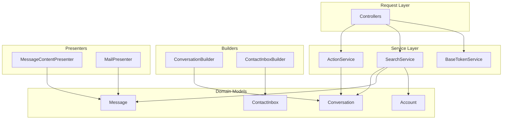
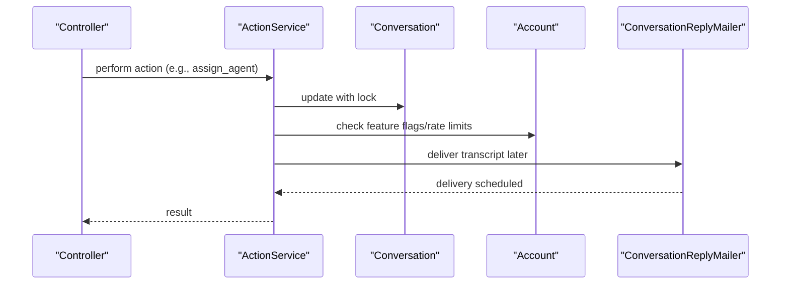
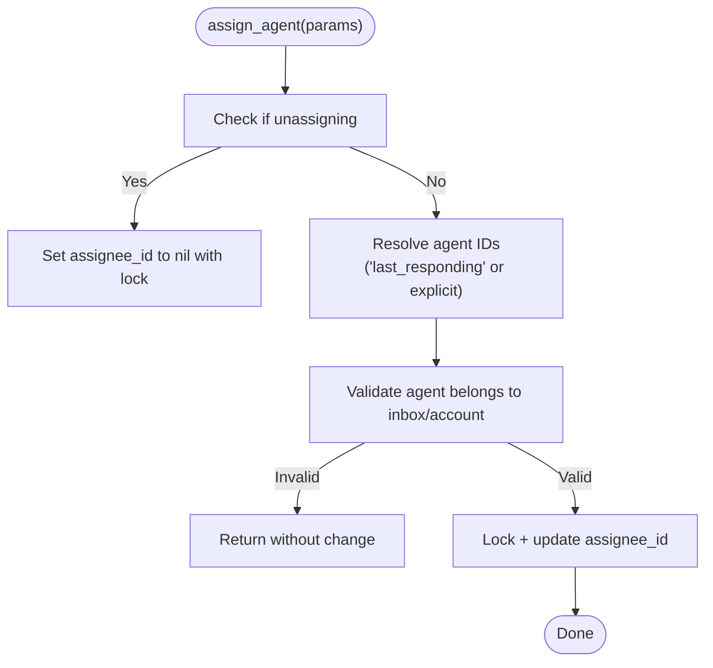
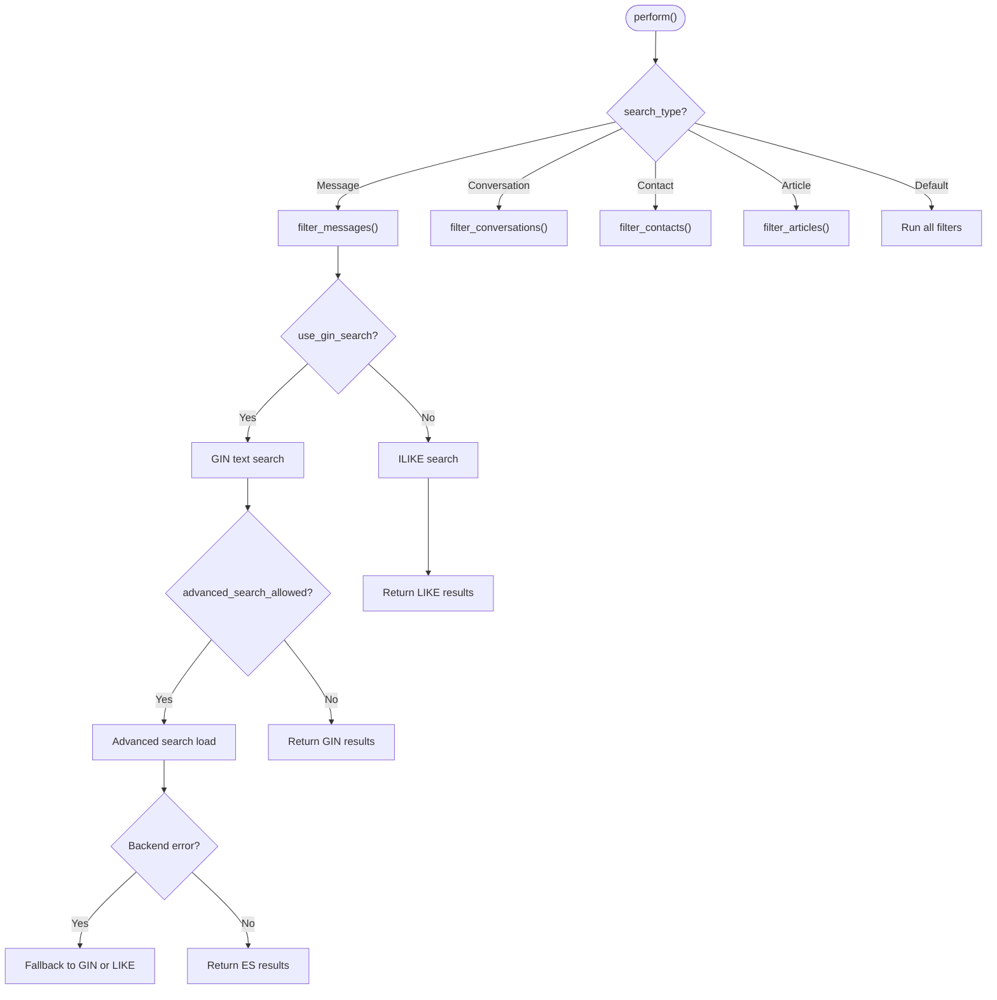
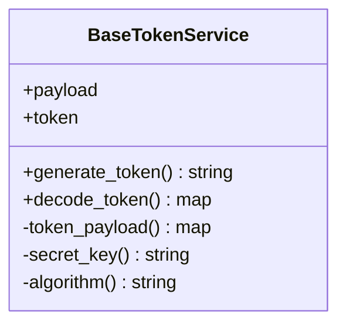
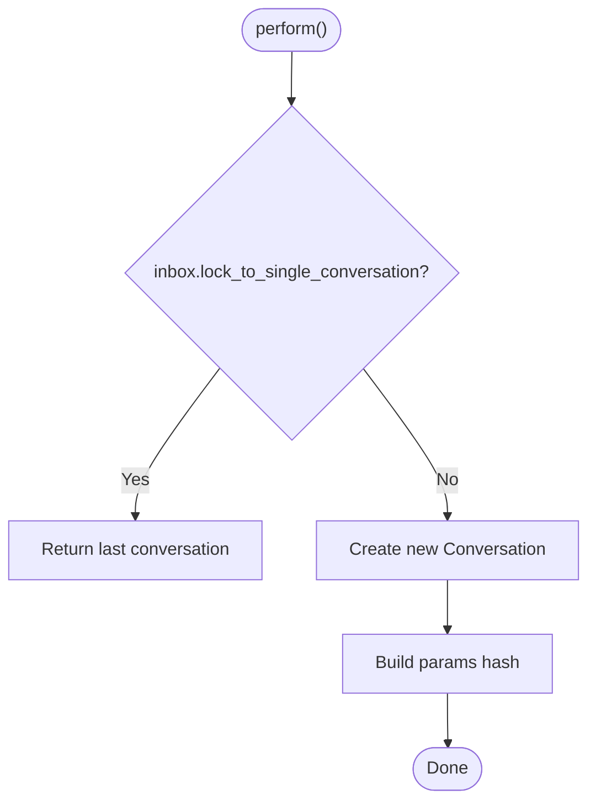
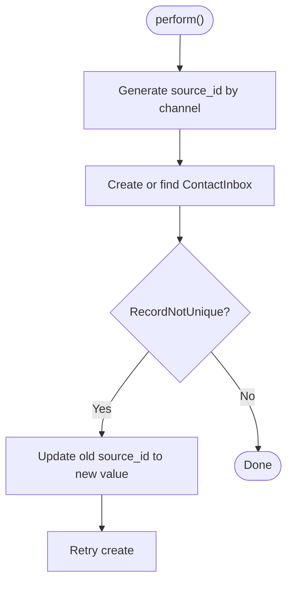
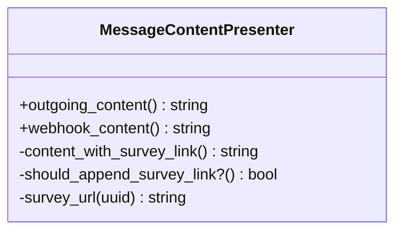
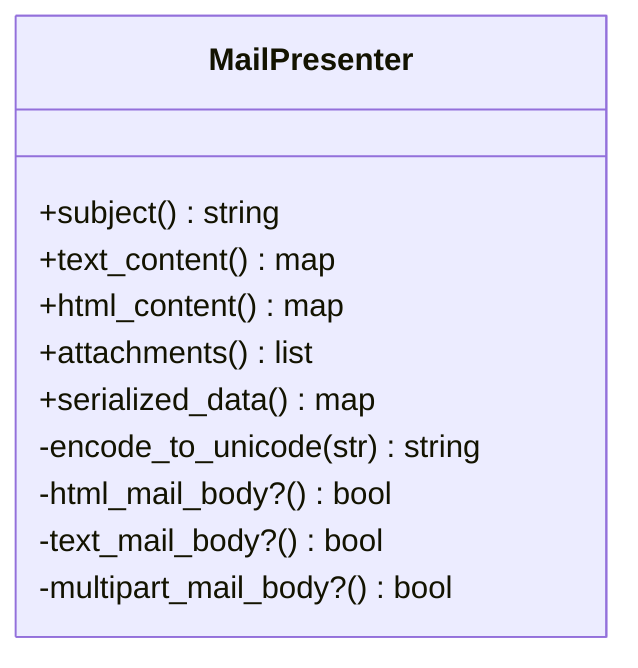
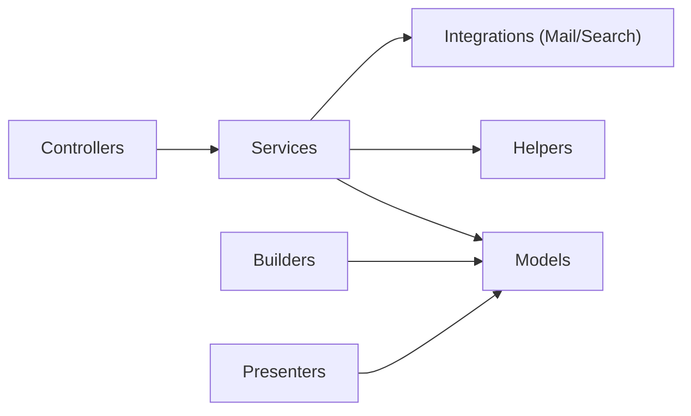

# Service Layer Architecture

<cite>
**Referenced Files in This Document**
- [action_service.rb](file://app/services/action_service.rb)
- [base_token_service.rb](file://app/services/base_token_service.rb)
- [search_service.rb](file://app/services/search_service.rb)
- [conversation_builder.rb](file://app/builders/conversation_builder.rb)
- [contact_inbox_builder.rb](file://app/builders/contact_inbox_builder.rb)
- [message_content_presenter.rb](file://app/presenters/message_content_presenter.rb)
- [mail_presenter.rb](file://app/presenters/mail_presenter.rb)
- [action_service_spec.rb](file://spec/services/action_service_spec.rb)
- [base_token_service_spec.rb](file://spec/services/base_token_service_spec.rb)
- [search_service_spec.rb](file://spec/services/search_service_spec.rb)
</cite>

## Table of Contents
1. [Introduction](#introduction)
2. [Project Structure](#project-structure)
3. [Core Components](#core-components)
4. [Architecture Overview](#architecture-overview)
5. [Detailed Component Analysis](#detailed-component-analysis)
6. [Dependency Analysis](#dependency-analysis)
7. [Performance Considerations](#performance-considerations)
8. [Troubleshooting Guide](#troubleshooting-guide)
9. [Conclusion](#conclusion)

## Introduction
This document explains Chatwoot’s service-oriented architecture with a focus on how business logic is encapsulated in dedicated service classes, how builders are used for complex object construction, and how presenters transform data for consumption by other layers. It also covers separation of concerns between controllers, services, models, and presenters; helper modules and domain-specific utilities; testing strategies for service objects; dependency injection patterns; composition techniques; error handling; and integration across architectural layers.

## Project Structure
Chatwoot organizes behavior into clear layers:
- Controllers handle HTTP requests and delegate to services.
- Services encapsulate business logic and orchestrate domain operations.
- Builders construct complex domain objects with validation and channel-specific logic.
- Presenters adapt model data for rendering or API responses.
- Helpers provide shared functionality across the application.
- Models represent domain entities and persistence.

**Diagram sources**
- [action_service.rb:1-123](file://app/services/action_service.rb#L1-L123)
- [search_service.rb:1-214](file://app/services/search_service.rb#L1-L214)
- [base_token_service.rb:1-28](file://app/services/base_token_service.rb#L1-L28)
- [conversation_builder.rb:1-41](file://app/builders/conversation_builder.rb#L1-L41)
- [contact_inbox_builder.rb:1-108](file://app/builders/contact_inbox_builder.rb#L1-L108)
- [message_content_presenter.rb:1-34](file://app/presenters/message_content_presenter.rb#L1-L34)
- [mail_presenter.rb:1-225](file://app/presenters/mail_presenter.rb#L1-L225)

**Section sources**
- [action_service.rb:1-123](file://app/services/action_service.rb#L1-L123)
- [search_service.rb:1-214](file://app/services/search_service.rb#L1-L214)
- [base_token_service.rb:1-28](file://app/services/base_token_service.rb#L1-L28)
- [conversation_builder.rb:1-41](file://app/builders/conversation_builder.rb#L1-L41)
- [contact_inbox_builder.rb:1-108](file://app/builders/contact_inbox_builder.rb#L1-L108)
- [message_content_presenter.rb:1-34](file://app/presenters/message_content_presenter.rb#L1-L34)
- [mail_presenter.rb:1-225](file://app/presenters/mail_presenter.rb#L1-L225)

## Core Components
- ActionService: Encapsulates conversation lifecycle actions (mute, snooze, resolve, open, pending), status/priority changes, label management, agent/team assignment, and transcript email dispatch. It uses locking to prevent race conditions during concurrent updates and integrates with mailers and account-level features.
- SearchService: Orchestrates multi-entity search across messages, conversations, contacts, and articles. It selects appropriate search strategies (GIN index, SQL LIKE, advanced search with fallbacks), applies feature flags, time filters, sender/inbox filters, and pagination.
- BaseTokenService: Provides reusable JWT encode/decode capabilities with configurable payload and algorithm, using application secrets.

These components demonstrate clean separation:
- Controllers call services without embedding business rules.
- Services coordinate models, helpers, and external integrations.
- Builders isolate complex creation flows.
- Presenters decouple presentation logic from domain models.

**Section sources**
- [action_service.rb:1-123](file://app/services/action_service.rb#L1-L123)
- [search_service.rb:1-214](file://app/services/search_service.rb#L1-L214)
- [base_token_service.rb:1-28](file://app/services/base_token_service.rb#L1-L28)

## Architecture Overview
The service layer acts as the central orchestrator for business workflows. Controllers remain thin, delegating to services that encapsulate domain logic. Builders ensure robust creation of complex objects with channel-specific behaviors. Presenters transform model data into view/API-friendly structures.

**Diagram sources**
- [action_service.rb:43-95](file://app/services/action_service.rb#L43-L95)

## Detailed Component Analysis

### ActionService
Responsibilities:
- Conversation state transitions and metadata updates.
- Assignment of agents and teams with authorization checks.
- Label addition/removal.
- Email transcript dispatch respecting rate limits and account settings.

Key implementation patterns:
- Uses database row locking to avoid race conditions when updating assignments.
- Validates agent membership against inbox members and account administrators.
- Delegates email sending to mailers and increments account counters.

**Diagram sources**
- [action_service.rb:43-55](file://app/services/action_service.rb#L43-L55)

Error handling:
- Validation failures short-circuit updates.
- Rate limiting prevents excessive email dispatch.

Integration points:
- Integrates with Conversation, Account, Inbox, User models.
- Uses mailers for asynchronous delivery.

Testing strategy:
- Unit tests verify state transitions, assignment logic, and email dispatch behavior.
- Specs assert private method contracts and side effects.

**Section sources**
- [action_service.rb:1-123](file://app/services/action_service.rb#L1-L123)
- [action_service_spec.rb:1-200](file://spec/services/action_service_spec.rb#L1-L200)

### SearchService
Responsibilities:
- Unified search entry point returning paginated results for multiple entity types.
- Strategy selection based on feature flags and environment capabilities.
- Time-based filtering, sender/inbox scoping, and access control.

Key implementation patterns:
- Feature flag-driven toggles for advanced search and GIN indexing.
- Fallback mechanism when advanced search backends are unavailable.
- Centralized query building with composable filters.

**Diagram sources**
- [search_service.rb:8-70](file://app/services/search_service.rb#L8-L70)
- [search_service.rb:74-107](file://app/services/search_service.rb#L74-L107)

Error handling:
- Catches transport/search errors and logs warnings while falling back to SQL strategies.
- Tracks exceptions via an exception tracker.

Integration points:
- Accesses Account, Conversation, Message, Contact, Article models.
- Uses feature flags and limits to constrain queries.

Testing strategy:
- Specs validate query composition, filter application, and fallback behavior.

**Section sources**
- [search_service.rb:1-214](file://app/services/search_service.rb#L1-L214)
- [search_service_spec.rb:1-200](file://spec/services/search_service_spec.rb#L1-L200)

### BaseTokenService
Responsibilities:
- Encapsulates JWT token generation and decoding.
- Provides a consistent interface for token payloads and algorithms.

Key implementation patterns:
- Attribute initialization via pattr_initialize for concise constructor definitions.
- Centralized secret key and algorithm configuration.

**Diagram sources**
- [base_token_service.rb:1-28](file://app/services/base_token_service.rb#L1-L28)

Error handling:
- Decoding catches expired or malformed tokens and returns empty maps.

Testing strategy:
- Specs cover encoding/decoding paths and error cases.

**Section sources**
- [base_token_service.rb:1-28](file://app/services/base_token_service.rb#L1-L28)
- [base_token_service_spec.rb:1-200](file://spec/services/base_token_service_spec.rb#L1-L200)

### Builders: Complex Object Construction

#### ConversationBuilder
Purpose:
- Creates or reuses a Conversation depending on inbox policy and provided parameters.

Key patterns:
- Single-conversation inboxes return existing conversations instead of creating new ones.
- Builds attributes including additional/custom attributes and optional status overrides.

**Diagram sources**
- [conversation_builder.rb:4-39](file://app/builders/conversation_builder.rb#L4-L39)

**Section sources**
- [conversation_builder.rb:1-41](file://app/builders/conversation_builder.rb#L1-L41)

#### ContactInboxBuilder
Purpose:
- Creates or retrieves a ContactInbox with channel-appropriate source IDs.
- Handles race conditions and uniqueness constraints gracefully.

Key patterns:
- Channel-specific source ID generation (email, phone, WhatsApp, Twilio).
- Retry logic with source ID mutation to avoid collisions.
- Explicit parameter validation per channel.

**Diagram sources**
- [contact_inbox_builder.rb:7-73](file://app/builders/contact_inbox_builder.rb#L7-L73)
- [contact_inbox_builder.rb:75-100](file://app/builders/contact_inbox_builder.rb#L75-L100)

**Section sources**
- [contact_inbox_builder.rb:1-108](file://app/builders/contact_inbox_builder.rb#L1-L108)

### Presenters: Data Transformation

#### MessageContentPresenter
Purpose:
- Presents message content with channel-aware markdown rendering and webhook normalization.
- Optionally appends survey links based on CSAT configuration.

Key patterns:
- Delegates rendering to channel-specific services.
- Composes content with optional survey link insertion.

**Diagram sources**
- [message_content_presenter.rb:1-34](file://app/presenters/message_content_presenter.rb#L1-L34)

**Section sources**
- [message_content_presenter.rb:1-34](file://app/presenters/message_content_presenter.rb#L1-L34)

#### MailPresenter
Purpose:
- Normalizes and serializes incoming email parts, headers, and attachments.
- Handles multipart vs single-part emails and encodes content safely.

Key patterns:
- SimpleDelegator to wrap Mail objects.
- Robust parsing of addresses, headers, and auto-reply detection.
- Attachment upload and blob creation.

**Diagram sources**
- [mail_presenter.rb:1-225](file://app/presenters/mail_presenter.rb#L1-L225)

**Section sources**
- [mail_presenter.rb:1-225](file://app/presenters/mail_presenter.rb#L1-L225)

## Dependency Analysis
- Controllers depend on services for business logic, keeping request handling minimal.
- Services depend on models, helpers, and external integrations (e.g., mailers, search backends).
- Builders depend on models and channel configurations to construct domain objects.
- Presenters depend on models and rendering services to produce output.

**Diagram sources**
- [action_service.rb:1-123](file://app/services/action_service.rb#L1-L123)
- [search_service.rb:1-214](file://app/services/search_service.rb#L1-L214)
- [conversation_builder.rb:1-41](file://app/builders/conversation_builder.rb#L1-L41)
- [contact_inbox_builder.rb:1-108](file://app/builders/contact_inbox_builder.rb#L1-L108)
- [message_content_presenter.rb:1-34](file://app/presenters/message_content_presenter.rb#L1-L34)
- [mail_presenter.rb:1-225](file://app/presenters/mail_presenter.rb#L1-L225)

**Section sources**
- [action_service.rb:1-123](file://app/services/action_service.rb#L1-L123)
- [search_service.rb:1-214](file://app/services/search_service.rb#L1-L214)
- [conversation_builder.rb:1-41](file://app/builders/conversation_builder.rb#L1-L41)
- [contact_inbox_builder.rb:1-108](file://app/builders/contact_inbox_builder.rb#L1-L108)
- [message_content_presenter.rb:1-34](file://app/presenters/message_content_presenter.rb#L1-L34)
- [mail_presenter.rb:1-225](file://app/presenters/mail_presenter.rb#L1-L225)

## Performance Considerations
- Use database locks around critical updates to prevent race conditions (as seen in assignment updates).
- Prefer indexed searches (GIN) where available; fall back to SQL LIKE when advanced search backends are unavailable.
- Apply feature flags to gate expensive operations like advanced search and time-range filters.
- Paginate large result sets to reduce memory usage and improve response times.
- Offload heavy tasks (e.g., email transcripts) to background jobs via mailers.

[No sources needed since this section provides general guidance]

## Troubleshooting Guide
Common issues and resolutions:
- Token decode failures: Ensure correct secret configuration and algorithm; inspect decoded payload for expiration.
- Search backend errors: Monitor logs for fallback triggers; verify advanced search availability and feature flags.
- Race conditions on assignments: Confirm use of row locking around updates; audit concurrent writers.
- Email processing errors: Validate multipart handling and encoding; check attachment uploads and header parsing.

**Section sources**
- [base_token_service.rb:8-12](file://app/services/base_token_service.rb#L8-L12)
- [search_service.rb:60-66](file://app/services/search_service.rb#L60-L66)
- [action_service.rb:43-55](file://app/services/action_service.rb#L43-L55)
- [mail_presenter.rb:175-211](file://app/presenters/mail_presenter.rb#L175-L211)

## Conclusion
Chatwoot’s service-oriented architecture cleanly separates concerns:
- Services encapsulate business logic and orchestrate domain operations.
- Builders manage complex object construction with channel-specific rules.
- Presenters transform data for consumption by UI or APIs.
- Helpers and utilities provide shared functionality across layers.
This structure improves maintainability, testability, and scalability, while enabling robust error handling and performance optimizations.

[No sources needed since this section summarizes without analyzing specific files]