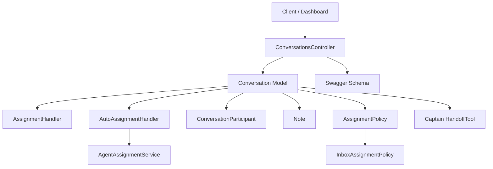
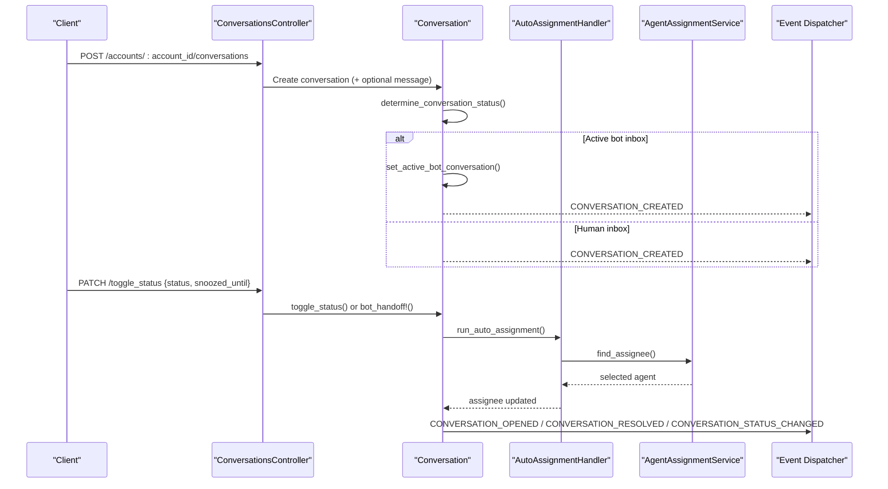
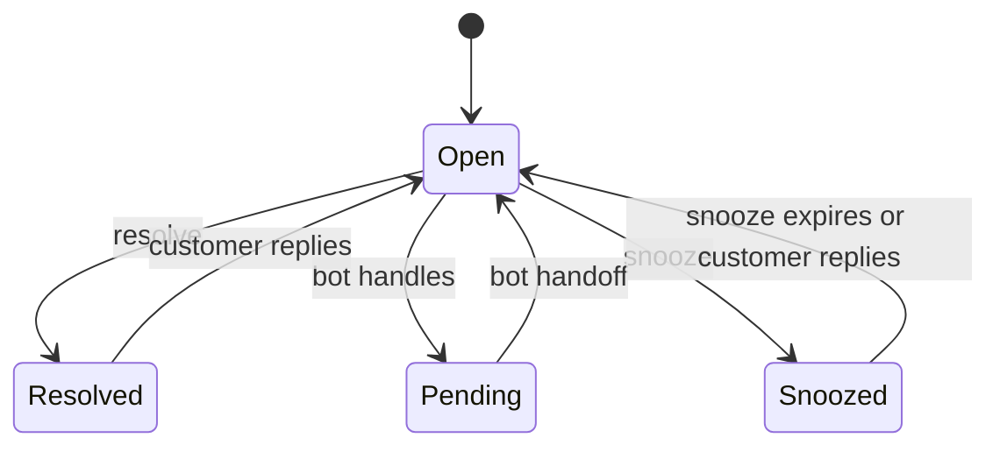
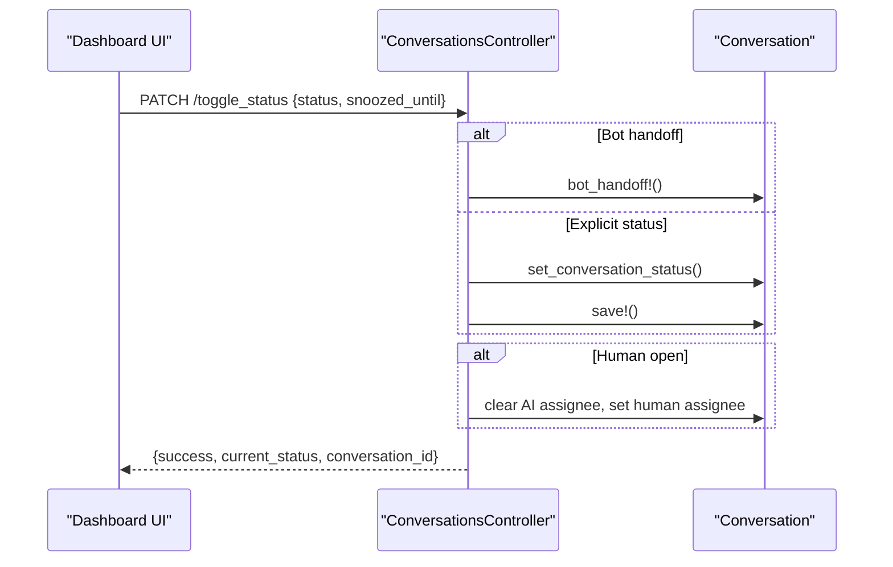
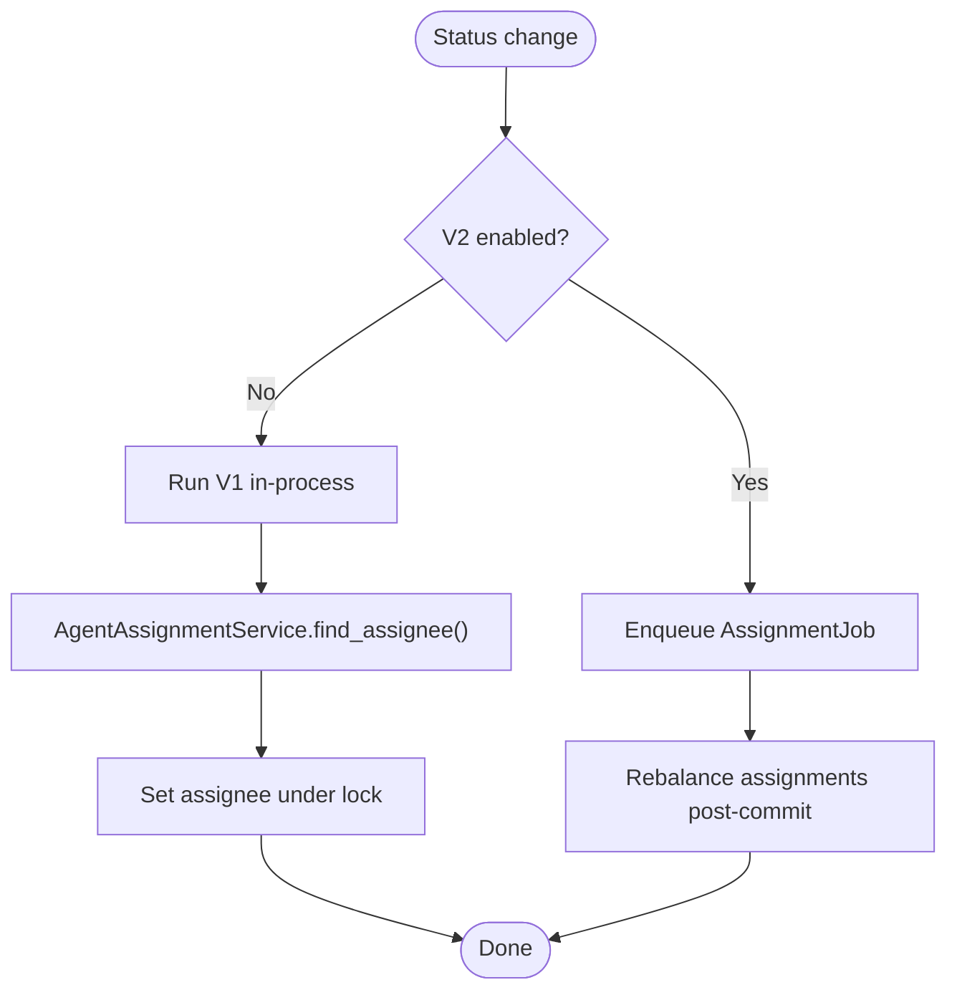
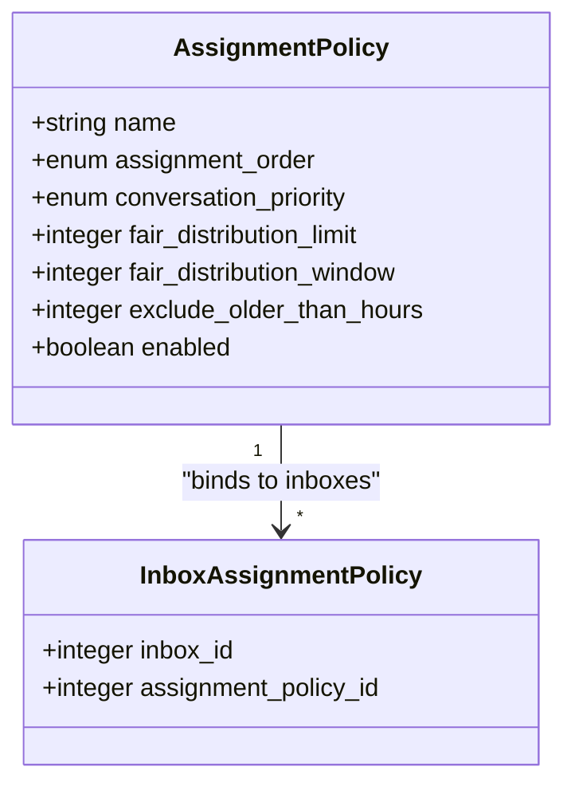
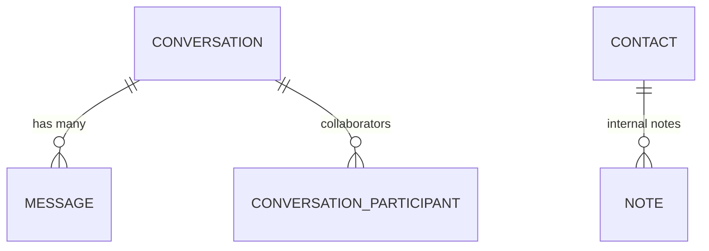
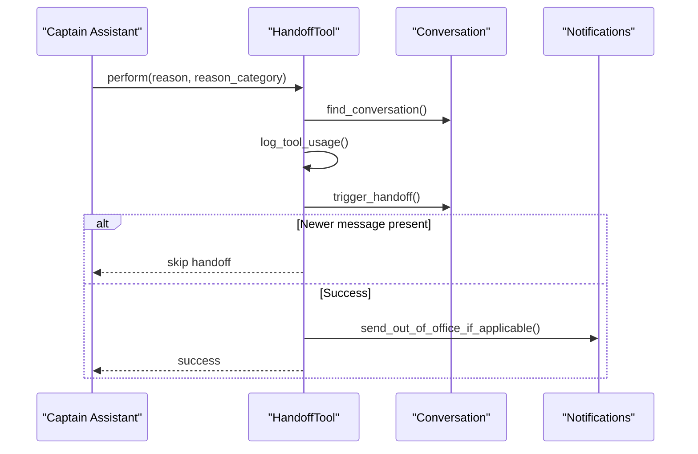
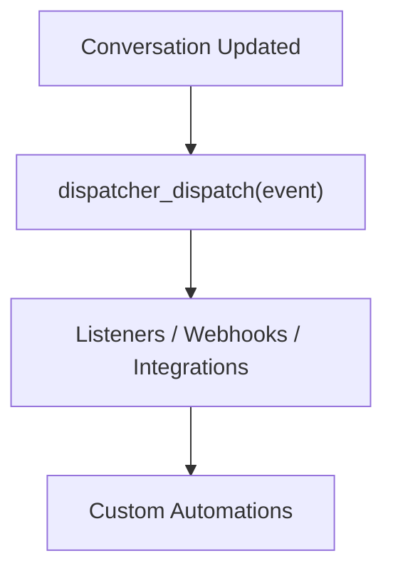
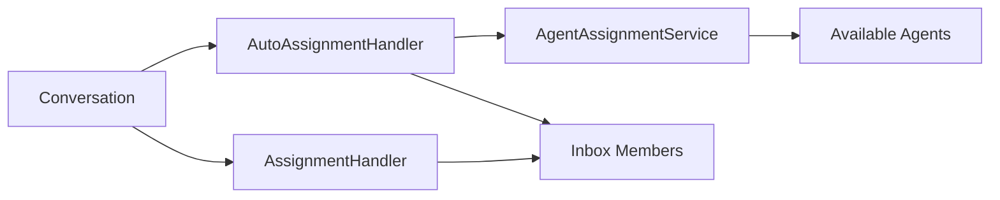

# Conversation Lifecycle & Workflow

<cite>
**Referenced Files in This Document**
- [conversation.rb](file://app/models/conversation.rb)
- [conversations_controller.rb](file://app/controllers/api/v1/accounts/conversations_controller.rb)
- [assignment_handler.rb](file://app/models/concerns/assignment_handler.rb)
- [auto_assignment_handler.rb](file://app/models/concerns/auto_assignment_handler.rb)
- [agent_assignment_service.rb](file://app/services/auto_assignment/agent_assignment_service.rb)
- [assignment_policy.rb](file://app/models/assignment_policy.rb)
- [inbox_assignment_policy.rb](file://app/models/inbox_assignment_policy.rb)
- [conversation_participant.rb](file://app/models/conversation_participant.rb)
- [note.rb](file://app/models/note.rb)
- [handoff_tool.rb](file://enterprise/lib/captain/tools/handoff_tool.rb)
- [copilot_workflows.liquid](file://enterprise/lib/captain/prompts/copilot_workflows.liquid)
- [status_toggle.yml](file://swagger/definitions/resource/extension/conversation/status_toggle.yml)
- [swagger.json](file://swagger/swagger.json)
- [assignmentPolicy.routes.js](file://app/javascript/dashboard/routes/dashboard/settings/assignmentPolicy/assignmentPolicy.routes.js)
- [constants.js](file://app/javascript/dashboard/routes/dashboard/settings/assignmentPolicy/constants.js)
</cite>

## Table of Contents
1. [Introduction](#introduction)
2. [Project Structure](#project-structure)
3. [Core Components](#core-components)
4. [Architecture Overview](#architecture-overview)
5. [Detailed Component Analysis](#detailed-component-analysis)
6. [Dependency Analysis](#dependency-analysis)
7. [Performance Considerations](#performance-considerations)
8. [Troubleshooting Guide](#troubleshooting-guide)
9. [Conclusion](#conclusion)

## Introduction
This document explains Chatwoot’s conversation lifecycle and workflow, covering how conversations are created, assigned, updated, snoozed, resolved, and reopened. It details status transitions (open, pending, resolved, snoozed), the auto-assignment system (legacy V1 and V2), collaboration features (threading, internal notes, participants), ownership rules, handoff scenarios between bots and agents, and automation hooks for custom workflows.

## Project Structure
The conversation lifecycle spans models, controllers, concerns, services, API schemas, and enterprise tools:
- Core model and lifecycle logic live in the Conversation model and its concerns.
- Status changes and bot handoffs are exposed via the Conversations controller.
- Assignment policies and routing are modeled by AssignmentPolicy and InboxAssignmentPolicy.
- Legacy and V2 assignment flows are coordinated by AutoAssignmentHandler and AgentAssignmentService.
- Collaboration is supported by ConversationParticipant and Note.
- AI-driven handoff is implemented in Captain::Tools::HandoffTool.
- API contracts define allowed statuses and payloads.

**Diagram sources**
- [conversations_controller.rb:83-104](file://app/controllers/api/v1/accounts/conversations_controller.rb#L83-L104)
- [conversation.rb:86-140](file://app/models/conversation.rb#L86-L140)
- [assignment_handler.rb:1-59](file://app/models/concerns/assignment_handler.rb#L1-L59)
- [auto_assignment_handler.rb:1-69](file://app/models/concerns/auto_assignment_handler.rb#L1-L69)
- [agent_assignment_service.rb:1-32](file://app/services/auto_assignment/agent_assignment_service.rb#L1-L32)
- [assignment_policy.rb:1-42](file://app/models/assignment_policy.rb#L1-L42)
- [inbox_assignment_policy.rb:1-22](file://app/models/inbox_assignment_policy.rb#L1-L22)
- [conversation_participant.rb:1-47](file://app/models/conversation_participant.rb#L1-L47)
- [note.rb:1-37](file://app/models/note.rb#L1-L37)
- [handoff_tool.rb:1-108](file://enterprise/lib/captain/tools/handoff_tool.rb#L1-L108)
- [swagger.json:5282-5365](file://swagger/swagger.json#L5282-L5365)

**Section sources**
- [conversation.rb:57-140](file://app/models/conversation.rb#L57-L140)
- [conversations_controller.rb:41-104](file://app/controllers/api/v1/accounts/conversations_controller.rb#L41-L104)

## Core Components
- Conversation lifecycle states: open, pending, resolved, snoozed.
- Ownership: assignee (human agent) or ai_assignee (bot).
- Collaboration: participants and private notes.
- Assignment: legacy V1 and V2 mechanisms with policy-based distribution.
- Automation: events dispatched on status and assignment changes.

Key responsibilities:
- Conversation model defines state machine behavior, timestamps, and event dispatching.
- AssignmentHandler ensures team constraints and notifies assignment changes.
- AutoAssignmentHandler triggers V1/V2 assignment based on inbox configuration and status changes.
- AgentAssignmentService selects an available agent using round-robin and capacity checks.
- AssignmentPolicy and InboxAssignmentPolicy configure distribution strategy per inbox.
- ConversationParticipant enforces inbox access for collaborators.
- Note provides internal, non-customer-facing context.
- HandoffTool orchestrates bot-to-agent handoff with reason categories and notifications.

**Section sources**
- [conversation.rb:86-140](file://app/models/conversation.rb#L86-L140)
- [assignment_handler.rb:1-59](file://app/models/concerns/assignment_handler.rb#L1-L59)
- [auto_assignment_handler.rb:1-69](file://app/models/concerns/auto_assignment_handler.rb#L1-L69)
- [agent_assignment_service.rb:1-32](file://app/services/auto_assignment/agent_assignment_service.rb#L1-L32)
- [assignment_policy.rb:1-42](file://app/models/assignment_policy.rb#L1-L42)
- [inbox_assignment_policy.rb:1-22](file://app/models/inbox_assignment_policy.rb#L1-L22)
- [conversation_participant.rb:1-47](file://app/models/conversation_participant.rb#L1-L47)
- [note.rb:1-37](file://app/models/note.rb#L1-L37)
- [handoff_tool.rb:1-108](file://enterprise/lib/captain/tools/handoff_tool.rb#L1-L108)

## Architecture Overview
The lifecycle begins when a conversation is created, optionally with an initial message. Depending on inbox configuration and whether a bot is active, the conversation may start as pending (AI-handled) or open (agent-handled). Status changes trigger events and possibly reassignment. Snoozing defers attention until a time or next customer reply. Resolution closes the conversation; incoming messages reopen it.

**Diagram sources**
- [conversations_controller.rb:41-104](file://app/controllers/api/v1/accounts/conversations_controller.rb#L41-L104)
- [conversation.rb:136-145](file://app/models/conversation.rb#L136-L145)
- [conversation.rb:316-334](file://app/models/conversation.rb#L316-L334)
- [auto_assignment_handler.rb:24-41](file://app/models/concerns/auto_assignment_handler.rb#L24-L41)
- [agent_assignment_service.rb:7-28](file://app/services/auto_assignment/agent_assignment_service.rb#L7-L28)

## Detailed Component Analysis

### Conversation Lifecycle States and Transitions
Statuses:
- open: waiting on the team.
- pending: handled by bot; not yet handed to an agent.
- snoozed: set aside until a chosen time or next customer message.
- resolved: closed; reopens on customer reply.

Business rules:
- Bot handoff from pending to open clears AI assignee and sets waiting_since if missing.
- Resolving clears waiting_since.
- Snoozed conversations reset snoozed_until when status changes away from snoozed.
- Toggle status flips open/resolved and opens from pending/snoozed.

**Diagram sources**
- [conversation.rb:86-140](file://app/models/conversation.rb#L86-L140)
- [conversation.rb:172-193](file://app/models/conversation.rb#L172-L193)
- [conversation.rb:290-300](file://app/models/conversation.rb#L290-L300)
- [conversation.rb:316-334](file://app/models/conversation.rb#L316-L334)

**Section sources**
- [conversation.rb:86-140](file://app/models/conversation.rb#L86-L140)
- [conversation.rb:172-193](file://app/models/conversation.rb#L172-L193)
- [conversation.rb:290-300](file://app/models/conversation.rb#L290-L300)
- [conversation.rb:316-334](file://app/models/conversation.rb#L316-L334)

### Status Change API and Frontend Flow
- The toggle_status endpoint supports explicit status updates and snoozing with a timestamp.
- When a human agent opens a conversation, the controller clears AI assignee and assigns the current user if they are an agent.
- Swagger schema enumerates allowed statuses and payload fields.

**Diagram sources**
- [conversations_controller.rb:83-104](file://app/controllers/api/v1/accounts/conversations_controller.rb#L83-L104)
- [conversations_controller.rb:176-186](file://app/controllers/api/v1/accounts/conversations_controller.rb#L176-L186)
- [swagger.json:5282-5365](file://swagger/swagger.json#L5282-L5365)
- [status_toggle.yml:1-14](file://swagger/definitions/resource/extension/conversation/status_toggle.yml#L1-L14)

**Section sources**
- [conversations_controller.rb:83-104](file://app/controllers/api/v1/accounts/conversations_controller.rb#L83-L104)
- [conversations_controller.rb:176-186](file://app/controllers/api/v1/accounts/conversations_controller.rb#L176-L186)
- [swagger.json:5282-5365](file://swagger/swagger.json#L5282-L5365)
- [status_toggle.yml:1-14](file://swagger/definitions/resource/extension/conversation/status_toggle.yml#L1-L14)

### Auto-Assignment System: Legacy V1 and V2
- Legacy V1:
  - Runs during save for status changes to open within the same transaction.
  - Uses AgentAssignmentService to pick an available agent under lock.
  - Considers team membership and inbox member capacity.
- V2:
  - Enqueues AssignmentJob after commit for open/resolved/snoozed transitions.
  - Allows redistribution when conversations are resolved or snoozed.
  - Controlled by inbox.auto_assignment_v2_enabled?.

**Diagram sources**
- [auto_assignment_handler.rb:12-41](file://app/models/concerns/auto_assignment_handler.rb#L12-L41)
- [auto_assignment_handler.rb:43-67](file://app/models/concerns/auto_assignment_handler.rb#L43-L67)
- [agent_assignment_service.rb:7-28](file://app/services/auto_assignment/agent_assignment_service.rb#L7-L28)

**Section sources**
- [auto_assignment_handler.rb:12-41](file://app/models/concerns/auto_assignment_handler.rb#L12-L41)
- [auto_assignment_handler.rb:43-67](file://app/models/concerns/auto_assignment_handler.rb#L43-L67)
- [agent_assignment_service.rb:7-28](file://app/services/auto_assignment/agent_assignment_service.rb#L7-L28)

### Assignment Policies and Distribution Rules
- AssignmentPolicy defines distribution order (round_robin), priority (earliest_created or longest_waiting), fair distribution limits/windows, and age exclusion thresholds.
- InboxAssignmentPolicy binds a policy to an inbox.
- Frontend routes expose settings for assignment and capacity policies, gated by feature flags.
- Constants define default values and options for order and priority.

**Diagram sources**
- [assignment_policy.rb:1-42](file://app/models/assignment_policy.rb#L1-L42)
- [inbox_assignment_policy.rb:1-22](file://app/models/inbox_assignment_policy.rb#L1-L22)
- [assignmentPolicy.routes.js:34-90](file://app/javascript/dashboard/routes/dashboard/settings/assignmentPolicy/assignmentPolicy.routes.js#L34-L90)
- [constants.js:1-20](file://app/javascript/dashboard/routes/dashboard/settings/assignmentPolicy/constants.js#L1-L20)

**Section sources**
- [assignment_policy.rb:1-42](file://app/models/assignment_policy.rb#L1-L42)
- [inbox_assignment_policy.rb:1-22](file://app/models/inbox_assignment_policy.rb#L1-L22)
- [assignmentPolicy.routes.js:34-90](file://app/javascript/dashboard/routes/dashboard/settings/assignmentPolicy/assignmentPolicy.routes.js#L34-L90)
- [constants.js:1-20](file://app/javascript/dashboard/routes/dashboard/settings/assignmentPolicy/constants.js#L1-L20)

### Conversation Threading, Internal Notes, and Collaboration
- Threading:
  - Each conversation has many messages forming a thread.
  - Recent chat messages are accessible for quick context.
- Internal notes:
  - Notes are private, attached to contacts, and visible only internally.
- Collaboration:
  - ConversationParticipant links users to conversations with inbox access validation.
  - Participant changes invalidate filtered unread counts for visibility.

**Diagram sources**
- [conversation.rb:127-134](file://app/models/conversation.rb#L127-L134)
- [conversation.rb:259-261](file://app/models/conversation.rb#L259-L261)
- [conversation_participant.rb:1-47](file://app/models/conversation_participant.rb#L1-L47)
- [note.rb:1-37](file://app/models/note.rb#L1-L37)

**Section sources**
- [conversation.rb:127-134](file://app/models/conversation.rb#L127-L134)
- [conversation.rb:259-261](file://app/models/conversation.rb#L259-L261)
- [conversation_participant.rb:1-47](file://app/models/conversation_participant.rb#L1-L47)
- [note.rb:1-37](file://app/models/note.rb#L1-L37)

### Ownership, Participants, and Handoff Scenarios
- Ownership:
  - Human assignee via assignee_id; AI assignee via ai_assignee_type/id.
  - Team constraints ensure assignee belongs to the conversation’s team when changed.
- Participants:
  - Users can be added as participants if they have inbox access.
- Handoff:
  - Captain::Tools::HandoffTool logs reasons, triggers handoff, and sends out-of-office templates where applicable.
  - Handoff skips if newer customer messages arrive.

**Diagram sources**
- [handoff_tool.rb:12-24](file://enterprise/lib/captain/tools/handoff_tool.rb#L12-L24)
- [handoff_tool.rb:89-95](file://enterprise/lib/captain/tools/handoff_tool.rb#L89-L95)
- [conversation.rb:184-193](file://app/models/conversation.rb#L184-L193)

**Section sources**
- [conversation.rb:114-125](file://app/models/conversation.rb#L114-L125)
- [assignment_handler.rb:12-29](file://app/models/concerns/assignment_handler.rb#L12-L29)
- [conversation_participant.rb:39-41](file://app/models/conversation_participant.rb#L39-L41)
- [handoff_tool.rb:12-24](file://enterprise/lib/captain/tools/handoff_tool.rb#L12-L24)
- [handoff_tool.rb:89-95](file://enterprise/lib/captain/tools/handoff_tool.rb#L89-L95)

### Custom Workflow Automation Hooks
- Event types are dispatched on conversation creation, update, deletion, and status changes.
- Listeners can react to these events to implement custom automations (e.g., webhooks, integrations).
- Copilot workflows reference conversation semantics and status meanings for AI-assisted operations.

**Diagram sources**
- [conversation.rb:336-350](file://app/models/conversation.rb#L336-L350)
- [conversation.rb:386-402](file://app/models/conversation.rb#L386-L402)
- [copilot_workflows.liquid:1-9](file://enterprise/lib/captain/prompts/copilot_workflows.liquid#L1-L9)

**Section sources**
- [conversation.rb:336-350](file://app/models/conversation.rb#L336-L350)
- [conversation.rb:386-402](file://app/models/conversation.rb#L386-L402)
- [copilot_workflows.liquid:1-9](file://enterprise/lib/captain/prompts/copilot_workflows.liquid#L1-L9)

## Dependency Analysis
- Conversation depends on:
  - AssignmentHandler for team-based assignment and notification.
  - AutoAssignmentHandler for V1/V2 assignment orchestration.
  - Message and participant associations for threading and collaboration.
- AssignmentHandler uses:
  - Inbox member capacity and team membership to select candidates.
- AutoAssignmentHandler uses:
  - Inbox configuration to choose V1 or V2 flow.
- AgentAssignmentService uses:
  - Round-robin selection among online, eligible agents.

**Diagram sources**
- [conversation.rb:57-66](file://app/models/conversation.rb#L57-L66)
- [assignment_handler.rb:12-29](file://app/models/concerns/assignment_handler.rb#L12-L29)
- [auto_assignment_handler.rb:12-41](file://app/models/concerns/auto_assignment_handler.rb#L12-L41)
- [agent_assignment_service.rb:7-28](file://app/services/auto_assignment/agent_assignment_service.rb#L7-L28)

**Section sources**
- [conversation.rb:57-66](file://app/models/conversation.rb#L57-L66)
- [assignment_handler.rb:12-29](file://app/models/concerns/assignment_handler.rb#L12-L29)
- [auto_assignment_handler.rb:12-41](file://app/models/concerns/auto_assignment_handler.rb#L12-L41)
- [agent_assignment_service.rb:7-28](file://app/services/auto_assignment/agent_assignment_service.rb#L7-L28)

## Performance Considerations
- Last seen updates are throttled to reduce DB writes when no unread messages exist.
- Unread count invalidation is scoped to relevant attribute changes.
- Assignment under lock serializes concurrent writes to avoid race conditions.
- V2 assignment runs asynchronously post-commit to avoid blocking request cycles.

[No sources needed since this section provides general guidance]

## Troubleshooting Guide
Common issues and diagnostics:
- Status not changing:
  - Verify toggle_status parameters and that the conversation exists.
  - Ensure snoozed_until is provided when setting snoozed.
- Unexpected reassignment:
  - Check inbox.auto_assignment_v2_enabled? and policy configurations.
  - Confirm team constraints and member capacity.
- Handoff skipped:
  - Newer customer messages will prevent handoff; check message timestamps.
- Collaboration access errors:
  - Ensure the user has inbox access before adding as participant.

**Section sources**
- [conversations_controller.rb:83-104](file://app/controllers/api/v1/accounts/conversations_controller.rb#L83-L104)
- [auto_assignment_handler.rb:43-67](file://app/models/concerns/auto_assignment_handler.rb#L43-L67)
- [handoff_tool.rb:12-24](file://enterprise/lib/captain/tools/handoff_tool.rb#L12-L24)
- [conversation_participant.rb:39-41](file://app/models/conversation_participant.rb#L39-L41)

## Conclusion
Chatwoot’s conversation lifecycle integrates robust state management, flexible assignment strategies, and collaborative features. Legacy V1 and V2 auto-assignment provide both immediate and asynchronous distribution based on capacity and policy. Status transitions are well-defined, with clear business rules for bot handoff, snoozing, and resolution. Teams can extend workflows through event listeners and automation, while maintaining data integrity and performance.