# Conversation Management

<cite>
**Referenced Files in This Document**
- [conversation.rb](file://app/models/conversation.rb)
- [message.rb](file://app/models/message.rb)
- [attachment.rb](file://app/models/attachment.rb)
- [note.rb](file://app/models/note.rb)
- [conversation_participant.rb](file://app/models/conversation_participant.rb)
- [inbox.rb](file://app/models/inbox.rb)
- [contact_inbox.rb](file://app/models/contact_inbox.rb)
- [room_channel.rb](file://app/channels/room_channel.rb)
- [action_cable_broadcast_job.rb](file://app/jobs/action_cable_broadcast_job.rb)
- [conversations_controller.rb](file://app/controllers/api/v1/accounts/conversations_controller.rb)
- [messages_controller.rb](file://app/controllers/api/v1/accounts/messages_controller.rb)
- [upload_controller.rb](file://app/controllers/api/v1/accounts/upload_controller.rb)
- [webhook_content_normalizer.rb](file://app/services/messages/webhook_content_normalizer.rb)
- [markdown_renderer_service.rb](file://app/services/messages/markdown_renderer_service.rb)
- [mention_service.rb](file://app/services/messages/mention_service.rb)
- [new_message_notification_service.rb](file://app/services/messages/new_message_notification_service.rb)
- [status_update_service.rb](file://app/services/messages/status_update_service.rb)
- [send_email_notification_service.rb](file://app/services/messages/send_email_notification_service.rb)
- [in_reply_to_message_builder.rb](file://app/services/messages/in_reply_to_message_builder.rb)
- [action_cable_listener.rb](file://app/listeners/action_cable_listener.rb)
- [cable.yml](file://config/cable.yml)
- [routes.rb](file://config/routes.rb)
</cite>

## Table of Contents
1. [Introduction](#introduction)
2. [Project Structure](#project-structure)
3. [Core Components](#core-components)
4. [Architecture Overview](#architecture-overview)
5. [Detailed Component Analysis](#detailed-component-analysis)
6. [Dependency Analysis](#dependency-analysis)
7. [Performance Considerations](#performance-considerations)
8. [Troubleshooting Guide](#troubleshooting-guide)
9. [Conclusion](#conclusion)
10. [Appendices](#appendices)

## Introduction
This document explains Chatwoot’s conversation management system with a focus on the end-to-end lifecycle from creation to resolution, status transitions, assignment workflows, message types and channel normalization, real-time updates via ActionCable, threading and collaboration features (notes), attachment handling, and programmatic APIs. It also covers performance considerations for high-volume conversations and real-time scaling.

## Project Structure
Conversation management spans models, controllers, services, channels, and jobs:
- Models define core entities: Conversation, Message, Attachment, Note, ConversationParticipant, Inbox, ContactInbox.
- Controllers expose REST APIs for conversations and messages and handle uploads.
- Services encapsulate message processing, content normalization, markdown rendering, mentions, notifications, and status updates.
- Channels and jobs provide real-time delivery through ActionCable.
- Configuration wires ActionCable and routes.

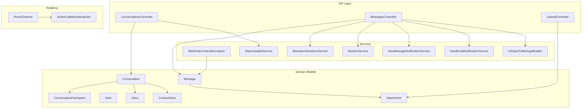

**Diagram sources**
- [conversations_controller.rb](file://app/controllers/api/v1/accounts/conversations_controller.rb)
- [messages_controller.rb](file://app/controllers/api/v1/accounts/messages_controller.rb)
- [upload_controller.rb](file://app/controllers/api/v1/accounts/upload_controller.rb)
- [conversation.rb](file://app/models/conversation.rb)
- [message.rb](file://app/models/message.rb)
- [attachment.rb](file://app/models/attachment.rb)
- [note.rb](file://app/models/note.rb)
- [conversation_participant.rb](file://app/models/conversation_participant.rb)
- [inbox.rb](file://app/models/inbox.rb)
- [contact_inbox.rb](file://app/models/contact_inbox.rb)
- [webhook_content_normalizer.rb](file://app/services/messages/webhook_content_normalizer.rb)
- [markdown_renderer_service.rb](file://app/services/messages/markdown_renderer_service.rb)
- [mention_service.rb](file://app/services/messages/mention_service.rb)
- [new_message_notification_service.rb](file://app/services/messages/new_message_notification_service.rb)
- [status_update_service.rb](file://app/services/messages/status_update_service.rb)
- [send_email_notification_service.rb](file://app/services/messages/send_email_notification_service.rb)
- [in_reply_to_message_builder.rb](file://app/services/messages/in_reply_to_message_builder.rb)
- [room_channel.rb](file://app/channels/room_channel.rb)
- [action_cable_broadcast_job.rb](file://app/jobs/action_cable_broadcast_job.rb)

**Section sources**
- [conversation.rb](file://app/models/conversation.rb)
- [message.rb](file://app/models/message.rb)
- [attachment.rb](file://app/models/attachment.rb)
- [note.rb](file://app/models/note.rb)
- [conversation_participant.rb](file://app/models/conversation_participant.rb)
- [inbox.rb](file://app/models/inbox.rb)
- [contact_inbox.rb](file://app/models/contact_inbox.rb)
- [room_channel.rb](file://app/channels/room_channel.rb)
- [action_cable_broadcast_job.rb](file://app/jobs/action_cable_broadcast_job.rb)
- [conversations_controller.rb](file://app/controllers/api/v1/accounts/conversations_controller.rb)
- [messages_controller.rb](file://app/controllers/api/v1/accounts/messages_controller.rb)
- [upload_controller.rb](file://app/controllers/api/v1/accounts/upload_controller.rb)
- [webhook_content_normalizer.rb](file://app/services/messages/webhook_content_normalizer.rb)
- [markdown_renderer_service.rb](file://app/services/messages/markdown_renderer_service.rb)
- [mention_service.rb](file://app/services/messages/mention_service.rb)
- [new_message_notification_service.rb](file://app/services/messages/new_message_notification_service.rb)
- [status_update_service.rb](file://app/services/messages/status_update_service.rb)
- [send_email_notification_service.rb](file://app/services/messages/send_email_notification_service.rb)
- [in_reply_to_message_builder.rb](file://app/services/messages/in_reply_to_message_builder.rb)

## Core Components
- Conversation: Represents a threaded dialogue between a contact and an inbox, with state, assignee/participants, and metadata.
- Message: A single unit of communication within a conversation, including type, content, attachments, and source/channel context.
- Attachment: Binary or media assets linked to messages.
- Note: Internal-only collaboration entries attached to a conversation.
- ConversationParticipant: Tracks agents participating in a conversation beyond the assignee.
- Inbox: The channel endpoint (web, email, WhatsApp, social) that owns conversations.
- ContactInbox: Bridges a contact to an inbox instance for multi-channel identity.

Key responsibilities:
- Lifecycle and state transitions are managed by conversation services and listeners.
- Message creation flows normalize content across channels and render rich text.
- Real-time updates are broadcast to clients subscribed to conversation rooms.
- Attachments are uploaded and associated with messages.
- Notes enable private internal collaboration.

**Section sources**
- [conversation.rb](file://app/models/conversation.rb)
- [message.rb](file://app/models/message.rb)
- [attachment.rb](file://app/models/attachment.rb)
- [note.rb](file://app/models/note.rb)
- [conversation_participant.rb](file://app/models/conversation_participant.rb)
- [inbox.rb](file://app/models/inbox.rb)
- [contact_inbox.rb](file://app/models/contact_inbox.rb)

## Architecture Overview
The system follows a layered architecture:
- API layer exposes REST endpoints for conversations, messages, and uploads.
- Domain models encapsulate business data and relationships.
- Services implement cross-cutting concerns like content normalization, markdown rendering, mention extraction, notifications, and status changes.
- Real-time layer uses ActionCable channels and background jobs to push updates to connected clients.

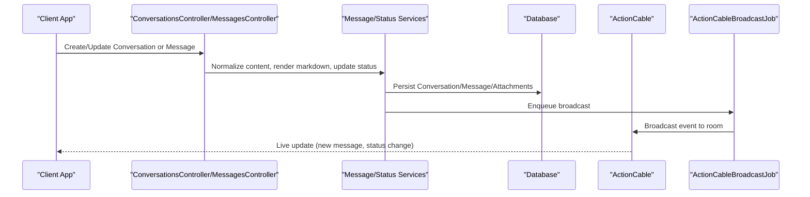

**Diagram sources**
- [conversations_controller.rb](file://app/controllers/api/v1/accounts/conversations_controller.rb)
- [messages_controller.rb](file://app/controllers/api/v1/accounts/messages_controller.rb)
- [webhook_content_normalizer.rb](file://app/services/messages/webhook_content_normalizer.rb)
- [markdown_renderer_service.rb](file://app/services/messages/markdown_renderer_service.rb)
- [status_update_service.rb](file://app/services/messages/status_update_service.rb)
- [action_cable_broadcast_job.rb](file://app/jobs/action_cable_broadcast_job.rb)
- [room_channel.rb](file://app/channels/room_channel.rb)

## Detailed Component Analysis

### Conversation Lifecycle and Status Transitions
- Creation: Conversations are created when a new thread is initiated in an inbox for a contact.
- Assignment: Assignees and participants can be updated; policies govern who can modify assignments.
- Status transitions: Open, pending, resolved states are managed by dedicated services and listeners.
- Resolution: Closing a conversation triggers notifications and updates downstream systems.

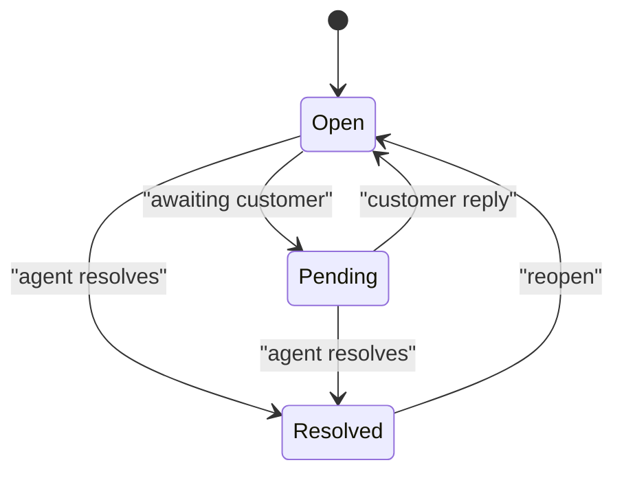

**Diagram sources**
- [status_update_service.rb](file://app/services/messages/status_update_service.rb)
- [conversation.rb](file://app/models/conversation.rb)

**Section sources**
- [conversation.rb](file://app/models/conversation.rb)
- [status_update_service.rb](file://app/services/messages/status_update_service.rb)

### Assignment Workflows
- Assignees and participants are tracked via model associations and policies.
- Assignment changes trigger notifications and real-time updates.
- Bulk assignment operations may use background jobs for scalability.

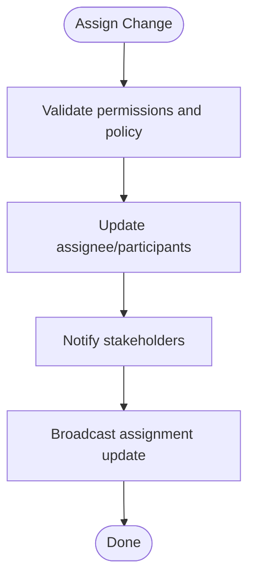

**Diagram sources**
- [conversation_participant.rb](file://app/models/conversation_participant.rb)
- [conversation.rb](file://app/models/conversation.rb)
- [action_cable_broadcast_job.rb](file://app/jobs/action_cable_broadcast_job.rb)

**Section sources**
- [conversation_participant.rb](file://app/models/conversation_participant.rb)
- [conversation.rb](file://app/models/conversation.rb)

### Message Types and Channel Normalization
- Supported types include text, image, audio, video, and file.
- Incoming messages from various channels are normalized into a unified format before persistence.
- Markdown rendering and mention extraction enrich message content.

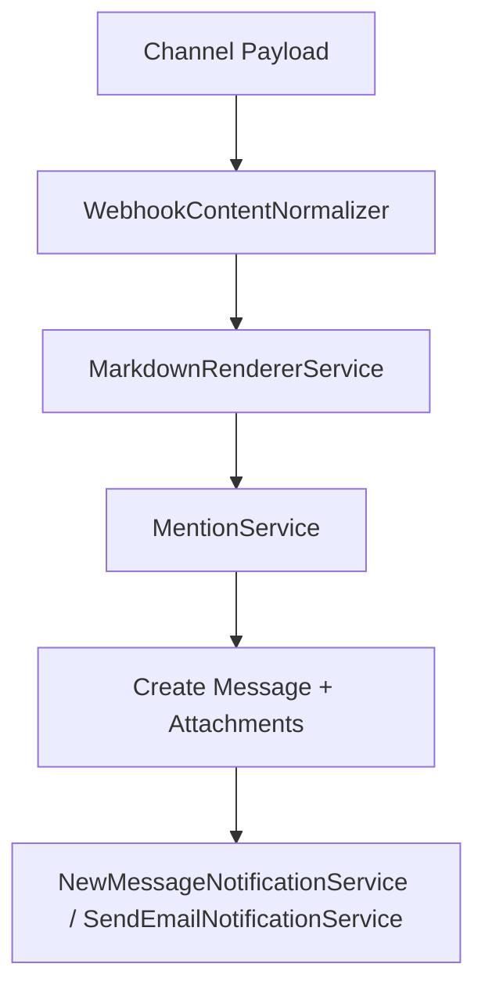

**Diagram sources**
- [webhook_content_normalizer.rb](file://app/services/messages/webhook_content_normalizer.rb)
- [markdown_renderer_service.rb](file://app/services/messages/markdown_renderer_service.rb)
- [mention_service.rb](file://app/services/messages/mention_service.rb)
- [new_message_notification_service.rb](file://app/services/messages/new_message_notification_service.rb)
- [send_email_notification_service.rb](file://app/services/messages/send_email_notification_service.rb)
- [message.rb](file://app/models/message.rb)
- [attachment.rb](file://app/models/attachment.rb)

**Section sources**
- [webhook_content_normalizer.rb](file://app/services/messages/webhook_content_normalizer.rb)
- [markdown_renderer_service.rb](file://app/services/messages/markdown_renderer_service.rb)
- [mention_service.rb](file://app/services/messages/mention_service.rb)
- [new_message_notification_service.rb](file://app/services/messages/new_message_notification_service.rb)
- [send_email_notification_service.rb](file://app/services/messages/send_email_notification_service.rb)
- [message.rb](file://app/models/message.rb)
- [attachment.rb](file://app/models/attachment.rb)

### Real-Time Messaging with ActionCable
- Clients subscribe to a per-conversation room.
- New messages, status changes, and assignment updates are broadcast to subscribers.
- Broadcasting is typically enqueued to ensure reliability under load.

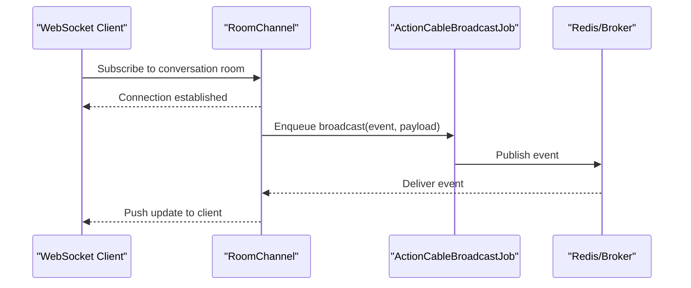

**Diagram sources**
- [room_channel.rb](file://app/channels/room_channel.rb)
- [action_cable_broadcast_job.rb](file://app/jobs/action_cable_broadcast_job.rb)
- [cable.yml](file://config/cable.yml)

**Section sources**
- [room_channel.rb](file://app/channels/room_channel.rb)
- [action_cable_broadcast_job.rb](file://app/jobs/action_cable_broadcast_job.rb)
- [cable.yml](file://config/cable.yml)

### Threading, Replies, and Collaboration
- Threading: Messages can reference parent messages to form threads using builder utilities.
- Internal notes: Agents can add private notes visible only internally.
- Collaboration: Participants allow multiple agents to collaborate without changing the primary assignee.

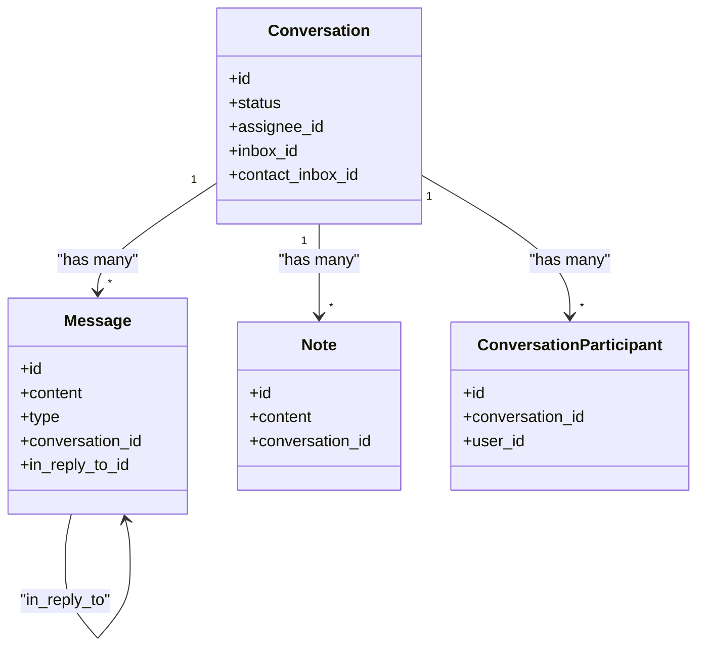

**Diagram sources**
- [conversation.rb](file://app/models/conversation.rb)
- [message.rb](file://app/models/message.rb)
- [note.rb](file://app/models/note.rb)
- [conversation_participant.rb](file://app/models/conversation_participant.rb)
- [in_reply_to_message_builder.rb](file://app/services/messages/in_reply_to_message_builder.rb)

**Section sources**
- [conversation.rb](file://app/models/conversation.rb)
- [message.rb](file://app/models/message.rb)
- [note.rb](file://app/models/note.rb)
- [conversation_participant.rb](file://app/models/conversation_participant.rb)
- [in_reply_to_message_builder.rb](file://app/services/messages/in_reply_to_message_builder.rb)

### Attachment Handling and Media Processing
- Uploads are handled via a dedicated controller and persisted as attachments linked to messages.
- Media processing pipelines validate types, sizes, and generate thumbnails/transcodes where applicable.
- Attachments are served securely and integrated with storage backends.

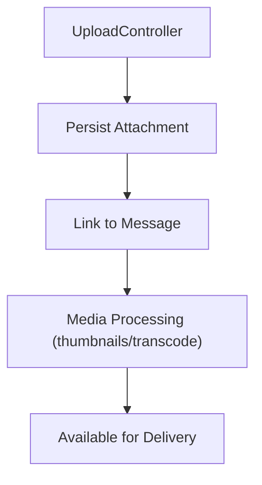

**Diagram sources**
- [upload_controller.rb](file://app/controllers/api/v1/accounts/upload_controller.rb)
- [attachment.rb](file://app/models/attachment.rb)
- [message.rb](file://app/models/message.rb)

**Section sources**
- [upload_controller.rb](file://app/controllers/api/v1/accounts/upload_controller.rb)
- [attachment.rb](file://app/models/attachment.rb)
- [message.rb](file://app/models/message.rb)

### Channel Integrations and Message Normalization
- Web, Email, WhatsApp, and social channels integrate via channel-specific adapters that normalize payloads into standard message objects.
- Normalization ensures consistent content structure, metadata, and attachment handling across channels.

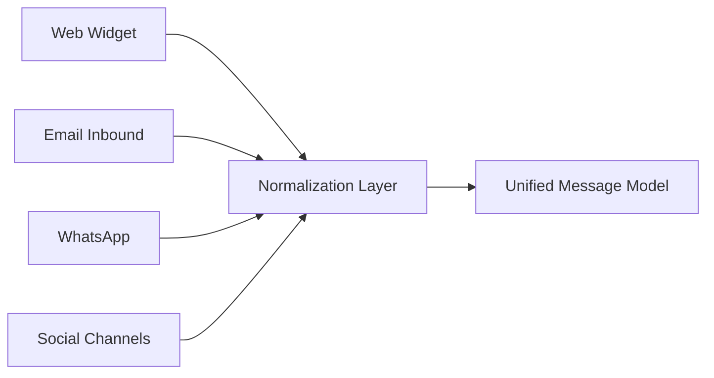

**Diagram sources**
- [webhook_content_normalizer.rb](file://app/services/messages/webhook_content_normalizer.rb)
- [message.rb](file://app/models/message.rb)

**Section sources**
- [webhook_content_normalizer.rb](file://app/services/messages/webhook_content_normalizer.rb)
- [message.rb](file://app/models/message.rb)

### Programmatic APIs and Webhooks
- Conversations API: CRUD operations for conversations, including status updates and assignment changes.
- Messages API: Create, list, and manage messages within a conversation, including replies and attachments.
- Webhooks: Outbound events notify external systems about conversation and message lifecycle changes.

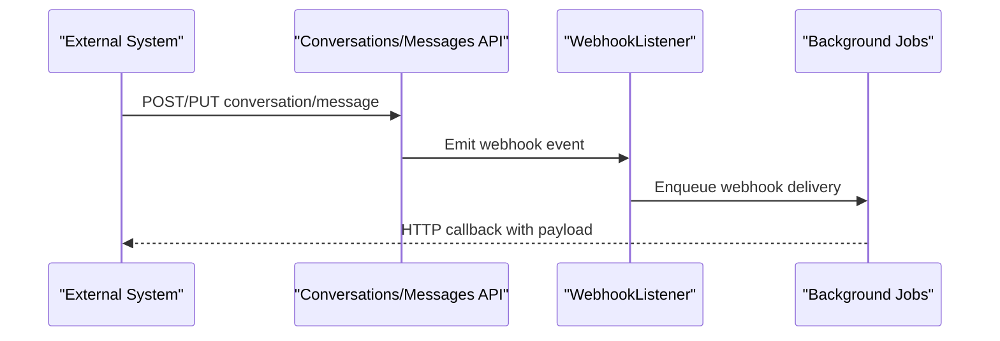

**Diagram sources**
- [conversations_controller.rb](file://app/controllers/api/v1/accounts/conversations_controller.rb)
- [messages_controller.rb](file://app/controllers/api/v1/accounts/messages_controller.rb)
- [action_cable_listener.rb](file://app/listeners/action_cable_listener.rb)

**Section sources**
- [conversations_controller.rb](file://app/controllers/api/v1/accounts/conversations_controller.rb)
- [messages_controller.rb](file://app/controllers/api/v1/accounts/messages_controller.rb)
- [action_cable_listener.rb](file://app/listeners/action_cable_listener.rb)

## Dependency Analysis
- Controllers depend on domain models and services for validation, persistence, and side effects.
- Services coordinate multiple models and external integrations while keeping controllers thin.
- Real-time broadcasting decouples event emission from delivery via jobs and channels.

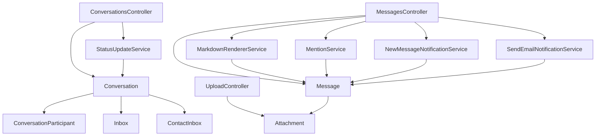

**Diagram sources**
- [conversations_controller.rb](file://app/controllers/api/v1/accounts/conversations_controller.rb)
- [messages_controller.rb](file://app/controllers/api/v1/accounts/messages_controller.rb)
- [upload_controller.rb](file://app/controllers/api/v1/accounts/upload_controller.rb)
- [conversation.rb](file://app/models/conversation.rb)
- [message.rb](file://app/models/message.rb)
- [attachment.rb](file://app/models/attachment.rb)
- [conversation_participant.rb](file://app/models/conversation_participant.rb)
- [inbox.rb](file://app/models/inbox.rb)
- [contact_inbox.rb](file://app/models/contact_inbox.rb)
- [markdown_renderer_service.rb](file://app/services/messages/markdown_renderer_service.rb)
- [mention_service.rb](file://app/services/messages/mention_service.rb)
- [new_message_notification_service.rb](file://app/services/messages/new_message_notification_service.rb)
- [send_email_notification_service.rb](file://app/services/messages/send_email_notification_service.rb)
- [status_update_service.rb](file://app/services/messages/status_update_service.rb)

**Section sources**
- [conversations_controller.rb](file://app/controllers/api/v1/accounts/conversations_controller.rb)
- [messages_controller.rb](file://app/controllers/api/v1/accounts/messages_controller.rb)
- [upload_controller.rb](file://app/controllers/api/v1/accounts/upload_controller.rb)
- [conversation.rb](file://app/models/conversation.rb)
- [message.rb](file://app/models/message.rb)
- [attachment.rb](file://app/models/attachment.rb)
- [conversation_participant.rb](file://app/models/conversation_participant.rb)
- [inbox.rb](file://app/models/inbox.rb)
- [contact_inbox.rb](file://app/models/contact_inbox.rb)
- [markdown_renderer_service.rb](file://app/services/messages/markdown_renderer_service.rb)
- [mention_service.rb](file://app/services/messages/mention_service.rb)
- [new_message_notification_service.rb](file://app/services/messages/new_message_notification_service.rb)
- [send_email_notification_service.rb](file://app/services/messages/send_email_notification_service.rb)
- [status_update_service.rb](file://app/services/messages/status_update_service.rb)

## Performance Considerations
- Database indexing: Ensure indexes on frequently queried fields such as conversation status, assignee, inbox, and timestamps.
- Pagination and cursors: Use pagination for listing conversations and messages to avoid large payloads.
- Background processing: Offload heavy tasks (markdown rendering, mentions, notifications, media processing) to background jobs.
- Real-time scaling: Configure ActionCable with a scalable adapter (e.g., Redis) and scale workers horizontally.
- Caching: Cache read-heavy data like inbox metadata and agent presence where appropriate.
- Storage optimization: Stream large files, use CDN for static assets, and compress media where possible.
- Rate limiting: Apply rate limits on public and platform APIs to protect resources.

[No sources needed since this section provides general guidance]

## Troubleshooting Guide
- Real-time not updating:
  - Verify ActionCable configuration and broker connectivity.
  - Check that broadcasts are enqueued and delivered to the correct room.
- Message not appearing:
  - Inspect normalization and rendering services for errors.
  - Confirm attachments are persisted and linked to the message.
- Status not transitioning:
  - Review status update service logic and permission checks.
- Webhook failures:
  - Inspect listener and job queues for delivery retries and error logs.

**Section sources**
- [cable.yml](file://config/cable.yml)
- [room_channel.rb](file://app/channels/room_channel.rb)
- [action_cable_broadcast_job.rb](file://app/jobs/action_cable_broadcast_job.rb)
- [webhook_content_normalizer.rb](file://app/services/messages/webhook_content_normalizer.rb)
- [markdown_renderer_service.rb](file://app/services/messages/markdown_renderer_service.rb)
- [status_update_service.rb](file://app/services/messages/status_update_service.rb)
- [action_cable_listener.rb](file://app/listeners/action_cable_listener.rb)

## Conclusion
Chatwoot’s conversation management system provides a robust, extensible foundation for multi-channel support, real-time collaboration, and scalable operations. By normalizing messages, leveraging background jobs, and using ActionCable for live updates, it supports complex workflows such as threading, internal notes, and assignment management while maintaining performance at scale.

[No sources needed since this section summarizes without analyzing specific files]

## Appendices

### API Examples and Integration Points
- Conversations:
  - List, create, update, and delete conversations.
  - Update status and assignee.
- Messages:
  - Create text, image, audio, video, and file messages.
  - Reply to existing messages to build threads.
- Uploads:
  - Upload attachments and associate them with messages.
- Webhooks:
  - Subscribe to conversation and message events for external integrations.

**Section sources**
- [conversations_controller.rb](file://app/controllers/api/v1/accounts/conversations_controller.rb)
- [messages_controller.rb](file://app/controllers/api/v1/accounts/messages_controller.rb)
- [upload_controller.rb](file://app/controllers/api/v1/accounts/upload_controller.rb)
- [action_cable_listener.rb](file://app/listeners/action_cable_listener.rb)

### Configuration References
- ActionCable:
  - Adapter and connection settings.
- Routes:
  - WebSocket route mapping for channels.

**Section sources**
- [cable.yml](file://config/cable.yml)
- [routes.rb](file://config/routes.rb)