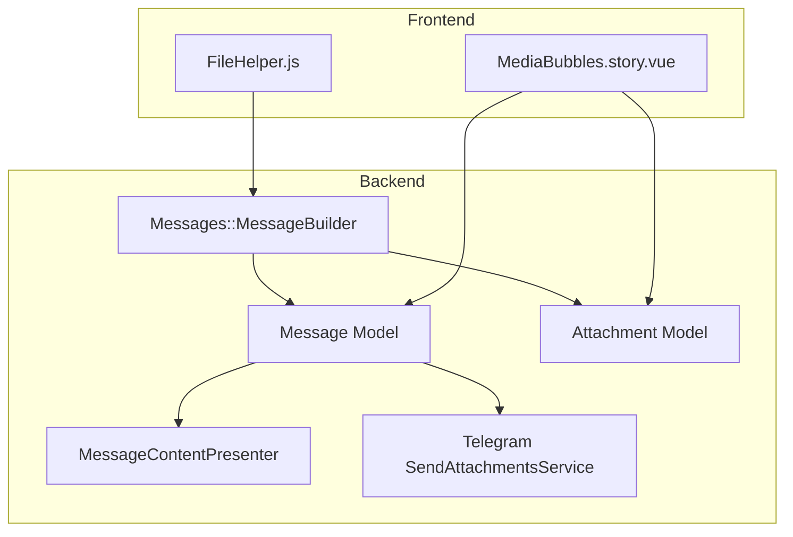
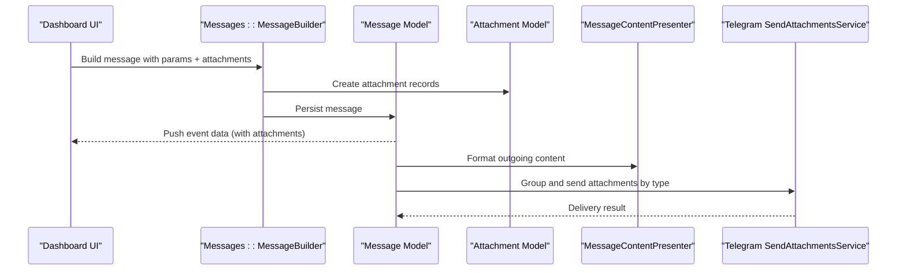
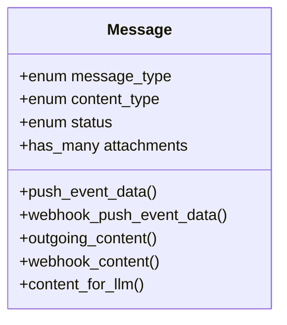
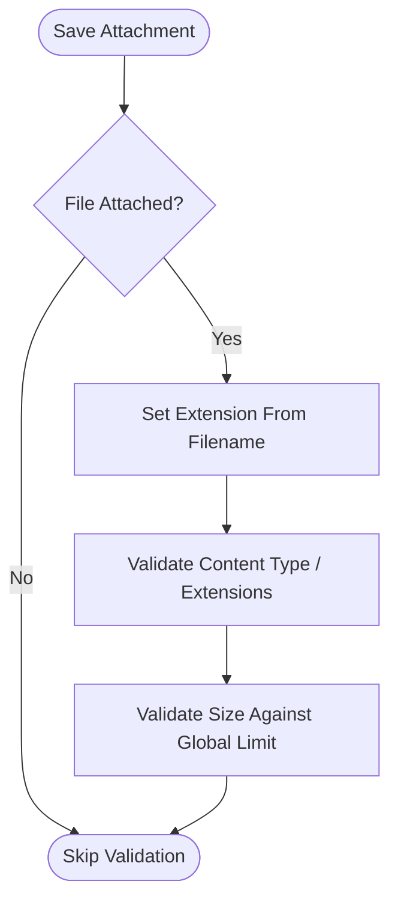
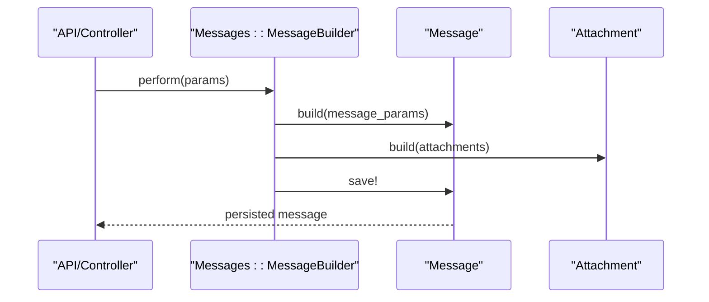
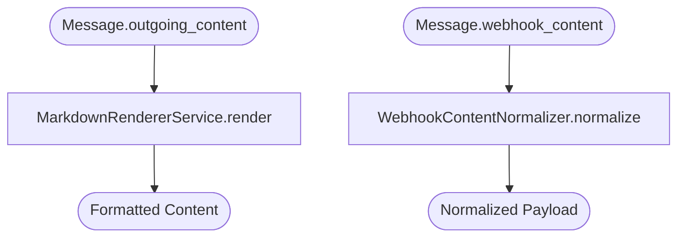
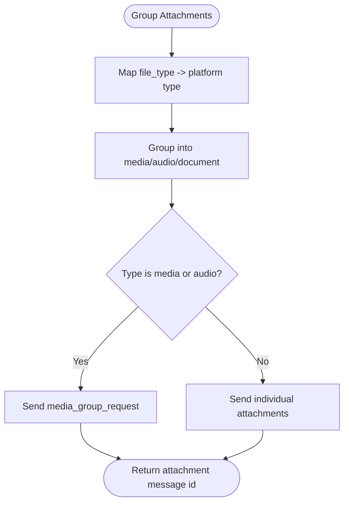
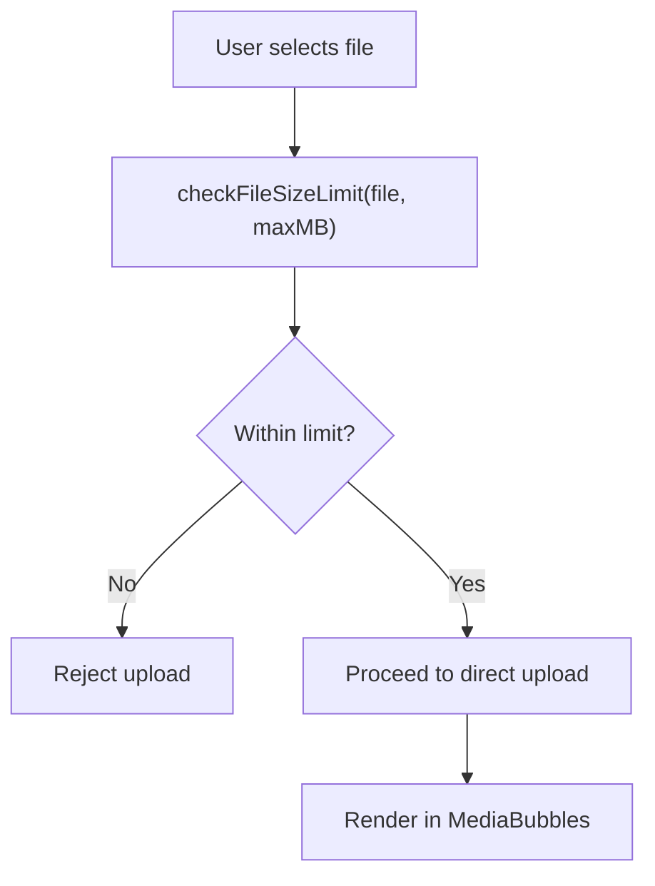
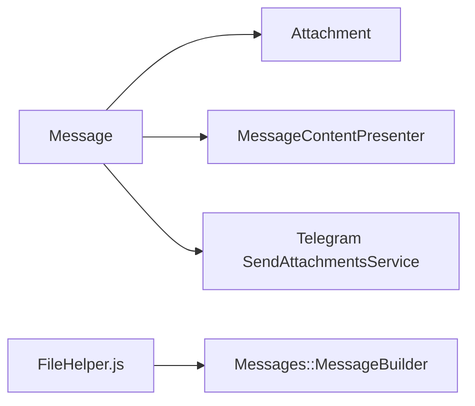

# Message Types & Content Handling

<cite>
**Referenced Files in This Document**
- [message.rb](file://app/models/message.rb)
- [attachment.rb](file://app/models/attachment.rb)
- [message_builder.rb](file://app/builders/messages/message_builder.rb)
- [message_content_presenter.rb](file://app/presenters/message_content_presenter.rb)
- [send_attachments_service.rb](file://app/services/telegram/send_attachments_service.rb)
- [FileHelper.js](file://app/javascript/shared/helpers/FileHelper.js)
- [MediaBubbles.story.vue](file://app/javascript/dashboard/components-next/message/stories/MediaBubbles.story.vue)
</cite>

## Table of Contents
1. [Introduction](#introduction)
2. [Project Structure](#project-structure)
3. [Core Components](#core-components)
4. [Architecture Overview](#architecture-overview)
5. [Detailed Component Analysis](#detailed-component-analysis)
6. [Dependency Analysis](#dependency-analysis)
7. [Performance Considerations](#performance-considerations)
8. [Troubleshooting Guide](#troubleshooting-guide)
9. [Conclusion](#conclusion)

## Introduction
This document explains Chatwoot’s message system architecture with a focus on supported message types, content processing and validation, attachment handling, media optimization, and the presenter layer that formats messages for outbound delivery and webhooks. It also covers how different channels handle attachments and how the dashboard renders various content formats.

## Project Structure
The message system spans models, builders, presenters, services, and frontend helpers:
- Models define message and attachment data structures and validations.
- Builders assemble messages from incoming parameters and attach files.
- Presenters format outgoing content and webhook payloads.
- Channel-specific services group and send attachments to external platforms.
- Frontend helpers validate file sizes and types before upload.

**Diagram sources**
- [message.rb:41-140](file://app/models/message.rb#L41-L140)
- [attachment.rb:24-48](file://app/models/attachment.rb#L24-L48)
- [message_builder.rb:8-33](file://app/builders/messages/message_builder.rb#L8-L33)
- [message_content_presenter.rb:1-34](file://app/presenters/message_content_presenter.rb#L1-L34)
- [send_attachments_service.rb:49-70](file://app/services/telegram/send_attachments_service.rb#L49-L70)
- [FileHelper.js:1-43](file://app/javascript/shared/helpers/FileHelper.js#L1-L43)
- [MediaBubbles.story.vue:107-146](file://app/javascript/dashboard/components-next/message/stories/MediaBubbles.story.vue#L107-L146)

**Section sources**
- [message.rb:41-140](file://app/models/message.rb#L41-L140)
- [attachment.rb:24-48](file://app/models/attachment.rb#L24-L48)
- [message_builder.rb:8-33](file://app/builders/messages/message_builder.rb#L8-L33)
- [message_content_presenter.rb:1-34](file://app/presenters/message_content_presenter.rb#L1-L34)
- [send_attachments_service.rb:49-70](file://app/services/telegram/send_attachments_service.rb#L49-L70)
- [FileHelper.js:1-43](file://app/javascript/shared/helpers/FileHelper.js#L1-L43)
- [MediaBubbles.story.vue:107-146](file://app/javascript/dashboard/components-next/message/stories/MediaBubbles.story.vue#L107-L146)

## Core Components
- Message model: Defines enums for message_type, content_type, status; stores content and processed_message_content; manages attachments; enforces limits and validations; dispatches events and triggers replies.
- Attachment model: Represents uploaded or external media; validates acceptable types and size; provides URLs and thumbnails; exposes metadata per file type.
- Messages::MessageBuilder: Builds messages from controller/API params, processes attachments, handles email forwarding attributes, and persists messages.
- MessageContentPresenter: Formats outgoing content (markdown rendering) and normalizes content for webhooks.
- Telegram SendAttachmentsService: Groups and sends attachments by type to Telegram, supporting media groups and individual documents.
- FileHelper.js: Validates file size and type constraints in the browser before upload.
- MediaBubbles.story.vue: Demonstrates rendering of images, videos, audio, and generic files in the dashboard UI.

**Section sources**
- [message.rb:41-140](file://app/models/message.rb#L41-L140)
- [attachment.rb:24-48](file://app/models/attachment.rb#L24-L48)
- [message_builder.rb:8-33](file://app/builders/messages/message_builder.rb#L8-L33)
- [message_content_presenter.rb:1-34](file://app/presenters/message_content_presenter.rb#L1-L34)
- [send_attachments_service.rb:49-70](file://app/services/telegram/send_attachments_service.rb#L49-L70)
- [FileHelper.js:1-43](file://app/javascript/shared/helpers/FileHelper.js#L1-L43)
- [MediaBubbles.story.vue:107-146](file://app/javascript/dashboard/components-next/message/stories/MediaBubbles.story.vue#L107-L146)

## Architecture Overview
End-to-end flow for creating and delivering messages with attachments:

**Diagram sources**
- [message_builder.rb:24-33](file://app/builders/messages/message_builder.rb#L24-L33)
- [message.rb:150-160](file://app/models/message.rb#L150-L160)
- [message_content_presenter.rb:1-34](file://app/presenters/message_content_presenter.rb#L1-L34)
- [send_attachments_service.rb:49-70](file://app/services/telegram/send_attachments_service.rb#L49-L70)

## Detailed Component Analysis

### Message Model
- Supported content types include text, input fields, cards, forms, articles, incoming emails, CSAT inputs, integrations, stickers, and voice calls.
- Supports incoming/outgoing/activity/template message types and statuses sent/delivered/read/failed.
- Enforces content length limits and JSON schema validation for template parameters.
- Manages attachments with a maximum count limit and ensures processed_message_content is set.
- Provides push_event_data and webhook_data for real-time and webhook consumers.
- Triggers reply sending after persistence, with a delay when attachments are present to ensure storage readiness.

**Diagram sources**
- [message.rb:88-116](file://app/models/message.rb#L88-L116)
- [message.rb:150-212](file://app/models/message.rb#L150-L212)
- [message.rb:280-293](file://app/models/message.rb#L280-L293)

**Section sources**
- [message.rb:41-140](file://app/models/message.rb#L41-L140)
- [message.rb:150-212](file://app/models/message.rb#L150-L212)
- [message.rb:280-293](file://app/models/message.rb#L280-L293)
- [message.rb:408-412](file://app/models/message.rb#L408-L412)

### Attachment Model
- Enumerates file types: image, audio, video, file, location, fallback, share, story_mention, contact, ig_reel, ig_post, ig_story, embed.
- Validates acceptable content types and extensions for non-media files; enforces maximum file size based on global configuration.
- Provides file_url, download_url, thumb_url, and typed metadata for each file_type.
- Sets extension automatically from attached file.

**Diagram sources**
- [attachment.rb:44-48](file://app/models/attachment.rb#L44-L48)
- [attachment.rb:179-225](file://app/models/attachment.rb#L179-L225)

**Section sources**
- [attachment.rb:24-48](file://app/models/attachment.rb#L24-L48)
- [attachment.rb:50-99](file://app/models/attachment.rb#L50-L99)
- [attachment.rb:179-225](file://app/models/attachment.rb#L179-L225)

### Message Creation Flow (Builder)
- Accepts user, conversation, and params including content, private flag, attachments, and optional voice message flag.
- Builds message record, attaches files, infers file types, tags voice messages, and processes email forwarding attributes when applicable.
- Persists the message and returns it for further processing.

**Diagram sources**
- [message_builder.rb:8-33](file://app/builders/messages/message_builder.rb#L8-L33)
- [message_builder.rb:51-75](file://app/builders/messages/message_builder.rb#L51-L75)

**Section sources**
- [message_builder.rb:8-33](file://app/builders/messages/message_builder.rb#L8-L33)
- [message_builder.rb:51-75](file://app/builders/messages/message_builder.rb#L51-L75)
- [message_builder.rb:96-111](file://app/builders/messages/message_builder.rb#L96-L111)

### Outbound Formatting and Webhooks (Presenter)
- Formats outgoing content using markdown rendering tailored to the inbox channel.
- Normalizes content for webhook consumers to ensure consistent payload structure.
- Optionally appends survey links for CSAT flows.

**Diagram sources**
- [message_content_presenter.rb:1-34](file://app/presenters/message_content_presenter.rb#L1-L34)

**Section sources**
- [message_content_presenter.rb:1-34](file://app/presenters/message_content_presenter.rb#L1-L34)

### Channel-Specific Attachment Handling (Telegram)
- Groups attachments by type into media (photos/videos), audio, and documents.
- Sends media and audio as groups where supported; otherwise sends individually.
- Maps internal file types to platform-specific types.

**Diagram sources**
- [send_attachments_service.rb:49-70](file://app/services/telegram/send_attachments_service.rb#L49-L70)

**Section sources**
- [send_attachments_service.rb:49-70](file://app/services/telegram/send_attachments_service.rb#L49-L70)

### Frontend File Upload Validation and Rendering
- Browser-side helper checks file size against configured maximum and validates allowed types per channel.
- Dashboard stories demonstrate rendering of images, videos, audio, and generic files within message bubbles.

**Diagram sources**
- [FileHelper.js:22-36](file://app/javascript/shared/helpers/FileHelper.js#L22-L36)
- [MediaBubbles.story.vue:107-146](file://app/javascript/dashboard/components-next/message/stories/MediaBubbles.story.vue#L107-L146)

**Section sources**
- [FileHelper.js:1-43](file://app/javascript/shared/helpers/FileHelper.js#L1-L43)
- [MediaBubbles.story.vue:107-146](file://app/javascript/dashboard/components-next/message/stories/MediaBubbles.story.vue#L107-L146)

## Dependency Analysis
Key relationships:
- Message depends on Attachment for media and files.
- Message uses MessageContentPresenter for formatting outgoing content and webhook payloads.
- Channel services (e.g., Telegram) consume Attachment metadata and URLs to deliver content.
- Frontend helpers coordinate with backend limits and channel policies during upload.

**Diagram sources**
- [message.rb:137-140](file://app/models/message.rb#L137-L140)
- [message_content_presenter.rb:1-34](file://app/presenters/message_content_presenter.rb#L1-L34)
- [send_attachments_service.rb:49-70](file://app/services/telegram/send_attachments_service.rb#L49-L70)
- [FileHelper.js:1-43](file://app/javascript/shared/helpers/FileHelper.js#L1-L43)

**Section sources**
- [message.rb:137-140](file://app/models/message.rb#L137-L140)
- [message_content_presenter.rb:1-34](file://app/presenters/message_content_presenter.rb#L1-L34)
- [send_attachments_service.rb:49-70](file://app/services/telegram/send_attachments_service.rb#L49-L70)
- [FileHelper.js:1-43](file://app/javascript/shared/helpers/FileHelper.js#L1-L43)

## Performance Considerations
- Attachment size limits: Backend enforces a configurable maximum file size; frontend validates against the same policy to avoid unnecessary uploads.
- Image thumbnails: Thumbnails are generated for images to reduce bandwidth and improve rendering performance.
- Audio playback: Inline audio URL generation respects Active Storage routes for proxy/CORS compatibility.
- Bulk attachment grouping: Channel services group media and audio to minimize network overhead and API calls.
- Reply scheduling: When attachments are present, reply sending is delayed briefly to ensure storage completion.

[No sources needed since this section provides general guidance]

## Troubleshooting Guide
- Too many messages: The model prevents flooding by limiting messages per minute per conversation.
- Unsupported file types: Only media types or explicitly allowed document types/extensions are accepted for website widget uploads.
- Oversized files: Files exceeding the configured maximum size are rejected at both frontend and backend.
- Unrepresentable images: Thumbnail generation logs warnings for unsupported image formats.

**Section sources**
- [message.rb:297-307](file://app/models/message.rb#L297-L307)
- [attachment.rb:194-213](file://app/models/attachment.rb#L194-L213)
- [attachment.rb:67-76](file://app/models/attachment.rb#L67-L76)

## Conclusion
Chatwoot’s message system cleanly separates concerns across models, builders, presenters, and channel services. Messages carry structured content and attachments, which are validated, optimized, and delivered through channel-specific logic. The presenter layer ensures consistent formatting for outbound channels and webhooks, while frontend helpers enforce upload policies and render rich media effectively.

[No sources needed since this section summarizes without analyzing specific files]