# Multi-Channel Integration

<cite>
**Referenced Files in This Document**
- [web_widget.rb](file://app/models/channel/web_widget.rb)
- [email.rb](file://app/models/channel/email.rb)
- [whatsapp.rb](file://app/models/channel/whatsapp.rb)
- [facebook_page.rb](file://app/models/channel/facebook_page.rb)
- [twitter_profile.rb](file://app/models/channel/twitter_profile.rb)
- [telegram.rb](file://app/models/channel/telegram.rb)
- [sms.rb](file://app/models/channel/sms.rb)
- [twilio_sms.rb](file://app/models/channel/twilio_sms.rb)
</cite>

## Table of Contents
1. [Introduction](#introduction)
2. [Project Structure](#project-structure)
3. [Core Components](#core-components)
4. [Architecture Overview](#architecture-overview)
5. [Detailed Component Analysis](#detailed-component-analysis)
6. [Dependency Analysis](#dependency-analysis)
7. [Performance Considerations](#performance-considerations)
8. [Troubleshooting Guide](#troubleshooting-guide)
9. [Conclusion](#conclusion)

## Introduction
This document explains Chatwoot’s multi-channel conversation integration system and how conversations are normalized across channels such as web widget, email, WhatsApp, Facebook Messenger, Twitter, Telegram, and SMS. It focuses on the channel adapter pattern used to integrate new platforms, channel-specific message formatting, attachment handling, authentication mechanisms, configuration examples, limitations, rate limiting considerations, error handling strategies, and how consistency is maintained while preserving platform-specific features.

## Project Structure
Chatwoot models each communication channel as a dedicated class under app/models/channel. Each model:
- Includes shared concerns (e.g., Channelable, Reauthorizable) for common behavior like inbox association and reauthorization flows.
- Stores provider-specific credentials and settings.
- Exposes methods for sending messages, managing webhooks, and interacting with external APIs.

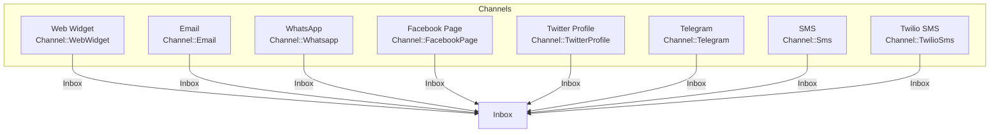

**Diagram sources**
- [web_widget.rb:29-40](file://app/models/channel/web_widget.rb#L29-L40)
- [email.rb:38-53](file://app/models/channel/email.rb#L38-L53)
- [whatsapp.rb:25-40](file://app/models/channel/whatsapp.rb#L25-L40)
- [facebook_page.rb:20-33](file://app/models/channel/facebook_page.rb#L20-L33)
- [twitter_profile.rb:19-34](file://app/models/channel/twitter_profile.rb#L19-L34)
- [telegram.rb:17-27](file://app/models/channel/telegram.rb#L17-L27)
- [sms.rb:18-24](file://app/models/channel/sms.rb#L18-L24)
- [twilio_sms.rb:29-50](file://app/models/channel/twilio_sms.rb#L29-L50)

**Section sources**
- [web_widget.rb:29-40](file://app/models/channel/web_widget.rb#L29-L40)
- [email.rb:38-53](file://app/models/channel/email.rb#L38-L53)
- [whatsapp.rb:25-40](file://app/models/channel/whatsapp.rb#L25-L40)
- [facebook_page.rb:20-33](file://app/models/channel/facebook_page.rb#L20-L33)
- [twitter_profile.rb:19-34](file://app/models/channel/twitter_profile.rb#L19-L34)
- [telegram.rb:17-27](file://app/models/channel/telegram.rb#L17-L27)
- [sms.rb:18-24](file://app/models/channel/sms.rb#L18-L24)
- [twilio_sms.rb:29-50](file://app/models/channel/twilio_sms.rb#L29-L50)

## Core Components
The core components are the channel models that encapsulate platform-specific logic and configuration. They implement a consistent interface for:
- Sending outbound messages
- Managing inbound webhooks or polling
- Handling attachments and rich content
- Managing authentication and authorization
- Preserving platform-specific capabilities

Key responsibilities per channel:
- Web Widget: Generates embed script, manages pre-chat form options, feature flags, HMAC security, and contact creation via builder.
- Email: Configures IMAP/SMTP providers, forwards incoming mail, supports OAuth providers (Microsoft/Google), and encrypts sensitive fields.
- WhatsApp: Supports multiple providers (default/360Dialog and whatsapp_cloud), template management, webhook setup/teardown, voice calling toggles, and media URL resolution.
- Facebook Page: Manages page/user tokens, subscribes/unsubscribes to Messenger events, and creates contact inboxes.
- Twitter Profile: Manages access tokens/secrets, tweets toggle, and client configuration for API calls.
- Telegram: Validates bot token, sets webhook, sends text and attachments, converts markdown to HTML, and handles errors.
- SMS (Bandwidth): Sends text and media via Bandwidth API, basic auth, and error mapping.
- Twilio SMS: Supports SMS and WhatsApp mediums, optional messaging service SID, dual auth modes, delivery callbacks, and Twilio client initialization.

**Section sources**
- [web_widget.rb:29-108](file://app/models/channel/web_widget.rb#L29-L108)
- [email.rb:38-80](file://app/models/channel/email.rb#L38-L80)
- [whatsapp.rb:25-190](file://app/models/channel/whatsapp.rb#L25-L190)
- [facebook_page.rb:20-67](file://app/models/channel/facebook_page.rb#L20-L67)
- [twitter_profile.rb:19-67](file://app/models/channel/twitter_profile.rb#L19-L67)
- [telegram.rb:17-171](file://app/models/channel/telegram.rb#L17-L171)
- [sms.rb:18-99](file://app/models/channel/sms.rb#L18-L99)
- [twilio_sms.rb:29-93](file://app/models/channel/twilio_sms.rb#L29-L93)

## Architecture Overview
Chatwoot uses a channel adapter pattern where each channel model acts as an adapter to its respective platform. The adapters normalize inbound/outbound payloads into Chatwoot’s internal representation and preserve platform-specific features when possible.

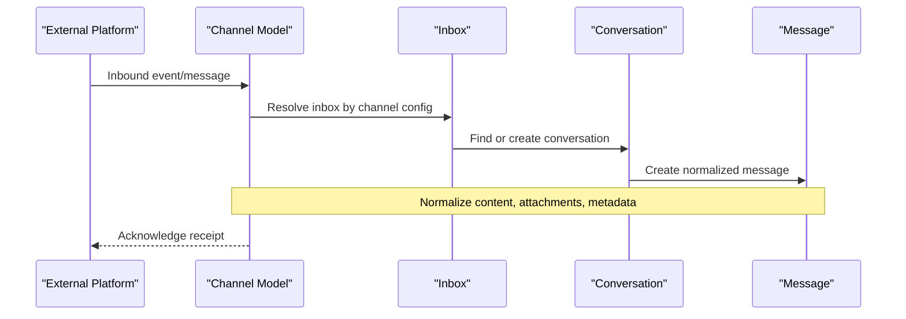

**Diagram sources**
- [whatsapp.rb:133-138](file://app/models/channel/whatsapp.rb#L133-L138)
- [telegram.rb:38-42](file://app/models/channel/telegram.rb#L38-L42)
- [sms.rb:36-41](file://app/models/channel/sms.rb#L36-L41)
- [twilio_sms.rb:63-68](file://app/models/channel/twilio_sms.rb#L63-L68)

## Detailed Component Analysis

### Web Widget (Channel::WebWidget)
- Purpose: Provides a website chat widget with configurable appearance, pre-chat forms, and security options.
- Key behaviors:
  - Generates an embed script using a unique website token.
  - Supports feature flags for attachments, emoji picker, end conversation, etc.
  - Enforces HMAC token optionality and allowed domains.
  - Creates ContactInbox via builder with additional attributes from pre-chat form.
- Normalization: Converts widget interactions into standard conversations and messages within the associated inbox.

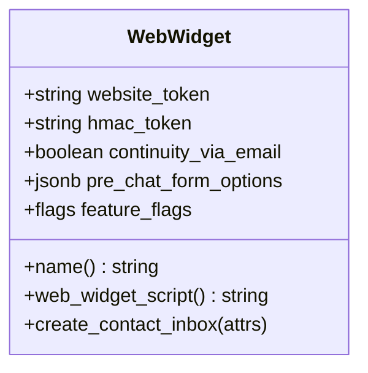

**Diagram sources**
- [web_widget.rb:29-108](file://app/models/channel/web_widget.rb#L29-L108)

**Section sources**
- [web_widget.rb:29-108](file://app/models/channel/web_widget.rb#L29-L108)

### Email (Channel::Email)
- Purpose: Integrates email via IMAP/SMTP and OAuth providers (Microsoft/Google).
- Key behaviors:
  - Encrypts passwords when encryption is configured.
  - Ensures forward_to_email uniqueness and generation based on account domain.
  - Distinguishes Microsoft/Google providers and legacy Gmail IMAP.
- Normalization: Incoming emails are parsed and mapped to messages; outgoing replies use configured SMTP settings.

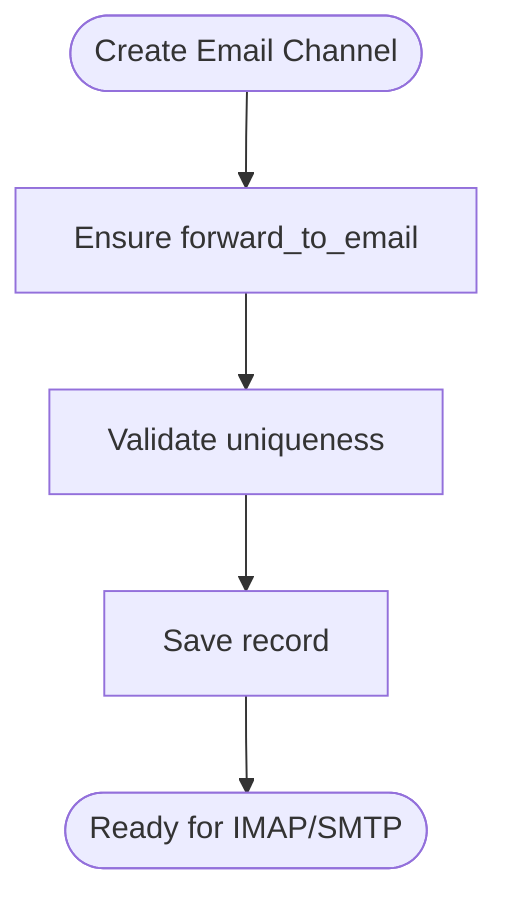

**Diagram sources**
- [email.rb:58-80](file://app/models/channel/email.rb#L58-L80)

**Section sources**
- [email.rb:38-80](file://app/models/channel/email.rb#L38-L80)

### WhatsApp (Channel::Whatsapp)
- Purpose: Integrates WhatsApp via default provider (360Dialog) and whatsapp_cloud.
- Key behaviors:
  - Provider selection determines service instantiation and capabilities (e.g., voice calling).
  - Template synchronization and webhook lifecycle management.
  - Voice calling enable/disable with webhook re-registration.
  - Delegates send_message, send_template, sync_templates, media_url, api_headers to provider service.
- Normalization: Maps WhatsApp templates, media, and structured messages to Chatwoot’s message format.

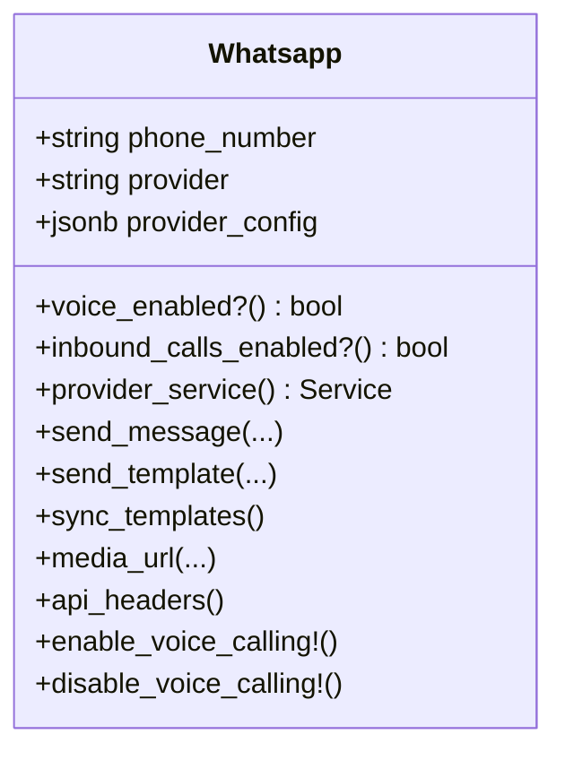

**Diagram sources**
- [whatsapp.rb:25-190](file://app/models/channel/whatsapp.rb#L25-L190)

**Section sources**
- [whatsapp.rb:25-190](file://app/models/channel/whatsapp.rb#L25-L190)

### Facebook Page (Channel::FacebookPage)
- Purpose: Integrates Facebook Messenger via page and user access tokens.
- Key behaviors:
  - Subscribes/unsubscribes to Messenger webhook events.
  - Creates ContactInbox using Instagram ID and name.
- Normalization: Translates Messenger events and payloads into Chatwoot conversations/messages.

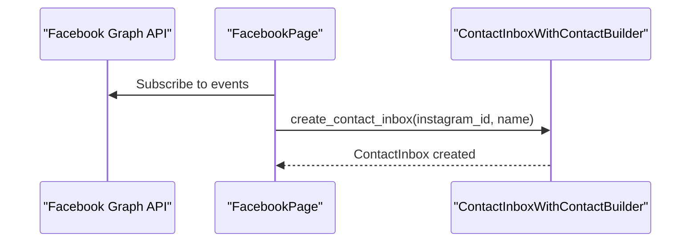

**Diagram sources**
- [facebook_page.rb:34-47](file://app/models/channel/facebook_page.rb#L34-L47)
- [facebook_page.rb:49-67](file://app/models/channel/facebook_page.rb#L49-L67)

**Section sources**
- [facebook_page.rb:20-67](file://app/models/channel/facebook_page.rb#L20-L67)

### Twitter Profile (Channel::TwitterProfile)
- Purpose: Integrates Twitter DMs and tweets via OAuth tokens.
- Key behaviors:
  - Encrypts access tokens/secrets when encryption is configured.
  - Configures Twitty client with environment and base URL.
  - Unsubscribes on destroy.
- Normalization: Maps tweet/DM interactions to Chatwoot messages and preserves thread context.

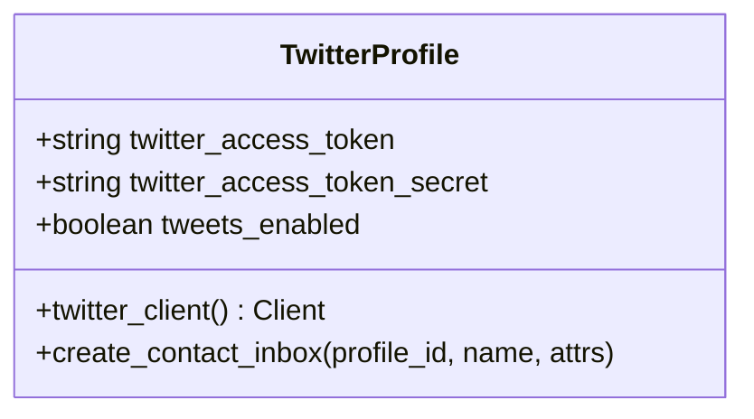

**Diagram sources**
- [twitter_profile.rb:19-67](file://app/models/channel/twitter_profile.rb#L19-L67)

**Section sources**
- [twitter_profile.rb:19-67](file://app/models/channel/twitter_profile.rb#L19-L67)

### Telegram (Channel::Telegram)
- Purpose: Integrates Telegram Bot API for text, attachments, and interactive keyboards.
- Key behaviors:
  - Validates bot token and sets webhook automatically.
  - Sends text and attachments separately.
  - Converts Markdown to Telegram HTML safely.
  - Handles Telegram API errors and marks messages failed with external_error.
- Normalization: Maps Telegram messages, inline keyboards, and file URLs to Chatwoot messages.

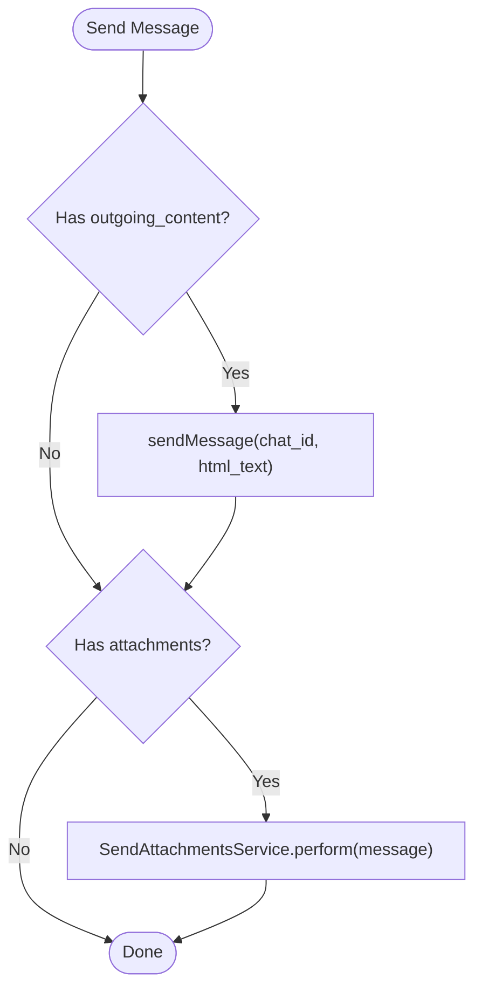

**Diagram sources**
- [telegram.rb:38-42](file://app/models/channel/telegram.rb#L38-L42)
- [telegram.rb:104-114](file://app/models/channel/telegram.rb#L104-L114)
- [telegram.rb:130-155](file://app/models/channel/telegram.rb#L130-L155)

**Section sources**
- [telegram.rb:17-171](file://app/models/channel/telegram.rb#L17-L171)

### SMS (Channel::Sms)
- Purpose: Integrates Bandwidth Messaging API for SMS and MMS.
- Key behaviors:
  - Builds payload with applicationId and sender number.
  - Attaches media URLs for MMS.
  - Uses basic auth with api_key/api_secret.
  - Maps provider errors to message.external_error and status failed.
- Normalization: Converts Bandwidth responses to Chatwoot messages.

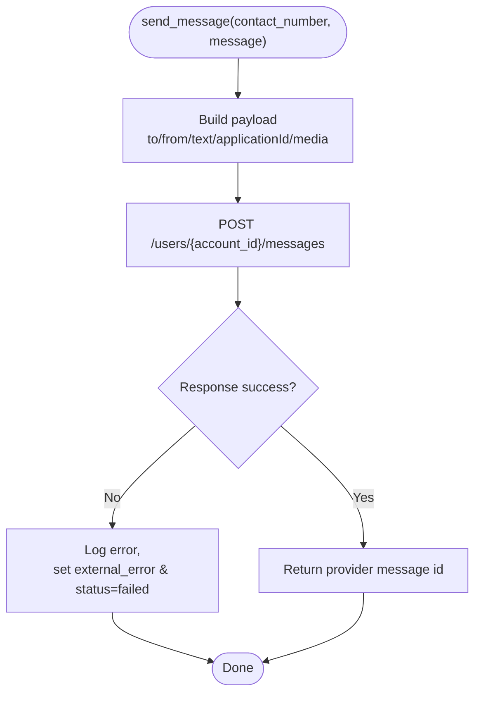

**Diagram sources**
- [sms.rb:36-41](file://app/models/channel/sms.rb#L36-L41)
- [sms.rb:59-83](file://app/models/channel/sms.rb#L59-L83)

**Section sources**
- [sms.rb:18-99](file://app/models/channel/sms.rb#L18-L99)

### Twilio SMS (Channel::TwilioSms)
- Purpose: Integrates Twilio for SMS and optionally WhatsApp (via medium enum).
- Key behaviors:
  - Supports two auth modes: AccountSid/AuthToken or ApiKeySid/AuthToken.
  - Optional messaging_service_sid preferred over phone_number.
  - Adds delivery status callback URL.
  - Initializes Twilio client accordingly.
- Normalization: Maps Twilio message statuses and media to Chatwoot messages.

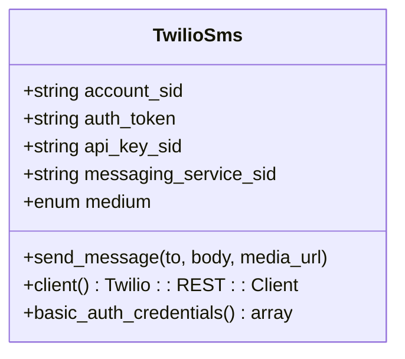

**Diagram sources**
- [twilio_sms.rb:29-93](file://app/models/channel/twilio_sms.rb#L29-L93)

**Section sources**
- [twilio_sms.rb:29-93](file://app/models/channel/twilio_sms.rb#L29-L93)

## Dependency Analysis
Channel models depend on:
- Shared concerns: Channelable (inbox association), Reauthorizable (OAuth refresh/reauth flows).
- External services: Platform APIs (Meta, Twitter, Telegram, Bandwidth, Twilio).
- Builders: ContactInboxWithContactBuilder for creating contacts/inboxes from platform identifiers.
- Services: Provider-specific services (e.g., Whatsapp provider services, Telegram attachment service).

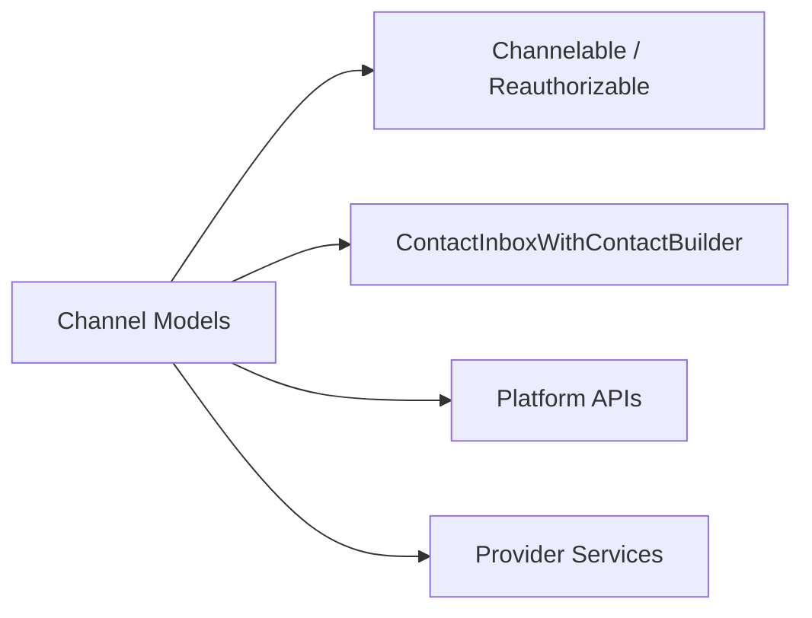

**Diagram sources**
- [web_widget.rb:30-31](file://app/models/channel/web_widget.rb#L30-L31)
- [email.rb:39-40](file://app/models/channel/email.rb#L39-L40)
- [whatsapp.rb:26-27](file://app/models/channel/whatsapp.rb#L26-L27)
- [facebook_page.rb:21-22](file://app/models/channel/facebook_page.rb#L21-L22)
- [telegram.rb:18-19](file://app/models/channel/telegram.rb#L18-L19)
- [twilio_sms.rb:30-31](file://app/models/channel/twilio_sms.rb#L30-L31)

**Section sources**
- [web_widget.rb:30-31](file://app/models/channel/web_widget.rb#L30-L31)
- [email.rb:39-40](file://app/models/channel/email.rb#L39-L40)
- [whatsapp.rb:26-27](file://app/models/channel/whatsapp.rb#L26-L27)
- [facebook_page.rb:21-22](file://app/models/channel/facebook_page.rb#L21-L22)
- [telegram.rb:18-19](file://app/models/channel/telegram.rb#L18-L19)
- [twilio_sms.rb:30-31](file://app/models/channel/twilio_sms.rb#L30-L31)

## Performance Considerations
- Webhook efficiency: Channels like Telegram and WhatsApp set webhooks to avoid polling overhead. Ensure webhooks are correctly registered and monitored.
- Attachment handling: Offload large file transfers to provider storage and use URLs rather than embedding binary data in messages.
- Rate limiting: Respect provider limits (e.g., Meta, Twitter, Telegram, Bandwidth, Twilio). Implement retries with exponential backoff and circuit breakers where applicable.
- Encryption overhead: Sensitive fields are encrypted only when encryption is configured; ensure keys are properly managed to avoid performance penalties.

[No sources needed since this section provides general guidance]

## Troubleshooting Guide
Common issues and strategies:
- Authentication failures:
  - Reauthorize channels that include Reauthorizable (e.g., Email, Facebook, WhatsApp).
  - Verify provider credentials and scopes.
- Webhook misconfiguration:
  - For Telegram, ensure the webhook URL is reachable and matches the bot token.
  - For WhatsApp, verify webhook subscriptions and coexistence flags.
- Error propagation:
  - Telegram maps API errors to message.external_error and status failed.
  - SMS (Bandwidth) logs provider descriptions and marks messages failed.
- Feature toggles:
  - WhatsApp voice calling requires whatsapp_cloud provider and feature flag; enabling/disabling triggers webhook re-registration.

**Section sources**
- [telegram.rb:62-69](file://app/models/channel/telegram.rb#L62-L69)
- [sms.rb:75-83](file://app/models/channel/sms.rb#L75-L83)
- [whatsapp.rb:95-118](file://app/models/channel/whatsapp.rb#L95-L118)
- [email.rb:42-48](file://app/models/channel/email.rb#L42-L48)
- [facebook_page.rb:49-67](file://app/models/channel/facebook_page.rb#L49-L67)

## Conclusion
Chatwoot’s multi-channel integration leverages a robust channel adapter pattern to normalize conversations across diverse platforms. Each channel model encapsulates provider-specific logic, authentication, and formatting while exposing a consistent interface. By following the patterns outlined here—using builders for contact/inbox creation, delegating provider operations to services, and handling errors gracefully—you can extend Chatwoot with new channels while maintaining consistency and preserving platform-specific features.

[No sources needed since this section summarizes without analyzing specific files]