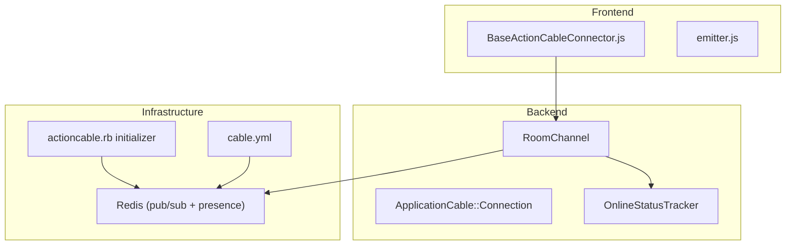
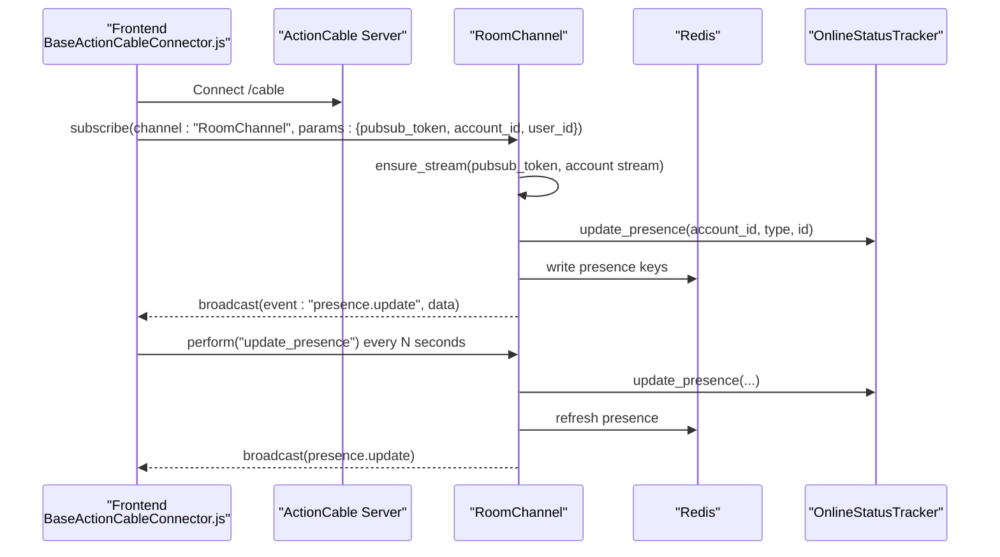
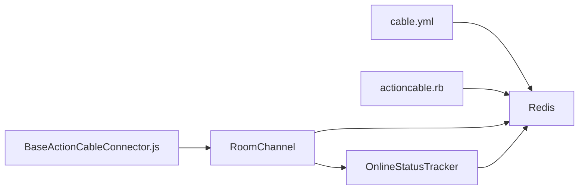

# Real-time Messaging System

<cite>
**Referenced Files in This Document**
- [cable.yml](file://config/cable.yml)
- [actioncable.rb](file://config/initializers/actioncable.rb)
- [room_channel.rb](file://app/channels/room_channel.rb)
- [application_cable_connection.rb](file://app/channels/application_cable/connection.rb)
- [online_status_tracker.rb](file://lib/online_status_tracker.rb)
- [BaseActionCableConnector.js](file://app/javascript/shared/helpers/BaseActionCableConnector.js)
- [emitter.js](file://app/javascript/dashboard/composables/emitter.js)
</cite>

## Table of Contents
1. [Introduction](#introduction)
2. [Project Structure](#project-structure)
3. [Core Components](#core-components)
4. [Architecture Overview](#architecture-overview)
5. [Detailed Component Analysis](#detailed-component-analysis)
6. [Dependency Analysis](#dependency-analysis)
7. [Performance Considerations](#performance-considerations)
8. [Troubleshooting Guide](#troubleshooting-guide)
9. [Conclusion](#conclusion)

## Introduction
This document explains Chatwoot’s real-time messaging infrastructure built on ActionCable. It covers WebSocket connection management, channel subscriptions, message broadcasting, and how the Vue.js frontend consumes these updates via a shared connector and event system. It also documents presence detection for agents and contacts, reconnection handling, and scaling considerations for high-volume environments.

## Project Structure
The real-time layer spans backend channels, Redis-backed pub/sub configuration, and a frontend connector that subscribes to a single channel and routes events into application state.

**Diagram sources**
- [BaseActionCableConnector.js:1-96](file://app/javascript/shared/helpers/BaseActionCableConnector.js#L1-L96)
- [room_channel.rb:1-60](file://app/channels/room_channel.rb#L1-L60)
- [online_status_tracker.rb:1-80](file://lib/online_status_tracker.rb#L1-L80)
- [cable.yml:1-22](file://config/cable.yml#L1-L22)
- [actioncable.rb:1-19](file://config/initializers/actioncable.rb#L1-L19)

**Section sources**
- [cable.yml:1-22](file://config/cable.yml#L1-L22)
- [actioncable.rb:1-19](file://config/initializers/actioncable.rb#L1-L19)
- [room_channel.rb:1-60](file://app/channels/room_channel.rb#L1-L60)
- [BaseActionCableConnector.js:1-96](file://app/javascript/shared/helpers/BaseActionCableConnector.js#L1-L96)

## Core Components
- Backend WebSocket server: Rails ActionCable with Redis adapter configured via cable.yml and an initializer that customizes the Redis client.
- Channel: RoomChannel handles subscription, presence updates, and broadcasts.
- Presence service: OnlineStatusTracker maintains online status and availability using Redis sorted sets and hashes.
- Frontend connector: BaseActionCableConnector creates an ActionCable consumer, subscribes to RoomChannel, manages presence pings, and routes incoming events.
- Event bus: A lightweight emitter helper used by Vue components to react to UI-level events.

**Section sources**
- [cable.yml:1-22](file://config/cable.yml#L1-L22)
- [actioncable.rb:1-19](file://config/initializers/actioncable.rb#L1-L19)
- [room_channel.rb:1-60](file://app/channels/room_channel.rb#L1-L60)
- [online_status_tracker.rb:1-80](file://lib/online_status_tracker.rb#L1-L80)
- [BaseActionCableConnector.js:1-96](file://app/javascript/shared/helpers/BaseActionCableConnector.js#L1-L96)
- [emitter.js:1-20](file://app/javascript/dashboard/composables/emitter.js#L1-L20)

## Architecture Overview
The system uses a single ActionCable channel for all real-time updates within an account scope. The frontend connects once per session, subscribes to RoomChannel with a token and identifiers, and receives events such as presence updates. Presence is tracked in Redis and periodically refreshed by the frontend.

**Diagram sources**
- [BaseActionCableConnector.js:1-96](file://app/javascript/shared/helpers/BaseActionCableConnector.js#L1-L96)
- [room_channel.rb:1-60](file://app/channels/room_channel.rb#L1-L60)
- [online_status_tracker.rb:1-80](file://lib/online_status_tracker.rb#L1-L80)

## Detailed Component Analysis

### WebSocket Connection Management
- The frontend creates an ActionCable consumer and immediately subscribes to RoomChannel with a pubsub token and account/user identifiers.
- The connector schedules periodic presence pings and tracks disconnections, initiating a reconnect loop when needed.
- On reconnect, it clears timers and invokes a hook for application-specific recovery logic.

Key behaviors:
- Consumer creation and subscription parameters include channel name and authentication tokens.
- Disconnected callback triggers reconnect timer; active connection after disconnect triggers reconnect hooks.
- Presence interval runs continuously while connected.

**Section sources**
- [BaseActionCableConnector.js:1-96](file://app/javascript/shared/helpers/BaseActionCableConnector.js#L1-L96)

### Channel Subscriptions and Streams
- RoomChannel subscribes clients to:
  - A private stream identified by pubsub_token for targeted messages.
  - An account-wide stream for users to receive account-scoped updates.
- On subscription, it ensures streams, updates presence, and broadcasts initial presence information.

Streams:
- Private stream: pubsub_token
- Account stream: account_<account_id>

**Section sources**
- [room_channel.rb:1-60](file://app/channels/room_channel.rb#L1-L60)

### Message Broadcasting Mechanisms
- RoomChannel broadcasts presence updates to the pubsub_token stream.
- Other parts of the application can publish to the same streams to deliver messages or other events to subscribers.

Broadcast targets:
- Per-token stream: pubsub_token
- Per-account stream: account_<account_id>

**Section sources**
- [room_channel.rb:1-60](file://app/channels/room_channel.rb#L1-L60)

### Presence Detection and Availability
- OnlineStatusTracker stores presence timestamps in Redis sorted sets keyed by account and entity type (User or Contact).
- It provides methods to:
  - Update presence timestamps.
  - Query available entities within a time window.
  - Manage per-user availability status in a Redis hash.
- RoomChannel calls OnlineStatusTracker on subscription and on each presence ping, then broadcasts aggregated presence data.

Presence details:
- Time-based expiration controlled by environment variables.
- Aggregated presence includes both users and contacts where applicable.

**Section sources**
- [online_status_tracker.rb:1-80](file://lib/online_status_tracker.rb#L1-L80)
- [room_channel.rb:1-60](file://app/channels/room_channel.rb#L1-L60)

### Frontend Event Handling with Vue.js and Pinia
- BaseActionCableConnector centralizes WebSocket lifecycle and event routing.
- Vue components can use a small emitter helper to subscribe/unsubscribe to UI events during component lifecycle.
- For real-time data, components typically listen to events dispatched from the connector and commit changes to Pinia store modules.

Event integration patterns:
- Connector.onReceived dispatches named events with payloads.
- Components register listeners via emitter helpers and update reactive state accordingly.

**Section sources**
- [BaseActionCableConnector.js:1-96](file://app/javascript/shared/helpers/BaseActionCableConnector.js#L1-L96)
- [emitter.js:1-20](file://app/javascript/dashboard/composables/emitter.js#L1-L20)

### Reconnection Handling
- The connector detects disconnections and starts a periodic check to see if the connection becomes active again.
- When reconnected, it clears timers and calls a hook for application-specific recovery (e.g., refetching missing data or re-synchronizing state).

Reconnect flow:
- disconnected -> initReconnectTimer -> checkConnection -> onReconnect (if active)

**Section sources**
- [BaseActionCableConnector.js:1-96](file://app/javascript/shared/helpers/BaseActionCableConnector.js#L1-L96)

### Concurrent Connections
- Each browser tab or device establishes its own ActionCable connection and presence entry.
- Presence is tracked per user/contact ID, so multiple concurrent connections are supported without conflict.

**Section sources**
- [online_status_tracker.rb:1-80](file://lib/online_status_tracker.rb#L1-L80)

### Implementing Custom Real-time Features
To add a new real-time feature:
- Define a new event name and payload structure.
- Publish the event to the appropriate stream(s):
  - Use the per-token stream for private updates.
  - Use the account stream for account-wide updates.
- In the frontend, extend BaseActionCableConnector to handle the new event and update Pinia state.

Example steps:
- Backend: broadcast to pubsub_token or account stream with a new event key.
- Frontend: register a handler in the connector’s event map and mutate store state.

[No sources needed since this section provides general guidance]

## Dependency Analysis
The following diagram shows how configuration, channels, and services depend on each other and on Redis.

**Diagram sources**
- [cable.yml:1-22](file://config/cable.yml#L1-L22)
- [actioncable.rb:1-19](file://config/initializers/actioncable.rb#L1-L19)
- [room_channel.rb:1-60](file://app/channels/room_channel.rb#L1-L60)
- [online_status_tracker.rb:1-80](file://lib/online_status_tracker.rb#L1-L80)
- [BaseActionCableConnector.js:1-96](file://app/javascript/shared/helpers/BaseActionCableConnector.js#L1-L96)

**Section sources**
- [cable.yml:1-22](file://config/cable.yml#L1-L22)
- [actioncable.rb:1-19](file://config/initializers/actioncable.rb#L1-L19)
- [room_channel.rb:1-60](file://app/channels/room_channel.rb#L1-L60)
- [online_status_tracker.rb:1-80](file://lib/online_status_tracker.rb#L1-L80)
- [BaseActionCableConnector.js:1-96](file://app/javascript/shared/helpers/BaseActionCableConnector.js#L1-L96)

## Performance Considerations
- Redis-backed pub/sub: Ensure Redis is sized appropriately for expected throughput and persistence settings.
- Presence intervals: Tune presence ping frequency to balance freshness vs. overhead.
- Stream scoping: Prefer per-token streams for private updates and account streams for broad updates to minimize fan-out.
- Backpressure: Avoid heavy processing inside channel callbacks; offload to background jobs when necessary.
- Monitoring: Track WebSocket connection counts, message rates, and Redis latency to detect bottlenecks.

[No sources needed since this section provides general guidance]

## Troubleshooting Guide
Common issues and resolutions:
- No messages received:
  - Verify the frontend is subscribing with a valid pubsub_token and correct account/user identifiers.
  - Confirm the backend is broadcasting to the intended stream(s).
- Presence not updating:
  - Check OnlineStatusTracker Redis keys and TTLs.
  - Ensure the frontend presence interval is running and the server is receiving update_presence calls.
- Frequent disconnects:
  - Inspect network conditions and reverse proxy settings for WebSocket support.
  - Review reconnect timers and hooks in the frontend connector.
- High Redis memory usage:
  - Validate presence key cleanup and consider adjusting presence durations.

**Section sources**
- [room_channel.rb:1-60](file://app/channels/room_channel.rb#L1-L60)
- [online_status_tracker.rb:1-80](file://lib/online_status_tracker.rb#L1-L80)
- [BaseActionCableConnector.js:1-96](file://app/javascript/shared/helpers/BaseActionCableConnector.js#L1-L96)

## Conclusion
Chatwoot’s real-time layer leverages ActionCable with Redis for scalable pub/sub and presence tracking. The RoomChannel coordinates subscriptions, presence updates, and broadcasts, while the frontend connector manages connection lifecycle and event routing. By tuning presence intervals, scoping streams correctly, and monitoring Redis and WebSocket metrics, teams can build reliable, high-performance real-time experiences.