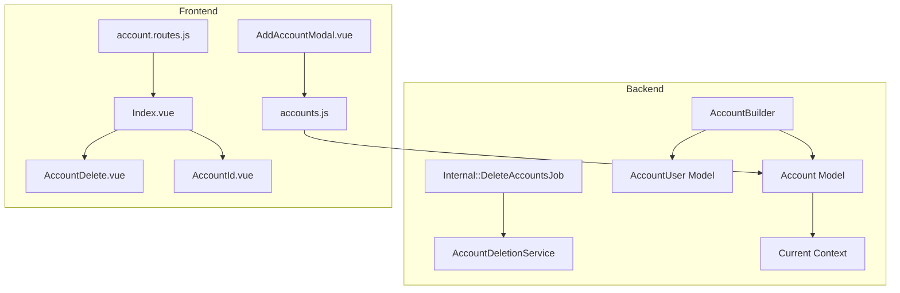
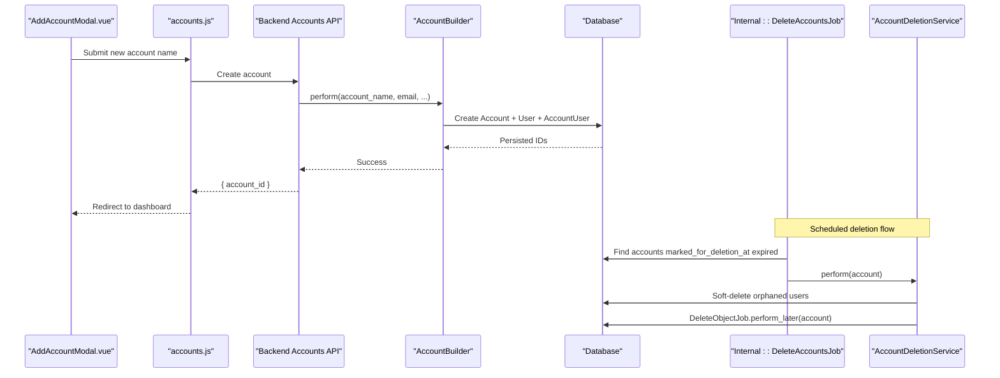
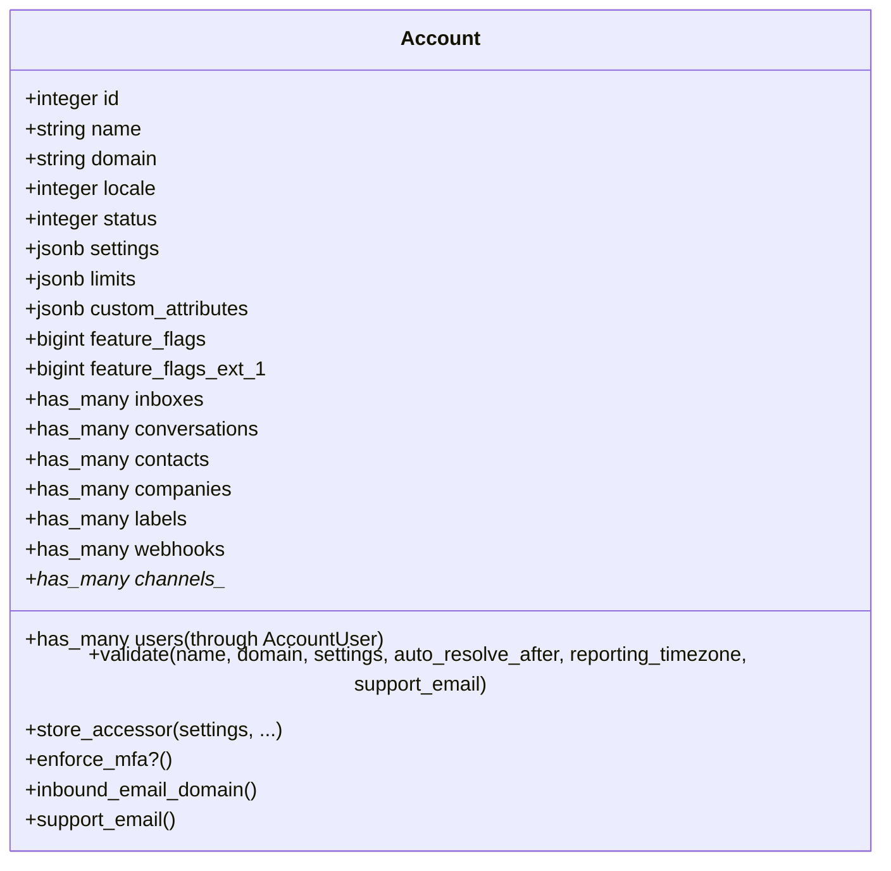
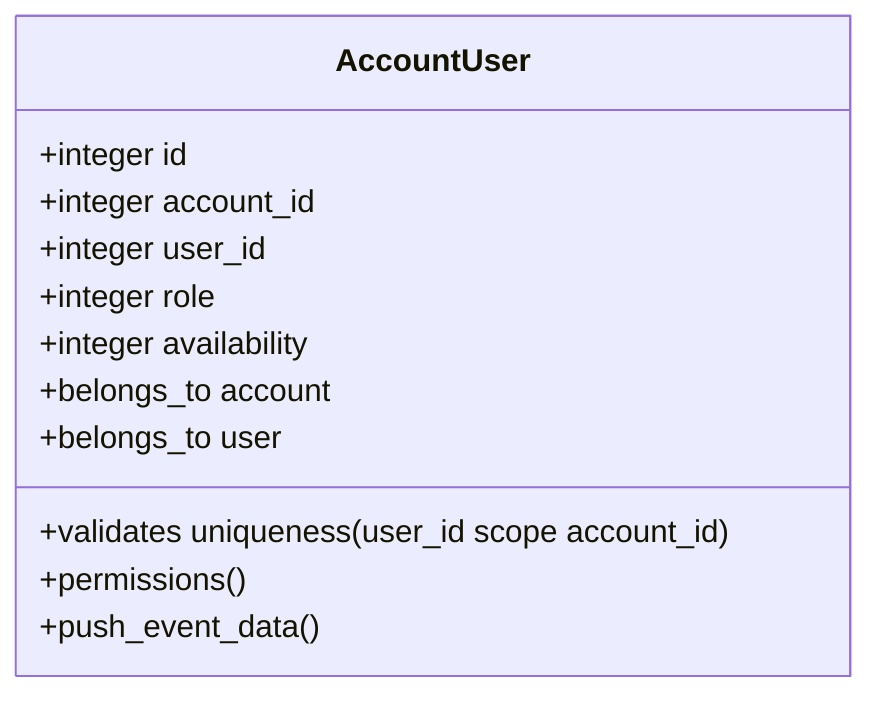
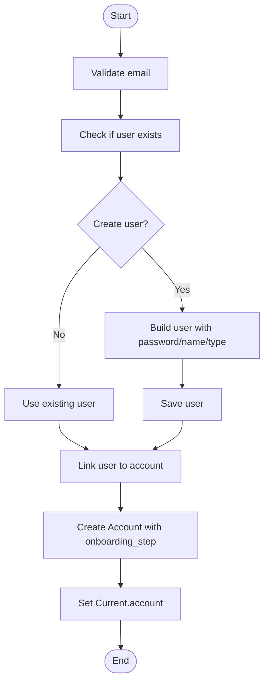
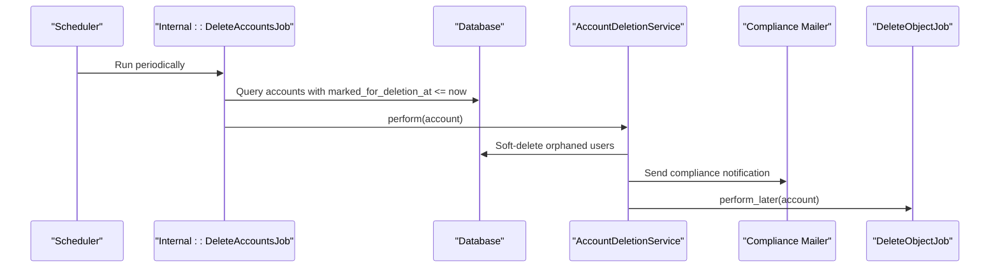
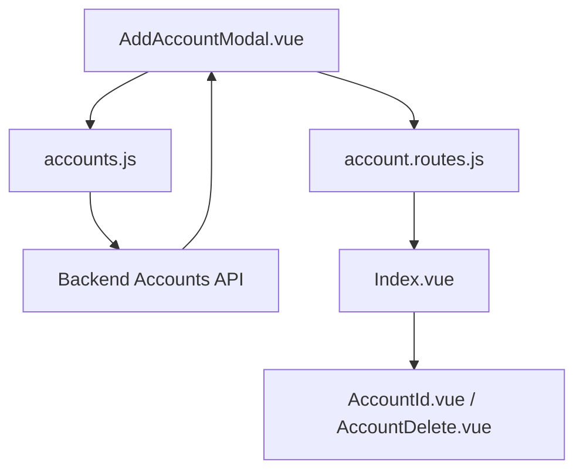
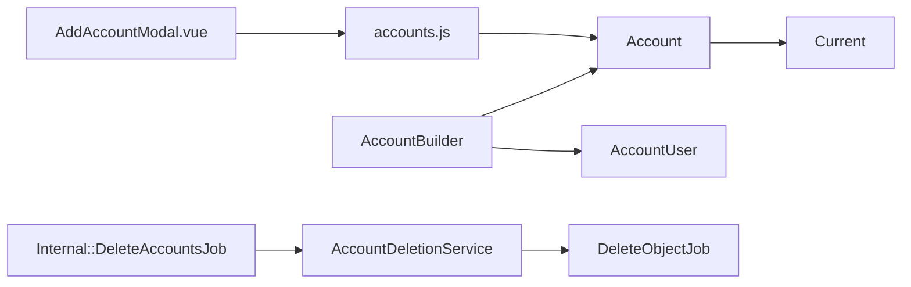

# Account Management

<cite>
**Referenced Files in This Document**
- [account.rb](file://app/models/account.rb)
- [account_user.rb](file://app/models/account_user.rb)
- [account_builder.rb](file://app/builders/account_builder.rb)
- [current.rb](file://lib/current.rb)
- [delete_accounts_job.rb](file://app/jobs/internal/delete_accounts_job.rb)
- [account_deletion_service.rb](file://app/services/account_deletion_service.rb)
- [accounts.js](file://app/javascript/dashboard/store/modules/accounts.js)
- [AddAccountModal.vue](file://app/javascript/dashboard/components/app/AddAccountModal.vue)
- [account.routes.js](file://app/javascript/dashboard/routes/dashboard/settings/account/account.routes.js)
- [Index.vue](file://app/javascript/dashboard/routes/dashboard/settings/account/Index.vue)
- [AccountId.vue](file://app/javascript/dashboard/routes/dashboard/settings/account/components/AccountId.vue)
- [AccountDelete.vue](file://app/javascript/dashboard/routes/dashboard/settings/account/components/AccountDelete.vue)
- [20250421082927_add_settings_column_to_account.rb](file://db/migrate/20250421082927_add_settings_column_to_account.rb)
- [20260706215758_add_feature_flags_ext_2_to_accounts.rb](file://db/migrate/20260706215758_add_feature_flags_ext_2_to_accounts.rb)
</cite>

## Table of Contents
1. Introduction
2. Project Structure
3. Core Components
4. Architecture Overview
5. Detailed Component Analysis
6. Dependency Analysis
7. Performance Considerations
8. Troubleshooting Guide
9. Conclusion

## Introduction
This document explains Chatwoot’s multi-tenant account management system. The Account model is the primary tenant boundary that isolates data and configuration for each organization. It defines how accounts are created, configured, and managed throughout their lifecycle, and how they relate to users, teams, inboxes, and conversations. It also covers account-level settings, feature flags, billing integration points, and security considerations for multi-tenancy.

## Project Structure
The account management system spans models, builders, services, jobs, and frontend components:
- Models define the tenant boundary and relationships (Account, AccountUser).
- Builders orchestrate creation flows.
- Services and jobs handle lifecycle operations like deletion.
- Frontend modules provide UI for creating and configuring accounts.

**Diagram sources**
- [account.rb:26-111](file://app/models/account.rb#L26-L111)
- [account_user.rb:27-45](file://app/models/account_user.rb#L27-L45)
- [account_builder.rb:3-20](file://app/builders/account_builder.rb#L3-L20)
- [account_deletion_service.rb:1-17](file://app/services/account_deletion_service.rb#L1-L17)
- [delete_accounts_job.rb:1-14](file://app/jobs/internal/delete_accounts_job.rb#L1-L14)
- [current.rb:1-18](file://lib/current.rb#L1-L18)
- [AddAccountModal.vue:44-60](file://app/javascript/dashboard/components/app/AddAccountModal.vue#L44-L60)
- [accounts.js:131-142](file://app/javascript/dashboard/store/modules/accounts.js#L131-L142)
- [account.routes.js:1-25](file://app/javascript/dashboard/routes/dashboard/settings/account/account.routes.js#L1-L25)
- [Index.vue:1-37](file://app/javascript/dashboard/routes/dashboard/settings/account/Index.vue#L1-L37)
- [AccountDelete.vue:1-35](file://app/javascript/dashboard/routes/dashboard/settings/account/components/AccountDelete.vue#L1-L35)
- [AccountId.vue:1-22](file://app/javascript/dashboard/routes/dashboard/settings/account/components/AccountId.vue#L1-L22)

**Section sources**
- [account.rb:26-111](file://app/models/account.rb#L26-L111)
- [account_user.rb:27-45](file://app/models/account_user.rb#L27-L45)
- [account_builder.rb:3-20](file://app/builders/account_builder.rb#L3-L20)
- [delete_accounts_job.rb:1-14](file://app/jobs/internal/delete_accounts_job.rb#L1-L14)
- [account_deletion_service.rb:1-17](file://app/services/account_deletion_service.rb#L1-L17)
- [accounts.js:131-142](file://app/javascript/dashboard/store/modules/accounts.js#L131-L142)
- [AddAccountModal.vue:44-60](file://app/javascript/dashboard/components/app/AddAccountModal.vue#L44-L60)
- [account.routes.js:1-25](file://app/javascript/dashboard/routes/dashboard/settings/account/account.routes.js#L1-L25)
- [Index.vue:1-37](file://app/javascript/dashboard/routes/dashboard/settings/account/Index.vue#L1-L37)
- [AccountDelete.vue:1-35](file://app/javascript/dashboard/routes/dashboard/settings/account/components/AccountDelete.vue#L1-L35)
- [AccountId.vue:1-22](file://app/javascript/dashboard/routes/dashboard/settings/account/components/AccountId.vue#L1-L22)

## Core Components
- Account: Primary tenant boundary with attributes for name, domain, locale, status, settings, limits, and feature flags. It owns all tenant-scoped resources such as users, inboxes, conversations, labels, webhooks, and more.
- AccountUser: Membership record linking a User to an Account with role and availability.
- AccountBuilder: Orchestrates account creation and user provisioning.
- Current: Thread-local context holding current account and user for request-scoped isolation.
- Internal::DeleteAccountsJob and AccountDeletionService: Lifecycle management for soft-deleting accounts after a grace period.

Key responsibilities:
- Data isolation via account_id scoping on associated records.
- Configuration storage using JSONB settings and feature flag bitsets.
- Lifecycle events and background processing for deletions.

**Section sources**
- [account.rb:26-111](file://app/models/account.rb#L26-L111)
- [account_user.rb:27-45](file://app/models/account_user.rb#L27-L45)
- [account_builder.rb:3-20](file://app/builders/account_builder.rb#L3-L20)
- [current.rb:1-18](file://lib/current.rb#L1-L18)
- [delete_accounts_job.rb:1-14](file://app/jobs/internal/delete_accounts_job.rb#L1-L14)
- [account_deletion_service.rb:1-17](file://app/services/account_deletion_service.rb#L1-L17)

## Architecture Overview
The system enforces multi-tenancy by anchoring all business entities to an Account. Requests set Current.account to ensure consistent scoping. Creation flows use AccountBuilder to create an Account and link the first user as administrator. Deletions are soft and scheduled via a job that triggers a service to sanitize orphaned users and notify compliance before deleting the account.

**Diagram sources**
- [AddAccountModal.vue:44-60](file://app/javascript/dashboard/components/app/AddAccountModal.vue#L44-L60)
- [accounts.js:131-142](file://app/javascript/dashboard/store/modules/accounts.js#L131-L142)
- [account_builder.rb:7-20](file://app/builders/account_builder.rb#L7-L20)
- [delete_accounts_job.rb:10-14](file://app/jobs/internal/delete_accounts_job.rb#L10-L14)
- [account_deletion_service.rb:11-17](file://app/services/account_deletion_service.rb#L11-L17)

## Detailed Component Analysis

### Account Model
The Account model encapsulates tenant identity and configuration:
- Attributes: name, domain, locale, status, settings (JSONB), limits (JSONB), custom_attributes (JSONB), internal_attributes (JSONB), feature flags (bitsets).
- Relationships: has_many associations to users (through AccountUser), inboxes, conversations, contacts, companies, labels, webhooks, channels, automation rules, campaigns, macros, notes, notifications, portals, working hours, and more.
- Validations: presence of name; length of domain; JSON schema validation for settings; numeric constraints for auto-resolve; reporting timezone validation; support email format validation.
- Feature flags: Uses FlagShihTzu for efficient multi-flag bitset columns.
- Settings accessors: store_accessor exposes keys like auto_resolve_after, auto_translate, reporting_timezone, enforce_mfa, etc.
- Lifecycle hooks: after_create_commit dispatches ACCOUNT_CREATED event; after_update clears unread counts cache when needed; after_destroy removes per-account sequences.

**Diagram sources**
- [account.rb:26-111](file://app/models/account.rb#L26-L111)
- [account.rb:115-124](file://app/models/account.rb#L115-L124)
- [account.rb:151-177](file://app/models/account.rb#L151-L177)
- [account.rb:222-245](file://app/models/account.rb#L222-L245)

**Section sources**
- [account.rb:26-111](file://app/models/account.rb#L26-L111)
- [account.rb:115-124](file://app/models/account.rb#L115-L124)
- [account.rb:151-177](file://app/models/account.rb#L151-L177)
- [account.rb:222-245](file://app/models/account.rb#L222-L245)

### AccountUser Model
AccountUser links Users to Accounts and defines roles and availability:
- Role enum: agent, administrator.
- Availability enum: online, offline, busy.
- Uniqueness constraint ensures one membership per user per account.
- After-create sets default notification preferences and emits AGENT_ADDED event.
- After-save updates presence in Redis for real-time status.

**Diagram sources**
- [account_user.rb:27-45](file://app/models/account_user.rb#L27-L45)
- [account_user.rb:58-69](file://app/models/account_user.rb#L58-L69)

**Section sources**
- [account_user.rb:27-45](file://app/models/account_user.rb#L27-L45)
- [account_user.rb:58-69](file://app/models/account_user.rb#L58-L69)

### Account Creation Flow
AccountBuilder coordinates account and user creation:
- Validates email and user existence.
- Creates Account with initial onboarding step.
- Sets Current.account to the newly created account.
- Creates or uses provided User and links it as administrator via AccountUser.

**Diagram sources**
- [account_builder.rb:34-85](file://app/builders/account_builder.rb#L34-L85)

**Section sources**
- [account_builder.rb:34-85](file://app/builders/account_builder.rb#L34-L85)

### Account Lifecycle and Deletion
Soft deletion is handled by a scheduled job and a service:
- Internal::DeleteAccountsJob scans accounts with a past deletion timestamp stored in custom_attributes.
- For each eligible account, it invokes AccountDeletionService.
- AccountDeletionService soft-deletes orphaned users (those not linked to other accounts), sends a compliance notification, and enqueues DeleteObjectJob to remove the account.

**Diagram sources**
- [delete_accounts_job.rb:10-26](file://app/jobs/internal/delete_accounts_job.rb#L10-L26)
- [account_deletion_service.rb:11-52](file://app/services/account_deletion_service.rb#L11-L52)

**Section sources**
- [delete_accounts_job.rb:10-26](file://app/jobs/internal/delete_accounts_job.rb#L10-L26)
- [account_deletion_service.rb:11-52](file://app/services/account_deletion_service.rb#L11-L52)

### Frontend Account Management
- AddAccountModal.vue: Collects account name and dispatches store action to create an account. On success, redirects to the new account dashboard.
- accounts.js: Provides actions for creating, deleting, and toggling deletion states; integrates with backend APIs.
- account.routes.js: Defines settings routes scoped to the current account with permission checks.
- Index.vue: Renders general account settings page and composes sections like AccountId and AccountDelete.
- AccountDelete.vue: Manages marking an account for deletion and displays deletion metadata from custom_attributes.
- AccountId.vue: Displays the current account ID for reference.

**Diagram sources**
- [AddAccountModal.vue:44-60](file://app/javascript/dashboard/components/app/AddAccountModal.vue#L44-L60)
- [accounts.js:131-142](file://app/javascript/dashboard/store/modules/accounts.js#L131-L142)
- [account.routes.js:1-25](file://app/javascript/dashboard/routes/dashboard/settings/account/account.routes.js#L1-L25)
- [Index.vue:1-37](file://app/javascript/dashboard/routes/dashboard/settings/account/Index.vue#L1-L37)
- [AccountDelete.vue:1-35](file://app/javascript/dashboard/routes/dashboard/settings/account/components/AccountDelete.vue#L1-L35)
- [AccountId.vue:1-22](file://app/javascript/dashboard/routes/dashboard/settings/account/components/AccountId.vue#L1-L22)

**Section sources**
- [AddAccountModal.vue:44-60](file://app/javascript/dashboard/components/app/AddAccountModal.vue#L44-L60)
- [accounts.js:131-142](file://app/javascript/dashboard/store/modules/accounts.js#L131-L142)
- [account.routes.js:1-25](file://app/javascript/dashboard/routes/dashboard/settings/account/account.routes.js#L1-L25)
- [Index.vue:1-37](file://app/javascript/dashboard/routes/dashboard/settings/account/Index.vue#L1-L37)
- [AccountDelete.vue:1-35](file://app/javascript/dashboard/routes/dashboard/settings/account/components/AccountDelete.vue#L1-L35)
- [AccountId.vue:1-22](file://app/javascript/dashboard/routes/dashboard/settings/account/components/AccountId.vue#L1-L22)

### Data Isolation Patterns and Security Considerations
- Tenant boundary: All major entities (conversations, messages, contacts, inboxes, labels, webhooks, etc.) belong to an Account via foreign keys, ensuring strict data isolation.
- Request scoping: Current.account provides thread-safe access to the active tenant during request processing.
- Feature flags: Bitset columns enable efficient per-account feature toggles.
- Settings and limits: JSONB fields allow flexible configuration while being validated through schema validators and custom validations.
- Billing integration: Account includes billing-related modules and helpers, enabling plan usage and limits enforcement at the tenant level.
- Email domain handling: inbound_email_domain and support_email methods centralize mail routing and sender addresses per account.

**Section sources**
- [account.rb:26-111](file://app/models/account.rb#L26-L111)
- [account.rb:151-177](file://app/models/account.rb#L151-L177)
- [current.rb:1-18](file://lib/current.rb#L1-L18)

## Dependency Analysis
The following diagram shows key dependencies among core components involved in account management.

**Diagram sources**
- [account_builder.rb:3-20](file://app/builders/account_builder.rb#L3-L20)
- [account.rb:26-111](file://app/models/account.rb#L26-L111)
- [account_user.rb:27-45](file://app/models/account_user.rb#L27-L45)
- [current.rb:1-18](file://lib/current.rb#L1-L18)
- [delete_accounts_job.rb:1-14](file://app/jobs/internal/delete_accounts_job.rb#L1-L14)
- [account_deletion_service.rb:1-17](file://app/services/account_deletion_service.rb#L1-L17)
- [AddAccountModal.vue:44-60](file://app/javascript/dashboard/components/app/AddAccountModal.vue#L44-L60)
- [accounts.js:131-142](file://app/javascript/dashboard/store/modules/accounts.js#L131-L142)

**Section sources**
- [account_builder.rb:3-20](file://app/builders/account_builder.rb#L3-L20)
- [account.rb:26-111](file://app/models/account.rb#L26-L111)
- [account_user.rb:27-45](file://app/models/account_user.rb#L27-L45)
- [current.rb:1-18](file://lib/current.rb#L1-L18)
- [delete_accounts_job.rb:1-14](file://app/jobs/internal/delete_accounts_job.rb#L1-L14)
- [account_deletion_service.rb:1-17](file://app/services/account_deletion_service.rb#L1-L17)
- [AddAccountModal.vue:44-60](file://app/javascript/dashboard/components/app/AddAccountModal.vue#L44-L60)
- [accounts.js:131-142](file://app/javascript/dashboard/store/modules/accounts.js#L131-L142)

## Performance Considerations
- Feature flags: Using bitset columns reduces storage overhead and improves query performance for multi-feature toggles.
- JSONB settings: Flexible but should be accessed via store_accessor to avoid unnecessary parsing and to leverage database indexing where appropriate.
- Background jobs: Deletion and related tasks are offloaded to jobs to keep request paths fast and responsive.
- Cache invalidation: Clearing unread conversation counts only when relevant features change avoids unnecessary cache churn.

[No sources needed since this section provides general guidance]

## Troubleshooting Guide
Common issues and resolutions:
- Account creation fails due to duplicate user email: Ensure the email does not already exist or pass a different email.
- Invalid settings or unsupported timezones: Verify settings conform to the schema and use valid timezone identifiers.
- Support email format errors: Provide a properly formatted email address.
- Account deletion not occurring: Check that custom_attributes contains a past marked_for_deletion_at timestamp and that the scheduled job is running.

Operational references:
- Validation logic for settings, reporting timezone, and support email resides in the Account model.
- Deletion scheduling and execution are handled by Internal::DeleteAccountsJob and AccountDeletionService.

**Section sources**
- [account.rb:44-56](file://app/models/account.rb#L44-L56)
- [account.rb:222-245](file://app/models/account.rb#L222-L245)
- [delete_accounts_job.rb:10-26](file://app/jobs/internal/delete_accounts_job.rb#L10-L26)
- [account_deletion_service.rb:11-52](file://app/services/account_deletion_service.rb#L11-L52)

## Conclusion
Chatwoot’s multi-tenant architecture centers around the Account model, which isolates data and configuration for each organization. The system provides robust creation workflows, clear relationships to users and other resources, flexible settings and feature flags, and a safe, auditable deletion process. Frontend components integrate seamlessly with backend services to offer a complete account management experience.

[No sources needed since this section summarizes without analyzing specific files]