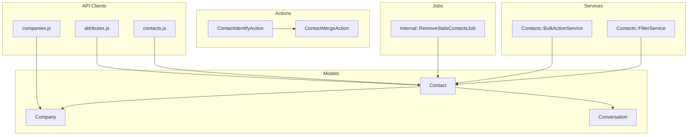
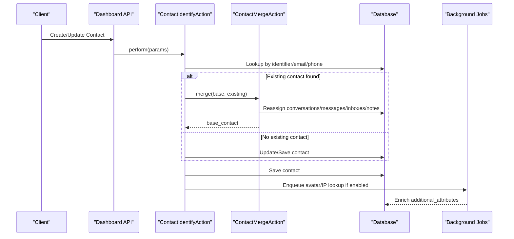
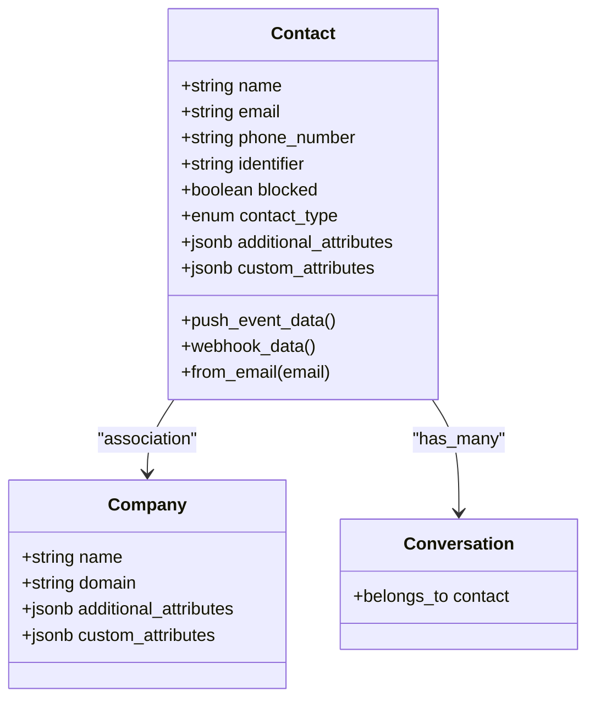
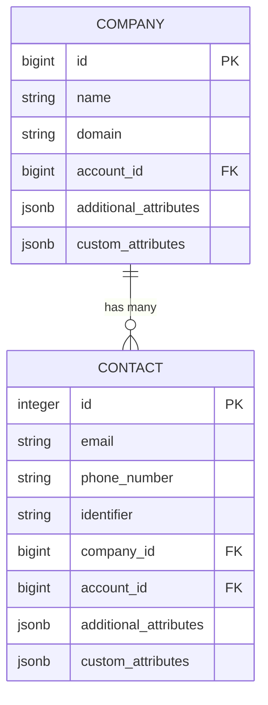
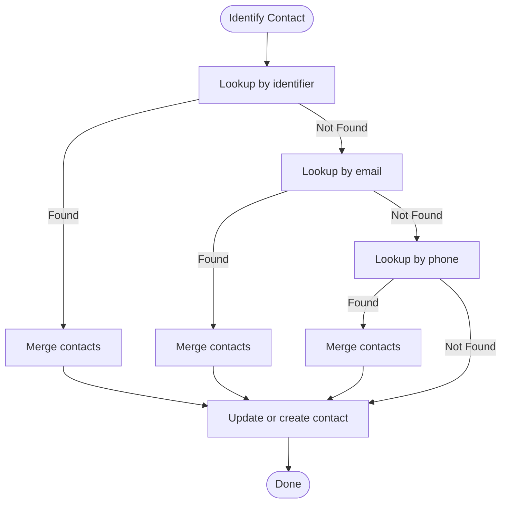
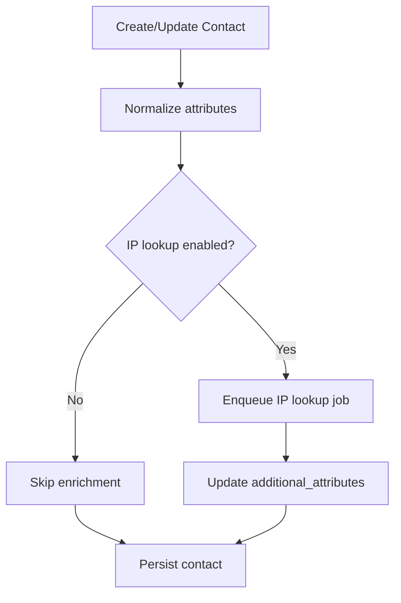
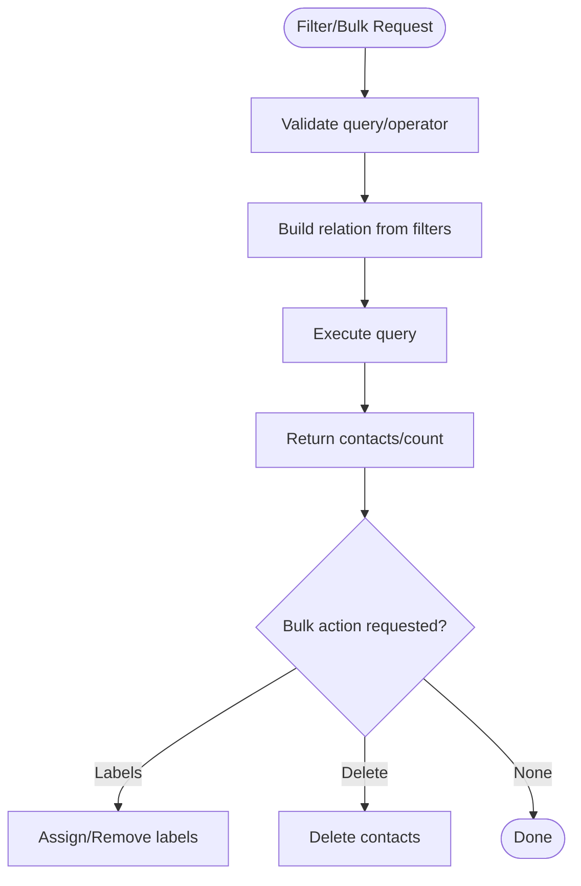
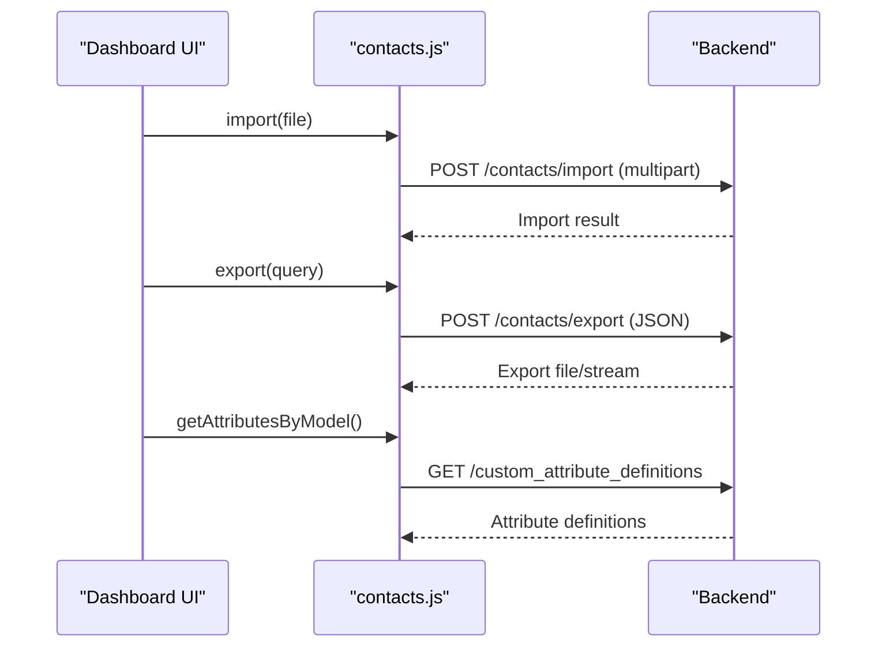
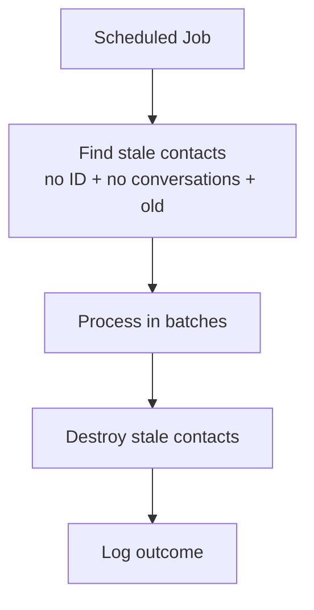
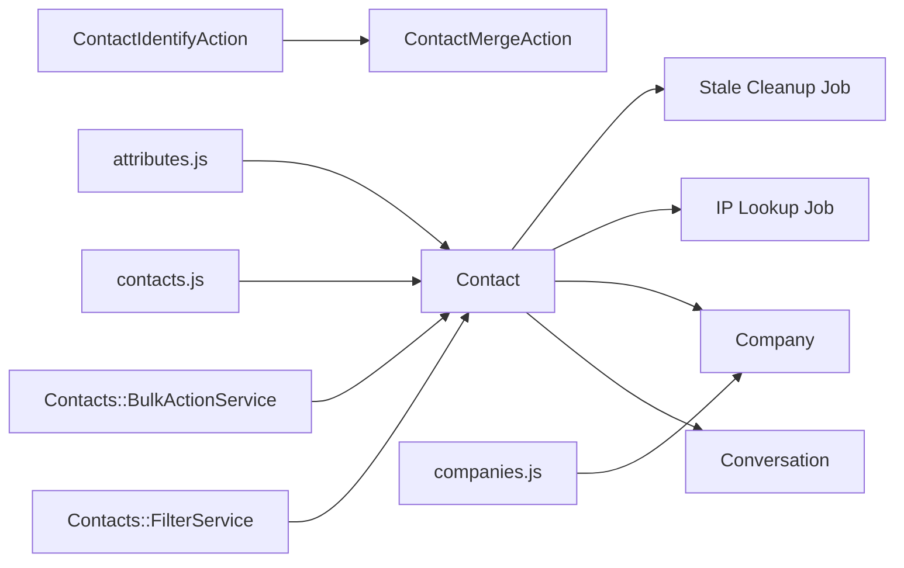

# Contact & Customer Data

<cite>
**Referenced Files in This Document**
- [contact.rb](file://app/models/contact.rb)
- [company.rb](file://app/models/company.rb)
- [conversation.rb](file://app/models/conversation.rb)
- [contact_identify_action.rb](file://app/actions/contact_identify_action.rb)
- [contact_merge_action.rb](file://app/actions/contact_merge_action.rb)
- [filter_service.rb](file://app/services/contacts/filter_service.rb)
- [bulk_action_service.rb](file://app/services/contacts/bulk_action_service.rb)
- [remove_stale_contacts_job.rb](file://app/jobs/internal/remove_stale_contacts_job.rb)
- [20230727065605_add_partial_index_contact_account_id.rb](file://db/migrate/20230727065605_add_partial_index_contact_account_id.rb)
- [contacts.js](file://app/javascript/dashboard/api/contacts.js)
- [companies.js](file://app/javascript/dashboard/api/companies.js)
- [attributes.js](file://app/javascript/dashboard/api/attributes.js)
- [contact_record.yml](file://swagger/definitions/resource/public/contact_record.yml)
</cite>

## Table of Contents
1. [Introduction](#introduction)
2. [Project Structure](#project-structure)
3. [Core Components](#core-components)
4. [Architecture Overview](#architecture-overview)
5. [Detailed Component Analysis](#detailed-component-analysis)
6. [Dependency Analysis](#dependency-analysis)
7. [Performance Considerations](#performance-considerations)
8. [Troubleshooting Guide](#troubleshooting-guide)
9. [Conclusion](#conclusion)

## Introduction
This document explains Chatwoot’s contact and customer data management system with a focus on the Contact model as the primary customer entity, its relationships to Company and Conversation, and how contacts are identified, enriched, segmented, merged, and bulk-managed. It also covers custom attributes, import/export flows, privacy considerations, and data retention practices implemented in the codebase.

## Project Structure
The contact and customer domain spans models, actions, services, jobs, API clients, and database migrations:
- Models define core entities and relationships (Contact, Company, Conversation).
- Actions implement identification and merging workflows.
- Services provide filtering and bulk operations.
- Jobs handle background tasks like stale contact cleanup.
- JavaScript API clients expose endpoints for import/export and attribute management.
- Swagger definitions describe public serialization of contact records.
- Migrations add indexes that support deduplication and performance.

**Diagram sources**
- [contact.rb:44-70](file://app/models/contact.rb#L44-L70)
- [company.rb:23-43](file://app/models/company.rb#L23-L43)
- [conversation.rb:114-134](file://app/models/conversation.rb#L114-L134)
- [contact_identify_action.rb:8-22](file://app/actions/contact_identify_action.rb#L8-L22)
- [contact_merge_action.rb:1-20](file://app/actions/contact_merge_action.rb#L1-L20)
- [filter_service.rb:1-19](file://app/services/contacts/filter_service.rb#L1-L19)
- [bulk_action_service.rb:1-15](file://app/services/contacts/bulk_action_service.rb#L1-L15)
- [remove_stale_contacts_job.rb:7-12](file://app/jobs/internal/remove_stale_contacts_job.rb#L7-L12)
- [contacts.js:88-105](file://app/javascript/dashboard/api/contacts.js#L88-L105)
- [companies.js:48-69](file://app/javascript/dashboard/api/companies.js#L48-L69)
- [attributes.js:4-11](file://app/javascript/dashboard/api/attributes.js#L4-L11)

**Section sources**
- [contact.rb:44-70](file://app/models/contact.rb#L44-L70)
- [company.rb:23-43](file://app/models/company.rb#L23-L43)
- [conversation.rb:114-134](file://app/models/conversation.rb#L114-L134)

## Core Components
- Contact: The central customer entity with standard fields (name, email, phone_number, identifier), JSONB attributes (additional_attributes, custom_attributes), and relationships to conversations, companies, messages, notes, and inboxes. It enforces uniqueness constraints and formats for email and phone number, and supports event dispatching and IP lookup enrichment.
- Company: Business entity with name, domain, description, and JSONB attributes; linked to contacts via company_id.
- Conversation: Represents a support thread tied to a contact; creation can promote a visitor to lead.

Key responsibilities:
- Contact validation and normalization (email downcasing, phone format).
- Enrichment via IP lookup job.
- Event emission on create/update/destroy.
- Association with Company and many Conversations.

**Section sources**
- [contact.rb:44-70](file://app/models/contact.rb#L44-L70)
- [contact.rb:137-189](file://app/models/contact.rb#L137-L189)
- [contact.rb:191-228](file://app/models/contact.rb#L191-L228)
- [company.rb:23-43](file://app/models/company.rb#L23-L43)
- [conversation.rb:114-134](file://app/models/conversation.rb#L114-L134)
- [conversation.rb:302-304](file://app/models/conversation.rb#L302-L304)

## Architecture Overview
The contact lifecycle includes identification, optional merging, enrichment, segmentation, and bulk operations.

**Diagram sources**
- [contact_identify_action.rb:12-22](file://app/actions/contact_identify_action.rb#L12-L22)
- [contact_identify_action.rb:30-47](file://app/actions/contact_identify_action.rb#L30-L47)
- [contact_identify_action.rb:100-116](file://app/actions/contact_identify_action.rb#L100-L116)
- [contact_merge_action.rb:5-20](file://app/actions/contact_merge_action.rb#L5-L20)
- [contact_merge_action.rb:34-48](file://app/actions/contact_merge_action.rb#L34-L48)
- [contact.rb:193-197](file://app/models/contact.rb#L193-L197)

## Detailed Component Analysis

### Contact Model
- Attributes:
  - Standard: name, middle_name, last_name, email, phone_number, identifier, country_code, blocked, contact_type, last_activity_at.
  - JSONB: additional_attributes (system-enriched), custom_attributes (user-defined).
- Relationships:
  - belongs_to account
  - has_many conversations, contact_inboxes, messages, notes, csat_survey_responses
  - has_many inboxes through contact_inboxes
  - association with company via included concern
- Validation and normalization:
  - Uniqueness of email and identifier per account; phone_number uniqueness per account.
  - Email downcased before save; phone normalized or reverted if invalid.
- Enrichment:
  - On create, triggers IP lookup job when feature is enabled.
- Events:
  - Dispatches create/update/destroy events with serialized payload.

**Diagram sources**
- [contact.rb:44-70](file://app/models/contact.rb#L44-L70)
- [contact.rb:137-189](file://app/models/contact.rb#L137-L189)
- [contact.rb:191-228](file://app/models/contact.rb#L191-L228)
- [company.rb:23-43](file://app/models/company.rb#L23-L43)
- [conversation.rb:114-134](file://app/models/conversation.rb#L114-L134)

**Section sources**
- [contact.rb:44-70](file://app/models/contact.rb#L44-L70)
- [contact.rb:137-189](file://app/models/contact.rb#L137-L189)
- [contact.rb:191-228](file://app/models/contact.rb#L191-L228)

### Company Organization and Contact Association
- Company stores business identity (name, domain) and links to contacts via company_id.
- Contacts can be associated with a company; features may gate this relationship.
- Domain uniqueness per account ensures consistent organization.

**Diagram sources**
- [company.rb:23-43](file://app/models/company.rb#L23-L43)
- [contact.rb:44-70](file://app/models/contact.rb#L44-L70)

**Section sources**
- [company.rb:23-43](file://app/models/company.rb#L23-L43)
- [contact.rb:44-70](file://app/models/contact.rb#L44-L70)

### Contact Identification, Merging, and Deduplication
- Identification:
  - ContactIdentifyAction merges based on identifier, email, or phone_number.
  - Prevents merging when identifiers differ; protects higher-priority attributes.
- Merging:
  - ContactMergeAction reassigns conversations, messages, contact_inboxes, and notes to the base contact, then destroys the mergee and updates base attributes.
  - Preserves higher contact_type between merged records.
- Deduplication:
  - Database-level unique constraints on email and identifier per account.
  - Partial index on resolved contacts to optimize queries for identified records.

**Diagram sources**
- [contact_identify_action.rb:12-22](file://app/actions/contact_identify_action.rb#L12-L22)
- [contact_identify_action.rb:30-47](file://app/actions/contact_identify_action.rb#L30-L47)
- [contact_identify_action.rb:72-98](file://app/actions/contact_identify_action.rb#L72-L98)
- [contact_merge_action.rb:34-66](file://app/actions/contact_merge_action.rb#L34-L66)
- [20230727065605_add_partial_index_contact_account_id.rb:1-8](file://db/migrate/20230727065605_add_partial_index_contact_account_id.rb#L1-L8)

**Section sources**
- [contact_identify_action.rb:12-22](file://app/actions/contact_identify_action.rb#L12-L22)
- [contact_identify_action.rb:30-47](file://app/actions/contact_identify_action.rb#L30-L47)
- [contact_identify_action.rb:72-98](file://app/actions/contact_identify_action.rb#L72-L98)
- [contact_merge_action.rb:5-20](file://app/actions/contact_merge_action.rb#L5-L20)
- [contact_merge_action.rb:34-66](file://app/actions/contact_merge_action.rb#L34-L66)
- [20230727065605_add_partial_index_contact_account_id.rb:1-8](file://db/migrate/20230727065605_add_partial_index_contact_account_id.rb#L1-L8)

### Custom Fields and Data Enrichment
- Custom attributes:
  - Stored in JSONB column custom_attributes; managed via custom_attribute_definitions.
  - Frontend exposes attribute definitions and pre-chat/custom field configuration.
- Additional attributes:
  - System-enriched JSONB column additional_attributes (e.g., IP-derived location).
- Enrichment:
  - IP lookup job runs after contact creation when enabled.
  - Public API serializes both additional_attributes and custom_attributes.

**Diagram sources**
- [contact.rb:191-228](file://app/models/contact.rb#L191-L228)
- [contact.rb:193-197](file://app/models/contact.rb#L193-L197)
- [contact_record.yml:31-40](file://swagger/definitions/resource/public/contact_record.yml#L31-L40)
- [attributes.js:4-11](file://app/javascript/dashboard/api/attributes.js#L4-L11)

**Section sources**
- [contact.rb:191-228](file://app/models/contact.rb#L191-L228)
- [contact_record.yml:31-40](file://swagger/definitions/resource/public/contact_record.yml#L31-L40)
- [attributes.js:4-11](file://app/javascript/dashboard/api/attributes.js#L4-L11)

### Segmentation, Filtering, and Bulk Operations
- Segmentation and filtering:
  - Contacts::FilterService builds queries against resolved contacts and supports operators for standard and custom attributes.
- Bulk operations:
  - Contacts::BulkActionService orchestrates label assignment/removal and deletion across multiple contacts.

**Diagram sources**
- [filter_service.rb:11-19](file://app/services/contacts/filter_service.rb#L11-L19)
- [filter_service.rb:32-34](file://app/services/contacts/filter_service.rb#L32-L34)
- [bulk_action_service.rb:8-15](file://app/services/contacts/bulk_action_service.rb#L8-L15)
- [bulk_action_service.rb:19-40](file://app/services/contacts/bulk_action_service.rb#L19-L40)

**Section sources**
- [filter_service.rb:11-19](file://app/services/contacts/filter_service.rb#L11-L19)
- [filter_service.rb:32-34](file://app/services/contacts/filter_service.rb#L32-L34)
- [bulk_action_service.rb:8-15](file://app/services/contacts/bulk_action_service.rb#L8-L15)
- [bulk_action_service.rb:19-40](file://app/services/contacts/bulk_action_service.rb#L19-L40)

### Import/Export and Attribute Management
- Import:
  - Frontend client posts multipart form data to /import endpoint for contacts.
- Export:
  - Frontend client posts query payload to /export endpoint to export contacts.
- Attribute management:
  - Frontend client accesses custom_attribute_definitions to manage attribute schemas.

**Diagram sources**
- [contacts.js:88-105](file://app/javascript/dashboard/api/contacts.js#L88-L105)
- [attributes.js:4-11](file://app/javascript/dashboard/api/attributes.js#L4-L11)

**Section sources**
- [contacts.js:88-105](file://app/javascript/dashboard/api/contacts.js#L88-L105)
- [attributes.js:4-11](file://app/javascript/dashboard/api/attributes.js#L4-L11)

### Privacy Compliance and Data Retention
- Privacy considerations:
  - Contact records include PII (email, phone, name); ensure access controls and auditability at the application level.
  - Avoid exposing sensitive fields beyond necessary APIs; use webhook/push payloads carefully.
- Data retention:
  - Internal::RemoveStaleContactsJob targets contacts without identification, no conversations, and older than a threshold (documented in job comments).
  - Use scopes and partial indexes to identify and clean up unresolved/stale records efficiently.

**Diagram sources**
- [remove_stale_contacts_job.rb:1-12](file://app/jobs/internal/remove_stale_contacts_job.rb#L1-L12)
- [contact.rb:125-135](file://app/models/contact.rb#L125-L135)
- [20230727065605_add_partial_index_contact_account_id.rb:1-8](file://db/migrate/20230727065605_add_partial_index_contact_account_id.rb#L1-L8)

**Section sources**
- [remove_stale_contacts_job.rb:1-12](file://app/jobs/internal/remove_stale_contacts_job.rb#L1-L12)
- [contact.rb:125-135](file://app/models/contact.rb#L125-L135)
- [20230727065605_add_partial_index_contact_account_id.rb:1-8](file://db/migrate/20230727065605_add_partial_index_contact_account_id.rb#L1-L8)

## Dependency Analysis
- Contact depends on:
  - Account (tenancy)
  - Company (optional business grouping)
  - Conversation (support threads)
  - Background jobs for enrichment and housekeeping
- Actions depend on:
  - ContactMergeAction for safe consolidation of duplicates
- Services depend on:
  - Base FilterService for generic filtering logic
- API clients depend on:
  - Backend endpoints for import/export and attribute definitions

**Diagram sources**
- [contact.rb:44-70](file://app/models/contact.rb#L44-L70)
- [contact.rb:193-197](file://app/models/contact.rb#L193-L197)
- [remove_stale_contacts_job.rb:7-12](file://app/jobs/internal/remove_stale_contacts_job.rb#L7-L12)
- [contact_identify_action.rb:118-126](file://app/actions/contact_identify_action.rb#L118-L126)
- [contact_merge_action.rb:34-48](file://app/actions/contact_merge_action.rb#L34-L48)
- [filter_service.rb:11-19](file://app/services/contacts/filter_service.rb#L11-L19)
- [bulk_action_service.rb:8-15](file://app/services/contacts/bulk_action_service.rb#L8-L15)
- [contacts.js:88-105](file://app/javascript/dashboard/api/contacts.js#L88-L105)
- [companies.js:48-69](file://app/javascript/dashboard/api/companies.js#L48-L69)
- [attributes.js:4-11](file://app/javascript/dashboard/api/attributes.js#L4-L11)

**Section sources**
- [contact.rb:44-70](file://app/models/contact.rb#L44-L70)
- [contact_identify_action.rb:118-126](file://app/actions/contact_identify_action.rb#L118-L126)
- [contact_merge_action.rb:34-48](file://app/actions/contact_merge_action.rb#L34-L48)
- [filter_service.rb:11-19](file://app/services/contacts/filter_service.rb#L11-L19)
- [bulk_action_service.rb:8-15](file://app/services/contacts/bulk_action_service.rb#L8-L15)
- [contacts.js:88-105](file://app/javascript/dashboard/api/contacts.js#L88-L105)
- [companies.js:48-69](file://app/javascript/dashboard/api/companies.js#L48-L69)
- [attributes.js:4-11](file://app/javascript/dashboard/api/attributes.js#L4-L11)

## Performance Considerations
- Indexes:
  - Unique constraints on email and identifier per account reduce duplication checks cost.
  - Partial index on resolved contacts improves query performance for identified records.
- JSONB columns:
  - additional_attributes and custom_attributes enable flexible enrichment and segmentation without schema changes.
- Background processing:
  - IP lookup and stale cleanup run asynchronously to avoid blocking request paths.

[No sources needed since this section provides general guidance]

## Troubleshooting Guide
- Duplicate contacts:
  - Verify uniqueness constraints on email and identifier per account.
  - Use ContactIdentifyAction to merge duplicates safely.
- Invalid phone numbers:
  - Phone normalization reverts invalid values; ensure input formatting adheres to expected pattern.
- Missing enrichment:
  - Confirm IP lookup feature is enabled; check background job queue for IP lookup tasks.
- Stale data:
  - Run internal removal job to purge unidentified, conversation-less, and aged contacts.

**Section sources**
- [contact.rb:50-56](file://app/models/contact.rb#L50-L56)
- [contact.rb:199-209](file://app/models/contact.rb#L199-L209)
- [contact.rb:193-197](file://app/models/contact.rb#L193-L197)
- [remove_stale_contacts_job.rb:1-12](file://app/jobs/internal/remove_stale_contacts_job.rb#L1-L12)

## Conclusion
Chatwoot’s contact and customer data system centers on the Contact model, with robust identification and merging mechanisms, flexible attribute storage, and scalable filtering and bulk operations. Companies provide organizational context, while background jobs and indexes ensure efficient enrichment and maintenance. For privacy and compliance, treat contact data as sensitive, limit exposure via APIs, and apply retention policies using built-in housekeeping tools.