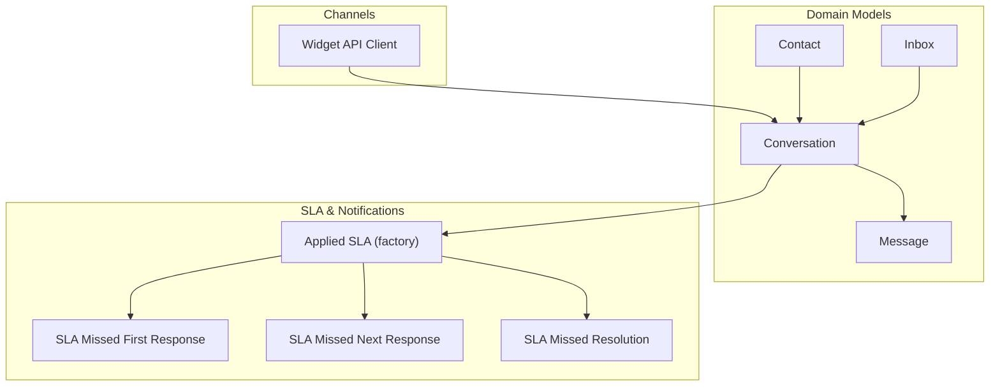
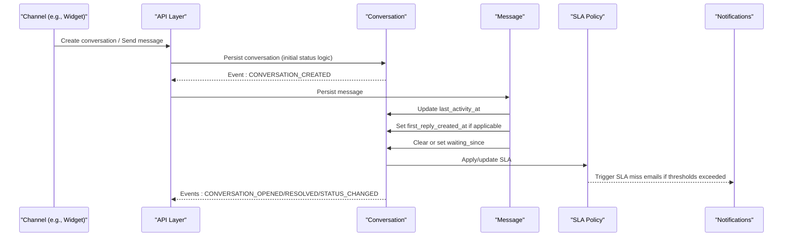
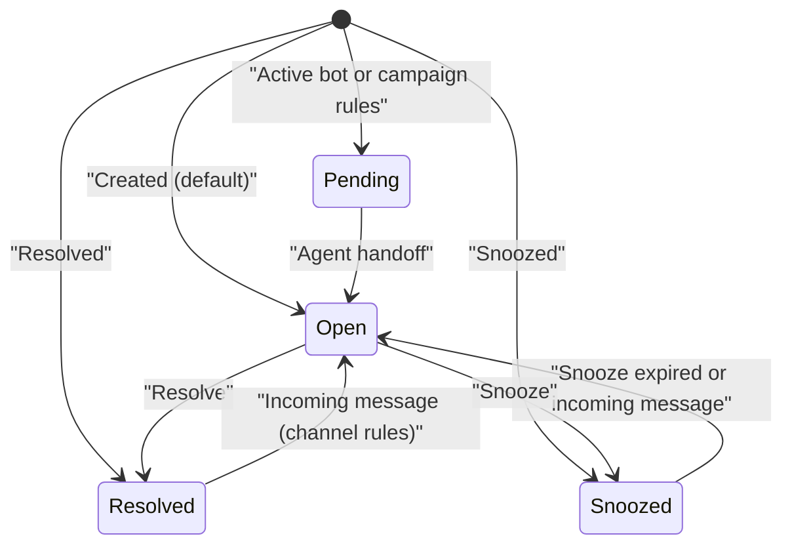
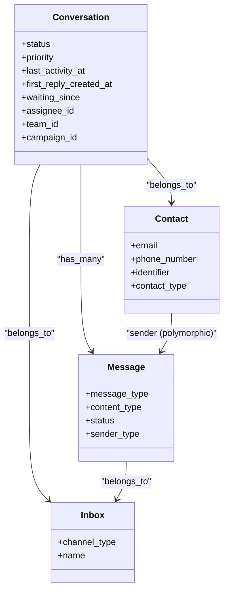
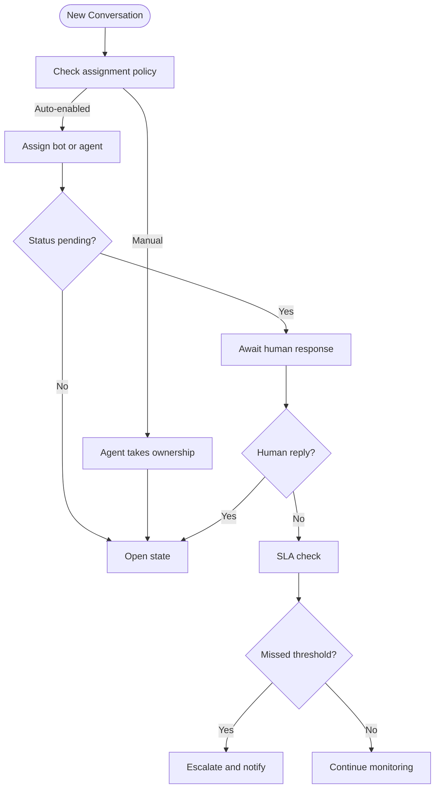
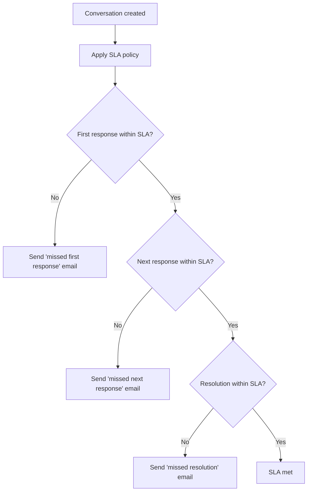
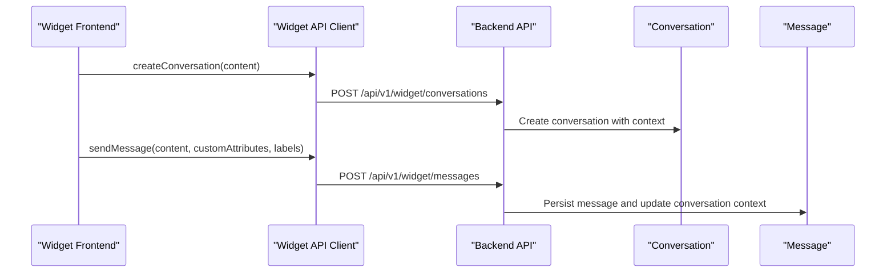
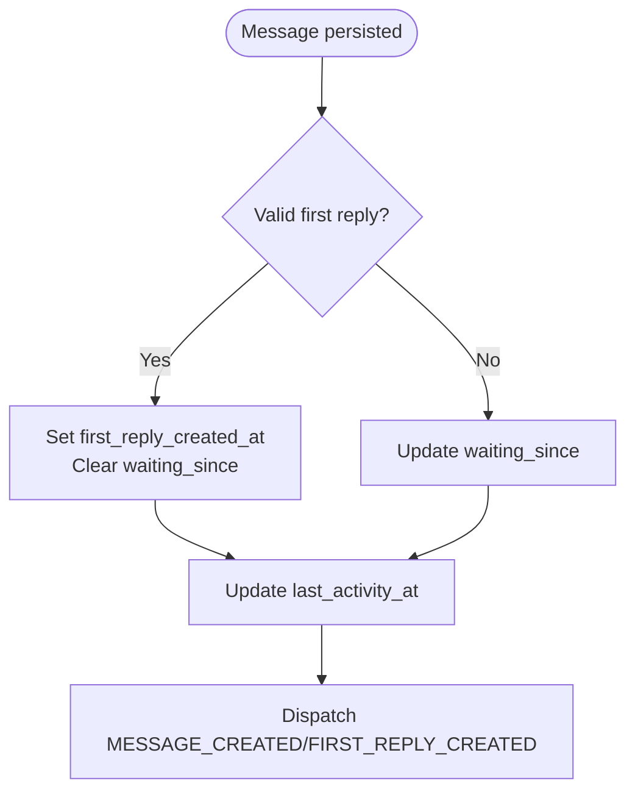
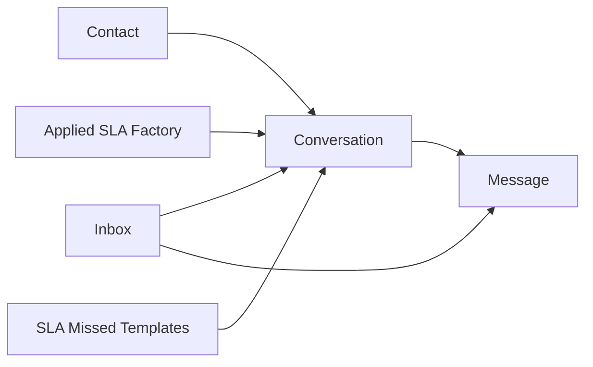

# Conversation Lifecycle

<cite>
**Referenced Files in This Document**
- [conversation.rb](file://app/models/conversation.rb)
- [message.rb](file://app/models/message.rb)
- [contact.rb](file://app/models/contact.rb)
- [inbox.rb](file://app/models/inbox.rb)
- [applied_slas.rb](file://spec/factories/applied_slas.rb)
- [sla_missed_first_response.liquid](file://app/views/mailers/agent_notifications/conversation_notifications_mailer/sla_missed_first_response.liquid)
- [sla_missed_next_response.liquid](file://app/views/mailers/agent_notifications/conversation_notifications_mailer/sla_missed_next_response.liquid)
- [sla_missed_resolution.liquid](file://app/views/mailers/agent_notifications/conversation_notifications_mailer/sla_missed_resolution.liquid)
- [conversation.js](file://app/javascript/widget/api/conversation.js)
</cite>

## Table of Contents
1. [Introduction](#introduction)
2. [Project Structure](#project-structure)
3. [Core Components](#core-components)
4. [Architecture Overview](#architecture-overview)
5. [Detailed Component Analysis](#detailed-component-analysis)
6. [Dependency Analysis](#dependency-analysis)
7. [Performance Considerations](#performance-considerations)
8. [Troubleshooting Guide](#troubleshooting-guide)
9. [Conclusion](#conclusion)

## Introduction
This document explains Chatwoot’s conversation lifecycle from creation to resolution, including state transitions (pending, open, resolved/closed, snoozed), and how conversations relate to contacts, messages, and inboxes. It covers assignment, escalation, SLA management, multi-channel creation, context maintenance, metadata and labels, automation triggers, status transitions, and performance considerations for high-volume environments.

## Project Structure
The conversation lifecycle is implemented across core domain models and supporting services:
- Conversation model defines the state machine, assignment hooks, and event dispatching.
- Message model drives activity updates, waiting time tracking, and first reply handling.
- Contact model represents the end user and participates in conversation creation.
- Inbox model represents channels and routing configuration.
- SLA templates and factories indicate SLA policy application and notifications.
- Widget API client shows how external channels create and interact with conversations.

**Diagram sources**
- [conversation.rb:57-140](file://app/models/conversation.rb#L57-L140)
- [message.rb:132-145](file://app/models/message.rb#L132-L145)
- [contact.rb:58-64](file://app/models/contact.rb#L58-L64)
- [inbox.rb:59-80](file://app/models/inbox.rb#L59-L80)
- [applied_slas.rb:1-11](file://spec/factories/applied_slas.rb#L1-L11)
- [conversation.js:4-19](file://app/javascript/widget/api/conversation.js#L4-L19)

**Section sources**
- [conversation.rb:57-140](file://app/models/conversation.rb#L57-L140)
- [message.rb:132-145](file://app/models/message.rb#L132-L145)
- [contact.rb:58-64](file://app/models/contact.rb#L58-L64)
- [inbox.rb:59-80](file://app/models/inbox.rb#L59-L80)
- [applied_slas.rb:1-11](file://spec/factories/applied_slas.rb#L1-L11)
- [conversation.js:4-19](file://app/javascript/widget/api/conversation.js#L4-L19)

## Core Components
- Conversation: Central entity with status enum (open, resolved, pending, snoozed), priority, timestamps, and relationships to contact, inbox, assignee, team, campaign, and messages. It includes assignment handlers and emits lifecycle events.
- Message: Represents chat turns; tracks message type, content type, status, and contributes to conversation activity and waiting time.
- Contact: End-user identity; linked to conversations and messages as sender.
- Inbox: Channel abstraction; determines channel type and routing behavior.

Key responsibilities:
- State transitions and initial status determination occur on conversation creation and updates.
- Waiting time and first reply are tracked via message persistence.
- Assignment and auto-assignment are handled through included modules and callbacks.
- SLA policies are applied per conversation and trigger notifications when missed.

**Section sources**
- [conversation.rb:57-140](file://app/models/conversation.rb#L57-L140)
- [message.rb:132-145](file://app/models/message.rb#L132-L145)
- [contact.rb:58-64](file://app/models/contact.rb#L58-L64)
- [inbox.rb:59-80](file://app/models/inbox.rb#L59-L80)

## Architecture Overview
The conversation lifecycle spans multiple layers:
- Channels (widget, email, SMS, social) create or send messages that drive conversation state.
- The Conversation model orchestrates state changes, assignment, and event dispatching.
- The Message model updates activity, waiting time, and first reply metrics.
- SLA policies are associated with conversations and generate notifications upon misses.

**Diagram sources**
- [conversation.rb:136-146](file://app/models/conversation.rb#L136-L146)
- [conversation.rb:316-334](file://app/models/conversation.rb#L316-L334)
- [message.rb:333-398](file://app/models/message.rb#L333-L398)
- [applied_slas.rb:1-11](file://spec/factories/applied_slas.rb#L1-L11)
- [sla_missed_first_response.liquid:1-10](file://app/views/mailers/agent_notifications/conversation_notifications_mailer/sla_missed_first_response.liquid#L1-L10)
- [sla_missed_next_response.liquid:1-10](file://app/views/mailers/agent_notifications/conversation_notifications_mailer/sla_missed_next_response.liquid#L1-L10)
- [sla_missed_resolution.liquid:1-10](file://app/views/mailers/agent_notifications/conversation_notifications_mailer/sla_missed_resolution.liquid#L1-L10)

## Detailed Component Analysis

### Conversation State Machine
States:
- open: Active work by agents.
- resolved: Closed/completed.
- pending: Handled by bots or awaiting human response.
- snoozed: Temporarily paused until a scheduled time.

Transitions:
- Creation: Initial status determined by contact block status, campaign presence, and active bot configuration.
- Toggle: Switches between open/resolved; pending/snoozed become open on toggle.
- Bot handoff: Pending to open when an agent takes over.
- Reopening: Incoming messages can reopen snoozed or resolved conversations depending on channel rules.

**Diagram sources**
- [conversation.rb:86-87](file://app/models/conversation.rb#L86-L87)
- [conversation.rb:172-177](file://app/models/conversation.rb#L172-L177)
- [conversation.rb:184-193](file://app/models/conversation.rb#L184-L193)
- [conversation.rb:316-334](file://app/models/conversation.rb#L316-L334)
- [message.rb:414-445](file://app/models/message.rb#L414-L445)

**Section sources**
- [conversation.rb:86-87](file://app/models/conversation.rb#L86-L87)
- [conversation.rb:172-177](file://app/models/conversation.rb#L172-L177)
- [conversation.rb:184-193](file://app/models/conversation.rb#L184-L193)
- [conversation.rb:316-334](file://app/models/conversation.rb#L316-L334)
- [message.rb:414-445](file://app/models/message.rb#L414-L445)

### Relationship Between Conversations, Contacts, Messages, and Inboxes
- Conversation belongs to Account, Inbox, Contact, and optionally Team/Campaign; has many Messages.
- Message belongs to Conversation and Inbox; sender can be Contact or bot/user.
- Contact has many Conversations and Messages; serves as the end-user identity.
- Inbox groups channels and members; routes conversations based on channel type.

**Diagram sources**
- [conversation.rb:114-134](file://app/models/conversation.rb#L114-L134)
- [message.rb:132-140](file://app/models/message.rb#L132-L140)
- [contact.rb:58-64](file://app/models/contact.rb#L58-L64)
- [inbox.rb:59-80](file://app/models/inbox.rb#L59-L80)

**Section sources**
- [conversation.rb:114-134](file://app/models/conversation.rb#L114-L134)
- [message.rb:132-140](file://app/models/message.rb#L132-L140)
- [contact.rb:58-64](file://app/models/contact.rb#L58-L64)
- [inbox.rb:59-80](file://app/models/inbox.rb#L59-L80)

### Conversation Assignment and Escalation
- Assignment: Included modules handle manual and automatic assignment; assignment changes emit events and may affect status.
- Auto-assignment: Enabled per inbox/account; assigns available agents or bots based on policies.
- Escalation: Can be driven by automation rules and SLA misses; status transitions and notifications guide escalation workflows.

**Diagram sources**
- [conversation.rb:58-66](file://app/models/conversation.rb#L58-L66)
- [conversation.rb:316-334](file://app/models/conversation.rb#L316-L334)
- [message.rb:389-398](file://app/models/message.rb#L389-L398)
- [applied_slas.rb:1-11](file://spec/factories/applied_slas.rb#L1-L11)

**Section sources**
- [conversation.rb:58-66](file://app/models/conversation.rb#L58-L66)
- [conversation.rb:316-334](file://app/models/conversation.rb#L316-L334)
- [message.rb:389-398](file://app/models/message.rb#L389-L398)
- [applied_slas.rb:1-11](file://spec/factories/applied_slas.rb#L1-L11)

### SLA Management
- Applied SLAs associate a policy with a conversation and track status.
- Missed SLA events trigger notification emails for first response, next response, and resolution.

**Diagram sources**
- [applied_slas.rb:1-11](file://spec/factories/applied_slas.rb#L1-L11)
- [sla_missed_first_response.liquid:1-10](file://app/views/mailers/agent_notifications/conversation_notifications_mailer/sla_missed_first_response.liquid#L1-L10)
- [sla_missed_next_response.liquid:1-10](file://app/views/mailers/agent_notifications/conversation_notifications_mailer/sla_missed_next_response.liquid#L1-L10)
- [sla_missed_resolution.liquid:1-10](file://app/views/mailers/agent_notifications/conversation_notifications_mailer/sla_missed_resolution.liquid#L1-L10)

**Section sources**
- [applied_slas.rb:1-11](file://spec/factories/applied_slas.rb#L1-L11)
- [sla_missed_first_response.liquid:1-10](file://app/views/mailers/agent_notifications/conversation_notifications_mailer/sla_missed_first_response.liquid#L1-L10)
- [sla_missed_next_response.liquid:1-10](file://app/views/mailers/agent_notifications/conversation_notifications_mailer/sla_missed_next_response.liquid#L1-L10)
- [sla_missed_resolution.liquid:1-10](file://app/views/mailers/agent_notifications/conversation_notifications_mailer/sla_missed_resolution.liquid#L1-L10)

### Multi-Channel Creation and Context Maintenance
- Widget API exposes endpoints to create conversations, send messages, and manage attributes.
- Context is maintained via conversation metadata (labels, custom_attributes, additional_attributes) and contact linkage.

**Diagram sources**
- [conversation.js:4-19](file://app/javascript/widget/api/conversation.js#L4-L19)
- [conversation.rb:114-134](file://app/models/conversation.rb#L114-L134)
- [message.rb:132-140](file://app/models/message.rb#L132-L140)

**Section sources**
- [conversation.js:4-19](file://app/javascript/widget/api/conversation.js#L4-L19)
- [conversation.rb:114-134](file://app/models/conversation.rb#L114-L134)
- [message.rb:132-140](file://app/models/message.rb#L132-L140)

### Metadata, Labels, and Categorization
- Labels: Managed via Labelable concern; cached list used for filtering and display.
- Custom attributes: JSONB field for structured data attached to conversations.
- Additional attributes: JSONB field for contextual data such as browser info, language, referer.

Practical usage:
- Use labels to categorize and filter conversations (e.g., billing, technical).
- Store custom_attributes for business-specific fields (e.g., order_id, plan_tier).
- Leverage additional_attributes for environment details (e.g., device, browser, source page).

**Section sources**
- [conversation.rb:58-66](file://app/models/conversation.rb#L58-L66)
- [conversation.rb:6-12](file://app/models/conversation.rb#L6-L12)

### Automation Triggers and Status Transitions
- On message creation:
  - First reply detection sets first_reply_created_at and clears waiting_since.
  - Waiting_since is updated for incoming messages and cleared on outgoing human responses.
  - Activity timestamp is updated to reflect latest interaction.
- On conversation updates:
  - Status change events are dispatched for opened, resolved, and general status changes.
  - Resolved status clears waiting_since.

**Diagram sources**
- [message.rb:333-398](file://app/models/message.rb#L333-L398)
- [conversation.rb:386-396](file://app/models/conversation.rb#L386-L396)

**Section sources**
- [message.rb:333-398](file://app/models/message.rb#L333-L398)
- [conversation.rb:386-396](file://app/models/conversation.rb#L386-L396)

## Dependency Analysis
- Conversation depends on Contact, Inbox, and Message associations.
- Message depends on Conversation and Inbox; sender polymorphism allows Contact/User/Bot.
- Inbox depends on Channel polymorphism and manages members and webhooks.
- SLA factory ties SLA policies to conversations; notification templates reference conversation and inbox context.

**Diagram sources**
- [conversation.rb:114-134](file://app/models/conversation.rb#L114-L134)
- [message.rb:132-140](file://app/models/message.rb#L132-L140)
- [inbox.rb:59-80](file://app/models/inbox.rb#L59-L80)
- [applied_slas.rb:1-11](file://spec/factories/applied_slas.rb#L1-L11)
- [sla_missed_first_response.liquid:1-10](file://app/views/mailers/agent_notifications/conversation_notifications_mailer/sla_missed_first_response.liquid#L1-L10)

**Section sources**
- [conversation.rb:114-134](file://app/models/conversation.rb#L114-L134)
- [message.rb:132-140](file://app/models/message.rb#L132-L140)
- [inbox.rb:59-80](file://app/models/inbox.rb#L59-L80)
- [applied_slas.rb:1-11](file://spec/factories/applied_slas.rb#L1-L11)
- [sla_missed_first_response.liquid:1-10](file://app/views/mailers/agent_notifications/conversation_notifications_mailer/sla_missed_first_response.liquid#L1-L10)

## Performance Considerations
- Message flooding protection prevents excessive messages per minute per conversation.
- Search indexing for messages is conditional and asynchronous to avoid blocking.
- Database indexes on conversations optimize queries by account, inbox, status, assignee, and timestamps.
- Unread counts and filtered unread counts use specialized scopes and invalidators to maintain performance at scale.

Recommendations:
- Enable advanced search indexing only where needed and monitor indexing jobs.
- Use appropriate filters and scopes to reduce query complexity.
- Monitor message rate limits and adjust automation rules to prevent loops.

**Section sources**
- [message.rb:260-274](file://app/models/message.rb#L260-L274)
- [message.rb:297-307](file://app/models/message.rb#L297-L307)
- [conversation.rb:35-54](file://app/models/conversation.rb#L35-L54)

## Troubleshooting Guide
Common issues and diagnostics:
- Conversation stuck in pending:
  - Verify bot handoff flow and ensure human response is recognized.
  - Check waiting_since and first_reply_created_at values.
- SLA misses not triggering:
  - Confirm SLA policy association and thresholds.
  - Inspect notification templates and delivery logs.
- Excessive messages causing throttling:
  - Review automation rules and webhook loops.
  - Validate message rate limiting and adjust flows.

**Section sources**
- [conversation.rb:184-193](file://app/models/conversation.rb#L184-L193)
- [message.rb:389-398](file://app/models/message.rb#L389-L398)
- [applied_slas.rb:1-11](file://spec/factories/applied_slas.rb#L1-L11)
- [sla_missed_first_response.liquid:1-10](file://app/views/mailers/agent_notifications/conversation_notifications_mailer/sla_missed_first_response.liquid#L1-L10)

## Conclusion
Chatwoot’s conversation lifecycle integrates robust state management, assignment mechanisms, and SLA enforcement across multiple channels. By leveraging metadata, labels, and automation triggers, teams can maintain context, streamline workflows, and ensure timely resolutions even under high volume. Proper configuration of assignment policies, SLA thresholds, and message rate controls ensures reliable performance and predictable customer experiences.