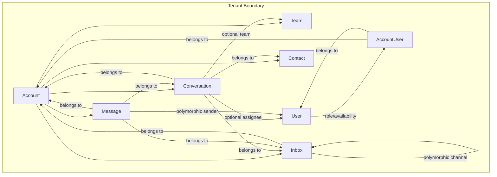
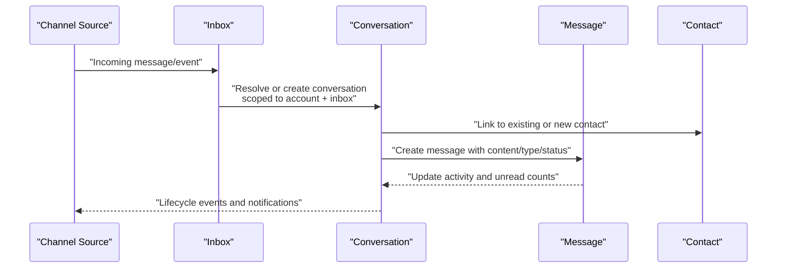
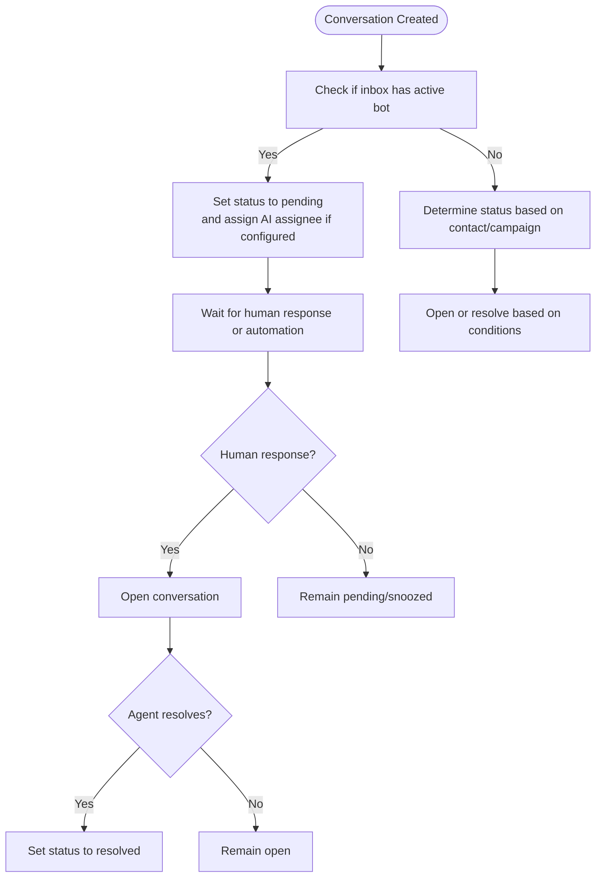
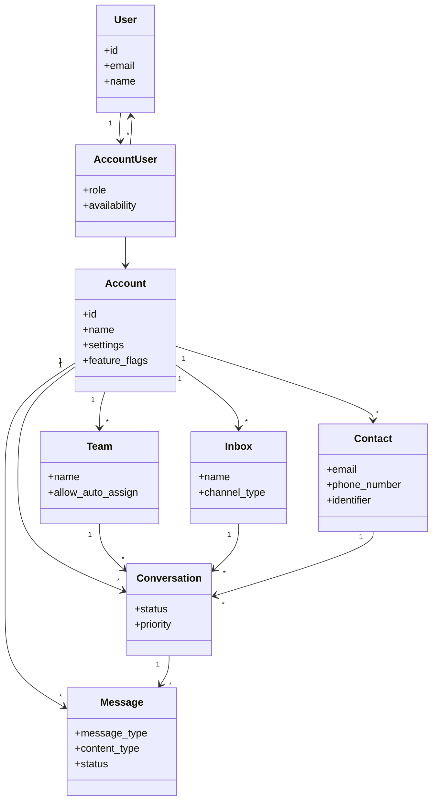
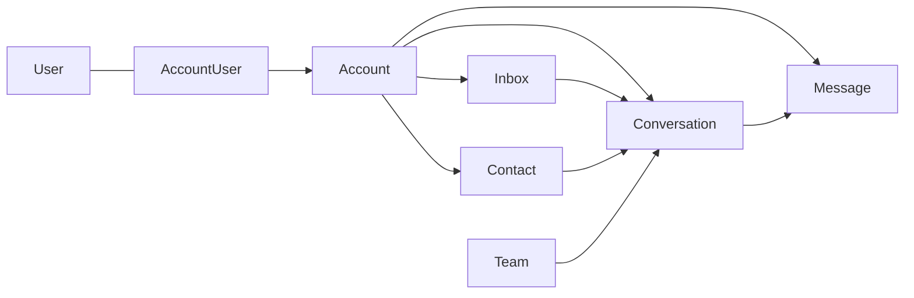

# Core Concepts

<cite>
**Referenced Files in This Document**
- [README.md](file://README.md)
- [account.rb](file://app/models/account.rb)
- [user.rb](file://app/models/user.rb)
- [account_user.rb](file://app/models/account_user.rb)
- [team.rb](file://app/models/team.rb)
- [inbox.rb](file://app/models/inbox.rb)
- [conversation.rb](file://app/models/conversation.rb)
- [contact.rb](file://app/models/contact.rb)
- [message.rb](file://app/models/message.rb)
</cite>

## Table of Contents
1. [Introduction](#introduction)
2. [Project Structure](#project-structure)
3. [Core Components](#core-components)
4. [Architecture Overview](#architecture-overview)
5. [Detailed Component Analysis](#detailed-component-analysis)
6. [Dependency Analysis](#dependency-analysis)
7. [Performance Considerations](#performance-considerations)
8. [Troubleshooting Guide](#troubleshooting-guide)
9. [Conclusion](#conclusion)

## Introduction
This document explains Chatwoot’s core architectural concepts and domain models that underpin all features. It focuses on:
- Multi-tenant account isolation
- User role hierarchy (agent, administrator; super admin is a system-level concept)
- Inboxes as channel endpoints and routing
- Conversation lifecycle from creation to resolution
- Contact management patterns
- Message types across channels
- Relationships between accounts, teams, agents, and customers
- Data isolation model and tenant boundaries

Chatwoot is an open-source customer support platform designed for omnichannel conversations, automation, and reporting.

**Section sources**
- [README.md:37-85](file://README.md#L37-L85)

## Project Structure
At the heart of Chatwoot are domain models that represent tenants (accounts), users (agents/admins), inboxes (channel endpoints), contacts (customers), conversations (threads), and messages (items). These models define relationships, validations, and behaviors that implement multi-tenancy, routing, and lifecycle management.

**Diagram sources**
- [account.rb:26-110](file://app/models/account.rb#L26-L110)
- [user.rb:48-118](file://app/models/user.rb#L48-L118)
- [account_user.rb:27-35](file://app/models/account_user.rb#L27-L35)
- [team.rb:20-26](file://app/models/team.rb#L20-L26)
- [inbox.rb:42-79](file://app/models/inbox.rb#L42-L79)
- [conversation.rb:57-134](file://app/models/conversation.rb#L57-L134)
- [contact.rb:44-64](file://app/models/contact.rb#L44-L64)
- [message.rb:41-139](file://app/models/message.rb#L41-L139)

**Section sources**
- [account.rb:26-110](file://app/models/account.rb#L26-L110)
- [user.rb:48-118](file://app/models/user.rb#L48-L118)
- [account_user.rb:27-35](file://app/models/account_user.rb#L27-L35)
- [team.rb:20-26](file://app/models/team.rb#L20-L26)
- [inbox.rb:42-79](file://app/models/inbox.rb#L42-L79)
- [conversation.rb:57-134](file://app/models/conversation.rb#L57-L134)
- [contact.rb:44-64](file://app/models/contact.rb#L44-L64)
- [message.rb:41-139](file://app/models/message.rb#L41-L139)

## Core Components
- Account: The top-level tenant boundary. All data (inboxes, contacts, conversations, messages, teams) belongs to an account. Accounts store settings, feature flags, locale, and limits.
- User and AccountUser: Users are global identities; AccountUser binds a user to an account with a role (agent or administrator) and availability.
- Team: Optional grouping of users within an account for assignment and reporting.
- Inbox: Channel endpoint bound to an account and a polymorphic channel type (web widget, email, SMS, WhatsApp, etc.). Inboxes have members, templates, and auto-assignment configuration.
- Contact: Customer record scoped to an account with identifiers (email, phone, identifier) and attributes.
- Conversation: Thread scoped to an account and inbox, linked to a contact and optionally assigned to a user or team.
- Message: Items within a conversation with content, type, status, and sender.

Key responsibilities:
- Multi-tenancy enforced by account_id on core entities.
- Role-based access via AccountUser roles.
- Channel routing via Inbox.channel_type and channel-specific logic.
- Lifecycle transitions via Conversation status and Message events.

**Section sources**
- [account.rb:26-110](file://app/models/account.rb#L26-L110)
- [user.rb:48-118](file://app/models/user.rb#L48-L118)
- [account_user.rb:27-35](file://app/models/account_user.rb#L27-L35)
- [team.rb:20-26](file://app/models/team.rb#L20-L26)
- [inbox.rb:42-79](file://app/models/inbox.rb#L42-L79)
- [contact.rb:44-64](file://app/models/contact.rb#L44-L64)
- [conversation.rb:57-134](file://app/models/conversation.rb#L57-L134)
- [message.rb:41-139](file://app/models/message.rb#L41-L139)

## Architecture Overview
The system enforces strict tenant boundaries at the model level. Every major entity includes account_id, ensuring data isolation. Inboxes act as channel endpoints that route incoming and outgoing messages into conversations tied to contacts. Conversations encapsulate the state and lifecycle, while messages carry the actual content and metadata.

**Diagram sources**
- [inbox.rb:42-79](file://app/models/inbox.rb#L42-L79)
- [conversation.rb:57-134](file://app/models/conversation.rb#L57-L134)
- [message.rb:41-139](file://app/models/message.rb#L41-L139)
- [contact.rb:44-64](file://app/models/contact.rb#L44-L64)

## Detailed Component Analysis

### Multi-Tenant Account System
- Account is the root tenant. All child records (inboxes, contacts, conversations, messages, teams) reference it.
- Settings, feature flags, locale, and limits are stored per account.
- Account-scoped enumerations and scopes ensure consistent behavior within a tenant.

Practical example:
- Creating an account establishes a tenant boundary. Subsequent setup steps (inboxes, users, teams) must be performed within that account context.

**Section sources**
- [account.rb:26-110](file://app/models/account.rb#L26-L110)

### User Role Hierarchy (Super Admin, Admin, Agent)
- Super admin is a system-level concept outside the standard account scope.
- Within an account, users are represented by User and bound via AccountUser with roles: agent and administrator.
- Administrator typically has broader permissions than agent within the account.

Practical example:
- Invite a user to an account and set their role to agent or administrator using AccountUser.

**Section sources**
- [user.rb:48-118](file://app/models/user.rb#L48-L118)
- [account_user.rb:27-35](file://app/models/account_user.rb#L27-L35)

### Inboxes and Channel Management
- Inbox represents a channel endpoint and belongs to an account and a polymorphic channel (e.g., web widget, email, SMS, WhatsApp).
- Inboxes manage members, templates, greeting/out-of-office messages, and auto-assignment configuration.
- Channel detection helpers determine routing behavior based on channel_type.

Practical example:
- Configure an inbox for a specific channel (e.g., email or WhatsApp) and assign team members who can handle its conversations.

**Section sources**
- [inbox.rb:42-79](file://app/models/inbox.rb#L42-L79)

### Conversation Lifecycle
- Statuses include open, resolved, pending, snoozed.
- Creation sets initial status based on contact state, campaign, and active bot rules.
- Messages update activity timestamps, unread counts, and waiting_since when applicable.
- Resolving clears waiting_since; reopening depends on channel and bot configuration.

**Diagram sources**
- [conversation.rb:86-140](file://app/models/conversation.rb#L86-L140)
- [conversation.rb:316-334](file://app/models/conversation.rb#L316-L334)
- [message.rb:414-445](file://app/models/message.rb#L414-L445)

**Section sources**
- [conversation.rb:86-140](file://app/models/conversation.rb#L86-L140)
- [conversation.rb:316-334](file://app/models/conversation.rb#L316-L334)
- [message.rb:414-445](file://app/models/message.rb#L414-L445)

### Contact Management Patterns
- Contacts are scoped to accounts and identified by email, phone_number, or identifier with uniqueness constraints per account.
- Contact types include visitor, lead, customer.
- Additional and custom attributes allow flexible enrichment.

Practical example:
- Create or merge contacts using identifiers; enrich profiles with additional_attributes and custom_attributes.

**Section sources**
- [contact.rb:44-64](file://app/models/contact.rb#L44-L64)
- [contact.rb:72-73](file://app/models/contact.rb#L72-L73)

### Message Types Across Channels
- Message types: incoming, outgoing, activity, template.
- Content types include text, input forms, cards, articles, integrations, stickers, voice calls, and more.
- Statuses track delivery lifecycle: sent, delivered, read, failed.
- Content attributes vary by channel (e.g., email threading, story info, translations).

Practical example:
- Use appropriate content_type and message_type when integrating external channels or building bots.

**Section sources**
- [message.rb:88-104](file://app/models/message.rb#L88-L104)
- [message.rb:112-118](file://app/models/message.rb#L112-L118)

### Teams, Agents, and Customers Relationship
- Teams group users within an account for assignment and reporting.
- Agents (users with AccountUser role) interact with conversations and messages.
- Customers are represented by contacts; they initiate or participate in conversations.

**Diagram sources**
- [account.rb:26-110](file://app/models/account.rb#L26-L110)
- [user.rb:48-118](file://app/models/user.rb#L48-L118)
- [account_user.rb:27-35](file://app/models/account_user.rb#L27-L35)
- [team.rb:20-26](file://app/models/team.rb#L20-L26)
- [inbox.rb:42-79](file://app/models/inbox.rb#L42-L79)
- [contact.rb:44-64](file://app/models/contact.rb#L44-L64)
- [conversation.rb:57-134](file://app/models/conversation.rb#L57-L134)
- [message.rb:41-139](file://app/models/message.rb#L41-L139)

**Section sources**
- [team.rb:20-26](file://app/models/team.rb#L20-L26)
- [account_user.rb:27-35](file://app/models/account_user.rb#L27-L35)
- [conversation.rb:57-134](file://app/models/conversation.rb#L57-L134)

## Dependency Analysis
- Account is the central tenant anchor; most models depend on it.
- Inbox depends on a polymorphic channel; routing decisions are made based on channel_type.
- Conversation depends on account, inbox, contact, and optionally user/team.
- Message depends on account, inbox, conversation, and a polymorphic sender (often User or Contact).

**Diagram sources**
- [account.rb:26-110](file://app/models/account.rb#L26-L110)
- [inbox.rb:42-79](file://app/models/inbox.rb#L42-L79)
- [contact.rb:44-64](file://app/models/contact.rb#L44-L64)
- [conversation.rb:57-134](file://app/models/conversation.rb#L57-L134)
- [message.rb:41-139](file://app/models/message.rb#L41-L139)
- [user.rb:48-118](file://app/models/user.rb#L48-L118)
- [account_user.rb:27-35](file://app/models/account_user.rb#L27-L35)
- [team.rb:20-26](file://app/models/team.rb#L20-L26)

**Section sources**
- [account.rb:26-110](file://app/models/account.rb#L26-L110)
- [inbox.rb:42-79](file://app/models/inbox.rb#L42-L79)
- [contact.rb:44-64](file://app/models/contact.rb#L44-L64)
- [conversation.rb:57-134](file://app/models/conversation.rb#L57-L134)
- [message.rb:41-139](file://app/models/message.rb#L41-L139)
- [user.rb:48-118](file://app/models/user.rb#L48-L118)
- [account_user.rb:27-35](file://app/models/account_user.rb#L27-L35)
- [team.rb:20-26](file://app/models/team.rb#L20-L26)

## Performance Considerations
- Use scopes and indexed columns (e.g., account_id, inbox_id, status) to optimize queries.
- Avoid heavy computations in callbacks; leverage background jobs where available.
- Be mindful of JSONB fields size and validation overhead.
- Limit attachment sizes and counts to prevent storage and processing bottlenecks.

[No sources needed since this section provides general guidance]

## Troubleshooting Guide
- If conversations do not reopen after resolution, verify channel-specific logic and bot configuration.
- If messages are not delivered, check message status and channel token retrieval.
- If contact updates do not reflect, ensure attribute synchronization services are running.
- For permission issues, confirm AccountUser role and inbox membership.

**Section sources**
- [message.rb:414-445](file://app/models/message.rb#L414-L445)
- [message.rb:146-148](file://app/models/message.rb#L146-L148)
- [contact.rb:226-228](file://app/models/contact.rb#L226-L228)
- [account_user.rb:58-60](file://app/models/account_user.rb#L58-L60)

## Conclusion
Chatwoot’s architecture centers on strong tenant isolation via Account, clear role binding through AccountUser, and flexible channel routing via Inbox. Conversations orchestrate lifecycle and state, while Messages carry content and metadata. Understanding these core models and their relationships is essential for configuring accounts, setting up inboxes, managing permissions, and extending features consistently across channels.

[No sources needed since this section summarizes without analyzing specific files]