# Inbox & Channel Concepts

<cite>
**Referenced Files in This Document**
- [inbox.rb](file://app/models/inbox.rb)
- [inboxes_controller.rb](file://app/controllers/api/v1/accounts/inboxes_controller.rb)
- [web_widget.rb](file://app/models/channel/web_widget.rb)
- [email.rb](file://app/models/channel/email.rb)
- [whatsapp.rb](file://app/models/channel/whatsapp.rb)
- [facebook_page.rb](file://app/models/channel/facebook_page.rb)
- [twilio_sms.rb](file://app/models/channel/twilio_sms.rb)
- [whatsapp_controller.rb](file://app/controllers/webhooks/whatsapp_controller.rb)
- [callback_controller.rb](file://app/controllers/twilio/callback_controller.rb)
</cite>

## Table of Contents
1. [Introduction](#introduction)
2. [Project Structure](#project-structure)
3. [Core Components](#core-components)
4. [Architecture Overview](#architecture-overview)
5. [Detailed Component Analysis](#detailed-component-analysis)
6. [Dependency Analysis](#dependency-analysis)
7. [Performance Considerations](#performance-considerations)
8. [Troubleshooting Guide](#troubleshooting-guide)
9. [Conclusion](#conclusion)

## Introduction
This document explains Chatwoot’s inbox and channel architecture. An inbox is a communication endpoint that abstracts different channels (web widget, email, WhatsApp, Facebook, SMS/Twilio, etc.). The channel abstraction layer encapsulates provider-specific configuration, authentication, and webhook handling while exposing a uniform interface to the rest of the system. We cover inbox configuration, routing rules, message flow from channels to conversations, channel-specific settings, and extensibility for adding new channels.

## Project Structure
At a high level:
- Inboxes represent business units or support endpoints and are bound to a polymorphic channel record.
- Channels define provider-specific settings and capabilities (e.g., web widget tokens, email IMAP/SMTP, WhatsApp providers).
- Controllers handle API operations for creating/updating inboxes and incoming webhooks from external services.

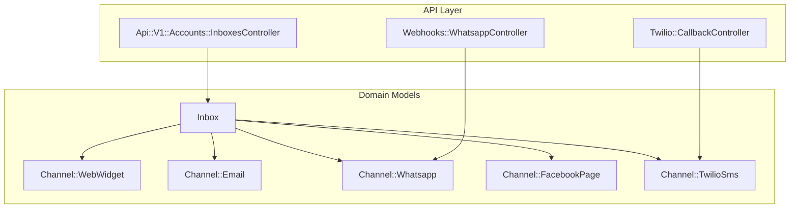

**Diagram sources**
- [inbox.rb:42-79](file://app/models/inbox.rb#L42-L79)
- [inboxes_controller.rb:33-46](file://app/controllers/api/v1/accounts/inboxes_controller.rb#L33-L46)
- [whatsapp_controller.rb:1-17](file://app/controllers/webhooks/whatsapp_controller.rb#L1-L17)
- [callback_controller.rb:1-6](file://app/controllers/twilio/callback_controller.rb#L1-L6)

**Section sources**
- [inbox.rb:42-79](file://app/models/inbox.rb#L42-L79)
- [inboxes_controller.rb:33-46](file://app/controllers/api/v1/accounts/inboxes_controller.rb#L33-L46)

## Core Components
- Inbox: A polymorphic container representing a communication endpoint. It binds to a specific channel type and holds operational settings like greeting, timezone, auto-assignment, CSAT, working hours, and member assignments. It also exposes helpers to detect channel types and compute callback URLs for inbound webhooks.
- Channel models: Concrete implementations for each provider (web widget, email, WhatsApp, Facebook, Twilio SMS), encapsulating credentials, provider-specific flags, and lifecycle hooks (e.g., subscribing/unsubscribing, webhook setup/teardown).

Key responsibilities:
- Inbox: Routing and orchestration surface; determines callback URLs; manages members and assignment policies; emits events.
- Channels: Provider configuration, authentication, capability checks, and integration with external APIs.

**Section sources**
- [inbox.rb:42-200](file://app/models/inbox.rb#L42-L200)
- [web_widget.rb:29-109](file://app/models/channel/web_widget.rb#L29-L109)
- [email.rb:38-81](file://app/models/channel/email.rb#L38-L81)
- [whatsapp.rb:25-190](file://app/models/channel/whatsapp.rb#L25-L190)
- [facebook_page.rb:20-68](file://app/models/channel/facebook_page.rb#L20-L68)
- [twilio_sms.rb:29-93](file://app/models/channel/twilio_sms.rb#L29-L93)

## Architecture Overview
The inbox abstraction decouples business logic from provider specifics. Incoming messages from any channel are normalized into Chatwoot’s conversation model via channel-specific controllers and jobs. Outbound replies are sent through the appropriate provider service exposed by the channel model.

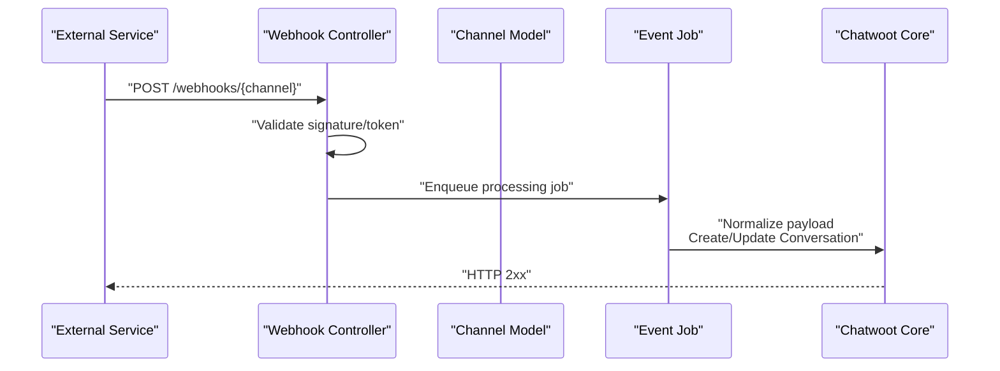

**Diagram sources**
- [whatsapp_controller.rb:1-17](file://app/controllers/webhooks/whatsapp_controller.rb#L1-L17)
- [callback_controller.rb:1-6](file://app/controllers/twilio/callback_controller.rb#L1-L6)

## Detailed Component Analysis

### Inbox Model
- Polymorphic association to a channel, enabling multiple channel types under one inbox entity.
- Provides helper methods to identify channel types (e.g., email?, whatsapp?, twilio?) and compute provider-specific callback URLs for inbound webhooks.
- Manages membership, assignment policies, and emits create/update events when enabled.

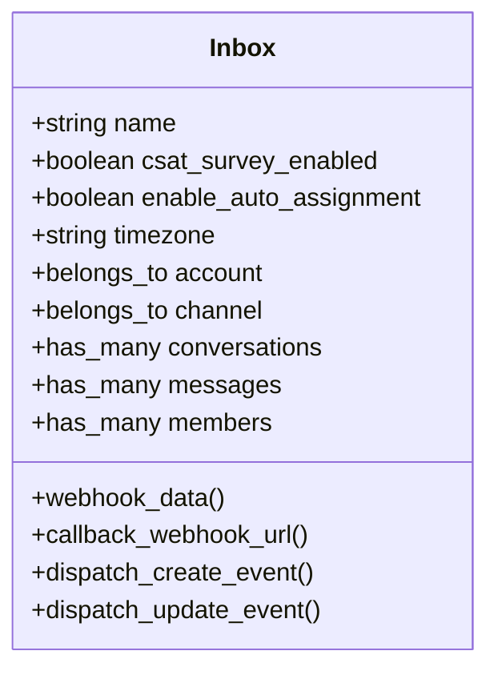

**Diagram sources**
- [inbox.rb:42-200](file://app/models/inbox.rb#L42-L200)

**Section sources**
- [inbox.rb:42-200](file://app/models/inbox.rb#L42-L200)

### Web Widget Channel
- Stores website token, HMAC token, allowed domains, pre-chat form options, and feature flags.
- Generates an embeddable script snippet for websites to initialize the widget.
- Creates contact-inbox relationships on first interaction.

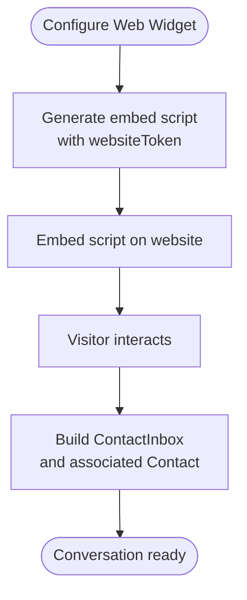

**Diagram sources**
- [web_widget.rb:60-108](file://app/models/channel/web_widget.rb#L60-L108)

**Section sources**
- [web_widget.rb:29-109](file://app/models/channel/web_widget.rb#L29-L109)

### Email Channel
- Supports IMAP/SMTP configuration and provider integrations (Microsoft, Google).
- Ensures forward-to email uniqueness and generates it automatically if missing.
- Encrypts sensitive credentials when encryption is configured.

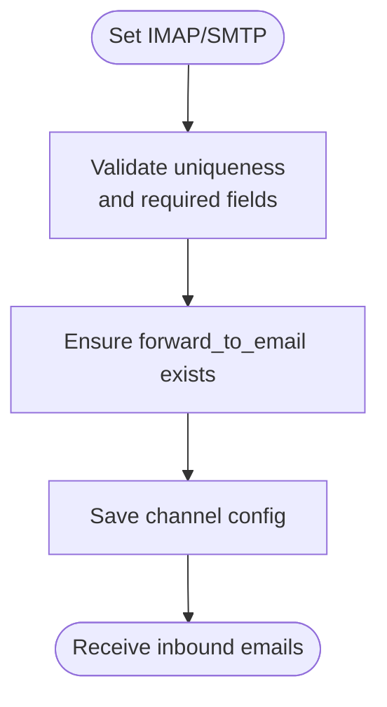

**Diagram sources**
- [email.rb:50-81](file://app/models/channel/email.rb#L50-L81)

**Section sources**
- [email.rb:38-81](file://app/models/channel/email.rb#L38-L81)

### WhatsApp Channel
- Supports multiple providers (default/360dialog and whatsapp_cloud).
- Manages template synchronization, voice calling toggles, and webhook registration/teardown.
- Delegates sending and media URL resolution to provider services.

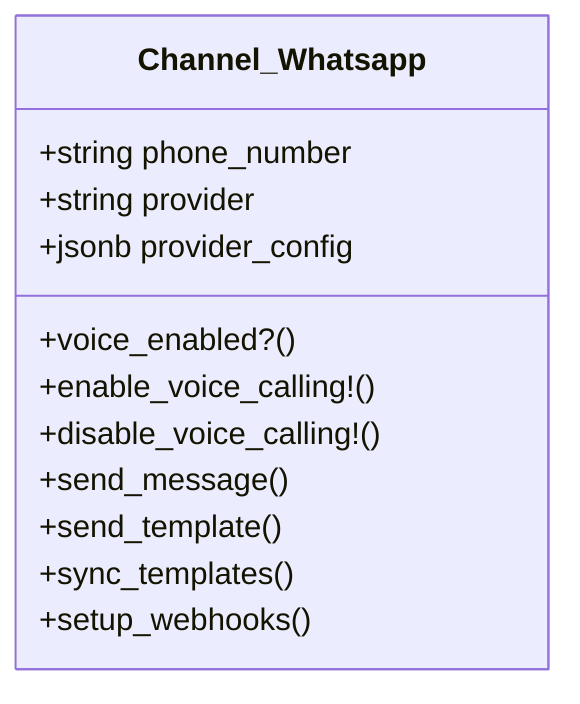

**Diagram sources**
- [whatsapp.rb:25-190](file://app/models/channel/whatsapp.rb#L25-L190)

**Section sources**
- [whatsapp.rb:25-190](file://app/models/channel/whatsapp.rb#L25-L190)

### Facebook Page Channel
- Subscribes/unsubscribes to Facebook Messenger webhook events using page access tokens.
- Encrypts access tokens when encryption is configured.

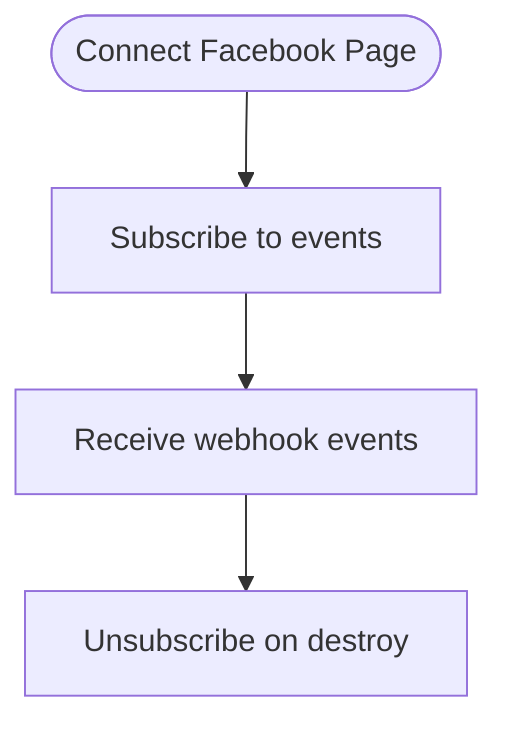

**Diagram sources**
- [facebook_page.rb:34-67](file://app/models/channel/facebook_page.rb#L34-L67)

**Section sources**
- [facebook_page.rb:20-68](file://app/models/channel/facebook_page.rb#L20-L68)

### Twilio SMS Channel
- Supports both SMS and WhatsApp over Twilio, with optional messaging service SID or direct phone number.
- Handles Twilio delivery callbacks and supports basic auth with either legacy or newer API key auth.

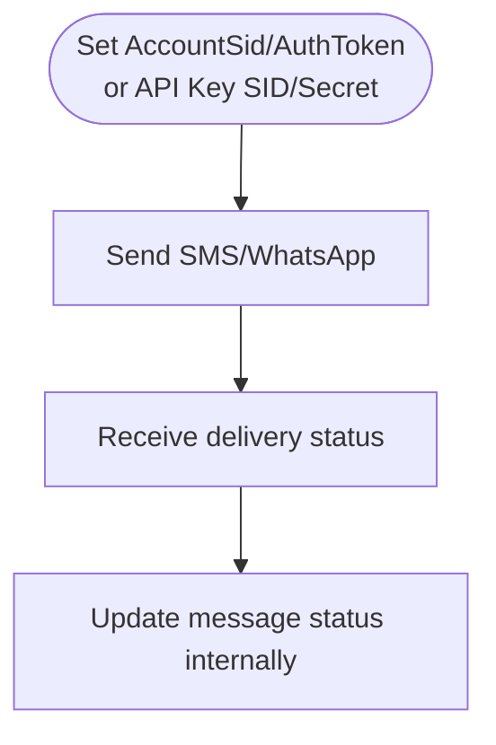

**Diagram sources**
- [twilio_sms.rb:52-90](file://app/models/channel/twilio_sms.rb#L52-L90)
- [callback_controller.rb:1-6](file://app/controllers/twilio/callback_controller.rb#L1-L6)

**Section sources**
- [twilio_sms.rb:29-93](file://app/models/channel/twilio_sms.rb#L29-L93)
- [callback_controller.rb:1-6](file://app/controllers/twilio/callback_controller.rb#L1-L6)

### Inbox Creation Flow
Creating an inbox involves building the appropriate channel instance and associating it with the inbox within a transaction.

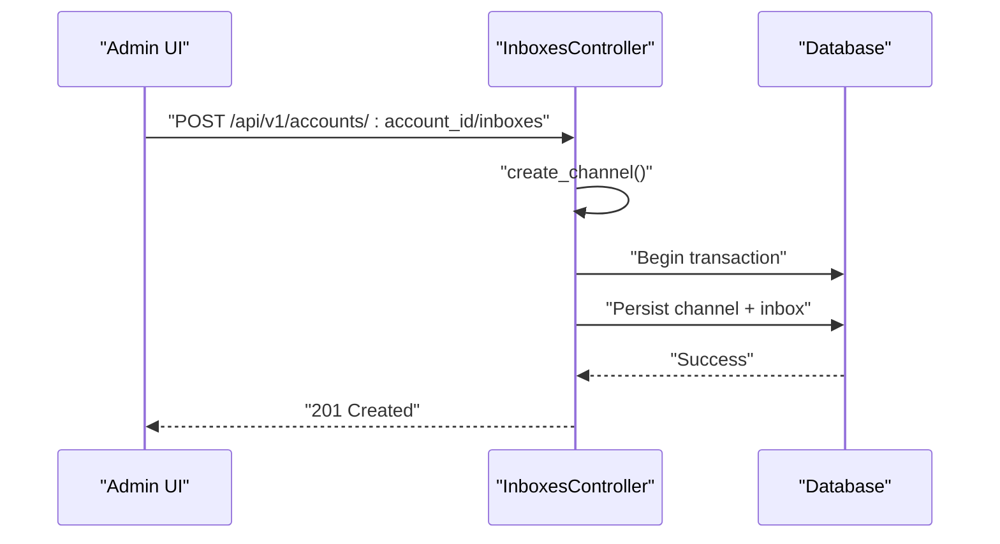

**Diagram sources**
- [inboxes_controller.rb:33-46](file://app/controllers/api/v1/accounts/inboxes_controller.rb#L33-L46)

**Section sources**
- [inboxes_controller.rb:33-46](file://app/controllers/api/v1/accounts/inboxes_controller.rb#L33-L46)

### Webhook Processing Flow (WhatsApp)
Incoming WhatsApp webhooks are validated and enqueued for asynchronous processing.

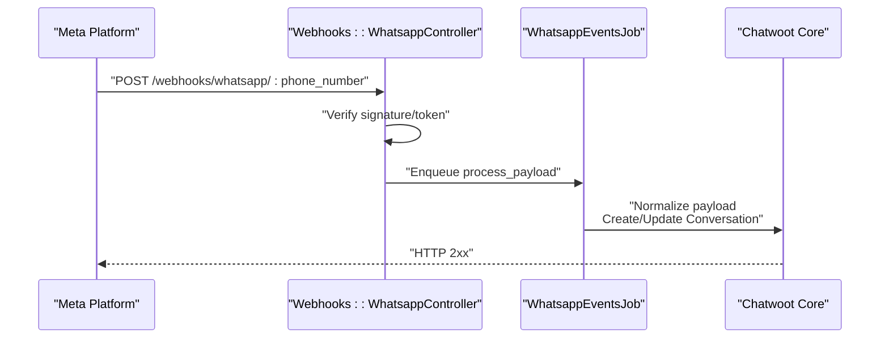

**Diagram sources**
- [whatsapp_controller.rb:1-17](file://app/controllers/webhooks/whatsapp_controller.rb#L1-L17)

**Section sources**
- [whatsapp_controller.rb:1-76](file://app/controllers/webhooks/whatsapp_controller.rb#L1-L76)

## Dependency Analysis
- Inbox depends on a polymorphic channel; this allows flexible extension without changing the inbox schema.
- Channel models encapsulate provider dependencies (IMAP/SMTP, Meta APIs, Twilio SDK).
- Controllers depend on channel models to resolve identifiers and validate provider-specific tokens/signatures.

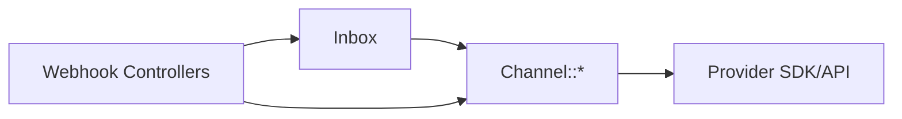

**Diagram sources**
- [inbox.rb:62-79](file://app/models/inbox.rb#L62-L79)
- [whatsapp.rb:71-77](file://app/models/channel/whatsapp.rb#L71-L77)
- [email.rb:50-53](file://app/models/channel/email.rb#L50-L53)
- [twilio_sms.rb:70-76](file://app/models/channel/twilio_sms.rb#L70-L76)

**Section sources**
- [inbox.rb:62-79](file://app/models/inbox.rb#L62-L79)
- [whatsapp.rb:71-77](file://app/models/channel/whatsapp.rb#L71-L77)
- [email.rb:50-53](file://app/models/channel/email.rb#L50-L53)
- [twilio_sms.rb:70-76](file://app/models/channel/twilio_sms.rb#L70-L76)

## Performance Considerations
- Use background jobs for webhook processing to avoid blocking HTTP responses.
- Prefer provider-specific optimizations (e.g., template caching for WhatsApp, connection pooling for IMAP/SMTP).
- Avoid unnecessary re-subscriptions to platform webhooks; only update subscriptions when configuration changes.

[No sources needed since this section provides general guidance]

## Troubleshooting Guide
- WhatsApp webhook verification failures:
  - Ensure the verify token matches the stored provider config.
  - Confirm the phone number is active and not listed as inactive.
- Twilio delivery callbacks:
  - Verify that the callback URL is correctly set in Twilio and that the controller accepts the expected parameters.
- Email inbound issues:
  - Check IMAP/SMTP connectivity and credentials; ensure forward_to_email is unique and properly generated.

**Section sources**
- [whatsapp_controller.rb:21-32](file://app/controllers/webhooks/whatsapp_controller.rb#L21-L32)
- [whatsapp_controller.rb:65-74](file://app/controllers/webhooks/whatsapp_controller.rb#L65-L74)
- [callback_controller.rb:10-50](file://app/controllers/twilio/callback_controller.rb#L10-L50)
- [email.rb:55-58](file://app/models/channel/email.rb#L55-L58)

## Conclusion
Chatwoot’s inbox and channel architecture cleanly separates business logic from provider specifics. Inboxes act as unified endpoints backed by polymorphic channel models that encapsulate credentials, capabilities, and webhook handling. This design enables straightforward addition of new channels by implementing a channel model and wiring up its controller/webhook handlers, while keeping the inbox and conversation layers consistent across all communication sources.

[No sources needed since this section summarizes without analyzing specific files]