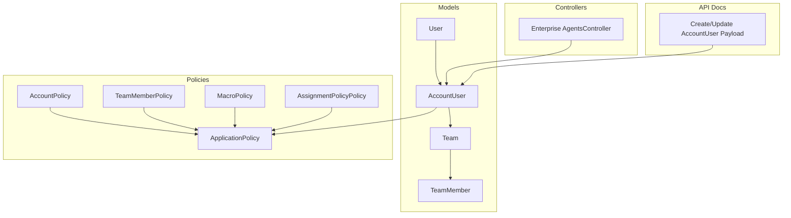
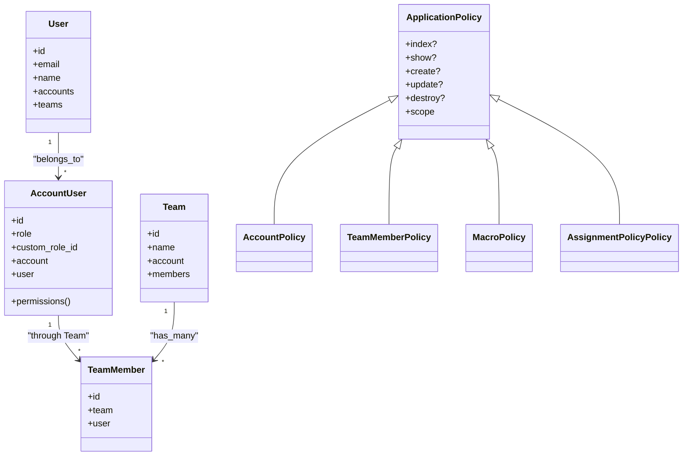
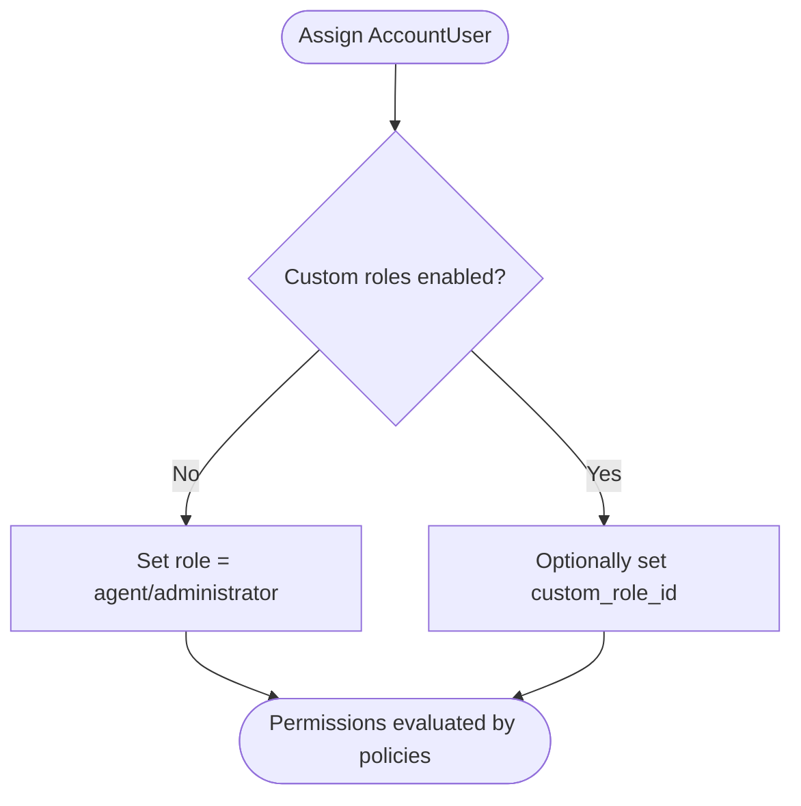
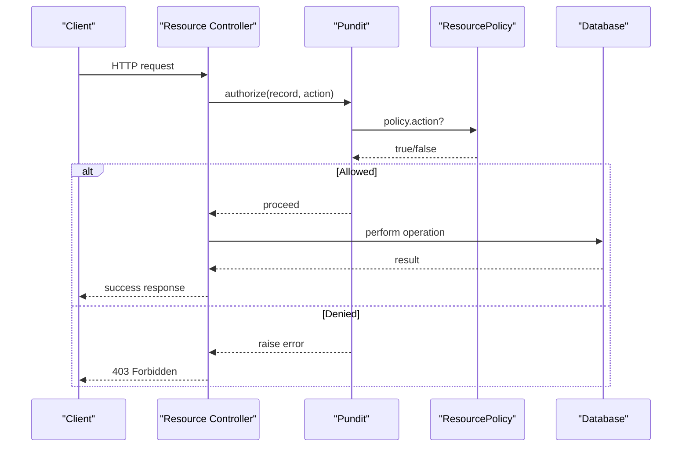
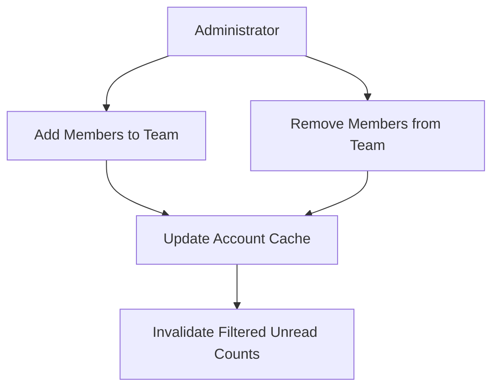
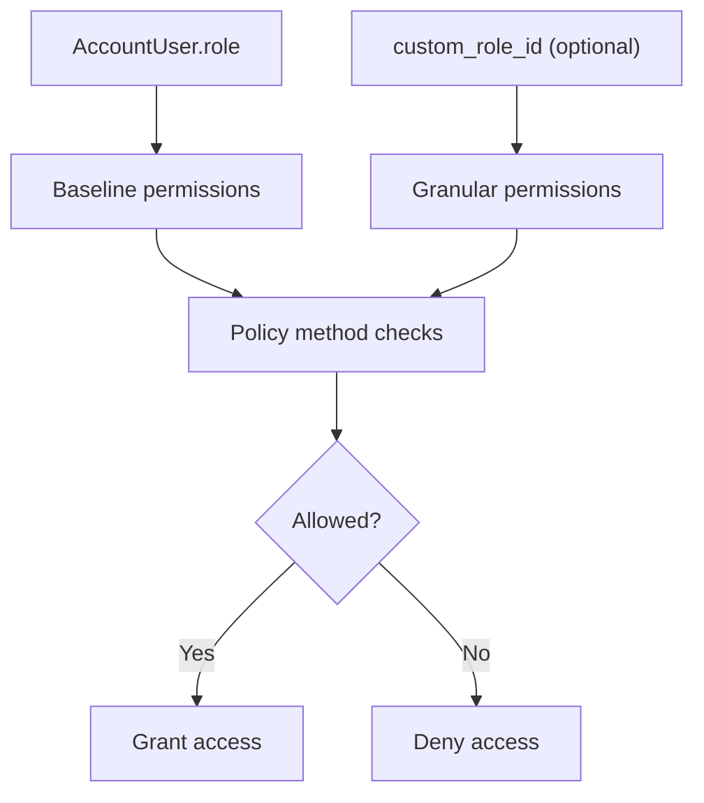
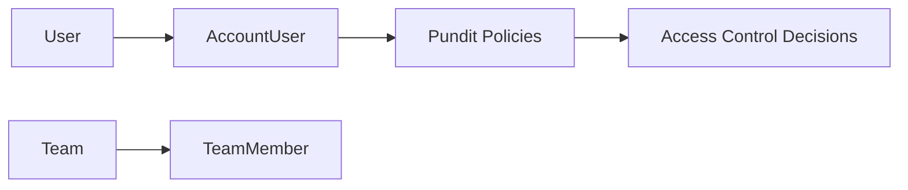

# User Roles & Permissions

<cite>
**Referenced Files in This Document**
- [user.rb](file://app/models/user.rb)
- [account_user.rb](file://app/models/account_user.rb)
- [team.rb](file://app/models/team.rb)
- [team_member.rb](file://app/models/team_member.rb)
- [application_policy.rb](file://app/policies/application_policy.rb)
- [account_policy.rb](file://app/policies/account_policy.rb)
- [team_member_policy.rb](file://app/policies/team_member_policy.rb)
- [macro_policy.rb](file://app/policies/macro_policy.rb)
- [assignment_policy_policy.rb](file://app/policies/assignment_policy_policy.rb)
- [agents_controller.rb](file://enterprise/app/controllers/enterprise/api/v1/accounts/agents_controller.rb)
- [create_update_payload.yml](file://swagger/definitions/request/account_user/create_update_payload.yml)
</cite>

## Table of Contents
1. [Introduction](#introduction)
2. [Project Structure](#project-structure)
3. [Core Components](#core-components)
4. [Architecture Overview](#architecture-overview)
5. [Detailed Component Analysis](#detailed-component-analysis)
6. [Dependency Analysis](#dependency-analysis)
7. [Performance Considerations](#performance-considerations)
8. [Troubleshooting Guide](#troubleshooting-guide)
9. [Conclusion](#conclusion)

## Introduction
This document explains Chatwoot’s user role and permission system, focusing on:
- Hierarchical roles (super admin, admin, agent, and custom roles)
- Policy-based authorization using Pundit for resource-level permissions
- Team-based organization and member management
- Permission cascading and granular access control configuration
- Practical examples for creating custom roles, assigning permissions, and managing teams
- Security implications and best practices

## Project Structure
The role and permission system spans models, policies, controllers, and API payloads:
- Models define users, account memberships, teams, and team membership
- Policies implement Pundit-based authorization rules per resource
- Enterprise controller extends agent creation/update to support custom roles
- Swagger payload documents the role field used when adding users to accounts

**Diagram sources**
- [user.rb:87-118](file://app/models/user.rb#L87-L118)
- [account_user.rb:27-35](file://app/models/account_user.rb#L27-L35)
- [team.rb:20-27](file://app/models/team.rb#L20-L27)
- [team_member.rb:17-20](file://app/models/team_member.rb#L17-L20)
- [application_policy.rb:1-10](file://app/policies/application_policy.rb#L1-L10)
- [account_policy.rb:1-16](file://app/policies/account_policy.rb#L1-L16)
- [team_member_policy.rb:1-17](file://app/policies/team_member_policy.rb#L1-L17)
- [macro_policy.rb:1-35](file://app/policies/macro_policy.rb#L1-L35)
- [assignment_policy_policy.rb:1-21](file://app/policies/assignment_policy_policy.rb#L1-L21)
- [agents_controller.rb:1-23](file://enterprise/app/controllers/enterprise/api/v1/accounts/agents_controller.rb#L1-L23)
- [create_update_payload.yml:1-13](file://swagger/definitions/request/account_user/create_update_payload.yml#L1-L13)

**Section sources**
- [user.rb:87-118](file://app/models/user.rb#L87-L118)
- [account_user.rb:27-35](file://app/models/account_user.rb#L27-L35)
- [team.rb:20-27](file://app/models/team.rb#L20-L27)
- [team_member.rb:17-20](file://app/models/team_member.rb#L17-L20)
- [application_policy.rb:1-10](file://app/policies/application_policy.rb#L1-L10)
- [account_policy.rb:1-16](file://app/policies/account_policy.rb#L1-L16)
- [team_member_policy.rb:1-17](file://app/policies/team_member_policy.rb#L1-L17)
- [macro_policy.rb:1-35](file://app/policies/macro_policy.rb#L1-L35)
- [assignment_policy_policy.rb:1-21](file://app/policies/assignment_policy_policy.rb#L1-L21)
- [agents_controller.rb:1-23](file://enterprise/app/controllers/enterprise/api/v1/accounts/agents_controller.rb#L1-L23)
- [create_update_payload.yml:1-13](file://swagger/definitions/request/account_user/create_update_payload.yml#L1-L13)

## Core Components
- User: Represents a person; belongs to multiple accounts via AccountUser; participates in teams via TeamMember.
- AccountUser: Per-account membership with role (agent or administrator), optional custom_role_id, and availability.
- Team and TeamMember: Organize users into teams within an account; enable team-scoped operations and reporting.
- Pundit Policies: Centralized authorization logic per resource, built on ApplicationPolicy base.

Key responsibilities:
- Role assignment at the account level (administrator vs agent)
- Optional custom roles for fine-grained permissions (enterprise feature)
- Team membership for grouping users and influencing visibility/reporting
- Policy methods controlling read/write access per resource

**Section sources**
- [user.rb:87-118](file://app/models/user.rb#L87-L118)
- [account_user.rb:27-35](file://app/models/account_user.rb#L27-L35)
- [team.rb:20-27](file://app/models/team.rb#L20-L27)
- [team_member.rb:17-20](file://app/models/team_member.rb#L17-L20)

## Architecture Overview
Chatwoot uses a layered authorization model:
- Identity layer: User
- Account context: AccountUser (role + custom_role_id)
- Organization layer: Team and TeamMember
- Authorization layer: Pundit policies (ApplicationPolicy and resource-specific policies)

**Diagram sources**
- [user.rb:87-118](file://app/models/user.rb#L87-L118)
- [account_user.rb:27-35](file://app/models/account_user.rb#L27-L35)
- [team.rb:20-27](file://app/models/team.rb#L20-L27)
- [team_member.rb:17-20](file://app/models/team_member.rb#L17-L20)
- [application_policy.rb:1-10](file://app/policies/application_policy.rb#L1-L10)
- [account_policy.rb:1-16](file://app/policies/account_policy.rb#L1-L16)
- [team_member_policy.rb:1-17](file://app/policies/team_member_policy.rb#L1-L17)
- [macro_policy.rb:1-35](file://app/policies/macro_policy.rb#L1-L35)
- [assignment_policy_policy.rb:1-21](file://app/policies/assignment_policy_policy.rb#L1-L21)

## Detailed Component Analysis

### Role Hierarchy and Custom Roles
- Built-in roles:
  - Administrator: Full account administration capabilities
  - Agent: Standard operational access
- Custom roles:
  - Enterprise feature that allows granular permissions beyond administrator/agent
  - Stored as custom_role_id on AccountUser
  - Controlled by feature flag; assignment blocked unless enabled

Role determination and usage:
- AccountUser.role determines baseline permissions
- AccountUser.permissions returns a list reflecting role
- Custom roles can refine permissions where policies check custom_role_id or related features

**Diagram sources**
- [account_user.rb:34-35](file://app/models/account_user.rb#L34-L35)
- [account_user.rb:58-60](file://app/models/account_user.rb#L58-L60)
- [agents_controller.rb:16-22](file://enterprise/app/controllers/enterprise/api/v1/accounts/agents_controller.rb#L16-L22)

**Section sources**
- [account_user.rb:34-35](file://app/models/account_user.rb#L34-L35)
- [account_user.rb:58-60](file://app/models/account_user.rb#L58-L60)
- [agents_controller.rb:16-22](file://enterprise/app/controllers/enterprise/api/v1/accounts/agents_controller.rb#L16-L22)

### Policy-Based Authorization (Pundit)
- ApplicationPolicy provides default behavior and common helpers
- Resource-specific policies override methods like show?, update?, destroy?
- Many policies gate actions on @account_user.administrator?
- Some policies allow broader access (e.g., index?) based on context

Examples:
- AccountPolicy restricts administrative updates to administrators
- TeamMemberPolicy requires administrator for create/update/destroy
- MacroPolicy allows author or global resources depending on context
- AssignmentPolicyPolicy restricts all operations to administrators

**Diagram sources**
- [application_policy.rb:12-42](file://app/policies/application_policy.rb#L12-L42)
- [account_policy.rb:14-16](file://app/policies/account_policy.rb#L14-L16)
- [team_member_policy.rb:6-16](file://app/policies/team_member_policy.rb#L6-L16)
- [macro_policy.rb:10-28](file://app/policies/macro_policy.rb#L10-L28)
- [assignment_policy_policy.rb:1-21](file://app/policies/assignment_policy_policy.rb#L1-L21)

**Section sources**
- [application_policy.rb:12-42](file://app/policies/application_policy.rb#L12-L42)
- [account_policy.rb:14-16](file://app/policies/account_policy.rb#L14-L16)
- [team_member_policy.rb:6-16](file://app/policies/team_member_policy.rb#L6-L16)
- [macro_policy.rb:10-28](file://app/policies/macro_policy.rb#L10-L28)
- [assignment_policy_policy.rb:1-21](file://app/policies/assignment_policy_policy.rb#L1-L21)

### Team-Based Organization and Member Management
- Teams group users within an account
- TeamMember links users to teams
- Team provides bulk add/remove members and invalidates caches when membership changes
- TeamMemberPolicy enforces administrator-only management of team members

**Diagram sources**
- [team.rb:42-57](file://app/models/team.rb#L42-L57)
- [team.rb:78-86](file://app/models/team.rb#L78-L86)
- [team_member.rb:22-28](file://app/models/team_member.rb#L22-L28)
- [team_member_policy.rb:6-16](file://app/policies/team_member_policy.rb#L6-L16)

**Section sources**
- [team.rb:42-57](file://app/models/team.rb#L42-L57)
- [team.rb:78-86](file://app/models/team.rb#L78-L86)
- [team_member.rb:22-28](file://app/models/team_member.rb#L22-L28)
- [team_member_policy.rb:6-16](file://app/policies/team_member_policy.rb#L6-L16)

### Permission Cascading and Granular Access Controls
- Baseline permissions derive from AccountUser.role (administrator vs agent)
- Policies enforce resource-level checks; many require administrator for sensitive actions
- Custom roles (when enabled) can provide additional granularity via custom_role_id
- Feature flags gate advanced capabilities (e.g., custom roles)

Patterns observed:
- Administrator-only endpoints: account updates, subscription management, assignment policies
- Shared read access: agents and administrators can view accounts and certain resources
- Authorship-aware policies: some resources allow authors to act even if not administrators

**Diagram sources**
- [account_user.rb:34-35](file://app/models/account_user.rb#L34-L35)
- [account_user.rb:58-60](file://app/models/account_user.rb#L58-L60)
- [account_policy.rb:14-16](file://app/policies/account_policy.rb#L14-L16)
- [assignment_policy_policy.rb:1-21](file://app/policies/assignment_policy_policy.rb#L1-L21)
- [agents_controller.rb:16-22](file://enterprise/app/controllers/enterprise/api/v1/accounts/agents_controller.rb#L16-L22)

**Section sources**
- [account_user.rb:34-35](file://app/models/account_user.rb#L34-L35)
- [account_user.rb:58-60](file://app/models/account_user.rb#L58-L60)
- [account_policy.rb:14-16](file://app/policies/account_policy.rb#L14-L16)
- [assignment_policy_policy.rb:1-21](file://app/policies/assignment_policy_policy.rb#L1-L21)
- [agents_controller.rb:16-22](file://enterprise/app/controllers/enterprise/api/v1/accounts/agents_controller.rb#L16-L22)

### Practical Examples

#### Creating a Custom Role and Assigning It
- Enable the custom_roles feature flag (enterprise)
- Create a custom role definition (outside scope of referenced files)
- Assign the custom role to an agent via custom_role_id on AccountUser during create/update

Reference implementation path:
- [agents_controller.rb:16-22](file://enterprise/app/controllers/enterprise/api/v1/accounts/agents_controller.rb#L16-L22)

**Section sources**
- [agents_controller.rb:16-22](file://enterprise/app/controllers/enterprise/api/v1/accounts/agents_controller.rb#L16-L22)

#### Assigning Permissions to Users
- Use the AccountUser role field to grant administrator or agent privileges
- For team management, only administrators can add/remove members

Reference implementation paths:
- [create_update_payload.yml:1-13](file://swagger/definitions/request/account_user/create_update_payload.yml#L1-L13)
- [team_member_policy.rb:6-16](file://app/policies/team_member_policy.rb#L6-L16)

**Section sources**
- [create_update_payload.yml:1-13](file://swagger/definitions/request/account_user/create_update_payload.yml#L1-L13)
- [team_member_policy.rb:6-16](file://app/policies/team_member_policy.rb#L6-L16)

#### Managing Team Structures
- Add or remove multiple members from a team
- Ensure cache invalidation and unread count recalculation after membership changes

Reference implementation paths:
- [team.rb:42-57](file://app/models/team.rb#L42-L57)
- [team.rb:78-86](file://app/models/team.rb#L78-L86)
- [team_member.rb:22-28](file://app/models/team_member.rb#L22-L28)

**Section sources**
- [team.rb:42-57](file://app/models/team.rb#L42-L57)
- [team.rb:78-86](file://app/models/team.rb#L78-L86)
- [team_member.rb:22-28](file://app/models/team_member.rb#L22-L28)

## Dependency Analysis
- Models depend on each other through associations (User <-> AccountUser, Team <-> TeamMember)
- Policies depend on ApplicationPolicy for defaults and on @account_user for role checks
- Controllers may extend base behavior to integrate custom roles and feature flags

**Diagram sources**
- [user.rb:87-118](file://app/models/user.rb#L87-L118)
- [account_user.rb:27-35](file://app/models/account_user.rb#L27-L35)
- [team.rb:20-27](file://app/models/team.rb#L20-L27)
- [team_member.rb:17-20](file://app/models/team_member.rb#L17-L20)
- [application_policy.rb:12-42](file://app/policies/application_policy.rb#L12-L42)

**Section sources**
- [user.rb:87-118](file://app/models/user.rb#L87-L118)
- [account_user.rb:27-35](file://app/models/account_user.rb#L27-L35)
- [team.rb:20-27](file://app/models/team.rb#L20-L27)
- [team_member.rb:17-20](file://app/models/team_member.rb#L17-L20)
- [application_policy.rb:12-42](file://app/policies/application_policy.rb#L12-L42)

## Performance Considerations
- Membership changes trigger cache invalidation to keep filtered unread counts accurate
- Avoid excessive policy evaluations by leveraging scopes and preloading associations where possible
- Feature-flag checks should be minimal and cached at the application level

[No sources needed since this section provides general guidance]

## Troubleshooting Guide
Common issues and resolutions:
- Cannot assign custom role: ensure the custom_roles feature is enabled; otherwise, assignment is blocked
- Unauthorized access errors: verify the current user’s AccountUser.role and policy requirements for the resource
- Team member operations failing: confirm the requester has administrator privileges

Diagnostic references:
- Custom role assignment gating: [agents_controller.rb:16-22](file://enterprise/app/controllers/enterprise/api/v1/accounts/agents_controller.rb#L16-L22)
- Administrator-only policies: [assignment_policy_policy.rb:1-21](file://app/policies/assignment_policy_policy.rb#L1-L21), [team_member_policy.rb:6-16](file://app/policies/team_member_policy.rb#L6-L16)

**Section sources**
- [agents_controller.rb:16-22](file://enterprise/app/controllers/enterprise/api/v1/accounts/agents_controller.rb#L16-L22)
- [assignment_policy_policy.rb:1-21](file://app/policies/assignment_policy_policy.rb#L1-L21)
- [team_member_policy.rb:6-16](file://app/policies/team_member_policy.rb#L6-L16)

## Conclusion
Chatwoot’s permission system combines:
- Role-based access at the account level (administrator, agent)
- Optional custom roles for fine-grained control (enterprise)
- Team-based organization for grouping users and influencing visibility
- Pundit policies enforcing resource-level authorization

Best practices:
- Prefer administrator-only actions for sensitive operations
- Use custom roles sparingly and document their intended permissions
- Keep team structures aligned with operational workflows
- Validate feature flags before enabling advanced capabilities

[No sources needed since this section summarizes without analyzing specific files]