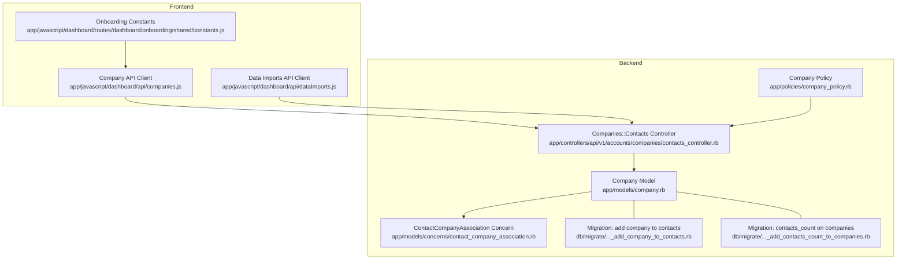
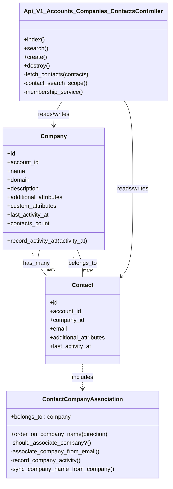
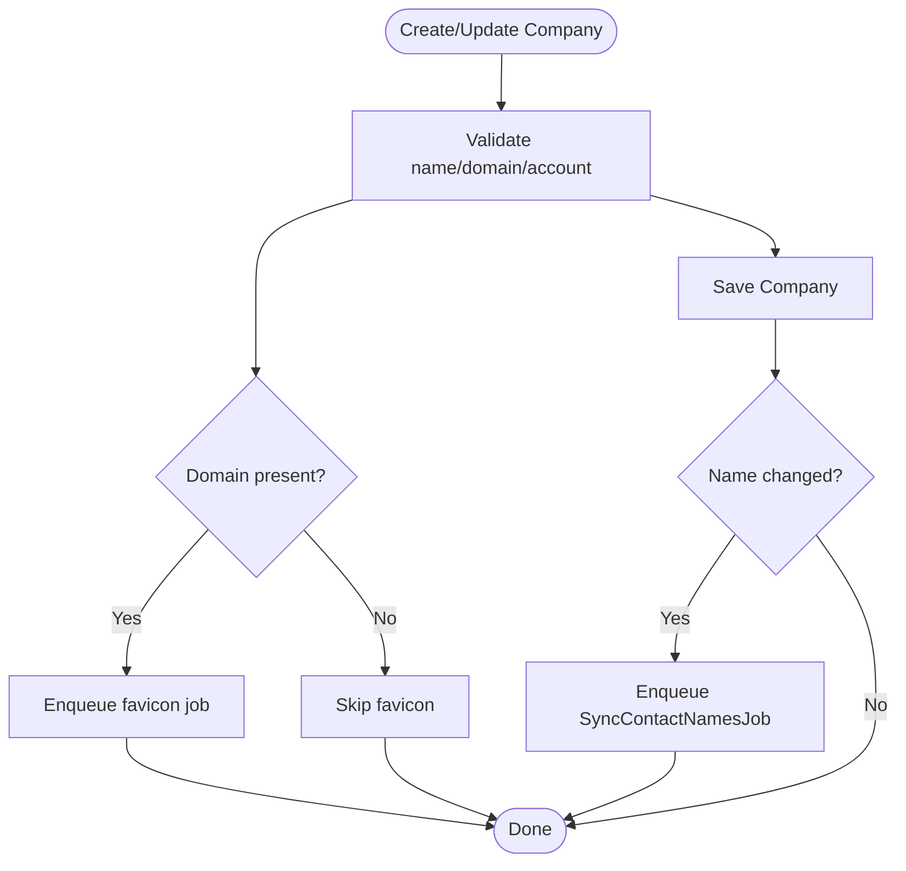
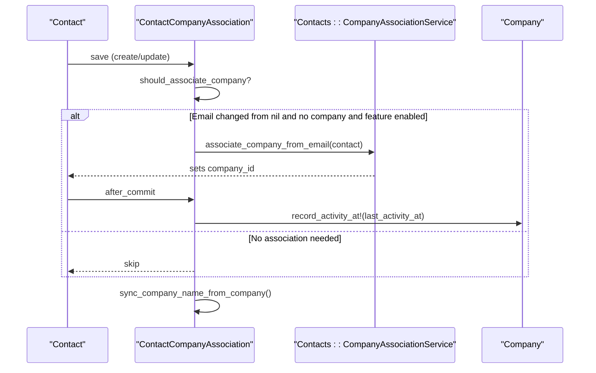
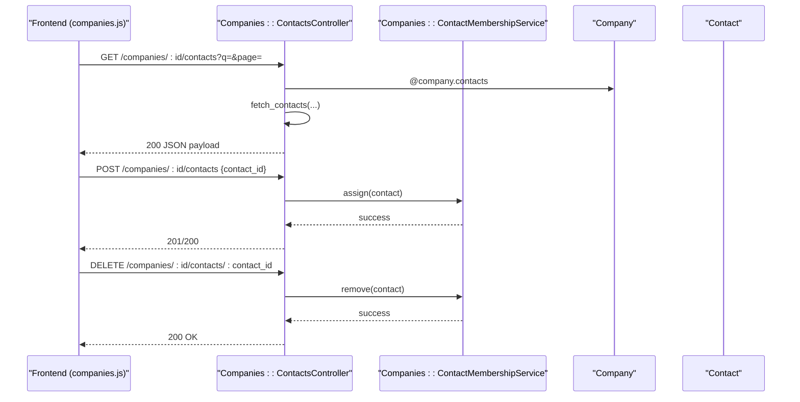
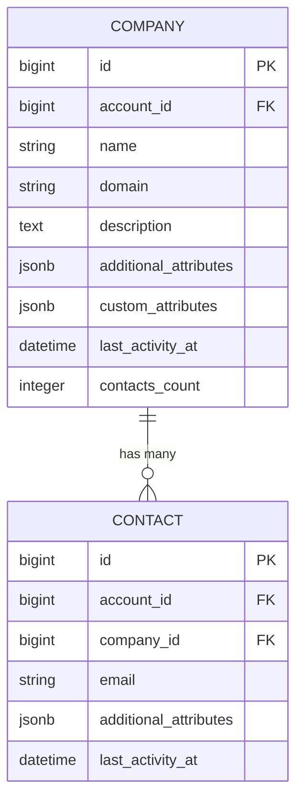
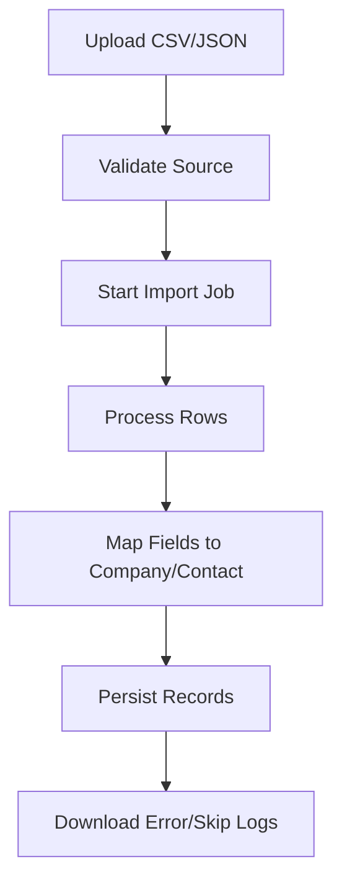
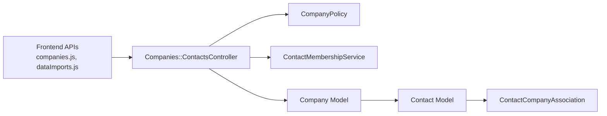

# Company Organization

<cite>
**Referenced Files in This Document**
- [company.rb](file://app/models/company.rb)
- [contact_company_association.rb](file://app/models/concerns/contact_company_association.rb)
- [contacts_controller.rb](file://app/controllers/api/v1/accounts/companies/contacts_controller.rb)
- [companies.js](file://app/javascript/dashboard/api/companies.js)
- [dataImports.js](file://app/javascript/dashboard/api/dataImports.js)
- [company_policy.rb](file://app/policies/company_policy.rb)
- [20250929132305_add_company_to_contacts.rb](file://db/migrate/20250929132305_add_company_to_contacts.rb)
- [20251111094402_add_contacts_count_to_companies.rb](file://db/migrate/20251111094402_add_contacts_count_to_companies.rb)
- [constants.js](file://app/javascript/dashboard/routes/dashboard/onboarding/shared/constants.js)
</cite>

## Table of Contents
1. [Introduction](#introduction)
2. [Project Structure](#project-structure)
3. [Core Components](#core-components)
4. [Architecture Overview](#architecture-overview)
5. [Detailed Component Analysis](#detailed-component-analysis)
6. [Dependency Analysis](#dependency-analysis)
7. [Performance Considerations](#performance-considerations)
8. [Troubleshooting Guide](#troubleshooting-guide)
9. [Conclusion](#conclusion)

## Introduction
This document explains Chatwoot’s company organization features: how companies are modeled, how they relate to contacts, and how teams create, manage, and segment customers by their affiliated organizations. It covers the Company model structure, the ContactCompanyAssociation concern that links contacts to companies, company-level attributes (name, domain, industry via custom attributes), many-to-many association patterns, filtering and segmentation, API operations for companies and contact-company associations, data import/export considerations, CRM integration points, privacy and access controls.

## Project Structure
The company feature spans models, controllers, policies, migrations, and frontend APIs:
- Models define the Company entity and its relationship with Contacts.
- A concern on Contact provides automatic association logic based on email and account features.
- Controllers expose endpoints to list, search, assign, and remove contacts from a company.
- Policies enforce read/write permissions.
- Migrations add database columns and indexes.
- Frontend JS modules call company and data import APIs.

**Diagram sources**
- [company.rb:1-86](file://app/models/company.rb#L1-L86)
- [contact_company_association.rb:1-53](file://app/models/concerns/contact_company_association.rb#L1-L53)
- [contacts_controller.rb:1-70](file://app/controllers/api/v1/accounts/companies/contacts_controller.rb#L1-L70)
- [company_policy.rb:1-36](file://app/policies/company_policy.rb#L1-L36)
- [20250929132305_add_company_to_contacts.rb:1-5](file://db/migrate/20250929132305_add_company_to_contacts.rb#L1-L5)
- [20251111094402_add_contacts_count_to_companies.rb:1-5](file://db/migrate/20251111094402_add_contacts_count_to_companies.rb#L1-L5)
- [companies.js:43-76](file://app/javascript/dashboard/api/companies.js#L43-L76)
- [dataImports.js:1-43](file://app/javascript/dashboard/api/dataImports.js#L1-L43)
- [constants.js:1-34](file://app/javascript/dashboard/routes/dashboard/onboarding/shared/constants.js#L1-L34)

**Section sources**
- [company.rb:1-86](file://app/models/company.rb#L1-L86)
- [contact_company_association.rb:1-53](file://app/models/concerns/contact_company_association.rb#L1-L53)
- [contacts_controller.rb:1-70](file://app/controllers/api/v1/accounts/companies/contacts_controller.rb#L1-L70)
- [company_policy.rb:1-36](file://app/policies/company_policy.rb#L1-L36)
- [20250929132305_add_company_to_contacts.rb:1-5](file://db/migrate/20250929132305_add_company_to_contacts.rb#L1-L5)
- [20251111094402_add_contacts_count_to_companies.rb:1-5](file://db/migrate/20251111094402_add_contacts_count_to_companies.rb#L1-L5)
- [companies.js:43-76](file://app/javascript/dashboard/api/companies.js#L43-L76)
- [dataImports.js:1-43](file://app/javascript/dashboard/api/dataImports.js#L1-L43)
- [constants.js:1-34](file://app/javascript/dashboard/routes/dashboard/onboarding/shared/constants.js#L1-L34)

## Core Components
- Company model: Represents an organization within an account. Stores name, domain, description, JSONB attributes (additional_attributes, custom_attributes), last_activity_at, and a counter cache contacts_count. Validates presence and format of name/domain, enforces unique domain per account, and manages avatar/favicon fetching and background jobs for syncing contact names when company name changes.
- ContactCompanyAssociation concern: Adds belongs_to :company to contacts with counter_cache, synchronizes a denormalized company_name into contact additional_attributes, auto-associates companies from contact email under feature flags, and updates company last_activity_at based on contact activity.
- Companies::Contacts controller: Exposes endpoints to list/search contacts belonging to a company, and to assign/remove contacts to/from a company using a membership service. Supports pagination and search across contact fields.
- Company policy: Defines authorization rules for index/show/create/update/destroy and related actions; destroy requires administrator role.
- Migrations: Add company reference to contacts and a contacts_count column on companies.
- Frontend APIs: companies.js exposes methods to list, search, enrich, and manage company contacts; dataImports.js supports bulk data import workflows.

**Section sources**
- [company.rb:23-86](file://app/models/company.rb#L23-L86)
- [contact_company_association.rb:1-53](file://app/models/concerns/contact_company_association.rb#L1-L53)
- [contacts_controller.rb:1-70](file://app/controllers/api/v1/accounts/companies/contacts_controller.rb#L1-L70)
- [company_policy.rb:1-36](file://app/policies/company_policy.rb#L1-L36)
- [20250929132305_add_company_to_contacts.rb:1-5](file://db/migrate/20250929132305_add_company_to_contacts.rb#L1-L5)
- [20251111094402_add_contacts_count_to_companies.rb:1-5](file://db/migrate/20251111094402_add_contacts_count_to_companies.rb#L1-L5)
- [companies.js:43-76](file://app/javascript/dashboard/api/companies.js#L43-L76)
- [dataImports.js:1-43](file://app/javascript/dashboard/api/dataImports.js#L1-L43)

## Architecture Overview
The system centers around the Company model and its relationship with Contacts. The ContactCompanyAssociation concern automates linking contacts to companies based on email and feature flags, while maintaining denormalized company_name on contacts for efficient sorting and display. Controllers provide RESTful endpoints for managing these relationships, backed by policies for authorization.

**Diagram sources**
- [company.rb:23-86](file://app/models/company.rb#L23-L86)
- [contact_company_association.rb:1-53](file://app/models/concerns/contact_company_association.rb#L1-L53)
- [contacts_controller.rb:1-70](file://app/controllers/api/v1/accounts/companies/contacts_controller.rb#L1-L70)

## Detailed Component Analysis

### Company Model
- Attributes and storage:
  - name, domain, description, additional_attributes (JSONB), custom_attributes (JSONB), last_activity_at, contacts_count.
- Validations and constraints:
  - Presence of account_id and name; length limits; domain format validation; uniqueness of domain scoped to account.
- Relationships:
  - belongs_to :account; has_many :contacts (dependent: nullify).
- Lifecycle hooks:
  - before_validation prepares JSONB hashes.
  - after_create_commit fetches favicon asynchronously if domain is present.
  - after_update_commit enqueues job to sync contact company names when company name changes.
- Scopes and ordering:
  - ordered_by_name, search_by_name_or_domain, order_on_contacts_count, order_on_last_activity_at.
- Activity tracking:
  - record_activity_at! rolls up activity timestamps to avoid excessive writes.

**Diagram sources**
- [company.rb:40-43](file://app/models/company.rb#L40-L43)
- [company.rb:77-83](file://app/models/company.rb#L77-L83)

**Section sources**
- [company.rb:23-86](file://app/models/company.rb#L23-L86)

### ContactCompanyAssociation Concern
- Relationship:
  - belongs_to :company optional with counter_cache.
- Automatic association:
  - On create/update, if contact email changes from nil to a value and no company is set, and the account has the companies feature enabled, it triggers association via a service.
- Denormalization:
  - Synchronizes company_name into contact additional_attributes whenever company_id changes.
- Activity rollup:
  - Updates company last_activity_at when contact last_activity_at changes.
- Ordering:
  - Provides scope to order contacts by company_name stored in additional_attributes.

**Diagram sources**
- [contact_company_association.rb:5-10](file://app/models/concerns/contact_company_association.rb#L5-L10)
- [contact_company_association.rb:25-41](file://app/models/concerns/contact_company_association.rb#L25-L41)

**Section sources**
- [contact_company_association.rb:1-53](file://app/models/concerns/contact_company_association.rb#L1-L53)

### Company-Contact Association Management (API)
- Endpoints:
  - List contacts for a company with pagination and optional search across name/email/phone/identifier.
  - Search contacts not currently assigned to the company (for assignment flows).
  - Assign a contact to a company or remove it.
- Authorization:
  - Read actions require company read permission; write actions require company update permission.
- Implementation details:
  - Uses a membership service to manage assignments.
  - Eager loads avatars and company for performance.

**Diagram sources**
- [contacts_controller.rb:15-40](file://app/controllers/api/v1/accounts/companies/contacts_controller.rb#L15-L40)
- [contacts_controller.rb:52-68](file://app/controllers/api/v1/accounts/companies/contacts_controller.rb#L52-L68)
- [companies.js:48-59](file://app/javascript/dashboard/api/companies.js#L48-L59)

**Section sources**
- [contacts_controller.rb:1-70](file://app/controllers/api/v1/accounts/companies/contacts_controller.rb#L1-L70)
- [companies.js:43-76](file://app/javascript/dashboard/api/companies.js#L43-L76)

### Many-to-Many vs One-to-Many Clarification
- Current implementation uses a one-to-many relationship between Company and Contact (company_id on contacts).
- The concern enables multiple contacts to belong to the same company, but a single contact can have at most one company_id.
- If true many-to-many is required (a contact belonging to multiple companies), the schema would need a join table and updated associations.

**Section sources**
- [20250929132305_add_company_to_contacts.rb:1-5](file://db/migrate/20250929132305_add_company_to_contacts.rb#L1-L5)
- [contact_company_association.rb:5-5](file://app/models/concerns/contact_company_association.rb#L5-L5)

### Company-Level Attributes and Custom Properties
- Standard attributes: name, domain, description.
- Custom properties: stored in custom_attributes (JSONB). Industry is commonly represented as a custom attribute key.
- Frontend constants include industry options used during onboarding and forms.

**Diagram sources**
- [company.rb:1-22](file://app/models/company.rb#L1-L22)
- [20250929132305_add_company_to_contacts.rb:1-5](file://db/migrate/20250929132305_add_company_to_contacts.rb#L1-L5)
- [20251111094402_add_contacts_count_to_companies.rb:1-5](file://db/migrate/20251111094402_add_contacts_count_to_companies.rb#L1-L5)

**Section sources**
- [company.rb:1-22](file://app/models/company.rb#L1-L22)
- [constants.js:1-34](file://app/javascript/dashboard/routes/dashboard/onboarding/shared/constants.js#L1-L34)

### Filtering and Segmentation
- Company listing:
  - Ordered by name, searchable by name or domain.
  - Orderable by contacts_count and last_activity_at.
- Contact listing within a company:
  - Paginated and searchable by name/email/phone/identifier.
- Contact search for assignment:
  - Returns contacts not currently associated with the target company.

**Section sources**
- [company.rb:44-62](file://app/models/company.rb#L44-L62)
- [contacts_controller.rb:15-30](file://app/controllers/api/v1/accounts/companies/contacts_controller.rb#L15-L30)
- [contacts_controller.rb:59-64](file://app/controllers/api/v1/accounts/companies/contacts_controller.rb#L59-L64)

### Data Import/Export and CRM Integration
- Data imports:
  - Frontend exposes data_imports API for validating sources, starting/retrying/abandoning imports, and downloading logs.
  - While not specific to companies, this mechanism can be used to bulk-create or update company records and link them to contacts.
- CRM integrations:
  - Company enrichment endpoint exists in the frontend API client, indicating support for enriching company data (e.g., domain metadata).
  - Custom attributes allow mapping external CRM fields to company records.

**Diagram sources**
- [dataImports.js:1-43](file://app/javascript/dashboard/api/dataImports.js#L1-L43)
- [companies.js:67-69](file://app/javascript/dashboard/api/companies.js#L67-L69)

**Section sources**
- [dataImports.js:1-43](file://app/javascript/dashboard/api/dataImports.js#L1-L43)
- [companies.js:67-69](file://app/javascript/dashboard/api/companies.js#L67-L69)

### Privacy and Access Controls
- Authorization:
  - CompanyPolicy allows broad read access and creation/modification, while destruction requires administrator role.
- Feature flag gating:
  - Automatic company association from contact email is gated by account.feature_enabled?('companies').
- Data minimization:
  - Denormalized company_name on contacts aids UI performance but should be kept in sync to avoid stale data.

**Section sources**
- [company_policy.rb:1-36](file://app/policies/company_policy.rb#L1-L36)
- [contact_company_association.rb:25-31](file://app/models/concerns/contact_company_association.rb#L25-L31)

## Dependency Analysis
- Company depends on:
  - Account (belongs_to).
  - Avatar/favicon job for domain-based enrichment.
  - Background job to sync contact company names upon company name change.
- Contact depends on:
  - Company (optional belongs_to).
  - ContactCompanyAssociation concern for lifecycle hooks and denormalization.
- Controllers depend on:
  - Membership service for assigning/removing contacts.
  - Pagination helpers and eager loading for performance.
- Frontend depends on:
  - companies.js for company CRUD and contact association endpoints.
  - dataImports.js for bulk import workflows.

**Diagram sources**
- [companies.js:43-76](file://app/javascript/dashboard/api/companies.js#L43-L76)
- [dataImports.js:1-43](file://app/javascript/dashboard/api/dataImports.js#L1-L43)
- [contacts_controller.rb:1-70](file://app/controllers/api/v1/accounts/companies/contacts_controller.rb#L1-L70)
- [company_policy.rb:1-36](file://app/policies/company_policy.rb#L1-L36)
- [company.rb:23-86](file://app/models/company.rb#L23-L86)
- [contact_company_association.rb:1-53](file://app/models/concerns/contact_company_association.rb#L1-L53)

**Section sources**
- [contacts_controller.rb:1-70](file://app/controllers/api/v1/accounts/companies/contacts_controller.rb#L1-L70)
- [company.rb:23-86](file://app/models/company.rb#L23-L86)
- [contact_company_association.rb:1-53](file://app/models/concerns/contact_company_association.rb#L1-L53)
- [company_policy.rb:1-36](file://app/policies/company_policy.rb#L1-L36)
- [companies.js:43-76](file://app/javascript/dashboard/api/companies.js#L43-L76)
- [dataImports.js:1-43](file://app/javascript/dashboard/api/dataImports.js#L1-L43)

## Performance Considerations
- Counter cache:
  - contacts_count on companies avoids expensive COUNT queries.
- Denormalization:
  - company_name stored in contact additional_attributes enables fast sorting by company without joins.
- Eager loading:
  - Includes avatar attachments and company to reduce N+1 queries.
- Activity rollup:
  - record_activity_at! throttles updates to last_activity_at to minimize writes.
- Background jobs:
  - Favicon fetching and contact name synchronization run asynchronously to keep request paths responsive.

[No sources needed since this section provides general guidance]

## Troubleshooting Guide
- Company not auto-associated from contact email:
  - Ensure the account has the companies feature enabled.
  - Verify that contact email changed from nil to a value and company_id was nil prior to save.
- Stale company_name on contacts:
  - Confirm that company name changes trigger the sync job and that the concern’s before_save hook runs.
- Permission errors when deleting companies:
  - Only administrators can destroy companies per CompanyPolicy.
- Slow contact listing:
  - Use pagination and search parameters; ensure avatar and company are included via eager loading.

**Section sources**
- [contact_company_association.rb:25-31](file://app/models/concerns/contact_company_association.rb#L25-L31)
- [contact_company_association.rb:43-51](file://app/models/concerns/contact_company_association.rb#L43-L51)
- [company_policy.rb:30-32](file://app/policies/company_policy.rb#L30-L32)
- [contacts_controller.rb:52-57](file://app/controllers/api/v1/accounts/companies/contacts_controller.rb#L52-L57)

## Conclusion
Chatwoot’s company organization feature centers on a robust Company model and a pragmatic ContactCompanyAssociation concern that automates linking contacts to companies based on email and feature flags. The design balances performance through counter caches and denormalized fields with clear separation of concerns in controllers and policies. Teams can create and manage companies, associate multiple contacts per company, filter and segment by company attributes, and leverage data import tools and enrichment endpoints to integrate with external systems. Proper use of feature flags and policies ensures privacy and controlled access to organizational data.