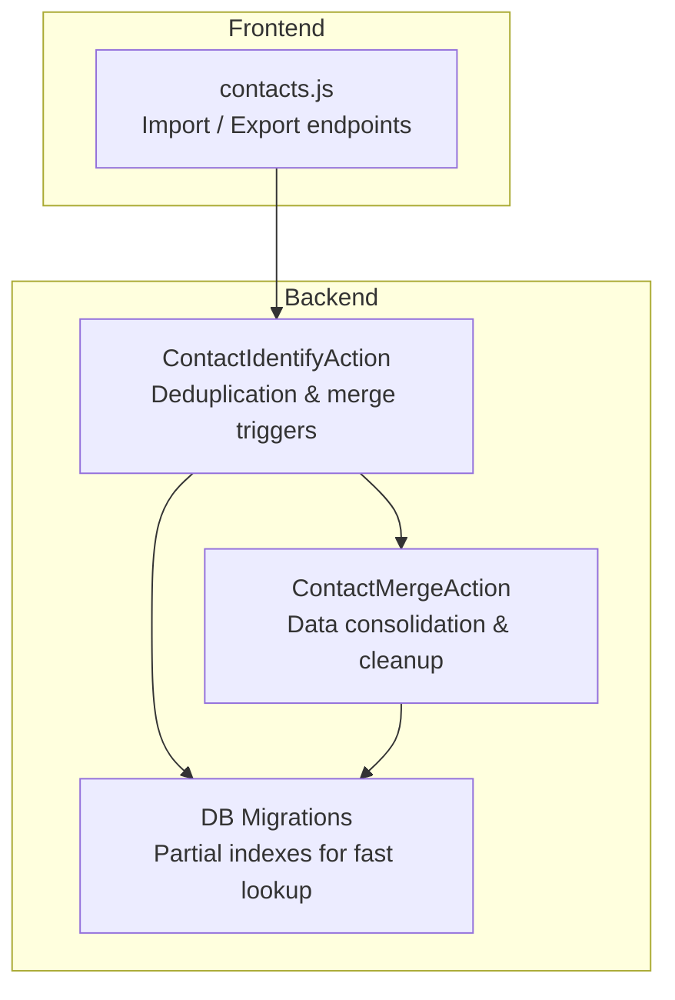
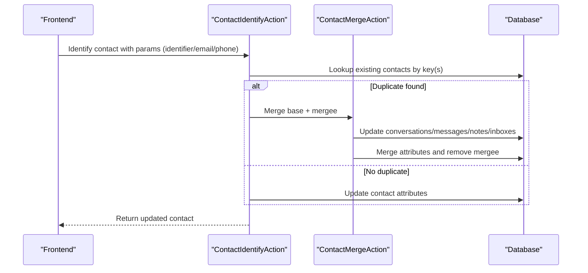
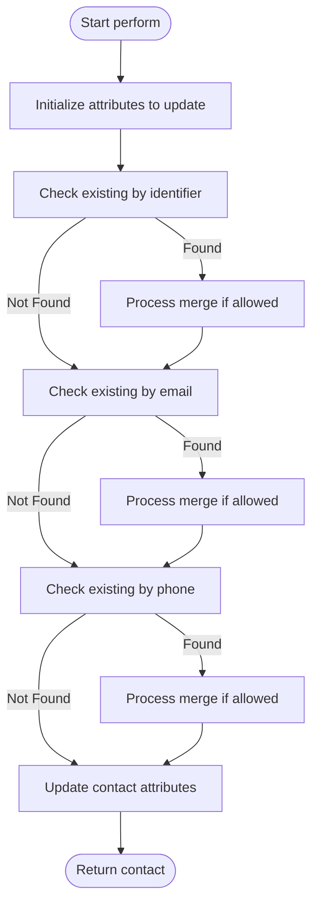
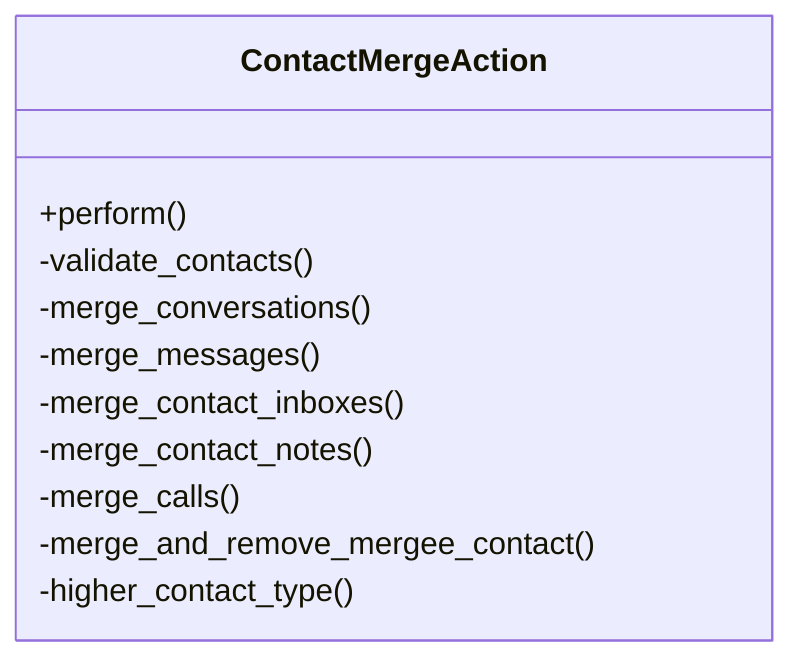
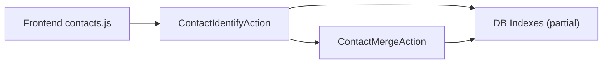

# Contact Data Management

<cite>
**Referenced Files in This Document**
- [contact_identify_action.rb](file://app/actions/contact_identify_action.rb)
- [contact_merge_action.rb](file://app/actions/contact_merge_action.rb)
- [20230523104139_add_partial_index_for_resolved_contacts.rb](file://db/migrate/20230523104139_add_partial_index_for_resolved_contacts.rb)
- [20230727065605_add_partial_index_contact_account_id.rb](file://db/migrate/20230727065605_add_partial_index_contact_account_id.rb)
- [contacts.js](file://app/javascript/dashboard/api/contacts.js)
</cite>

## Table of Contents
1. [Introduction](#introduction)
2. [Project Structure](#project-structure)
3. [Core Components](#core-components)
4. [Architecture Overview](#architecture-overview)
5. [Detailed Component Analysis](#detailed-component-analysis)
6. [Dependency Analysis](#dependency-analysis)
7. [Performance Considerations](#performance-considerations)
8. [Troubleshooting Guide](#troubleshooting-guide)
9. [Conclusion](#conclusion)
10. [Appendices](#appendices)

## Introduction
This document explains Chatwoot’s contact data management features with a focus on deduplication, merging, enrichment, bulk operations, validation/sanitization, import/export workflows, and compliance-related considerations. It maps these capabilities to the actual implementation components in the codebase, including actions for identifying and merging contacts, database indexes that support efficient lookups, and frontend APIs used for import and export.

## Project Structure
The contact management logic is primarily implemented in:
- Actions that orchestrate identification and merging of contacts
- Database migrations that add performance-critical partial indexes for resolved contacts
- Frontend JavaScript API helpers for importing and exporting contacts

**Diagram sources**
- [contact_identify_action.rb:12-22](file://app/actions/contact_identify_action.rb#L12-L22)
- [contact_merge_action.rb:5-20](file://app/actions/contact_merge_action.rb#L5-L20)
- [20230523104139_add_partial_index_for_resolved_contacts.rb:1-8](file://db/migrate/20230523104139_add_partial_index_for_resolved_contacts.rb#L1-L8)
- [20230727065605_add_partial_index_contact_account_id.rb:1-8](file://db/migrate/20230727065605_add_partial_index_contact_account_id.rb#L1-L8)
- [contacts.js:88-105](file://app/javascript/dashboard/api/contacts.js#L88-L105)

**Section sources**
- [contact_identify_action.rb:12-22](file://app/actions/contact_identify_action.rb#L12-L22)
- [contact_merge_action.rb:5-20](file://app/actions/contact_merge_action.rb#L5-L20)
- [20230523104139_add_partial_index_for_resolved_contacts.rb:1-8](file://db/migrate/20230523104139_add_partial_index_for_resolved_contacts.rb#L1-L8)
- [20230727065605_add_partial_index_contact_account_id.rb:1-8](file://db/migrate/20230727065605_add_partial_index_contact_account_id.rb#L1-L8)
- [contacts.js:88-105](file://app/javascript/dashboard/api/contacts.js#L88-L105)

## Core Components
- ContactIdentifyAction: Orchestrates contact identification, duplicate detection, and safe merging based on identifier, email, and phone number. It also updates attributes and enqueues avatar processing when applicable.
- ContactMergeAction: Performs the actual merge across related entities (conversations, messages, notes, inbox links), merges attribute maps with conflict resolution rules, and removes the mergee record.
- Database Partial Indexes: Optimize queries for resolved contacts by indexing non-empty identifier fields per account.
- Frontend Contacts API: Provides methods to import and export contacts.

Key responsibilities:
- Deduplication: Detect duplicates via unique identifiers and common contact keys.
- Merging: Consolidate data while preserving higher-priority values and relationships.
- Enrichment hooks: Prepare attributes and trigger background jobs (e.g., avatar).
- Bulk operations: Import and export endpoints exposed via frontend API.

**Section sources**
- [contact_identify_action.rb:12-22](file://app/actions/contact_identify_action.rb#L12-L22)
- [contact_merge_action.rb:5-20](file://app/actions/contact_merge_action.rb#L5-L20)
- [20230523104139_add_partial_index_for_resolved_contacts.rb:1-8](file://db/migrate/20230523104139_add_partial_index_for_resolved_contacts.rb#L1-L8)
- [20230727065605_add_partial_index_contact_account_id.rb:1-8](file://db/migrate/20230727065605_add_partial_index_contact_account_id.rb#L1-L8)
- [contacts.js:88-105](file://app/javascript/dashboard/api/contacts.js#L88-L105)

## Architecture Overview
The contact identification and merging flow involves coordinated steps to ensure data integrity and consistency.

**Diagram sources**
- [contact_identify_action.rb:12-22](file://app/actions/contact_identify_action.rb#L12-L22)
- [contact_merge_action.rb:34-66](file://app/actions/contact_merge_action.rb#L34-L66)

## Detailed Component Analysis

### Contact Identification and Deduplication
ContactIdentifyAction performs:
- Transactional workflow to prevent race conditions during identification and merging.
- Sequential checks for existing contacts by:
  - Identifier
  - Email
  - Phone number
- Conditional merging only if identifiers are compatible or not provided.
- Attribute update strategy that excludes blank values and merges custom/additional attribute maps.
- Optional avatar job enqueueing when an avatar URL is provided and valid.

**Diagram sources**
- [contact_identify_action.rb:12-22](file://app/actions/contact_identify_action.rb#L12-L22)
- [contact_identify_action.rb:30-47](file://app/actions/contact_identify_action.rb#L30-L47)
- [contact_identify_action.rb:72-98](file://app/actions/contact_identify_action.rb#L72-L98)
- [contact_identify_action.rb:100-116](file://app/actions/contact_identify_action.rb#L100-L116)

Key behaviors:
- Identifier conflict handling: Prevents merging when existing contact has a different identifier than provided.
- Phone merge safety: Avoids overwriting an existing email on the phone-linked contact when a new email is provided.
- Attribute preservation: Custom and additional attributes are deep merged; blank values are rejected before save.

**Section sources**
- [contact_identify_action.rb:12-22](file://app/actions/contact_identify_action.rb#L12-L22)
- [contact_identify_action.rb:30-47](file://app/actions/contact_identify_action.rb#L30-L47)
- [contact_identify_action.rb:72-98](file://app/actions/contact_identify_action.rb#L72-L98)
- [contact_identify_action.rb:100-116](file://app/actions/contact_identify_action.rb#L100-L116)

### Contact Merging Process and Conflict Resolution
ContactMergeAction consolidates data from two contacts into one:
- Validates both contacts belong to the same account.
- Reassigns related records:
  - Conversations
  - Messages (sender references)
  - Notes
  - ContactInbox entries
- Merges attribute maps with precedence rules:
  - Base contact attributes take priority over mergee attributes.
  - Contact type is set to the higher value among the two.
- Removes the mergee contact after successful merge.
- Dispatches a contact merged event for downstream listeners.

**Diagram sources**
- [contact_merge_action.rb:5-20](file://app/actions/contact_merge_action.rb#L5-L20)
- [contact_merge_action.rb:34-66](file://app/actions/contact_merge_action.rb#L34-L66)
- [contact_merge_action.rb:68-70](file://app/actions/contact_merge_action.rb#L68-L70)

Conflict resolution highlights:
- Attribute precedence: Base contact attributes override mergee attributes during deep merge.
- Type precedence: The higher contact type wins.
- Relationship continuity: All related entities are reassigned to the base contact to maintain conversation history and auditability.

**Section sources**
- [contact_merge_action.rb:5-20](file://app/actions/contact_merge_action.rb#L5-L20)
- [contact_merge_action.rb:34-66](file://app/actions/contact_merge_action.rb#L34-L66)
- [contact_merge_action.rb:68-70](file://app/actions/contact_merge_action.rb#L68-L70)

### Data Enrichment and External Population
- Avatar enrichment: When an avatar URL is provided and valid, a background job is enqueued to fetch and attach the avatar asynchronously.
- Attribute enrichment: Custom and additional attributes are merged into the contact record, enabling integration-driven population of structured metadata.

Operational notes:
- Avatar URL validation prevents invalid or unsafe URLs from being processed.
- Background job ensures UI responsiveness and avoids blocking the main request.

**Section sources**
- [contact_identify_action.rb:100-116](file://app/actions/contact_identify_action.rb#L100-L116)
- [contact_identify_action.rb:128-138](file://app/actions/contact_identify_action.rb#L128-L138)

### Bulk Operations: Import and Export
Frontend API exposes:
- Import endpoint for uploading CSV or similar files to create/update contacts in bulk.
- Export endpoint to generate downloadable contact datasets based on query filters.

Usage patterns:
- Import: Use multipart form submission to upload a file; backend processes rows and creates or updates contacts accordingly.
- Export: Submit a query payload to filter contacts and receive a generated export file.

**Section sources**
- [contacts.js:88-105](file://app/javascript/dashboard/api/contacts.js#L88-L105)

### Data Validation and Sanitization
- Identifier uniqueness and presence: Blank identifiers or emails can cause unique index errors; the action rejects blank values before saving to minimize such issues.
- Attribute sanitization: Blank values are removed prior to persistence; custom and additional attributes are deep merged to avoid accidental overwrites.
- Phone/email handling: Special care is taken to avoid overwriting existing email when merging by phone number if a conflicting email is provided.

Recommendations:
- Normalize inputs upstream (e.g., trim whitespace, lowercase emails) before invoking the identify action.
- Validate phone numbers using a library consistent with your region requirements before sending to the backend.

**Section sources**
- [contact_identify_action.rb:100-116](file://app/actions/contact_identify_action.rb#L100-L116)
- [contact_identify_action.rb:72-98](file://app/actions/contact_identify_action.rb#L72-L98)

### Data Import Workflows and Error Handling
- Import workflow: Frontend calls the import endpoint with a file; backend parses rows and applies deduplication and merging logic through the same mechanisms used for single-record updates.
- Error handling: Malformed rows should be handled at the importer layer (not shown here) and reported back to the user; the core identify/merge actions raise exceptions on constraint violations (e.g., unique index conflicts) which should be caught and surfaced appropriately.

Best practices:
- Provide clear CSV templates with required columns (email, phone_number, identifier, name, custom_attributes).
- Pre-validate rows client-side to reduce server errors and improve UX.

**Section sources**
- [contacts.js:88-91](file://app/javascript/dashboard/api/contacts.js#L88-L91)
- [contact_identify_action.rb:100-116](file://app/actions/contact_identify_action.rb#L100-L116)

### Data Retention, GDPR Compliance, and Anonymization
- Deletion and anonymization: While specific deletion/anonymization routines are not detailed in the referenced files, the system supports destruction of records and reassignment of relationships during merges. For GDPR compliance, implement retention policies and anonymization strategies at the service layer and ensure audit trails capture necessary changes without retaining unnecessary personal data.
- Event-driven auditing: The contact merged event can be leveraged to log changes for compliance and observability.

Note: Implement retention and anonymization policies according to your organization’s legal requirements and extend the relevant services/actions to enforce them consistently.

[No sources needed since this section provides general guidance]

### Backup and Recovery Procedures
- Backups: Ensure regular backups of the database containing contacts and related entities (conversations, messages, notes, inbox links).
- Recovery: Restore from backups and verify referential integrity post-recovery. Since merges reassign relationships, confirm that all foreign keys point to the correct base contact after recovery.

[No sources needed since this section provides general guidance]

## Dependency Analysis
The following diagram shows how the primary components interact:

**Diagram sources**
- [contacts.js:88-105](file://app/javascript/dashboard/api/contacts.js#L88-L105)
- [contact_identify_action.rb:12-22](file://app/actions/contact_identify_action.rb#L12-L22)
- [contact_merge_action.rb:5-20](file://app/actions/contact_merge_action.rb#L5-L20)
- [20230523104139_add_partial_index_for_resolved_contacts.rb:1-8](file://db/migrate/20230523104139_add_partial_index_for_resolved_contacts.rb#L1-L8)
- [20230727065605_add_partial_index_contact_account_id.rb:1-8](file://db/migrate/20230727065605_add_partial_index_contact_account_id.rb#L1-L8)

**Section sources**
- [contacts.js:88-105](file://app/javascript/dashboard/api/contacts.js#L88-L105)
- [contact_identify_action.rb:12-22](file://app/actions/contact_identify_action.rb#L12-L22)
- [contact_merge_action.rb:5-20](file://app/actions/contact_merge_action.rb#L5-L20)
- [20230523104139_add_partial_index_for_resolved_contacts.rb:1-8](file://db/migrate/20230523104139_add_partial_index_for_resolved_contacts.rb#L1-L8)
- [20230727065605_add_partial_index_contact_account_id.rb:1-8](file://db/migrate/20230727065605_add_partial_index_contact_account_id.rb#L1-L8)

## Performance Considerations
- Partial indexes on non-empty identifier fields accelerate deduplication lookups by email, phone, and identifier within an account.
- Transactional operations in identify and merge actions reduce contention and ensure consistency under concurrent updates.
- Asynchronous avatar processing prevents blocking the main request path.

Optimization tips:
- Keep identifier fields normalized and indexed.
- Batch large imports to avoid excessive transaction overhead.
- Monitor background job queues for avatar processing and other asynchronous tasks.

**Section sources**
- [20230523104139_add_partial_index_for_resolved_contacts.rb:1-8](file://db/migrate/20230523104139_add_partial_index_for_resolved_contacts.rb#L1-L8)
- [20230727065605_add_partial_index_contact_account_id.rb:1-8](file://db/migrate/20230727065605_add_partial_index_contact_account_id.rb#L1-L8)
- [contact_identify_action.rb:12-22](file://app/actions/contact_identify_action.rb#L12-L22)
- [contact_identify_action.rb:100-116](file://app/actions/contact_identify_action.rb#L100-L116)

## Troubleshooting Guide
Common issues and resolutions:
- Unique constraint errors on identifier/email: Occur when attempting to save blank or conflicting values. Ensure inputs are validated and sanitized before calling the identify action.
- Unexpected merges due to phone number overlap: The system avoids overwriting existing email when merging by phone if a conflicting email is provided. Verify input parameters and consider normalizing phone numbers.
- Missing avatar after update: Confirm that the avatar URL is valid and that the background job is running. Check job queues and logs for failures.

Diagnostic steps:
- Inspect the attributes being updated and ensure blank values are excluded.
- Review event logs for contact merged events to trace merge outcomes.
- Validate database indexes exist and are healthy for fast lookups.

**Section sources**
- [contact_identify_action.rb:100-116](file://app/actions/contact_identify_action.rb#L100-L116)
- [contact_identify_action.rb:72-98](file://app/actions/contact_identify_action.rb#L72-L98)
- [contact_merge_action.rb:5-20](file://app/actions/contact_merge_action.rb#L5-L20)

## Conclusion
Chatwoot’s contact data management centers around robust identification and merging logic that safeguards data integrity while supporting enrichment and bulk operations. The use of partial indexes and transactional workflows ensures performance and consistency. Frontend APIs provide straightforward entry points for import and export. For compliance and operational needs, extend the system with retention policies, anonymization routines, and comprehensive audit logging as appropriate.

[No sources needed since this section summarizes without analyzing specific files]

## Appendices

### Key Implementation References
- Contact identification and merging orchestration:
  - [contact_identify_action.rb:12-22](file://app/actions/contact_identify_action.rb#L12-L22)
  - [contact_merge_action.rb:5-20](file://app/actions/contact_merge_action.rb#L5-L20)
- Database performance optimizations:
  - [20230523104139_add_partial_index_for_resolved_contacts.rb:1-8](file://db/migrate/20230523104139_add_partial_index_for_resolved_contacts.rb#L1-L8)
  - [20230727065605_add_partial_index_contact_account_id.rb:1-8](file://db/migrate/20230727065605_add_partial_index_contact_account_id.rb#L1-L8)
- Frontend import/export endpoints:
  - [contacts.js:88-105](file://app/javascript/dashboard/api/contacts.js#L88-L105)